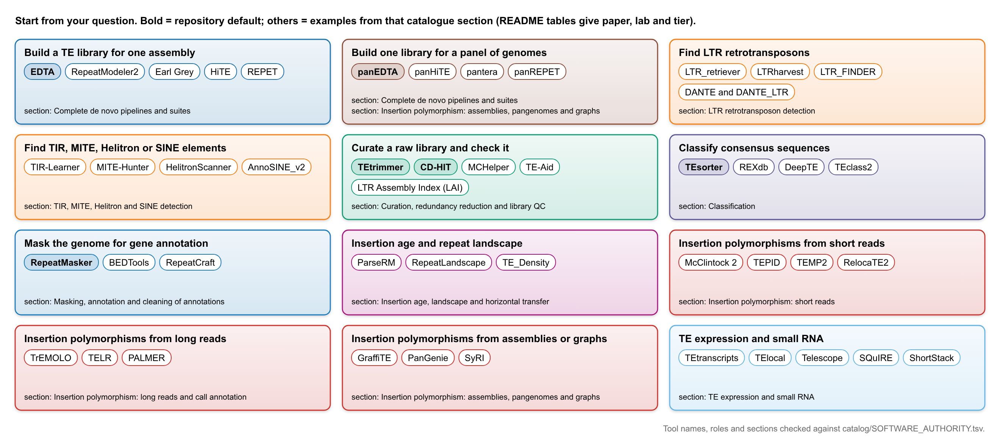
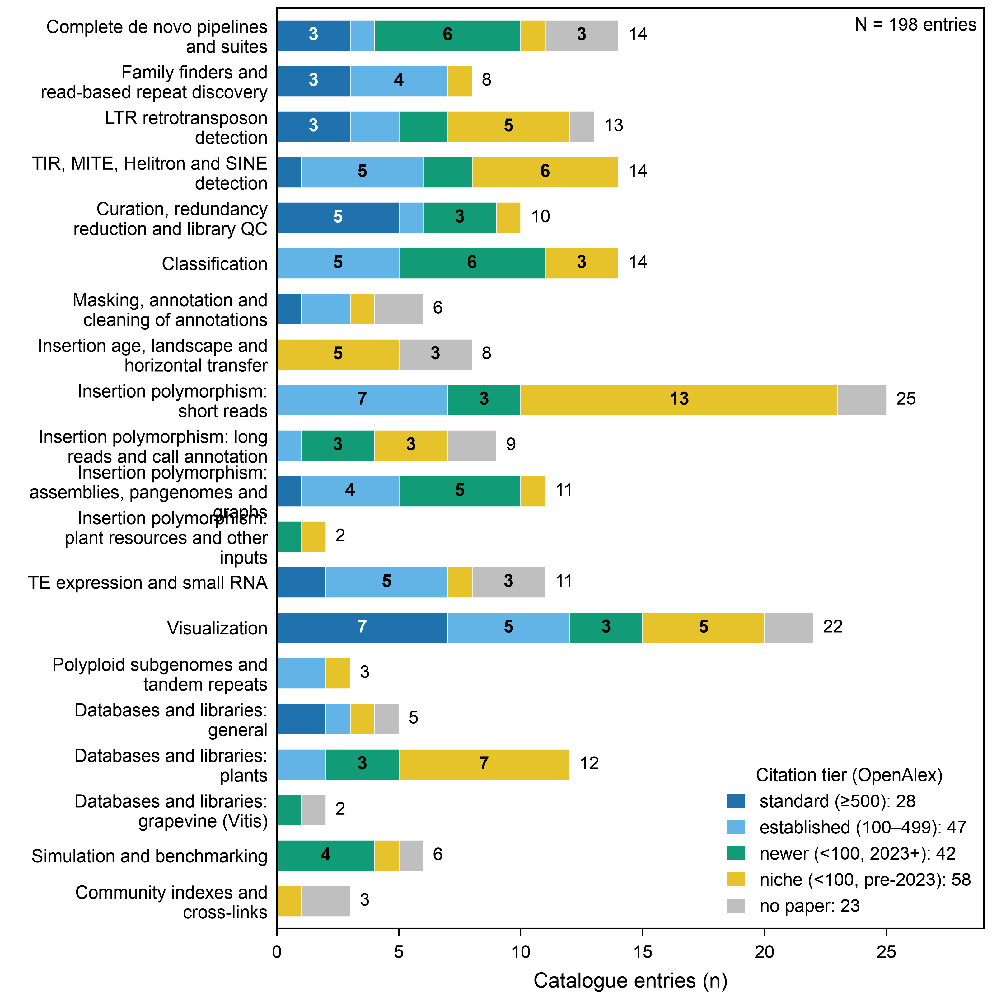
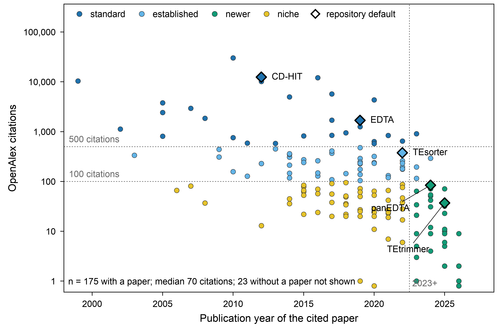
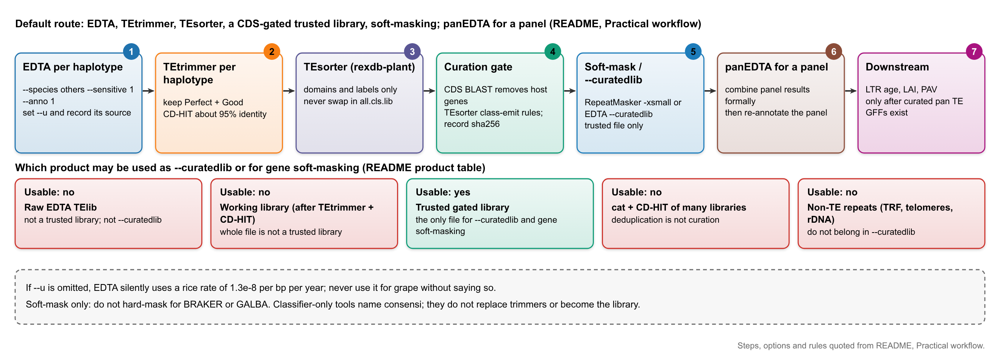
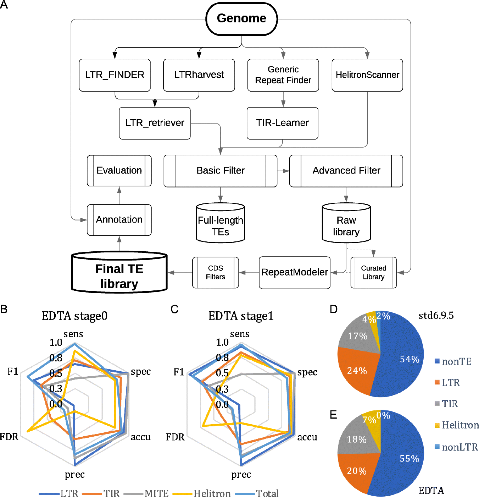

# TE-Lib
<a id="vitis-te"></a>

[English](README.md) | 中文

TE-Lib 是一个通用的转座子（TE）知识、软件与流程库，面向植物及其他真核基因组：一部中文书稿，讲转座子是什么、怎样分类、与宿主怎样相互作用；每类转座子及其识别方法的知识页；按分析步骤整理的软件目录；以及一条从原始发现到可信 TE 库、测试过的路线，配有小脚本和测试数据。全书以葡萄（*Vitis*）为实例，葡萄的内容都保留；方法同样适用于其他基因组。基因软屏蔽所用的葡萄 TE 库说明见 [gene-structure-annotation `docs/TE_LIBRARY.md`](https://github.com/Xuzhen-Li/gene-structure-annotation/blob/main/docs/TE_LIBRARY.md)。本仓库原名 vitis-te，GitHub 会自动跳转旧链接。

基因模型注释由 [gene-structure-annotation](https://github.com/Xuzhen-Li/gene-structure-annotation) 负责。功能注释属于 [gene-function-annotation](https://github.com/Xuzhen-Li/gene-function-annotation)。PAV 图和较长的图工具列表见 [vitis-pangenome](https://github.com/Xuzhen-Li/vitis-pangenome)。本仓库不是其他研究组原始 TE 识别结果的转存。尚未公开出现在 GitHub 上的私有实验草稿和讲义，不复制到这里。

## 本仓库怎么组织

先知识，再软件，再流程。全部页面按主题索引在 [`docs/KNOWLEDGE_MAP.zh.md`](docs/KNOWLEDGE_MAP.zh.md)。

| 部分 | 用来 | 位置 |
|---|---|---|
| 书（中文） | 学习转座子生物学、分类、对宿主的影响以及葡萄中已知的事实 | [`book/`](book/README.md)；目录见下 |
| 主题 | 把一个主题的所有内容放在一处看 | [`docs/KNOWLEDGE_MAP.zh.md`](docs/KNOWLEDGE_MAP.zh.md) |
| 转座子类型 | 每个纲或目一页 | [`docs/types/`](docs/types/README.zh.md) |
| 识别 | 序列特征、工具与流程，以及 soft-mask 交接 | [`signatures.zh.md`](docs/detection/signatures.zh.md)；[`tools_and_pipelines.zh.md`](docs/detection/tools_and_pipelines.zh.md)；[`softmask_handoff.zh.md`](docs/detection/softmask_handoff.zh.md) |
| 宿主效应 | 宿主怎样沉默转座子、转座子怎样影响基因 | [`docs/host/`](docs/host/README.zh.md) |
| 软件 | 按分析步骤比较 198 条工具、流程与数据库 | [按分析步骤划分的软件](#按分析步骤划分的软件)；[`docs/software/`](docs/software/README.zh.md)；[`catalog/SOFTWARE_AUTHORITY.tsv`](catalog/SOFTWARE_AUTHORITY.tsv) |
| 流程 | 走一条从发现到可信库的路线 | [`docs/WORKFLOW.zh.md`](docs/WORKFLOW.zh.md) |
| 葡萄实例 | 葡萄基因组、文库和已知结果 | [`docs/vitis/`](docs/vitis/README.zh.md) |
| 脚本与测试数据 | 运行一个小型玩具流程 | [`scripts/`](scripts/README.md)；[`testdata/`](testdata/README.md) |
| 图 | 查看示意图 | [`figures/`](figures/README.md) |
| 来源与核对 | 查看读过哪些来源、核对过哪些 DOI | [`SOURCES_READ.tsv`](SOURCES_READ.tsv)；[`DOI_CHECKS.tsv`](DOI_CHECKS.tsv)；[`CHANGELOG.md`](CHANGELOG.md) |
| 英文页面 | 阅读英文原版 | [`README.md`](README.md) |

## 书的目录

中文书稿《转座子从发现到实践，以葡萄为例》见 [`book/README.md`](book/README.md)。同一正文的合订本见 [`book/TE_BOOK_full.md`](book/TE_BOOK_full.md)。文件清单见 [`book/INDEX.md`](book/INDEX.md)。凡尚未对照已打开的来源核实的说法或文献，一律标为 [待确认]。

配图合订本（第1至4章、类型详解、第13章、第5至12章与附录）见 [`book/illustrated_v3_p2d/TE_BOOK_illustrated_v3_p2d.md`](book/illustrated_v3_p2d/TE_BOOK_illustrated_v3_p2d.md)。

- [前言](book/chapters/00-preface.md)
  - [编写定位](book/chapters/00-preface.md#编写定位)
  - [全书结构与阅读路径](book/chapters/00-preface.md#全书结构与阅读路径)
  - [术语规范、代码约定与可重复计算原则](book/chapters/00-preface.md#术语规范代码约定与可重复计算原则)
- [第1章 转座子的发现史与核心概念](book/chapters/01-discovery-and-core-concepts.md)
  - [1.1 玉米控制元件的发现与早期争议](book/chapters/01-discovery-and-core-concepts.md#11-玉米控制元件的发现与早期争议)
  - [1.2 从“垃圾DNA”到基因组动态组分：认知范式的演变](book/chapters/01-discovery-and-core-concepts.md#12-从垃圾dna到基因组动态组分认知范式的演变)
  - [1.3 转座子的基本定义、结构特征与宿主基因组背景](book/chapters/01-discovery-and-core-concepts.md#13-转座子的基本定义结构特征与宿主基因组背景)
- [第2章 转座子的分类体系与命名规范](book/chapters/02-classification-and-nomenclature.md)
  - [2.1 分类学的演进：从Finnegan到Wicker与Repbase体系](book/chapters/02-classification-and-nomenclature.md#21-分类学的演进从finnegan到wicker与repbase体系)
  - [2.2 统一分类框架中的层级与边界争议](book/chapters/02-classification-and-nomenclature.md#22-统一分类框架中的层级与边界争议)
  - [2.3 命名规则与公共数据库标准](book/chapters/02-classification-and-nomenclature.md#23-命名规则与公共数据库标准)
- [第3章 Ⅰ类转座子（反转录转座子）的结构与生活史](book/chapters/03-class-I-retrotransposons.md)
  - [3.1 LTR反转录转座子的结构与反转录机制](book/chapters/03-class-I-retrotransposons.md#31-ltr反转录转座子的结构与反转录机制)
  - [3.2 非LTR反转录转座子：LINE与SINE](book/chapters/03-class-I-retrotransposons.md#32-非ltr反转录转座子line与sine)
  - [3.3 DIRS、PLE及其他特殊反转录元件](book/chapters/03-class-I-retrotransposons.md#33-dirsple及其他特殊反转录元件)
- [第4章 Ⅱ类转座子（DNA转座子）的结构与生活史](book/chapters/04-class-II-dna-transposons.md)
  - [4.1 经典“剪切-粘贴”型TIR DNA转座子](book/chapters/04-class-II-dna-transposons.md#41-经典剪切-粘贴型tir-dna转座子)
  - [4.2 MITEs（微型反向重复转座元件）的起源与扩增](book/chapters/04-class-II-dna-transposons.md#42-mites微型反向重复转座元件的起源与扩增)
  - [4.3 Helitron与Maverick/Polinton：滚环复制与自合成元件](book/chapters/04-class-II-dna-transposons.md#43-helitron与maverickpolinton滚环复制与自合成元件)
- [第5章 宿主沉默机制与表观遗传调控](book/chapters/05-host-silencing-and-epigenetics.md)
  - [5.1 植物DNA甲基化与RdDM（RNA导向的DNA甲基化）通路](book/chapters/05-host-silencing-and-epigenetics.md#51-植物dna甲基化与rddmrna导向的dna甲基化通路)
  - [5.2 组蛋白修饰、染色质重塑与异染色质维持](book/chapters/05-host-silencing-and-epigenetics.md#52-组蛋白修饰染色质重塑与异染色质维持)
  - [5.3 转座子的逃逸、胁迫激活与表观遗传重编程](book/chapters/05-host-silencing-and-epigenetics.md#53-转座子的逃逸胁迫激活与表观遗传重编程)
- [第6章 基因组演化与转座子动力学](book/chapters/06-genome-evolution-and-te-dynamics.md)
  - [6.1 转座子爆发、清除与基因组大小演化](book/chapters/06-genome-evolution-and-te-dynamics.md#61-转座子爆发清除与基因组大小演化)
  - [6.2 基因组区室化分布与嵌套插入](book/chapters/06-genome-evolution-and-te-dynamics.md#62-基因组区室化分布与嵌套插入)
  - [6.3 结构变异、基因捕获与功能外适应（Exaptation）](book/chapters/06-genome-evolution-and-te-dynamics.md#63-结构变异基因捕获与功能外适应exaptation)
- [第7章 转座子的检测、从头注释与文库构建](book/chapters/07-detection-annotation-and-libraries.md)
  - [7.1 基于同源与基于结构的从头预测原理](book/chapters/07-detection-annotation-and-libraries.md#71-基于同源与基于结构的从头预测原理)
  - [7.2 整合注释流程与高质量一致性文库构建](book/chapters/07-detection-annotation-and-libraries.md#72-整合注释流程与高质量一致性文库构建)
  - [7.3 注释质量评估与跨基因组/泛基因组注释策略](book/chapters/07-detection-annotation-and-libraries.md#73-注释质量评估与跨基因组泛基因组注释策略)
- [第8章 群体水平的转座子插入多态性（TIPs）分析](book/chapters/08-insertion-polymorphisms-tips.md)
  - [8.1 短读长与长读长测序数据的TIPs检测原理](book/chapters/08-insertion-polymorphisms-tips.md#81-短读长与长读长测序数据的tips检测原理)
  - [8.2 群体遗传学统计量与中性检验在TIPs中的应用](book/chapters/08-insertion-polymorphisms-tips.md#82-群体遗传学统计量与中性检验在tips中的应用)
  - [8.3 TIPs在全基因组关联分析（TE-GWAS）中的应用](book/chapters/08-insertion-polymorphisms-tips.md#83-tips在全基因组关联分析te-gwas中的应用)
- [第9章 转座子、表型变异与作物驯化](book/chapters/09-phenotype-and-domestication.md)
  - [9.1 转座子影响基因表达的分子机制](book/chapters/09-phenotype-and-domestication.md#91-转座子影响基因表达的分子机制)
  - [9.2 模式植物与主要作物中的经典表型案例](book/chapters/09-phenotype-and-domestication.md#92-模式植物与主要作物中的经典表型案例)
  - [9.3 无性繁殖与多年生木本作物中的转座子与体细胞变异](book/chapters/09-phenotype-and-domestication.md#93-无性繁殖与多年生木本作物中的转座子与体细胞变异)
- [第10章 葡萄基因组中的转座子：以葡萄属（*Vitis*）为范例](book/chapters/10-vitis-as-worked-example.md)
  - [10.1 葡萄基因组特征与转座子组成概览](book/chapters/10-vitis-as-worked-example.md#101-葡萄基因组特征与转座子组成概览)
  - [10.2 经典案例：Gret1与葡萄果皮颜色的演化](book/chapters/10-vitis-as-worked-example.md#102-经典案例gret1与葡萄果皮颜色的演化)
  - [10.3 葡萄无性系变异、风土适应与性状改良中的转座子](book/chapters/10-vitis-as-worked-example.md#103-葡萄无性系变异风土适应与性状改良中的转座子)
- [第11章 实践工作流：以葡萄基因组为例的端到端分析](book/chapters/11-practical-workflow.md)
  - [11.1 数据准备、软件环境与单基因组转座子从头注释实战](book/chapters/11-practical-workflow.md#111-数据准备软件环境与单基因组转座子从头注释实战)
  - [11.2 转座子文库精修、插入时间估算与基因组分布可视化](book/chapters/11-practical-workflow.md#112-转座子文库精修插入时间估算与基因组分布可视化)
  - [11.3 葡萄群体重测序TIPs鉴定与候选功能位点筛选实战](book/chapters/11-practical-workflow.md#113-葡萄群体重测序tips鉴定与候选功能位点筛选实战)
- [第12章 开放问题与前沿方向](book/chapters/12-open-questions.md)
  - [12.1 T2T基因组与泛基因组时代的转座子解析新挑战](book/chapters/12-open-questions.md#121-t2t基因组与泛基因组时代的转座子解析新挑战)
  - [12.2 深度学习与长读长多组学在转座子研究中的应用](book/chapters/12-open-questions.md#122-深度学习与长读长多组学在转座子研究中的应用)
  - [12.3 转座子工程化应用与未来作物育种前景](book/chapters/12-open-questions.md#123-转座子工程化应用与未来作物育种前景)
- [第13章 基因组里实际看到的转座子：完整、残缺、嵌合与驯化](book/chapters/13-observed-forms.md)
  - [13.1 完整的自主元件](book/chapters/13-observed-forms.md#131-完整的自主元件)
  - [13.2 非自主元件](book/chapters/13-observed-forms.md#132-非自主元件)
  - [13.3 碎片与截短体](book/chapters/13-observed-forms.md#133-碎片与截短体)
  - [13.4 solo-LTR 与 LTR 间非等位重组](book/chapters/13-observed-forms.md#134-solo-ltr-与-ltr-间非等位重组)
  - [13.5 嵌套插入（nested insertion）](book/chapters/13-observed-forms.md#135-嵌套插入nested-insertion)
  - [13.6 嵌合元件与重组产物](book/chapters/13-observed-forms.md#136-嵌合元件与重组产物)
  - [13.7 被驯化成宿主基因的 TE](book/chapters/13-observed-forms.md#137-被驯化成宿主基因的-teexaptationdomestication)
  - [13.8 携带宿主基因片段的元件](book/chapters/13-observed-forms.md#138-携带宿主基因片段的元件)
  - [13.9 TE 衍生的串联重复与卫星](book/chapters/13-observed-forms.md#139-te-衍生的串联重复与卫星)
  - [13.10 Penelope 类元件（PLE）](book/chapters/13-observed-forms.md#1310-penelope-类元件ple)
  - [13.11 DIRS 类元件](book/chapters/13-observed-forms.md#1311-dirs-类元件)
  - [13.12 Crypton](book/chapters/13-observed-forms.md#1312-crypton)
  - [13.13 Maverick/Polinton](book/chapters/13-observed-forms.md#1313-maverickpolinton)
  - [13.14 Ngaro 及其他酪氨酸重组酶反转录元件](book/chapters/13-observed-forms.md#1314-ngaro-及其他酪氨酸重组酶反转录元件)
  - [13.15 其他少见超家族与 Helitron2/Helentron](book/chapters/13-observed-forms.md#1315-其他少见超家族与-helitron2helentron)
  - [13.16 植物（包括葡萄）中各稀有类别的存在与否汇总](book/chapters/13-observed-forms.md#1316-植物包括葡萄中各稀有类别的存在与否汇总)
  - [13.17 注释工具对稀有类别的常见误判和漏判，以及人工核查建议](book/chapters/13-observed-forms.md#1317-注释工具对稀有类别的常见误判和漏判以及人工核查建议)
  - [13.18 本章小结](book/chapters/13-observed-forms.md#1318-本章小结)
- [转座子类型逐类详解](book/chapters/types-catalogue.md)
  - [分类树与总表](book/chapters/types-catalogue.md#分类树与总表)
  - [第一部分　LTR 逆转录转座子](book/chapters/types-catalogue.md#第一部分ltr-逆转录转座子目超家族与非自主衍生物)
  - [第二部分　Copia 超家族谱系（一）](book/chapters/types-catalogue.md#第二部分copia-超家族谱系一)
  - [第三部分　Copia 超家族谱系（二）](book/chapters/types-catalogue.md#第三部分copia-超家族谱系二)
  - [第四部分　Gypsy 超家族：色质病毒样谱系](book/chapters/types-catalogue.md#第四部分gypsy-超家族色质病毒样谱系)
  - [第五部分　Gypsy 超家族：苔藓/石松特有谱系与 OTA 分支](book/chapters/types-catalogue.md#第五部分gypsy-超家族苔藓石松特有谱系与-ota-分支)
  - [第六部分　DIRS、PLE 与 LINE/SINE 目](book/chapters/types-catalogue.md#第六部分dirsple-与-linesine-目)
  - [第七部分　LINE 分支（一）](book/chapters/types-catalogue.md#第七部分line-分支一)
  - [第八部分　LINE 分支（二）与 SINE 类型](book/chapters/types-catalogue.md#第八部分line-分支二与-sine-类型)
  - [第九部分　TIR DNA 转座子：主要超家族](book/chapters/types-catalogue.md#第九部分tir-dna-转座子主要超家族)
  - [第十部分　TIR DNA 转座子：其他超家族（一）](book/chapters/types-catalogue.md#第十部分tir-dna-转座子其他超家族一)
  - [第十一部分　TIR DNA 转座子：其他超家族（二）与 Crypton](book/chapters/types-catalogue.md#第十一部分tir-dna-转座子其他超家族二与-crypton)
  - [第十二部分　Helitron、Maverick 与基因捕获形态](book/chapters/types-catalogue.md#第十二部分helitronmaverick-与基因捕获形态)
  - [第十三部分　基因组中实际看到的转座子形态](book/chapters/types-catalogue.md#第十三部分基因组中实际看到的转座子形态)
  - [类型详解附录　分类体系外与有争议的类型](book/chapters/types-catalogue.md#类型详解附录分类体系外与有争议的类型)
- [附录A 常用专业术语与缩略语对照表](book/chapters/appendix-a-glossary.md)
- [附录B 公共数据库与主流生物信息学工具清单](book/chapters/appendix-b-databases-and-tools.md)
  - [公共转座子与重复序列数据库](book/chapters/appendix-b-databases-and-tools.md#公共转座子与重复序列数据库)
  - [转座子注释、精修与评估核心工具](book/chapters/appendix-b-databases-and-tools.md#转座子注释精修与评估核心工具)
  - [群体TIPs检测与常规辅助分析工具](book/chapters/appendix-b-databases-and-tools.md#群体tips检测与常规辅助分析工具)
- [附录C 推荐进阶阅读文献](book/chapters/appendix-c-further-reading.md)
  - [一、基础理论、发现史与基因组演化](book/chapters/appendix-c-further-reading.md#一基础理论发现史与基因组演化)
  - [二、分类体系与生物信息学注释方法](book/chapters/appendix-c-further-reading.md#二分类体系与生物信息学注释方法)
  - [三、表观遗传调控与宿主沉默](book/chapters/appendix-c-further-reading.md#三表观遗传调控与宿主沉默)
  - [四、葡萄基因组与转座子范例研究](book/chapters/appendix-c-further-reading.md#四葡萄基因组与转座子范例研究)

按类型写的较短笔记和配图见 [`docs/types/README.zh.md`](docs/types/README.zh.md)（英文索引：[`docs/types/README.md`](docs/types/README.md)）。TE 与宿主的笔记见 [`docs/host/README.zh.md`](docs/host/README.zh.md)。葡萄基因组中的 TE 见 [`docs/vitis/README.zh.md`](docs/vitis/README.zh.md)。教学示意图见 [`figures/README.md`](figures/README.md)。

## 软件与流程

默认路线是 EDTA，再到 TEtrimmer，再到 TEsorter，再到经过 CDS 过滤的 trusted 文库，最后用于软屏蔽或 panEDTA。带判断节点的决策树见 [`docs/WORKFLOW.zh.md`](docs/WORKFLOW.zh.md)。按步骤划分的软件、行业难点，以及同一路线的更详细说明见 [`docs/detection/tools_and_pipelines.zh.md`](docs/detection/tools_and_pipelines.zh.md)。用于识别各类型的序列特征见 [`docs/detection/signatures.zh.md`](docs/detection/signatures.zh.md)。交给基因注释的软屏蔽说明见 [`docs/detection/softmask_handoff.zh.md`](docs/detection/softmask_handoff.zh.md)。每一行的链接、标题匹配的 DOI（如有）、输入、输出和适用场合见 [`catalog/CATALOG.tsv`](catalog/CATALOG.tsv)。此处未锁定工具版本。只在 Crossref 题名与目标论文一致时收录 DOI（核对于 2026-11-15，Asia/Shanghai，CST，UTC+8）。没有题名匹配 DOI 的条目只写网址，或标 [待确认]。

### 按分析步骤划分的软件

本节目录：各步骤的链接如下。括号中的数字是该表中的条目数。权威度规则和整套流程覆盖表也列在这里。本节共 198 条。



*图：从问题出发找工具：粗体为本仓库默认工具，其余为对应目录小节中的例子。名称、角色和所属小节都与 `catalog/SOFTWARE_AUTHORITY.tsv` 核对过；论文、实验室和权威度见下方各表。示意图，为本仓库绘制；可编辑 SVG：[`te_question_to_tools_v2.svg`](figures/guide/te_question_to_tools_v2.svg)。*

- [权威度规则](#权威度规则)
- [整套流程及其覆盖的步骤](#整套流程及其覆盖的步骤)（14）
- [整套流程：论文、实验室与权威度](#整套流程论文实验室与权威度)（14）
- [重复家族发现工具与基于读段的发现](#重复家族发现工具与基于读段的发现)（8）
- [LTR 反转录转座子检测](#ltr-反转录转座子检测)（13）
- [TIR、MITE、Helitron 与 SINE 检测](#tirmitehelitron-与-sine-检测)（14）
- [精修、去冗余与文库质控](#精修去冗余与文库质控)（10）
- [分类](#分类)（14）
- [屏蔽、注释与注释结果整理](#屏蔽注释与注释结果整理)（6）
- [插入年龄、景观与水平转移](#插入年龄景观与水平转移)（8）
- [插入多态：短读长](#插入多态短读长)（25）
- [插入多态：长读长与结果注释](#插入多态长读长与结果注释)（9）
- [插入多态：组装、泛基因组与图基因组](#插入多态组装泛基因组与图基因组)（11）
- [插入多态：植物资源与其他输入](#插入多态植物资源与其他输入)（2）
- [转座子表达与小 RNA](#转座子表达与小-rna)（11）
- [可视化](#可视化)（22）
  - [转座子专用视图、景观图与嵌套结构图](#转座子专用视图景观图与嵌套结构图)（6）
  - [重复序列点图与一致性热图](#重复序列点图与一致性热图)（3）
  - [密度图与核型（染色体示意）图](#密度图与核型染色体示意图)（3）
  - [Circos 风格的环形图](#circos-风格的环形图)（2）
  - [基因组浏览器轨道](#基因组浏览器轨道)（4）
  - [共线性、组装比对与泛基因组图视图](#共线性组装比对与泛基因组图视图)（4）
- [多倍体亚基因组与串联重复](#多倍体亚基因组与串联重复)（3）
- [数据库与文库：通用](#数据库与文库通用)（5）
- [数据库与文库：植物](#数据库与文库植物)（11）
- [数据库与文库：葡萄（Vitis）](#数据库与文库葡萄vitis)（2）
- [模拟与评测](#模拟与评测)（6）
- [社区索引与交叉链接](#社区索引与交叉链接)（3）

下面按分析步骤列出本目录的 198 个软件、数据库和流程。每个条目给出原始论文、实验室和权威度；链接指向官方仓库或站点。更长的说明见 [`docs/software/README.zh.md`](docs/software/README.zh.md)，逐条数据见 [`catalog/SOFTWARE_AUTHORITY.tsv`](catalog/SOFTWARE_AUTHORITY.tsv)，每条的核对说明见 [`catalog/CATALOG.tsv`](catalog/CATALOG.tsv)。

**默认路线：** [EDTA](https://github.com/oushujun/EDTA) → [TEtrimmer](https://github.com/qjiangzhao/TEtrimmer) → [TEsorter](https://github.com/zhangrengang/TEsorter) → 经 CDS 过滤的 trusted 文库 → [RepeatMasker](https://github.com/Dfam-consortium/RepeatMasker) 软屏蔽，或用 panEDTA 处理多基因组。下表中只有这条路线上的工具标「默认」；没有默认的步骤，各行按论文被引次数排序，这不说明哪个工具更适合你的基因组。

#### 权威度规则

> **权威度规则（只在此处说明一次）：** 权威度取 OpenAlex 的论文被引次数（2026-11-25 取数）。标准：500 次及以上；成熟：100–499 次；较新：少于 100 次且论文发表于 2023 年或之后；小众：少于 100 次且发表于 2023 年之前；无论文：目录中没有题名匹配的论文。BEDTools、IGV 这类通用工具的引用数来自所有学科。实验室取论文元数据中的通讯作者及其机构（多个通讯作者时写第一位并以 +N 表示其余人数；没有标注时写末位作者）；DOI 已用 Crossref 核对，例外见 `catalog/SOFTWARE_AUTHORITY.tsv` 的 `doi_check` 列。本节共 198 条：标准 28、成熟 47、较新 42、小众 58、无论文 23。



*图：各分析步骤的目录条目数，按权威度着色（规则见上）。数字由 `figures/guide/src/make_catalog_charts.py` 从 `catalog/SOFTWARE_AUTHORITY.tsv` 计算（198 条；OpenAlex 被引数于 2026-11-25 取得）。*



*图：175 条有论文的目录条目的发表年份与 OpenAlex 被引数；菱形为本仓库默认工具（RepeatMasker 没有论文，未画出）。被引数不代表在你的基因组上的准确度。数据：`catalog/SOFTWARE_AUTHORITY.tsv`；脚本 `figures/guide/src/make_catalog_charts.py`。*

#### 整套流程及其覆盖的步骤

「有」表示该流程自己的说明或目录条目写明了这一步，「—」只表示没有写明。各流程的论文和实验室见本表后的第一张表。

| 流程 | 建库 | 精修/去冗余 | 分类 | 屏蔽/注释 | 年龄/分化度 | 多基因组 | 权威度 |
|---|---|---|---|---|---|---|---|
| **[EDTA](https://github.com/oushujun/EDTA)** （默认路线） | 有 | 有 | 有 | 有 | — | 经 panEDTA | 标准 · 1683 次 |
| **[panEDTA](https://github.com/oushujun/EDTA/blob/master/panEDTA.sh)** （默认路线） | — | 有 | — | 有 | — | 有 | 较新 · 84 次 |
| [EDTA-GUI](https://github.com/Marcos-Fernando/EDTA-GUI) | 同 EDTA | 同 EDTA | 有 | 同 EDTA | — | — | 较新 · 2 次 |
| [RepeatModeler2](https://github.com/Dfam-consortium/RepeatModeler) | 有 | 有 | 有 | — | — | — | 标准 · 4333 次 |
| [Dfam TETools](https://github.com/Dfam-consortium/TETools) | 经 RepeatModeler | — | 经 RepeatModeler | 经 RepeatMasker | — | — | 无论文 |
| [Earl Grey](https://github.com/TobyBaril/EarlGrey) | 有 | 有 | 有 | 有 | 有 | ParTEA | 成熟 · 292 次 |
| [ParTEA](https://github.com/TobyBaril/EarlGreyParTEA) | — | — | — | 有 | — | 有 | 较新 · 0 次，预印本 |
| [HiTE](https://github.com/CSU-KangHu/HiTE) | 有 | — | 有 | 有 | — | panHiTE | 较新 · 71 次 |
| [panHiTE](https://github.com/CSU-KangHu/HiTE) | 有 | — | — | — | — | 有 | 较新 · 5 次 |
| [REPET](https://urgi.versailles.inrae.fr/Tools/REPET) | 有 | 有 | — | 有 | — | — | 标准 · 589 次 |
| [Tephra](https://github.com/sestaton/tephra) | 有 | — | 有 | 有 | 有 | — | 无论文 |
| [CARP](https://github.com/carp-te/carp-documentation) | 有 | 有 | — | 有 | — | — | 小众 · 36 次 |
| [CLARI-TE](https://github.com/jdaron/CLARI-TE) | — | — | — | 有 | — | — | 无论文 |
| [PanTE](https://github.com/unavailable-2374/Pan_TE) | 有 | — | 有 | — | — | 有 | 较新 · 2 次，预印本 |

#### 整套流程：论文、实验室与权威度

| 工具 | 角色 | 原始论文（期刊 年份 · DOI） | 实验室（通讯作者，机构） | 权威度（档位 · 被引） |
|---|---|---|---|---|
| [EDTA](https://github.com/oushujun/EDTA) | **默认** | *Genome biology* 2019 · [10.1186/s13059-019-1905-y](https://doi.org/10.1186/s13059-019-1905-y) | Ning Jiang, Michigan State University +2 | 标准 · 1683 次 |
| [panEDTA](https://github.com/oushujun/EDTA/blob/master/panEDTA.sh) | **默认** | *Genome Research* 2024 · [10.1101/gr.278131.123](https://doi.org/10.1101/gr.278131.123) | Matthew B. Hufford, Iowa State University +1 | 较新 · 84 次 |
| [RepeatModeler2](https://github.com/Dfam-consortium/RepeatModeler) | 备选 | *Proceedings of the National Academy of Sciences* 2020 · [10.1073/pnas.1921046117](https://doi.org/10.1073/pnas.1921046117) | Arian F. A. Smit, Institute for Systems Biology（末位作者） | 标准 · 4333 次 |
| [REPET](https://urgi.versailles.inrae.fr/Tools/REPET) | 备选 | *PLoS ONE* 2011 · [10.1371/journal.pone.0016526](https://doi.org/10.1371/journal.pone.0016526) | Hadi Quesneville, Institut National de Recherche pour l'Agriculture, l'Alimentation et l'Environnement | 标准 · 589 次 |
| [Earl Grey](https://github.com/TobyBaril/EarlGrey) | 备选 | *Molecular Biology and Evolution* 2024 · [10.1093/molbev/msae068](https://doi.org/10.1093/molbev/msae068) | Tobias Baril, University of Exeter +1 | 成熟 · 292 次 |
| [HiTE](https://github.com/CSU-KangHu/HiTE) | 备选 | *Nature Communications* 2024 · [10.1038/s41467-024-49912-8](https://doi.org/10.1038/s41467-024-49912-8) | Bin Hu, Beijing Institute of Technology +1 | 较新 · 71 次 |
| [CARP](https://github.com/carp-te/carp-documentation) | 备选 | *PLoS ONE* 2018 · [10.1371/journal.pone.0193588](https://doi.org/10.1371/journal.pone.0193588) | David L. Adelson, The University of Adelaide | 小众 · 36 次 |
| [panHiTE](https://github.com/CSU-KangHu/HiTE) | 备选 | *Plant Communications* 2025 · [10.1016/j.xplc.2025.101669](https://doi.org/10.1016/j.xplc.2025.101669) | Jianxin Wang, Central South University | 较新 · 5 次 |
| [EDTA-GUI](https://github.com/Marcos-Fernando/EDTA-GUI) | 备选 | *BMC Genomics* 2026 · [10.1186/s12864-026-12588-z](https://doi.org/10.1186/s12864-026-12588-z) | Alessandro M. Varani, Universidade Estadual Paulista (Unesp) +1 | 较新 · 2 次 |
| [PanTE](https://github.com/unavailable-2374/Pan_TE) | 备选 | *Research Square* 2025 · [10.21203/rs.3.rs-5867196/v1](https://doi.org/10.21203/rs.3.rs-5867196/v1) | Yiwen Wang, The University of Melbourne | 较新 · 2 次，预印本 |
| [ParTEA](https://github.com/TobyBaril/EarlGreyParTEA) | 备选 | *bioRxiv (Cold Spring Harbor Laboratory)* 2026 · [10.64898/2026.11.04.764261](https://doi.org/10.64898/2026.11.04.764261) | Tobias Baril, Swedish Museum of Natural History | 较新 · 0 次，预印本 |
| [CLARI-TE](https://github.com/jdaron/CLARI-TE) | 备选 | — | — | 无论文 |
| [Dfam TETools](https://github.com/Dfam-consortium/TETools) | 备选 | — | — | 无论文 |
| [Tephra](https://github.com/sestaton/tephra) | 备选 | — | — | 无论文 |

#### 重复家族发现工具与基于读段的发现

| 工具 | 原始论文（期刊 年份 · DOI） | 实验室（通讯作者，机构） | 权威度（档位 · 被引） |
|---|---|---|---|
| [RepeatScout](https://github.com/Dfam-consortium/RepeatScout) | *Bioinformatics* 2005 · [10.1093/bioinformatics/bti1018](https://doi.org/10.1093/bioinformatics/bti1018) | Alkes L. Price, University of California San Diego | 标准 · 2427 次 |
| [RECON](https://github.com/Dfam-consortium/RECON) | *Genome Research* 2002 · [10.1101/gr.88502](https://doi.org/10.1101/gr.88502) | Sean R. Eddy, Howard Hughes Medical Institute | 标准 · 1126 次 |
| [PILER](https://www.drive5.com/piler/) | *Bioinformatics* 2005 · [10.1093/bioinformatics/bti1003](https://doi.org/10.1093/bioinformatics/bti1003) | R. C. Edgar, bob@drive5.com | 标准 · 807 次 |
| [TAREAN](https://repeatexplorer-elixir.cerit-sc.cz/galaxy/) | *Nucleic Acids Research* 2017 · [10.1093/nar/gkx257](https://doi.org/10.1093/nar/gkx257) | Jir̆í Macas, Institute of Plant Molecular Biology | 成熟 · 368 次 |
| [RepeatExplorer2](https://repeatexplorer-elixir.cerit-sc.cz) | *Nature Protocols* 2020 · [10.1038/s41596-020-0400-y](https://doi.org/10.1038/s41596-020-0400-y) | Jir̆í Macas, Czech Academy of Sciences | 成熟 · 320 次 |
| [Red](https://github.com/BioinformaticsToolsmith/Red) | *BMC Bioinformatics* 2015 · [10.1186/s12859-015-0654-5](https://doi.org/10.1186/s12859-015-0654-5) | Hani Z. Girgis, National Institutes of Health | 成熟 · 275 次 |
| [dnaPipeTE](https://github.com/clemgoub/dnaPipeTE) | *Genome Biology and Evolution* 2015 · [10.1093/gbe/evv050](https://doi.org/10.1093/gbe/evv050) | Matthieu Boulesteix, Lyon 1 Université | 成熟 · 240 次 |
| [Transposome](https://github.com/sestaton/Transposome) | *Bioinformatics* 2015 · [10.1093/bioinformatics/btv059](https://doi.org/10.1093/bioinformatics/btv059) | S. Evan Staton, University of Georgia | 小众 · 22 次 |

#### LTR 反转录转座子检测

| 工具 | 原始论文（期刊 年份 · DOI） | 实验室（通讯作者，机构） | 权威度（档位 · 被引） |
|---|---|---|---|
| [LTR_FINDER](https://github.com/xzhub/LTR_FINDER) | *Nucleic Acids Research* 2007 · [10.1093/nar/gkm286](https://doi.org/10.1093/nar/gkm286) | Hao Wang, Fudan University | 标准 · 2933 次 |
| [LTRharvest](https://github.com/genometools/genometools) | *BMC Bioinformatics* 2008 · [10.1186/1471-2105-9-18](https://doi.org/10.1186/1471-2105-9-18) | Ute Willhoeft, Universität Hamburg | 标准 · 1855 次 |
| [LTR_retriever](https://github.com/oushujun/LTR_retriever) | *Plant Physiology* 2017 · [10.1104/pp.17.01310](https://doi.org/10.1104/pp.17.01310) | Ning Jiang, Michigan State University | 标准 · 1703 次 |
| [LTRdigest](https://github.com/genometools/genometools) | *Nucleic Acids Research* 2009 · [10.1093/nar/gkp759](https://doi.org/10.1093/nar/gkp759) | Sascha Steinbiss, Universität Hamburg | 成熟 · 310 次 |
| [LTR_FINDER_parallel](https://github.com/oushujun/LTR_FINDER_parallel) | *Mobile DNA* 2019 · [10.1186/s13100-019-0193-0](https://doi.org/10.1186/s13100-019-0193-0) | Ning Jiang, Michigan State University | 成熟 · 291 次 |
| [DANTE and DANTE_LTR](https://github.com/kavonrtep/dante_ltr) | *NAR Genomics and Bioinformatics* 2024 · [10.1093/nargab/lqae113](https://doi.org/10.1093/nargab/lqae113) | Jir̆í Macas, Czech Academy of Sciences | 较新 · 42 次 |
| [Inpactor2](https://github.com/simonorozcoarias/Inpactor2) | *Briefings in Bioinformatics* 2022 · [10.1093/bib/bbac511](https://doi.org/10.1093/bib/bbac511) | Simón Orozco-Arias, Universidad de Caldas +3 | 小众 · 38 次 |
| [LTRpred](https://github.com/drostlab/LTRpred) | *The Journal of Open Source Software* 2020 · [10.21105/joss.02170](https://doi.org/10.21105/joss.02170) | Hajk‐Georg Drost, University of Cambridge | 小众 · 28 次 |
| [LtrDetector](https://github.com/BioinformaticsToolsmith/LtrDetector) | *BMC Genomics* 2019 · [10.1186/s12864-019-5796-9](https://doi.org/10.1186/s12864-019-5796-9) | Hani Z. Girgis, University of Tulsa | 小众 · 27 次 |
| [TE-greedy-nester](https://gitlab.fi.muni.cz/lexa/nested) | *Bioinformatics* 2020 · [10.1093/bioinformatics/btaa632](https://doi.org/10.1093/bioinformatics/btaa632) | Matej Lexa, Czech Academy of Sciences | 小众 · 24 次 |
| [MegaLTR](https://github.com/MoradMMokhtar/MegaLTR) | *Frontiers in Plant Science* 2023 · [10.3389/fpls.2023.1237426](https://doi.org/10.3389/fpls.2023.1237426) | Morad M. Mokhtar, Université Mohammed VI Polytechnique +1 | 较新 · 9 次 |
| [PhyLTR](https://github.com/mcsimenc/PhyLTR) | *Zenodo (CERN European Organization for Nuclear Research)* 2020 · [10.5281/zenodo.4256534](https://doi.org/10.5281/zenodo.4256534) | Der, JP.（末位作者） | 小众 · 0 次 |
| [MGEScan](https://github.com/MGEScan/mgescan) | — | — | 无论文 |

#### TIR、MITE、Helitron 与 SINE 检测

| 工具 | 原始论文（期刊 年份 · DOI） | 实验室（通讯作者，机构） | 权威度（档位 · 被引） |
|---|---|---|---|
| [MITE-Hunter](https://doi.org/10.1093/nar/gkq862) | *Nucleic Acids Research* 2010 · [10.1093/nar/gkq862](https://doi.org/10.1093/nar/gkq862) | S. R. Wessler, University of Georgia | 标准 · 759 次 |
| [HelitronScanner](https://sourceforge.net/projects/helitronscanner/) | *Proceedings of the National Academy of Sciences* 2014 · [10.1073/pnas.1410068111](https://doi.org/10.1073/pnas.1410068111) | Chunguang Du, Montclair State University（末位作者） | 成熟 · 307 次 |
| [TIR-Learner](https://github.com/oushujun/TIR-Learner) | *Molecular Plant* 2019 · [10.1016/j.molp.2019.02.008](https://doi.org/10.1016/j.molp.2019.02.008) | Thomas Peterson, Iowa State University | 成熟 · 175 次 |
| [MITE Tracker](https://github.com/INTABiotechMJ/MITE-Tracker) | *BMC Bioinformatics* 2018 · [10.1186/s12859-018-2376-y](https://doi.org/10.1186/s12859-018-2376-y) | Leonardo Sebastian Vanzetti, Consejo Nacional de Investigaciones Científicas y Técnicas | 成熟 · 144 次 |
| [Generic Repeat Finder (GRF)](https://github.com/bioinfolabmu/GenericRepeatFinder) | *Plant Physiology* 2019 · [10.1104/pp.19.00386](https://doi.org/10.1104/pp.19.00386) | Chun Liang, Miami University（末位作者） | 成熟 · 138 次 |
| [SINE-Finder](https://doi.org/10.1105/tpc.111.088682) | *The Plant Cell* 2011 · [10.1105/tpc.111.088682](https://doi.org/10.1105/tpc.111.088682) | Thomas Schmidt, Technische Universität Dresden（末位作者） | 成熟 · 128 次 |
| [detectMITE](https://sourceforge.net/projects/detectmite/) | *Scientific Reports* 2016 · [10.1038/srep19688](https://doi.org/10.1038/srep19688) | Guoli Ji, Xiamen University +1 | 小众 · 70 次 |
| [SINE_Scan](https://github.com/maohlzj/SINE_Scan) | *Bioinformatics* 2016 · [10.1093/bioinformatics/btw718](https://doi.org/10.1093/bioinformatics/btw718) | Hao Wang, University of Georgia | 小众 · 57 次 |
| [EAHelitron](https://github.com/dontkme/EAHelitron) | *BMC Bioinformatics* 2019 · [10.1186/s12859-019-2945-8](https://doi.org/10.1186/s12859-019-2945-8) | Yidan Ouyang, Huazhong Agricultural University +1 | 小众 · 50 次 |
| [miteFinderII](https://github.com/jhu99/miteFinder) | *BMC Medical Genomics* 2018 · [10.1186/s12920-018-0418-y](https://doi.org/10.1186/s12920-018-0418-y) | Xuequn Shang, Northwestern Polytechnical University | 小众 · 49 次 |
| [AnnoSINE](https://github.com/yangli557/AnnoSINE) | *Plant Physiology* 2021 · [10.1093/plphys/kiab524](https://doi.org/10.1093/plphys/kiab524) | Yanni Sun, City University of Hong Kong | 小众 · 23 次 |
| [MUSTv2](https://doi.org/10.1515/jib-2017-0029) | *Berichte aus der medizinischen Informatik und Bioinformatik/Journal of integrative bioinformatics* 2017 · [10.1515/jib-2017-0029](https://doi.org/10.1515/jib-2017-0029) | Qing Wu, Hangzhou Dianzi University +1 | 小众 · 20 次 |
| [AnnoSINE_v2](https://github.com/oushujun/AnnoSINE_v2) | *Mobile DNA* 2024 · [10.1101/2024.03.01.582874](https://doi.org/10.1101/2024.03.01.582874) | Yanni Sun, City University of Hong Kong +1 | 较新 · 4 次 |
| [DeepHel](https://github.com/lyysxb/DeepHel) | *Bioinformatics* 2026 · [10.1093/bioinformatics/btag817](https://doi.org/10.1093/bioinformatics/btag817) | Jianxin Wang, Central South University | 较新 · 0 次 |

#### 精修、去冗余与文库质控

| 工具 | 角色 | 原始论文（期刊 年份 · DOI） | 实验室（通讯作者，机构） | 权威度（档位 · 被引） |
|---|---|---|---|---|
| [CD-HIT](https://github.com/weizhongli/cdhit) | **默认** | *Bioinformatics* 2012 · [10.1093/bioinformatics/bts565](https://doi.org/10.1093/bioinformatics/bts565) | LiMin Fu, University of California San Diego +3 | 标准 · 12430 次 |
| [TEtrimmer](https://github.com/qjiangzhao/TEtrimmer) | **默认** | *Nature Communications* 2025 · [10.1038/s41467-025-63889-y](https://doi.org/10.1038/s41467-025-63889-y) | Stefan Kusch, Forschungszentrum Jülich +1 | 较新 · 37 次 |
| [VSEARCH](https://github.com/torognes/vsearch) | 备选 | *PeerJ* 2016 · [10.7717/peerj.2584](https://doi.org/10.7717/peerj.2584) | Frédéric Mahé, Centre de Coopération Internationale en Recherche Agronomique pour le Développement（末位作者） | 标准 · 12129 次 |
| [Tandem Repeats Finder (TRF)](https://tandem.bu.edu/trf/trf.html) | 备选 | *Nucleic Acids Research* 1999 · [10.1093/nar/27.2.573](https://doi.org/10.1093/nar/27.2.573) | Gary Benson, Icahn School of Medicine at Mount Sinai | 标准 · 10371 次 |
| [MMseqs2](https://github.com/soedinglab/MMseqs2) | 备选 | *Nature Biotechnology* 2017 · [10.1038/nbt.3988](https://doi.org/10.1038/nbt.3988) | Johannes Söding, Max Planck Institute for Biophysical Chemistry | 标准 · 5716 次 |
| [LTR Assembly Index (LAI)](https://github.com/oushujun/LTR_retriever) | 备选 | *Nucleic Acids Research* 2018 · [10.1093/nar/gky730](https://doi.org/10.1093/nar/gky730) | Shujun Ou, Michigan State University | 标准 · 947 次 |
| [TE-Aid](https://github.com/clemgoub/TE-Aid) | 备选 | *Mobile DNA* 2022 · [10.1186/s13100-021-00259-7](https://doi.org/10.1186/s13100-021-00259-7) | Anna Victoria Protasio, University of Cambridge | 成熟 · 196 次 |
| [MCHelper](https://github.com/GonzalezLab/MCHelper) | 备选 | *Genome Research* 2024 · [10.1101/gr.278821.123](https://doi.org/10.1101/gr.278821.123) | Josefa González, Consejo Superior de Investigaciones Científicas | 较新 · 51 次 |
| [SENMAP](https://github.com/simonorozcoarias/SENMAP) | 备选 | *Berichte aus der medizinischen Informatik und Bioinformatik/Journal of integrative bioinformatics* 2022 · [10.1515/jib-2021-0036](https://doi.org/10.1515/jib-2021-0036) | Simón Orozco-Arias, Universidad de Caldas +6 | 小众 · 6 次 |
| [ColabCuraTE](https://github.com/Ellison-Lab/ColabCuraTE) | 备选 | *Mobile DNA* 2025 · [10.1186/s13100-025-00389-2](https://doi.org/10.1186/s13100-025-00389-2) | Christopher E. Ellison, Rutgers, The State University of New Jersey | 较新 · 2 次 |

#### 分类

| 工具 | 角色 | 原始论文（期刊 年份 · DOI） | 实验室（通讯作者，机构） | 权威度（档位 · 被引） |
|---|---|---|---|---|
| [TEsorter](https://github.com/zhangrengang/TEsorter) | **默认** | *Horticulture Research* 2022 · [10.1093/hr/uhac017](https://doi.org/10.1093/hr/uhac017) | Rengang Zhang, Kunming Institute of Botany +2 | 成熟 · 376 次 |
| [REXdb](https://bitbucket.org/petrnovak/repex_tarean) | 备选 | *Mobile DNA* 2019 · [10.1186/s13100-018-0144-1](https://doi.org/10.1186/s13100-018-0144-1) | Pavel Neumann, Czech Academy of Sciences | 成熟 · 478 次 |
| [TEclass](https://bioinformatics.uni-muenster.de/tools/teclass/index.hbi) | 备选 | *Bioinformatics* 2009 · [10.1093/bioinformatics/btp084](https://doi.org/10.1093/bioinformatics/btp084) | György Abrusán, University of Münster | 成熟 · 443 次 |
| [PASTEC](https://urgi.versailles.inrae.fr/Tools/REPET) | 备选 | *PLoS ONE* 2014 · [10.1371/journal.pone.0091929](https://doi.org/10.1371/journal.pone.0091929) | Hadi Quesneville, Ressources génomique-info | 成熟 · 350 次 |
| [DeepTE](https://github.com/LiLabAtVT/DeepTE) | 备选 | *Bioinformatics* 2020 · [10.1093/bioinformatics/btaa519](https://doi.org/10.1093/bioinformatics/btaa519) | Song Li, Virginia Tech | 成熟 · 239 次 |
| [TERL](https://github.com/muriloHoracio/TERL) | 备选 | *Briefings in Bioinformatics* 2020 · [10.1093/bib/bbaa185](https://doi.org/10.1093/bib/bbaa185) | Murilo Horacio Pereira da Cruz, Universidade Tecnológica Federal do Paraná +1 | 小众 · 64 次 |
| [Inpactor](https://github.com/simonorozcoarias/Inpactor) | 备选 | *Biology* 2018 · [10.3390/biology7020032](https://doi.org/10.3390/biology7020032) | Romain Guyot, Centre de Coopération Internationale en Recherche Agronomique pour le Développement | 小众 · 34 次 |
| [ClassifyTE](https://github.com/manisa/ClassifyTE) | 备选 | *Bioinformatics* 2021 · [10.1093/bioinformatics/btab146](https://doi.org/10.1093/bioinformatics/btab146) | Md Tamjidul Hoque, LSU New Orleans +1 | 小众 · 25 次 |
| [TEclass2](https://github.com/IOB-Muenster/TEclass2) | 备选 | *Biology* 2025 · [10.3390/biology15010059](https://doi.org/10.3390/biology15010059) | Wojciech Makałowski, University of Münster | 较新 · 23 次 |
| [CREATE](https://doi.org/10.1093/bib/bbaf608) | 备选 | *Briefings in Bioinformatics* 2025 · [10.1093/bib/bbaf608](https://doi.org/10.1093/bib/bbaf608) | Xingyu Liao, Northwestern Polytechnical University +1 | 较新 · 11 次 |
| [Terrier](https://doi.org/10.1093/bib/bbaf442) | 备选 | *Briefings in Bioinformatics* 2025 · [10.1093/bib/bbaf442](https://doi.org/10.1093/bib/bbaf442) | Robert Turnbull, The University of Melbourne | 较新 · 10 次 |
| [NeuralTE](https://github.com/CSU-KangHu/NeuralTE) | 备选 | *ACM International Conference on Bioinformatics, Computational Biology, and Health Informatics (ACM-BCB)* 2024 · [10.1145/3698587.3701346](https://doi.org/10.1145/3698587.3701346) | Jianxin Wang, Central South University | 较新 · 9 次 |
| [YORO](https://github.com/simonorozcoarias/YORO) | 备选 | *PLoS ONE* 2023 · [10.1371/journal.pone.0291925](https://doi.org/10.1371/journal.pone.0291925) | Romain Guyot, Centre de Coopération Internationale en Recherche Agronomique pour le Développement | 较新 · 5 次 |
| [PanTEon](https://github.com/simonorozcoarias/PanTEon) | 备选 | *bioRxiv (Cold Spring Harbor Laboratory)* 2026 · [10.64898/2026.04.01.715927](https://doi.org/10.64898/2026.04.01.715927) | Simón Orozco-Arias, Barcelona Supercomputing Center | 较新 · 1 次，预印本 |

#### 屏蔽、注释与注释结果整理

| 工具 | 角色 | 原始论文（期刊 年份 · DOI） | 实验室（通讯作者，机构） | 权威度（档位 · 被引） |
|---|---|---|---|---|
| [RepeatMasker](https://www.repeatmasker.org/) | **默认** | — | — | 无论文 |
| [BEDTools](https://github.com/arq5x/bedtools2) | 备选 | *Bioinformatics* 2010 · [10.1093/bioinformatics/btq033](https://doi.org/10.1093/bioinformatics/btq033) | Aaron R. Quinlan, University of Virginia +1 | 标准 · 30267 次 |
| [MAKER-P](https://yandell-lab.org/software/maker-p/) | 备选 | *Plant Physiology* 2013 · [10.1104/pp.113.230144](https://doi.org/10.1104/pp.113.230144) | Mark D. Yandell, Eccles Institute of Human Genetics (M.S.C., M.L., M.Y.) and（末位作者） | 成熟 · 451 次 |
| [oneCodeToFindThemAll](https://doua.prabi.fr/software/one-code-to-find-them-all) | 备选 | *Mobile DNA* 2014 · [10.1186/1759-8753-5-13](https://doi.org/10.1186/1759-8753-5-13) | Emmanuelle Lerat, Lyon 1 Université | 成熟 · 213 次 |
| [RepeatCraft](https://github.com/niccw/repeatcraftp) | 备选 | *Bioinformatics* 2018 · [10.1093/bioinformatics/bty745](https://doi.org/10.1093/bioinformatics/bty745) | Wai Yee Wong, University of Vienna | 小众 · 51 次 |
| [Soft-mask hand-off (this repository)](https://github.com/Xuzhen-Li/gene-structure-annotation/blob/main/docs/TE_LIBRARY.md) | 备选 | — | — | 无论文 |

#### 插入年龄、景观与水平转移

| 工具 | 原始论文（期刊 年份 · DOI） | 实验室（通讯作者，机构） | 权威度（档位 · 被引） |
|---|---|---|---|
| [VHICA](https://cran.r-project.org/package=vhica) | *Molecular Biology and Evolution* 2015 · [10.1093/molbev/msv341](https://doi.org/10.1093/molbev/msv341) | Gabriel Luz Wallau, Universidade Federal de Santa Maria | 小众 · 78 次 |
| [HTT-DB](https://web.archive.org/web/20220814084307/http://lpa.saogabriel.unipampa.edu.br:8080/httdatabase/) | *Bioinformatics* 2015 · [10.1093/bioinformatics/btv281](https://doi.org/10.1093/bioinformatics/btv281) | Bruno Reis Dotto, Universidade Federal do Pampa +1 | 小众 · 62 次 |
| [REANNOTATE](https://web.archive.org/web/20120208050248/http://www.bioinformatics.org/reannotate/) | *BMC Genomics* 2008 · [10.1186/1471-2164-9-614](https://doi.org/10.1186/1471-2164-9-614) | Vini Pereira, Quadram Institute | 小众 · 37 次 |
| [TE_Density](https://github.com/sjteresi/TE_Density) | *Mobile DNA* 2022 · [10.1186/s13100-022-00264-4](https://doi.org/10.1186/s13100-022-00264-4) | Patrick P. Edger, Michigan State University | 小众 · 17 次 |
| [TEGRiP](https://github.com/marieBvr/TEs_genes_relationship_pipeline) | *Peer Community Journal* 2021 · [10.24072/pcjournal.57](https://doi.org/10.24072/pcjournal.57) | Quynh-Trang Bui, Université de Bordeaux（末位作者） | 小众 · 7 次 |
| [ParseRM](https://github.com/4ureliek/Parsing-RepeatMasker-Outputs) | — | — | 无论文 |
| [RepeatLandscape](https://github.com/caballero/RepeatLandscape) | — | — | 无论文 |
| [Repeattools](https://github.com/AgustinAmata/Repeattools) | — | — | 无论文 |

#### 插入多态：短读长

| 工具 | 原始论文（期刊 年份 · DOI） | 实验室（通讯作者，机构） | 权威度（档位 · 被引） |
|---|---|---|---|
| [MELT](https://melt.igs.umaryland.edu) | *Genome Research* 2017 · [10.1101/gr.218032.116](https://doi.org/10.1101/gr.218032.116) | Scott E. Devine, University of Maryland, Baltimore | 成熟 · 411 次 |
| [TEPID](https://github.com/ListerLab/TEPID) | *eLife* 2016 · [10.7554/eLife.20777](https://doi.org/10.7554/eLife.20777) | Ryan Lister, The University of Western Australia | 成熟 · 261 次 |
| [RetroSeq](https://github.com/tk2/RetroSeq) | *Bioinformatics* 2012 · [10.1093/bioinformatics/bts697](https://doi.org/10.1093/bioinformatics/bts697) | Thomas Keane, Wellcome Sanger Institute | 成熟 · 229 次 |
| [TEMP](https://github.com/JialiUMassWengLab/TEMP) | *Nucleic Acids Research* 2014 · [10.1093/nar/gku323](https://doi.org/10.1093/nar/gku323) | William E. Theurkauf, University of Massachusetts Chan Medical School +1 | 成熟 · 146 次 |
| [xTea](https://github.com/parklab/xTea) | *Nature Communications* 2021 · [10.1038/s41467-021-24041-8](https://doi.org/10.1038/s41467-021-24041-8) | Eunjung Alice Lee, Broad Institute +1 | 成熟 · 131 次 |
| [PoPoolationTE2](https://doi.org/10.1093/molbev/msw137) | *Molecular Biology and Evolution* 2016 · [10.1093/molbev/msw137](https://doi.org/10.1093/molbev/msw137) | Christian Schlötterer, University of Veterinary Medicine Vienna | 成熟 · 129 次 |
| [Mobster](https://github.com/jyhehir/mobster) | *Genome biology* 2014 · [10.1186/s13059-014-0488-x](https://doi.org/10.1186/s13059-014-0488-x) | Jayne Y. Hehir‐Kwa, Radboud University Medical Center | 成熟 · 118 次 |
| [TEFLoN](https://github.com/jradrion/TEFLoN) | *Genome Biology and Evolution* 2017 · [10.1093/gbe/evx050](https://doi.org/10.1093/gbe/evx050) | Sarah Schaack, Reed College | 小众 · 91 次 |
| [ITIS](https://web.archive.org/web/20160825205722/http://bioinformatics.psc.ac.cn:80/software/ITIS/) | *BMC Bioinformatics* 2015 · [10.1186/s12859-015-0507-2](https://doi.org/10.1186/s12859-015-0507-2) | Renyi Liu, Chinese Academy of Sciences +1 | 小众 · 66 次 |
| [TEMP2](https://github.com/weng-lab/TEMP2) | *Nucleic Acids Research* 2021 · [10.1093/nar/gkab010](https://doi.org/10.1093/nar/gkab010) | William E. Theurkauf, University of Massachusetts Chan Medical School +2 | 小众 · 66 次 |
| [MEGAnE](https://github.com/shohei-kojima/MEGAnE) | *Nature Genetics* 2023 · [10.1101/2022.03.25.485726](https://doi.org/10.1101/2022.03.25.485726) | Shohei Kojima, RIKEN +1 | 较新 · 64 次 |
| [RelocaTE2](https://github.com/JinfengChen/RelocaTE2) | *PeerJ* 2017 · [10.7717/peerj.2942](https://doi.org/10.7717/peerj.2942) | J. Stajich, University of California, Riverside（末位作者） | 小众 · 56 次 |
| [Jitterbug](https://github.com/elzbth/jitterbug) | *BMC Genomics* 2015 · [10.1186/s12864-015-1975-5](https://doi.org/10.1186/s12864-015-1975-5) | Josep Casacuberta, Center for Research in Agricultural Genomics +1 | 小众 · 53 次 |
| [TIF](https://github.com/akiomiyao/tif) | *BMC Bioinformatics* 2014 · [10.1186/1471-2105-15-71](https://doi.org/10.1186/1471-2105-15-71) | Akio Miyao, Institute of Agrobiological Sciences | 小众 · 45 次 |
| [TE-Tracker](https://web.archive.org/web/20170813054646/http://www.genoscope.cns.fr:80/externe/tetracker/) | *BMC Bioinformatics* 2014 · [10.1186/s12859-014-0377-z](https://doi.org/10.1186/s12859-014-0377-z) | Vincent Colot, Centre National de la Recherche Scientifique +1 | 小众 · 36 次 |
| [ngs_te_mapper2](https://github.com/bergmanlab/ngs_te_mapper2) | *Genetics* 2021 · [10.1093/genetics/iyab113](https://doi.org/10.1093/genetics/iyab113) | Casey Bergman, University of Georgia | 小众 · 27 次 |
| [T-lex3](https://github.com/GonzalezLab/T-lex3) | *Bioinformatics* 2019 · [10.1093/bioinformatics/btz727](https://doi.org/10.1093/bioinformatics/btz727) | Josefa González, Universitat Pompeu Fabra | 小众 · 27 次 |
| [McClintock 2](https://github.com/bergmanlab/mcclintock) | *Mobile DNA* 2023 · [10.1186/s13100-023-00296-4](https://doi.org/10.1186/s13100-023-00296-4) | Casey Bergman, University of Georgia | 较新 · 21 次 |
| [TEfinder](https://github.com/VistaSohrab/TEfinder) | *Genes* 2021 · [10.3390/genes12020224](https://doi.org/10.3390/genes12020224) | Li‐Jun Ma, University of Massachusetts Amherst +1 | 小众 · 19 次 |
| [TIP_finder](https://github.com/simonorozcoarias/TIP_finder) | *Biology* 2020 · [10.3390/biology9090281](https://doi.org/10.3390/biology9090281) | Simón Orozco-Arias, Universidad de Caldas +1 | 小众 · 11 次 |
| [TEF](https://github.com/akiomiyao/tef) | *BMC Bioinformatics* 2022 · [10.1186/s12859-022-05011-3](https://doi.org/10.1186/s12859-022-05011-3) | Akio Miyao, National Agriculture and Food Research Organization | 小众 · 6 次 |
| [TypeSINE](https://github.com/mobilome/TypeSINE) | *bioRxiv (Cold Spring Harbor Laboratory)* 2025 · [10.1101/2025.05.21.653756](https://doi.org/10.1101/2025.05.21.653756) | Chengyi Song, Yangzhou University | 较新 · 2 次，预印本 |
| [ELITE](https://github.com/Anwica/ELITE) | *ACM International Conference on Bioinformatics, Computational Biology, and Health Informatics (ACM-BCB)* 2019 · [10.1145/3307339.3342182](https://doi.org/10.1145/3307339.3342182) | Leonard McMillan, University of North Carolina at Chapel Hill（末位作者） | 小众 · 1 次 |
| [TE-locate](https://sourceforge.net/projects/te-locate/) | — | — | 无论文 |
| [TRACKPOSON](https://github.com/Markestine/TRACKPOSON) | — | — | 无论文 |

#### 插入多态：长读长与结果注释

| 工具 | 原始论文（期刊 年份 · DOI） | 实验室（通讯作者，机构） | 权威度（档位 · 被引） |
|---|---|---|---|
| [PALMER](https://github.com/WeichenZhou/PALMER) | *Nucleic Acids Research* 2019 · [10.1093/nar/gkz1173](https://doi.org/10.1093/nar/gkz1173) | Ryan E. Mills, University of Michigan | 成熟 · 104 次 |
| [LoRTE](https://doi.org/10.1186/s13100-017-0088-x) | *Mobile DNA* 2017 · [10.1186/s13100-017-0088-x](https://doi.org/10.1186/s13100-017-0088-x) | Jonathan Filée, Centre National de la Recherche Scientifique（末位作者） | 小众 · 38 次 |
| [TrEMOLO](https://github.com/DrosophilaGenomeEvolution/TrEMOLO) | *Genome biology* 2023 · [10.1186/s13059-023-02911-2](https://doi.org/10.1186/s13059-023-02911-2) | Anna-Sophie Fiston-Lavier, Centre National de la Recherche Scientifique +1 | 较新 · 34 次 |
| [TELR](https://github.com/bergmanlab/telr) | *Nucleic Acids Research* 2022 · [10.1093/nar/gkac794](https://doi.org/10.1093/nar/gkac794) | Casey Bergman, University of Georgia | 小众 · 28 次 |
| [rMETL](https://github.com/tjiangHIT/rMETL) | *Bioinformatics* 2019 · [10.1093/bioinformatics/btz106](https://doi.org/10.1093/bioinformatics/btz106) | Yadong Wang, Harbin Institute of Technology | 小众 · 25 次 |
| [sTELLeR](https://github.com/kristinebilgrav/sTELLeR) | *Bioinformatics* 2024 · [10.1093/bioinformatics/btae686](https://doi.org/10.1093/bioinformatics/btae686) | Kristine Bilgrav Sæther, Science for Life Laboratory | 较新 · 12 次 |
| [somrit](https://github.com/adcosta17/somrit) | *bioRxiv (Cold Spring Harbor Laboratory)* 2023 · [10.1101/2023.08.06.552193](https://doi.org/10.1101/2023.08.06.552193) | Jared T. Simpson, Ontario Institute for Cancer Research | 较新 · 3 次，预印本 |
| [MEIGA-PAV](https://github.com/MEIGA-tk/MEIGA-PAV) | — | — | 无论文 |
| [SVAN](https://github.com/REPBIO-LAB/SVAN) | — | — | 无论文 |

#### 插入多态：组装、泛基因组与图基因组

| 工具 | 原始论文（期刊 年份 · DOI） | 实验室（通讯作者，机构） | 权威度（档位 · 被引） |
|---|---|---|---|
| [SyRI](https://github.com/schneebergerlab/syri) | *Genome biology* 2019 · [10.1186/s13059-019-1911-0](https://doi.org/10.1186/s13059-019-1911-0) | Korbinian Schneeberger, Max Planck Institute for Plant Breeding Research | 标准 · 1256 次 |
| [PanGenie](https://github.com/eblerjana/pangenie) | *Nature Genetics* 2022 · [10.1038/s41588-022-01043-w](https://doi.org/10.1038/s41588-022-01043-w) | Tobias Marschall, Heinrich Heine University Düsseldorf | 成熟 · 349 次 |
| [Paragraph](https://github.com/Illumina/paragraph) | *Genome biology* 2019 · [10.1186/s13059-019-1909-7](https://doi.org/10.1186/s13059-019-1909-7) | Michael A. Eberle, Illumina (United States) | 成熟 · 246 次 |
| [SVIM-asm](https://github.com/eldariont/svim-asm) | *Bioinformatics* 2020 · [10.1093/bioinformatics/btaa1034](https://doi.org/10.1093/bioinformatics/btaa1034) | Martin Vingron, Max Planck Institute for Molecular Genetics | 成熟 · 232 次 |
| [AnchorWave](https://github.com/baoxingsong/AnchorWave) | *Proceedings of the National Academy of Sciences* 2021 · [10.1073/pnas.2113075119](https://doi.org/10.1073/pnas.2113075119) | Baoxing Song, Cornell University +2 | 成熟 · 120 次 |
| [ITIPs](https://github.com/caixu0518/ITIPs) | *Plant Biotechnology Journal* 2022 · [10.1111/pbi.13807](https://doi.org/10.1111/pbi.13807) | Jian Wu, Institute of Vegetables and Flowers +1 | 小众 · 87 次 |
| [GraffiTE](https://github.com/cgroza/GraffiTE) | *Nature Communications* 2024 · [10.1038/s41467-024-53294-2](https://doi.org/10.1038/s41467-024-53294-2) | Clément Goubert, University of Arizona | 较新 · 54 次 |
| [pantera](https://github.com/piosierra/pantera) | *Mobile DNA* 2024 · [10.1186/s13100-024-00323-y](https://doi.org/10.1186/s13100-024-00323-y) | Richard Michael Durbin, University of Cambridge | 较新 · 31 次 |
| [panREPET](https://forgemia.inra.fr/urgi-anagen/panREPET) | *Genome biology* 2026 · [10.1186/s13059-026-03984-5](https://doi.org/10.1186/s13059-026-03984-5) | Hadi Quesneville, Institut National de Recherche pour l'Agriculture, l'Alimentation et l'Environnement | 较新 · 9 次 |
| [panTEvo](https://github.com/Lcamdom/panTEvo) | *Genome biology* 2025 · [10.1186/s13059-025-03837-7](https://doi.org/10.1186/s13059-025-03837-7) | Lucía Campos, Universitat Autònoma de Barcelona +1 | 较新 · 9 次 |
| [Pannagram](https://github.com/iganna/pannagram) | *bioRxiv (Cold Spring Harbor Laboratory)* 2025 · [10.1101/2025.02.07.637071](https://doi.org/10.1101/2025.02.07.637071) | Anna A. Igolkina, Gregor Mendel Institute of Molecular Plant Biology | 较新 · 6 次，预印本 |

#### 插入多态：植物资源与其他输入

| 工具 | 原始论文（期刊 年份 · DOI） | 实验室（通讯作者，机构） | 权威度（档位 · 被引） |
|---|---|---|---|
| [RTRIP](https://web.archive.org/web/20240226054850/http://ibi.zju.edu.cn/Rtrip/index.html) | *Plant Biotechnology Journal* 2020 · [10.1111/pbi.13425](https://doi.org/10.1111/pbi.13425) | Jian‐Hong Xu, Zhejiang University | 小众 · 20 次 |
| [TEPEAK](https://github.com/ryanlayerlab/TEPEAK) | *PLoS Computational Biology* 2026 · [10.1371/journal.pcbi.1013122](https://doi.org/10.1371/journal.pcbi.1013122) | Devin Burke, University of Colorado Boulder | 较新 · 1 次 |

#### 转座子表达与小 RNA

| 工具 | 原始论文（期刊 年份 · DOI） | 实验室（通讯作者，机构） | 权威度（档位 · 被引） |
|---|---|---|---|
| [TEtranscripts](https://github.com/mhammell-laboratory/TEtranscripts) | *Bioinformatics* 2015 · [10.1093/bioinformatics/btv422](https://doi.org/10.1093/bioinformatics/btv422) | Molly Hammell, Cold Spring Harbor Laboratory | 标准 · 822 次 |
| [ShortStack](https://github.com/MikeAxtell/ShortStack) | *Rna* 2013 · [10.1261/rna.035279.112](https://doi.org/10.1261/rna.035279.112) | Michael J. Axtell, Pennsylvania State University | 标准 · 579 次 |
| [RepEnrich](https://doi.org/10.1186/1471-2164-15-583) | *BMC Genomics* 2014 · [10.1186/1471-2164-15-583](https://doi.org/10.1186/1471-2164-15-583) | Nicola Neretti, Brown University | 成熟 · 360 次 |
| [SQuIRE](https://github.com/wyang17/SQuIRE) | *Nucleic Acids Research* 2019 · [10.1093/nar/gky1301](https://doi.org/10.1093/nar/gky1301) | Lindsay M. Payer, Johns Hopkins University +1 | 成熟 · 232 次 |
| [Telescope](https://github.com/mlbendall/telescope) | *PLoS Computational Biology* 2019 · [10.1371/journal.pcbi.1006453](https://doi.org/10.1371/journal.pcbi.1006453) | Douglas F. Nixon, Weill Cornell Medicine | 成熟 · 227 次 |
| [TEtools](https://github.com/l-modolo/TEtools) | *Nucleic Acids Research* 2016 · [10.1093/nar/gkw953](https://doi.org/10.1093/nar/gkw953) | Emmanuelle Lerat, Lyon 1 Université +3 | 成熟 · 149 次 |
| [SalmonTE](https://github.com/jeonglab-bcm/SalmonTE) | *Pacific Symposium on Biocomputing (PSB)* 2017 · [10.1142/9789813235533_0016](https://doi.org/10.1142/9789813235533_0016) | Zhandong Liu, Baylor College of Medicine（末位作者） | 成熟 · 109 次 |
| [SoloTE](https://github.com/bvaldebenitom/SoloTE) | *Communications Biology* 2022 · [10.1038/s42003-022-04020-5](https://doi.org/10.1038/s42003-022-04020-5) | Braulio Valdebenito‐Maturana, Icahn School of Medicine at Mount Sinai | 小众 · 76 次 |
| [piPipes](https://github.com/bowhan/piPipes) | — | — | 无论文 |
| [scTE](https://github.com/JiekaiLab/scTE) | — | — | 无论文 |
| [TElocal](https://github.com/mhammell-laboratory/TElocal) | — | — | 无论文 |

#### 可视化

按用途分组。标为通用工具的条目不限于转座子，转座子的用法是用户自己提供 TE 坐标或轨道。

##### 转座子专用视图、景观图与嵌套结构图

| 工具 | 原始论文（期刊 年份 · DOI） | 实验室（通讯作者，机构） | 权威度（档位 · 被引） |
|---|---|---|---|
| [TEnest](https://github.com/cmdcolin/TEnest) | *Plant Physiology* 2007 · [10.1104/pp.107.110353](https://doi.org/10.1104/pp.107.110353) | Roger P. Wise, Agricultural Research Service | 小众 · 81 次 |
| [UCSC Repeat Browser](https://repeatbrowser.ucsc.edu) | *Mobile DNA* 2020 · [10.1186/s13100-020-00208-w](https://doi.org/10.1186/s13100-020-00208-w) | Sofie R. Salama, Howard Hughes Medical Institute +1 | 小众 · 53 次 |
| [RepeatOBserver](https://github.com/celphin/RepeatOBserverV1) | *Molecular Ecology Resources* 2025 · [10.1111/1755-0998.14084](https://doi.org/10.1111/1755-0998.14084) | Cassandra Elphinstone, University of British Columbia | 较新 · 32 次 |
| [LTRsift](https://github.com/satta/ltrsift) | *Mobile DNA* 2012 · [10.1186/1759-8753-3-18](https://doi.org/10.1186/1759-8753-3-18) | Stefan Kurtz, Universität Hamburg | 小众 · 13 次 |
| [DfamTEBrowser](https://github.com/Dfam-consortium/DfamTEBrowser) | — | — | 无论文 |
| [RepeatMasker landscape utilities (calcDivergenceFromAlign.pl, createRepeatLandscape.pl)](https://github.com/Dfam-consortium/RepeatMasker/blob/master/util/createRepeatLandscape.pl) | — | R. M. Hubley, J. Caballero, Institute for Systems Biology（脚本头部署名） | 无论文 |

##### 重复序列点图与一致性热图

| 工具 | 原始论文（期刊 年份 · DOI） | 实验室（通讯作者，机构） | 权威度（档位 · 被引） |
|---|---|---|---|
| [StainedGlass](https://github.com/vollgerlab/StainedGlass) | *Bioinformatics* 2022 · [10.1093/bioinformatics/btac018](https://doi.org/10.1093/bioinformatics/btac018) | Mitchell Robert Vollger, University of Washington +1 | 成熟 · 177 次 |
| [FlexiDot](https://github.com/molbio-dresden/flexidot) | *Bioinformatics* 2018 · [10.1093/bioinformatics/bty395](https://doi.org/10.1093/bioinformatics/bty395) | Tony Heitkam, Technische Universität Dresden | 小众 · 95 次 |
| [ModDotPlot](https://github.com/marbl/ModDotPlot) | *Bioinformatics* 2024 · [10.1093/bioinformatics/btae493](https://doi.org/10.1093/bioinformatics/btae493) | Alexander P. Sweeten, National Institutes of Health +1 | 较新 · 86 次 |

##### 密度图与核型（染色体示意）图

| 工具 | 原始论文（期刊 年份 · DOI） | 实验室（通讯作者，机构） | 权威度（档位 · 被引） |
|---|---|---|---|
| [karyoploteR](https://github.com/bernatgel/karyoploteR) | *Bioinformatics* 2017 · [10.1093/bioinformatics/btx346](https://doi.org/10.1093/bioinformatics/btx346) | Bernat Gel, Institut d'Investigació en Ciències de la Salut Germans Trias i Pujol | 标准 · 845 次 |
| [RIdeogram](https://github.com/TickingClock1992/RIdeogram) | *PeerJ Computer Science* 2020 · [10.7717/peerj-cs.251](https://doi.org/10.7717/peerj-cs.251) | Guangchuang Yu, Southern Medical University +1 | 标准 · 633 次 |
| [chromoMap](https://github.com/lakshay-anand/chromoMap) | *BMC Bioinformatics* 2022 · [10.1186/s12859-021-04556-z](https://doi.org/10.1186/s12859-021-04556-z) | Lakshay Anand, University of Kentucky | 成熟 · 261 次 |

##### Circos 风格的环形图

| 工具 | 原始论文（期刊 年份 · DOI） | 实验室（通讯作者，机构） | 权威度（档位 · 被引） |
|---|---|---|---|
| [circlize](https://github.com/jokergoo/circlize) | *Bioinformatics* 2014 · [10.1093/bioinformatics/btu393](https://doi.org/10.1093/bioinformatics/btu393) | Benedikt Brors, German Cancer Research Center | 标准 · 4971 次 |
| [interacCircos](https://github.com/mrcuizhe/interacCircos) | *Bioinformatics* 2021 · [10.1093/bioinformatics/btab232](https://doi.org/10.1093/bioinformatics/btab232) | Tianyi Zang, Harbin Institute of Technology +1 | 小众 · 19 次 |

##### 基因组浏览器轨道

| 工具 | 原始论文（期刊 年份 · DOI） | 实验室（通讯作者，机构） | 权威度（档位 · 被引） |
|---|---|---|---|
| [IGV](https://github.com/igvteam/igv) | *Briefings in Bioinformatics* 2012 · [10.1093/bib/bbs017](https://doi.org/10.1093/bib/bbs017) | J. T. Robinson, Broad Institute | 标准 · 10150 次 |
| [JBrowse 2](https://github.com/GMOD/jbrowse-components) | *Genome biology* 2023 · [10.1186/s13059-023-02914-z](https://doi.org/10.1186/s13059-023-02914-z) | Ian H Holmes, University of California, Berkeley | 标准 · 907 次 |
| [igv.js](https://github.com/igvteam/igv.js) | *Bioinformatics* 2022 · [10.1093/bioinformatics/btac830](https://doi.org/10.1093/bioinformatics/btac830) | James T Robinson, University of California San Diego | 标准 · 648 次 |
| [pyGenomeTracks](https://github.com/deeptools/pyGenomeTracks) | *Bioinformatics* 2020 · [10.1093/bioinformatics/btaa692](https://doi.org/10.1093/bioinformatics/btaa692) | Fidel Ramírez, Max Planck Institute of Immunobiology and Epigenetics | 标准 · 575 次 |

##### 共线性、组装比对与泛基因组图视图

| 工具 | 原始论文（期刊 年份 · DOI） | 实验室（通讯作者，机构） | 权威度（档位 · 被引） |
|---|---|---|---|
| [plotsr](https://github.com/schneebergerlab/plotsr) | *Bioinformatics* 2022 · [10.1093/bioinformatics/btac196](https://doi.org/10.1093/bioinformatics/btac196) | Korbinian Schneeberger, Ludwig-Maximilians-Universität München | 成熟 · 383 次 |
| [ODGI](https://github.com/pangenome/odgi) | *Bioinformatics* 2022 · [10.1093/bioinformatics/btac308](https://doi.org/10.1093/bioinformatics/btac308) | Erik P. Garrison, University of Tennessee Health Science Center | 成熟 · 233 次 |
| [NGenomeSyn](https://github.com/hewm2008/NGenomeSyn) | *Bioinformatics* 2023 · [10.1093/bioinformatics/btad121](https://doi.org/10.1093/bioinformatics/btad121) | Xiaodong Fang, BGI Group (China) | 成熟 · 195 次 |
| [SVbyEye](https://github.com/daewoooo/SVbyEye) | *Bioinformatics* 2025 · [10.1093/bioinformatics/btaf332](https://doi.org/10.1093/bioinformatics/btaf332) | David Porubskỳ, University of Washington | 较新 · 71 次 |

另见其他步骤中的相关条目：ParseRM、RepeatLandscape、Repeattools、TE_Density、TE-Aid。

#### 多倍体亚基因组与串联重复

| 工具 | 原始论文（期刊 年份 · DOI） | 实验室（通讯作者，机构） | 权威度（档位 · 被引） |
|---|---|---|---|
| [SubPhaser](https://github.com/zhangrengang/SubPhaser) | *New Phytologist* 2022 · [10.1111/nph.18173](https://doi.org/10.1111/nph.18173) | Jian‐Feng Mao, Beijing Forestry University（末位作者） | 成熟 · 179 次 |
| [TRASH](https://github.com/vlothec/TRASH) | *Bioinformatics* 2023 · [10.1093/bioinformatics/btad308](https://doi.org/10.1093/bioinformatics/btad308) | Ian R. Henderson, University of Cambridge | 成熟 · 115 次 |
| [PolyCRACKER](https://bitbucket.org/berkeleylab/jgi-polycracker/) | *BMC Genomics* 2019 · [10.1186/s12864-019-5828-5](https://doi.org/10.1186/s12864-019-5828-5) | Sean Gordon, Joint Genome Institute +1 | 小众 · 20 次 |

#### 数据库与文库：通用

| 工具 | 原始论文（期刊 年份 · DOI） | 实验室（通讯作者，机构） | 权威度（档位 · 被引） |
|---|---|---|---|
| [Repbase Update](https://www.girinst.org/repbase/) | *Cytogenetic and Genome Research* 2005 · [10.1159/000084979](https://doi.org/10.1159/000084979) | Jolanta Walichiewicz, Genetic Information Research Institute（末位作者） | 标准 · 3782 次 |
| [Dfam (Storer et al. 2021)](https://www.dfam.org/) | *Mobile DNA* 2021 · [10.1186/s13100-020-00230-y](https://doi.org/10.1186/s13100-020-00230-y) | Jessica M. Storer, Institute for Systems Biology +2 | 标准 · 838 次 |
| [SINEBase](https://sines.eimb.ru/) | *Nucleic Acids Research* 2012 · [10.1093/nar/gks1263](https://doi.org/10.1093/nar/gks1263) | Dmitri A. Kramerov, Engelhardt Institute of Molecular Biology | 成熟 · 229 次 |
| [RepetDB](https://urgi.versailles.inrae.fr/repetdb) | *Mobile DNA* 2019 · [10.1186/s13100-019-0150-y](https://doi.org/10.1186/s13100-019-0150-y) | Joëlle Amselem, Université Paris-Saclay | 小众 · 72 次 |
| [TREP](https://trep-db.uzh.ch) | — | — | 无论文 |

#### 数据库与文库：植物

| 工具 | 原始论文（期刊 年份 · DOI） | 实验室（通讯作者，机构） | 权威度（档位 · 被引） |
|---|---|---|---|
| [TIGR Plant Repeat Databases](https://rice.uga.edu/pub/data/TIGR_Plant_Repeats/) | *Nucleic Acids Research* 2003 · [10.1093/nar/gkh099](https://doi.org/10.1093/nar/gkh099) | Shu Ouyang, The Institute for Genomic Research, 9712 Medical Center Drive, Rockville, MD 20850, USA | 成熟 · 335 次 |
| [SoyTEdb](https://legacy.soybase.org/soytedb/) | *BMC Genomics* 2010 · [10.1186/1471-2164-11-113](https://doi.org/10.1186/1471-2164-11-113) | Randy C. Shoemaker, Agricultural Research Service +1 | 成熟 · 157 次 |
| [RiTE-db](https://ava.genome.arizona.edu/cgi-bin/rite/index.cgi) | *BMC Genomics* 2015 · [10.1186/s12864-015-1762-3](https://doi.org/10.1186/s12864-015-1762-3) | Rod A. Wing, University of Arizona | 小众 · 84 次 |
| RetrOryza | *Nucleic Acids Research* 2006 · [10.1093/nar/gkl780](https://doi.org/10.1093/nar/gkl780) | Olivier Panaud, University of Arizona | 小众 · 66 次 |
| [PlantRep](https://doi.org/10.1007/s00299-021-02817-y) | *Plant Cell Reports* 2022 · [10.1007/s00299-021-02817-y](https://doi.org/10.1007/s00299-021-02817-y) | Yu Zhang, Sun Yat-sen University | 小众 · 47 次 |
| [DPTEdb](https://web.archive.org/web/20180812090334/http://genedenovoweb.ticp.net:81/DPTEdb/index.php) | *Database* 2016 · [10.1093/database/baw078](https://doi.org/10.1093/database/baw078) | Lianfeng Gu, Fujian Agriculture and Forestry University +1 | 小众 · 24 次 |
| [InpactorDB](https://inpactordb.github.io) | *Genes* 2021 · [10.3390/genes12020190](https://doi.org/10.3390/genes12020190) | Simón Orozco-Arias, Universidad de Caldas +1 | 小众 · 24 次 |
| [SPTEdb](https://web.archive.org/web/20180730000921/http://genedenovoweb.ticp.net:81/SPTEdb/index.php) | *Database* 2018 · [10.1093/database/bay024](https://doi.org/10.1093/database/bay024) | Wenjun Ma, Chinese Academy of Forestry +1 | 小众 · 22 次 |
| [PlantLTRdb](https://bioinformatics.um6p.ma/PlantLTRdb/) | *Frontiers in Plant Science* 2023 · [10.3389/fpls.2023.1134627](https://doi.org/10.3389/fpls.2023.1134627) | Morad M. Mokhtar, Université Mohammed VI Polytechnique +1 | 较新 · 21 次 |
| [ConTEdb](https://web.archive.org/web/20210921143932/http://genedenovoweb.ticp.net:81/conTEdb/index.php) | *Database* 2018 · [10.1093/database/bay131](https://doi.org/10.1093/database/bay131) | Fangqun Ouyang, Chinese Academy of Forestry +1 | 小众 · 20 次 |
| [AnnoTEP-DB](https://plantgenomics.ncc.unesp.br/AnnoTEP-DB/) | *BMC Genomics* 2026 · [10.1186/s12864-026-12588-z](https://doi.org/10.1186/s12864-026-12588-z) | Alessandro M. Varani, Universidade Estadual Paulista (Unesp) +1 | 较新 · 2 次 |
| [MaizeGP](https://github.com/Jia-nianhua/Maize-Graph-Pangenome) | *Journal of Integrative Plant Biology* 2026 · [10.1111/jipb.70439](https://doi.org/10.1111/jipb.70439) | Shaojiang Chen, China Agricultural University +2 | 较新 · 0 次 |

#### 数据库与文库：葡萄（Vitis）

| 工具 | 原始论文（期刊 年份 · DOI） | 实验室（通讯作者，机构） | 权威度（档位 · 被引） |
|---|---|---|---|
| [PN40024 T2T TE annotations](https://zenodo.org/records/13741133) | *DIGITAL.CSIC (Spanish National Research Council (CSIC))* 2023 · [10.5281/zenodo.13741133](https://doi.org/10.5281/zenodo.13741133) | ShiXiaoya | 较新 · 1 次 |
| [GrapeGenomics Vitis RepeatMasker library](https://grapegenomics.com/pages/repeats.php) | — | — | 无论文 |

#### 模拟与评测

| 工具 | 原始论文（期刊 年份 · DOI） | 实验室（通讯作者，机构） | 权威度（档位 · 被引） |
|---|---|---|---|
| [simuG](https://github.com/yjx1217/simuG) | *Bioinformatics* 2019 · [10.1093/bioinformatics/btz424](https://doi.org/10.1093/bioinformatics/btz424) | Jia‐Xing Yue, Centre National de la Recherche Scientifique +1 | 小众 · 61 次 |
| [PrinTE](https://github.com/cwb14/PrinTE) | *Nature Communications* 2026 · [10.1101/2025.06.04.657780](https://doi.org/10.1101/2025.06.04.657780) | Shujun Ou, The Ohio State University | 较新 · 2 次 |
| [TEgenomeSimulator](https://github.com/Plant-Food-Research-Open/TEgenomeSimulator) | *bioRxiv (Cold Spring Harbor Laboratory)* 2026 · [10.64898/2026.03.09.710711](https://doi.org/10.64898/2026.03.09.710711) | Ting-Hsuan Chen, Bioeconomy Science Institute | 较新 · 2 次，预印本 |
| [TEvarSim](https://github.com/daweili-lab/TEvarSim) | *PLoS Computational Biology* 2026 · [10.1371/journal.pcbi.1013933](https://doi.org/10.1371/journal.pcbi.1013933) | Dawei Li, Texas Tech University | 较新 · 2 次 |
| [TE_Bench](https://doi.org/10.1186/s13100-026-00405-z) | *Mobile DNA* 2026 · [10.1186/s13100-026-00405-z](https://doi.org/10.1186/s13100-026-00405-z) | Hannah Kania, Duke University | 较新 · 1 次 |
| [TE_simu](https://github.com/unavailable-2374/TE_simu) | — | — | 无论文 |

#### 社区索引与交叉链接

| 工具 | 原始论文（期刊 年份 · DOI） | 实验室（通讯作者，机构） | 权威度（档位 · 被引） |
|---|---|---|---|
| [TE Hub](https://tehub.org/) | *Mobile DNA* 2021 · [10.1186/s13100-021-00244-0](https://doi.org/10.1186/s13100-021-00244-0) | Travis J. Wheeler, University of Montana | 小众 · 42 次 |
| [awesome-transposable-elements](https://github.com/nixonlab/awesome-transposable-elements) | — | — | 无论文 |
| [gene-structure-annotation TE_LIBRARY.md](https://github.com/Xuzhen-Li/gene-structure-annotation/blob/main/docs/TE_LIBRARY.md) | — | — | 无论文 |

同一工作线上的相关论文（不是独立软件）：植物反转录转座子结构、识别与分类的综述（[10.3390/ijms20153837](https://doi.org/10.3390/ijms20153837)）；机器学习用于转座子检测与分类的系统调查（[10.7717/peerj.8311](https://doi.org/10.7717/peerj.8311)）；基于 k-mer 的植物 LTR 分类方法（[10.7717/peerj.11456](https://doi.org/10.7717/peerj.11456)）；以及这些任务中性能指标的比较（[10.3390/pr8060638](https://doi.org/10.3390/pr8060638)）。配套实验仓库：[MLinTEs](https://github.com/simonorozcoarias/MLinTEs) 和 [MachineLearningInTEs](https://github.com/simonorozcoarias/MachineLearningInTEs)。

旧表中列出的评测论文（是论文，不是软件）：Hoen 等 2015，呼吁对转座子注释方法做系统评测（[10.1186/s13100-015-0044-6](https://doi.org/10.1186/s13100-015-0044-6)）；Rishishwar 等 2016，多态转座子检测工具的评测（[10.1093/bib/bbw072](https://doi.org/10.1093/bib/bbw072)）；Saha 等 2008，从头重复序列发现程序的实测比较（[10.1093/nar/gkn064](https://doi.org/10.1093/nar/gkn064)）。

### 操作流程



*图：把操作流程画成一张图：从逐个单倍型运行 EDTA 到下游分析共七步，并标出哪种产物可以用作 `--curatedlib` 或基因 soft-mask（只有通过门控的可信文库可以）。示意图，据 README 操作流程为本仓库绘制；可编辑 SVG：[`te_workflow_v2.svg`](figures/guide/te_workflow_v2.svg)。*



*图：EDTA 流程：先分别找出并过滤 LTR、TIR 与 Helitron 候选，遮盖基因组后把其余部分交给 RepeatModeler，最后汇成分类文库。原图未修改，引自 Ou S、Su W、Liao Y 等（2019），Benchmarking transposable element annotation methods for creation of a streamlined, comprehensive pipeline，Genome Biology 20:275，Fig. 5，doi:10.1186/s13059-019-1905-y，PMC6913007，许可 CC BY 4.0 (https://creativecommons.org/licenses/by/4.0/)。图片文件与配图合订本所用的相同。*

1. 针对每个组装或单倍型运行 `EDTA`，使用 `--species others --sensitive 1 --anno 1`，并显式设定 `--u`、记录其来源。葡萄的 `--u` 仍为 [待确认]；若不设 `--u`，EDTA 会静默使用水稻的 1.3e-8 /bp/年，不能当作葡萄的默认值。
2. 针对每个单倍型运行 `TEtrimmer`，合并 Perfect 与 Good 序列，并用 `CD-HIT` 生成相似度约 95% 的 working 文库。可以按需生成 80-80 阈值的家族目录，但不要覆盖 working 文库。
3. 使用 `TEsorter`（如 `rexdb-plant`）只分配结构域和标签。不要用 `all.cls.lib` 替换 working FASTA。
4. 通过包含 CDS BLAST 和 TEsorter 分类输出规则的整理步骤，生成 trusted FASTA 并记录 sha256。
5. 仅使用 trusted 文件进行软屏蔽，或作为 EDTA 的 `--curatedlib` 传入。
6. 运行 `panEDTA` 做正式合并，而不是直接拼接 TE 文库，随后对面板重新注释。
7. 在生成经过整理的泛 TE GFF 之后，再做 LTR 插入时间、LAI 和 PAV。

| 产物 | 可否作为 `--curatedlib` / 基因软屏蔽？ |
|------|----------------------------------------|
| 原始 EDTA TElib | 否 |
| working 文库（TEtrimmer 后 CD-HIT） | 否（整份文件） |
| 经过门控的 trusted 文库 | 是 |
| 把许多文库 `cat` 后再 CD-HIT | 否（去冗余不是整理） |

```bash
EDTA.pl --genome assembly.fa --species others --sensitive 1 --anno 1 --u RATE --threads 32
```

- 不要把原始 EDTA 输出当作金标准 TE 文库。
- 不要把 `cat` 加 CD-HIT 的结果直接当作 `--curatedlib`。
- 只做分类的工具只给 consensus 命名，不能取代修剪，也不能直接作为最终文库。
- 不要在 BRAKER 或 GALBA 流程中硬屏蔽。必须使用经过宿主基因清洗的 trusted 文库做软屏蔽。
- 非 TE 重复序列（如 TRF、端粒、rDNA）不属于 `--curatedlib`。

### 示例脚本

用 Python 3 和 numpy 即可运行的演示脚本在 [`scripts/`](scripts/)。它们使用一条人工放入的 LTR 样插入，而非真实的 *Vitis* 数据。见 [`scripts/README.md`](scripts/README.md) 和 [`testdata/README.md`](testdata/README.md)。操作示例见 [`testdata/EXAMPLES.md`](testdata/EXAMPLES.md)。

| 脚本 | 作用 | 是否实测 |
|------|------|----------|
| `00_make_tiny_genome.py` | 写入带一条人工 LTR 样插入的小 FASTA 和 BED | 是，2026-11-15 CST |
| `01_ltr_insertion_age.py` | 计算两条 LTR 的 p 距离和 K2P；只有提供 `--rate` 时才给年份（无默认速率）；T = K/(2r) | 是，2026-11-15 CST（未给 `--rate`） |
| `02_softmask.py` | 把 BED 区间改成小写（软屏蔽演示） | 是，2026-11-15 CST |
| `03_run_edta.sh` | 记录上面的 EDTA 命令 | 否（仅 `--dry-run` / `--help`） |
| `04_run_repeatmodeler_repeatmasker.sh` | 记录 RepeatModeler2 和 RepeatMasker `-xsmall` | 否（仅 `--dry-run` / `--help`） |
| `05_run_tesorter.sh` | 记录 TEsorter（rexdb-plant）和 all.cls.lib 规则 | 否（仅 `--dry-run` / `--help`） |
| `run_toy_pipeline.sh` | 运行上面三个已实测的 Python 脚本 | 是，2026-11-15 CST |

```bash
bash scripts/run_toy_pipeline.sh OUTDIR
```

DOI 题名核对见 [`DOI_CHECKS.tsv`](DOI_CHECKS.tsv)，说明见 [`DOI_CHECKS.NOTES.md`](DOI_CHECKS.NOTES.md)。为目录论断打开过的来源见 [`SOURCES_READ.tsv`](SOURCES_READ.tsv)。变更记录见 [`CHANGELOG.md`](CHANGELOG.md)。

作者：Xuzhen Li，[ORCID](https://orcid.org/0000-0003-3670-6657)

## 许可

本仓库的代码（脚本、流程文件、配置示例和测试）采用 [MIT 许可](LICENSE)。为本仓库撰写的文字、表格和绘制的图采用 [CC BY 4.0](https://creativecommons.org/licenses/by/4.0/deed.zh-hans)。转载自已发表论文的图沿用原文许可，见各图注。详见 [`NOTICE.md`](NOTICE.md)。
