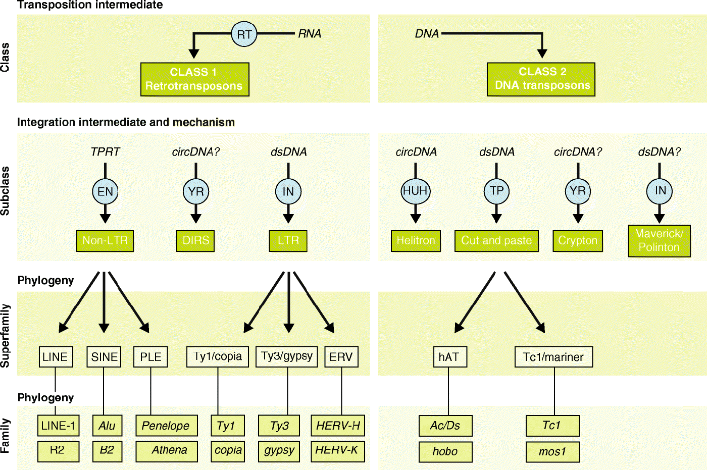

# 第2章 转座子的分类体系与命名规范

## 2.1 分类学的演进：从Finnegan到Wicker与Repbase体系

### 2.1.1 Finnegan的二分法：基于转座中间体的Ⅰ类与Ⅱ类划分

20世纪70年代末至80年代，随着分子克隆和Sanger测序技术在原核与真核生物中的普及，研究者在玉米、果蝇、酵母、线虫、哺乳动物及细菌中相继分离出数十种结构迥异的可移动DNA元件。在最初的探索阶段，命名完全取决于发现者的研究对象或表型特征：玉米中的*Ac*/*Ds*和*Spm*、果蝇中的*copia*与*P*元件、酵母中的*Ty*元件、人类基因组中的*Alu*和*LINE-1*，彼此之间缺乏统一的归类坐标。这种以宿主物种或突变表型为中心的命名方式，很快阻碍了跨物种的演化比较——研究者迫切需要一套超越物种界限、直指分子本质的分类框架。

1989年，英国遗传学家David Finnegan在《遗传学趋势》（*Trends in Genetics*）上发表了奠基性的分类方案，首次依据转座过程中所经历的核酸中间体类型，将真核生物转座子划分为两大根本类别[待确认]。第一类（Class I，Ⅰ类转座子），即反转录转座子（retrotransposons），其移动必须经过RNA中间体：宿主RNA聚合酶将原始转座子DNA转录为RNA，随后由元件自身编码（或反式借用）的逆转录酶将RNA反转录为互补双链DNA（cDNA），最终整合到宿主基因组的新位点上。由于原始拷贝在转录后依然保留在原位，Ⅰ类转座子遵循“复制-粘贴”（copy-and-paste）的扩增模式，每次成功的转座事件都会使基因组中该元件的拷贝数净增一个。

第二类（Class II，Ⅱ类转座子），即DNA转座子（DNA transposons），其移动不经过RNA中间体，而是直接以DNA分子本身作为移动载体。在Finnegan提出二分法的时代，已知的真核DNA转座子（如玉米*Ac*/*Ds*、果蝇*P*元件、线虫*Tc1*）均表现为由转座酶识别两端反向重复序列并将整个DNA片段从供体位点切下，再插入受体位点的“剪切-粘贴”（cut-and-paste）机制。

Finnegan的二分法在转座子生物学史上具有里程碑式的意义。它彻底打破了物种分类的藩篱，使学界意识到酵母的*Ty1*、果蝇的*copia*以及植物中的*Tnt1*尽管宿主亲缘关系相隔十亿年，但在分子生活史上属于同一大类；而同处玉米基因组中的*Ac*元件与*Cin4*元件则属于截然不同的演化谱系。直到今天，Ⅰ类（RNA中间体）与Ⅱ类（DNA中间体）的顶层二分法依然是所有转座子分类体系的基石。

然而，随着20世纪90年代末至21世纪初全基因组测序时代的到来，一系列违背经典模式的“非典型”DNA转座子被陆续发现，使得Finnegan的原始二分法面临严峻挑战。2001年，Kapitonov和Jurka在拟南芥、水稻和线虫基因组中鉴定出*Helitron*元件[待确认]。*Helitron*直接以DNA为中间体，理应归入Ⅱ类转座子，但它既没有经典的末端反向重复序列（TIR），也不采用“剪切-粘贴”机制，而是通过类似噬菌体和质粒的滚环复制（rolling-circle replication）机制，切割单链DNA并经由DNA复制合成新拷贝，客观上呈现出类似“复制-粘贴”的扩增特征。紧接着，研究者在真核生物中又发现了长达10至20 kb的*Maverick*（又称*Polinton*）元件，它们自身编码B家族DNA聚合酶，能够在切离后以单链或双链DNA为模板自我复制后再整合[待确认]。与此同时，在Ⅰ类转座子中，*DIRS*（*Dictyostelium*中间重复序列）元件被证明虽然经过RNA反转录，却不依赖经典整合酶，而是通过环状DNA中间体和酪氨酸重组酶完成整合。这些新发现表明，仅靠“Ⅰ类/Ⅱ类”两个层级已远远不足以容纳真核生物转座子的结构与机制多样性，亟需建立一套多层次的统一分类体系。

### 2.1.2 Wicker统一分类体系的层级架构与逻辑

为了终结不同模式生物社群（如植物学界、果蝇学界与哺乳动物学界）各行其是的分类乱象，2007年，由Thomas Wicker领衔的国际多物种研究团队在《自然综述：遗传学》（*Nat. Rev. Genet.*）上发表了题为《真核生物转座子的统一分类体系》的纲领性论文（doi:10.1038/nrg2165）。该体系借鉴了经典生物分类学的林奈层级思想，构建了一套自上而下、逻辑严密的六级分类框架：纲（Class）、亚纲（Subclass）、目（Order）、超家族（Superfamily）、家族（Family）和亚家族（Subfamily）。

在顶层的**纲（Class）**一级，Wicker体系完全保留了Finnegan的经典划分，即依据转座中间体为RNA还是DNA，区分为Ⅰ类（反转录转座子）和Ⅱ类（DNA转座子）（doi:10.1038/nrg2165）。为了妥善安置*Helitron*和*Maverick*这两类不发生双链切除的特殊DNA转座子，Wicker体系在Ⅱ类之下专门增设了**亚纲（Subclass）**一级：亚纲1（Subclass 1）涵盖所有在转座过程中双链DNA均被切离的经典元件（包括TIR型DNA转座子和*Crypton*）；亚纲2（Subclass 2）则专门收录仅切割单链或通过自我DNA合成实现扩增、不发生传统双链物理切离的DNA转座子（包括*Helitron*和*Maverick*）。Ⅰ类转座子由于机制均围绕逆转录展开，在Wicker 2007体系中未设亚纲。

在**目（Order）**一级，划分标准是元件的整体复制与整合机制、核心编码区的组织方式以及宏观结构特征（doi:10.1038/nrg2165）。Ⅰ类转座子被划分为5个目：长末端重复序列反转录转座子（LTR）、*DIRS*（使用酪氨酸重组酶的反转录元件）、*Penelope*样元件（PLE）、长散在核元件（LINE）以及短散在核元件（SINE）。Ⅱ类亚纲1包含2个目：末端反向重复序列元件（TIR）和利用酪氨酸重组酶的*Crypton*；Ⅱ类亚纲2包含2个目：*Helitron*和*Maverick*。这9个目构成了真核生物转座子宏观结构的主干图谱。

**超家族（Superfamily）**是Wicker体系中最核心、也是日常基因组学研究中最常使用的分类单元。同一个目内的不同超家族虽然共享相似的宏观转座策略，但在演化起源上相互独立或分化极早，其界定严格依赖两个方面的综合证据：一是核心催化蛋白（如逆转录酶或转座酶）的氨基酸序列同源性与系统发育聚类；二是具有高度诊断价值的精细结构特征，包括靶位点重复（TSD）的长度、末端反向重复序列（TIR）的保守特征碱基以及编码结构域的排列顺序（doi:10.1038/nrg2165）。例如，在LTR目下，根据*pol*基因内部整合酶（INT）与逆转录酶（RT）的相对位置以及RT系统发育树，划分出*Copia*、*Gypsy*、*Bel-Pao*、*Retrovirus*和*ERV*五个超家族；在TIR目下，则依据转座酶系统发育与TSD特征划分出*Tc1/Mariner*、*hAT*、*Mutator*、*Merlin*、*Transib*、*P*、*PiggyBac*、*PIF/Harbinger*和*CACTA*九个主要超家族。

在超家族之下，**家族（Family）**和**亚家族（Subfamily）**不再依赖蛋白质结构域，而是基于DNA核苷酸序列的相似性进行界定（doi:10.1038/nrg2165）。Wicker等人为此提出了著名的“80-80-80规则”（详见2.2.1节），旨在为大规模基因组测序时代的自动化聚类和家族统计提供可操作的定量标准。亚家族则用于进一步区分同一家族内部通过系统发育分析可明确辨别的晚近演化分支，通常对应同一家族在宿主演化史上不同时期的连续爆发波次。

### 2.1.3 Repbase体系与Wicker体系的核心分歧

Wicker统一分类体系发表后迅速在植物基因组学界获得广泛采纳，但也立刻引发了另一支极具影响力的分类学派——Repbase数据库创建者Vladimir Kapitonov与Jerzy Jurka的公开质疑。2008年，Kapitonov和Jurka在《自然综述：遗传学》上发表了正式评论文章《Repbase中实施的真核生物转座子通用分类体系》（doi:10.1038/nrg2165-c1），系统阐述了Repbase分类体系的设计哲学，并尖锐指出了Wicker体系在机制一致性与演化单系性上的多处缺陷。这两套体系的分歧至今仍深刻影响着生物信息学工具的输出格式，研究者必须透彻理解其差异。

两者的第一大核心分歧在于**Ⅱ类转座子的顶层细分逻辑**。Kapitonov和Jurka指出，Wicker体系将*Crypton*与经典TIR元件共同归入Ⅱ类亚纲1是不合理的：经典TIR元件依赖DDE/DDD转座酶催化双链剪切-粘贴，而*Crypton*依赖酪氨酸重组酶通过环状DNA中间体进行位点特异性重组，二者在催化机制和演化起源上毫无亲缘关系（doi:10.1038/nrg2165-c1）。因此，Repbase体系摒弃了亚纲1/2的划分，直接将Ⅱ类DNA转座子并列划分为四个主要演化大类：经典DNA转座子（编码DDE/DDD转座酶）、*Helitron*、*Polinton*（即Wicker体系中的*Maverick*）以及*Crypton*。

第二大核心分歧在于**对非自主型转座子的归类原则**。Wicker体系主张，非自主型元件应当尽可能归入其对应自主型元件所属的超家族或家族中，例如将微型反向重复转座元件（MITEs）分散归入*PIF/Harbinger*、*Tc1/Mariner*等TIR超家族，不为其单设分类层级。但Kapitonov和Jurka敏锐地指出，Wicker体系自身违背了这一原则：SINE元件本质上是依赖LINE元件逆转录酶反式动员的非自主型反转录转座子，Wicker体系却将SINE单列为一个与LINE平级的独立“目”，而没有采用同样标准处理MITEs、LARD或TRIM（doi:10.1038/nrg2165-c1）。相比之下，Repbase作为面向实际注释的参考序列数据库，更注重序列实体的可操作性，对SINE（依据其起源的tRNA、7SL RNA或5S rRNA进一步细分）及多种非自主元件均设有独立且灵活的分类标签。

第三大核心分歧体现在**超家族的划分粒度与传统命名习惯**。Wicker 2007体系为了保持框架简洁，在TIR目下仅列出了9个经典超家族；而Repbase基于对数百种真核生物（包括原生生物、真菌、无脊椎动物和低等植物）基因组的长期人工精修，依据转座酶催化域的系统发育独立性，识别并维护了超过20个DNA转座子超家族，例如增补了*Chapaev*、*Kolobok*、*Sola*、*Zator*、*Ginger*、*Academ*、*Novosib*等在小众类群或特定演化支中发现的超家族（doi:10.1038/nrg2165-c1）。在命名上，双方也存在显著的历史惯性差异：植物学界和Wicker体系习惯称呼的*CACTA*、*Mutator*和*Maverick*，在Repbase中分别对应*EnSpm*（以玉米*Enhancer/Suppressor-mutator*命名）、*MuDR*和*Polinton*。

从本质上看，Wicker体系与Repbase体系并非绝对对立的“正确与错误”，而是反映了两种不同的科学目标：Wicker体系追求教学友好、结构对称、带有统一编码的宏观分类规范，更适合跨物种宏观统计与自动化注释流程设计；Repbase体系则追求对演化多样性细节的忠实记录与数据库检索的高精度，更贴近一线序列精修专家的工作需求。在现代转座子研究中，两套体系长期并存，熟知二者之间的术语映射关系是开展文献综述与数据分析的必备能力。

### 2.1.4 基于蛋白质结构域系统发育的分类依据

在转座子的多层级分类中，一个贯穿始终的方法论问题是：为什么在家族层面可以使用DNA碱基相似度，而在超家族及更高层级上却必须依赖蛋白质结构域的系统发育分析？答案根植于转座子独特的分子演化规律。

绝大多数转座子拷贝一旦插入宿主基因组，便迅速遭受宿主表观遗传沉默机制的压制，不再承担维持宿主生存的功能，因此处于近乎完全中性的演化状态（缺乏纯化选择保护）。在中性突变率的驱动下，转座子的非编码区（如LTR序列、非翻译区和内部间隔区）以极快的速度积累点突变和插入缺失。通常只需经过数百万至数千万年的演化，同一超家族内不同家族之间的DNA核苷酸相似度就会衰减到随机噪声水平（低于50%），基于核酸序列的比对工具（如BLASTN）将完全失效。

然而，对于在演化谱系中持续保持转座活性的自主型转座子而言，其编码的核心催化酶（如逆转录酶和转座酶）必须维持精确的三维空间构象和催化活性中心，否则就会丧失扩增能力并在基因组内自然消亡。这种源于基因组内自私选择的强烈纯化选择压力，使得转座子核心蛋白质结构域的氨基酸序列在跨越数亿年甚至超过十亿年的深层演化尺度上，依然保留了清晰可辨的保守基序。因此，蛋白质结构域成为界定转座子超家族最可靠的分子化石与系统发育标记（doi:10.1038/nrg2165）。

在Ⅰ类反转录转座子中，**逆转录酶（reverse transcriptase，RT）结构域**是公认的通用系统发育锚点。所有Ⅰ类自主元件的RT结构域都包含7个高度保守的氨基酸催化基序（通常编号为基序1至7，其中包含经典的催化三联体，如`YXDD`或`FDD`基序）。利用这7个保守区段构建的系统发育树，能够将真核生物所有反转录元件清晰地划分为LTR、DIRS、PLE和LINE等单系大类，并在LTR内部准确区分*Ty1/Copia*、*Ty3/Gypsy*、*Bel-Pao*等超家族。除了序列系统发育外，*pol*多聚蛋白内部不同功能结构域的线性排列顺序还提供了极强的独立共衍征（synapomorphy）：例如，*Ty1/Copia*超家族的结构域排列恒定为蛋白酶（PR）—整合酶（INT）—逆转录酶（RT）—核糖核酸酶H（RH）；而*Ty3/Gypsy*超家族则恒定为PR—RT—RH—INT（doi:10.1038/nrg2165）。将RT系统发育与结构域排列顺序相结合，几乎可以百分之百无歧义地鉴定任何完整的自主型LTR元件。

在Ⅱ类经典TIR转座子中，分类的核心锚点则是**转座酶（transposase，TPase）的DDE或DDD催化结构域**。这类转座酶在三维结构上共享核糖核酸酶H样折叠（RNase H-like fold），其活性中心由三个空间上紧密相邻的酸性氨基酸残基（两个天冬氨酸D和一个谷氨酸E，或三个天冬氨酸D）组成，负责螯合二价镁离子（$\text{Mg}^{2+}$）以催化DNA磷酸二酯键的水解与转酯反应。不同TIR超家族在DDE/DDD基序之间的氨基酸间隔长度、两侧保守特征残基以及DNA结合域（如BED锌指、HTH结构域）上各具特色，结合该超家族特有的TSD长度与TIR末端碱基，共同构成了严密的超家族界定标准。而对于非DDE型的Ⅱ类元件，*Helitron*依赖Rep/Helicase双功能结构域（包含滚环复制特有的HUH基序和SF1解旋酶基序），*Maverick*/*Polinton*依赖B家族DNA聚合酶与反转录病毒样整合酶，*Crypton*则依赖酪氨酸重组酶的RHR基序和催化酪氨酸残基。

尽管蛋白质结构域系统发育是目前最严谨的高阶分类依据，研究者也必须清醒地认识到其固有的应用局限。第一，真核生物基因组中大量存在的非自主型元件（如MITEs、SINEs、LARDs、TRIMs）以及高度退化的古老碎片根本不包含任何编码区，完全无法通过蛋白质结构域直接定类，只能退而求其次，依据末端非编码结构特征或与已知自主型元件的局部核酸同源性进行间接归类。第二，转座子在漫长演化中也存在模块重组（domain shuffling）现象，例如某些反转录元件的*gag*基因、*env*样基因与*pol*基因可能拥有不同的演化来源，因此单凭单一结构域建树有时会掩盖嵌合起源的复杂历史，必要时需结合多结构域联合系统发育分析加以核验。

*图：真核转座子的分类总图，按转座中间体和关键酶分出Ⅰ类与Ⅱ类，并画出各类的典型结构模块。原图未修改，引自 Bourque G、Burns KH、Gehring M 等（2018），Ten things you should know about transposable elements，Genome Biology 19:199，Fig. 1，doi:10.1186/s13059-018-1577-z，PMC6240941，许可 CC BY 4.0 (https://creativecommons.org/licenses/by/4.0/)。图片文件与配图合订本所用的相同。*

## 2.2 统一分类框架中的层级与边界争议

### 2.2.1 80-80-80规则的实用价值与理论局限

在2007年提出的统一分类体系中，Wicker等人针对“如何界定一个转座子家族”这一困扰基因组注释多年的实操难题，给出了一条广为流传的定量操作标准，即**80-80-80规则**：两条转座子序列若要被归入同一个家族，必须同时满足三个条件——二者比对区域的序列长度不低于80 bp，比对覆盖度不低于参考序列全长的80%，且比对区域内的DNA碱基一致性（identity）不低于80%（doi:10.1038/nrg2165）。

从生物信息学工程实践的角度看，80-80-80规则具有显著的实用价值。首先，它为大规模基因组重复序列的自动化聚类（例如使用CD-HIT、VSEARCH等序列聚类软件去除冗余）提供了明确且易于编程实现的参数阈值，使得不同实验室在处理同一物种或近缘物种基因组时，能够依据统一标尺统计转座子家族数量并构建非冗余一致性文库。其次，“长度不低于80 bp”的下限设定有效过滤了真核生物基因组中广泛存在的短片段随机同源性（如低复杂度区域、简单重复或偶然相似的短基序），防止毫无亲缘关系的元件被错误合并。在植物比较基因组学中，80-80-80规则已成为衡量家族边界和计算家族拷贝数的事实标准。

然而，一旦将80-80-80规则置于严格的演化生物学和数学逻辑下审视，其理论局限性便暴露无遗。

第一是**聚类关系上的非传递性（non-transitivity）**。在数学集合论中，基于固定相似度阈值的“属于同一家族”关系并不满足等价关系的传递律。假设基因组中存在同一古老家族演化出的三个拷贝A、B、C：序列A与B的一致性为82%，序列B与C的一致性也为82%，但A与C之间由于各自在不同位点积累了突变，一致性仅为74%。按照80-80-80规则，A与B应为同一家族，B与C应为同一家族，但A与C却不属于同一家族。在实际使用聚类算法时，如果采用单链聚类（single-linkage clustering），这种链式效应会导致许多原本分化较远的家族被雪球式地合并为一个庞大的超级家族；如果采用贪心中心点聚类（如CD-HIT），最终划分出的家族数量和边界则会高度依赖于输入序列的排序顺序，带来不可忽视的算法不稳定性。

第二是**固定碱基一致性阈值与演化时间尺度的脱节**。80%的核酸一致性意味着两条序列之间积累了约20%的碱基差异。但在自然界中，不同植物类群的世代周期和中性分子进化速率存在巨大差异。一年生草本植物（如拟南芥或水稻）的每年中性替代率显著高于世代周期长达数十年甚至上百年的多年生木本植物（如葡萄、杨树或裸子植物松柏类）[待确认]。因此，同样的“80%一致性”边界，在草本植物中可能仅对应过去数百万年内分化出的年轻分支，而在木本植物中却可能涵盖了数千万年前就已经分道扬镳的古老演化谱系。用一把固定的碱基百分比尺子去衡量不同物种的家族多样性，必然引入系统性的演化时间偏倚。

第三是**结构不对称性与内部缺失引发的家族割裂**。转座子在基因组中极易发生内部大片段缺失或同源重组。例如，一条全长10 kb的完整LTR反转录转座子，在其生命周期中可能通过两端LTR之间的同源重组失去整个内部编码区，留下一个长度仅800 bp的单LTR（solo-LTR）；或者因内部缺失衍生出一个长度2 kb的非自主拷贝。尽管这个solo-LTR与完整拷贝的LTR区域碱基一致性高达98%，在生物学上毫无疑问属于同一个家族的成员，但若严格按照“覆盖度达到较长序列全长的80%”来计算，800 bp仅占10 kb的8%，远低于80%的覆盖度红线。反之，如果在聚类软件中放宽为“覆盖度达到较短序列的80%”，虽然能将solo-LTR和截短片段成功归并，却又会带来新的灾难：任何偶然插入到大型嵌合元件内部的小型短转座子（如MITE），都会因为自身100%被大元件覆盖而导致两个完全不同超家族的元件被错误合并。

第四是**同一元件内部不同区段演化速率的异质性**。在完整LTR反转录转座子中，负责编码逆转录酶和整合酶的*pol*区受到较强的纯化选择，序列相对保守；而两端的LTR以及非编码调控区演化速率快得多。这经常导致两条元件在*pol*区一致性高达88%，但在LTR区一致性已降至65%。此时它们是否属于同一家族，完全取决于研究者是按全长比对还是仅按LTR区比对。

正因存在上述深层缺陷，系统发育分类学家Seberg和Petersen在2009年发表专文对Wicker体系中的80-80-80规则提出了尖锐批评，指出以固定相似度百分比划界实质上是早已被现代生物系统学摒弃的“表型数值分类学”（phenetics）回潮，而非基于共同祖先和单系群（monophyly）的支序系统学（cladistics）[待确认]。尽管在面对数百万条全基因组重复序列时，构建全套支序系统发育树在计算上仍不现实，80-80-80规则作为工程妥协方案短期内尚无可替代，但研究者在解读家族数量和家族边界时，必须牢记它只是一个人为划定的操作近似值，绝非绝对的生物学自然边界。

### 2.2.2 嵌合元件、高度退化拷贝与水平转移带来的边界模糊

经典的林奈式层级分类体系有一个隐含的数学前提：所有被分类的实体都处于一棵严格分叉的演化树上，每个子节点只能拥有唯一的一个父节点。然而，转座子在宿主基因组中的真实演化历程充满了重组、退化与跨物种跳跃，大量真实存在的序列直接打破了严格树状分类的理想假设。

**嵌合型转座子（chimeric TEs）**是层级分类面临的最典型挑战。嵌合元件的产生主要有三种分子途径：其一是**反转录过程中的模板转换（template switching）**。由于Ⅰ类LTR反转录转座子的病毒样颗粒中通常同时包装两条RNA分子，当不同家族的RNA被共包装时，逆转录酶在合成cDNA的过程中可能从一条模板跳跃到另一条模板上，产生由A家族提供LTR调控区、B家族提供*gag*/*pol*编码区的重组型LTR元件。其二是**嵌套插入后的复合移动**。当一个转座子（如小型DNA转座子或MITE）插入到另一个活跃转座子的非必需区域内部后，宿主或转座酶可能将这个“元件套元件”的复合体作为一个整体进行转录或切离并继续扩增，形成跨超家族的嵌合体。其三是**宿主基因片段的捕获**。植物基因组中的*Pack-MULE*（Mutator样元件）和*Helitron*以频繁捕获、拼接宿主蛋白质编码基因的外显子而著称。一条嵌合元件在物理上同时携带来自两个不同超家族甚至宿主基因的遗传信息，无论将其硬性归入哪一个单一分类节点，都会丢失另一半关键的演化与结构信息。

**高度退化拷贝（highly degraded copies）**构成了基因组注释中庞大的“暮光区”（twilight zone）。随着插入年代推移，数千万年前爆发的古老转座子拷贝会不断遭受随机点突变、小片段缺失以及年轻转座子的反复打断与覆盖。最终，这些古老拷贝失去了完整的开放阅读框，两端的TIR、TSD和LTR边界彻底消融，仅剩下一段数百碱基长、与现代一致性序列一致性仅存60%至70%的残片。在自动化注释流程中，这些碎片往往既无法满足结构预测算法的边界要求，也难以跨越同源比对软件的显著性打分阈值，最终被大量归入“未分类”（Unknown）或仅能勉强定类到“目”一级的模糊标签。这种随时间推移而急剧下降的分类分辨率，意味着我们从基因组注释表中看到的转座子组成，天然偏向于近期活跃的年轻元件，而系统性地低估了古老转座子的历史贡献。

**转座子水平转移（horizontal transposon transfer，HTT）**则进一步模糊了跨物种分类与命名的边界。与主要依靠垂直遗传（亲代传给子代）的宿主基因不同，转座子能够跨越生殖隔离，借助昆虫媒介、寄生植物、病毒、真菌或附生微生物，在亲缘关系极远的物种之间发生水平传播。在动物界（如果蝇与脊椎动物之间）和植物界（如禾本科与双子叶植物之间、不同科属被子植物之间），已有大量确凿的LTR反转录转座子和DNA转座子水平转移案例被报道[待确认]。例如，如果葡萄基因组中的某一个*Copia*家族与远缘木本植物或寄生植物中的某家族共享高达95%的核酸一致性，远超二者宿主基因组的演化分化程度，那么在跨物种泛基因组或数据库收录时，这两个序列在80-80-80规则下属于同一个家族，但传统的“物种前缀+家族编号”命名法却会将它们割裂为两个毫无关联的独立条目，掩盖了它们近期共享同一水平转移源头的演化事实。

### 2.2.3 非自主元件的归类难题：以MITEs、LARD与TRIM为例

在真核生物（尤其是高等植物）基因组中，不编码任何蛋白质的非自主型转座子在拷贝数上常常占据压倒性优势。然而，正因为缺乏核心编码结构域，非自主元件构成了所有分类体系中最棘手的“灰色地带”，集中体现了“按演化起源归类”与“按结构表型归类”之间的深刻矛盾。

**微型反向重复转座元件（MITEs）**是植物基因组中最具代表性的非自主Ⅱ类元件。MITEs通常长度极短（多在50至600 bp之间）、富含AT碱基、无编码能力、具有保守的末端反向重复序列（TIR）和明确的靶位点重复（TSD），且同一家族的拷贝长度高度均一、拷贝数可达数千至数万个。分子演化研究表明，绝大多数植物MITEs是由自主型TIR DNA转座子（尤其是*PIF/Harbinger*超家族产生的*Tourist*样MITEs，以及*Tc1/Mariner*超家族产生的*Stowaway*样MITEs，另有部分源自*hAT*、*Mutator*和*CACTA*）经由内部缺失演化而来，并依靠这些自主型元件反式提供的转座酶在基因组中大规模扩增。

在Wicker 2007统一分类体系中，MITEs并不作为一个独立的目或超家族存在，而是被要求根据其TIR和TSD特征分别归入对应的TIR超家族（doi:10.1038/nrg2165）。这一设计在理论上遵循了演化起源原则，但在实际注释操作中却面临两大困难：其一，许多古老的MITEs家族在宿主基因组中对应的自主型“母本”早已彻底灭绝或退化殆尽，缺乏序列同源桥梁；其二，部分MITEs的TIR极短且发生突变，仅凭2至3 bp的TSD（如`TA`或`TAA`）很难在全基因组尺度上可靠区分其究竟源自*Tc1/Mariner*、*PIF/Harbinger*还是*CACTA*。因此，许多植物转座子预测软件和文献在实操中依然习惯将MITEs单列为一个独立统计类别，结果导致同一批MITEs在不同研究中时而被计入*PIF/Harbinger*，时而被单列为*MITE*，造成统计口径混乱。

类似的问题在Ⅰ类LTR反转录转座子的非自主衍生物——**LARD（大型反转录转座子衍生物）**与**TRIM（末端重复反转录转座子微型元件）**中表现得更为突出。LARD和TRIM两端均保留了成对的同向LTR序列、引物结合位点（PBS）、多聚嘌呤区（PPT）以及经典的4至6 bp TSD，但其内部编码区完全缺失，取而代之的是一段非编码序列（TRIM全长通常仅数百bp至1 kb，LARD全长则可达数kb以上）[待确认]。由于彻底丧失了*gag*和*pol*蛋白编码区，除非能在同一基因组中找到与该LARD或TRIM共享高相似度LTR序列的完整自主型拷贝，否则根本无法利用RT系统发育或结构域顺序判定它究竟隶属于*Ty1/Copia*还是*Ty3/Gypsy*超家族。在绝大多数植物基因组（包括葡萄基因组）的注释结果中，大量结构完整的LARD和TRIM最终只能停留在“LTR/unknown”这一粗糙层级上。

此外，正如2.1.3节所述，Wicker体系对非自主元件的处理本身存在逻辑不对称：SINE作为非自主型非LTR反转录转座子被赋予了独立的“目”级地位（与LINE平级），而同样作为非自主元件的MITEs、LARDs和TRIMs却未被赋予独立层级。这提醒我们，任何分类体系都是在生物学演化的连续光谱上强行切分出的离散格子，遇到跨越格子的非自主衍生物时，明确标注其“自主/非自主状态”往往比强行塞入某个不确定的超家族更有科学价值。

### 2.2.4 跨物种与跨工具比较中的分类陷阱

在比较基因组学研究、综述撰写以及多物种数据整合分析中，研究者经常需要将自己注释的基因组转座子汇总表与其他已发表论文的数据进行横向对比。这一看似常规的操作，实际上暗藏着诸多由分类体系不统一引发的方法学陷阱。

第一个常见陷阱是**超家族名称的同义词与历史更替**。不同数据库与软件遵循不同的命名传统，同一个生物学超家族在输出文件中可能顶着截然不同的名字。例如，在TIR DNA转座子中，Wicker体系和植物学界广泛使用的*CACTA*，在Repbase和RepeatMasker默认输出中被标记为`DNA/CMC-EnSpm`；Wicker体系中的*Mutator*（或MULE），在Repbase中常标记为`DNA/MULE-MuDR`；Wicker体系中的*Maverick*在Repbase中称为*Polinton*；*PIF/Harbinger*在不同工具中可能写作`PIF-Harbinger`、`Harbinger`或`DTH`。近年来，国际转座子学界还针对“Gypsy”一词在英语语境中带有针对罗姆人群体的贬义色彩展开了广泛的更名倡议，呼吁在学术论文和数据库中逐步使用*Ty3*或国际病毒分类委员会（ICTV）的*Metaviridae*取代*Gypsy*，并相应以*Ty1*或*Pseudoviridae*对应*Copia*[待确认]。在当前漫长的术语过渡期内，新旧名称在文献和软件输出中高度混用，如果直接用脚本按字符串匹配汇总不同来源的统计表，极易漏掉整个超家族的数据。

第二个陷阱是**分类粒度不匹配导致的重复计算或遗漏**。RepeatMasker结合Repbase/Dfam输出的分类标签往往细分到亚超家族或家族复合层级，例如将*hAT*细分为`DNA/hAT-Ac`、`DNA/hAT-Tip100`、`DNA/hAT-Tag1`、`DNA/hAT-Charlie`等多个条目，同时将*Helitron*单独置于`RC/Helitron`（滚环类）之下而非`DNA/`之下；而像EDTA这样的植物整合注释流程，则会输出诸如`LTR/Gypsy`、`DNA/DTC`、`MITE/DTH`、`DNA/Helitron`等混合了Wicker三字母代码与结构标签的格式。如果研究者在统计“DNA转座子总占比”时仅筛选以`DNA/`开头的行，就会在RepeatMasker结果中意外遗漏`RC/Helitron`，或在EDTA结果中遗漏`MITE/`类别，导致跨论文比较出现高达数个百分点的系统误差。

第三个、也是最容易被忽视的陷阱是**“未分类（Unknown）”比例造成的分母扭曲与假象**。假设两篇关于不同葡萄品种或近缘物种的论文，一篇报道*Gypsy*占比为22%、*Unknown*占比为3%；另一篇报道*Gypsy*占比为14%、*Unknown*占比为18%。初学者很容易草率得出“第一个物种发生了剧烈的*Gypsy*扩张”的错误结论。实际上，这种差异很可能完全源于注释流程和参考文库精修程度的差异：后一篇论文可能仅运行了未经人工精修的从头重复序列预测工具（如RepeatModeler默认流程），将大量结构退化或边界截短的*Gypsy*片段滞留在了*Unknown*类别中。同样，某些算法在默认参数下对*Helitron*存在极高的假阳性预测率，若未经严格过滤直接跨文献比较，往往会制造出“某植物基因组中*Helitron*异常扩张”的纯计算假象。因此，在任何严谨的跨物种或跨单倍型比较研究中，绝对不能直接拼凑不同文献中各自跑出的汇总表，而必须使用同一套标准化的注释流程和统一的泛基因组一致性文库对所有目标基因组进行重新注释，才能确保比较结果的科学可靠性。

## 2.3 命名规则与公共数据库标准

### 2.3.1 Wicker三字母代码命名法与标准命名格式

在统一分类体系建立之前，转座子家族的命名几乎完全依赖发现者的个人偏好或偶然灵感——例如以神话人物、历史事件、音乐流派或宿主突变表型命名（如*Copia*、*Gypsy*、*Mariner*、*Tourist*、*Stowaway*、*Gret1*）。这类富有文化色彩的传统名称虽然易于人类记忆，但对于计算机解析和大规模跨基因组统计却极不友好：仅凭“*Gret1*”或“*BARE1*”这样的字符串，研究者和生信脚本都无法直接判断它究竟属于Ⅰ类反转录转座子还是Ⅱ类DNA转座子，更无法得知其所属的目与超家族。

为了解决这一痛点，Wicker等人在2007年的统一分类体系中配套设计了一套高度结构化的**三字母代码命名法**（three-letter code），将“纲—目—超家族”三个核心分类层级直接编码进三个大写英文字母之中（doi:10.1038/nrg2165）。这套编码规则简洁直观，已成为现代植物基因组学和众多自动化注释工具（如EDTA、TREP）的通用语言。

三字母代码的构成遵循严格的逐级定位逻辑：
- **第一位字母代表纲（Class）**：`R`代表Ⅰ类反转录转座子（Retrotransposon），`D`代表Ⅱ类DNA转座子（DNA transposon）。
- **第二位字母代表目（Order）**：在Ⅰ类（`R`）之下，`L`代表LTR，`Y`代表DIRS（取酪氨酸重组酶Tyrosine之音），`P`代表PLE（Penelope-like elements），`I`代表LINE，`S`代表SINE。在Ⅱ类（`D`）之下，`T`代表TIR，`Y`代表Crypton，`H`代表Helitron，`M`代表Maverick。
- **第三位字母代表超家族（Superfamily）**：在LTR目（`RL`）下，`RLC`代表*Copia*，`RLG`代表*Gypsy*，`RLB`代表*Bel-Pao*，`RLR`代表*Retrovirus*，`RLE`代表*ERV*；在TIR目（`DT`）下，`DTT`代表*Tc1/Mariner*，`DTA`代表*hAT*（取*Ac*之首字母），`DTM`代表*Mutator*，`DTC`代表*CACTA*，`DTH`代表*PIF/Harbinger*，`DTP`代表*P*，`DTB`代表*PiggyBac*，`DTE`代表*Merlin*，`DTR`代表*Transib*；对于目下仅含单一或未细分超家族的类群，第三位字母常重复第二位或采用特定字母，如`DHH`代表*Helitron*，`DMM`代表*Maverick*，`DYC`代表*Crypton*（doi:10.1038/nrg2165）。

此外，三字母代码还引入了一个极具实用价值的通配符——字母`X`，专门用于表示在某一分类层级上**未知或尚未确定**（unknown/unclassified）的状态（doi:10.1038/nrg2165）。例如，一条具有完整两端LTR和TSD、但因内部编码区完全缺失而无法区分*Copia*与*Gypsy*的非自主LTR元件，应编码为`RLX`；一条确认属于TIR DNA转座子但无法归入已知超家族的元件，编码为`DTX`；仅能确认属于反转录转座子但连“目”都无法判定的退化片段，编码为`RXX`；而完全无法判定大类的未知重复序列，则可标记为`XXX`。这种设计避免了强行归类带来的假阳性污染，忠实保留了注释过程中的不确定性信息。

在实际基因组注释文件（如FASTA文库头文件或GFF3特征表）中，完整的Wicker标准命名格式通常由三字母代码、家族名称、物种缩写以及可选的拷贝编号通过下划线和连字符拼接而成，形式为`三字母代码_家族名_物种缩写-拷贝号`（doi:10.1038/nrg2165）。例如，在栽培葡萄（*Vitis vinifera*，常缩写为`Vvi`）中发现的经典*Gypsy*元件*Gret1*，按照规范可写作`RLG_Gret1_Vvi`，其基因组上的第1个具体拷贝则可记作`RLG_Gret1_Vvi-1`。在生物信息学实践中，遵循这一标准化命名格式能够让下游脚本通过简单的前缀切分，在毫秒级时间内完成全基因组各纲、目、超家族的拷贝数与碱基占比汇总，极大降低了数据清洗的出错率。

### 2.3.2 主流公共转座子数据库的定位与特点

高质量的转座子研究离不开公共参考序列数据库的支撑。经过三十余年的发展，国际转座子学界已经形成了若干定位互补、覆盖面各异的核心公共数据库。了解这些数据库的数据结构、维护机制与适用边界，是合理选择参考文库的前提。

**Repbase**（由遗传信息研究所GIRI的Jerzy Jurka于20世纪90年代初创立并长期维护）是转座子领域历史最悠久、影响力最深远的综合型参考数据库[待确认]。Repbase的核心特色在于其高标准的专家人工精修（manual curation）：每一条收录的真核生物转座子一致性序列，原则上都经过了边界核验、末端特征确认、编码区翻译检查与超家族归类。在长达二十多年的时间里，Repbase一直是全基因组重复序列屏蔽软件RepeatMasker的默认核心文库。然而，随着维护经费压力的增加，Repbase在2019年前后转向了付费订阅制，限制了其核心文库随开源软件自由分发的权限，这在一定程度上推动了开源替代数据库的加速发展。

**Dfam**是当前最具活力的完全开源、开放获取（open-access）的转座子数据库，目前已成为RepeatMasker和RepeatModeler的默认核心后端库[待确认]。与Repbase早期主要存储单一核苷酸一致性序列不同，Dfam在底层设计上引入了**轮廓隐马尔可夫模型（profile Hidden Markov Models，profile HMMs）**来表征每一个转座子家族[待确认]。profile HMMs不仅记录了每个碱基位点的优势碱基，还定量刻画了不同位点的碱基替换概率以及插入/缺失（indel）的容忍度。在比对高度分化、年代久远的古老转座子拷贝时，基于profile HMMs的搜索灵敏度显著高于传统的一致性序列局部比对。近年来，Dfam进一步扩展为包含已精修家族（curated families）与社区提交的未精修从头预测家族（uncurated families）的双层架构，极大地扩充了对非模式物种的覆盖范围。

除了Repbase和Dfam这两大跨界综合数据库外，植物基因组学界还建立了多个**植物专用转座子数据库与参考文库**，以弥补综合库在植物类群上的不足。
- **TREP（TRansposable Elements Platform）**最初聚焦于小麦族（小麦、大麦等）植物，随后逐步扩展至更广泛的单子叶与双子叶植物[待确认]。TREP以极高的人工精修质量著称，且严格贯彻Wicker三字母代码命名体系，非常适合作为植物转座子分类学的教学范本与高质量基准测试集。
- **PGSB Repeat Element Database（原MIPS-REdat）**是一个面向大型植物比较基因组学的重复序列集合，整合了大量已测序被子植物（包括模式植物、禾本科作物及部分木本植物）的重复序列，常用于跨物种同源检索[待确认]。
- 此外，学界还维护着针对特定转座子大类的垂直数据库，例如专注于LTR反转录转座子和逆转录病毒蛋白结构域系统发育的**GyDB**（Gypsy Database），以及专门收录真核生物SINE元件的**SINEBase**等[待确认]。

### 2.3.3 公共数据库维护中的现实问题与局限

尽管公共转座子数据库为基因组学研究提供了宝贵的基础设施，但它们绝非完美无缺的“标准答案库”。在实际科研中，盲目依赖公共数据库直接对新测序基因组进行同源屏蔽，往往会遭遇三大突出的现实问题。

第一是**数据库内部的冗余条目与碎片化污染**。由于公共数据库汇聚了来自全球不同实验室、不同测序年代和不同亲缘物种的提交记录，同一个转座子家族常常以多个不同的名称被反复收录。更常见的情况是，一条全长8 kb的完整LTR反转录转座子，其内部区域、单侧LTR片段以及不同截短版本的非自主衍生物，在数据库中可能作为四五条彼此独立的条目同时存在。当RepeatMasker使用包含大量冗余条目的数据库扫描基因组时，基因组上的同一个真实插入位点会同时匹配到多个高度相似的参考条目，导致注释结果被切得支离破碎，进而扭曲家族拷贝数统计和完整度评估。

第二是**错误分类与宿主基因混入的“传递效应”**。在早期基因组测序和大规模自动化提交阶段，部分被错误分类的序列进入了公共数据库——例如，将*Copia*误标为*Gypsy*，将嵌套插入的嵌合体当作单一家族收录，或者最危险的情况：将宿主基因组中天然存在的高拷贝蛋白质编码基因家族（如植物抗病基因NLR、组蛋白基因、泛素基因、细胞色素P450或F-box基因家族）误判为重复转座子收入库中。由于后续无数新测序物种的自动化注释流程都依赖与公共库的同源比对来传递分类标签，一条错误的数据库条目就像病毒一样，通过“以讹传讹”的同源注释链条，被复制到数十甚至上百个新发表的基因组注释结果中。如果库中混入了宿主抗病基因片段，使用该库对新基因组进行硬屏蔽后，下游的基因结构注释软件就会把大量真实的抗病基因彻底漏掉。

第三是**严重的物种覆盖偏倚（taxonomic bias）**。公共转座子数据库的收录分布极度不均匀，绝大多数高质量精修条目高度集中在少数明星模式生物（如人类、小鼠、果蝇、线虫、拟南芥、水稻、玉米、小麦）中。对于广大的非模式植物，尤其是多年生木本果树、林木以及野生近缘种，公共数据库中的覆盖率极低。以本书的范例物种葡萄属（*Vitis*）为例，虽然栽培葡萄（*Vitis vinifera*）是较早完成全基因组测序的果树之一，但在Repbase和Dfam等公共库中，经过严格人工精修的葡萄特异性转座子家族数量依然非常有限，远远无法涵盖葡萄属数十个野生种和栽培品种中极其丰富的谱系特异性LTR爆发家族与MITEs家族。如果仅用公共数据库直接屏蔽葡萄基因组，往往会漏检大量近期活跃的年轻转座子，导致基因组中转座子总占比被严重低估。

### 2.3.4 构建物种特异性一致性序列文库的必要性

正因为公共数据库存在物种覆盖不足、冗余与分类噪音等固有局限，当代高质量基因组注释的黄金法则非常明确：**绝不能仅依赖公共数据库进行单步同源屏蔽，而必须针对目标物种（或目标属的泛基因组）从头构建并精修物种特异性的一致性序列（consensus sequence）文库**。

所谓**一致性序列**，是指将基因组中属于同一转座子家族的多个同源拷贝进行多序列比对后，在每一个碱基位点上取出现频率最高的碱基（多数投票原则）重构出的代表性序列。从演化生物学的角度看，由于每个独立拷贝在插入基因组后所积累的随机点突变和小片段缺失在位置上是相互独立的，通过多拷贝比对取多数碱基，能够有效“抵消”各自独立的插入后突变，从而在数学上高度逼近该转座子家族在历史爆发瞬间的**祖先活性序列（ancestral active sequence）**。

构建物种特异性一致性序列文库为何是高质量注释的前提？其底层逻辑体现在三个核心层面：

首先，**大幅提升对退化拷贝的检测灵敏度与边界完整度**。假设某个古老转座子家族在距今数百万年前爆发，每个拷贝自插入以来平均积累了15%的随机点突变。如果直接用基因组中的任意一个拷贝去比对另一个拷贝，二者之间的序列分歧度将叠加至约30%（即一致性降至70%），已经逼近常规核酸比对工具的检测极限，极易造成漏检或只比对上局部保守片段。但如果先重构出该家族的祖先一致性序列，那么每一个退化拷贝与一致性序列之间的分歧度就减半回落至约15%（一致性达85%）。这一简单的演化几何学原理，使得基于一致性文库的同源屏蔽能够精准捕获大量隐藏在基因组深处的古老退化拷贝，并还原其完整边界。

其次，**全面捕获谱系特异性与近期活跃的转座子家族**。不同植物科属在分化后的数千万年间，各自经历了完全独立的转座子爆发事件。这些物种或属内特有的年轻转座子家族在远缘模式植物（如拟南芥或水稻）的公共库中根本不存在，但它们恰恰是驱动当前物种基因组大小分化、染色体结构变异以及群体表型多态性的最主要力量。只有通过从头预测与物种特异性文库构建，才能将这些决定物种演化特色的年轻家族完整纳入视野。

最后，**实现跨单倍型、跨品种与泛基因组研究的统一标尺**。对于像葡萄这样高度杂合、且包含众多栽培品种与野生近缘种的植物类群，若对每一个新组装的单倍型基因组分别进行孤立的从头预测，同一家族在不同单倍型中会被赋予不同的随机编号，导致无法直接比较不同品种间同一家族的扩张或清除动态。通过整合多份代表性基因组构建一套经过严格去冗余、去除宿主基因污染、并采用统一Wicker三字母代码命名的**葡萄属特异性一致性文库**，不仅能保护下游蛋白质编码基因注释免受误屏蔽干扰，更能为全书后续章节（第7章的注释方法、第8章的群体插入多态性分析以及第11章的葡萄实战工作流）奠定坚实、可重复的数据基石。

## 本章参考文献

- doi:10.1038/nrg2165
- doi:10.1038/nrg2165-c1
