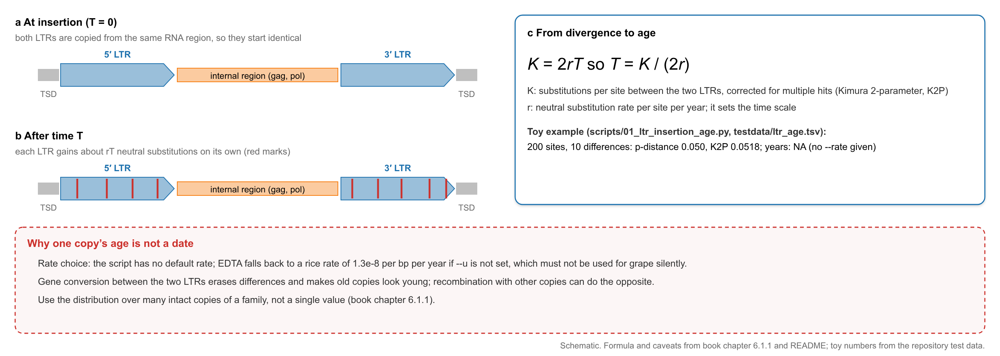
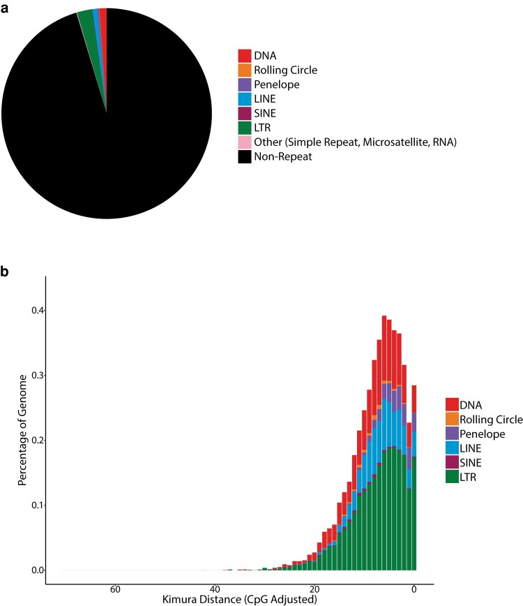

# 第6章 基因组演化与转座子动力学

## 6.1 转座子爆发、清除与基因组大小演化

### 6.1.1 基于完整LTR分歧度的插入时间估算：$T = K / (2r)$ 推导与误差来源

在演化生物学中，重建远古事件通常依赖化石记录，但DNA分子本身无法形成常规形态化石。幸运的是，Ⅰ类LTR反转录转座子独特的反转录机制为基因组学家提供了一枚精准的“分子时钟”。正如第3.1.3节所述，在病毒样颗粒中完成两次链转移合成双链cDNA时，新生成转座子的5'-LTR与3'-LTR以同一段RNA区段为模板复制而来。因此，**在转座子刚刚整合进宿主染色体的那一瞬间（$t = 0$），其5'-LTR与3'-LTR的核苷酸序列在理论上是100%完全相同的**（极少数由逆转录酶单次复制错误引入的错配可忽略不计）[待确认]。

插入完成后，绝大多数LTR反转录转座子迅速遭受宿主表观遗传沉默，不再承担任何编码或调控功能，两端的LTR随即进入彼此独立的中性演化轨道，各自以宿主基因组的中性核苷酸替代率 $r$（单位通常为每次替换/位点/年）随机积累点突变。经过时间 $T$ 后，5'-LTR积累的期望替代数为 $rT$，3'-LTR独立积累的期望替代数同样为 $rT$。二者之间观测到的总演化分歧度（即每个位点的平均核苷酸替代数）$K$ 等于两条独立演化支路长度之和：

$$K = rT + rT = 2rT$$

由此直接推导出估算完整LTR反转录转座子插入时间 $T$ 的经典分子钟公式（由SanMiguel等人于1998年在研究玉米基因组时率先系统应用）[待确认]：

$$T = \frac{K}{2r}$$

在实际计算中，直接用5'-LTR与3'-LTR比对后的不同碱基比例（$p$-distance）代替 $K$ 会因“同一位点发生多次重复替换（multiple hits）”而系统性低估古老元件的插入年代。因此，生物信息学流程通常采用**Kimura双参数模型（Kimura 2-parameter model，简称K2P）**对观测差异进行校正。该模型区分了转换（transition，嘌呤与嘌呤或嘧啶与嘧啶间的替换，比例记为 $P$）和颠换（transversion，嘌呤与嘧啶间的替换，比例记为 $Q$），计算公式为：

$$K = -\frac{1}{2}\ln(1 - 2P - Q) - \frac{1}{4}\ln(1 - 2Q)$$

尽管 $T = K / (2r)$ 公式简洁优雅，成为植物比较基因组学绘制“转座子爆发年代分布图”的标准工具，但研究者在解读估算出的绝对年代（例如“距今120万年前爆发”）时，必须高度警惕两大核心误差来源：

第一是**中性替代率 $r$ 的选取偏倚与跨物种差异**。公式中的分母 $2r$ 直接决定了绝对时间的标尺，但转座子所处的非编码异染色质区往往与蛋白质编码基因的同义替代位点（$K_s$）具有不同的突变率。在植物研究中，经典文献常沿用禾本科草本植物（如水稻、玉米）的替代率（约 $1.3 \times 10^{-8}$ 次替换/位点/年，约为禾本科基因同义替代率的两倍）或拟南芥的替代率（约 $7 \times 10^{-9}$ 次替换/位点/年）[待确认]。然而，对于多年生木本植物（如杨树、柑橘和本书的范例物种葡萄），由于其世代周期远长于一年生草本植物，每年累积的生殖细胞分裂次数较少，其实际年均中性替代率显著低于草本植物（通常在 $2 \times 10^{-9}$ 至 $7 \times 10^{-9}$ 次替换/位点/年之间波动）[待确认]。如果在分析葡萄基因组时生搬硬套禾本科的 $1.3 \times 10^{-8}$ 参数，就会将葡萄历史上真实的转座子爆发年代系统性地压缩一半甚至更多，从而在关联古气候事件或物种分化节点时得出完全错误的结论。此外，高度甲基化的转座子富含5-甲基胞嘧啶，极易发生自发脱氨导致 $\text{C}\to\text{T}$（互补链为 $\text{G}\to\text{A}$）的高频转换，进一步加快了局部表观突变率。

第二是**元件内基因转换（intra-element gene conversion）导致的年代低估**。基因转换是指在DNA双链断裂修复过程中，同源序列之间发生的非互惠信息拷贝。对于同一条LTR反转录转座子而言，其5'-LTR与3'-LTR互为高度相似的同源序列，在演化过程中可能发生基因转换——即其中一侧LTR的局部区段被另一侧LTR的序列直接覆盖重写。这种“同质化”事件会人为抹平两端LTR原本已经积累的碱基差异，使测得的 $K$ 值异常偏小，导致一个原本插入于数百万年前的古老元件被误判为近期才插入的“年轻”拷贝[待确认]。此外，部分LTR元件在整合后可能与邻近同源拷贝发生异位重组形成嵌合体，使其5'-LTR和3'-LTR源自不同的母本，反而造成 $K$ 值异常虚高。因此，在利用 $T = K / (2r)$ 推断物种演化史时，应以整个家族的大量完整拷贝的分布峰值作为宏观趋势参考，切忌对单个拷贝的绝对年龄数字过度迷信。

*图：用两端 LTR 估计 LTR 反转录转座子的插入时间：插入时两端相同，此后各自独立积累替换，因此 K = 2rT，T = K/(2r)。演示数字取自 `testdata/ltr_age.tsv`（由 `scripts/01_ltr_insertion_age.py` 在不给替代率时写出）。示意图，为本仓库绘制。*

*图：Earl Grey 对一个 840 Mb 模拟基因组的输出示例：各类转座子占基因组的比例（a），以及重复景观图，即基因组占比对与家族一致性序列的 Kimura 距离（CpG 校正）作图，越靠右越年轻（b）。原图未修改，引自 Baril T、Galbraith J、Hayward A（2024），Molecular Biology and Evolution 41:msae068，Fig. 2，doi:10.1093/molbev/msae068，PMC11003543，许可 CC BY 4.0 (https://creativecommons.org/licenses/by/4.0/)。*

### 6.1.2 “膨胀与收缩”平衡模型：爆发、不等同源重组与非法重组

在20世纪90年代末，随着玉米等大型植物基因组中海量近期爆发LTR反转录转座子的发现，植物演化学界一度产生过一种担忧：既然Ⅰ类转座子采用“复制-粘贴”机制只增不减，植物基因组是否注定走向一条“单行道式的肥胖之路”（one-way ticket to genomic obesity）[待确认]？然而，比较基因组学很快证实，植物基因组大小在生命之树上既能剧烈扩张，也能显著收缩。为此，Bennetzen与Devos等人提出了经典的**“膨胀与收缩”（obesity and diet）动态平衡模型**：一个物种的基因组大小并非静态特征，而是由**转座子阶段性爆发（膨胀动力）**与**DNA重组介导的序列清除（收缩动力）**这两股相互拮抗的力量长期博弈的结果[待确认]。

在“膨胀”一端，转座子的扩增并非匀速线性进行，而是呈现出剧烈的**脉冲式阶段性爆发（episodic bursts）**特征。在数百万年的平静态之后，由于环境剧变、种间杂交、多倍化或表观遗传防御出现短暂漏洞，某一个或少数几个LTR反转录转座子家族会在短短几十万年内呈指数级扩增，向基因组中倾倒数以万计的新拷贝，使单倍体基因组在极短的地质时间内膨胀数倍。

在“收缩”一端，植物基因组演化出了两台高效的“DNA碎纸机”来清除冗余的转座子序列：

1. **不等同源重组（unequal homologous recombination）**：正如第3.1.4节所述，同一条完整LTR转座子两端的5'-LTR与3'-LTR具有高度序列一致性，它们之间发生元件内同源重组会将整个内部编码区（通常占元件全长的70%至90%）彻底环化切除，仅在染色体上留下一个短小的solo-LTR。此外，分布在同一条染色体上相距不远的两个同向同源转座子拷贝之间也会发生不等同源重组，将两个转座子之间的整个大片段基因组区域一并删除。不等同源重组是植物基因组快速“减肥”的高效机制，但它受限于局部染色体的重组率以及两端LTR的长度与相似度——一旦LTR因古老突变而分歧过大，或位于重组受抑制的着丝粒区，该机制的效率便会急剧下降。
2. **非法重组（illegitimate recombination）**：2002年，Devos等人通过对拟南芥和水稻基因组中大量残缺LTR元件的精细比对，揭示了另一种不依赖长同源序列、但在植物基因组收缩中起决定性作用的机制——非法重组[待确认]。非法重组主要指在DNA双链断裂修复（如非同源末端连接NHEJ或微同源介导的末端连接MMEJ）或DNA复制叉滑动过程中，由极短的微同源序列（仅1至15 bp）介导的随机小片段缺失。与不等同源重组一次切除数kb内部区域不同，非法重组每次通常仅删除几十bp到几百bp，且发生位置完全随机——既可以切在LTR内部，也可以跨越转座子边界。尽管单次删除量小，但非法重组不受染色体重组率和序列同源长度的限制，在全基因组范围内持续不断地发生，将古老的完整转座子乃至solo-LTR逐步啃噬得支离破碎，最终彻底抹除。

不同植物物种基因组大小的悬殊差异，本质上反映了上述“膨胀速率”与“清除速率”的比值差异。在拟南芥和水稻中，极高的非法重组与不等同源重组速率使得转座子DNA的半衰期极短（在拟南芥中，大部分LTR元件在插入后不到数百万年就会被清除殆尽），从而维持了高度紧凑的小基因组；而在部分裸子植物（如挪威云杉 *Picea abies*，单倍体基因组约20 Gb）中，不仅存在古老的转座子积累，更关键的是其不等同源重组和非法重组的清除速率极其缓慢，导致数千万年前的古老LTR元件如同化石般长期堆积在基因组中无法排出，造就了极其庞大的基因组[待确认]。

### 6.1.3 近缘物种基因组大小剧烈分化的演化案例

“膨胀与收缩”模型在近缘植物物种的比较基因组学研究中得到了最直观、最震撼的验证。当两个亲缘关系极近、染色体倍性完全相同、分化时间仅数百万年的同属植物，其基因组大小却相差两倍甚至三倍以上时，全基因组测序几乎无一例外地指向同一个幕后推手：**少数优势LTR反转录转座子家族的谱系特异性近期爆发**。

稻属（*Oryza*）植物提供了植物基因组学中最经典的教科书级案例。栽培稻（*Oryza sativa*，AA基因组）的单倍体基因组大小约为380至430 Mb，而与其同属的澳大利亚野生稻（*Oryza australiensis*，EE基因组）虽然同为二倍体（$2n = 24$），其单倍体基因组大小却高达约965 Mb，比栽培稻膨胀了两倍以上[待确认]。2006年，Piegu等人通过对*O. australiensis*的基因组解析揭开了谜底：该物种基因组凭空多出的超过400 Mb DNA，既不是源于全基因组复制，也不是所有转座子均匀扩张的结果，而是几乎完全由**仅仅三个LTR反转录转座子家族**（*RIRE2*、*Kangourou*和*Wallabi*）在过去约300万年内的剧烈爆发所贡献，仅这三个家族就累计产生了超过9万个拷贝，占据了*O. australiensis*全基因组的约60%[待确认]。

类似的现象在双子叶植物和作物近缘种中同样屡见不鲜。在棉属（*Gossypium*）二倍体物种中，不同基因组类型的单倍体大小从约880 Mb（如D基因组的雷蒙德氏棉 *G. raimondii*）跨越至约2.5 Gb（如K基因组物种），相差近三倍，其核心驱动力同样是以*Gorge3*为代表的极少数*Gypsy*类LTR反转录转座子家族在不同谱系中的差异性扩增与清除[待确认]。在玉米（*Zea mays*，约2.3 Gb）与其近缘种高粱（*Sorghum bicolor*，约730 Mb）的比较中，尽管二者均经历过共同的祖先演化史且玉米多经历了一次古四倍化，但玉米基因组在过去数百万年内由少数大型*Gypsy*和*Copia*家族（如*Opie*、*Ji*、*Huck*、*Cinful-Zeon*等）驱动的剧烈爆发，是其基因组远大于高粱的主要原因[待确认]。

回到本书的范例类群——葡萄属（*Vitis*），尽管不同野生种（如北美种、东亚种）与欧亚栽培葡萄（*V. vinifera*）之间单倍体基因组大小总体维持在450至600 Mb的相对温和区间，未出现像稻属或棉属那样数倍的极端分化，但不同葡萄物种及单倍型之间依然存在数十Mb乃至上百Mb的基因组大小差异，这些差异同样高度集中在特定*Gypsy*和*Copia*亚家族的近期谱系特异性扩增以及着丝粒周边重复序列的动态消长上。

### 6.1.4 有效群体大小（$N_e$）与交配系统对转座子积累的群体遗传学影响

既然所有植物都具备转座子爆发的潜力和重组清除的机制，那么从更深层的群体遗传学视角追问：**究竟是什么演化力量决定了某些物种能够有效压制转座子，而另一些物种却放任转座子不断积累？**

2003年，Michael Lynch与John Conery提出了著名的**突变-灾难/有效群体大小假说（mutational-hazard hypothesis）**，将基因组大小与转座子丰度的宏观演化直接与经典的群体遗传学参数——**有效群体大小（effective population size，$N_e$）**挂钩[待确认]。根据群体遗传学基本理论，一个轻微有害突变（选择系数为 $s < 0$，例如一个不直接破坏编码区但增加了复制负担或潜在异位重组风险的转座子插入）在群体中的命运，取决于乘积 $|2N_e s|$（二倍体生物）与1的相对大小：
- 当物种的**$N_e$ 极大**时（如细菌、单细胞真核生物或广泛分布的昆虫），即使转座子插入带来的适应度代价 $|s|$ 极其微弱，$|2N_e s| \gg 1$ 依然成立，自然选择能够敏锐地“看见”这些轻微有害的插入并将其高效清除（纯化选择占主导）。
- 当物种的**$N_e$ 较小**时（如大型哺乳动物、多年生木本植物或经历严重驯化瓶颈的作物），遗传漂变的力量显著增强。只要 $|2N_e s| < 1$，轻微有害的转座子插入在群体中就会表现出“近中性”（effectively neutral）的行为，纯化选择对其无能为力，这些转座子便能凭借遗传漂变在群体中随机升高频率甚至固定下来，导致基因组逐渐膨胀。

在高等植物中，**交配系统（mating system，即自花授粉/自交与异花授粉/异交的转变）**是调节 $N_e$ 与重组效率最剧烈的生物学因子，其对转座子积累的影响呈现出迷人而复杂的双重博弈[待确认]：

1. **自交对纯化选择效率的削弱（促进转座子积累的效应）**：从异交转变为高度自交（如拟南芥 *A. thaliana* 与其异交近缘种 *A. lyrata* 的对比），会直接使有效群体大小 $N_e$ 至少减半，同时由于高度纯合导致**有效重组率大幅下降**，引发强烈的背景选择和希尔-罗伯逊干扰（Hill-Robertson interference）。这削弱了纯化选择清除轻微有害转座子插入的能力，理论上有利于转座子在基因组中积累。
2. **自交对纯合暴露与异位重组风险的抑制（限制转座子扩散的效应）**：然而，自交也会从反方向强烈抑制转座子的扩张。首先，在异交群体中，一个新插入的隐性有害转座子可以长期以杂合状态隐藏在基因组中逃避选择；而在高度自交群体中，纯合化过程极其迅速，任何具有隐性有害效应的转座子都会立刻暴露在纯化选择之下被淘汰。其次，在群体传播层面，异交允许活跃的转座子通过花粉和有性杂交迅速扩散到整个物种的所有谱系中；而自交将转座子困在孤立的纯系内部，如果某个纯系中的转座子过度活跃导致宿主适应度崩溃，该转座子就会随宿主纯系一同灭绝，从而在谱系选择层面压制了高活性转座子的演化。

此外，对于像**葡萄、马铃薯、香蕉、木薯和柑橘**这类长期依赖**无性克隆繁殖（clonal propagation）**的多年生作物而言，其群体遗传学动力学又呈现出独特的第三种格局：由于长期缺乏减数分裂重组，无性繁殖体细胞谱系无法通过有性重组剥离有害插入，理论上容易像“穆勒棘轮”（Muller's ratchet）一样持续积累杂合状态的体细胞转座子负荷（TE load）；但与此同时，无性繁殖也彻底阻断了转座子通过有性杂交在品种间水平扩散的通道。这种复杂的群体遗传学权衡，使得比较自交、异交与无性繁殖植物的转座子演化动力学成为当代植物演化基因组学最活跃的课题之一。

## 6.2 基因组区室化分布与嵌套插入

### 6.2.1 染色体上的非均匀分布规律：异染色质与常染色质臂的分化

当我们在全基因组尺度上沿着染色体从一端端粒扫描至另一端端粒，以滑动窗口统计不同类别转座子的密度分布时，几乎在所有已测序的高等植物（包括拟南芥、水稻、玉米、大豆和葡萄）中，都会观测到一幅高度规律、层次分明的**基因组区室化（compartmentalization）分布图谱**：转座子绝非均匀随机地撒在染色体上，不同超家族各自占据着截然不同的染色体生态位。

宏观上，植物染色体可分为两大核心区室：**着丝粒与近着丝粒异染色质区（centromeric and pericentromeric heterochromatin）**，以及**基因丰富的常染色质臂（gene-rich euchromatic arms）**。这两大区室的转座子组成呈现出鲜明的镜像反差：

- **Ty3/Gypsy超家族强烈富集于低重组率的着丝粒与近着丝粒异染色质区**。在绝大多数植物染色体上，*Gypsy*元件的密度曲线呈现出典型的“单峰山脉”形态——在着丝粒及两侧宽阔的近着丝粒区域飙升至极高水平（常占据局部DNA总量的70%至90%），而在远离着丝粒的染色体臂末端则迅速回落。这些区域的特点是蛋白质编码基因极度稀疏、组蛋白H3K9me2和DNA甲基化高度密集、且减数分裂重组率几乎为零。
- **Ty1/Copia超家族、MITEs与经典TIR DNA转座子更倾向分布于基因丰富的常染色质臂**。与*Gypsy*的“中心聚集”截然相反，MITEs（如*Tourist*和*Stowaway*）和许多短小DNA转座子的密度曲线与蛋白质编码基因的密度曲线高度正相关，在染色体两臂呈现双峰或多峰富集，紧贴基因的启动子、内含子和3' UTR分布。*Ty1/Copia*超家族的分布则相对更为分散和均衡，它们在常染色质臂上的相对占比显著高于*Gypsy*，经常穿插在基因间区之中，尽管部分古老退化的*Copia*拷贝也会在近着丝粒区积累。

当然，这种宏观区室化格局在不同基因组大小的植物中存在梯度变化。在拟南芥这类极度紧凑的小基因组中，异染色质与常染色质的物理边界极为锐利，绝大多数转座子都被严格“圈禁”在近着丝粒区和端粒异染色质节（heterochromatic knob）内，常染色质臂几乎是纯粹的基因区；而在玉米、小麦等大型基因组中，由于海量LTR转座子在全基因组范围内爆发，即便是基因丰富的常染色质臂也变成了“基因岛屿漂浮在转座子海洋中”的镶嵌格局，但即便如此，着丝粒区与染色质臂之间在*Gypsy*与MITEs/DNA转座子相对比例上的区室分化依然清晰可辨。栽培葡萄（约500 Mb）的染色体区室化格局恰好介于拟南芥与玉米之间：其19条染色体均具有清晰的近着丝粒*Gypsy*富集带与常染色质臂基因/MITEs富集区，是展示植物染色体区室化分布的绝佳教学样本。

### 6.2.2 插入偏好性与插入后纯化选择的相对贡献辨析

面对染色体上如此显著的区室化分布，演化生物学家长期以来围绕一个核心机制问题展开了深入辨析：**这种非均匀分布究竟是由转座子在整合瞬间主动“挑地方”造成的（插入偏好性假说，insertion preference），还是由转座子随机插入后被自然选择“差异化清理”造成的（插入后纯化选择假说，post-insertional purifying selection）？**

为了科学地拆解这两种机制的相对贡献，研究者采用了一项极为巧妙的对比策略：**比较“全新插入（*de novo* insertions）”或“极年轻拷贝”的分布格局与“古老固定拷贝”的分布格局**。全新插入尚未经历漫长的自然选择过滤，其分布直接反映了转座子酶学机器的原始插入偏好；而古老拷贝与全新插入分布之间的差值，则定量刻画了纯化选择与重组清除的长期塑造力量。

大量基于拟南芥、水稻、玉米及酵母的实验与基因组学证据表明，**两种机制并非非此即彼，而是因转座子超家族而异，共同塑造了最终的染色体图谱**：

1. **插入偏好性主导的典型案例**：最确凿的证据来自*Ty3/Gypsy*超家族中的*Chromovirus*分支（如*Tekay*、*CRM*等亚谱系）。正如第3.1.2节所述，这类元件的整合酶C端携带特异性识别异染色质H3K9me2或着丝粒组蛋白CENH3的色质结构域（chromodomain）。生化实验和全新插入追踪证实，它们在整合瞬间就主动避开常染色质基因区，直接精准投向着丝粒与近着丝粒异染色质区。反之，水稻中的活跃MITE元件*mPing*以及玉米中的*Mutator*和*Ac*/*Ds*，在全新插入实验中即表现出强烈的常染色质与基因侧翼（特别是开放染色质、低甲基化、富含AT的启动子区）插入偏好[待确认]。
2. **插入后纯化选择与重组清除主导的典型案例**：对于缺乏色质结构域的普通LTR反转录转座子（如拟南芥中的*ONSEN*、*EVD*以及水稻*Tos17*），实验诱导的全新插入实际上高度偏好染色质开放的常染色质基因区（因为开放染色质更容易被整合前复合物接触）。然而，当我们观察自然界中这些家族的古老拷贝时，却发现它们大多残留在近着丝粒异染色质区！这一剧烈的“年轻在臂、古老在心”的分布反转，正是插入后选择与重组清除铁律的直接体现：
   - **纯化选择的清除**：插入常染色质基因内部或启动子区的转座子，极易破坏基因功能或引发异染色质扩散沉默邻近基因，因而承受强烈的负选择，在群体中被迅速淘汰；而偶然落入基因荒漠（近着丝粒区）的拷贝则几乎无害，得以长期幸存。
   - **局部重组率的庇护效应（Hill-Robertson效应与solo-LTR清除）**：常染色质臂具有极高的减数分裂重组率，这不仅提高了纯化选择剥离有害插入的效率，而且极大地加速了不等同源重组将完整LTR元件切除为solo-LTR的速度；相反，近着丝粒区重组率极低，几乎不发生不等同源重组，因此一旦有转座子落入此地，就如同掉进了演化上的“安全避难所”，得以长期堆积并不断被后续插入层层掩埋。

### 6.2.3 嵌套插入的形成机制与局部相对演化年代重建

在大型植物基因组（如玉米、小麦、大麦）以及中等大小植物（如葡萄）的近着丝粒异染色质区，转座子不仅密度极高，而且在物理结构上呈现出一种极其壮观的“俄罗斯套娃”式层级架构——**嵌套插入（nested insertion）**。所谓嵌套插入，是指一个较年轻的转座子（B）直接插入到了一个早已存在于基因组中的较古老转座子（A）的内部序列之中，将原本连续的元件A从中间一分为二；随后，更年轻的转座子（C）又可能插入到B的内部，形成三层、四层甚至多达七八层的复合嵌套结构[待确认]。

嵌套插入之所以在植物基因组中高频发生，源于两大客观条件：其一，在近着丝粒区和宽阔的基因间区，转座子已经占据了超过80%的物理空间，新整合的转座子按概率计算极大可能落在已有转座子的“躯体”之上；其二，正如前文所述，插入到已沉默的古老转座子内部对宿主基因完全无害，属于绝对的中性安全区，因此能够百分百逃避纯化选择而完整保留下来。

从演化生物学和比较基因组学的角度看，嵌套插入绝非杂乱无章的序列垃圾，而是一部记录局部染色体演化历史的**“地层学档案”（genomic stratigraphy）**。就像地质学家依据沉积岩层的上下叠压关系（越靠上的岩层越年轻）判断地质年代一样，基因组学家完全可以依据嵌套插入的物理拓扑结构，精确重建局部染色体区域的**相对演化年代**：
- **基本拓扑法则**：如果转座子B完整地插入在转座子A的内部，且B的两侧带有属于A序列的TSD，而被打断的A的左半段与右半段拼接起来恰好能还原为一条完整的A元件，那么**必然可以无歧义地断定：A的插入时间早于B（$T_A > T_B$）**。
- **跨类别定年优势**：这一地层学法则的最大威力在于，它能够为**无法使用LTR分子钟定年的转座子**（例如缺乏成对LTR的DNA转座子、MITEs、LINE、solo-LTR或高度退化的古老碎片）提供精确的相对年代锚点。如果一个DNA转座子插在两个已知LTR插入年代（例如 $T_1 = 2.0\text{ Ma}$ 与 $T_2 = 0.5\text{ Ma}$）的LTR元件之间，我们就能立刻将该DNA转座子的爆发时间精准框定在0.5至2.0百万年之间。
- **分子钟独立校验**：对于“LTR嵌套于LTR内部”的组合，研究者可以分别用 $T = K / (2r)$ 独立计算外层宿主LTR和内层插入LTR的插入年代。在1998年SanMiguel等人对玉米*Adh1*基因座长达225 kb区段的里程碑式解析中，绝大多数嵌套LTR组合的分子钟估算年代都严格满足“外层老、内层新”的地层学逻辑，不仅证实了玉米基因组在过去数百万年内经历过剧烈的LTR扩张，也为LTR分子钟方法的可靠性提供了强有力的独立交叉验证[待确认]。

当然，嵌套插入也给现代生物信息学注释软件带来了巨大的算法挑战：当一条完整的古老转座子被两三个年轻转座子打断成四五段互不相连的碎片后，常规的同源比对软件（如RepeatMasker）会将其误报为四五个独立的短小片段，从而严重高估片段化拷贝数、低估完整拷贝比例。因此，高级注释流程中往往需要专门的嵌套重组与碎片缝合算法（defragmentation）来还原原始的嵌套层级。

### 6.2.4 着丝粒特异反转录转座子与着丝粒功能的协同演化

在染色体最神秘的核心区域——**着丝粒（centromere）**，转座子与宿主之间的关系彻底超越了简单的“寄生与镇压”，演化出了一种高度特化、甚至接近共生的协同演化格局。在高等植物中，功能着丝粒由特殊的着丝粒特异组蛋白H3变体——**CENH3**（相当于动物的CENP-A）的沉积所定义，负责在细胞分裂时组装动粒（kinetochore）并牵引纺锤丝。

长期以来，由于着丝粒区域充斥着极其冗长的串联卫星重复序列（satellite repeats，单体长度常在150至180 bp左右，如玉米中的*CentC*、水稻中的*CentO*、拟南芥中的*CEN178*），传统短读长测序技术无法将其拼接组装，导致着丝粒一直被称为基因组的“暗物质”。随着近年端粒到端粒（T2T）超长读长基因组组装技术的突破，研究者终于看清了植物着丝粒的真实内部构造：它并非纯粹由卫星DNA垄断，而是由**大规模串联卫星重复序列**与**着丝粒特异LTR反转录转座子（主要为*Ty3/Gypsy*超家族中的*CRM*亚谱系，即Centromeric Retrotransposon of Maize及其在各类植物中的同源元件）**紧密交错构成的复合生态[待确认]。

*CRM*类反转录转座子与植物着丝粒及卫星重复序列之间展现出三大令人惊叹的协同演化特征：

1. **精准的着丝粒靶向整合机制**：*CRM*元件的整合酶C端演化出了一种高度特化的色质结构域（CR motif），能够特异性识别富含CENH3的着丝粒核小体（或其特有的染色质微环境）。这使得*CRM*元件在转座时几乎百分之百精准插入功能着丝粒核心区，将自己直接嵌入卫星重复序列阵列之中[待确认]。
2. **参与CENH3核小体结合与动粒微环境维持**：染色质免疫共沉淀测序（CENH3 ChIP-seq）明确证实，植物着丝粒区的CENH3核小体不仅结合在卫星重复序列上，同样高密度地直接结合在*CRM*反转录转座子序列上。更重要的是，尽管着丝粒整体属于高度压缩的异染色质，但穿插其中的*CRM*元件往往维持着低水平的转录活性，其产生的着丝粒非编码RNA被认为能够结合CENH3及着丝粒蛋白复合体，协助稳定动粒组装与着丝粒表观遗传身份的跨代维持[待确认]。
3. **驱动着丝粒卫星重复序列的演化与“着丝粒驱动”**：着丝粒区域虽然在减数分裂中重组受到严格抑制，但在演化速率上却是全基因组最快的区域之一——不同近缘物种甚至同一物种的不同染色体之间，其着丝粒卫星序列的组成和长度都在剧烈更迭。*CRM*转座子的周期性高频插入，一方面直接打破了原有单调的卫星重复阵列，通过不等同源重组和断裂修复诱发卫星DNA的扩张、收缩与同质化；另一方面，部分新生的着丝粒卫星单体甚至直接起源于退化*CRM*转座子内部片段的串联扩增。在拟南芥、玉米、水稻以及近年完成的葡萄T2T基因组组装中，均清晰观察到了年轻*CRM*/*Athila*类*Gypsy*元件在着丝粒核心区与卫星阵列的动态博弈[待确认]。这一发现再次印证了本书第1章的核心主题：即使是起源于自私寄生虫的转座子，也能在数千万年的协同演化中，深度嵌入宿主染色体最核心的结构与功能架构之中。

## 6.3 结构变异、基因捕获与功能外适应（Exaptation）

### 6.3.1 高相似度转座子介导的异位重组与染色体结构变异

在真核生物基因组演化中，转座子不仅通过自身的插入与切离直接改变局部DNA序列，还扮演着引发宏观**染色体结构变异（structural variations，SVs）**的核心催化剂角色。其底层分子机制是**异位重组（ectopic recombination）**，在细胞遗传学中也被称为**非等位同源重组（non-allelic homologous recombination，NAHR）**。

正常的减数分裂同源重组发生在同源染色体上位置严格对应的等位区段之间，确保遗传物质的精确交换而不改变基因组的宏观结构。然而，真核生物细胞内的DNA同源重组修复机器（如RAD51介导的链入侵系统）在寻找同源修复模板时，仅依据DNA序列的相似度而非染色体物理坐标。当基因组中某一个近期爆发的转座子家族（尤其是长度达数kb至十数kb、序列一致性高达95%以上的年轻LTR反转录转座子或大型DNA转座子）在染色体的不同位置散布了成百上千个高度相似的拷贝时，这些散在分布的非等位拷贝极易在DNA双链断裂修复或减数分裂联会过程中发生错配并启动同源交换[待确认]。

依据发生错配的两个高相似度转座子拷贝的**相对空间位置与方向**，异位重组会精准地衍生出四大类经典的染色体结构变异：

1. **染色体片段缺失（deletion）与串联重复（duplication）**：当位于**同一条染色体**（或姐妹染色单体、同源染色体）不同位置的两个高度相似转座子拷贝呈**同向排列（direct repeats）**时，若二者之间发生不等交叉互换，一条重组产物染色体将会把两个转座子之间的整个基因组区段（可能包含数十个甚至上百个蛋白质编码基因）彻底切除丢失，形成大片段缺失；而另一条互补的重组产物染色体则会同时获得该区段的双份拷贝，形成大片段串联重复。前文所述的solo-LTR形成，本质上就是同一条LTR转座子内部两个同向LTR之间发生微型异位重组引发的内部缺失。
2. **染色体倒位（inversion）**：当位于**同一条染色体**不同位置的两个高度相似转座子拷贝呈**反向排列（inverted repeats）**时，同一条DNA双链发生折返并使这两个反向拷贝配对重组，就会将二者之间的整个染色体区段首尾翻转180度，形成染色体倒位。由于倒位杂合体在减数分裂时倒位环内部的重组受到强烈抑制，由转座子介导的大型染色体倒位常常将多个协同适应的基因锁定在一起，形成演化生物学中著名的“超级基因”（supergene），推动生态型分化与生殖隔离的建立[待确认]。
3. **染色体易位（translocation）**：当两个高度相似的转座子拷贝分别位于**两条不同的非同源染色体**上时，它们之间发生的异位重组会导致两条非同源染色体交换各自的末端臂段，形成相互易位（reciprocal translocation）。相互易位会显著改变物种的核型（karyotype），并在杂合状态下导致减数分裂联会异常与配子半不育，是植物物种形成中染色体核型演化的重要推手。

从宿主基因组稳定性的角度看，异位重组带来的染色体大片段缺失和易位往往是致命的。这从另一个维度解释了为什么宿主细胞必须对高拷贝转座子维持极高水平的DNA甲基化和H3K9me2异染色质压缩——**异染色质不仅抑制转座子的转录，还强烈抑制了同源重组机器的进入，从而在物理上遏制了高相似度转座子之间发生灾难性异位重组的频率**。在植物（包括玉米、水稻、小麦以及高度杂合的葡萄单倍型基因组）的泛基因组比较研究中，研究者发现大量品种间或单倍型间的Mb级大片段倒位、存在/缺失变异（PAV）的断点两侧，恰恰精准坐落着成对的高相似度LTR反转录转座子或DNA转座子，为转座子驱动染色体结构重排提供了直观的基因组学证据[待确认]。

### 6.3.2 Pack-MULE与Helitron介导的外显子洗牌与嵌合新基因起源

除了通过异位重组重塑染色体的宏观骨架，部分特殊的Ⅱ类DNA转座子还能在微观基因尺度上直接充当“分子剪刀与搬运工”，通过捕获、拼接并扩增宿主蛋白质编码基因的片段，驱动**外显子洗牌（exon shuffling）**与**嵌合新基因（chimeric new genes）**的起源。在高等植物中，这一现象的两大主角分别是第4.1.2节提及的**Pack-MULE**（*Mutator*样元件）与第4.3.2节详述的**Helitron**。

**Pack-MULE**是一类携带了宿主基因组片段的非自主型*Mutator*超家族DNA转座子，它们两端保留了*Mutator*典型的长末端反向重复序列（TIR）和约9 bp的TSD，但其内部原本编码转座酶的区域被来自宿主不同染色体的一个或多个基因片段所取代。2004年，Jiang等人在水稻（*Oryza sativa*）基因组中系统鉴定出超过3000个Pack-MULE元件，这些元件捕获了超过1000个宿主基因的片段，其中相当一部分Pack-MULE内部同时串联了来自两个甚至多个完全不同宿主基因的外显子片段[待确认]。Pack-MULE捕获宿主基因片段的机制普遍认为与DNA双链断裂的间隙修复（gap repair）有关：当*Mutator*元件切离后，宿主修复系统在以非同源模板填补断裂口时，偶然将其他基因的DNA片段复制并拼接到了TIR之间，随后该嵌合元件被自主型*MuDR*转座酶反式动员并在基因组中扩增。与Helitron通过滚环复制3'端通读捕获基因片段不同，Pack-MULE对富含GC碱基的宿主基因片段表现出明显的捕获偏好，且在水稻等禾本科植物中尤为活跃[待确认]。

面对水稻Pack-MULE和玉米Helitron中数以千计的嵌合基因结构，演化基因组学领域曾爆发过一场旷日持久的学术争论：**这些由转座子拼接出来的嵌合体，究竟是植物新基因诞生的主要工厂，还是绝大多数注定消亡的基因组碎片？**

为了给出严谨的科学回答，必须建立一套清晰的评判标准，严格区分**真正的功能新基因（functional new genes）**与**无功能的假基因片段（pseudogene fragments）**：

1. **序列演化特征与纯化选择检验（$K_a/K_s$）**：如果一个被转座子捕获的嵌合片段沦为假基因，它在插入后将不再受自然选择约束，非同义替代率（$K_a$）与同义替代率（$K_s$）的比值将趋近于1（中性演化），并迅速积累移码突变和提前终止密码子。相反，如果该嵌合拷贝获得了真正的蛋白质编码功能，其编码区在近缘物种或群体演化中将承受显著的纯化选择（$K_a/K_s < 1$），且阅读框保持完整。大规模演化分析表明，在水稻Pack-MULE和玉米Helitron捕获的数千个基因片段中，绝大多数（通常超过90%至95%）呈现中性退化特征，属于典型的假基因；仅有极小比例（约数个百分点）显示出显著的纯化选择信号与完整的嵌合开放阅读框[待确认]。
2. **转录、翻译与蛋白质组学证据**：常规RNA-seq检测到转座子内部有转录本读长，绝不足以证明它是一个功能编码基因，因为许多沉默边缘的转座子或读穿转录都会产生无意义的转录噪音。真正的嵌合新基因需要结合全长转录组（验证剪接位点的精确性）、核糖体印迹测序（Ribo-seq，验证其确实结合核糖体进行翻译）以及质谱蛋白质组学数据（直接检测到嵌合肽段的存在）加以确证。
3. **非编码调控功能的独立路径**：有趣的是，近年研究发现，一部分虽然丧失了蛋白质编码能力、沦为假基因的Pack-MULE，却通过另一条路径获得了生物学功能——当这些包含宿主基因片段的Pack-MULE以反向或双向转录产生双链RNA时，它们能够生成靶向原宿主母本基因的**小干扰RNA（siRNA）**，反过来在转录后水平负向微调原母本基因的表达量[待确认]。

由此可见，Pack-MULE和Helitron介导的外显子洗牌，本质上是一场极高淘汰率的演化“随机抽奖”：绝大多数产物都是迅速退化的假基因废料，但在漫长的地质时间与庞大的捕获基数下，那极少数中奖的嵌合拷贝确实为植物基因组贡献了全新的蛋白质结构域组合与基因调控通路。

### 6.3.3 转座子外适应（Exaptation）与驯化：从转座酶到宿主调控网络

当一个原本纯粹为了自身复制而存在的“自私”转座子（或其编码的蛋白质、顺式调控序列），在演化过程中被宿主“征用”并改造为执行全新宿主生理功能的基因组元件时，演化生物学将其称为**外适应（exaptation）**——这一概念最初由Stephen Jay Gould与Elisabeth Vrba于1982年提出，用于指代那些最初并非为当前功能而演化、但后来被自然选择挪作新用的生物性状[待确认]。在分子生物学与转座子研究中，针对转座子编码蛋白被宿主改造为新基因的过程，学界也常使用**分子驯化（molecular domestication）**这一同义术语。

高等植物中转座子的外适应主要通过两大经典路径实现：**蛋白质编码区的分子驯化**与**非编码顺式调控元件的外适应**。

**路径一：转座酶演变为宿主核心转录因子。** 转座子编码的转座酶天然具备两项极其宝贵的生化特性——特异性结合特定DNA序列基序的能力，以及与其他蛋白形成二聚体或复合物的能力。这两项特性恰好与真核生物的**转录因子（transcription factors）**高度重合。因此，在演化史上，多次发生过转座子丧失末端TIR和转座移动能力、但其转座酶基因被宿主保留并改造为全新转录因子的驯化事件。

植物界最负盛名的转座酶驯化典范，是广泛存在于被子植物中的***FHY3*（*FAR-RED ELONGATED HYPOCOTYL 3*）与*FAR1*（*FAR-RED-IMPAIRED RESPONSE 1*）基因家族**[待确认]。2007年，Lin等人证实，拟南芥中调控光敏色素A（phyA）远红光信号转导通路的核心转录因子FHY3和FAR1，竟然直接起源于古老的***Mutator*样DNA转座子（MULE）的转座酶**[待确认]。在漫长的演化过程中，古老的MULE转座酶失去了移动能力，但其N端的C2H2型锌指DNA结合域被精准保留下来，专门识别宿主基因启动子上的特定顺式元件（FBS基序，`CACGCGC`），直接激活下游光信号基因（如*FHY1*和*FHL*）的转录。后续研究表明，FHY3/FAR1家族在被子植物中不仅主导幼苗去黄化与避荫反应，还深度整合进了生物钟节律、叶绿素合成、开花时间调控、淀粉代谢及逆境响应等众多核心生命过程[待确认]。另一个经典植物案例是拟南芥中的***DAYSLEEPER***基因，它起源于***hAT*超家族转座酶**的驯化，结合特定基因启动子的Kubox1基序，对拟南芥的正常胚胎发育与器官建成至关重要，敲除该基因会导致植株严重矮化甚至致死[待确认]。

**路径二：LTR片段与MITEs演化为宿主基因的新启动子、增强子与调控网络重塑。** 与蛋白质驯化相比，转座子非编码序列作为**顺式调控元件（*cis*-regulatory elements）**的外适应在基因组中发生得更为频繁。正如第3章和第5章所述，LTR反转录转座子的5'-LTR（尤其是U3区）天生就包含一套功能完备的RNA聚合酶Ⅱ启动子、转录起始位点以及响应高温、低温、干旱或激素信号的转录因子结合基序。当一个LTR转座子（或solo-LTR、MITE）偶然插入到某个宿主蛋白质编码基因的上游时，它相当于直接给该基因送上了一个“即插即用”的新调控模块：
- 它既可以替代原有启动子，成为该基因的**新替代启动子（alternative promoter）**，赋予基因全新的组织特异性或胁迫诱导表达模式；
- 也可以在较远距离充当**远程增强子（enhancer）**或染色质绝缘子（insulator），精细调节邻近基因的转录强度；
- 在更宏大的系统生物学层面，如果同一个携带特定转录因子结合基序的转座子家族在一次爆发中，先后插入到了数十个原本互不相关的宿主基因附近，它就能将这批基因瞬间串联进同一个转录调控网络之中，实现所谓的**“调控网络重塑”（regulatory network rewiring）**。这一机制在哺乳动物胎盘发育基因网络和人类先天免疫干扰素响应网络中已有深入报道，在植物（如十字花科和禾本科）的胁迫响应与发育调控网络演化中也正不断涌现新的候选案例[待确认]。

### 6.3.4 证明转座子外适应的严格证据链与常见过度解读陷阱

随着基因组测序、染色质可及性测序（ATAC-seq）和转录因子ChIP-seq成本的大幅下降，近年来文献中关于“某转座子家族驱动了某植物适应性演化”或“某LTR片段是关键功能增强子”的报道呈井喷之势。然而，正如同第1.2.3节剖析ENCODE争议时所强调的，**转座子外适应研究是目前基因组学中最容易滑向“事后诸葛亮式过度解读”（adaptationist storytelling）的重灾区**。

研究者在阅读文献和设计自身课题时，必须时刻警惕三大常见陷阱：
1. **偶然共定位陷阱（co-localization fallacy）**：在转座子占比高达40%至85%的植物基因组（包括葡萄、玉米、小麦）中，几乎每一个蛋白质编码基因的上游2 kb至5 kb范围内都能轻易找到至少一个转座子碎片或MITE。仅仅因为某个胁迫响应基因上游恰好躺着一个转座子，就宣称该转座子赋予了该基因胁迫响应能力，在统计学上毫无说服力。
2. **生化活性等同于适应性功能陷阱**：在ATAC-seq中检测到某个转座子拷贝处于开放染色质状态，或在ChIP-seq中检测到某个转录因子结合在了该转座子上，甚至在RNA-seq中看到该转座子与邻近基因同步上调，都只属于“因果角色”层面的生化信号。这些信号完全可能是转座子自身残留的自私转录活性，或是邻近活跃基因开放染色质环境带来的“搭便车”副产物，未必对宿主适应度有任何贡献。
3. **单物种快照误判演化驱动力**：仅凭单一参考基因组上的静态注释，无法判断该转座子插入是古老的保守功能元件，还是近期中性漂变偶然固定下来的普通多态性插入。

要在国际主流学术界严谨地确立一个转座子拷贝（尤其是顺式调控元件）发生了真正的**功能外适应**，必须构建一条环环相扣的**四重严格证据链**：

1. **演化保守性与纯化选择证据**：真正的宿主功能元件必然受到纯化选择的保护。对于蛋白质驯化基因（如*FHY3*/*FAR1*），需证明其在多个分化物种间保持直系同源共线性、丧失移动能力且 $K_a/K_s \ll 1$；对于顺式调控外适应，需通过跨物种比较基因组学证明该特定位置的转座子片段（尤其是其核心转录因子结合基序）在演化上显著比周围中性DNA或其他非功能同源转座子拷贝更为保守，且在多个近缘物种的同源基因座中被稳定保留。
2. **分子生化机制证据**：需要证明该转座子序列本身直接承载了调控活性，例如通过双荧光素酶报告基因实验（luciferase assay）、电泳迁移率变动分析（EMSA）或酵母单杂交实验，直接证实特定的宿主转录因子结合在该转座子内部的精确基序上并驱动转录。
3. **因果遗传扰动证据（黄金标准）**：这是区分“相关”与“因果”的决定性一环。必须利用基因编辑技术（如CRISPR-Cas9精准敲除该特定转座子拷贝或其内部的核心顺式基序），在原位基因组背景下验证：移除该转座子后，目标宿主基因的表达模式（如胁迫诱导性或组织特异性）是否发生可重复的显著丧失，并进而引发明确的植株表型改变。
4. **群体遗传学与生态适应度证据**：在群体水平上，结合多材料重测序数据，检验该转座子插入位点是否伴随显著的选择清除（selective sweep）信号、与特定环境因子（如温度、降水、海拔）或驯化性状呈现强关联，并在田间或受控逆境条件下评估携带与不携带该插入的近等基因系之间的实际适应度差异。

唯有将演化保守性、生化机制、基因编辑因果验证与群体选择信号紧密结合，我们才能在浩如烟海的转座子序列中，去伪存真地甄别出那些真正被自然选择与人类驯化雕琢而成的演化瑰宝。至此，本书的基础理论篇（第1至6章）已全部收官。从下一章开始，我们将正式迈入方法与实践篇，系统学习如何利用现代生物信息学算法，在真实的基因组数据中精准检测、注释并解析转座子的演化与功能奥秘。

## 本章参考文献

