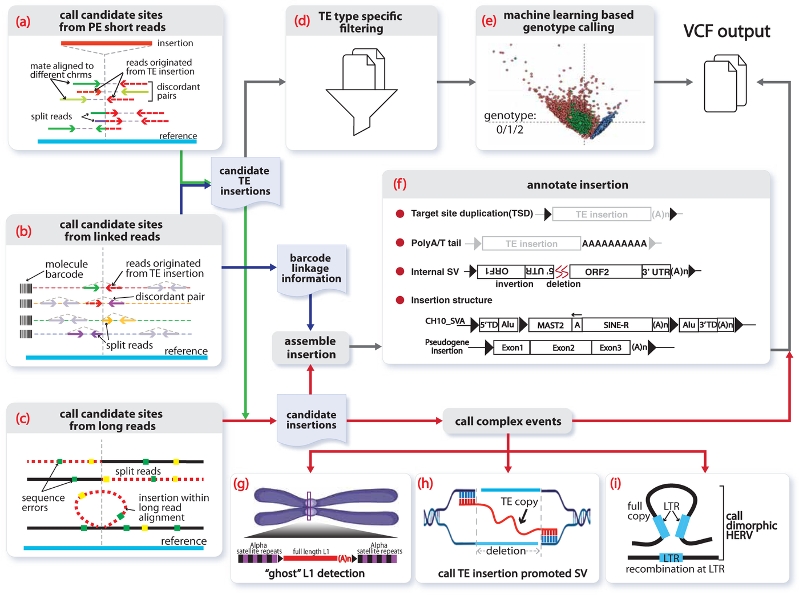

# 第8章 群体水平的转座子插入多态性（TIPs）分析

## 8.1 短读长与长读长测序数据的TIPs检测原理

### 8.1.1 非参考插入与参考缺失的短读长检测信号：不一致配对读长与分裂读长

单份参考基因组只能提供物种转座子景观的一张静态快照，它无法区分哪些转座子拷贝早在数百万年前便已在物种内固定，哪些拷贝则是近期活跃转座、仅存在于部分自然居群或栽培品种中的动态变异。当我们在群体尺度上比较多个个体的基因组时，某个特定染色体坐标上表现为“部分个体存在转座子插入、另一部分个体缺失该插入”的遗传多态位点，被称为**转座子插入多态性（transposon insertion polymorphisms，简称TIPs）**。在基于单一参考基因组开展群体短读长重测序（如Illumina双端测序，读长通常为100至150 bp，插入片段长度约300至500 bp）分析时，依据目标转座子拷贝在参考基因组中的存在状态，所有TIPs在算法层面必须被区分为两类极性相反的变异：

- **非参考插入（non-reference TIPs）**：指该转座子拷贝存在于被测序的个体基因组中，但在参考基因组对应位点上为空位点（不存在该插入）。
- **参考缺失（reference TIPs，又称reference absences）**：指参考基因组中注释了该转座子拷贝，但在被测序的个体基因组对应位点上该拷贝缺失。需要强调的是，在生物学演化极性上，绝大多数“参考缺失”实际上并非被测个体发生了转座子精确切除，而是参考基因组所代表的个体（或单倍型）在其演化谱系中获得了该转座子插入，而被测个体保留了祖先的空位点状态。

由于150 bp的短读长远远无法完整跨越长达数kb的LTR反转录转座子或大型DNA转座子，短读长TIPs检测算法只能依托比对到参考基因组上的两种核心异常信号：**不一致配对读长（discordant read-pair，DRP）**与**分裂读长（split-read，SR）**。

在检测**非参考插入**时，DRP与SR信号呈现出典型的双向夹击几何特征。对于一对来自同一DNA片段的双端测序读长（Read 1与Read 2），当该DNA片段恰好跨越新插入转座子的左侧或右侧边界时，其中一端读长（称为锚定读长，anchor read）能够唯一比对到参考基因组插入位点的侧翼单拷贝区，而另一端读长（称为支持读长，supporting read）则落在新插入的转座子内部。由于参考基因组在此处不含该转座子，支持读长在比对到参考基因组时会呈现未比对状态，或者错误比对到参考基因组其他染色体上的同源转座子拷贝上，表现为双端比对距离异常或跨染色体比对（即DRP信号）。算法随后提取这些异常配对的支持读长，将其重新比对到物种特异性转座子一致性文库上。在真实的非参考插入位点两侧，来自插入上游的锚定读长全部指向正向（+链），聚集在断点左侧约一个文库插入片段长度的区间内；来自插入下游的锚定读长全部指向反向（-链），聚集在断点右侧。这种由正向锚定簇与反向锚定簇构成的双峰夹击信号，能够以极高的灵敏度将非参考插入锁定在数十至数百bp的候选窗口内。

然而，仅凭DRP信号无法确定精确到单碱基的插入断点，也无法直接验证靶位点重复（TSD）。此时需要引入**分裂读长（SR）信号**。当单条150 bp的读长本身直接跨越转座子与宿主基因组的连接点时，BWA-MEM等局部比对软件会将该读长位于宿主侧翼的部分正常比对到参考基因组，而将落入转座子内部的部分进行软裁剪（soft-clipping，在BAM文件的CIGAR字符串中标记为`S`）。在插入位点的精确坐标上，来自上游的读长在3'端发生软裁剪，形成一条整齐的右裁剪边界；来自下游的读长在5'端发生软裁剪，形成一条整齐的左裁剪边界。算法提取所有软裁剪序列并与转座子一致性文库比对，若左裁剪序列匹配转座子3'端、右裁剪序列匹配转座子5'端，即可在单碱基精度上锁定插入断点。更具诊断价值的是，由于真实转座插入会在两侧生成一对完全相同的TSD，上游右裁剪边界与下游左裁剪边界在参考基因组坐标上并不会严丝合缝地对接在同一个碱基上，而是会形成一段长度恰好等于TSD（例如LTR转座子为5 bp）的**坐标重叠区**。这种由SR信号直接还原的TSD重叠，是排除假阳性结构重排的最强证据。

在检测**参考缺失**时，DRP与SR信号的几何形态则恰好反转。当被测个体缺乏参考基因组上某段长度为 $L_{\text{TE}}$ 的转座子时，跨过该空位点的双端测序片段比对回参考基因组后，其两端的比对坐标会被参考基因组中那段额外的转座子强行撑开，导致观测到的模板跨度（TLEN）显著大于正常测序文库的插入片段均值（约等于正常插入片段长度加上 $L_{\text{TE}}$），且跨越该转座子内部的测序覆盖深度骤降至零（纯合缺失）或降至正常背景深度的一半（杂合缺失）。与此同时，直接跨越空位点接缝的单条读长会产生经典的缺失型分裂读长信号：读长的前半段精确比对至参考转座子的5'侧翼，后半段跳跃过整个转座子长度精确比对至3'侧翼，且缺失区间的起止坐标与参考基因组上该转座子的注释边界（包含一份TSD）高度吻合。

*图：短读长双端、linked reads 与长读长如何找到候选插入位点（不一致配对读长与劈裂读长），随后过滤、分型和注释。材料以人类数据为主。原图未修改，引自 Chu C、Borges-Monroy R、Viswanadham VV 等（2021），Comprehensive identification of transposable element insertions using multiple sequencing technologies，Nature Communications 12:3836，Fig. 1，doi:10.1038/s41467-021-24041-8，PMC8219666，许可 CC BY 4.0 (https://creativecommons.org/licenses/by/4.0/)。图片文件与配图合订本所用的相同。*

### 8.1.2 主流短读长TIPs检测工具的工作逻辑与高重复植物基因组误差来源

在过去十余年中，生物信息学界围绕DRP与SR信号开发了数十款短读长TIPs检测工具。在群体基因组学实践中，**MELT**、**TEMP2**与**TEPID**是三款代表性极强且设计哲学各异的主流工具。

**MELT（Mobile Element Locator Tool）**[待确认]最初为千人基因组计划设计，用于检测人类基因组中的*Alu*、LINE-1和SVA多态性，随后通过自定义转座子文库被广泛拓展至水稻、玉米和葡萄等植物群体。MELT的核心优势在于其面向大规模群体的**联合发现与基因型分型架构（MELT-SPLIT）**。该流程输入所有个体的比对BAM文件、参考基因组及压缩后的转座子一致性序列，先在单样本层面利用DRP信号寻找非参考插入，再跨全群体合并断点聚类，利用SR信号精确计算断点坐标、TSD长度、插入方向及截短长度，最后基于最大似然模型对全群体所有个体在全部多态位点上进行统一基因型分型（同时提供独立的MELT-Deletion模块用于检测参考缺失）。MELT对全长完整插入的断点精度和群体基因型质量控制非常严格，但其对输入转座子文库的非冗余度和边界完整度要求极高。

**TEMP2**[待确认]是在经典工具TEMP基础上全面重构的检测流程，专门针对高重复基因组中假阳性过高的问题进行了算法优化。TEMP2需要输入BAM文件、参考基因组、RepeatMasker生成的参考转座子注释BED文件以及转座子一致性文库。在检测非参考插入时，TEMP2结合DRP与SR信号，并引入了一套精细的去重与过滤机制，能够区分群体中高频存在的可遗传种系插入与测序噪音或极低频体细胞插入；同时内置了针对参考缺失的检测模块，通过校验跨界DRP信号和内部覆盖度衰减来识别参考转座子的缺失。在植物群体分析中，TEMP2因运行速度较快、对多家族并存的植物文库兼容性好而被频繁选用。

**TEPID（Transposable Element Polymorphism IDentification）**[待确认]则是专门面向植物基因组群体开发的经典工具，最早在拟南芥千株基因组计划中得到大规模验证[待确认]。TEPID的工作逻辑独具特色：它使用Bowtie2进行常规比对，同时结合专用的分裂读长比对器YAHA捕获跨断点读长，同步整合DRP与SR信号以鉴定非参考插入和参考缺失。TEPID的一项重要创新是引入了**群体迭代精修模块（refinement step）**：在第一轮单样本检测汇总出群体多态位点列表后，算法会回溯检查在第一轮中未报出阳性、但测序深度较低的个体，放宽读长支持阈值重新核查这些已知多态位点，从而显著挽救了低深度样本中的假阴性漏检。此外，学界还开发了如McClintock等元流程框架，支持在同一数据集上并行调用多款TIPs工具以评估算法一致性[待确认]。

尽管这些短读长工具在人类或拟南芥（约135 Mb、重复序列占比约20%）上表现优异，但一旦迁移到葡萄（约500 Mb、重复序列占比约45%至50%）或玉米（约2.3 Gb、重复序列占比超80%）等**高重复植物基因组**中，短读长TIPs检测便会面临四大顽固的误差来源：

1. **重复区与嵌套插入导致的比对盲区（系统性假阴性）**：DRP和SR检测的绝对前提是锚定读长必须**唯一比对**到参考基因组上（通常要求比对质量 $\text{MAPQ} \ge 20$）。然而，在植物基因组的近着丝粒异染色质区，或者当一个年轻转座子嵌套插入到另一个古老转座子内部时，插入位点两侧本身就是高度重复的序列。此时锚定读长在全基因组存在数十甚至上百个等价匹配位置，比对软件会将其MAPQ赋值为0，导致所有主流短读长工具直接将其丢弃。因此，短读长TIPs图谱在植物基因组中天然存在严重的“常染色质偏倚”：基因区附近的TIPs检出率高，而异染色质和嵌套区的TIPs绝大多数被漏检。
2. **转座子文库不完整或冗余引发的错分与漏检**：如果参考文库中缺少某个近期在特定野生葡萄或地方品种中爆发的转座子家族，支持读长便无法比对到文库上，该家族的所有非参考插入都会彻底隐身；反之，若文库存在大量冗余或截短序列，同一插入位点的支持读长会被分散到多个高度相似的文库条目中，导致单个家族的支持读长数跌破阈值而漏报，或在跨样本合并时被误判为不同家族的独立插入。
3. **基因组片段重复与组装错误制造的假阳性DRP**：植物基因组经历了频繁的全基因组复制与局部片段重复。当被测个体的旁系同源区段与参考基因组存在拷贝数差异或局部组装折叠时，大量错配的双端读长会聚集成类似DRP的异常信号，若缺乏严格的SR断点与TSD核验，极易被误报为非参考插入。
4. **短读长无法解析插入体内部结构**：即使短读长完美检出了一个非参考LTR插入并精准定位了5 bp TSD，算法看到的也仅仅是该插入体最左端和最右端的约100 bp序列。对于被测个体中插进去的究竟是一条10 kb的完整自主型LTR转座子、一条缺失内部编码区的非自主拷贝，还是一个仅800 bp的solo-LTR，短读长检测原理本身完全无法分辨。

### 8.1.3 长读长测序与泛基因组图谱对重复区瓶颈的突破

第三代单分子长读长测序技术（包括高准确度的PacBio HiFi读长，长度通常为15至25 kb、单碱基准确度超过99.9%，以及牛津纳米孔ONT超长读长，长度可达50至100 kb以上）与泛基因组图谱（pangenome graph）的兴起，正在从根本上终结短读长时代TIPs检测的结构性困境。

长读长技术突破短读长瓶颈的物理本质极为直观：**单条测序读长的长度远远超过了绝大多数完整植物转座子的全长**。一条20 kb的PacBio HiFi读长，能够轻而易举地从上游唯一锚定区出发，完整横跨一条长达12 kb的完整LTR反转录转座子（甚至包含两层嵌套插入），最终稳稳锚定在下游的单拷贝宿主序列上。这种物理上的“一穿到底”，彻底消除了锚定读长在局部重复区迷失方向的比对盲区，并带来了三项短读长无法企及的质变：其一，直接读取新插入转座子的**完整内部序列**，无需靠侧翼猜测即可无歧义地区分完整LTR、截短拷贝与solo-LTR；其二，直接以单碱基精度解析嵌套插入的层级结构和复杂断点；其三，借由单分子甲基化信号（HiFi动力学信息或ONT电信号）同步获取该新插入转座子在插入位点上的真实DNA甲基化状态。

当前基于长读长数据的TIPs解析主要沿着两条技术路线推进：

**路线一：基于长读长比对的结构变异与转座子联合解析。** 将个体的HiFi或ONT长读长使用minimap2或NGMLR比对到参考基因组上，利用长读长结构变异检测工具（如Sniffles2、cuteSV或pbsv）检出全基因组范围内的所有插入（INS）和缺失（DEL）事件，提取变异区间的完整DNA序列，再调用物种特异性转座子一致性文库（配合RepeatMasker或专门的长读长TIP注释工具如TLDR、GraffiTE等）[待确认]判定该结构变异是否由完整的转座子插入或缺失引起，并精确标注其超家族、方向、完整度与TSD。这一路线适用于中等深度（如10至20x）的长读长群体测序项目。

**路线二：基于多单倍型组装与泛基因组图谱（Pangenome Graph）的对称解析。** 当群体中已有数十个代表性材料（涵盖野生近缘种、地方品种和主栽品种，例如葡萄属的多单倍型T2T或高质量HiFi组装集合）完成单倍型解析组装后，研究者不再局限于将序列逐一比对到单一线性参考基因组，而是使用**Minigraph-Cactus**或**PGGB**等工具将所有单倍型组装整合构建为**泛基因组变异图谱（variation graph）**[待确认]。在泛基因组图谱中，所有单倍型共享的保守基因组区段构成主干节点，而每一个多态性转座子插入（无论它存在于传统参考基因组中还是仅存在于某个野生葡萄单倍型中）都以完全对称的“气泡（bubble）”分支路径存在于图谱之中。

泛基因组图谱的建立，还催化了一项极具性价比的群体研究范式——**图谱引导的短读长基因型分型（graph-based genotyping）**。利用**PanGenie**或**vg giraffe**等图谱分型工具[待确认]，研究者只需对数以千计的群体材料进行低成本的常规Illumina短读长重测序，即可基于图谱中已知气泡路径的特异性*k*-mer分布或图谱比对信号，精准推断每一个体在所有泛基因组TIPs位点上的精确二倍体基因型。这种“少数代表性材料长读长建图 + 大规模群体短读长图谱分型”的混合架构，兼顾了长读长的结构解析精度与短读长的群体规模经济性，正迅速成为现代作物（包括葡萄）群体转座子研究的标准配置。

### 8.1.4 群体基因型分型中的缺失值、杂合度偏差与测序深度阈值

在群体遗传学与GWAS研究中，仅仅“发现（discovery）”群体中存在哪些多态性转座子位点远远不够，真正决定下游统计推断可靠性的是**群体基因型分型（genotyping）**的质量，即准确判定每一个体在每一个多态位点上究竟是纯合参考型（`0/0`）、杂合型（`0/1`）、纯合变异型（`1/1`），还是数据不足无法判定的缺失值（`./.`）。与成熟的SNP分型流程（如GATK联合分型）相比，TIPs的群体分型存在三个极易扭曲科学结论的技术陷阱。

**第一是缺失值（`./.`）与纯合参考型（`0/0`）的混淆陷阱。** 这是许多初学者在合并多个样本的TIPs结果时最常犯的致命错误。假设利用某短读长工具对200份葡萄重测序样本独立检测非参考插入，合并所有样本的阳性位点后，如果简单地将“在某个体中未检出阳性”的位点全部直接填充为`0/0`（无插入），就会制造出灾难性的统计偏差。某个体在位点 $X$ 未报出阳性，可能存在两种完全不同的原因：一是该个体在该位点确实拥有20条正常跨越空位点的读长，确凿证明其为`0/0`；二是该个体在位点 $X$ 的测序深度恰好为0或仅有2条低质量读长，根本没有足够的数据来排除插入的存在（理应标记为`./.`）。将低深度盲区错误填充为`0/0`，会人为拉低群体中TIPs的等位基因频率，制造出大量虚假的单例突变（singletons），进而使下游的位点频率谱（SFS）严重左偏，误导出“极强纯化选择”或“近期爆发”的假结论。严谨的分型算法必须在每个候选位点上显式核查跨越空位点的正常配对读长数（reference-supporting reads）与支持插入的DRP/SR读长数（alternate-supporting reads），唯有在总有效覆盖深度达到最低阈值且符合似然比检验时才输出确定基因型，否则必须诚实标记为`./.`。

**第二是杂合度估计偏差（heterozygosity estimation bias）与等位基因脱扣。** 这一问题在自交高度纯合的拟南芥或水稻中相对隐蔽，但在像**栽培葡萄这样高度杂合的异交无性繁殖木本作物**中却表现得极为突出。在一个基因型为`0/1`的杂合葡萄个体中，一条同源染色体携带参考空位点，另一条同源染色体携带非参考转座子插入。理论上，覆盖该位点的测序读长应有50%支持参考等位基因、50%支持插入等位基因。然而，在实际短读长比对中，携带参考空位点的读长能以100%完美匹配无缝比对到参考基因组；而携带转座子插入边界的读长却要承受软裁剪惩罚、不一致配对惩罚甚至部分落入重复区被过滤的损失。这种固有的**参考等位基因比对偏好（reference mapping bias）**，导致在`0/1`杂合位点上，观测到的插入支持读长比例常常显著低于50%（有时跌至20%至30%）。在测序深度不足时，这种不对称性极易引发插入等位基因的**等位基因脱扣（allelic dropout）**，将大量真实的`0/1`杂合体错误分型为`0/0`纯合体，导致群体观测杂合度（$H_o$）被系统性严重低估。同理，在检测参考缺失时，如果缺失断点周围存在高频SNP或微缺失，部分正常读长无法比对，反而可能将`0/1`误判为`1/1`。

**第三是测序深度阈值设定与质控标准。** 基准测试研究表明，对于短读长重测序数据，当全基因组平均测序深度低于10x时，非参考TIPs的检出灵敏度与`0/1`杂合分型准确率均会出现断崖式下跌[待确认]。对于拟南芥、水稻等高度纯合的自交物种，10x至15x的测序深度配合群体联合分型尚可获得较高的检出率；但对于葡萄、苹果、柑橘等高度杂合的二倍体作物，为了在杂合位点上稳定捕获足够的双向DRP与SR读长并区分`0/1`与`1/1`，建议用于TIPs群体分型的短读长重测序平均深度不低于**15x至20x**。在构建最终用于群体遗传学和GWAS分析的TIPs基因型矩阵（VCF文件）时，通常还需实施严格的位点级与样本级过滤：剔除群体基因型缺失率过高（例如缺失率 $> 10\%$ 或 $> 20\%$）的位点、剔除单侧缺乏独立SR或双向DRP支持的低置信度位点，并结合物种的交配系统特征（如无性繁殖作物的预期杂合度特征）核查极端偏离哈迪-温伯格平衡的异常位点，以过滤掉由旁系同源重复混叠引发的虚假“全群体杂合”假阳性。

## 8.2 群体遗传学统计量与中性检验在TIPs中的应用

### 8.2.1 TIPs与SNP在突变率、突变方向性与等位基因频率分布上的差异

在传统群体遗传学教材中，绝大多数数学模型与统计检验都是围绕单核苷酸多态性（SNP）建立的。当我们把研究对象从单碱基替换拓展到动辄数kb的转座子插入多态性（TIPs）时，切忌机械套用SNP的隐含假设。TIPs与SNP在三大基础演化属性上存在本质差异，正是这些差异赋予了TIPs独特的群体遗传学信息价值，同时也带来了新的建模挑战。

**第一，突变率的时空异质性。** 宿主的自发点突变（SNP）主要源于DNA复制聚合酶的偶发错误与碱基自发脱氨，其突变率在基因组尺度上相对平稳且极低（植物中通常在 $10^{-9}$ 至 $10^{-8}$ 次/碱基/世代量级），在同一物种的不同世代间大致可视为恒定常数。相比之下，转座子的转座插入率具有极端的**脉冲性、家族特异性与表观遗传依赖性**。在表观遗传沉默严密维持的漫长时期内，某个转座子家族的转座率几乎为零；而一旦遭遇环境胁迫、杂交冲击或表观防御漏洞，特定家族的转座率可能在短短几个世代内飙升数个数量级，随后又因触及拷贝数阈值被RdDM通路瞬间归零。此外，一个家族的新增插入速率还与该家族当前基因组中活跃自主型拷贝的数量呈正相关，这彻底违背了标准群体遗传学中“突变率独立于拷贝数且随时间恒定”的基本前提。

**第二，突变方向性（极性）与近乎无同塑性（homoplasy-free）。** 对于一个双等位SNP位点（例如A/G），仅看物种内部的序列比对无法判断究竟是A突变为G，还是G突变为A，必须借助近缘外群物种进行祖先状态极化（polarization）；而且在漫长的演化尺度上，同一碱基位点可能发生回复突变或平行突变（同塑性）。相反，转座子插入几乎是自然界中最完美的**单向演化标记**。对于Ⅰ类反转录转座子而言，两个完全独立的插入事件在全基因组数亿个碱基中，恰好命中完全相同的单碱基坐标、拥有相同方向并产生相同TSD的概率几乎为零；同时，反转录转座子缺乏任何已知的精确切除酶学机制（即便发生同源重组也会留下明确的solo-LTR和原始TSD，绝不会还原为空位点）。对于Ⅱ类DNA转座子，虽然存在切离机制，但如第4.1.3节所述，NHEJ修复几乎总会在原位留下特征性“足迹”，能够完美抹平TSD并精准还原为插入前野生型序列的“精确切除”在自然界极其罕见。因此，在群体TIPs分析中，**“空位点（无插入）”几乎总是无歧义的祖先状态（ancestral state），而“存在转座子插入”几乎总是衍生状态（derived state）**。这一得天独厚的单向极性，使研究者无需依赖遥远且难以比对的外群物种，就能直接、高置信度地构建展开位点频率谱（unfolded SFS）并追溯清晰的等位基因起源方向。

**第三，等位基因频率分布的强烈左偏特征。** 在拟南芥、水稻、玉米、番茄以及葡萄等多种植物的群体研究中，研究者一致观察到一个高度普适的格局：与同一群体中的同义SNP或基因间区中性SNP相比，**TIPs的衍生等位基因频率（derived allele frequency，DAF）分布呈现出极为剧烈的低频偏斜（大量位点仅以极低频率甚至单例形式存在，高频或接近固定的衍生插入比例极低）**[待确认]。这一显著差异直接反映了TIPs与中性SNP在适应度效应上的鸿沟：单个非编码碱基替换绝大多数是严格中性的，容易凭借遗传漂变漂移至中高频；而一条数kb的转座子插入不仅可能直接破坏编码框或调控元件，还会通过异染色质顺式扩散压制邻近基因，并增加染色体异位重组的致死风险，因此全基因组范围内TIPs承受着远强于普通SNP的平均纯化选择压力。

### 8.2.2 位点频率谱（SFS）检验纯化选择及区分群体扩张与转座爆发

**位点频率谱（site frequency spectrum，SFS）**是指群体中不同衍生等位基因频次（从仅出现1次的singleton，到出现2次、3次直至 $2N-1$ 次）的变异位点数量分布直方图。由于TIPs天然具备极高的极化准确度，**展开位点频率谱（unfolded SFS，uSFS）**以及基于SFS衍生出的经典汇总统计量（如**Tajima's $D$**、平均衍生等位基因频率 $\overline{\text{DAF}}$ 与单例比例）成为定量评估转座子自然选择强度的核心工具。

在标准中性平衡群体（恒定群体大小、恒定突变率、无自然选择）的理论预期下，出现频次为 $i$ 的衍生变异位点期望数与 $1/i$ 成正比，对应的Tajima's $D$ 期望值接近0。当转座子插入对宿主有害并承受**纯化选择（purifying selection）**时，有害插入难以在群体中扩散至高频率，绝大多数会在低频阶段被自然选择淘汰。这在uSFS上表现为极低频区（尤其是单例）的尖锐堆积与中高频区的急剧塌陷，对应的Tajima's $D$ 呈现显著的负值。通过在不同基因组功能区室（如外显子、启动子区上游2 kb、内含子、远端基因间区、近着丝粒异染色质区）以及不同转座子结构类别（完整长LTR vs solo-LTR vs 短小MITEs）之间比较uSFS和Tajima's $D$，群体遗传学家能够清晰地量化选择强度的空间梯度：通常，插入基因内部和启动子区的完整长LTR转座子表现出最极端的低频偏斜（纯化选择最强），而位于远端基因间区的短小MITEs或重组后的solo-LTR则呈现相对平缓的频率分布（承受较弱的负选择或接近中性）。进一步地，研究者还可将适用于SNP的**适应度效应分布（distribution of fitness effects，DFE）**推断模型改造应用于TIPs，以定量估算转座子插入的平均选择系数 $N_e s$。

然而，在利用uSFS和Tajima's $D$ 推断转座子所受的纯化选择时，群体遗传学中存在一个极其著名且棘手的**三因子混淆难题**：以下三种完全不同的演化过程，在uSFS上会产生几乎一模一样的“极低频过量与强负Tajima's $D$”统计信号：

1. **强烈的纯化选择（purifying selection）**：有害转座子插入被压制在低频区间，无法向高频漂变。
2. **近期的宿主群体规模扩张（recent demographic expansion）**：例如物种在末次冰期后迅速向外扩散，或栽培作物在驯化后伴随农业传播人口激增，会导致全基因组所有新产生的突变（无论中性还是有害）在谱系树末端大量积累，产生海量的低频变异。
3. **近期的转座子爆发（recent transposition burst）**：假设宿主群体大小恒定且转座子插入完全中性，但某一个转座子家族在距今仅数百或数千个世代前突然发生了一次剧烈爆发。由于这些新拷贝诞生的时间极短，根本来不及通过遗传漂变攀升至高频率，因此在当下抽样时，它们几乎全部表现为极低频或单例变异！

如果研究者忽视了上述混淆效应，直接看到某个年轻*Gypsy*家族的Tajima's $D = -2.3$ 就断言“该家族正遭受极强的纯化选择”，便会落入严重的方法学误区。为了在真实的群体数据中严谨地剥离纯化选择、群体历史动态与近期转座爆发这三种力量，现代群体转座子研究必须采取**三重对照拆解策略**：

- **对照一：以同一群体的中性SNP为基准剥离人口学历史（Demography）**。宿主群体扩张或瓶颈历史会平等地作用于全基因组的所有位点。因此，必须先利用同一批测序样本中的四倍简并位点（4-fold degenerate sites）或远离基因的基因间区中性SNP构建中性uSFS，并借助群体历史推断软件（如$\partial a \partial i$或fastsimcoal2）拟合出宿主的真实群体大小变化模型。只有在扣除该群体历史模型所预期的中性基线后，TIPs相对于中性SNP仍然多出来的那部分低频偏斜，才可能归因于纯化选择或近期转座爆发。
- **对照二：跨转座子家族横向比较以剥离家族特异性爆发（Burst）**。宿主的人口学扩张对所有转座子家族的影响是完全一致的，而转座爆发几乎总是高度家族特异的。如果观察到全基因组绝大多数古老或温和的转座子家族（如部分MITEs、LINEs及非活跃LTR家族）的uSFS仅略微偏左，唯有某两个特定LTR家族（例如携带大量零分歧完整拷贝的年轻*Copia*家族）呈现出极端尖锐的单例峰值，且结合第6.1.1节的LTR分子钟证实这两个家族的两端LTR分歧度极低（$K \approx 0$），即可明确判定这部分极端低频过量主要由近期转座爆发驱动。
- **对照三：在同一家族内部跨基因组区室比较以锁定纯化选择（Selection）**。对于同一个经历过近期爆发的转座子家族而言，爆发本身在时间上是统一的。如果我们在该家族内部进一步对比“插入在基因启动子/外显子附近或高重组区的拷贝”与“插入在远端基因间区或低重组区的拷贝”，观察到基因附近与高重组区拷贝的uSFS显著比远端基因间区拷贝更偏低频（且排除插入偏好性随时间变化的影响），那么这两组区室之间的频率落差，便构成了纯化选择正在积极清除有害插入的最确凿、无混淆的证据。

### 8.2.3 TIPs与邻近SNP的连锁不平衡（LD）衰减模式：年轻插入与古老插入的分化

**连锁不平衡（linkage disequilibrium，LD）**衡量染色体上两个不同位点的等位基因之间非随机关联的程度，最常用的度量指标是相关系数平方 $r^2$（同时结合标准化指标 $D'$ 辅助判读）。剖析TIPs与周围侧翼SNP之间的LD衰减模式，不仅能揭示转座子在单倍型背景上的演化轨迹，更是决定第8.3节TE-GWAS能否发现新表型关联的理论枢纽。

在群体基因组中，**古老插入（old insertions）**与**年轻插入（young insertions）**在LD特征上呈现出截然不同的动力学图景：

- **古老插入的LD特征**：一个插入年代久远、且在群体中经受住选择考验并漂变至中高频（例如MAF在0.1至0.5之间）的TIP，最初诞生在某一条祖先单倍型上。在随后的数万至数十万个世代中，减数分裂重组逐渐打断了该TIP与远端SNP之间的连锁，使其长距离LD迅速衰减至背景水平；但在紧邻插入位点的局部短距离窗口（例如上下游数kb范围内），由于重组事件稀少，该TIP往往与周围多个频率相近的SNP保持着中等到较高的 $r^2$，其局部LD衰减曲线与同等频率的普通SNP大致平行。
- **年轻插入的LD特征**：一个在近期（例如作物驯化后或近数千世代内）刚刚插入的新生TIP，诞生于一条现存的常见单倍型之上，因此在群体中通常处于低频或极低频状态。在数学上，两个双等位位点间的 $r^2$ 严格受限于二者等位基因频率的匹配程度（只有当两个位点的等位基因频率完全相等时，$r^2$ 才可能达到最大值1）。因此，尽管这个年轻TIP与它所寄生单倍型上的常见侧翼SNP之间尚未发生重组（即 $D' = 1$，处于完全单向嵌套连锁），但由于年轻TIP频率极低而侧翼SNP频率很高，二者之间的 **$r^2$ 值必然极其低微**（往往接近0）。只有在罕见情况下，当一个年轻TIP凭借强烈的正向选择发生快速“硬选择清除（hard selective sweep）”并在极短时间内飙升至高频时，它才会拖曳着整个宿主单倍型一起高频化，在周围形成异常宽阔的**延伸单倍型纯合度（EHH）**和高 $r^2$ 区块。

除了插入年龄导致的频率错配外，在拟南芥、水稻、玉米、番茄和葡萄等植物的实证研究中，人们还发现了一个极具启发性的现象：**即使在限定于中高频（例如 $\text{MAF} \ge 0.05$）的TIPs中，依然有相当大比例（在不同物种中常占20%至50%甚至更高）的TIPs与其周围任何邻近SNP之间的最大 $r^2$ 值均处于极低水平（如 $r^2 < 0.5$ 或 $r^2 < 0.8$）**[待确认]。造成中高频TIPs呈现“低SNP标签率”的原因是多方面的：
1. **局部重复环境导致的SNP呼叫盲区**：部分转座子插入在局部高重复或高GC/AT偏倚区域，短读长SNP检测流程因比对质量低而过滤掉了该区域内的真实SNP，导致物理距离最近的可用SNP远在数kb之外，中间已被重组打断。
2. **近期多态性插入的重组或结构复发**：部分插入位于基因启动子附近的重组热点区，局部极高的重组率加速了LD崩溃；此外，若一个活跃的DNA转座子发生二次切除，或一个完整LTR转座子在部分个体中通过同源重组转化为solo-LTR，就会在同一单倍型背景上打破原有的“插入-SNP”一一对应关系，急剧拉低 $r^2$。
3. **无性繁殖与高度杂合背景的叠加效应**：在葡萄等长期无性繁殖作物中，虽然克隆传播保留了大段祖代杂合单倍型（整体LD衰减较缓慢），但发生在无性繁殖系中的体细胞新转座子插入（芽变插入）仅存在于特定克隆分支的某一条单倍型上，其周围的侧翼SNP与同品种的其他未突变克隆系完全一模一样，导致这类体细胞TIPs与周围任何SNP之间的 $r^2$ 几乎为零。

### 8.2.4 群体分化分析（$F_{ST}$）与选择清除扫描中的参考基因组偏倚校正

将TIPs作为独立遗传标记纳入**群体遗传分化指数（$F_{ST}$）**、群体分支统计量（PBS）以及全基因组选择清除扫描（selective sweep scan），能够帮助研究者直接捕获那些在物种生态适应或作物驯化过程中受到强烈正向选择的大效应转座子变异。例如，比较野生葡萄（*Vitis vinifera* subsp. *sylvestris*）与栽培葡萄（*V. vinifera* subsp. *vinifera*）群体间的TIPs分化，或者比较不同酿酒葡萄生态型间的TIPs频率差异，能够直接锁定驱动果皮颜色、成熟期或抗逆性分化的候选插入事件（如第10.2节将详述的*Gret1*经典案例，doi:10.1126/science.1095011）。

然而，与相对对称的SNP标记相比，在利用基于单一线性参考基因组检出的TIPs开展 $F_{ST}$ 和选择清除分析时，**参考基因组偏倚（reference genome bias）**是一座随时可能倾覆分析结论的暗礁。

以葡萄群体研究为例，假设我们选用欧亚栽培葡萄参考基因组PN40024作为唯一比对参考，同时重测序了100份欧亚栽培葡萄和100份亲缘关系较远的野生葡萄（或美洲/东亚葡萄）。此时，参考基因组偏倚会通过两个渠道系统性地扭曲群体分化统计量：

1. **参考缺失与非参考插入的不对称检测灵敏度**：存在于栽培葡萄高频区（且恰好存在于PN40024中）的多态性转座子，在野生葡萄中表现为“参考缺失”；而存在于野生葡萄高频区（PN40024中不含）的多态性转座子，在野生葡萄中表现为“非参考插入”。然而，绝大多数短读长TIPs工具对“参考缺失”和“非参考插入”的灵敏度、假阳性率以及基因型分型准确率并不对称。如果某工具对非参考插入的漏检率显著高于参考缺失，分析结果就会呈现一个虚假的宏观格局：似乎所有高 $F_{ST}$ 分化位点全都是“栽培葡萄特有插入”，而野生葡萄特有的适应性插入被系统性地漏掉了。
2. **随遗传距离递增的比对衰减效应（mapping decay）**：野生葡萄与栽培参考基因组PN40024之间的基因组序列分歧度显著高于栽培葡萄内部。在野生葡萄样本中，由于侧翼序列存在大量SNP和小片段插入缺失，短读长比对到PN40024上的效率下降、软裁剪增多。这不仅降低了野生葡萄中非参考TIPs的检出率，还会导致部分野生葡萄本应存在的参考转座子因侧翼比对失败、覆盖度骤降而被误判为“参考缺失”。这种随演化距离单调恶化的系统误差，会人为拉大参考群体与远缘群体之间的TIPs $F_{ST}$ 均值，并在高分化区域制造大量虚假的选择清除峰值。

为了在 $F_{ST}$ 扫描和群体分化分析中有效消除或校正参考基因组偏倚，严谨的群体转座子分析应当贯彻以下四项校正规范：

1. **分层独立检验（Reference vs Non-reference stratification）**：在计算全基因组 $F_{ST}$ 分布和筛选前1%高分化异常位点时，切忌将参考缺失与非参考插入混为一谈直接套用统一阈值。应当分别统计“参考TIPs子集”和“非参考TIPs子集”的频率分布与 $F_{ST}$ 经验分布，检查二者的极值分布是否对称；在必要时，对两类位点分别设立基于各自经验分布的显著性分位阈值（如各自的Top 1%）。
2. **统一可及基因组掩膜与极化对齐（Uniform mappability mask）**：利用比对性评估工具，仅保留在**所有待比较群体中均具备高唯一比对率且平均覆盖深度达标**的基因组区段（accessible genome），剔除远缘群体中因序列高度分化导致比对崩塌的区域；同时将所有参考缺失与非参考插入统一极化为“0 = 祖先空位点，1 = 衍生转座子插入”，在统一极性下重新核验等位基因频率差（$\Delta \text{DAF}$）。
3. **采用外群参考基因组或泛基因组图谱实现对称分型**：如果研究目的是比较两个分化显著的姐妹群（如东亚野生葡萄与欧亚栽培葡萄），最彻底消除单侧偏倚的方法有两种：一是选用与两者演化距离相等的**外群物种参考基因组**进行比对；二是在条件允许时，直接构建囊括所有待比较群体代表性单倍型的**泛基因组图谱**，在无参考偏倚的图谱坐标系下对全部群体执行对称的TIPs分型。
4. **结合侧翼中性SNP的“搭便车”选择清除信号进行交叉验证**：一个在近期受到强烈正向选择的真实适应性TIP，在迅速攀升至高频的过程中必然会通过遗传搭便车效应（genetic hitchhiking），在插入位点上下游数kb至数十kb范围内扫空周围中性SNP的遗传多样性（表现为局部核苷酸多样性 $\pi$ 骤降、Tajima's $D$ 显著负偏、群体间SNP $F_{ST}$ 同步飙升以及跨群体延伸单倍型纯合度XP-EHH出现尖锐峰值）。因此，将TIPs高 $F_{ST}$ 候选位点与同一批数据的SNP选择清除扫描结果进行重叠校验，是区分真实适应性转座子与比对偏倚假阳性的黄金法则。

## 8.3 TIPs在全基因组关联分析（TE-GWAS）中的应用

### 8.3.1 将TIPs纳入GWAS的理论依据与“缺失遗传力”的填补

在过去二十年间，基于高密度单核苷酸多态性（SNP）的全基因组关联分析（SNP-GWAS）已成为解析作物重要农艺性状遗传基础的标准工具。然而，在大量植物（包括拟南芥、水稻、玉米、番茄及葡萄等）的SNP-GWAS实践中，研究者普遍遭遇了一个被称为**“缺失遗传力”（missing heritability）**的瓶颈：全基因组显著关联的SNP位点所能解释的表型方差之和，往往远低于通过家系或双生子/克隆设计估算出的狭义遗传力；同时，在许多已知由单基因或主效数量性状位点（QTL）控制的性状中，SNP-GWAS要么完全检测不到显著信号，要么关联峰值宽泛模糊，难以锁定真正的因果突变。

将转座子插入多态性（TIPs）作为独立遗传变异纳入全基因组关联分析——即**TE-GWAS**（或将TIPs与SNP、结构变异联合进行多变异GWAS）——正是填补这部分缺失遗传力、直击大效应因果变异的关键突破口。这一策略背后站立着三条坚实的群体遗传学与分子生物学理论依据：

第一，**中高频TIPs与邻近SNP的低连锁不平衡（低LD）状态导致传统SNP标记严重脱靶**。传统SNP-GWAS之所以能够仅凭数十万个SNP（甚至几万个芯片SNP）扫描全基因组，其隐含前提是“真正的因果变异必然与周围某个被测到的SNP处于极高的连锁不平衡（$r^2 \ge 0.8$）状态”，从而可以通过SNP间接标签（tag）捕获该因果变异。然而，正如第8.2.3节所述，在多种植物群体的实证分析中，高达20%至50%以上的中高频TIPs与其周围任何邻近SNP之间的最大 $r^2$ 均处于较低水平[待确认]。这种低标签率在**传统SNP基因分型芯片（SNP array）**和**低深度重测序（low-depth WGS）**数据中尤为致命：SNP芯片在设计之初为了保证探针杂交特异性，往往刻意避开了转座子密集区和重复序列侧翼，导致大量位于基因启动子或内含子中的TIPs处于芯片探针的LD盲区；而近期插入或由克隆芽变产生的新生TIPs，其侧翼单倍型与未插入的野生型完全一致，任何密度的SNP都无法将其区分开来。唯有将TIPs本身直接作为基因型变量输入GWAS模型，才能把这些被SNP漏掉的关联信号重新打捞出来。

第二，**转座子插入天然具备远超单碱基替换的表型效应量（effect size）**。绝大多数非编码区SNP对基因表达的影响微乎其微，需要成百上千个微效位点叠加才能产生可观测的表型分化；而一条长达数百bp至十数kb的转座子插入基因启动子、增强子、内含子或外显子时，能够一步到位地带来全新的顺式调控元件、截断转录本、触发可变剪接或引入大范围的DNA甲基化异染色质沉默。因此，在作物驯化与农艺性状演化中，许多主效QTL的真正底层因果变异并非SNP，而是TIPs。例如，在番茄驯化与育种群体中，TE-GWAS成功鉴定出多个与果色、果形、叶片形态及次生代谢物含量显著关联的TIPs，其中相当一部分位点在同批次的SNP-GWAS中完全未达到显著性阈值，或TIPs的关联显著性（$-\log_{10}P$）远高于周围任何SNP[待确认]；在拟南芥、水稻和玉米的群体研究中，TE-GWAS同样在开花时间、抗病性、株型与胁迫耐受性等复杂性状上捕获了大量独立于SNP的新增遗传力[待确认]。

第三，**直接指向因果变异，大幅缩短精细定位周期**。即使某个因果TIP碰巧与周围若干SNP处于较高的LD状态（因此在SNP-GWAS中也能看到一个显著的曼哈顿图峰值），传统的SNP-GWAS峰下往往同时躺着数十个与表型同等显著的连锁SNP，研究者仍需耗费数年构建近等基因系进行精细定位。如果在GWAS中同步纳入TIPs，当该TIP本身就是真正的因果突变时，它在关联模型中往往表现出最强的统计显著性（Lead variant），能够直接将研究者的目光聚焦到具体的转座子插入事件上。

### 8.3.2 混合线性模型（MLM）在TE-GWAS中的构建要点

在数学建模层面，TE-GWAS沿用了现代数量遗传学中最核心的统计框架——**混合线性模型（mixed linear model，简称MLM）**（以及由此衍生出的加速近似算法如EMMAX、GEMMA、FarmCPU、BLINK等）[待确认]。对于某一连续表型向量 $\mathbf{y}$，针对全基因组每一个待检验的TIP位点，标准单标记MLM可写作：

$$\mathbf{y} = \mathbf{X}\boldsymbol{\beta} + \mathbf{S}\alpha + \mathbf{Z}\mathbf{u} + \mathbf{e}$$

其中，$\mathbf{S}$ 为当前待检验TIP位点在群体所有个体中的基因型编码向量（通常按加性模型编码为0、1、2，分别代表纯合空位点`0/0`、杂合插入`0/1`与纯合插入`1/1`；对于显隐性效应强烈的插入，也可测试显性或隐性编码模型），$\alpha$ 为该TIP的固定效应待估参数；$\mathbf{X}\boldsymbol{\beta}$ 代表固定效应协变量矩阵（核心为**群体结构矩阵 $\mathbf{Q}$** 或主成分分析的前若干个主成分PCs，以及环境、年份、区组等试验设计协变量）；$\mathbf{Z}\mathbf{u}$ 代表随机多基因背景效应，其中 $\mathbf{u} \sim N(\mathbf{0}, \sigma_g^2 \mathbf{K})$，$\mathbf{K}$ 为刻画群体中任意两个个体间遗传相似度的**亲缘关系矩阵（kinship matrix）**；$\mathbf{e} \sim N(\mathbf{0}, \sigma_e^2 \mathbf{I})$ 为残差项。

尽管公式形式与SNP-GWAS完全一致，但在将MLM具体落地到TE-GWAS实践时，有四个极易被忽视的**构建要点与关键差异**必须严格把控：

1. **群体结构（$\mathbf{Q}$ 矩阵/PCA）与亲缘关系矩阵（$\mathbf{K}$）的计算必须依托全基因组中性SNP，而非仅用TIPs本身**。这是一个极其重要的统计原则。正如第8.1节与第8.2节所阐明的，全基因组TIPs的总位点数通常远少于SNP（一般在数千至数万个量级，而SNP可达数百万个），且TIPs在群体中存在严重的低频偏斜、参考基因组比对偏倚以及杂合度脱扣误差。如果仅用TIPs矩阵去计算PCA和亲缘关系矩阵 $\mathbf{K}$，估算出的群体结构和个体间亲缘关系会充满噪音，导致MLM无法充分校正群体分层，引发大面积假阳性膨胀（QQ图严重上翘）。正确的做法是：利用同一批重测序群体中经过严格LD修剪（LD-pruned）的高质量全基因组中性SNP来计算 $\mathbf{Q}$ 矩阵（前3至10个主成分）与亲缘关系矩阵 $\mathbf{K}$，再将这套精准的背景校正矩阵固定下来，逐一检验TIPs位点的关联效应。在像葡萄这样存在大量近亲杂交系谱、同品种克隆系和复杂地理亚群的作物中，使用高质量SNP构建的 $\mathbf{K}$ 矩阵对于压制亲缘假关联尤为关键。
2. **最小等位基因频率（MAF）与缺失率过滤阈值的权衡**。与SNP-GWAS常规要求 $\text{MAF} \ge 0.05$（且位点缺失率 $\le 10\%$ 或 $20\%$）一致，在TE-GWAS中同样需要剔除极低频位点。由于TIPs天然富含大量单例和极低频插入，若不过滤直接纳入单标记MLM检验，极少数携带罕见插入且恰好表型极端的个体会造成严重的统计量畸变和假阳性。然而，考虑到许多近期爆发的适应性转座子插入在自然群体中频率偏低（例如MAF在0.01至0.05之间），在样本量足够大（如数百至上千份材料）的群体中，研究者可将MAF阈值适度放宽至0.02或0.03，或者针对同一基因启动子区内的多个罕见TIPs采用**基因水平聚合检验（burden test / SKAT）**，将低频插入的信号合并以提升统计检验效能。
3. **多重检验显著性阈值的科学设定**。在全基因组同时检验数万个TIPs位点时，必须对名义显著性水平 $\alpha = 0.05$ 进行多重检验校正，否则仅凭随机概率就会产生上千个假阳性关联。最保守的方法是**邦费罗尼校正（Bonferroni correction）**：$P_{\text{threshold}} = 0.05 / M$，其中 $M$ 为参与检验的TIPs总数。如果将TIPs与数百万个SNP合并在同一个矩阵中进行联合GWAS，机械使用全套变异总数作为分母会导致阈值过于严苛（如 $10^{-8}$），大幅增加假阴性。更合理的做法是计算基因组中**独立有效检验数（effective number of independent tests，$M_{\text{eff}}$）**（例如利用GEC或SimpleM等算法扣除位点间的LD冗余后估算 $M_{\text{eff}}$），以 $0.05 / M_{\text{eff}}$ 或 $1 / M_{\text{eff}}$ 作为显著性与提示性阈值；或者结合**Benjamini-Hochberg假发现率（FDR < 0.05）**与**表型置换检验（permutation test）**来确立经验显著性红线。
4. **联合条件分析（Conditional Analysis）验证TIPs的独立贡献**。当TE-GWAS在某个染色体区段检出一个显著关联的TIP位点，且同一区段在SNP-GWAS中也存在显著关联峰值时，必须执行**条件分析**：将该区段最显著的Lead SNP作为额外固定效应协变量放入MLM中，重新检验该TIP的 $P$ 值；反之，再将该TIP作为协变量放入MLM中，重新检验该区段所有SNP的 $P$ 值。如果控制Lead SNP后该TIP依然高度显著，而控制该TIP后周围所有SNP的信号全部归零，就构成了强有力的统计学证据，表明该TIP极可能是独立于已知SNP、甚至直接驱动该性状变异的真正因果位点。

### 8.3.3 整合顺式eQTL与表观遗传数据缩小因果变异候选范围

即便TE-GWAS在曼哈顿图上给出了一个高达 $P < 10^{-10}$ 的璀璨尖峰，研究者也必须牢记一条遗传学铁律：**GWAS本质上只是一种统计学关联，而非分子生物学因果证明**。一个显著关联的TIP位点上下游数万bp的LD区块内，可能同时包含多个蛋白质编码基因、数十个非编码SNP以及其他小型结构变异。要从“统计显著位点”跨越到“确凿的因果转座子机制”，最高效的现代多组学策略是将TE-GWAS结果与**顺式表达数量性状位点（*cis*-eQTL）**及**表观遗传组数据（DNA甲基化与染色质可及性）**进行深度交叉整合。

**第一重整合：顺式eQTL（*cis*-eQTL）与等位基因特异表达（ASE）验证。**
绝大多数位于基因非编码区（启动子、内含子、3' UTR）的因果TIPs，都是通过改变邻近目标基因的转录水平、剪接模式或组织表达特异性来影响宏观表型的。因此，在同一个自然群体（或代表性核心子集）中采集与目标表型高度相关的发育组织（例如研究葡萄果皮色泽或风味时采集转色期果皮组织）开展群体转录组测序（RNA-seq），并以TIPs为基因型开展顺式eQTL映射（通常扫描每个基因转录起始位点上下游10 kb至100 kb内的TIPs），能够直接建立**“TIP基因型 $\to$ 目标基因表达量 $\to$ 宏观农艺表型”**的三元中介链条。
更进一步，对于像**葡萄这样高度杂合的二倍体作物**，杂合个体（基因型为`0/1`）天然提供了最完美的“体内对照实验”：在同一个细胞核、完全相同的反式调控因子环境下，携带转座子插入的那一条同源染色体与携带空位点的另一条同源染色体并排存在。通过RNA-seq读长上的杂合外显子SNP量化两条单倍型的**等位基因特异表达（allele-specific expression，ASE）**，如果发现凡是携带该TIP插入的单倍型，其目标基因的转录本丰度均一致地显著下调（如葡萄*VvmybA1*启动子区插入*Gret1*导致该等位基因彻底沉默，doi:10.1126/science.1095011）或一致地显著上调，即可直接确证该TIP发挥了真实的顺式调控效应，将因果候选范围精准锁定到唯一的靶基因上。

**第二重整合：群体表观遗传数据（WGBS甲基化组与ATAC-seq开放染色质）机制锚定。**
正如第5章所述，转座子影响邻近基因表达的两大经典分子开关，一是**异染色质DNA甲基化的顺式扩散**，二是**自身携带的顺式调控元件（增强子/启动子）导致的染色质开放**。将TE-GWAS显著位点与群体水平的全基因组亚硫酸氢盐测序（WGBS，可衍生出**甲基化数量性状位点，meQTL**）以及染色质可及性测序（ATAC-seq）叠加分析，能够瞬间揭示其底层分子机制：
- **表观沉默路径**：如果携带该TIP插入的个体，其目标基因启动子区在CG、CHG和CHH背景上的DNA甲基化水平显著高于空位点个体（形成强meQTL），且该启动子区的ATAC-seq开放信号同步塌陷、目标基因表达量骤降，即可明确该TIP是通过诱导局部异染色质扩散沉默靶基因来塑造表型的。
- **顺式激活路径**：反之，如果该TIP内部本身呈现出显著的ATAC-seq开放染色质峰（且富含组蛋白激活修饰如H3K27ac或H3K4me3），同时在携带插入的个体中靶基因表达量大幅攀升，则提示该TIP通过提供新的顺式增强子或替代启动子激活了靶基因。

通过在统计层面应用**共定位分析（colocalization analysis，如coloc）**或**基于汇总数据的孟德尔随机化（SMR）**，定量检验TE-GWAS表型信号、*cis*-eQTL表达信号与meQTL甲基化信号是否共享同一个底层因果变异，研究者能够在启动耗时耗力的基因编辑（CRISPR-Cas9）功能验证之前，将成百上千个初始候选位点精准收敛至屈指可数的高置信度因果转座子靶标。

### 8.3.4 TE-GWAS中常见的假关联陷阱与结果核验

TE-GWAS虽然威力强大，但由于转座子序列固有的重复属性与群体分型算法的不完美，在实战中极易产生看似统计显著（$P$ 值极小）、实则毫无生物学意义的**假关联陷阱**。研究者在撰写论文或解读TE-GWAS曼哈顿图时，必须逐一排查以下四类高频陷阱：

**陷阱一：与复杂结构变异（SV）的深度连锁假象。**
这是TE-GWAS中最隐蔽的生物学混淆。在植物基因组（尤其是高杂合木本作物和野生近缘种）中，许多主效表型实际上是由大片段染色体倒位、串联基因拷贝数变异（CNV）或整个蛋白质编码基因的存在/缺失变异（gene PAV）直接决定的。然而，正如第6.3.1节所述，这些复杂结构变异的断点处或内部往往伴生着大量转座子插入。如果一个与表型完全无关的普通TIP恰好坐落在一个大片段倒位内部，或紧邻一个决定抗病性的NLR基因缺失区，由于倒位抑制重组，该TIP会与真正的因果SV处于完全连锁状态，从而在TE-GWAS中飙升出极高的显著性峰。若不核查该区段的宏观结构变异与基因PAV，研究者极易错误地将倒位或基因缺失的功劳安在旁边一个“搭便车”的转座子头上。

**陷阱二：不同单倍型组装差异与参考偏倚导致的分型假象。**
当群体中混杂了亲缘关系较远的亚种或生态型（例如在葡萄GWAS中同时纳入欧亚栽培种、美洲野生种与种间杂交后代）时，如第8.2.4节所述，远缘群体因侧翼序列高度分化，容易在特定参考转座子位点上因比对失败被系统性地误判为“参考缺失”。如果某一表型（如抗霜霉病能力或果粒大小）恰好在欧亚栽培种与美洲野生种之间存在剧烈分化，那么所有因比对失败而产生的虚假“参考缺失”位点，都会与该表型呈现出极其强烈的虚假统计关联！即使MLM中的 $\mathbf{Q}$ 和 $\mathbf{K}$ 矩阵能压制大部分群体结构效应，这种与特定亚群高度耦合的**系统性分型错误（differential genotyping error）**依然经常突破显著性阈值，在曼哈顿图上制造出成片无法复现的假峰。

**陷阱三：近期转座子爆发与特定克隆系/地理亚群的共分层效应。**
在无性繁殖作物（如葡萄）或高度自交作物中，某个活跃转座子家族的近期爆发往往局限于某一个特定的育种家系或地理亚群。该亚群内部所有个体共享几十个近期同步产生的新插入位点，同时又共享该亚群特有的某些风土或育种表型。如果亲缘关系矩阵未能完全吸收这种局部的极端谱系结构，这批同步爆发的惰性转座子可能会集体呈现出虚假的关联信号。

**陷阱四：旁系同源重复混叠引发的“全群体杂合”假位点。**
如果基因组中存在一段未被参考基因组完整组装的片段重复，且其中一个拷贝含有转座子、另一个拷贝不含，那么短读长比对到单一参考位点时，几乎所有个体都会同时呈现支持插入与支持空位点的读长。测序深度的微小波动会导致不同批次样本在`0/1`和`0/0`之间随机跳变；若测序批次恰好与表型分组存在轻微混淆（批次效应），就会立刻产生极端显著的假关联。

因此，任何从TE-GWAS中筛选出的显著候选TIP位点，在开展下游功能阐述和湿实验验证之前，**必须经过严格的三步人工核验流程**：
1. **基因组浏览器（IGV）原始读长可视化核验**：直接将表型极端高值组（如10份代表性材料）与极端低值组（10份代表性材料）的原始比对BAM文件加载到IGV浏览器中，肉眼检查候选TIP断点的DRP夹击信号、SR软裁剪边界、TSD重叠特征以及背景覆盖深度。凡是侧翼覆盖度异常（如深度突增数倍提示片段重复折叠）、缺乏清晰单碱基断点或仅由低质量比对读长（MAPQ=0）支撑的候选位点，一律直接判为假阳性剔除。
2. **长读长组装或泛基因组单倍型局部共线性比对**：若研究体系中拥有部分材料的PacBio HiFi组装或泛基因组图谱，直接提取携带与不携带该TIP的单倍型局部区段（上下游各20至50 kb）进行点阵图或局部全序列比对，直观确认该处是一个干净、独立的转座子插入事件，而非嵌套在大型倒位或基因大片段缺失之中。
3. **湿实验PCR跨越扩增与Sanger测序金标准验证**：对于最终锁定的核心候选因果TIP，设计一对位于转座子插入位点两侧单拷贝宿主序列上的特异性引物（以及针对大型LTR转座子加设一条位于转座子内部的三引物体系），在群体代表性材料中进行PCR扩增与凝胶电泳分型，并对扩增产物进行Sanger测序，最终在物理DNA分子层面百分之百确证插入的真实性、基因型准确率、精确断点及TSD序列。

至此，我们系统打通了从单基因组转座子注释（第7章）到群体水平TIPs检测、群体遗传学选择检验与TE-GWAS表型挖掘（第8章）的完整方法学链条。在接下来的第9章中，我们将把视线聚焦于具体的生命表型与农业文明史，深入探讨转座子究竟是如何通过多样的分子途径改写基因表达、塑造模式植物与主要作物的经典驯化性状，并在多年生无性繁殖作物中掀起体细胞变异的浪潮。

## 8.4 补充：TIP_finder

第8.1节讨论的短读长 TIP 检测路线之外，**TIP_finder**（doi:10.3390/biology9090281；https://github.com/simonorozcoarias/TIP_finder）是面向大规模基因组数据集的高性能计算软件。它采用不一致配对读长策略：输入为 Illumina 双端短读、染色体级别的参考基因组，以及转座子一致性序列库。该工具与 TEMP、RelocaTE2、xTea、Jitterbug 等并列，作为群体插入多态检测的备选，并不取代上文对长读长与泛基因组路线的讨论。

## 本章参考文献

- doi:10.1126/science.1095011
