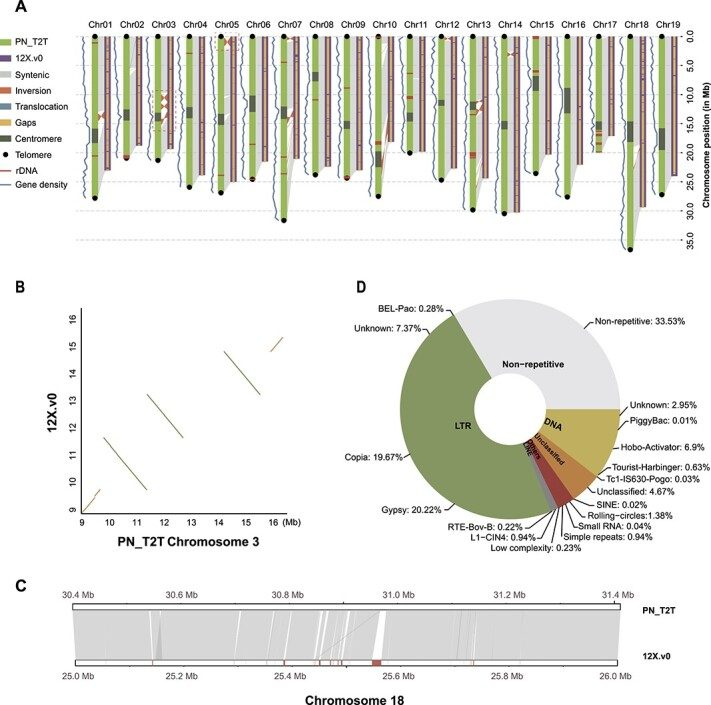

# 第10章 葡萄基因组中的转座子：以葡萄属（*Vitis*）为范例

## 10.1 葡萄基因组特征与转座子组成概览

### 10.1.1 葡萄参考基因组的演进：从PN40024早期草图到T2T与多单倍型解析

葡萄属（*Vitis*）植物隶属于葡萄科（Vitaceae），不仅是全球种植历史悠久、经济与文化价值极高的多年生木本果树，也是被子植物比较基因组学中具有枢纽地位的经典参考类群。与拟南芥、水稻等一年生草本模式植物不同，绝大多数栽培葡萄（*Vitis vinifera*）品种都是高度杂合的异交二倍体（$2n = 2x = 38$），同一植株的两条同源染色体之间不仅存在高密度的单碱基多态性，还充斥着大量长度不一的插入缺失和结构重排。在21世纪初以Sanger双脱氧测序为主导的技术条件下，直接对高度杂合的商业酿酒品种进行全基因组从头组装几乎是不可能完成的任务——两条分歧显著的单倍型会导致拼接算法产生海量错误分叉与碎片化重叠群。

为了攻克高杂合度这一技术壁垒，法国与意大利的葡萄基因组测序联盟采取了一项极具前瞻性的遗传材料策略：以经典酿酒品种黑皮诺（Pinot Noir）为起点，经过连续多代人工自交，培育出基因组纯合度高达约93%的近交系材料**PN40024**（doi:10.1038/nature06148）。2007年，该联盟在《自然》（*Nature*）发表了PN40024的首个高质量基因组草图（8X版本，随后升级为12X.v0与12X.v2版本），成为全球首个完成全基因组测序的木本果树物种（doi:10.1038/nature06148）。这项奠基性工作确立了葡萄在植物演化基因组学中的特殊坐标：葡萄基因组在分化后未经历近期的物种特异性全基因组加倍（WGD），却完整保留了核心真双子叶植物共同祖先的古六倍体化（$\gamma$事件）基因组印记，因而成为重建被子植物祖先染色体核型与基因家族演化的重要参照系（doi:10.1038/nature06148）。

然而，站在当代转座子生物学的视角回望，早期基于Sanger测序和二代短读长构建的PN40024参考基因组在重复序列解析度上存在难以逾越的先天局限。由于读长普遍短于完整LTR反转录转座子（4 kb至15 kb）以及嵌套转座子阵列的长度，早期组装在着丝粒核心区、近着丝粒致密异染色质带以及年轻高相似度转座子富集区出现了大面积的序列折叠（collapse）与断裂，基因组中遗留了数以千计的测序间隙（gaps，`N`区），且约有数十Mb的高重复序列未能挂载到19条染色体上。这些缺失与折叠直接导致早期文献对葡萄着丝粒结构、近期爆发LTR家族的真实拷贝数以及完整转座子比例（LAI值）产生了一定程度的系统性低估。

进入第三代单分子长读长测序时代后，高保真长读长（PacBio HiFi，读长15至25 kb、准确度超过99.9%）、超长读长（ONT）以及Hi-C染色质构象捕获技术的融合，使葡萄参考基因组实现了两次质的飞跃。第一次飞跃是**端粒到端粒（telomere-to-telomere，T2T）无间隙参考基因组的诞生**。2023年，研究团队利用PacBio HiFi长读长数据完成了栽培葡萄PN40024的T2T无间隙参考基因组组装，完整跨越了全部19条染色体的着丝粒区与两端端粒，彻底填补了此前长期存在的组装缺口（doi:10.1093/hr/uhad061）。T2T组装不仅使葡萄参考基因组的重复区组装连续性（如LAI指标，doi:10.1093/nar/gky730）跃升至黄金级水准，更首次让研究者得以在单碱基精度上完整审视葡萄着丝粒卫星重复阵列与*CRM*/*Gypsy*反转录转座子的交错结构，以及近着丝粒区层层叠压的复杂嵌套插入（doi:10.1093/hr/uhad061）。

第二次飞跃则是**从“单一纯合参考系”迈向“多品种单倍型解析基因组与泛基因组”时代**。近交系PN40024虽然便于早期组装，但它毕竟只代表了单一栽培品种经自交纯化后的一个单倍型缩影，无法反映全球数千个栽培葡萄品种及数十个野生葡萄种之间浩如烟海的杂合结构变异。近年来，随着HiFi结合Hi-C分型组装算法的成熟，研究者已相继完成了赤霞珠（Cabernet Sauvignon）、霞多丽（Chardonnay）、黑皮诺（Pinot Noir）等众多主栽品种以及北美、东亚野生葡萄种的**双单倍型解析组装（haplotype-resolved assemblies，即同时独立组装出`hap1`与`hap2`两套完整染色体）**，并在此基础上构建了葡萄属泛基因组与超级泛基因组（doi:10.1038/s41588-025-02111-7）。这一演进彻底改变了葡萄转座子的研究范式：研究者不再满足于统计“单一参考基因组中有多少转座子”，而是能够直接在同源单倍型之间、品种之间以及野生种与栽培种之间，精准追踪每一个转座子拷贝的插入、缺失、重组与演化命运。

### 10.1.2 栽培葡萄转座子的总体占比、主要超家族构成与染色体分布格局

在被子植物基因组大小跨越超过两千倍的宏观谱系中，栽培葡萄（*Vitis vinifera*）占据着一个极具教学与研究代表性的“黄金中间带”。其单倍体基因组大小约为480 Mb至500 Mb，既不像拟南芥（约135 Mb）那样因极度精简而缺乏复杂的嵌套转座子景观，也不像玉米（约2.3 Gb）或异源六倍体小麦（约16 Gb）那样因极端重复序列膨胀而给常规教学和计算分析带来过高门槛。在栽培葡萄基因组中，转座子是占比最高的非编码重复组分，全基因组转座子总占比通常维持在**40%至50%左右**（在T2T无间隙组装及经过敏感模式全基因组注释的流程中，该比例往往更接近或略高于50%）[待确认]。

从Wicker统一分类体系（doi:10.1038/nrg2165）的宏观结构来看，栽培葡萄基因组的转座子组成呈现出鲜明的高等植物典型特征，同时又保留了木本双子叶植物的独特印记：

- **Ⅰ类LTR反转录转座子占据绝对统治地位**：在葡萄全基因组所有转座子碱基总量中，LTR反转录转座子通常贡献了半数以上乃至三分之二左右的份额。其中，***Ty3/Gypsy*超家族（`RLG`）**与***Ty1/Copia*超家族（`RLC`）**是两大核心支柱。与绝大多数中等及大型植物基因组一致，葡萄中*Gypsy*超家族的总碱基占比通常显著高于*Copia*超家族[待确认]，这主要归因于*Gypsy*元件（尤其是携带色质结构域的*Chromovirus*分支）倾向于在低重组率的着丝粒与近着丝粒区域长期大量积累且个体全长较大；而*Copia*超家族虽然总碱基占比略低于*Gypsy*，但其在常染色质臂上的分布更为广泛，且包含多个在葡萄演化晚期依然保持活跃的年轻亚家族[待确认]。此外，葡萄基因组中还存在大量因内部编码区缺失而归入`LTR/unknown`（`RLX`）的非自主LTR衍生物（如LARD和TRIM）以及通过不等同源重组留下的海量solo-LTR。
- **Ⅰ类非LTR反转录转座子占比温和但局部重要**：与哺乳动物基因组截然不同，葡萄基因组中的**LINE（`RIX`）**与**SINE（`RSX`）**元件总占比相对较低（合计通常仅占全基因组的数个百分点以内）[待确认]。但这些非LTR元件经常散布在基因丰富的常染色质臂及基因内含子中，在局部表观调控与分子标记开发中具有不可忽视的价值。
- **Ⅱ类DNA转座子碱基占比适中但拷贝数极为庞大**：葡萄基因组完整保留了植物界经典的五大TIR DNA转座子超家族——***hAT*（`DTA`）**、***CACTA*（`DTC`）**、***PIF/Harbinger*（`DTH`）**、***Mutator/MULE*（`DTM`）**与***Tc1/Mariner*（`DTT`）**，以及滚环复制型的***Helitron*（`DHH`）**和海量的非自主微型反向重复转座元件（**MITEs**）[待确认]。尽管单个MITEs长度仅数百bp，导致Ⅱ类DNA转座子在全基因组总碱基占比上远不及长达数kb至十数kb的LTR反转录转座子，但若按**独立插入拷贝数**统计，MITEs与短小TIR元件在葡萄基因组中占据了极高比例，是基因上下游调控区最常出现的“邻居”。

在全基因组19条染色体的空间尺度上，葡萄转座子展现出教科书般清晰的**区室化分布格局**。沿着每条染色体从一端端粒向另一端端粒扫描，蛋白质编码基因的密度曲线与*Ty3/Gypsy*反转录转座子的密度曲线呈现出近乎完美的**镜像互补关系**：在每条染色体的着丝粒核心区及两侧宽阔的近着丝粒异染色质带，减数分裂重组率极低、基因极度稀疏，*Gypsy*元件高度聚集并伴随着层层嵌套插入与串联卫星重复阵列（doi:10.1093/hr/uhad061）；而在远离着丝粒的染色体两臂（常染色质臂），基因密度大幅攀升，*Gypsy*密度迅速跌落，取而代之的是高密度的MITEs、经典TIR DNA转座子以及相对分散的*Copia*元件。

在阅读不同年代发表的葡萄基因组文献时，初学者必须警惕一个极为常见的误区：2007年早期PN40024草图报道的重复序列比例与近年T2T无间隙基因组报道的转座子比例往往存在数个百分点的差异，甚至同一份基因组在不同论文中报道的*Helitron*或*Unknown*占比也大相径庭。这绝非葡萄基因组本身在十几年间发生了演化，而是由**组装完整度提升（补齐了着丝粒高重复区）**以及**注释算法与文库构建策略不同（如早期仅用公共库RepeatMasker vs 现代EDTA整合注释，doi:10.1186/s13059-019-1905-y）**共同造成的计算口径差异。

*图：PN40024 端粒到端粒组装概览；(D) 为该参考基因组中各类转座子的类型与比例。原图未修改，引自 Shi X、Cao S、Wang X 等（2023），The complete reference genome for grapevine (Vitis vinifera L.) genetics and breeding，Horticulture Research 10:uhad061，Fig. 1，doi:10.1093/hr/uhad061，PMC10199708，许可 CC BY 4.0 (https://creativecommons.org/licenses/by/4.0/)。图片文件与配图合订本所用的相同。*

### 10.1.3 葡萄属不同野生种与欧亚种之间的转座子分化特征

葡萄属（*Vitis*）是研究多年生木本植物演化与作物驯化的理想属级体系。按传统分类学，葡萄属分为两大亚属：染色体基数为19（$2n = 38$）的**真葡萄亚属（*Euvitis*）**与染色体基数为20（$2n = 40$）的**圆叶葡萄亚属（*Muscadinia*，以圆叶葡萄 *V. rotundifolia* 为代表）**。在物种最为丰富的真葡萄亚属内部，依据地理分布与系统发育关系，通常可清晰划分为三大主要演化支系：**欧亚群**（包含欧亚野生葡萄 *V. vinifera* subsp. *sylvestris* 及其驯化后代欧亚栽培葡萄 *V. vinifera* subsp. *vinifera*）、**北美群**（如河岸葡萄 *V. riparia*、沙地葡萄 *V. rupestris*、美洲葡萄 *V. labrusca* 等）以及**东亚群**（如山葡萄 *V. amurensis*、刺葡萄 *V. davidii*、毛葡萄 *V. quinquangularis* 等）[待确认]。

跨越这三大地理演化支系与两大亚属的比较基因组学研究，揭示了葡萄属转座子在数百万至数千万年演化尺度上的动态分化图景：

1. **古老骨架保守与谱系特异性扩张并存**：所有葡萄属物种共享高度保守的转座子超家族基础框架与大量古老的共享转座子家族，说明这些核心家族在葡萄属各支系分化之前便已完成早期奠基。然而，在北美、东亚与欧亚三大支系各自独立演化的漫长地质时期内，不同物种经历了完全不同步的**谱系特异性LTR爆发（lineage-specific bursts）**与差异化的重组清除速率[待确认]。尽管葡萄属不同物种的单倍体基因组大小总体维持在约450 Mb至600 Mb的相对温和区间内（未像稻属或棉属那样出现数倍的极端膨胀），但物种间数十Mb至上百Mb的基因组大小差异，几乎全部由特定*Gypsy*与*Copia*亚家族在各自谱系中的近期扩增与solo-LTR清除失衡所贡献。
2. **泛基因组可变区（Dispensable regions）的转座子高度富集**：在多物种葡萄泛基因组比较中，所有物种共享的“核心基因组”（core genome）高度富集保守的单拷贝蛋白质编码基因，转座子密度相对较低；而在仅存在于部分物种或部分单倍型中的“可变/特有区段”（dispensable/private regions）中，转座子（尤其是年轻的*Gypsy*、*Copia*及与结构变异断点伴生的重复元件）呈现出极度显著的富集[待确认]。这表明，转座子不仅是基因组大小的调节器，更是驱动葡萄属种间染色体非共线性区段扩张与物种基因组可塑性的核心引擎。
3. **野生祖先（*sylvestris*）与栽培葡萄（*vinifera*）之间的驯化分化**：欧亚栽培葡萄驯化自欧亚野生葡萄，并在数千年的传播与育种中经历了群体瓶颈、花性转变（从野生雌雄异株转变为栽培两性花）、无性克隆固定以及与局部野生种的偶发基因渗入[待确认]。在转座子群体多态性（TIPs）层面，野生葡萄群体通常保留了更高比例的祖先空位点与丰富的地方特异性低频插入；而在栽培葡萄群体中，一方面由于驯化瓶颈和长期无性繁殖导致部分中高频转座子插入随优良单倍型被锁定，另一方面与果实色泽、果粒大小、风味等人类偏好性状紧密关联的特定转座子变异（如第10.2节的*Gret1*）在栽培群体中经历了强烈的频率飙升，形成了野生种与栽培种之间鲜明的转座子分化信号。

### 10.1.4 葡萄高杂合基因组在转座子注释与单倍型比较中的特有技术问题

将第7章和第8章的通用转座子生物信息学流程直接套用到葡萄属基因组时，**高度杂合性**往往会让缺乏经验的研究者遭遇一系列隐蔽却致命的技术难题。与高度纯合的自交模式植物（如拟南芥Col-0或水稻日本晴）相比，葡萄高杂合基因组在转座子注释与单倍型比较中面临四大特有挑战：

1. **未充分分型组装中的“等位折叠”与“冗余单倍体滞留”双向畸变**：如果输入的葡萄基因组组装未经过彻底的单倍型分型（unphased primary assembly），两条同源染色体在高度相似区段会被合并为一条共识序列，而在携带大型单倍型特异性转座子插入或结构变异的高分歧区段，组装软件往往无法合并，从而将两条单倍型同时保留为两条独立的重叠群（即冗余单倍体滞留，haplotig retention）。这种局部“该合未合、该分未分”的嵌合状态，会直接导致全基因组转座子总拷贝数与总长度的剧烈失真，也会在群体短读长比对时因局部存在两套高度相似的参考模板而引发大面积MAPQ=0的比对盲区。因此，现代葡萄转座子研究强烈要求基于严格分型的单倍型组装（`hap1`与`hap2`分离）开展分析。
2. **双单倍型独立从头注释引发的命名割裂与假性PAV**：即便拿到了高质量的`hap1`与`hap2`双单倍型组装，如果研究者对`hap1`和`hap2`分别独立运行EDTA或RepeatModeler从头预测，同一植株两条同源染色体上原本完全等价的转座子家族会被赋予毫无关联的随机编号，且边界长度可能相差数十bp。这种人为的注释不一致会彻底破坏后续的“单倍型等位转座子配对”分析。唯有贯彻第7.3.4节阐述的泛基因组联合注释策略（先合并所有单倍型构建统一的pan-TElib，再以同一把尺子重新屏蔽每一个单倍型），才能保证单倍型间的严格可比性。
3. **高杂合多拷贝抗病基因簇与串联重复的误屏蔽风险**：葡萄属（尤其是北美和东亚野生葡萄）基因组中富含大量成簇串联扩增的NLR抗病基因家族与类受体激酶家族。这些基因簇在两条单倍型之间拷贝数变异剧烈、序列重复度高，极易被从头聚类工具误判为高拷贝转座子并写入一致性文库。若不经过严格的CDS与蛋白域排雷过滤，后续的基因组屏蔽将会把葡萄最宝贵的抗霜霉病、抗白粉病候选基因大面积误伤。
4. **高密度侧翼变异对单倍型等位位点比对与TIPs极化的干扰**：在比较葡萄同一品种的`hap1`与`hap2`，或比较欧亚栽培种与美洲野生种单倍型时，一个单倍型特异性转座子插入的两侧宿主侧翼序列，往往本身就密布着高达1%至3%的SNP和小片段插入缺失。这种高背景分歧度会显著降低短读长在远缘葡萄材料中的比对效率（引发第8.2.4节所述的比对衰减与参考基因组偏倚），也要求在长读长单倍型比较中必须采用对高分歧度友好的全基因组共线性比对参数或泛基因组图谱，才能精准锚定空位点与插入位点的一一对应关系。

## 10.2 经典案例：Gret1与葡萄果皮颜色的演化

### 10.2.1 Gret1插入*VvmybA1*启动子导致基因沉默与白皮表型的起源

在植物转座子生物学与园艺作物遗传学的发展史上，栽培葡萄（*Vitis vinifera*）果皮颜色的分子机制解析堪称最负盛名、逻辑最为严密的教科书典范。自然界中的野生葡萄以及绝大多数古老栽培品种，其成熟果皮呈现出深紫黑、紫红或红色，这源于果皮表皮细胞液泡中大量积累的花青素（anthocyanins）；而现代葡萄酒与鲜食产业中占据半壁江山的众多经典“白皮”品种——如霞多丽（Chardonnay）、雷司令（Riesling）、长相思（Sauvignon Blanc）、白皮诺（Pinot Blanc）以及无核白（Thompson Seedless）——其成熟果皮呈现黄绿色，果皮中几乎完全检测不到花青素的合成。

早在20世纪末，植物生化学家与遗传学家就已经明确：花青素生物合成通路末端负责将不稳定花青素苷元糖基化为稳定色素的关键酶——**UDP-葡萄糖：类黄酮3-O-葡萄糖基转移酶（UFGT）**——仅在红/紫皮葡萄转色期后的果皮中特异性表达，而在白皮葡萄果皮中完全不表达；与此同时，经典遗传作图将控制葡萄果皮“有色 vs 白色”的主效遗传位点（berry color locus）精准锁定在葡萄第2号染色体上。随后的功能研究证实，坐落于该位点、编码R2R3-MYB类转录因子的***VvmybA1***基因（亦常写作*VviMybA1*或*VvMYBA1*），正是直接结合*UFGT*启动子并开启整条花青素合成通路的总开关（doi:10.1126/science.1095011）。然而，令人费解的是，白皮葡萄中的*VvmybA1*蛋白质编码区序列与红皮葡萄几乎完全一致，并未发生导致蛋白失活的移码或无义突变。

2004年，日本研究者Shohei Kobayashi、Nami Goto-Yamamoto与Hirohiko Hirochika在《科学》（*Science*）上发表了里程碑式的短篇研究论文《反转录转座子诱导的葡萄果皮颜色突变》（doi:10.1126/science.1095011），一举揭开了困扰学界多年的白皮葡萄起源之谜。通过比较红皮葡萄（如巨峰衍生系或红皮欧亚品种）与白皮葡萄的*VvmybA1*上游侧翼序列，Kobayashi等人震惊地发现：在白皮葡萄中，*VvmybA1*基因翻译起始密码子上游的**5'侧翼启动子区域**，赫然插入了一段全长约**10.4 kb**的完整反转录转座子，研究者将其命名为***Gret1***（*Grapevine retrotransposon 1*）（doi:10.1126/science.1095011）。

精细的序列结构解剖表明，*Gret1*是一个结构极其完整的自主型（或近自主型）Ⅰ类LTR反转录转座子，隶属于***Ty3/Gypsy*超家族**（Wicker三字母代码`RLG`，doi:10.1038/nrg2165）。它两端拥有一对高度相似、长度约824 bp的同向长末端重复序列（5'-LTR与3'-LTR），内部包含完整的*gag*与*pol*编码区（编码蛋白酶、逆转录酶、RNase H与整合酶），且在*VvmybA1*启动子插入位点的左右两侧，完好无损地保留了LTR反转录转座子整合时留下的标志性**5 bp靶位点重复（TSD）**（doi:10.1126/science.1095011）。

*Gret1*插入*VvmybA1*启动子后，在物理空间上将原本紧邻转录起始位点的核心上游调控元件推离了超过10 kb之远，同时伴随着宿主表观遗传防御系统在*Gret1*表面铺设的致密DNA甲基化与异染色质沉默，彻底阻断了*VvmybA1*基因在果皮转色期的正常转录启动（doi:10.1126/science.1095011）。由于丧失了VvmybA1转录因子的激活，下游*UFGT*基因陷入静默，花青素合成通路戛然而止，葡萄果皮由此从祖先的深紫黑色转变为黄绿色的白色表型。这一携带有*Gret1*插入的非功能隐性等位基因被命名为***VvmybA1a***，而不含*Gret1*插入的功能性显性等位基因则对应*VvmybA1c*等有色等位基因。

更引人深思的是Kobayashi等人随后开展的跨物种与跨品种群体调查结果：在几乎所有测试的欧亚栽培白皮葡萄品种中，均可稳定检测到纯合状态的*Gret1*插入等位基因（*VvmybA1a*）；而在所检测的北美野生葡萄（如美洲葡萄 *V. labrusca*）及其他野生近缘种中，虽然基因组其他位置同样存在*Gret1*家族的同源拷贝，但*VvmybA1*启动子位点上却完全不存在这一特定的*Gret1*插入（doi:10.1126/science.1095011）。这一强有力的群体演化证据表明，现今遍布全球的绝大多数白皮欧亚栽培葡萄，其白色果皮性状很可能共同溯源于欧亚葡萄驯化或早期栽培历史上一次极其罕见的、单一（或极少数）的*Gret1*转座插入事件——随后被古代果农敏锐发现、通过无性扦插保存并在杂交育种中不断纯合扩散至世界各地（doi:10.1126/science.1095011）。

### 10.2.2 同源重组形成solo-LTR与皮诺系等葡萄芽变中的色泽演变轨迹

*Gret1*的故事并未止步于“一次插入造就白皮葡萄”。恰恰相反，在长达数百年乃至上千年的无性扦插繁殖历史中，葡萄的果皮色泽展现出惊人的**体细胞可塑性与芽变（bud sport）双向演替**——白皮葡萄藤上偶尔会突然抽出一根结粉红或红皮果实的枝条，而紫黑皮葡萄藤上也会分化出灰粉皮与纯白皮的芽变分支。深入追踪这些不同颜色芽变系的分子轨迹，不仅完美印证了第3.1.4节与第9.3.2节的理论机制，更打破了初学者对“芽变全靠转座子跳进跳出”的单一刻板印象。

**轨迹一：白皮向红/粉红皮的逆转——*Gret1*元件内同源重组形成solo-LTR。**
在2004年的同一篇《科学》论文中，Kobayashi等人同时剖析了白皮葡萄芽变为红皮葡萄（例如白皮鲜食品种‘意大利’Italia芽变为红皮品种‘红意大利’Ruby Okuyama）的分子秘密（doi:10.1126/science.1095011）。测序结果令人拍案叫绝：在这些从白变红的芽变品种中，*VvmybA1*启动子区原本长达10.4 kb的完整*Gret1*元件消失了，取而代之的仅仅是一个长度约**824 bp的单一LTR序列（solo-LTR）**，且该solo-LTR的两侧依然原封不动地保留着当年*Gret1*插入时留下的那一对5 bp TSD（doi:10.1126/science.1095011）！

这一分子指纹清晰地还原了体细胞内发生的事件：在营养分生组织的有丝分裂过程中，*Gret1*两端高度同源的5'-LTR与3'-LTR之间发生了**元件内不等同源重组（unequal homologous recombination）**，将长达近10 kb的内部*gag*/*pol*编码区连同一个杂合LTR环化切除并丢失，仅在原位留下一个短小的solo-LTR（该等位基因被命名为*VvmybA1b*）。移除庞大的内部异染色质障碍后，solo-LTR本身甚至能够提供一定的顺式转录活性，使原本彻底沉默的*VvmybA1*基因重新恢复表达，从而让白皮葡萄“奇迹般”地重新合成花青素，呈现粉红或红色果皮（doi:10.1126/science.1095011）。类似地，在著名白皮酿酒品种霞多丽（Chardonnay）衍生出的粉红芽变系（Chardonnay Rose）等案例中，研究者也观测到了*Gret1*元件的重组切除或部分消除事件（doi:10.1093/hr/uhac201）。

**轨迹二：紫黑皮向灰皮与白皮的演化——皮诺系（Pinot Noir → Pinot Gris → Pinot Blanc）的大片段缺失、LOH与细胞层嵌合。**
在葡萄酒世界里，最著名的同源芽变家族莫过于法国勃艮第的**皮诺三姐妹**：深紫黑皮的**黑皮诺（Pinot Noir）**、灰粉/红褐皮的**灰皮诺（Pinot Gris）**以及纯黄绿白皮的**白皮诺（Pinot Blanc）**。全基因组指纹证实，三者本质上是同一古老无性系在数百年扦插历史中连续发生体细胞芽变衍生出的克隆姐妹。

许多初学者在学完*Gret1*插入变白的故事后，常常想当然地猜测：“既然黑皮诺变白皮诺，那一定是黑皮诺里又跳进去了一个新的*Gret1*拷贝！”然而，分子遗传学与单倍型基因组解析彻底纠正了这一常见误解（doi:10.1371/journal.pgen.1005081）。事实上，作为高度杂合的二倍体品种，**黑皮诺在第2号染色体果皮色泽位点上本来就是杂合的**：它的一条同源染色体（单倍型1）携带功能正常的显性有色等位基因，而另一条同源染色体（单倍型2）早已携带了被*Gret1*沉默的隐性白皮等位基因（*VvmybA1a*）！

正因为黑皮诺仅靠单倍型1这一份功能拷贝“单枪匹马”维持着紫黑果皮，当体细胞有丝分裂中发生针对单倍型1的大尺度结构突变——具体表现为**包含功能性*VvmybA1*/*VvmybA2*基因簇在内的染色体大片段缺失（deletion）或有丝分裂重组引发的杂合性丢失（loss of heterozygosity，LOH）**——时，单倍型2上原本被遮蔽的*Gret1*隐性白皮等位基因就会瞬间暴露出来（doi:10.1371/journal.pgen.1005081）。更为精妙的是，这一体细胞突变与植物茎尖分生组织的**周缘嵌合体（periclinal chimera）**结构深度耦合：
- 葡萄茎尖分生组织由表皮层（**L1层**，最终发育为果实最外层的果皮表皮，也是花青素合成的主要场所）与亚表皮层（**L2层**，发育为果皮内层、果肉及花粉/卵细胞配子）构成；
- 当功能单倍型的大片段缺失或LOH仅发生在L2层（而L1层仍保留功能拷贝），或L1与L2层呈现出特定的嵌合分布时，果皮整体花青素合成大幅减弱，形成灰褐或粉紫色的**灰皮诺（Pinot Gris）**；
- 当突变细胞最终通过细胞层置换同时占据了L1层和L2层，使整个果皮表皮彻底丧失功能性有色单倍型、仅剩携带*Gret1*的白皮单倍型时，便诞生了彻底无色的**白皮诺（Pinot Blanc）**（doi:10.1371/journal.pgen.1005081）。

由此可见，皮诺系的色泽演替并非*Gret1*的再次跳跃，而是**“历史遗留的*Gret1*杂合背景 + 体细胞大片段缺失/LOH + 分生组织L1/L2嵌合层置换”**三者协同演绎的演化大戏。

### 10.2.3 *VvmybA*基因簇的拷贝数变异、单倍型结构与转座子插入的协同作用

如果将显微镜的倍率进一步调高，聚焦于葡萄第2号染色体果皮色泽位点长达数百kb的精细基因组结构，我们会发现另一个打破“单基因决定论”的深刻事实：*VvmybA1*并非孤零零地躺在第2号染色体上，而是坐落在一个由多个高度同源的R2R3-MYB基因串联排列而成的***VvmybA*多基因簇（gene cluster）**之中，核心成员包括*VvmybA1*、*VvmybA2*、*VvmybA3*以及邻近的*VvmybA4*等串联重复拷贝[待确认]。

其中，紧邻*VvmybA1*的***VvmybA2***同样是一个具备完整转录激活能力的花青素合成主效调节基因。这就立刻引出了一个极其敏锐的逻辑问题：既然白皮葡萄中*Gret1*仅仅插入并沉默了*VvmybA1*的启动子，为什么旁边的*VvmybA2*没有站出来代偿功能、把葡萄果皮染红呢？

精细的等位基因测序揭开了这道**“双重保险锁”**的分子真相[待确认]：在绝大多数欧亚白皮葡萄的隐性单倍型上，不仅*VvmybA1*启动子区遭受了*Gret1* LTR反转录转座子的插入沉默，而且相邻的***VvmybA2*基因编码区也同步携带了导致蛋白质功能彻底丧失的突变**（包括一个改变关键氨基酸的非同义单碱基替换以及一个导致阅读框提前终止的2 bp微缺失）[待确认]！唯有当同一条染色体单倍型上的*VvmybA1*（因*Gret1*插入失活）与*VvmybA2*（因编码区突变失活）同时失效，且植株在该位点处于纯合（或半合子缺失）状态时，花青素合成通路才会被彻底关闭，呈现出纯净的白色果皮。如果某个品种的*VvmybA1*携带*Gret1*插入但*VvmybA2*仍保持功能完整，或者*VvmybA1*通过solo-LTR部分恢复表达，果皮就会表现出从浅粉、玫瑰红、红褐到深紫黑的连续色泽梯度。

随着近年多品种单倍型解析基因组组装的普及，研究者在*VvmybA*基因簇中进一步揭示了令人惊叹的**拷贝数变异（CNV）与单倍型结构多态性**[待确认]。在不同栽培品种与野生葡萄单倍型之间，*VvmybA*基因簇的长度、串联重复基因的拷贝数（例如部分深色酿酒或染色葡萄单倍型中存在功能性*VvmybA*基因的额外串联扩增拷贝，以及内部穿插的其他转座子插入与大片段缺失）存在剧烈分化。这种**“多基因簇拷贝数变异 + 单倍型编码区突变 + *Gret1*转座子插入与solo-LTR重组”**的立体协同架构，不仅精准解释了葡萄果皮颜色为何呈现出如此丰富的表型连续谱，也为理解高等植物复杂次生代谢基因簇的演化提供了绝佳范本。

### 10.2.4 以Gret1为范例的转座子功能研究完整闭环

回顾*Gret1*与葡萄果皮颜色长达二十余年的研究历程，它之所以被全球转座子与植物遗传学界奉为经典，是因为它极其完整地示范了一项顶尖转座子功能研究从现象到本质、从基础到应用的**四步完整闭环**：

1. **第一环：宏观表型观察与经典遗传定位**。从葡萄田间广泛存在的紫/红皮与白皮分化及芽变现象切入，结合花青素生化通路分析（锁定*UFGT*表达差异）与双亲群体遗传作图，将控制果皮色泽的主效位点精准锚定在2号染色体的*VvmybA*基因簇区域（doi:10.1126/science.1095011）。
2. **第二环：分子克隆与因果转座子鉴定**。在排除蛋白质编码区突变后，将目光投向非编码顺式调控区，通过步移测序发现白皮等位基因*VvmybA1a*启动子中长达10.4 kb的*Gret1*（`RLG`）反转录转座子插入及其两侧5 bp TSD，并结合转录表达验证确证了转座子插入阻断启动子活性的因果机制（doi:10.1126/science.1095011）。
3. **第三环：体细胞动态演替与单倍型多维解剖**。并未止步于单一静态插入，而是进一步追踪白变红芽变中的*Gret1*元件内同源重组（solo-LTR形成，doi:10.1126/science.1095011），以及黑皮诺→灰皮诺→白皮诺芽变中的染色体大片段缺失、LOH、L1/L2分生组织嵌合结构与*VvmybA2*协同失活机制（doi:10.1371/journal.pgen.1005081），将单个转座子置于完整的单倍型与细胞生物学语境中加以审视。
4. **第四环：群体演化溯源与分子辅助育种落地**。将实验室发现拓展至全球欧亚栽培品种与美洲/东亚野生葡萄群体，追溯*Gret1*插入的驯化起源与传播路径（doi:10.1126/science.1095011）；同时，基于*Gret1*插入的有无与solo-LTR状态开发出简便、精准的三引物PCR分子标记，直接应用于现代葡萄杂交育种的苗期果色早期筛选——使育种家无需苦等3至5年葡萄挂果，在幼苗叶片阶段即可提前预知杂交后代未来的果皮色泽，实现了从基础转座子发现到产业育种实践的完美跨越。

## 10.3 葡萄无性系变异、风土适应与性状改良中的转座子

### 10.3.1 葡萄无性系变异中的转座子动态与农艺酿酒性状分化

在世界葡萄酒与鲜食葡萄产业中，真正支撑起顶级产区风味多样性与栽培稳定性的，并不仅仅是数千个独立的栽培品种，更是同一经典品种内部通过数百年营养繁殖分化出的庞大**无性系（clones）**群体。以法国勃艮第的黑皮诺（Pinot Noir）、波尔多的赤霞珠（Cabernet Sauvignon）、香槟区的霞多丽（Chardonnay）以及罗讷河谷的歌海娜（Grenache）为例，这些古老品种在长达数百甚至上千年的扦插与嫁接历史中，虽未经过有性杂交洗牌，却在田间自发演化出了数十乃至上百个表型各异、且能够通过无性繁殖稳定遗传的商业无性系。在酿酒师与葡萄栽培学家的眼中，同一品种的不同无性系在**果穗紧密度、果粒大小、果皮厚度、成熟期早晚、含糖量与酸度平衡、单宁结构以及芳香前体物质（如单萜类、甲氧基吡嗪类与硫醇类化合物）的积累水平**上存在着显著差异。这些细微的农艺性状分化，直接决定了葡萄酒的色泽深度、酒体饱满度、香气轮廓以及葡萄园对灰霉病等穗部病害的田间抗性。

长期以来，由于同一品种不同无性系在传统的微卫星（SSR）标记和常规SNP芯片检测中几乎完全一致，其表型分化的分子基础一直是葡萄遗传学中的核心谜题。随着全基因组高深度重测序与单倍型解析测序技术在葡萄克隆系中的深入应用，研究者逐步厘清了无性系变异的遗传与表观遗传架构：在长达数个世纪的体细胞有丝分裂谱系中，体细胞单核苷酸突变（somatic SNVs）、染色体大片段结构重排、DNA甲基化表观漂移以及**转座子活动（插入、切离与重组）**共同构成了无性系分化的驱动力（doi:10.1371/journal.pone.0032973）。

在转座子层面，针对黑皮诺、霞多丽等经典葡萄无性系的群体比较研究发现，转座子插入多态性（TIPs）是区分同一品种不同无性系的重要分子变异来源之一，在部分无性系比较中，移动元件引发的变异在导致基因功能或表达改变的大效应体细胞突变中占有显著比例（doi:10.1371/journal.pone.0032973）。具体而言，转座子在葡萄无性系性状分化中主要通过三条路径发挥作用：

1. **体细胞新插入或切离直接微调关键农艺基因**：当活跃的LTR反转录转座子或DNA转座子（尤其是短小的MITEs或*hAT*/*Mutator*类元件）在茎尖分生组织干细胞中发生体细胞插入或切离，恰好落入控制细胞分裂、果皮发育、糖酸转运或萜烯合酶（*TPS*）等次生代谢基因的启动子或内含子中时，即可在不破坏品种整体遗传背景的前提下，特异性改变果粒大小、果皮厚度或香气成分含量。例如，在无性系浆果大小与果肉紧实度变异、果穗松散度（直接影响灰霉病发生率）以及成熟期分化中，均已观察到候选基因邻近区域的结构变异与转座子多态性信号[待确认]。
2. **转座子介导的体细胞局部缺失与杂合性丢失（LOH）**：正如第10.2.2节在皮诺系果色芽变中所揭示的，高度杂合的葡萄品种在许多农艺性状位点上处于杂合状态。分布在同一条染色体上的高相似度转座子拷贝在体细胞DNA损伤修复过程中发生有丝分裂异位重组，引发局部染色体片段缺失或LOH，能够瞬间将另一条同源单倍型上原本被遮蔽的隐性等位基因暴露出来，催生出肉眼可见的优良芽变无性系。
3. **克隆系特异性的转座子表观甲基化漂移**：在许多表型分化明显、但DNA一级序列差异极小的葡萄无性系之间，全基因组亚硫酸氢盐测序（WGBS）揭示了大量稳定的差异甲基化区域（DMRs），其中相当高比例的DMRs精准富集在基因侧翼的转座子拷贝及其顺式扩散边界上[待确认]。由于葡萄通过扦插直接传递体细胞染色质状态，这些围绕转座子建立的局部DNA甲基化变异能够跨越数十年的无性繁殖保持相对稳定，持续微调邻近基因的转录活性。

在开展葡萄无性系转座子变异鉴定时，研究者必须克服一项严峻的技术挑战：**体细胞嵌合体与极低频假阳性的甄别**。由于体细胞转座子新插入最初往往仅局限于茎尖分生组织的L1层或L2层，在混合提取叶片全基因组DNA进行重测序时，该变异的等位基因支持读长比例（VAF）通常远低于正常杂合体的50%（可能仅在15%至25%之间），极易被常规面向二倍体生殖系变异设计的TIPs检测阈值过滤掉；反之，若盲目放宽阈值，又会引入大量PCR扩增噪音与比对假阳性。因此，结合L1/L2组织分离测序（如分别提取表皮毛/果皮与内部组织DNA）以及高深度长读长测序，正成为解析葡萄无性系转座子变异的标准方向。

### 10.3.2 转座子在葡萄环境胁迫响应与风土适应中的表观遗传调控

与一年生草本作物可以通过种子休眠躲避严冬酷暑不同，葡萄是寿命可达数十年甚至上百年的多年生木本藤本植物。定植于特定葡萄园中的每一株葡萄藤，必须年复一年地原地承受季节更替与极端气候的考验——夏季强烈的紫外辐射与高温热浪、地中海型或半干旱产区普遍存在的季节性水分亏缺（干旱胁迫）、高纬度产区的冬季低温与春季晚霜，以及霜霉病（*Plasmopara viticola*）、白粉病（*Erysiphe necator*）和灰霉病（*Botrytis cinerea*）等病原菌的持续侵袭。在葡萄酒文化中，特定产区的气候、土壤、地形与微生物环境共同塑造葡萄酒独特风格的综合效应被称为**“风土”（terroir）**。从现代分子生物学与表观遗传学的视角审视，“风土”在葡萄植株内部的生物学落脚点之一，正是**环境信号驱动的表观遗传可塑性与转座子动态调控**。

针对栽培葡萄在不同非生物胁迫（干旱、高温、低温、高盐）与生物胁迫（病原菌侵染）下的多组学研究一致表明，转座子在葡萄的逆境响应网络中扮演着高度活跃的角色[待确认]：

- **胁迫诱导的转座子转录激活与家族特异性**：在干旱、热激或病原菌激发子处理下，葡萄叶片、根系与发育中浆果的转录组（RNA-seq）中，均可检测到数百至数千个转座子位点的显著差异表达（包括*Ty1/Copia*、*Ty3/Gypsy*以及部分DNA转座子）[待确认]。这种激活具有高度的家族特异性与胁迫特异性——某些携带热激响应基序的*Copia*家族主要在高温下苏醒，而另一些携带ABA或防卫响应顺式元件的LTR家族则在干旱或病原菌侵染时显著上调。
- **DNA甲基化重塑与小RNA防线的动态博弈**：伴随逆境下的转录波动，葡萄基因组中的DNA甲基化（尤其是对环境最敏感的CHH甲基化背景）以及21-nt、24-nt小干扰RNA（siRNA）谱系发生显著重塑[待确认]。在正常生长条件下，宿主的RdDM通路和DDM1-MET1/CMT3体系将绝大多数转座子死死锁定；而在剧烈干旱或病原菌侵染期间，局部区域的DNA去甲基化（或RdDM通路成员的短暂下调）既释放了邻近抗逆或防卫基因的转录潜力，也同步松动了周边转座子的沉默状态。
- **顺式调控邻近抗逆基因与次生代谢通路**：当携带胁迫响应顺式元件的转座子恰好位于葡萄抗逆转录因子（如DREB、NAC、WRKY家族）或次生代谢基因（如花青素、单宁、白藜芦醇合成通路中的*STS*芪合酶基因）上游时，该转座子在逆境下的转录激活或局部去甲基化，能够顺式放大邻近宿主基因的诱导表达强度[待确认]。在田间栽培中，适度的水分亏缺与昼夜温差（冷凉夜间温度）恰恰是优质酿酒葡萄积累高浓度多酚与芳香物质的关键风土因子，而转座子介导的表观响应正是连接外界微气候与果实次生代谢调控网络的重要分子桥梁之一。
- **跨季节的表观遗传记忆与“风土印记”**：近年在多年生葡萄园开展的跨地域克隆移植实验（将同一基因型的无性系分别种植在气候与土壤截然不同的多个产区并连续追踪多年）发现，不同产区生长的同源克隆植株之间会建立起稳定且具产区特征的DNA甲基化图谱差异，这些产区特异性甲基化位点在转座子及基因侧翼重复区高度富集[待确认]。这为“风土效应在分子层面具有表观遗传记忆基础”提供了引人入胜的实证线索。

尽管如此，在解读葡萄胁迫转录组与表观组数据时，研究者必须保持高度的科学审慎，避免落入两大误区：第一，严格区分**“胁迫诱导的转座子短暂转录上调”**与**“实际发生的基因组新转座插入”**——在野生型葡萄中，绝大多数逆境激活仅停留在RNA转录或局部甲基化波动层面，胁迫解除后宿主的siRNA防线会迅速将其重新沉默，极少转化为可遗传的新拷贝插入；第二，在发现某个转座子与邻近抗逆基因同步上调时，需排查这究竟是转座子主动提供顺式增强子驱动了基因表达，还是活跃基因自身的开放染色质环境引发了周边转座子的被动“读穿转录”（read-through transcription）。

### 10.3.3 葡萄泛基因组视角下野生抗性基因座的转座子动态与远缘杂交育种启示

现代全球葡萄产业长期面临一个严峻的结构性矛盾：贡献了全球绝大部分优质葡萄酒与鲜食市场的**欧亚栽培葡萄（*Vitis vinifera*）**，虽然在长达数千年的驯化中积累了极佳的浆果风味、高糖度与大果粒等品质性状，却对原产于北美和东亚的毁灭性病虫害——尤其是**霜霉病、白粉病、黑痘病以及葡萄根瘤蚜（*Daktulosphaira vitifoliae*）**——以及严寒气候普遍缺乏有效抗性。结果，欧亚葡萄园成为了全球单位面积化学杀菌剂施用量最高的农业生态系统之一。

破解这一产业困境的根本出路，深藏于葡萄属庞大的**野生近缘种基因库**之中。北美野生葡萄（如河岸葡萄 *V. riparia*、沙地葡萄 *V. rupestris*、圆叶葡萄 *V. rotundifolia* 等）在与当地病原菌和根瘤蚜长达数百万年的军备竞赛中，演化出了极其强效的抗病位点（如抗霜霉病位点*Rpv*系列、抗白粉病位点*Ren*/*Run*系列）；东亚野生葡萄（如山葡萄 *V. amurensis*、刺葡萄 *V. davidii* 等）则同时蕴藏着极强的抗寒性与广谱抗病性[待确认]。由于真葡萄亚属各物种间大多不存在完全的生殖隔离（且与圆叶葡萄亚属亦可借助胚挽救等技术实现远缘杂交），利用野生葡萄开展**远缘杂交抗性育种**已成为全球葡萄育种的战略核心。

随着葡萄属多单倍型组装与超级泛基因组研究的深入，研究者首次得以在单碱基精度上俯瞰野生葡萄与栽培葡萄抗性基因座的演化全貌，并发现**转座子是塑造野生葡萄抗性基因座（尤其是NLR抗病基因簇）高度动态演化的核心结构引擎**[待确认]：

1. **抗病NLR基因簇周围的转座子高度富集与协同扩张**：植物免疫系统的核心受体——核苷酸结合位点-富含亮氨酸重复序列（NLR）抗病基因——在葡萄基因组中并非孤立分布，而是大量成簇串联排列在特定染色体区段（如12号、13号、18号等染色体上的经典*Rpv*/*Run*抗性基因座）。泛基因组比较清晰显示，这些NLR基因簇内部及两侧密布着高密度的年轻LTR反转录转座子（*Gypsy*与*Copia*）及DNA转座子[待确认]。高相似度转座子拷贝介导的非等位同源重组（NAHR）不断驱动NLR基因簇发生串联复制、不等交换、外显子洗牌与大片段缺失，使野生葡萄群体能够在与病原菌效应蛋白的快速军备竞赛中，源源不断地产生全新的抗病受体组合与拷贝数变异（CNV）。
2. **抗性基因座剧烈的单倍型存在/缺失变异（PAV）与结构重排**：正是由于转座子的高频插入与重组催化，野生葡萄与栽培葡萄在抗性基因座上的基因组共线性被剧烈打破——野生葡萄抗性单倍型中长达数百kb甚至上Mb的抗病基因簇区段，在欧亚栽培参考基因组PN40024的对应坐标上可能完全缺失，或者被完全不同的转座子阵列与大片段倒位所取代[待确认]。
3. **转座子参与抗病基因的精细表观平衡**：抗病NLR基因的组成型过度表达往往会引发植物的自身免疫反应，导致严重的生长停滞与细胞坏死（即“生长-防御权衡”）。插在NLR基因簇周围的转座子通过吸引局部DNA甲基化与小RNA，在无病原菌侵染时协助将抗病基因维持在低水平的基础警戒状态；而在病原菌入侵引发局部表观松动时，又允许抗病基因迅速爆发表达。

上述泛基因组视角下的转座子演化规律，为现代葡萄远缘杂交育种与分子设计育种带来了三点极具实操价值的战略启示：

- **启示一：彻底摒弃单参考盲区，依托泛基因组精准克隆野生抗性基因**。过去仅依赖欧亚栽培葡萄PN40024单一参考基因组进行抗病QTL精细定位时，由于栽培参考基因组中根本缺失野生葡萄特有的抗性NLR基因簇与特有转座子结构，导致大量野生抗性区段的短读长无法比对或定位漂移。借助涵盖北美与东亚野生种的多单倍型泛基因组图谱，育种家可以直接在抗性亲本的真实单倍型上精准锁定目标NLR基因及其侧翼的转座子特征，大幅缩短抗病基因图位克隆周期。
- **启示二：解析转座子介导的结构变异，精准打破远缘杂交中的“连锁拖拽”（Linkage Drag）**。在将北美或东亚野生葡萄的抗病基因通过多代回交导入欧亚栽培葡萄时，育种家最头疼的难题是“连锁拖拽”——野生抗性位点周围往往紧密连锁着导致葡萄酒产生狐臭味（如美洲葡萄的邻氨基苯甲酸甲酯）、高酸低糖或小果粒的不良野生基因。泛基因组结构比对揭示，许多顽固的连锁拖拽正是因为野生与栽培单倍型在抗性基因座两侧存在由转座子介导的**大片段染色体倒位**或**高度分歧的转座子插入阵列**，在物理上彻底抑制了减数分裂重组。明确这些转座子结构障碍的精确坐标后，育种家一方面可以开发紧贴目标抗性基因的高精度分子标记（包括特异性TIPs标记）在超大回交群体中筛选罕见重组单株，另一方面也可结合基因编辑技术直接靶向敲除连锁的不良基因，绕过重组抑制瓶颈。
- **启示三：警惕远缘杂交与组培快繁中的表观不稳定与转座子活化**。在野生葡萄与欧亚葡萄远缘杂交创制新种质，以及通过组织培养进行无病毒苗木快繁的过程中，两个高度分歧亚基因组的融合（“基因组冲击”）与离体激素胁迫可能局部打破特定转座子的甲基化沉默。在新品种中试与区试阶段，持续监测目标抗性位点与关键果色/风味基因座周围转座子的插入稳定性与甲基化状态，有助于及早淘汰表观不稳定的株系，确保育成的新品种兼具野生种的强抗逆性与欧亚种的卓越酿酒品质。

至此，我们以葡萄属（*Vitis*）为活体标本，完成了从参考基因组演进、转座子宏观格局、*Gret1*果色分子闭环，到无性系芽变、风土表观适应与泛基因组抗性育种的全面剖析。下一章（第11章），我们将把所有理论与生物学背景转化为可直接在Linux服务器与R环境中运行的端到端生物信息学实战工作流。

## 本章参考文献

- doi:10.1038/nature06148
- doi:10.1093/hr/uhad061
- doi:10.1093/nar/gky730
- doi:10.1038/nrg2165
- doi:10.1186/s13059-019-1905-y
- doi:10.1126/science.1095011
- Guo, L., Wang, X., Ayhan, D. H., et al. (2025). Super pangenome of Vitis empowers identification of downy mildew resistance genes for grapevine improvement. *Nature Genetics*. doi:10.1038/s41588-025-02111-7
- Yang, Y., Ke, J., Han, X., et al. (2022). Removal of a 10-kb Gret1 transposon from VvMybA1 of Vitis vinifera cv. Chardonnay. *Horticulture Research*. doi:10.1093/hr/uhac201
- Pelsy, F., Dumas, V., Bévilacqua, L., et al. (2015). Chromosome Replacement and Deletion Lead to Clonal Polymorphism of Berry Color in Grapevine. *PLOS Genetics*. doi:10.1371/journal.pgen.1005081
- Carrier, G., Le Cunff, L., Dereeper, A., et al. (2012). Transposable Elements Are a Major Cause of Somatic Polymorphism in Vitis vinifera L. *PLoS ONE*. doi:10.1371/journal.pone.0032973
