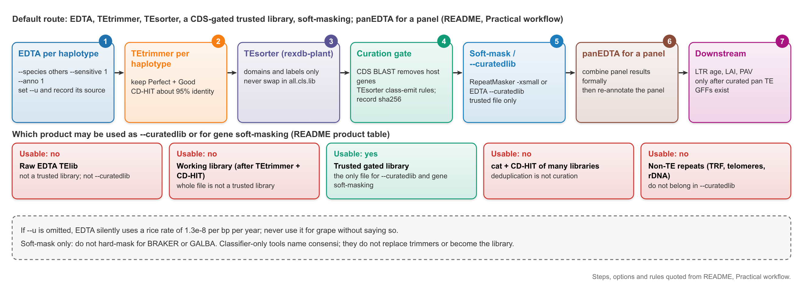

# 第11章 实践工作流：以葡萄基因组为例的端到端分析



*图：把操作流程画成一张图：从逐个单倍型运行 EDTA 到下游分析共七步，并标出哪种产物可以用作 `--curatedlib` 或基因 soft-mask（只有通过门控的可信文库可以）。示意图，据 README 操作流程为本仓库绘制；可编辑 SVG：[`te_workflow.svg`](../../figures/guide/te_workflow.svg)。*

## 11.1 数据准备、软件环境与单基因组转座子从头注释实战

### 11.1.1 公开葡萄参考基因组的获取、完整性检查与头文件标准化清理

任何高质量的转座子注释工作流，都必须始于对输入基因组序列的严格“体检”。以栽培葡萄（*Vitis vinifera*）经典参考系**PN40024**为例，研究者可以从NCBI GenBank/RefSeq、Ensembl Plants或葡萄专用基因组数据库（如Grapedia）下载其最新版本的参考基因组FASTA文件（例如基于PacBio HiFi构建的端粒到端粒T2T无间隙组装版本，doi:10.1093/hr/uhad061，或广泛使用的12X.v2版本）以及配套的蛋白质编码基因注释文件（GFF3格式）和编码序列文件（CDS FASTA格式）。在实际操作中，切忌下载完压缩包就直接丢进注释软件运行，而应先完成三项基础质控与预处理。

第一项预处理是**序列基本统计与完整性检查**。利用`seqkit`[待确认]或`samtools faidx`[待确认]快速核查基因组的染色体条数、总碱基数、N50长度以及未知碱基`N`的占比：

```bash
# 查看基因组序列基础统计信息
seqkit stats -a PN40024_T2T.fa

# 统计每条染色体的长度及N碱基数量
seqkit fx2tab -n -l -B N PN40024_T2T.fa | head -n 25
```

对于高质量的栽培葡萄单倍体参考基因组，其总长度应稳定在480 Mb至500 Mb左右，包含19条主染色体（`chr01`至`chr19`），且在T2T组装中主染色体内部几乎不含测序间隙`N`（doi:10.1093/hr/uhad061）。如果发现FASTA文件中混杂了叶绿体基因组（chloroplast）、线粒体基因组（mitochondrion）或大量长度不足10 kb的碎片化未挂载支架（unplaced scaffolds），建议先将细胞器基因组剔除——因为细胞器序列不仅不含典型的真核核内转座子，而且其高GC/AT偏倚或插入核基因组的NUMTs/NUPTs碎片容易干扰从头重复序列聚类。

第二项预处理是**FASTA头文件（header）的标准化清理**。这是生物信息学新手在运行RepeatMasker和EDTA时最常遭遇崩溃报错的“隐形杀手”。许多从公共数据库直接下载的FASTA文件，其序列名称极长且包含空格、竖线`|`、冒号`:`、括号或逗号（例如`>NC_012007.3 Vitis vinifera cultivar PN40024 chromosome 1, whole genome shotgun sequence`）。然而，转座子注释流水线底层的老牌工具（如RepeatMasker、LTRharvest、BLAST和Perl解析脚本）对序列ID长度和特殊字符有极其严苛的限制：部分模块会在遇到空格时截断ID导致上下游坐标对不上，或在ID长度超过15至20个字符时直接触发格式化溢出报错。因此，在运行任何注释工具之前，必须将基因组FASTA与配套GFF3/CDS文件中的染色体名称统一精简为**仅含字母、数字和下划线、长度不超过15个字符的短标识符**（如`chr01`至`chr19`）：

```bash
# 仅保留FASTA头文件第一个空格前的标识符，并检查是否有非法字符
awk '/^>/{print $1; next} {print}' PN40024_T2T.fa > PN40024.tmp.fa

# 若原始ID为NCBI登录号，可借助映射表（old_id \t new_id）批量替换为 chr01..chr19
seqkit replace -p '^(\S+)' -r '{kv}' -k chr_name_map.tsv PN40024.tmp.fa > PN40024.clean.fa

# 验证清理后的头文件格式并建立索引
grep '^>' PN40024.clean.fa
samtools faidx PN40024.clean.fa
```

第三项预处理是**软屏蔽小写碱基与换行符检查**。部分公共数据库提供的参考基因组已经过初步软屏蔽（包含大量小写字母`a/t/c/g`）或混有Windows换行符（`\r\n`）。为了确保从头注释不受既有软屏蔽干扰，建议先将全基因组序列统一转为大写字母并统一行宽（例如每行60或80 bp），同时准备好对应版本的纯编码序列文件`PN40024.cds.fa`（仅保留每个基因的最长代表性转录本CDS），用于在后续整合注释中精准剔除误判的宿主编码基因。

### 11.1.2 软件环境部署（Conda与容器）及计算资源配置

整合型转座子注释流程**EDTA**（doi:10.1186/s13059-019-1905-y）内部串联了LTRharvest（doi:10.1186/1471-2105-9-18）、LTR_FINDER（doi:10.1093/nar/gkm286）、LTR_retriever（doi:10.1104/pp.17.01310）、TIR-Learner、HelitronScanner、RepeatModeler（doi:10.1073/pnas.1921046117）、RepeatMasker以及Perl、Python、TensorFlow、BLAST+等数十个底层软件与运行库。在Linux服务器或高性能计算（HPC）集群上，如果尝试逐一手动源码编译安装，极易陷入Perl模块版本冲突、Python深度学习库依赖崩溃或RepeatMasker数据库路径错乱的泥潭。

目前最稳妥、可重复性最高的部署方式分为**容器化部署（Singularity/Apptainer或Docker）**与**Mamba/Conda独立环境部署**两种：

1. **Singularity/Apptainer容器部署（HPC集群强烈推荐）**：在高校和科研院所的共享计算集群上，普通用户通常没有Docker的root权限，但普遍支持Singularity或Apptainer。直接拉取官方预构建的EDTA容器镜像，能够将所有底层依赖冻结在经过严格测试的环境中，实现“零依赖冲突、跨集群100%可重复运行”：

```bash
# 拉取官方EDTA容器镜像（具体版本号可按需替换）
apptainer pull edta.sif docker://quay.io/biocontainers/edta:2.2.2--hdfd78af_0  # [待确认]

# 测试容器内EDTA及核心子工具是否正常调用
apptainer exec edta.sif EDTA.pl -h
apptainer exec edta.sif RepeatMasker -v
```

2. **Mamba/Conda独立环境部署（个人工作站适用）**：若需要在本地Linux工作站灵活调试或二次开发，可使用`mamba`（Conda的高速C++替代品）创建完全隔离的环境，切勿将其安装到`base`环境中：

```bash
# 创建名为edta的独立环境并安装EDTA及常用辅助工具
mamba create -n edta -c conda-forge -c bioconda edta bedtools seqkit samtools mafft
mamba activate edta
```

在**计算资源与并行参数配置**方面，针对大小约为500 Mb的栽培葡萄基因组，合理估算资源既能避免作业因内存溢出（OOM）被集群队列强杀，又能避免过度申请线程导致排队时间过长：
- **内存（RAM）**：运行完整EDTA流程（包含TIR-Learner和RepeatModeler）处理500 Mb葡萄基因组时，常规峰值内存消耗通常在32 GB至64 GB之间；在集群作业脚本中建议申请**64 GB至128 GB内存**以留足安全余量。
- **CPU线程数（`--threads`）**：并非线程数越多运行越快。EDTA内部部分Perl串联步骤和单基因组LTRharvest属于单线程或轻度并行，而RepeatMasker（RMBlast）与RepeatModeler在超过32至40个线程后容易遭遇磁盘I/O瓶颈。对于葡萄单基因组注释，配置**16至32个CPU核心**是性价比最高的黄金区间，完整跑完一次包含`--sensitive 1`的全流程通常耗时约6至18小时（视磁盘读写速度与CPU主频而定）。
- **临时磁盘空间**：全基因组自比对和RepeatMasker搜索会产生大量中间临时文件，需确保工作目录所在分区至少拥有**50 GB至100 GB以上的可用空间**，避免因磁盘写满导致流程在最后一步功亏一篑。

### 11.1.3 在葡萄基因组上运行从头转座子注释的完整命令与参数解析

完成数据清理与环境部署后，即可在独立的运行目录中启动葡萄基因组的端到端从头转座子注释。以下给出基于EDTA（doi:10.1186/s13059-019-1905-y）的标准运行命令（以容器调用为例，Conda环境可直接省略`apptainer exec edta.sif`前缀）：

```bash
mkdir -p 01_edta_pn40024 && cd 01_edta_pn40024

apptainer exec ../edta.sif EDTA.pl \
  --genome ../PN40024.clean.fa \
  --species others \
  --step all \
  --cds ../PN40024.cds.fa \
  --sensitive 1 \
  --anno 1 \
  --evaluate 0 \
  --overwrite 0 \
  --threads 32 \
  > edta.run.log 2>&1
```

理解上述每一个核心参数的生物学与算法含义，是避免“盲目复制命令”的关键：
- `--genome ../PN40024.clean.fa`：指定已完成头文件标准化清理的葡萄参考基因组FASTA文件。
- `--species others`：指定用于辅助识别TIR DNA转座子候选体的物种类型（官方可选值为`Rice`、`Maize`或默认的`others`）。对于葡萄等非水稻/玉米的双子叶木本植物，应设置为`others`，指示流程采用通用植物模式进行识别与过滤（doi:10.1186/s13059-019-1905-y）。
- `--step all`：指示执行全部阶段（包括原始结构预测、交叉过滤、一致性文库构建与最终注释）。若流程中途因集群超时中断，可保持`--overwrite 0`重新提交，EDTA会自动检测已完成的中间目录并实现断点续跑；若需单独重跑某一模块，可将该参数改为`filter`、`final`或`anno`。
- `--cds ../PN40024.cds.fa`：**极其关键的去污染参数**。提供葡萄的高质量蛋白质编码序列（CDS）后，EDTA在构建一致性文库时会利用BLAST识别并剪除**DNA转座子（DNA TE）与未分类重复序列**中与宿主CDS高度同源的匹配区段，从而大幅降低将NLR抗病基因等宿主多拷贝基因误判为转座子的风险；而**LTR、LINE与SINE反转录转座子条目则会整条保留**。需要特别注意：输入该参数的CDS文件自身必须经过质控，确保其中没有混入大量未经屏蔽而误预测出来的“转座子假基因”，否则反而会把真实的DNA转座子或未分类转座子区段从文库中误删！
- `--sensitive 1`：开启敏感模式。正如第7.2.1节所述，默认的结构预测模块只覆盖LTR、TIR和Helitron，开启`--sensitive 1`后，EDTA（doi:10.1186/s13059-019-1905-y）会在结构屏蔽的剩余基因组上调用RepeatModeler（现今更新的流程常配套使用2020年发表的RepeatModeler2，doi:10.1073/pnas.1921046117），专门打捞非LTR反转录转座子（LINE、SINE）以及高度退化的古老高拷贝重复家族。对于构建完整葡萄转座子图谱，强烈建议设为`1`。
- `--anno 1`：在构建完非冗余一致性文库后，自动调用RepeatMasker对整个葡萄基因组执行全基因组同源注释、坐标整合与汇总统计。
- `--evaluate 0`：是否对注释结果运行额外的分类一致性评估模块。该步骤在大型基因组上耗时极长且对常规注释非必需，通常先设为`0`，待拿到核心结果后通过第11.2节介绍的多维质控脚本独立评估。

### 11.1.4 核心输出文件解读与常见报错、异常统计值核查

当`edta.run.log`末尾出现完成提示且无致命错误退出时，运行目录中会生成一系列核心结果文件。对于后续分析和下游基因注释，必须重点掌握以下五个文件的结构与用途：

1. **`PN40024.clean.fa.mod.EDTA.TElib.fa`（非冗余转座子一致性文库）**：这是全流程最宝贵的资产，以FASTA格式存储了所有过滤、去冗余后的葡萄特异性转座子一致性序列。每条序列的头文件遵循`序列名#分类标签`（如`TE_00001234#LTR/Gypsy`、`TE_00005678#DNA/DTC`、`TE_00009012#MITE/DTH`）的RepeatMasker兼容格式，可直接用于后续的手工精修、泛基因组文库合并或对其他葡萄品种进行统一屏蔽。
2. **`PN40024.clean.fa.mod.EDTA.TEanno.gff3`（全基因组转座子综合注释文件）**：整合了完整结构拷贝与RepeatMasker同源碎片拷贝的全基因组GFF3坐标文件。第3列（Feature）标注具体分类，第9列（Attributes）包含`ID`、`Name`、`Classification`、`Sequence_ontology`、`Identity`（与一致性序列的相似度）及`Method`（区分该拷贝是由`structural`结构预测检出还是`homology`同源比对检出）。
3. **`PN40024.clean.fa.mod.EDTA.intact.gff3`（完整结构转座子注释文件）**：仅收录基因组中结构完整的转座子拷贝（包含完整的LTR边界、TSD以及完整TIR元件）。对于完整LTR元件，第9列直接记录了`ltr_identity`（5'-LTR与3'-LTR的碱基一致性），是第11.2.2节计算爆发年代的直接数据来源。
4. **`PN40024.clean.fa.mod.EDTA.TEanno.sum`（全基因组转座子分类汇总表）**：按Ⅰ类（LTR下的Copia、Gypsy、unknown）、Ⅱ类（TIR下的DTA、DTC、DTH、DTM、DTT及Helitron）等层级汇总了各自的拷贝数（Count）、覆盖碱基总数（bpMasked）以及占全基因组的百分比（%masked）。
5. **`PN40024.clean.fa.mod.MAKER.masked`（或通过RepeatMasker自行生成的软屏蔽基因组）**：注意EDTA默认输出的屏蔽文件多为硬屏蔽，若用于下游BRAKER3等现代基因预测流程，建议使用精修后的`TElib.fa`单独运行一次`RepeatMasker -xsmall`以生成**软屏蔽**基因组。

拿到汇总表`TEanno.sum`后，切忌直接把数字抄进论文，必须第一时间执行**常见报错与异常统计值核查**：
- **核查总占比是否落在合理区间**：栽培葡萄（~500 Mb）的转座子总占比通常在40%至55%之间[待确认]。如果总占比异常偏低（例如低于20%），极可能是LTR分支或RepeatMasker中途报错退出、仅输出了局部结果；应立刻检查`edta.run.log`以及子目录`*.EDTA.raw/LTR/`中是否成功生成了非空的`*.LTRlib.fa`。
- **核查Helitron占比是否异常虚高**：如第4.3.4节所警示，HelitronScanner在复杂植物基因组上极易产生高假阳性。在葡萄基因组中，高置信度Helitron占比通常在较低水平（多为数个百分点以内）[待确认]。若`TEanno.sum`中Helitron占比飙升至15%甚至20%以上，说明过滤失灵或混入了大量虚假片段，必须进行严格的多拷贝与CDS污染排查。
- **核查`Unknown`（未分类）比例**：若`Unknown`占比超过转座子总量的20%，说明`--sensitive 1`调用RepeatModeler打捞出的大量重复序列未能完成蛋白域分类，必须在下一节中借助TEsorter和精修流程进行二次分类与清理。

## 11.2 转座子文库精修、插入时间估算与基因组分布可视化

### 11.2.1 葡萄注释结果的质量检查与高丰度家族精修实战

全自动流程产出的注释只是“初稿”，在用于正式演化分析前，必须执行三步标准质量检查（QC）：**计算LAI指数**、**排查与编码基因外显子的异常重叠**以及**对高丰度未分类家族进行分类升级与精修**。

**第一步：计算LTR组装指数（LAI）。**
依托EDTA子目录`PN40024.clean.fa.mod.EDTA.raw/LTR/`中由LTR_retriever生成的完整LTR列表（`*.pass.list`）以及全基因组RepeatMasker输出文件（`*.out`），直接调用`LAI`程序（doi:10.1093/nar/gky730）计算全基因组及每条染色体的LAI得分：

```bash
# 运行LAI评估葡萄基因组重复区组装与LTR注释完整性
LAI \
  -genome PN40024.clean.fa \
  -intact PN40024.clean.fa.mod.EDTA.raw/LTR/PN40024.clean.fa.mod.pass.list \
  -all PN40024.clean.fa.mod.EDTA.anno/PN40024.clean.fa.mod.out \
  -t 16
```

查看输出的`*.out.LAI`文件，对于高质量HiFi或T2T组装的PN40024葡萄基因组，全基因组校正LAI值通常应达到参考级以上甚至黄金级（$\text{LAI} \ge 20$，doi:10.1093/nar/gky730；doi:10.1093/hr/uhad061）。若某条染色体的局部滑动窗口LAI值骤降，可结合基因组坐标核查该区域是否存在未闭合的组装缺口或古老着丝粒卫星阵列。

**第二步：排查转座子注释与宿主蛋白质编码基因外显子的异常重叠。**
利用`bedtools`[待确认]将转座子注释GFF3与葡萄高质量基因注释中的CDS外显子坐标取交集，统计每个转座子家族覆盖宿主CDS的总碱基数，精准揪出误判的宿主多拷贝基因（如NLR抗病基因）：

```bash
# 从基因注释GFF3中提取CDS区间并合并重叠区域
awk '$3=="CDS"' PN40024.gene.gff3 | bedtools sort -i - | bedtools merge -i - > PN40024.cds.bed

# 计算每个转座子注释条目与宿主CDS的重叠长度
bedtools intersect -a PN40024.clean.fa.mod.EDTA.TEanno.gff3 -b PN40024.cds.bed -wo > te_cds_overlap.tsv

# 按转座子家族汇总与CDS重叠的总碱基数，排查排名前20的高风险污染家族
awk -F'\t' '{match($9, /Name=([^;]+)/, arr); cov[arr[1]] += $NF} END {for (k in cov) print k "\t" cov[k]}' te_cds_overlap.tsv | sort -k2,2nr | head -n 20
```

对上述排名前20的高风险家族，从`TElib.fa`中提取对应序列，利用`DIAMOND`[待确认]或`BLASTX`比对至剔除了转座子蛋白的UniProt/Swiss-Prot植物蛋白数据库。如果某家族序列高置信度匹配到NB-ARC、LRR抗病结构域、蛋白激酶或转录因子，且两端缺乏真实转座子特征边界，即可确证为宿主基因污染，将其ID写入黑名单并从`TElib.fa`中剔除。

**第三步：高丰度`Unknown`家族的蛋白域分类升级与手动精修。**
对于`TElib.fa`中标记为`Unknown`或`LTR/unknown`的序列，按其在全基因组`TEanno.gff3`中的累计覆盖碱基数从高到低排序，优先对排名前50至100的高丰度家族使用**TEsorter**[待确认]（基于REXdb植物转座子蛋白域库）进行深度结构域扫描：

```bash
# 提取所有Unknown家族序列并用TEsorter进行植物转座子蛋白域精细分类
seqkit grep -r -p '#Unknown|LTR/unknown' PN40024.clean.fa.mod.EDTA.TElib.fa > unknown_te.fa
TEsorter unknown_te.fa -db rexdb-plant -p 16  # [待确认]
```

对于TEsorter依然无法分类的头部高丰度未知家族，可借助半自动工具（如TEtrimmer）[待确认]或执行标准手动精修脚本：用`BLASTN`在葡萄基因组中抽提该家族相似度 $\ge 80\%$ 的前20个代表性拷贝，向两侧各延伸1000 bp，使用`mafft --auto`完成多序列比对后，导入可视化软件检查比对两端的“保守区-随机侧翼”悬崖边界与TSD特征，同时绘制自比对点阵图剔除呈规则网格状的串联卫星重复。完成去污染与头部精修后，用升级版文库重新运行一次`RepeatMasker -pa 32 -gff -xsmall -lib PN40024.TElib.curated.fa PN40024.clean.fa`，即可获得兼具高分类精度与软屏蔽安全性的最终注释。

### 11.2.2 完整LTR插入时间估算（K2P距离）与爆发年代分布可视化

解析葡萄基因组中*Ty3/Gypsy*与*Ty1/Copia*两大超家族的历史爆发波次，核心依据是第6.1.1节推导的LTR分子钟公式 $T = K / (2r)$。在实战中，我们可以直接基于LTR_retriever产出的完整LTR结果，编写透明、可复现的自动化计算脚本。

首先，从`*.pass.list`（或`intact.gff3`）中提取每一条完整LTR的5'-LTR与3'-LTR精确坐标，并用`bedtools getfasta`提取两段LTR序列；随后对每一对5'-LTR与3'-LTR运行`mafft`双序列比对，计算转换比例 $P$ 与颠换比例 $Q$，代入Kimura双参数（K2P）公式计算演化分歧度 $K$。事实上，LTR_retriever（doi:10.1104/pp.17.01310）在生成的`*.pass.list`文件中已经基于内部比对给出了每条完整LTR的碱基一致性（Identity）以及按默认替代率估算的初步插入时间；但**强烈建议研究者自己提取 $K$ 值并显式设定适合葡萄的中性替代率 $r$ 重新计算**！

原因在于，LTR_retriever的默认替代率参数通常是为一年生禾本科草本植物（如水稻、玉米）设定的（$r = 1.3 \times 10^{-8}$ 次替换/位点/年），而葡萄是世代周期漫长的多年生木本植物，其年均中性核苷酸替代率显著低于禾本科草本，文献中针对葡萄或木本被子植物常用的替代率区间多在 $2.5 \times 10^{-9}$ 至 $7.0 \times 10^{-9}$ 次替换/位点/年之间[待确认]（在正式发表论文时，务必在方法学中明确声明所选用的 $r$ 值及其文献出处，或同时提供以分歧度 $K$ 为横坐标的原始分布图，以便不同研究间直接横向比较）。

以下展示一段简洁的R语言脚本逻辑，用于读取整理好的完整LTR分歧度表（包含`Superfamily`与`K2P_distance`两列），换算插入年代（单位：百万年前，Ma）并绘制*Gypsy*与*Copia*的爆发年代核密度分布图：

```r
library(ggplot2)

# 读取每条完整LTR的K2P距离表（列：TE_ID, Superfamily, K2P）
ltr_df <- read.table("PN40024_intact_LTR_K2P.tsv", header = TRUE, sep = "\t")

# 仅保留明确分类的 Copia 与 Gypsy，并设定木本植物代表性中性替代率 r
r_vitis <- 5.0e-9  # 示例值，具体取值需结合文献核定 [待确认]
ltr_df <- subset(ltr_df, Superfamily %in% c("Copia", "Gypsy"))
ltr_df$Age_Ma <- (ltr_df$K2P / (2 * r_vitis)) / 1e6

# 绘制插入时间分布密度图
p_age <- ggplot(ltr_df, aes(x = Age_Ma, color = Superfamily, fill = Superfamily)) +
  geom_density(alpha = 0.25, linewidth = 0.9) +
  xlim(0, 10) +
  labs(
    x = "估算插入时间 (百万年前, Ma)",
    y = "完整LTR密度",
    title = "葡萄基因组完整 Copia 与 Gypsy 反转录转座子爆发年代分布"
  ) +
  theme_classic(base_size = 13)

ggsave("PN40024_LTR_insertion_age.pdf", p_age, width = 7, height = 4.5)
```

在解读绘制出的密度曲线时，若发现某超家族在 $T \approx 0$ 至 $1\text{ Ma}$ 处呈现尖锐高峰，说明该超家族在晚近地质时期（甚至延续至冰期后）依然保持着活跃的扩增势头；而曲线在 $5\text{ Ma}$ 之后迅速拖尾归零，并非意味着葡萄在500万年前没有转座子，而是反映了不等同源重组（形成solo-LTR）与非法重组对古老完整拷贝的持续清除效应。

### 11.2.3 滑动窗口统计（转座子密度、基因密度与GC含量）与染色体可视化

为了直观验证第6.2.1节和第10.1.2节所述的葡萄染色体区室化格局——即着丝粒与近着丝粒区*Gypsy*高度富集、常染色质臂基因与MITEs/DNA转座子富集——我们需要将全基因组切分为等宽的**滑动窗口（sliding windows）**，并同步统计各窗口内的GC含量、基因密度以及各主要转座子超家族的碱基覆盖占比。对于长度约15至35 Mb的葡萄单条染色体，窗口大小通常设为**200 kb或500 kb**（步长等于窗口大小，即非重叠窗口用于圈图；或步长为窗口一半用于平滑热图）。

利用`bedtools`[待确认]三步即可高效完成全基因组窗口特征表的计算：

```bash
# 1. 基于染色体长度索引（仅保留19条主染色体）生成500 kb非重叠窗口
awk '$1 ~ /^chr/' PN40024.clean.fa.fai | cut -f1,2 > PN40024.chr.sizes
bedtools makewindows -g PN40024.chr.sizes -w 500000 > win500k.bed

# 2. 计算每个500 kb窗口的GC含量（第5列为pct_gc）
bedtools nuc -fi PN40024.clean.fa -bed win500k.bed | awk 'NR>1 {print $1"\t"$2"\t"$3"\t"$5}' > win500k_gc.tsv

# 3. 分别提取基因、Gypsy、Copia及DNA转座子区间，先merge去重叠再计算窗口覆盖占比
awk '$3=="gene"' PN40024.gene.gff3 | bedtools sort -i - | bedtools merge -i - > gene.merged.bed
grep 'LTR/Gypsy' PN40024.TEanno.curated.gff3 | bedtools sort -i - | bedtools merge -i - > gypsy.merged.bed
grep 'LTR/Copia' PN40024.TEanno.curated.gff3 | bedtools sort -i - | bedtools merge -i - > copia.merged.bed
grep -E 'DNA/|MITE/' PN40024.TEanno.curated.gff3 | bedtools sort -i - | bedtools merge -i - > dna_te.merged.bed

bedtools coverage -a win500k.bed -b gene.merged.bed | cut -f1,2,3,7 > win500k_gene_cov.tsv
bedtools coverage -a win500k.bed -b gypsy.merged.bed | cut -f1,2,3,7 > win500k_gypsy_cov.tsv
bedtools coverage -a win500k.bed -b copia.merged.bed | cut -f1,2,3,7 > win500k_copia_cov.tsv
bedtools coverage -a win500k.bed -b dna_te.merged.bed | cut -f1,2,3,7 > win500k_dna_cov.tsv
```

这里有一个极易出错的细节需要注意：在运行`bedtools coverage`计算某类转座子在窗口内的覆盖占比之前，**务必先对该类转座子的BED区间执行`bedtools merge`**，以防嵌套或轻微重叠的注释条目导致同一碱基被重复统计（虽然`bedtools coverage`的第7列按碱基并集计算覆盖比例，但提前`merge`能大幅加快运算速度并避免下游自编脚本求和超过100%）。

生成上述四个标准化表格后，即可在R语言中使用`circlize`[待确认]绘制经典的基因组圈图（Circos plot），由外向内依次排布：最外圈为葡萄19条染色体骨架刻度，第二圈为基因密度热图，第三圈为*Gypsy*密度折线/面积图，第四圈为*Copia*密度图，第五圈为DNA转座子/MITEs密度图，最内圈为GC含量曲线。在生成的圈图中，读者将清晰地看到每条染色体中央的近着丝粒区域呈现“基因密度跌入谷底、*Gypsy*密度高耸成峰”的镜像互补特征，而在染色体两臂则呈现出基因与短小DNA转座子同步升高的常染色质格局。

### 11.2.4 特定基因座（以*VvmybA*位点为例）的局部转座子提取与结构可视化

全基因组宏观统计完成后，科研工作往往需要下沉到具体的表型候选基因座，进行单碱基精度的局部结构解剖。以第10.2节深入剖析的栽培葡萄2号染色体果皮色泽位点——***VvmybA1***基因座（doi:10.1126/science.1095011）为例，演示如何精准提取目标基因上下游的转座子注释，并与不同果色品种的单倍型序列开展局部结构比对与可视化。

第一步是**锁定目标基因坐标并提取上下游50 kb局部窗口内的基因与转座子注释**：

```bash
# 假设已知VvmybA1在chr02上的坐标区间，向下游与上游各扩展50 kb形成目标BED区间
# （实际操作中应先用BLASTP或基因ID在PN40024.gene.gff3中精准检索VvmybA1的起止坐标）
echo -e "chr02\t14150000\t14260000" > vvmyba_locus.bed  # 示例坐标，需按所用组装版本核实 [待确认]

# 提取该局部区间内的所有基因模型与转座子注释
bedtools intersect -a PN40024.gene.gff3 -b vvmyba_locus.bed -wa > vvmyba_genes.gff3
bedtools intersect -a PN40024.TEanno.curated.gff3 -b vvmyba_locus.bed -wa > vvmyba_tes.gff3

# 提取该区间的参考基因组DNA序列（如白皮单倍型PN40024）
bedtools getfasta -fi PN40024.clean.fa -bed vvmyba_locus.bed -fo PN40024_vvmyba.fa
```

第二步是**跨单倍型/跨品种局部序列比对与结构差异可视化**。在葡萄中，PN40024源自黑皮诺自交后代，其*VvmybA1*启动子区携带完整的*Gret1*插入（表现为白皮等位基因结构）；若同时获取一个红皮葡萄功能单倍型（不含*Gret1*插入）或粉红芽变单倍型（含*Gret1* solo-LTR）对应区间的局部FASTA序列`RedGrape_vvmyba.fa`，使用`minimap2`[待确认]进行局部全序列比对：

```bash
# 使用minimap2进行两个单倍型局部基因座的精确比对，输出PAF格式
minimap2 -cx asm5 --eqx PN40024_vvmyba.fa RedGrape_vvmyba.fa > vvmyba_hap_align.paf
```

将`vvmyba_genes.gff3`、`vvmyba_tes.gff3`以及局部比对结果`vvmyba_hap_align.paf`导入R语言的`gggenomes`[待确认]（或Python的`pyGenomeViz`）中，即可绘制出出版级的局部微共线性结构图：在上下两条并行的染色体轨道上，*VvmybA1*的外显子与内含子清晰对齐，而在白皮单倍型启动子区正上方赫然矗立着长达约10 kb的*Gret1*（`LTR/Gypsy`）插入模块，共线性连线在*Gret1*两侧完美中断并紧贴5 bp TSD闭合。这种将宏观注释精准下钻到局部单倍型微共线性的分析范式，可直接迁移至葡萄抗病NLR基因簇、香味合成基因座或任何其他作物候选基因的转座子功能挖掘之中。

## 11.3 葡萄群体重测序TIPs鉴定与候选功能位点筛选实战

### 11.3.1 葡萄群体短读长数据质控、参考基因组比对与TIPs检测流程

在第11.1与11.2节中，我们已经针对栽培葡萄PN40024参考基因组构建了经过去污染与头部精修的物种特异性转座子一致性文库（`PN40024.TElib.curated.fa`）以及全基因组转座子注释文件（`PN40024.TEanno.curated.gff3`）。接下来，我们将把分析视角从单份参考基因组拓展至群体尺度，演示如何利用公开的葡萄全基因组短读长重测序数据（例如从NCBI SRA或ENA数据库获取的欧亚栽培葡萄与野生葡萄双端Illumina测序数据），完成从原始FASTQ文件到群体转座子插入多态性（TIPs）鉴定的全流程实战。

在样本筛选阶段，正如第8.1.4节所强调的，由于栽培葡萄属于高度杂合的二倍体作物，为了在杂合位点（`0/1`）上稳定捕获双向不一致配对读长（DRP）与分裂读长（SR），建议优先挑选平均测序深度不低于**15x至20x**、读长为150 bp双端测序（PE150）的高质量样本。

**第一步：原始短读长质控与接头切除。**
使用高速质控工具`fastp`[待确认]对每个葡萄样本的原始双端测序文件进行自动接头切除、低质量碱基修剪（Q20过滤）与短读长剔除：

```bash
# 对单个样本（以 sample01 为例）执行双端测序质控
fastp \
  -i raw_data/sample01_R1.fastq.gz \
  -I raw_data/sample01_R2.fastq.gz \
  -o clean_data/sample01_R1.clean.fq.gz \
  -O clean_data/sample01_R2.clean.fq.gz \
  --detect_adapter_for_pe \
  -q 20 -u 30 -l 50 \
  -w 8 \
  -h qc_reports/sample01.fastp.html \
  -j qc_reports/sample01.fastp.json
```

**第二步：参考基因组比对、排序与PCR重复标记。**
使用`bwa mem`[待确认]将质控后的双端读长比对到清理后的葡萄参考基因组`PN40024.clean.fa`上。在TIPs分析中，有两个细节至关重要：其一，比对时必须通过`-R`参数添加规范的读长组（Read Group）标签，以便下游群体工具识别样本；其二，比对排序后**必须使用`samtools markdup`[待确认]（或Picard MarkDuplicates）标记并排除PCR扩增重复**。如果不去除PCR重复，单条偶然错配的异常读长经PCR扩增产生10条一模一样的拷贝后，会被TIPs检测软件误判为强有力的DRP或SR支持簇，从而制造大量假阳性插入。

```bash
# 提前为参考基因组建立BWA索引（仅需运行一次）
bwa index PN40024.clean.fa

# 双端比对、修正配对信息、坐标排序并标记PCR重复
bwa mem -t 16 -M \
  -R "@RG\tID:sample01\tSM:sample01\tPL:ILLUMINA" \
  PN40024.clean.fa \
  clean_data/sample01_R1.clean.fq.gz \
  clean_data/sample01_R2.clean.fq.gz \
  | samtools fixmate -m -@ 4 - - \
  | samtools sort -@ 8 -o bam/sample01.sorted.bam -

samtools markdup -@ 8 -r bam/sample01.sorted.bam bam/sample01.dedup.bam
samtools index bam/sample01.dedup.bam
```

**第三步：利用群体TIPs工具检测非参考插入与参考缺失。**
在植物重测序群体中，**TEMP2**[待确认]（或MELT、TEPID）是兼顾运行效率与假阳性控制的常用工具。运行TEMP2之前，需将第11.2节得到的精修注释文件`PN40024.TEanno.curated.gff3`转换为6列标准BED格式（`chr, start, end, family_name, score, strand`），确保第4列的家族名称与`PN40024.TElib.curated.fa`中的序列ID严格一一对应。随后，分别调用TEMP2的插入模块与缺失模块，同步检测该葡萄样本中的**非参考插入（non-reference TIPs）**与**参考缺失（reference TIPs）**：

在`TEMP2 insertion`命令中，转座子一致性文库应通过大写`-R`参数指定（小写`-r`在官方脚本中用于指定双端测序的read2 FASTQ文件）。运行`TEMP2 absence`前，需先将参考基因组FASTA转换为2bit格式文件（例如`PN40024.clean.2bit`），并通过必选参数`-t`传入；同时`TEMP2 absence`不支持`-p`选项，应予删除。

```bash
# 1. 检测非参考转座子插入（使用TEMP2 insertion模块）
TEMP2 insertion \
  -i bam/sample01.dedup.bam \
  -g PN40024.clean.fa \
  -R PN40024.TElib.curated.fa \
  -t PN40024.TEanno.curated.bed \
  -o temp2_out/sample01 \
  -p sample01 \
  -c 16  # [待确认]

# 2. 检测参考基因组转座子缺失（使用TEMP2 absence模块；需提供参考基因组2bit文件）
TEMP2 absence \
  -i bam/sample01.dedup.bam \
  -r PN40024.TEanno.curated.bed \
  -t PN40024.clean.2bit \
  -o temp2_out/sample01 \
  -c 16  # [待确认]
```

在实际的百份或千份葡萄群体项目中，上述质控、比对与单样本TEMP2检测步骤应编写为集群数组作业脚本（例如Slurm作业数组），对所有样本并行执行。

### 11.3.2 群体水平合并、多维过滤质控与标准VCF/基因型矩阵构建

单样本检测完成后，每个葡萄样本都会各自输出一份非参考插入列表与参考缺失列表。此时，研究者面临群体TIPs分析中最核心的工程步骤：**如何将上百份独立样本的断点合并为统一的群体多态位点集，执行严格的多维过滤质控，并构建可用于下游群体遗传学与TE-GWAS的标准VCF基因型矩阵？**

**第一步：跨样本断点聚类与位点合并。**
由于不同样本的测序文库插入片段长度和局部覆盖度存在细微波动，同一个真实的非参考转座子插入在样本A中报出的坐标可能是`chr02:14201050`，而在样本B中可能报为`chr02:14201058`（仅有SR精度）甚至`chr02:14201180`（仅有DRP精度）。因此，跨样本合并必须设定合理的**坐标合并窗口**与**家族一致性约束**：通常要求在染色体上相距不超过一定距离（对于具备精确SR断点的位点一般设为±20 bp至±50 bp；对于仅靠DRP定位的位点一般设为±200 bp至±500 bp），且注释为**同一转座子家族（或同一超家族）且插入方向一致**的候选事件，合并为同一个群体多态位点。对于参考缺失位点，合并则更为直接——因为所有样本共享同一份`PN40024.TEanno.curated.bed`参考注释，只需按参考转座子的唯一ID进行对齐汇总即可。

**第二步：位点级与样本级的多维过滤质控标准。**
在生成原始群体位点列表后，必须施加五道严密的质控防线，清除测序噪音与比对假象：
1. **支持读长数与断点类型过滤**：在单样本检出层面，剔除仅由极少数读长（例如支持读长总数 $< 3$ 或 $< 5$）支撑的低置信度事件；在群体层面，优先保留在至少部分阳性样本中同时具备**双向（5'端与3'端）DRP支持（如TEMP2中的`1p1`类型）或精确SR软裁剪断点**的位点，剔除仅有单侧模糊信号（`2p`）且在全群体中均无SR支持的孤立假阳性。
2. **区分真实纯合空位点（`0/0`）与缺失值（`./.`）的二次回溯分型**：正如第8.1.4节所警示的，绝不能把“某样本未报出阳性”直接填为`0/0`。对于每一个合并后的群体TIP位点，必须编写脚本或调用分型模块，回溯检查每个样本BAM文件在该位点上下游的**正常跨界参考支持读长数（reference-supporting reads）**与**变异支持读长数（alternate-supporting reads）**：
   - 若该位点总有效覆盖深度过低（例如 $< 5\times$）或读长比对质量极差（平均 $\text{MAPQ} < 20$），必须诚实赋值为缺失基因型`./.`；
   - 若参考支持读长充足且变异支持读长为0，赋值为纯合参考`0/0`；
   - 若参考支持读长与变异支持读长同时达到阈值（考虑到短读长参考比对偏倚，变异读长占比通常在0.15至0.80之间即可判定为杂合），赋值为杂合`0/1`；
   - 若变异支持读长充足且几乎无跨界参考读长（变异读长占比 $> 0.80$ 或 $> 0.85$），赋值为纯合变异`1/1`。
3. **群体缺失率（Missing Rate）过滤**：剔除在全群体中基因型缺失率超过10%或20%（`--max-missing 0.8`或`0.9`）的位点，这类位点通常位于葡萄基因组的重复盲区或局部组装折叠区。
4. **最小等位基因频率（MAF）过滤**：若下游用于群体结构、$F_{ST}$分化扫描或TE-GWAS分析，通常按`--maf 0.05`（大群体可放宽至`0.02`）过滤掉极低频与单例插入；但需注意，**如果下游分析目的是绘制展开位点频率谱（uSFS）或计算Tajima's $D$以检验纯化选择，则绝对不能进行MAF过滤**，必须保留单例和低频位点。
5. **异常杂合度与极化统一**：检查是否存在在全群体95%以上个体中均表现为`0/1`的异常位点（典型由旁系同源片段重复混叠造成），予以剔除；同时在VCF的`INFO`字段中清晰标注该位点属于`NONREF`（非参考插入）还是`REFABS`（参考缺失），便于后续按第8.2.4节要求进行参考偏倚分层检验。

将过滤后的群体TIPs整理为标准VCF文件（`grape_pop_TIPs.filtered.vcf.gz`）后，即可无缝接入`vcftools`、`bcftools`、`plink`以及EMMAX/GEMMA等所有主流群体遗传学与GWAS软件生态。

### 11.3.3 多态性TIPs的基因位置注释与群体/表型分化候选位点筛选

获得高质量的群体TIPs基因型矩阵后，接下来的核心科学问题便是：**在这成千上万个多态性转座子中，哪些位于关键基因的调控区或编码区，并且在特定地理群体或表型分组（例如红皮葡萄 vs 白皮葡萄、野生葡萄 vs 栽培葡萄）之间呈现出剧烈的频率分化？**

**第一步：基于基因结构的位置功能注释。**
利用`bedtools`[待确认]将葡萄基因注释文件`PN40024.gene.gff3`拆分为互斥的功能区室BED文件——按照功能影响优先级通常划分为：**外显子（Exon/CDS）**、**内含子（Intron）**、**启动子区（Promoter，常规定义为转录起始位点TSS上游2 kb区间）**、**下游调控区（Downstream，终止位点下游2 kb）**以及**远端基因间区（Intergenic）**。随后将群体TIPs坐标与这些功能区室取交集，为每一个TIP打上精确的基因位置标签与最近邻基因ID：

```bash
# 提取葡萄基因坐标并生成上游2 kb启动子区BED（注意区分正负链方向）
awk -F'\t' '$3=="gene" {
  if ($7=="+") { s = ($4-2001 > 0 ? $4-2001 : 0); e = $4-1; }
  else         { s = $5; e = $5+2000; }
  match($9, /ID=([^;]+)/, id);
  print $1"\t"s"\t"e"\t"id[1]"\t.\t"$7
}' PN40024.gene.gff3 | bedtools sort -i - > PN40024.promoter2k.bed

# 将群体TIPs断点BED文件与启动子区、外显子区分别取交集，关联目标基因
bedtools intersect -a grape_pop_TIPs.bed -b PN40024.promoter2k.bed -wa -wb > TIPs_in_promoter.tsv
bedtools intersect -a grape_pop_TIPs.bed -b PN40024.cds.bed -wa -wb > TIPs_in_cds.tsv
```

**第二步：群体间或表型组间分化统计量（$F_{ST}$ 与 $\Delta \text{AF}$）计算与候选筛选。**
假设我们希望在葡萄重测序群体中筛选与特定表型（例如红皮品种群 `red_cultivars.txt` 与白皮品种群 `white_cultivars.txt`）或驯化分化（野生葡萄 `sylvestris.txt` 与栽培葡萄 `vinifera.txt`）高度关联的候选TIP位点，可以直接使用`vcftools`[待确认]计算每个TIP位点的Weir-Cockerham $F_{ST}$ 以及两组的等位基因频率差（$\Delta \text{AF}$）：

```bash
# 计算红皮葡萄组与白皮葡萄组在每个TIP位点上的单点Fst
vcftools \
  --gzvcf grape_pop_TIPs.filtered.vcf.gz \
  --weir-fst-pop red_cultivars.txt \
  --weir-fst-pop white_cultivars.txt \
  --out red_vs_white_TIP_fst

# 分别计算两组在每个TIP位点上的等位基因频率
vcftools --gzvcf grape_pop_TIPs.filtered.vcf.gz --keep red_cultivars.txt --freq2 --out red_freq
vcftools --gzvcf grape_pop_TIPs.filtered.vcf.gz --keep white_cultivars.txt --freq2 --out white_freq
```

将单点 $F_{ST}$ 结果、$\Delta \text{AF}$ 以及上一步得到的基因位置注释表在R或Python中进行联合筛选：
1. 设定严格的经验分化阈值（例如全基因组 $F_{ST}$ 排名前1%的极值位点，且两组等位基因频率差 $\vert{}\Delta \text{AF}\vert{} \ge 0.5$）；
2. 优先聚焦于落在**启动子区、外显子或第一内含子**内的高度分化TIPs；
3. 结合目标基因的功能注释（如GO/KEGG富集分析或已知调控通路）锁定核心候选位点。例如，在红皮与白皮葡萄的对比实战中，2号染色体*VvmybA1*基因启动子区对应的*Gret1*参考缺失/插入多态性位点（doi:10.1126/science.1095011）通常会以极高的 $F_{ST}$ 跃居全基因组榜单最前列，成为检验整套TIPs流程灵敏度与准确性的完美“阳性内参”。

### 11.3.4 基于IGV的候选TIPs人工读长证据核验与假阳性排除

无论自动化检测流程多么精密、统计 $P$ 值或 $F_{ST}$ 多么惊人，在正式将某个候选TIP位点写入论文结论或投入昂贵的湿实验（PCR与基因编辑）验证之前，**必须执行最后一道不可逾越的质控闸门——使用基因组浏览器（如IGV，Integrative Genomics Viewer）[待确认]对候选位点进行人工读长证据核验**。肉眼检查原始BAM比对视图，往往能在几秒钟内识破自动化软件难以察觉的复杂假阳性。

**第一步：加载数据与优化IGV显示设置。**
打开IGV桌面客户端，依次加载以下四类文件：
1. 葡萄参考基因组`PN40024.clean.fa`（需配套`.fai`索引）；
2. 基因注释轨道`PN40024.gene.gff3`与精修转座子注释轨道`PN40024.TEanno.curated.gff3`；
3. 从分化两组中各挑选3至5个代表性样本的去重比对文件（`*.dedup.bam`及`.bai`索引），例如3份阳性携带者（`1/1`或`0/1`）与3份阴性对照（`0/0`），上下并排展示以便直观对比。

在IGV的BAM轨道上右键单击，务必勾选三项针对结构变异和TIPs核验的核心视觉选项：
- **View as pairs**（以配对形式查看双端读长，便于观察异常跨度）；
- **Color alignments by -> insert size and pair orientation**（按插入片段大小与配对方向着色：正常比对读长呈灰色，插入片段异常偏大的读长呈红色，跨染色体比对的读长按目标染色体显示不同彩色）；
- **Show soft-clipped bases**（在IGV偏好设置中开启显示软裁剪碱基，使跨越断点的分裂读长末端呈现出醒目的彩色碱基条带）。

**第二步：真阳性TIPs的典型IGV视觉指纹。**
将IGV视图定位到候选位点上下游各1 kb至2 kb窗口内，真实的TIPs呈现出如教科书般清晰的视觉几何特征：
- **真实非参考插入（Non-reference TIP）的指纹**：
  1. 在插入断点的精确单碱基位置上，阴性对照样本（`0/0`）中是一片平缓、连贯的灰色正常读长；
  2. 而在阳性样本（`1/1`或`0/1`）中，断点处赫然出现一道**垂直对齐的彩色软裁剪“悬崖”（soft-clipped cliff）**——断点左侧的读长右端整齐裁剪，断点右侧的读长左端整齐裁剪，放大至单碱基视图可清晰看到左右两条裁剪边界之间存在一段长度约2至9 bp（如LTR为5 bp）的**TSD重叠区**；
  3. 在断点左侧约300至500 bp范围内聚集着一簇右向（`+`）的彩色异常配对读长（其配对端比对到了其他染色体的同源转座子拷贝上），在断点右侧聚集着一簇左向（`-`）的彩色异常配对读长；
  4. 整个窗口的背景覆盖深度平稳正常，且锚定读长均为实心着色（表明比对质量 $\text{MAPQ} > 0$，属于唯一比对）。
- **真实参考缺失（Reference TIP）的指纹**：
  1. 定位到参考注释轨道上某条已标注的转座子（如*Gret1*）全长区间；
  2. 在纯合缺失样本（`1/1`）中，整个转座子内部区域的测序覆盖深度条（Coverage track）呈**断崖式跌落至0**（杂合缺失`0/1`则精准跌落至两侧正常背景深度的一半）；
  3. 跨越该转座子左右两侧边界的配对读长呈现醒目的**红色连线**（表明插入片段跨度异常增大，跨过了整个被缺失的转座子），且在转座子5'端和3'端精确边界处可见整齐的缺失型分裂读长。

**第三步：四类常见假阳性的IGV排雷特征。**
如果在IGV视图中看到以下任意一种异常画面，应果断将该候选位点判为假阳性剔除：
1. **覆盖深度异常飙升（局部折叠假象）**：候选位点周围的背景测序深度突然暴涨至全基因组平均深度的3倍、5倍甚至10倍以上，同时布满杂乱无章的杂合SNP。这表明参考基因组在此处发生了串联重复或片段重复的组装折叠，所谓的“TIP”只是旁系同源序列错配的产物。
2. **全白/空心读长主导（比对质量MAPQ = 0）**：在IGV中，唯一比对失败（$\text{MAPQ} = 0$）的多重比对读长默认显示为**白色空心框**。如果支撑某个候选插入的DRP或SR读长几乎全是白色空心框，说明该位点处于高重复盲区，读长归属毫无把握。
3. **杂乱无章的软裁剪与无TSD对齐**：真实插入的软裁剪碱基在单碱基位置上高度整齐一致；若软裁剪零散分布在几十bp的区间内，且裁剪出的序列是一长串单碱基重复（如`AAAAAAA...`或`ATATAT...`），则属于简单微卫星长度多态性或测序末端质量衰减，绝非转座子插入。
4. **“参考缺失”区域深度未降反乱**：在所谓的参考缺失位点内部，覆盖深度并未呈现整齐的断崖式下降，而是高高低低布满大量白色空心读长与密集错配。这通常意味着远缘野生葡萄样本在此处并非发生了转座子缺失，而是由于该转座子序列与参考基因组高度分化导致短读长比对失败（即第8.2.4节所述的比对衰减假象）。

通过本章从参考基因组清理、EDTA从头注释、LAI与CDS去污染质控、K2P爆发年代与滑动窗口可视化，再到葡萄重测序群体TIPs鉴定、$F_{ST}$候选筛选与IGV人工读长核验的完整端到端实战，读者已经掌握了一套可直接落地于科研课题的标准化植物转座子分析技术体系。在全书的最后一章（第12章），我们将把目光投向转座子生物学与生物信息学的最前沿，探讨T2T泛基因组、深度学习、第三代单分子多组学以及转座子工程化应用所带来的新挑战与未来图景。

## 本章参考文献

- doi:10.1093/hr/uhad061
- doi:10.1186/s13059-019-1905-y
- doi:10.1186/1471-2105-9-18
- doi:10.1093/nar/gkm286
- doi:10.1104/pp.17.01310
- doi:10.1073/pnas.1921046117
- doi:10.1093/nar/gky730
- doi:10.1126/science.1095011
