# 第13章 基因组里实际看到的转座子：完整、残缺、嵌合与驯化

> 预览阅读说明：本章是对第2至4章分类与结构讨论的延伸，专门写基因组里实际能看到的各种形态，以及稀有类别。合订预览把本章放在第4章之后、第5章之前。章号仍为第13章，与源稿文件名一致。

教科书上的转座子结构图往往线条工整、边界清晰、编码区完整。然而，当研究者真正打开一份植物参考基因组的注释文件（GFF3）或用基因组浏览器浏览某条染色体时，映入眼帘的却远非整齐划一的“标准件”：绝大多数序列早已在漫长演化中支离破碎、截短缺失、层层嵌套，甚至与宿主基因或串联卫星重复融为一体。真正结构完整且保留转座活性的拷贝，在多数植物基因组中只占极小比例。本章从基因组实战观测的视角出发，系统拆解我们在真实植物基因组中实际看到的九类转座子物理形态，阐明它们的结构特征、生物信息学识别判据、常见注释误判以及在植物尤其是葡萄属（*Vitis*）中的实际分布。

## 13.1 完整的自主元件

**结构特征**。完整的自主型转座子（autonomous transposable elements）是指同时具备完整顺式作用末端元件与完整反式作用编码区的拷贝，理论上能够独立编码自身移动所需的全部酶学机器。对于Ⅰ类长末端重复序列（long terminal repeat，LTR）反转录转座子而言，完整自主拷贝两端具有一对高度相似、末端为经典`5'-TG...CA-3'`二核苷酸的同向LTR，内部紧邻5'-LTR和3'-LTR分别存在引物结合位点（primer binding site，PBS）与多聚嘌呤区（polypurine tract，PPT），中间包含完整的*gag*和*pol*开放阅读框（open reading frame，ORF）且无提前终止密码子或移码突变，插入位点两侧保留着清晰的4至6 bp（最常见5 bp）靶位点重复（target site duplication，TSD）（Wicker et al. 2007，*Nature Reviews Genetics*，doi:10.1038/nrg2165）。对于Ⅱ类经典末端反向重复序列（terminal inverted repeat，TIR）DNA转座子，完整自主拷贝两端具备成对的TIR与特定长度的TSD（如*hAT*为8 bp、*Mutator*为9 bp、*CACTA*为3 bp），内部保留完整的DDE/DDD转座酶编码框。对于自主型LINE和*Helitron*，则分别要求保留完整的ORF1/ORF2（核酸内切酶与逆转录酶）或Rep/Helicase双功能编码区。在已组装的植物基因组中，这类严格意义上的“结构完整且编码区无损”的自主拷贝通常仅占全基因组转座子总拷贝数的极小比例（多在1%至10%以内，具体视物种近期爆发历史与组装连续性而定）[待确认]，绝大多数拷贝已因插入后积累的提前终止密码子、移码或内部缺失而丧失自主活性。

**识别工具与判据**。在全基因组上识别完整自主元件，需将“结构预测”与“蛋白域完整性校验”相结合。针对LTR反转录转座子，主流流程先利用LTR_FINDER（Xu & Wang 2007，*Nucleic Acids Research*，doi:10.1093/nar/gkm286）和LTRharvest（Ellinghaus et al. 2008，*BMC Bioinformatics*，doi:10.1186/1471-2105-9-18）搜索成对LTR与TSD，再经LTR_retriever（Ou & Jiang 2018，*Plant Physiology*，doi:10.1104/pp.17.01310）过滤假阳性，输出结构完整的`*.intact.gff3`；针对TIR和*Helitron*，EDTA整合了TIR-Learner（Su et al. 2019，*Plant Physiology*，[待确认]）与HelitronScanner（Xiong et al. 2014，*Proceedings of the National Academy of Sciences*，[待确认]）（Ou et al. 2019，*Genome Biology*，doi:10.1186/s13059-019-1905-y）。但需注意，“结构完整”并不等于“自主有活性”：必须进一步将提取出的完整拷贝输入TEsorter（Zhang et al. 2022，*Horticulture Research*，[待确认]）或HMMER结合REXdb数据库（Neumann et al. 2019，*Mobile DNA*，[待确认]），检查其是否完整保留了对应超家族的全部核心蛋白结构域（如*Copia*的GAG-PR-INT-RT-RH或*Gypsy*的GAG-PR-RT-RH-INT），并通过ORF翻译核查内部是否存在提前终止密码子。

**注释工具常见误判**。第一，短读长草图基因组中的测序间隙（gaps）会拦腰截断原本完整的长LTR元件，导致结构预测工具将其漏检，人为压低完整拷贝比例（这正是LTR组装指数LAI衡量组装质量的原理，Ou et al. 2018，*Nucleic Acids Research*，doi:10.1093/nar/gky730）。第二，LTR_retriever输出的`intact`集合中实际上混杂了大量内部编码区已退化、移码甚至完全缺失（如LARD和TRIM）的非自主拷贝，若不经蛋白域与ORF核验，极易高估自主元件数量。第三，HelitronScanner在缺乏严格多拷贝与Rep/Helicase蛋白域校验时，容易将基因组中偶然满足`5'-TC`与`3'-CTRR`基序的普通非重复区误判为完整*Helitron*。

**在植物与葡萄中的分布及报道**。在拟南芥、水稻、玉米及葡萄等被子植物中，完整自主元件均集中分布于近期爆发的年轻家族中。在栽培葡萄（*Vitis vinifera*）经典近交系PN40024的端粒到端粒（T2T）无间隙参考基因组中，随着着丝粒与高重复区缺口的彻底填补，完整LTR反转录转座子的检出数量与LAI得分较早期Sanger草图大幅跃升（Jaillon et al. 2007，*Nature*，doi:10.1038/nature06148；Shi et al. 2023，*Horticulture Research*，doi:10.1093/hr/uhad061）。葡萄中最著名的完整自主（或近自主）元件代表即插入*VvmybA1*启动子区的*Gret1*（*Ty3/Gypsy*超家族，全长约10.4 kb，具完整*gag*/*pol*、两端同向LTR及5 bp TSD）（Kobayashi et al. 2004，*Science*，doi:10.1126/science.1095011），此外在葡萄*Ty1/Copia*超家族中也已鉴定出多个近期活跃的完整自主亚家族（Moisy et al. 2008，*BMC Genomics*，[待确认]）。

**图 13-1**　完整自主元件的结构对照（与图 2-1 为同一幅）

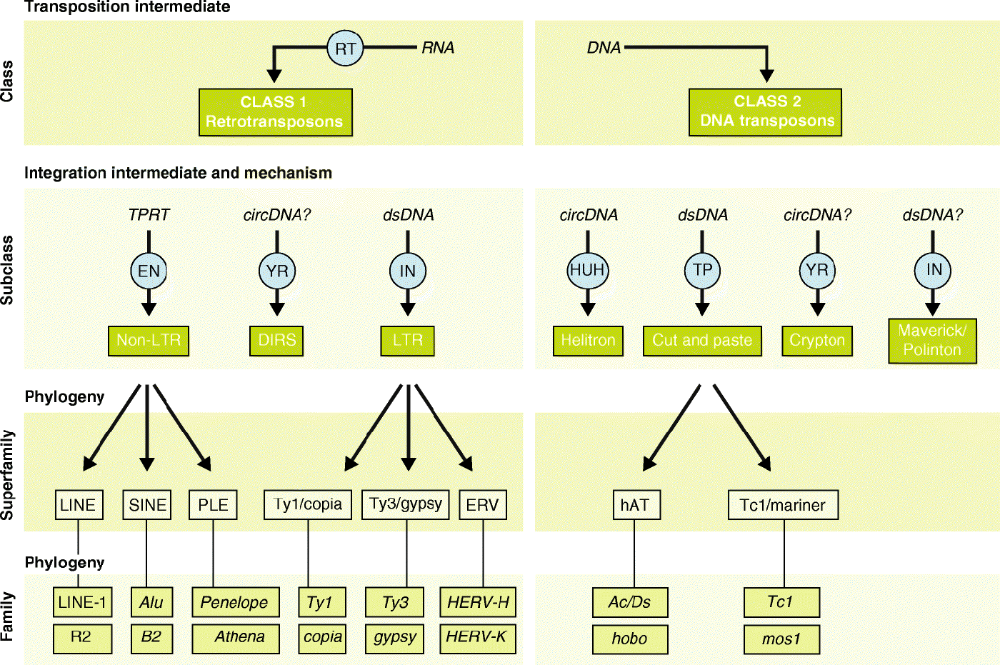

与图 2-1 为同一幅已发表图，未修改。用来对照完整自主型Ⅰ类（LTR、LINE、SINE、DIRS、PLE）和Ⅱ类（TIR、Helitron）的标准结构。

署名：Guillaume Bourque、Kathleen H. Burns、Mary Gehring、Vera Gorbunova、Andrei Seluanov、Molly Hammell、Michaël Imbeault、Zsuzsanna Izsvák、Henry L. Levin、Todd S. Macfarlan、Dixie L. Mager、Cédric Feschotte，2018，Genome Biology，DOI 10.1186/s13059-018-1577-z，Fig. 1，CC BY 4.0（https://creativecommons.org/licenses/by/4.0/），未修改。

复制机制对照见图 3-1。

## 13.2 非自主元件

**结构特征**。非自主型转座子（non-autonomous transposable elements）保留了被转座酶或逆转录机器识别所必需的顺式末端序列，但内部完全丧失了蛋白质编码能力，必须依赖基因组中同源或近缘自主型“伙伴”反式（*in trans*）提供的酶学机器才能移动。真实植物基因组中最常见的六类非自主元件及其自主伙伴如下：
- **微型反向重复转座元件（MITEs）**：长度通常50至600 bp、富含AT、尺寸高度均一，保留完整TIR与TSD，绝大多数源自*PIF/Harbinger*（如*Tourist*类，依赖*Ping*/*Pong*等自主伙伴，Jiang et al. 2003，*Nature*，[待确认]）或*Tc1/Mariner*（如*Stowaway*类，依赖*Osmar*等自主伙伴，Yang et al. 2009，*The Plant Cell*，[待确认]）的内部缺失。
- **大型反转录转座子衍生物（LARDs）与末端重复反转录转座子微型元件（TRIMs）**：两端保留完整同向LTR、PBS、PPT与5 bp TSD，内部为无编码能力的非编码区（TRIM全长约300至1000 bp，LARD可达4 kb以上），分别依赖同源自主LTR反转录转座子反式动员（Witte et al. 2001，*Proceedings of the National Academy of Sciences*，[待确认]；Kalendar et al. 2004，*Proceedings of the National Academy of Sciences*，[待确认]）。
- **短散在核元件（SINEs）**：长度约80至500 bp，起源于RNA聚合酶Ⅲ转录的tRNA、7SL RNA或5S rRNA基因，无编码区，依靠3'端同源尾序列劫持伴侣LINE的逆转录酶与核酸内切酶通过靶标引物反转录（TPRT）扩增（Wicker et al. 2007，doi:10.1038/nrg2165）。
- **非自主*Helitron***：保留`5'-TC`、`3'-CTRR`及3'端发夹结构，但缺失Rep/Helicase编码区，常在内部包裹宿主基因片段，依赖自主*Helitron*反式提供滚环复制酶（Kapitonov & Jurka 2001，*Proceedings of the National Academy of Sciences*，[待确认]）。
- ***Ac*/*Ds*类缺失衍生体**：经典*hAT*、*CACTA*或*Mutator*等自主DNA转座子因内部不同长度的缺失而形成的非自主拷贝（如玉米*Ds*依赖自主*Ac*，*dSpm*依赖自主*Spm*），长度从数百bp到数kb不等。

**识别工具与判据**。非自主元件因缺乏蛋白编码域，无法依赖蛋白同源搜索，必须依靠末端结构特征与高拷贝一致性聚类。MITEs可使用MITE-Hunter（Han & Wessler 2010，*Nucleic Acids Research*，[待确认]）、MITE-Tracker或EDTA内置的TIR-Learner结合长度上限（如$< 600\text{ bp}$）与高拷贝数判据识别；LARD和TRIM由LTR_FINDER/LTRharvest与LTR_retriever按完整LTR边界检出后，结合TEsorter无蛋白域命中及长度特征区分；SINEs需借助RepeatModeler2（Flynn et al. 2020，*Proceedings of the National Academy of Sciences*，doi:10.1073/pnas.1921046117）或专用工具（如AnnoSINE，Li et al. 2022，*Plant Physiology*，[待确认]）基于Pol III内部启动子（A/B盒）和3'端poly(A)/微卫星尾识别；*Ac*/*Ds*类缺失体则通过与自主型一致性序列的局部末端比对（RepeatMasker）归类。

**注释工具常见误判**。第一，蛋白域分类工具（如TEsorter）对所有无编码区的非自主元件均会输出未分类，导致大量结构完整的LARD和TRIM在EDTA汇总表中滞留于`LTR/unknown`（`RLX`）。第二，在未开启`--sensitive 1`时，EDTA默认漏检SINEs。第三，部分短小的回文序列或微卫星易被MITEs预测工具误判为低拷贝假MITE；而长度介于600 bp至1.5 kb之间的*Ac*/*Ds*类缺失体常在`MITE/`与`DNA/`标签间摇摆不定。

**在植物与葡萄中的分布及报道**。非自主元件在植物基因组拷贝数上往往远超自主元件。在栽培葡萄基因组中，已系统鉴定出涵盖*Tourist*、*Stowaway*、*hAT*、*Mutator*和*CACTA*衍生的海量MITEs家族，它们高频分布于葡萄基因上下游调控区（Benjak et al. 2008，*BMC Genomics*，[待确认]）；同时，葡萄基因组中亦广泛存在`LTR/unknown`（含TRIM与LARD）及少量SINE元件，在PN40024参考基因组与葡萄属超级泛基因组中均构成重要的多态性变异来源（Jaillon et al. 2007，doi:10.1038/nature06148；Guo et al. 2025，*Nature Genetics*，doi:10.1038/s41588-025-02111-7）。

**图 13-2**　非自主 MITE 的结构（与图 4-1 为同一幅）

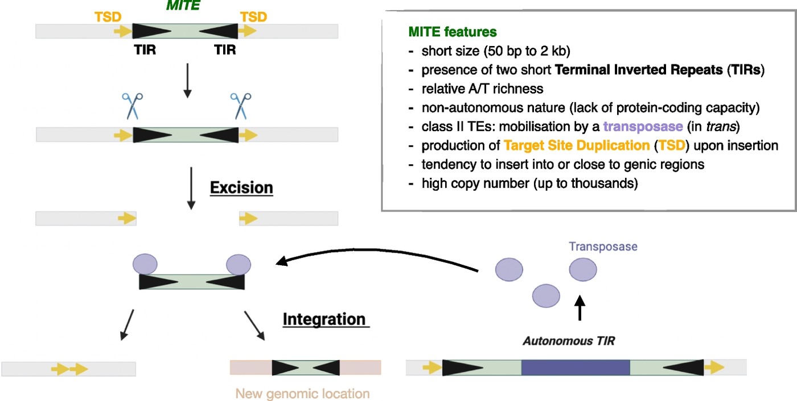

与图 4-1 为同一幅已发表图，未修改。画出 MITE 的 TIR、TSD，以及依赖自主元件转座酶的反式动员。LARD、TRIM 等非自主反转录元件仍缺专用对照图。

署名：Abirami Soundiramourtty、Marie Mirouze，2025，Mobile DNA，DOI 10.1186/s13100-025-00375-8，Fig. 1，CC BY 4.0（https://creativecommons.org/licenses/by/4.0/），未修改。

**图 13-10**　非自主元件与其自主伙伴的结构对照

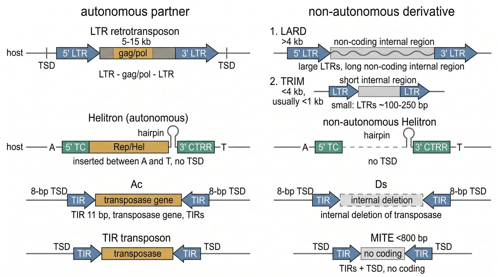

常见非自主元件与其自主伙伴的结构对照（LARD/TRIM、非自主 Helitron、Ds、MITE）。长度为常见量级。示意图，由 AI 生成，非已发表图。

## 13.3 碎片与截短体

**结构特征**。在真实植物基因组中，占绝对多数的转座子既非完整自主元件，也非边界整齐的非自主元件，而是形态各异的**碎片与截短体（fragments and truncated copies）**。其形成主要源于三条分子途径：一是**5'端截短（5' truncation）**，典型见于LINE非LTR反转录转座子——由于逆转录酶在TPRT过程中持续合成能力有限或提前脱落，绝大多数新整合的LINE拷贝仅保留3'端poly(A)尾及部分ORF2，丧失了5'端启动子与ORF1（Luan et al. 1993，*Cell*，[待确认]）；二是**内部缺失（internal deletion）与单侧截断**，由DNA双链断裂后的非法重组（illegitimate recombination）或微同源介导末端连接引发，导致LTR或TIR元件仅剩半截内部编码区或单侧末端（Devos et al. 2002，*Genome Research*，[待确认]）；三是**古老退化与嵌套打断**，数百万年前插入的拷贝被后续年轻转座子反复劈开，沦为互不相连、仅存数十至数百bp且仅剩部分保守结构域的残骸。在多数高等植物（如玉米、小麦、葡萄）的RepeatMasker全基因组注释中，这类非完整的碎片与截短体通常占据全部转座子注释条目的70%至90%以上[待确认]。

**识别工具与判据**。所有基于结构特征的从头预测工具（LTR_retriever、TIR-Learner、HelitronScanner）均无法直接检出碎片与截短体，必须依赖**基于高质量一致性文库的同源比对引擎**——即RepeatMasker（配合RMBlast或Cross_Match）或基于Dfam轮廓隐马尔可夫模型（profile HMMs）的`nhmmer`（Wheeler & Eddy 2013，*Bioinformatics*，[待确认]）。判据主要依据比对得分（Smith-Waterman score）、与一致性序列的覆盖区间（例如仅覆盖一致性序列3'端30%即提示5'截短）以及分歧度（divergence，如Kimura距离）。

**注释工具常见误判**。第一，**碎片计数膨胀（fragmentation overcounting）**：当一条古老转座子被嵌套打断或因高分歧度在中间出现比对断口时，RepeatMasker会将其输出为2至5条独立的注释行，若直接按GFF3行数统计“拷贝数”，会将真实插入事件数严重高估数倍；为此常需使用`One code to find them all`（Bailly-Bechet et al. 2014，*Mobile DNA*，[待确认]）或RepeatMasker自带的`ProcessRepeats`进行同源碎片缝合。第二，**低复杂度与短片段假阳性**：长度小于80 bp、分歧度超过35%至40%的极短匹配极易与随机基因组序列混淆，实际统计中通常需设定最小长度阈值（如 $\ge 80\text{ bp}$）过滤噪音。第三，**遗漏古老截短体**：若参考文库不完整或未开启RepeatModeler2敏感打捞，大量高度截短的LINE与古老家族会被归为未注释非编码区。

**在植物与葡萄中的分布及报道**。在拟南芥、水稻、玉米及葡萄基因组中，碎片化拷贝均是转座子碱基总量的主要承载者。在栽培葡萄PN40024基因组中，大量古老的*Gypsy*、*Copia*与LINE拷贝以碎片和5'端截短体形式广泛分布于近着丝粒异染色质与基因间区（Jaillon et al. 2007，doi:10.1038/nature06148；Shi et al. 2023，doi:10.1093/hr/uhad061）。在葡萄EDTA注释结果（`TEanno.gff3`）中，通过比对`Method=homology`与`Method=structural`条目数，可直观看到同源碎片条目数通常比完整结构条目数高出一个数量级以上。

**图 13-11**　LINE 的 5 端截短与 LTR 内部缺失碎片

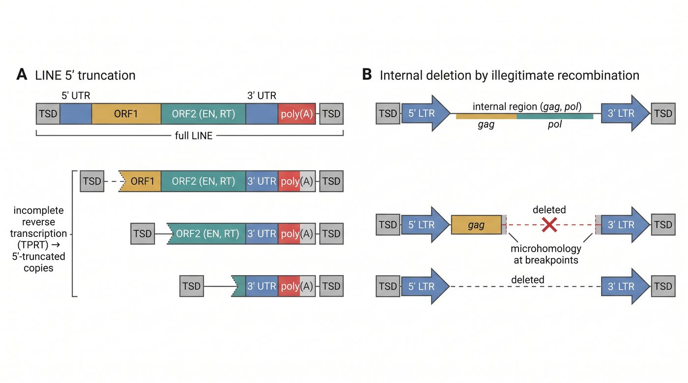

A，LINE 在靶位引发的逆转录中途停止，产生保留 3 端和 poly(A)、5 端长短不一的截短拷贝；B，LTR 元件经非法重组形成内部缺失的碎片。示意图，由 AI 生成，非已发表图。

## 13.4 solo-LTR 与 LTR 间非等位重组

**结构特征**。单长末端重复序列（solo-LTR）是完整LTR反转录转座子在基因组中发生**元件内不等同源重组（intra-element unequal homologous recombination）**后的直接产物。由于一条完整LTR元件两端的5'-LTR与3'-LTR方向相同且在插入初期序列几乎100%一致，细胞在DNA复制或双链断裂修复时，两个同向LTR之间极易发生错配配对与交叉互换，将整个内部*gag*/*pol*编码区连同一个杂合LTR以环状DNA形式切除丢失，最终在染色体原位仅留下一个完整的**单一LTR序列**，且其左右两侧依然完好保留着当年完整元件整合时留下的**4至6 bp TSD**（Devos et al. 2002，*Genome Research*，[待确认]；Ma et al. 2004，*Genome Research*，[待确认]）。

**识别工具与判据**。在全基因组上精准识别solo-LTR并计算`solo-LTR : intact LTR`比例，标准流程需结合LTR_retriever（Ou & Jiang 2018，doi:10.1104/pp.17.01310）附带的`solo_finder.pl`脚本（或基于RepeatMasker输出的自编判据）：首先，从一致性文库中提取各家族的纯LTR序列与内部区序列，用RepeatMasker注释全基因组；其次，筛选出与参考LTR全长覆盖度高（如 $\ge 80\%$）、且上下游一定距离（如300 bp至500 bp）内**不含同家族内部编码区序列**的孤立LTR匹配；最后，高严格度标准还会核查该孤立LTR两侧是否存在完整的5 bp TSD。`solo:intact`比例具有极高的演化生物学意义：它直接定量反映了该物种基因组通过同源重组清除LTR DNA的效率与基因组收缩速率——高`solo:intact`比例（如水稻、拟南芥等小型基因组常大于1:1甚至高达数倍）意味着强劲的重组清除遏制了基因组膨胀；而极低的`solo:intact`比例（如部分大型裸子植物挪威云杉 *Picea abies*，Nystedt et al. 2013，*Nature*，[待确认]）则说明重组清除极其缓慢，导致完整LTR长期堆积。

**注释工具常见误判**。第一，**将截短的完整LTR单侧末端误判为solo-LTR**：如果一条完整LTR元件因组装缺口（`N`区）或大片段非法重组缺失了内部区和另一侧LTR，仅剩一侧LTR孤零零留在那里，且未核查两侧TSD，就会被误计为solo-LTR。第二，**嵌套插入导致的假solo-LTR**：当一个年轻转座子精准插入到某完整LTR的5'-LTR与内部区交界处时，5'-LTR在物理坐标上与内部区被拉远数kb，若仅用短窗口检查相邻内部区，就会把这条5'-LTR误判为solo-LTR。第三，**短LTR家族与内部区边界划分不清**：若一致性文库中未精确切分LTR与内部区，会导致`solo_finder`漏检或误报。

**在植物与葡萄中的分布及报道**。solo-LTR在所有已测序高等植物中均极为普遍。在栽培葡萄中，solo-LTR不仅是平衡基因组大小的重要清除途径，更直接造就了转座子生物学史上最著名的表型逆转案例：白皮葡萄*VvmybA1*启动子中原本插入了长达10.4 kb的完整*Gret1*元件（*VvmybA1a*），而在‘红意大利’（Ruby Okuyama）等白变红芽变品种中，*Gret1*两端的LTR发生不等同源重组，切除了近10 kb内部编码区，在原位仅留下一个两侧带5 bp TSD的solo-LTR（*VvmybA1b*），从而恢复了*VvmybA1*转录并使果皮重新变红（Kobayashi et al. 2004，*Science*，doi:10.1126/science.1095011）。在PN40024 T2T基因组中，全基因组范围内同样可检出数以千计的*Gypsy*与*Copia* solo-LTR（Shi et al. 2023，doi:10.1093/hr/uhad061）。

**图 13-12**　solo-LTR 的形成（与图 3-4 为同一幅）

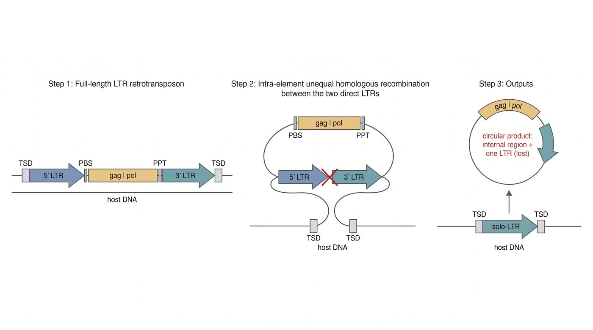

与图 3-4 为同一幅示意图，未修改。完整 LTR 经两端同向 LTR 不等同源重组，切去内部区，染色体上只留下一个 solo-LTR。Gret1 在 VvMybA1 上的结构见图 10-4；solo-LTR 的数量关系见图 3-2、图 3-3。示意图，由 AI 生成，非已发表图。

## 13.5 嵌套插入（nested insertion）

**结构特征**。嵌套插入（nested insertion）是指一个较年轻的转座子（B）直接插入到了一个早已存在于染色体中的较古老转座子（A）的内部序列之中，将元件A从物理上劈成左右两半（A1与A2），并在元件B的两侧产生属于元件A内部序列的TSD；随后，更年轻的元件（C）又可插入B的内部，形成三层、四层甚至多达七八层的“俄罗斯套娃”式复合结构（SanMiguel et al. 1996，*Science*，[待确认]）。嵌套插入高度富集于低重组率、低基因密度的着丝粒和近着丝粒异染色质区域——在这些“安全港”中，年轻转座子插进古老转座子内部既不会破坏宿主必需基因，又避免了被纯化选择清除，从而在玉米、小麦、大麦和葡萄等中大型植物基因组中堆积出连绵数十kb至数百kb的嵌套转座子阵列。

**识别工具与判据**。识别并重建多层嵌套结构的核心逻辑是**由内向外迭代剥离（iterative peeling）**：先定位最内层结构完整、边界连续的年轻转座子，将其从序列中虚拟切除并缝合两侧断点；若缝合后的序列恰好还原出一条完整且连续的古老转座子（且缝合处正好吻合年轻元件的TSD），即确证为一层嵌套，如此循环直至剥离至最外层。专门针对植物基因组开发的经典嵌套重建工具是**TEnest**（Kronmiller & Wise 2008，*Plant Physiology*，[待确认]），此外在现代注释实践中，研究者也常借助LTR_retriever的嵌套检测辅助信息、RepeatMasker的`ID`碎片关联以及TE-Aid（Goubert et al. 2022，*Mobile DNA*，[待确认]）等可视化工具辅助人工重建。

**注释工具常见误判与难点**。嵌套插入是当前自动化注释流程最棘手的难点之一。第一，**常规结构预测工具遗漏外层元件**：LTR_FINDER和LTRharvest通常设有最大元件长度上限（如15 kb或20 kb），当一条原本10 kb的古老LTR内部被嵌套插入了两条各8 kb的年轻LTR后，外层古老LTR两端的物理间距被撑大到26 kb，直接超出搜索窗口而被彻底漏检。第二，**RepeatMasker输出碎片化**：RepeatMasker会将被劈成两半的古老元件A标注为两条孤立碎片，丢失它们原本属于同一插入事件的物理关联。第三，**多代嵌套叠加非法重组导致重建失效**：如果外层古老元件在被嵌套的同时又发生了内部大片段缺失或高分歧度退化，迭代剥离算法往往难以准确配对左右残片。

**在植物与葡萄中的分布及报道**。嵌套插入最早在玉米*Adh1*基因座225 kb区段被系统解析，并成为验证LTR分子钟“外层老、内层新”地层学逻辑的经典证据（SanMiguel et al. 1996，*Science*，[待确认]；SanMiguel et al. 1998，*Science*，[待确认]）。在栽培葡萄PN40024的T2T无间隙基因组中，近着丝粒异染色质区及部分高重复基因间区同样存在大量*Gypsy*与*Copia*相互嵌套的复杂阵列（Shi et al. 2023，doi:10.1093/hr/uhad061），在葡萄泛基因组变异图谱中，不同单倍型间嵌套层级的差异更是制造复杂多层级“气泡套气泡”拓扑结构的主要原因（Guo et al. 2025，doi:10.1038/s41588-025-02111-7）。

**图 13-3**　嵌套插入的实例（与图 6-2 为同一幅）

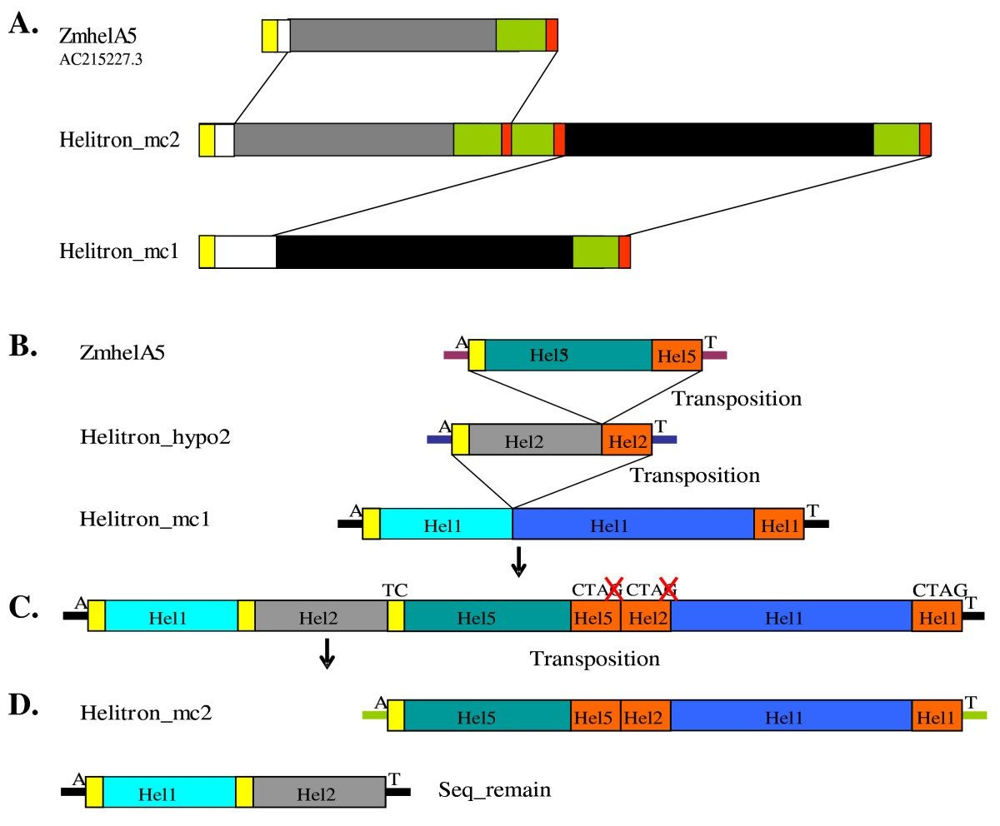

与图 6-2 为同一幅已发表图，未修改。展示 Helitron 如何一步步套叠，形成带多个末端的新元件。

署名：Yongbin Dong、Xiaomin Lu、Weibin Song、Lei Shi、Mei Zhang、Hainan Zhao、Yinping Jiao、Jinsheng Lai，2011，BMC Genomics，DOI 10.1186/1471-2164-12-609，Figure 4，CC BY 2.0（https://creativecommons.org/licenses/by/2.0），未修改。

多种植物中嵌套型与被插入元件的年龄分布见图 6-1。部分建议来源不能按开放许可再用。

## 13.6 嵌合元件与重组产物

**结构特征**。与仅仅在物理位置上“元件套元件”的嵌套插入不同，**嵌合元件（chimeric elements）**是指在同一条连续的转座子实体内部，融合了来自两个不同家族（甚至不同超家族）的序列模块或蛋白结构域，且该嵌合结构有时能够作为一个整体继续在基因组中扩增。其主要分子形成途径包括：一是**反转录模板跳跃（template switching）**，即在LTR反转录转座子的病毒样颗粒共包装两条不同家族RNA时，逆转录酶在合成cDNA中途从一条模板跳至另一条模板，产生“A家族LTR + B家族*gag*/*pol*”或杂合编码区的重组LTR元件（Sabot & Schulman 2007，*Chromosome Research*，[待确认]）；二是**家族间非等位同源重组**，发生于两个近缘家族的保守编码区或LTR区之间；三是**复合DNA转座（composite transposition）**，即两个同向或反向排列的DNA转座子（如*hAT*或*Mutator*）将夹在中间的另一段转座子或宿主序列整体切离并移动。

**识别工具与判据，以及如何与组装错误区分**。在基因组注释中，识别嵌合元件主要通过**局部比对断点扫描**（如使用BLASTN或RepeatMasker将单条候选一致性序列比对至参考库，观察5'半段与3'半段是否分别高置信度命中两个完全不同的家族）以及**多结构域系统发育冲突检验**（分别用同一元件的5'-LTR、*gag*、INT和RT构建系统发育树，若拓扑位置发生显著跳变即提示重组嵌合）。
实战中最关键的一步是**将真实的生物学嵌合元件与基因组组装错误（chimeric assembly artifacts）严格区分开来**：
1. **原始长读长跨越验证（核心金标准）**：将原始PacBio HiFi或ONT长读长比对回组装基因组，检查是否存在多条高质量、唯一比对的单分子长读长**从头到尾完整跨越**该嵌合元件及其两侧单拷贝宿主侧翼区；若在嵌合拼接点处出现覆盖度骤降、大量软裁剪（soft-clipping）断点或无单条读长跨越，则高度疑似组装嵌合错误。
2. **多拷贝重复出现检验**：如果一个嵌合结构在基因组的不同染色体位点上独立出现了多个完整拷贝，且每个拷贝两侧都带有各自独立的TSD，说明该嵌合体已在演化中作为一个完整功能单元成功扩增，绝非偶然的单点组装错误。
3. **跨单倍型/近缘物种共线性核查**：在泛基因组或双单倍型组装中，若该嵌合元件在近缘品种的对应直系同源位点上稳定存在，亦可确证其真实性。

**注释工具常见误判**。从头聚类工具（如RepeatModeler2，doi:10.1073/pnas.1921046117）在面对高频嵌套或串联重复区时，极易将物理上紧邻的两个不同转座子错误拼接为一条虚假的“人造嵌合一致性序列”，一旦入库就会在全基因组屏蔽时引发大面积分类错乱（Goubert et al. 2022，*Mobile DNA*，[待确认]）。

**在植物与葡萄中的分布及报道**。家族间重组与模板跳跃在禾本科（如大麦*BARE1*/*BARE2*与水稻LTR家族）中已有经典报道[待确认]。在高度杂合的葡萄单倍型基因组与泛基因组中，早期短读长组装曾因杂合单倍型折叠产生过不少虚假嵌合重复；而在HiFi T2T与双单倍型组装时代，结合原始长读长核验与TEtrimmer/人工精修（Qian et al. 2025，*Nature Communications*，[待确认]），研究者已能有效区分真实存在的重组型LTR家族与局部组装假象（Shi et al. 2023，doi:10.1093/hr/uhad061）。

**图 13-13**　模板跳跃形成嵌合元件，以及与组装错误的区分

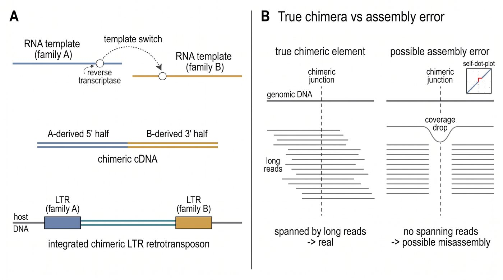

A，逆转录时模板在两个家族的 RNA 之间转换，产生家族间嵌合元件；B，用长读长是否跨越接点区分真嵌合体和组装错误。图中 LTR 画成方框，而不是箭头。示意图，由 AI 生成，非已发表图。

## 13.7 被驯化成宿主基因的 TE（exaptation/domestication）

**结构特征**。被宿主驯化（molecular domestication / exaptation，外适应）的转座子是指原本用于自身移动的转座酶、整合酶或Gag蛋白编码区，在演化中被宿主基因组“征用”并改造为执行全新宿主生理功能的稳定单拷贝（或小家族）蛋白质编码基因（Gould & Vrba 1982，*Paleobiology*，[待确认]；Sinzelle et al. 2009，*Cellular and Molecular Life Sciences*，[待确认]）。这类被驯化的基因具有鲜明的分子特征：**彻底丧失了移动所需的顺式末端结构**（无TIR、无LTR、无TSD）；保留了经过改造的DNA结合域（如来源于转座酶的WRKY-GCM1、BED锌指或HTH域）和/或催化结构域；通常获得标准真核内含子-外显子结构与宿主启动子；在跨物种演化中处于强烈的**纯化选择**（$K_a/K_s \ll 1$）与高度保守的染色体共线性位置上。

**识别工具与判据**。识别驯化转座子基因的核心是**跨物种共线性与选择压力检验**，而非单纯的重复序列搜索：首先，在宿主蛋白质注释集中通过PFAM/InterPro或HMMER检索含有转座酶（如MULE、hAT、PIF/Harbinger）或逆转录酶/Gag同源结构域的基因；其次，排除高拷贝重复家族，筛选在基因组中呈单拷贝或极低拷贝、两端无TIR/LTR/TSD的候选基因；最后，验证其在多个亲缘物种间保持严格的直系同源共线性、稳定转录表达且 $K_a/K_s$ 显著小于1。

**注释工具常见误判**。这是基因注释与转座子注释交界处最经典的“误杀区”。当使用RepeatMasker或未经严格CDS去污染的EDTA文库对基因组进行屏蔽时，由于*FAR1*/*FHY3*、*MUSTANG*或*DAYSLEEPER*等驯化基因在蛋白质水平上与*Mutator*或*hAT*转座酶高度同源，自动化流程极易将它们误判为转座子并予以硬屏蔽，导致下游基因预测软件彻底漏掉这些至关重要的宿主转录因子！这正是第11.1.3节强调在EDTA中必须提供高质量CDS（`--cds`）并审慎排查TE-CDS重叠的根本原因（Ou et al. 2019，doi:10.1186/s13059-019-1905-y）。

**在植物与葡萄中的分布及报道**。被子植物中拥有多个经过严密功能验证的转座子驯化经典案例：
- ***FAR1*/*FHY3*家族**：起源于古老*Mutator*样DNA转座子（MULE）转座酶的驯化，在拟南芥及广泛被子植物中编码光敏色素A（phyA）远红光信号转导的核心转录因子，并广泛参与生物钟、避荫反应、叶绿素合成与开花调控（Hudson et al. 2003，*The Plant Cell*，[待确认]；Lin et al. 2007，*Science*，[待确认]；Ma & Li 2018，*Molecular Plant*，[待确认]）。
- ***DAYSLEEPER***：在拟南芥中鉴定，起源于*hAT*超家族转座酶的驯化，结合特定启动子的Kubox1基序，对胚胎发育与器官建成不可或缺，敲除导致严重矮化甚至致死（Bundock & Hooykaas 2005，*Nature*，[待确认]）。
- ***MUSTANG*（*MUG1–MUG8*）家族**：另一支独立起源于*Mutator*样转座酶（MULE）驯化的被子植物保守基因家族，在单双子叶植物中广泛存在，功能研究表明其对拟南芥的正常花发育、育性与植株生长至关重要（Cowan et al. 2005，*Plant Physiology*，[待确认]；Joly-Lopez et al. 2012，*PLOS Genetics*，[待确认]）。
- 在栽培葡萄（*Vitis vinifera*）基因组中，同源检索同样完整保留了*FAR1*/*FHY3*和*MUSTANG*等被子植物共享的驯化转座酶基因家族[待确认]，在葡萄光信号调控、果实着色光响应及发育进程中发挥重要功能，开展葡萄转座子注释时必须避免将其误屏蔽。

**图 13-14**　Mutator 转座酶驯化为 FAR1/FHY3 与 MUSTANG

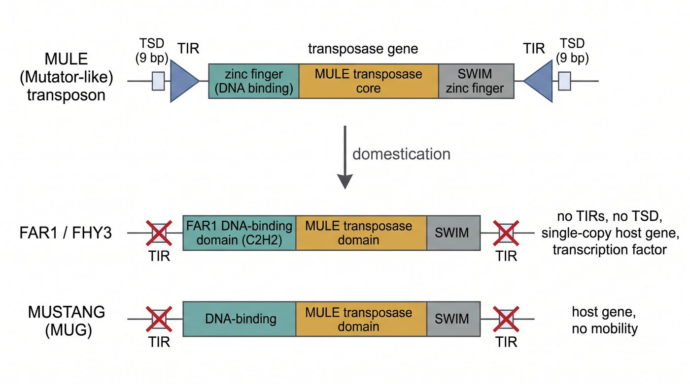

Mutator 类转座酶被驯化为宿主基因 FAR1/FHY3 与 MUSTANG：保留 DNA 结合区、转座酶核心区和 SWIM 锌指，失去末端反向重复和移动能力。顶行 MULE 的两个 TIR 已朝内。示意图，由 AI 生成，非已发表图。

## 13.8 携带宿主基因片段的元件

**结构特征**。与“自身沦为宿主基因”的驯化现象相反，部分Ⅱ类DNA转座子在演化中发展出了“劫持宿主基因片段”的惊人能力，植物界最著名的两大代表是***Mutator*超家族的Pack-MULE**与**滚环复制型的*Helitron***。**Pack-MULE**两端保留完整的*Mutator* TIR和9 bp TSD，但其内部转座酶编码区被一个或多个来自宿主不同染色体的蛋白质编码基因外显子片段所取代，且明显偏好捕获富含GC碱基的宿主基因区段（Jiang et al. 2004，*Nature*，[待确认]；Jiang et al. 2011，*Proceedings of the National Academy of Sciences*，[待确认]）。***Helitron***则通过滚环复制过程中的3'端终止信号通读，将下游邻近的宿主基因外显子甚至完整基因“打包”卷入自身体内并随滚环复制在基因组中扩增（Morgante et al. 2005，*Nature Genetics*，[待确认]）。这两类元件捕获的基因片段绝大多数（超过90%至95%）处于中性退化状态，沦为嵌合假基因，但极少数可形成受纯化选择的新嵌合蛋白或产生靶向母本基因的调控型siRNA（Juretic et al. 2005，*Genome Research*，[待确认]；Hanada et al. 2009，*The Plant Cell*，[待确认]）。

**识别工具与判据**。识别Pack-MULE与基因捕获型*Helitron*需采用“转座子结构边界 + 宿主基因同源性”双轨策略：先通过TIR-Learner、Pack-MULE专用挖掘流程或HelitronScanner（Xiong et al. 2014，*Proceedings of the National Academy of Sciences*，[待确认]）锁定具有完整末端结构与多拷贝特征的候选元件；再将其内部非末端序列与剔除了转座子蛋白的宿主蛋白质数据库进行BLASTX/DIAMOND比对，若内部稳定匹配到一个或多个宿主外显子片段（且在基因组中存在对应的单拷贝母本直系同源基因），即可确证为基因捕获型转座子。

**注释工具常见误判及对基因注释的干扰**。携带宿主基因片段的元件是造成**植物基因组基因注释膨胀与假基因污染的头号元凶**。一方面，如果转座子屏蔽不彻底，Pack-MULE和*Helitron*内部捕获的外显子片段会被基因预测软件（如AUGUSTUS、MAKER、BRAKER）当作真实的宿主编码基因预测出来，甚至把转座子与邻近真实基因错误融合成荒谬的嵌合基因模型，导致全基因组基因总数虚高数千个。另一方面，如果在运行EDTA的`--cds`去污染时，输入的宿主CDS参考集本身混入了大量未清理的Pack-MULE或*Helitron*假基因模型，EDTA就会把真实的*Mutator*和*Helitron*区段从转座子文库中错误剪除，引发双向污染。

**在植物与葡萄中的分布及报道**。Pack-MULE在水稻中被系统鉴定出超过3000个，捕获了逾1000个宿主基因片段（Jiang et al. 2004，*Nature*，[待确认]）；基因捕获型*Helitron*则在玉米中被广泛报道，直接驱动了玉米自交系B73与Mo17之间大量的基因非共线性存在/缺失变异（PAV）（Morgante et al. 2005，*Nature Genetics*，[待确认]）。在双子叶木本植物葡萄（*Vitis vinifera*）中，Pack-MULE与*Helitron*的总体活跃度虽不及水稻和玉米极端，但全基因组扫描同样可检出捕获宿主基因片段的Pack-MULE与*Helitron*拷贝（Benjak et al. 2008，*BMC Genomics*，[待确认]），在构建葡萄泛基因组基因集与NLR抗病基因注释时，必须仔细核查候选基因是否落入这两类元件内部。

**图 13-4**　携带宿主基因碎片的元件（与图 6-4 为同一幅）

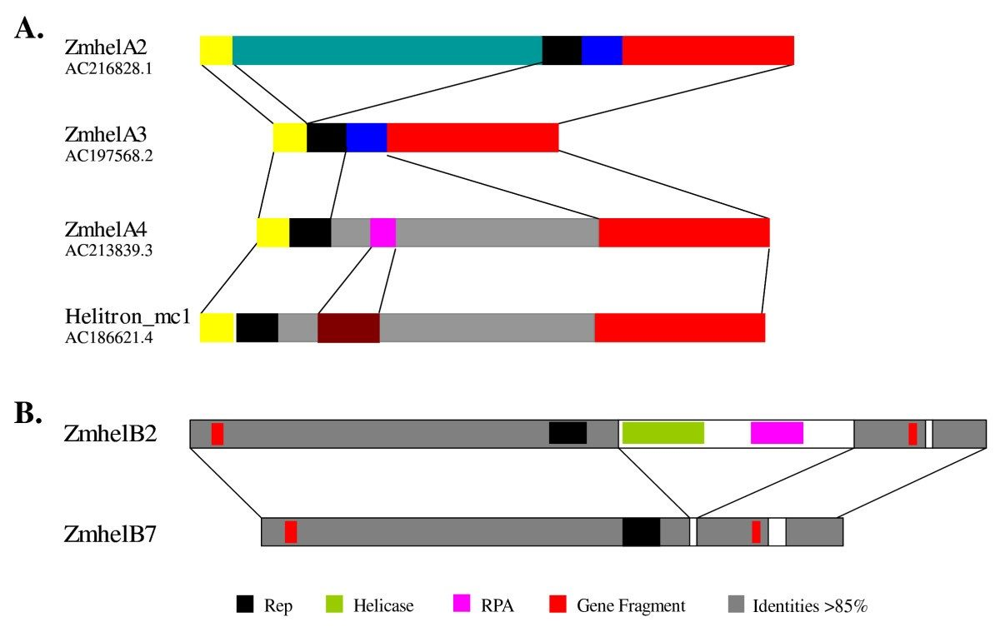

与图 6-4 为同一幅已发表图，未修改。展示 Helitron 分步捕获基因碎片，以及内部编码区丢失。Pack-MULE 的专用结构图这次没有找到可再用的开放许可来源。

署名：Yongbin Dong、Xiaomin Lu、Weibin Song、Lei Shi、Mei Zhang、Hainan Zhao、Yinping Jiao、Jinsheng Lai，2011，BMC Genomics，DOI 10.1186/1471-2164-12-609，Figure 6，CC BY 2.0（https://creativecommons.org/licenses/by/2.0），未修改。

**图 13-15**　Pack-MULE 捕获多个宿主基因外显子片段

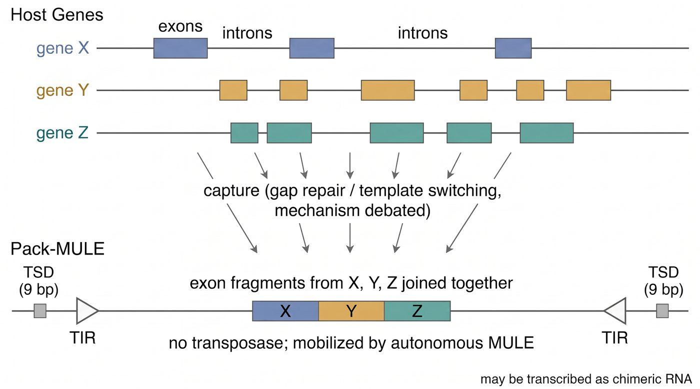

Pack-MULE 携带来自多个宿主基因的外显子片段，两端是 MULE 的 TIR 和 9 bp TSD，本身不编码转座酶。目检确认两端 TIR 相对朝内。示意图，由 AI 生成，非已发表图。

## 13.9 TE 衍生的串联重复与卫星

**结构特征**。在经典教科书中，散在重复（转座子）与串联重复（tandem repeats，如着丝粒卫星DNA）常被截然二分。然而，T2T无间隙基因组时代彻底打破了这道人造界限，揭示了**转座子与着丝粒卫星重复之间深刻的双重共生与演化转化关系**。第一重关系是**结构交错共生**：高等植物的功能着丝粒并非纯粹的卫星DNA海洋，而是由绵延数Mb的串联卫星单体阵列（如玉米*CentC*、水稻*CentO*、拟南芥*CEN178*）与特异性靶向着丝粒的*Ty3/Gypsy*反转录转座子（尤其是携带C端色质结构域CR motif的***CRM*亚谱系**以及拟南芥中的*Athila*亚谱系）紧密交错构成的复合生态（Zhong et al. 2002，*The Plant Cell*，[待确认]；Gao et al. 2008，*Genome Research*，[待确认]；Naish et al. 2021，*Science*，[待确认]）。第二重关系是**由转座子直接衍生出串联卫星**：部分转座子（如特定LTR的亚区、*CACTA*或*Helitron*片段）在发生局部串联扩增或滚环复制后，其内部短片段可演化为全新的高拷贝串联卫星单体，随后通过不等交换扩张为染色体着丝粒或亚端粒的巨型卫星阵列（Meštrović et al. 2015，*Cytogenetic and Genome Research*，[待确认]）。

**识别工具与判据**。解析着丝粒区串联卫星与转座子的复合结构，必须结合**串联重复专用识别工具**与**转座子蛋白域注释**：先用TRF（Tandem Repeats Finder，Benson 1999，*Nucleic Acids Research*，[待确认]）、TRASH或StainedGlass（Vollger et al. 2022，*Bioinformatics*，[待确认]）绘制自比对相似度热图，精准定位高阶重复（HOR）卫星阵列的边界与单体长度；随后针对卫星阵列内部被切割出的非卫星区段，结合TEsorter（Zhang et al. 2022，*Horticulture Research*，[待确认]）与CENH3 ChIP-seq定位*CRM*等着丝粒反转录转座子；若要确证某串联卫星起源于转座子，则需检验卫星单体一致性序列与已知转座子家族（如LTR或TIR内部区）是否存在显著的局部序列同源性。

**注释工具常见误判**。正如第12.1.1节所述，这是T2T基因组注释中误判率最高的区域。其一，当年轻完整的*CRM*反转录转座子直接插入到高度同质化的着丝粒卫星阵列内部时，其5'上游和3'下游侧翼均为完全相同的卫星单体，会直接触发LTR_retriever的“侧翼同源性过滤”机制，导致大量真实的着丝粒*CRM*完整拷贝被当作串联重复假阳性而遭误删（Ou & Jiang 2018，doi:10.1104/pp.17.01310）。其二，RepeatModeler2等从头聚类工具扫描数Mb纯卫星阵列时，极易将卫星单体与穿插其中的*CRM*拼接为虚假嵌合一致性序列，或将高拷贝卫星单体误标为`Unknown`转座子。

**在植物与葡萄中的分布及报道**。在拟南芥T2T基因组中，已清晰观测到年轻*Athila*类*Gypsy*元件高频插入*CEN178*着丝粒卫星阵列并不断重塑其高阶重复结构（Naish et al. 2021，*Science*，[待确认]）。在栽培葡萄PN40024的T2T无间隙参考基因组中，研究者首次完整跨越了全部19条染色体的着丝粒区域，系统鉴定出葡萄特有的着丝粒串联卫星重复单体阵列，并观察到大量*Ty3/Gypsy*反转录转座子（包括着丝粒富集类群）与卫星阵列紧密交错分布的典型格局（Shi et al. 2023，*Horticulture Research*，doi:10.1093/hr/uhad061）。这一发现在葡萄T2T基因组注释实战中具有重要警示意义：处理葡萄着丝粒区时，必须先独立标注卫星阵列再协同解析穿插其中的*Gypsy*元件，才能还原着丝粒的真实面貌。

**图 13-5**　葡萄 T2T 基因组中着丝粒、端粒与转座子的分布

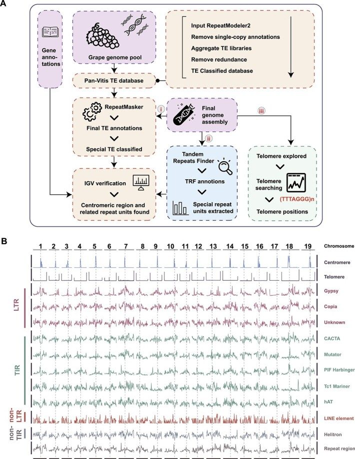

PN40024 参考基因组的重复序列注释。(A) 着丝粒和端粒预测流程；(B) 各染色体上端粒、着丝粒和不同类型转座子的分布，虚线标出预测的着丝粒中心。

署名：Xiaoya Shi、Shuo Cao、Xu Wang 等，2023，Horticulture Research，DOI 10.1093/hr/uhad061，Figure 2，CC BY 4.0（https://creativecommons.org/licenses/by/4.0/），未修改。

**图 13-16**　着丝粒卫星阵列与 CRM 类元件交错分布

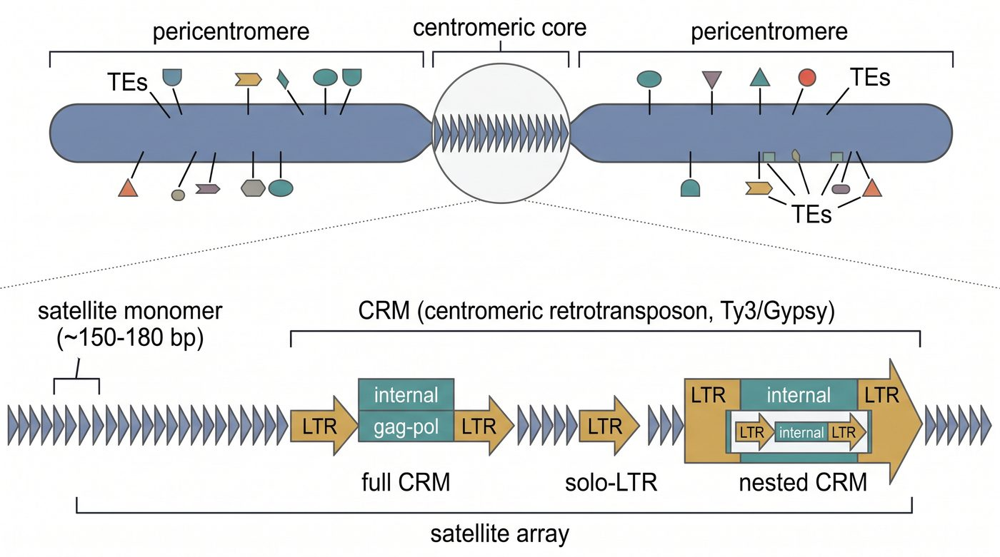

着丝粒核心区的串联卫星阵列与 CRM 类 Gypsy 元件交错分布的局部放大示意。示意图，由 AI 生成，非已发表图。

## 13.10 Penelope 类元件（PLE）

**结构特征**。佩内洛普样元件（*Penelope*-like elements，PLE）在Wicker统一分类体系中归属于Ⅰ类反转录转座子下的独立目（三字母代码`RPP`，Wicker et al. 2007，*Nature Reviews Genetics*，doi:10.1038/nrg2165）。PLE最早在研究果蝇（*Drosophila virilis*）杂种劣育现象时被发现（Evgen'ev et al. 1997，*Proceedings of the National Academy of Sciences*，[待确认]），其分子结构兼具古老性与奇特性。典型的自主型PLE编码一个大型开放阅读框，包含两个核心结构域：其一是**逆转录酶（RT）结构域**，系统发育分析表明该RT与经典LTR或LINE的RT亲缘关系较远，反而与真核生物端粒酶逆转录酶（telomerase reverse transcriptase，TERT）聚为最近的姐妹支（Arkhipova et al. 2003，*Proceedings of the National Academy of Sciences*，[待确认]）；其二是位于C端的**GIY-YIG核酸内切酶（endonuclease，EN）结构域**，负责切割宿主靶DNA以启动整合。PLE在基因组结构上有三项标志性特征：第一，两端常带有**假长末端重复序列（pseudo-LTRs，pLTRs）**，但与经典LTR不同，pLTRs既可以是同向排列，也可以是反向排列，且缺乏保守的`5'-TG...CA-3'`末端；第二，整合时产生可变长度（常为6至12 bp）的靶位点重复（TSD）；第三，**可能保留内含子（intron retention）**——绝大多数反转录转座子在经过RNA中间体剪接后会丢失内含子，但许多PLE的基因组拷贝内部却完整保留了剪接体识别的内含子，提示其转座周期中存在逃避剪接的独特转录加工机制（Arkhipova et al. 2003，[待确认]）。此外，在蛭形轮虫与部分真菌中还存在丧失GIY-YIG内切酶域的端粒特异PLE分支，它们直接利用染色体末端游离3'-OH作为引物参与端粒维持（Gladyshev & Arkhipova 2007，*Proceedings of the National Academy of Sciences*，[待确认]）。

**识别工具与判据**。由于PLE缺乏经典LTR的`TG...CA`边界且pLTR方向多变，基于结构的LTR搜索工具对其完全失效。在基因组上识别PLE主要依赖**蛋白质结构域HMM搜索与系统发育锚定**：将基因组六阅读框翻译序列或RepeatModeler2（Flynn et al. 2020，*Proceedings of the National Academy of Sciences*，doi:10.1073/pnas.1921046117）产出的一致性序列，通过HMMER或RepeatClassifier比对至Dfam/Repbase或专用RT/GIY-YIG结构域库；核心判据为同时检出TERT样RT结构域与C端GIY-YIG内切酶结构域，并在RT系统发育树中稳定聚类于PLE单系支内。

**注释工具常见误判**。常规植物注释流程EDTA（Ou et al. 2019，*Genome Biology*，doi:10.1186/s13059-019-1905-y）默认不包含PLE结构预测模块，极易彻底漏检；RepeatModeler2在缺乏近缘参考库支持时，常将PLE碎片误判为`LINE`或归入`Unknown`；而其内部保留的内含子结构也容易干扰基因预测软件将其误标为宿主未知编码基因。

**在植物与葡萄中的分布及报道**。PLE广泛分布于动物（昆虫、鱼类、两栖类、轮虫等）、真菌及原生生物中。在绿色植物谱系中，PLE仅在基部类群——包括绿藻、苔藓、石松类、蕨类以及部分裸子植物（如松柏类）——中被零星鉴定出结构可辨的拷贝，而在包括拟南芥、水稻、玉米与栽培葡萄（*Vitis vinifera*）在内的绝大多数核心被子植物基因组中，常规注释几乎完全检不出完整的PLE元件（Arkhipova 2006，*Molecular Biology and Evolution*，[待确认]）。

**图 13-6**　Penelope 样元件的结构特征

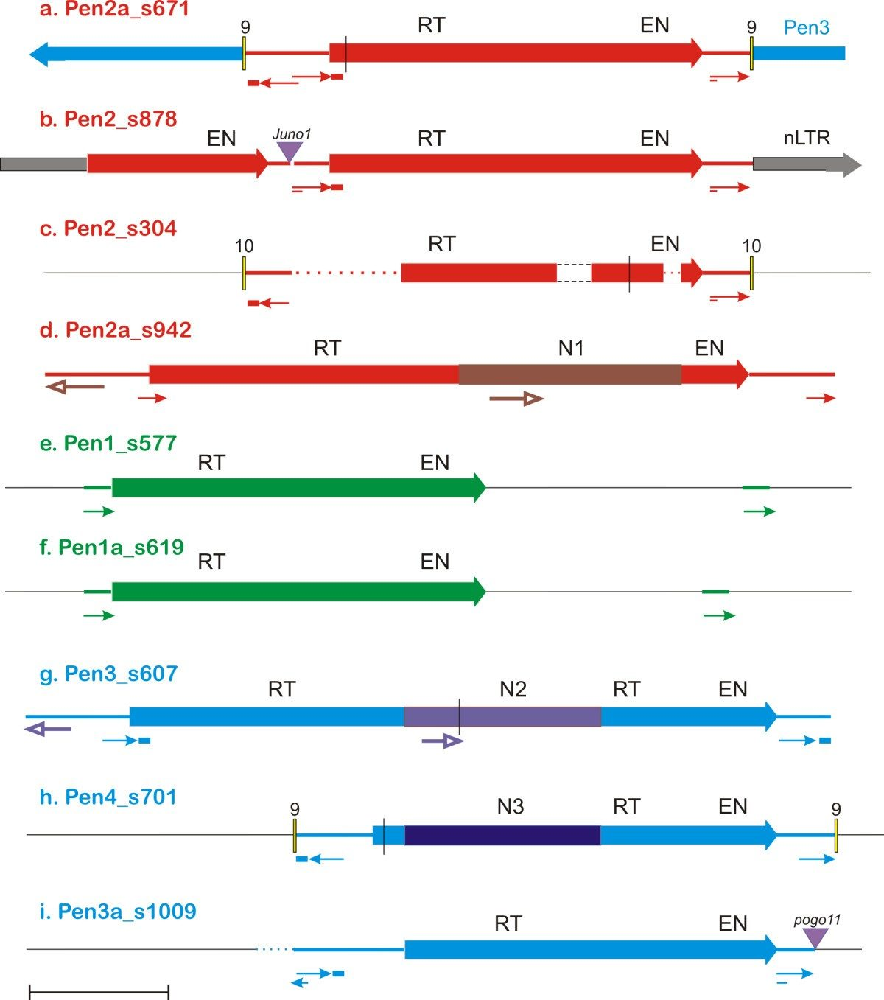

轮虫 Adineta vaga 中若干 Penelope 家族的结构。彩色方框是开放阅读框，标出反转录酶（RT）和内切酶（EN）；细箭头是伪长末端重复（pLTR），小彩条是可选的短尾巴。还标出了靶位点重复、截短、缺失和串联排列。材料不是植物，但画出了 PLE 的典型结构要素。

署名：Irina R. Arkhipova、Irina A. Yushenova、Fernando Rodriguez，2013，Mobile DNA，DOI 10.1186/1759-8753-4-19，Figure 2，CC BY 2.0（https://creativecommons.org/licenses/by/2.0），未修改。

## 13.11 DIRS 类元件

**结构特征**。盘基网柄菌中间重复序列（*Dictyostelium* intermediate repeat sequence，DIRS）在Wicker统一分类体系中归属于Ⅰ类反转录转座子下的DIRS目（三字母代码`RYD`，Wicker et al. 2007，doi:10.1038/nrg2165），最早于20世纪80年代在黏菌盘基网柄菌（*Dictyostelium discoideum*）中被克隆并命名为DIRS-1（Cappello et al. 1985，*Cell*，[待确认]）。DIRS最核心的分子特征在于其整合酶的彻底替换：它不编码经典LTR元件的DDE整合酶，而是编码一种**酪氨酸重组酶（tyrosine recombinase，YR）**，催化双链环状DNA中间体通过位点特异性重组整合进宿主基因组，因此**整合过程不产生TSD**（Poulter & Goodwin 2005，*Cytogenetic and Genome Research*，[待确认]）。除YR外，自主型DIRS还编码Gag蛋白、RT、核糖核酸酶H（RH）以及一个类似甲基转移酶（methyltransferase-like，MT）的结构域。在末端结构上，DIRS-1表现出极其特殊的**非典型末端架构**：两端并非同向重复，而是一对**末端反向重复序列（inverted terminal repeats，ITRs）**，同时在元件内部3'端附近存在一段**内部互补区（internal complementary region，ICR）**，该区域分别与5'-ITR和3'-ITR的末端序列互补，在反转录过程中充当模板连接两端以形成闭合环状DNA中间体（Poulter & Goodwin 2005，[待确认]）。

**识别工具与判据**。识别DIRS元件的关键在于**同时锁定RT/RH与酪氨酸重组酶（YR）结构域的物理共定位**，并辅以非典型末端（ITR + ICR）的局部自比对验证。实战中可利用RepeatModeler2结合Dfam/Repbase同源搜索，或使用HMMER对基因组ORF进行YR（含保守R-H-R-Y催化四联体）与RT双结构域共现扫描，再通过自比对点阵图核查两端ITR与内部ICR的互补关系。

**注释工具常见误判**。LTR_retriever（Ou & Jiang 2018，*Plant Physiology*，doi:10.1104/pp.17.01310）等经典LTR预测工具依赖同向LTR、`TG...CA`边界与TSD，会百分之百漏检DIRS；而部分TIR DNA转座子搜索工具若未校验内部编码区，可能将DIRS两端的ITR误判为超长TIR元件；在自动化流水线中，DIRS拷贝最常被误归入`LTR/unknown`或`Unknown`。

**在植物与葡萄中的分布及报道**。跨界基因组调查表明，DIRS元件在动物（如鱼类、两栖类、无脊椎动物）、真菌与变形虫中较为常见；在绿色植物中，DIRS（含同目的*Ngaro*分支）仅在绿藻、苔藓等基部类群中有确凿报道，在绝大多数被子植物（包括栽培葡萄及葡萄属野生种）的参考基因组中基本缺失，尚未见到高置信度完整自主DIRS拷贝的报道（Piednoël et al. 2011，*Genome Biology and Evolution*，[待确认]）。

**图 13-17**　DIRS-1 的末端结构与环状中间体（与图 3-5 为同一幅）

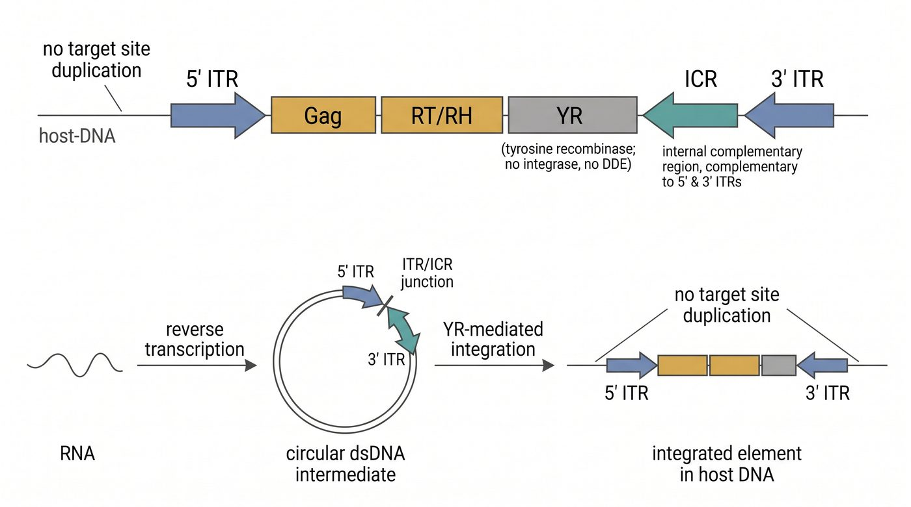

与图 3-5 为同一幅示意图，未修改。DIRS-1 的非典型末端（5 端 ITR、3 端 ITR、ICR）与环状 DNA 中间体整合。环状中间体上没有单独标出 ICR；也未画出表 13.16 所列的甲基转移酶（MT）结构域。分类总图中的示意见图 2-1、图 13-1。示意图，由 AI 生成，非已发表图。

## 13.12 Crypton

**结构特征**。*Crypton*是一类独特的Ⅱ类DNA转座子，在Wicker体系中归入Ⅱ类亚纲1的Crypton目（三字母代码`DYC`，Wicker et al. 2007，doi:10.1038/nrg2165），而在Repbase体系中因其机制与经典DDE转座子截然不同而被单列为Ⅱ类下的独立大类（Kapitonov & Jurka 2008，*Nature Reviews Genetics*，doi:10.1038/nrg2165-c1）。*Crypton*最早在真菌新型隐球菌（*Cryptococcus neoformans*）中被鉴定（Goodwin et al. 2003，*Genome Research*，[待确认]）。其最显著的特征是**完全不编码DDE/DDD转座酶，而是编码一种酪氨酸重组酶（YR）**，且不含任何逆转录酶域。在末端结构上，*Crypton*缺乏经典DNA转座子的TIR，取而代之的是位于元件两端的**极短同向重复序列（通常为4至6 bp）**；这两段短同向重复并非交错切割产生的TSD，而是酪氨酸重组酶介导环状DNA中间体进行位点特异性切离与整合的识别重组位点（Goodwin et al. 2003，[待确认]）。

**识别工具与判据**。识别*Crypton*需要采用“正向筛选YR + 负向排除RT”的组合判据：通过HMMER或BLASTX在全基因组或从头聚类一致性序列中检索真核生物型酪氨酸重组酶（保留保守的R-H-R-Y活性位点），确认其周围不存在RT或RH编码域（借此与Ⅰ类DIRS/*Ngaro*严格区隔），再通过多拷贝比对界定元件全长边界并核查两端4至6 bp短同向重组位点。

**注释工具常见误判**。基于TIR特征的预测工具（如TIR-Learner）对*Crypton*完全失明；RepeatModeler2在缺乏Repbase/Dfam近缘模板时常将其标记为`Unknown`；若仅凭YR结构域进行粗略蛋白域匹配，自动化脚本容易将*Crypton*与DIRS反转录转座子或原核噬菌体整合酶污染相混淆。

**在植物与葡萄中的分布及报道**。大规模真核基因组筛查证实，*Crypton*广泛分布于真菌（子囊菌、担子菌等）、动物（昆虫、软体动物、鱼类、两栖类及部分脊椎动物）以及原生生物中（Kojima & Jurka 2011，*Mobile DNA*，[待确认]）。然而，在陆生植物（胚胎植物）中*Crypton*极为罕见或几乎缺失，目前在包括葡萄属（*Vitis*）在内的被子植物基因组中尚未有确凿的经典*Crypton*元件报道[待确认]。

**图 13-7**　Crypton 各分支的结构示意

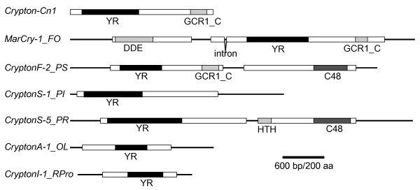

不同 Crypton 家族的结构：共同特征是酪氨酸重组酶（YR），有的还带 DNA 结合域、DDE 转座酶、C48 肽酶或螺旋-转角-螺旋基序。这是蛋白结构域图，不是切离-整合的环状中间体卡通。

署名：Kenji K. Kojima、Jerzy Jurka，2011，Mobile DNA，DOI 10.1186/1759-8753-2-12，Figure 1，CC BY 2.0（https://creativecommons.org/licenses/by/2.0），未修改。

**图 13-18**　Crypton 经环状中间体切离与整合的模型

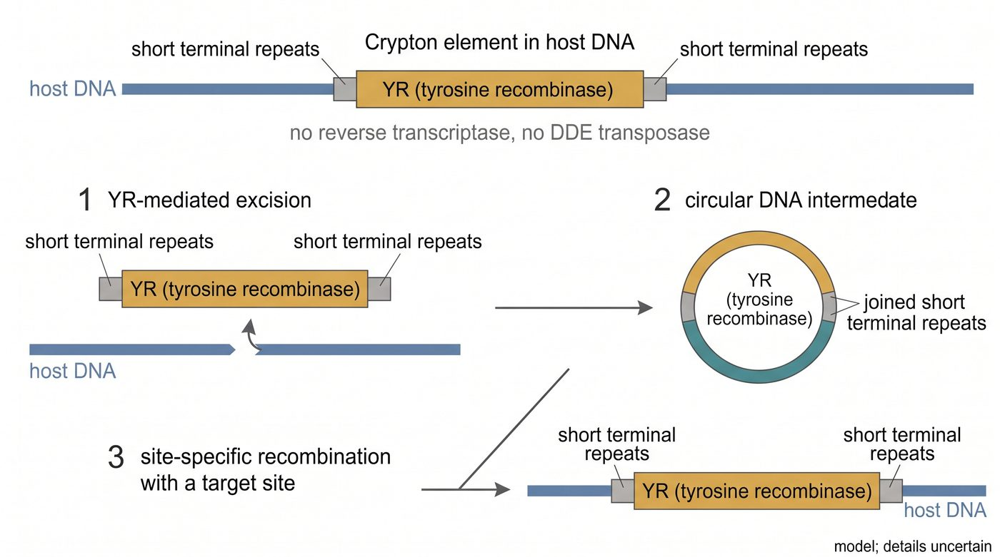

Crypton 依靠酪氨酸重组酶切离，形成环状 DNA 中间体，再经位点特异重组整合（模型示意，细节尚无定论）。第 2 步到第 3 步的箭头走向较别扭，但不影响步骤含义。示意图，由 AI 生成，非已发表图。

## 13.13 Maverick/Polinton

**结构特征**。*Maverick*（在Repbase体系中称为*Polinton*，得名于其编码的DNA聚合酶POLymerase与整合酶INTegrase）是目前已知体型最庞大的真核生物Ⅱ类自我合成型DNA转座子（self-synthesizing DNA transposons），在Wicker体系中归入Ⅱ类亚纲2的Maverick目（三字母代码`DMM`，Wicker et al. 2007，doi:10.1038/nrg2165；Kapitonov & Jurka 2006，*Proceedings of the National Academy of Sciences*，[待确认]；Pritham et al. 2007，*Gene*，[待确认]）。完整拷贝全长通常达**10 kb至25 kb**（极端可达40 kb），两端带有长达数百bp的TIR，插入宿主基因组时产生典型的**6 bp TSD**。其内部编码高达6至10个蛋白质，核心包括：一个蛋白引物型**B家族DNA聚合酶（pPolB）**（使其能够在切离后以自身单链DNA为模板直接复制合成新拷贝）、一个逆转录病毒样**DDE整合酶（INT）**，以及一系列完整的**病毒形态发生蛋白**——腺病毒样成熟蛋白酶（PRO）、DNA包装ATP酶（ATPase）以及构成二十面体病毒外壳的主要衣壳蛋白（MCP）和次要衣壳蛋白（mCP）（Krupovic et al. 2014，*Biology Direct*，[待确认]）。

**与病毒的关系**。正是基于MCP、mCP、PRO与包装ATP酶等确凿的病毒结构基因，Krupovic与Koonin等人提出了著名的**“Polintovirus”演化假说**，认为*Maverick*/*Polinton*本质上是一类兼具“基因组内自私转座子”与“潜在胞外病毒颗粒”双重生活史的过渡型元件，很可能是真核生物腺病毒（adenoviruses）、噬病毒体（virophages，如*Mavirus*）以及核质大DNA病毒（NCLDVs）共同的古老演化枢纽（Krupovic & Koonin 2015，*Nature Reviews Microbiology*，[待确认]）。

**识别工具与判据**。由于体积庞大，识别*Maverick*/*Polinton*必须基于高连续性的长读长基因组组装，采用**多基因共线性簇搜索**：利用HMMER在10 kb至30 kb的滑动窗口内联合检索pPolB、DDE整合酶、包装ATP酶与MCP蛋白域的共现，随后向两侧延伸搜寻长TIR与6 bp TSD。

**注释工具常见误判**。第一，常规TIR检测工具（如TIR-Learner）的默认长度上限远小于20 kb，会彻底漏检完整*Maverick*/*Polinton*；第二，在短读长草图基因组中，如此庞大的元件几乎必然被组装间隙切碎；第三，若仅对碎片进行局部蛋白域注释，其DDE整合酶片段极易被误判为`LTR/Gypsy`或逆转录病毒，而pPolB片段则常被基因组质控流程误判为外源病毒污染或宿主DNA聚合酶假基因。

**在植物与葡萄中的分布及报道**。*Maverick*/*Polinton*在原生生物、真菌以及多种动物（尤其是水生无脊椎动物、鱼类、两栖类与爬行类）中高度丰富；但在陆生植物（胚胎植物）谱系中普遍缺失，仅在部分单细胞绿藻中存在远缘的Polinton样病毒或相关元件[待确认]。在包括栽培葡萄（*Vitis vinifera*）在内的被子植物基因组中，目前未发现真正的*Maverick*/*Polinton*转座子。

**图 13-8**　脊椎动物 Maverick 的基因排布

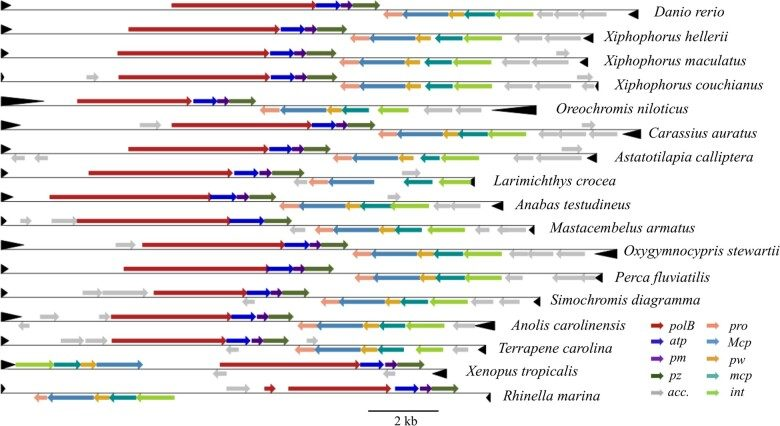

脊椎动物中完整 Maverick 的基因组结构大体保守。彩色箭头是开放阅读框，黑色箭头是末端反向重复。标出了蛋白引物 DNA 聚合酶、ATP 酶、整合酶、衣壳蛋白和蛋白酶等。材料是鱼类和四足动物，不是植物。

署名：Jose Gabriel Nino Barreat、Aris Katzourakis，2021，Molecular Biology and Evolution，DOI 10.1093/molbev/msaa291，Fig. 1，CC BY 4.0（https://creativecommons.org/licenses/by/4.0/），未修改。

## 13.14 Ngaro 及其他酪氨酸重组酶反转录元件

**结构特征**。在Ⅰ类DIRS目（酪氨酸重组酶反转录转座子，YR-retrotransposons）内部，除经典的DIRS-1超家族外，还包含***Ngaro***（三字母代码`RYN`）、***VIPER***（`RYV`）以及*PAT*等重要分支（Goodwin & Poulter 2004，*Genome Research*，[待确认]；Wicker et al. 2007，doi:10.1038/nrg2165）。*Ngaro*与其他YR反转录元件一样，编码Gag、RT、RH和酪氨酸重组酶（YR），通过环状DNA中间体整合且不产生TSD。它与DIRS-1最核心的结构区别体现在两点：第一，*Ngaro*通常**缺乏DIRS-1中存在的甲基转移酶样（MT）结构域**；第二，*Ngaro*的末端重复既不是经典LTR的简单同向重复，也不是DIRS-1的反向重复（ITR），而是一种高度特化的**分裂同向重复（split direct repeats，SDRs）**——其序列排布呈`A1 ... B1-A2 ... B2`结构，其中`A1`位于元件5'最末端，`B2`位于3'最末端，而与`A1`同向重复的`A2`以及与`B2`同向重复的`B1`则紧邻排列在元件内部（通常位于YR编码区下游），这种分裂同向重复同样用于在反转录末端形成环状重组模板（Goodwin & Poulter 2004，[待确认]）。同目的*VIPER*超家族则主要见于锥虫等动质体原生生物中，其末端同样具有特殊的短重复与YR整合机制。

**识别工具与判据**。识别*Ngaro*需结合**蛋白域组合筛选**与**分裂同向重复结构验证**：先通过HMMER或TEsorter/RepeatClassifier锁定同时编码RT、RH与YR（且缺乏MT域）的候选反转录元件，再利用局部自比对（BLASTN或点阵图）检查其5'端、内部3'侧与3'末端之间是否呈现出标志性的`A1 ... B1-A2 ... B2`分裂同向重复几何特征。

**注释工具常见误判**。由于分裂同向重复完全不符合传统LTR的成对末端模型，LTR_FINDER、LTRharvest与LTR_retriever均无法检出*Ngaro*；EDTA在默认模式下会彻底遗漏，即使开启`--sensitive 1`由RepeatModeler2打捞出多拷贝序列，也极易因缺乏植物参考库模板而被标为`LTR/unknown`或`Unknown`。

**在植物与葡萄中的分布及报道**。*Ngaro*在动物（如斑马鱼、线虫、海鞘）、真菌及部分基部绿色植物（绿藻与苔藓等）中均有发现，但在高等被子植物（包括栽培葡萄 *Vitis vinifera* 及葡萄属野生种）中基本缺失（Piednoël et al. 2011，*Genome Biology and Evolution*，[待确认]）。

**图 13-19**　DIRS-1 与 Ngaro 的末端和编码区对比

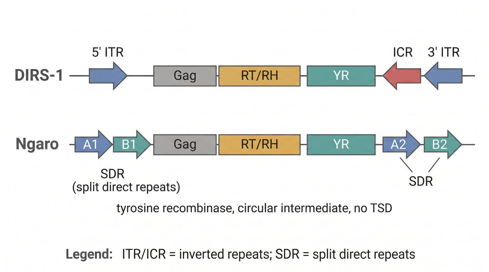

DIRS-1（ITR 加 ICR）与 Ngaro（分裂同向重复 SDR）的末端结构和编码区排布对比。DIRS-1 一行未画出表 13.16 所列的甲基转移酶（MT）结构域。示意图，由 AI 生成，非已发表图。

## 13.15 其他少见超家族与 Helitron2/Helentron

除第2章和第4章重点介绍的植物五大经典TIR超家族（*hAT*、*CACTA*、*PIF/Harbinger*、*Mutator*、*Tc1/Mariner*）及经典*Helitron*外，随着真核生物全基因组测序覆盖面不断扩大，研究者在动物、真菌、原生生物乃至部分基部植物中陆续鉴定出十余个分布相对局限、结构各具特色的少见Ⅱ类DNA转座子超家族与滚环复制变体（Yuan & Wessler 2011，*Proceedings of the National Academy of Sciences*，doi:10.1073/pnas.1104208108）。在植物基因组自动化注释中，这些少见类群的名称偶尔会出现在RepeatMasker或Dfam的比对输出里，了解它们的真实结构与分布边界有助于迅速辨别真假信号。

### 13.15.1 少见 DDE/DDD 型 DNA 转座子超家族

**结构特征**。以下七类经正式文献确立的少见超家族均通过DDE或DDD催化三联体转座酶介导DNA水平移动，但在靶位点特异性、TSD长度与蛋白结构域组合上各具鲜明特征：
- ***Spy***：由Han等人在真核生物基因组中系统鉴定（Han et al. 2014，*Genome Biology and Evolution*，doi:10.1093/gbe/evu140）。它打破了“所有TIR DNA转座子必然产生TSD”的传统铁律——*Spy*元件两端具短TIR并编码DDE转座酶，但高度特异性地插入宿主`AAA|TTT`六核苷酸位点正中央，且**整合过程不产生任何TSD**（Han et al. 2014，doi:10.1093/gbe/evu140）。该超家族主要分布于无脊椎动物、原生生物与真菌，在部分陆生植物中亦有零星报道[待确认]。
- ***Zisupton***：最早在硬骨鱼类基因组中被发现（Böhne et al. 2012，*Molecular Biology and Evolution*，doi:10.1093/molbev/msr208）。其典型特征为较长的TIR、恒定的**8 bp TSD**，以及编码一个分子量较大、同时携带锌指与SAP等DNA结合域的转座酶；分布以鱼类等脊椎动物、真菌及部分藻类/低等植物为主，在高等被子植物中极为罕见[待确认]。
- ***Academ***：由Kapitonov和Jurka在动物基因组中首次描述（Kapitonov & Jurka 2010，*Repbase Reports*，[待确认]；Yuan & Wessler 2011，doi:10.1073/pnas.1104208108）。典型*Academ*编码DDE转座酶（部分亚支如*AcademH*额外融合了解旋酶结构域[待确认]），具短TIR与通常3 bp TSD；主要见于动物与真菌，植物中极少报道。
- ***Ginger***：分为*Ginger1*与*Ginger2*两大分支，具TIR与典型的**4 bp TSD**（Bao et al. 2010，*Mobile DNA*，[待确认]）。该超家族最具演化意义的特征是其转座酶催化域与Ⅰ类LTR反转录转座子（如*Gypsy*）的DDE整合酶具有极高的序列同源性，直接揭示了Ⅱ类DNA转座子与Ⅰ类LTR整合酶之间的演化桥梁；主要分布于动物、真菌与原生生物，高等被子植物中罕见。
- ***Kolobok***：编码DDE转座酶，高度特异性识别宿主`TTAA`靶位点并产生**4 bp `TTAA` TSD**（Kapitonov & Jurka 2007，*Repbase Reports*，[待确认]；Yuan & Wessler 2011，doi:10.1073/pnas.1104208108）；广泛见于无脊椎动物、鱼类、真菌与原生生物，高等植物中罕见。
- ***Sola***：由Bao等人报道，编码**DDD型转座酶**，产生**4 bp TSD**，内部依据催化域系统发育划分为*Sola1*、*Sola2*与*Sola3*三个主要分支（Bao et al. 2009，*Molecular Biology and Evolution*，doi:10.1093/molbev/msp013）。该文同期还鉴定了起源于细菌TP36转座酶、具**3 bp TSD**的***Zator***超家族（Bao et al. 2009，doi:10.1093/molbev/msp013）。*Sola*在动物、原生生物、真菌及部分植物类群中均有分布[待确认]。
- ***Novosib***：由Kapitonov和Jurka命名，编码DDE转座酶，具TIR与**8 bp TSD**（Kapitonov & Jurka 2006，*Repbase Reports*，[待确认]；Yuan & Wessler 2011，doi:10.1073/pnas.1104208108）；其分类学分布极为局限（主要见于部分动物基因组），目前在植物中尚未见确凿报道。

**识别工具与判据**。识别上述少见超家族不能依赖针对植物五大TIR超家族训练的专用结构工具，必须采用**DDE/DDD催化域蛋白同源搜索（HMMER/BLASTX比对Repbase或Dfam）+ 转座酶系统发育树锚定**（Yuan & Wessler 2011，doi:10.1073/pnas.1104208108），再辅以多拷贝比对核查对应的诊断性TSD特征（如*Spy*的无TSD且位于`AAA|TTT`、*Kolobok*的4 bp `TTAA`、*Sola*的4 bp TSD）。

**注释工具常见误判**。EDTA（Ou et al. 2019，*Genome Biology*，doi:10.1186/s13059-019-1905-y）内置的TIR-Learner仅针对植物五大经典TIR超家族（`DTA`/`DTC`/`DTH`/`DTM`/`DTT`）训练，会直接漏检无TSD的*Spy*或将其他少见TIR超家族错分入五大类中；*Ginger*的转座酶常被粗略蛋白域搜索误标为`LTR/Gypsy`整合酶碎片；而*Kolobok*的`TTAA` TSD特征容易使其与*PiggyBac*（同样识别`TTAA`）发生混淆。

### 13.15.2 Helitron2 与 Helentron

**结构特征**。传统意义上的植物*Helitron*（亦称经典*Helitron*或`HLE1`分支）以无TIR、无TSD、`5'-TC`起始、`3'-CTRR`终止及3'端发夹为特征。然而，Thomas与Pritham通过跨真核生物系统发育与结构比较，将滚环复制型*Helitron*大类进一步细分为***Helitron***、***Helentron***、***Proto-Helentron***与***Helitron2***四个主要结构变体，其中*Helentron*与*Helitron2*聚为独立的姊妹演化支（常统称`HLE2`分支）（Thomas & Pritham 2015，*Microbiology Spectrum*，doi:10.1128/microbiolspec.mdna3-0049-2014）。与经典*Helitron*相比，*Helitron2*与*Helentron*在结构上有两项显著区别：第一，它们在5'端和3'端均具有**短的不对称末端反向重复序列（short asymmetric TIRs，通常长约11至18 bp）**，同时在3'端保留经典发夹结构（但在整合时同样不产生TSD）；第二，***Helentron***在Rep/Helicase双功能蛋白编码区之外，还额外编码一个**无嘌呤/无嘧啶（apurinic/apyrimidinic，AP）核酸内切酶结构域**（Thomas & Pritham 2015，doi:10.1128/microbiolspec.mdna3-0049-2014）。

**识别工具与判据**。鉴定*Helitron2*与*Helentron*需同时检索Rep/Helicase蛋白域（对*Helentron*还需检索AP内切酶域）及两端11至18 bp的短TIR和3'发夹结构。常规面向经典植物*Helitron*训练的HelitronScanner极易漏检*Helitron2*/*Helentron*，实战中需借助RepeatModeler2（Flynn et al. 2020，*Proceedings of the National Academy of Sciences*，doi:10.1073/pnas.1921046117）结合Repbase/Dfam同源搜索，或采用专门兼容`HLE1`与`HLE2`两套末端模型的新一代检测工具（如HELIANO[待确认]）。

**注释工具常见误判与植物分布**。由于带有短TIR，*Helitron2*与*Helentron*的非自主拷贝极易被常规TIR预测工具误归入`DNA/TIR`或`MITE`类别；而*Helentron*携带的AP内切酶域在片段比对时可能与LINE的APE内切酶发生误匹配。在分布上，经典*Helitron*（`HLE1`）在绿色植物（包括栽培葡萄 *Vitis vinifera*）中普遍存在，而*Helitron2*与*Helentron*主要活跃于动物（如果蝇、两栖类）、真菌与原生生物中，在陆生高等植物（含葡萄属）中极为罕见或尚未见高置信度自主拷贝报道[待确认]。

**图 13-9**　Helitron 的编码区结构（与图 4-2 为同一幅）

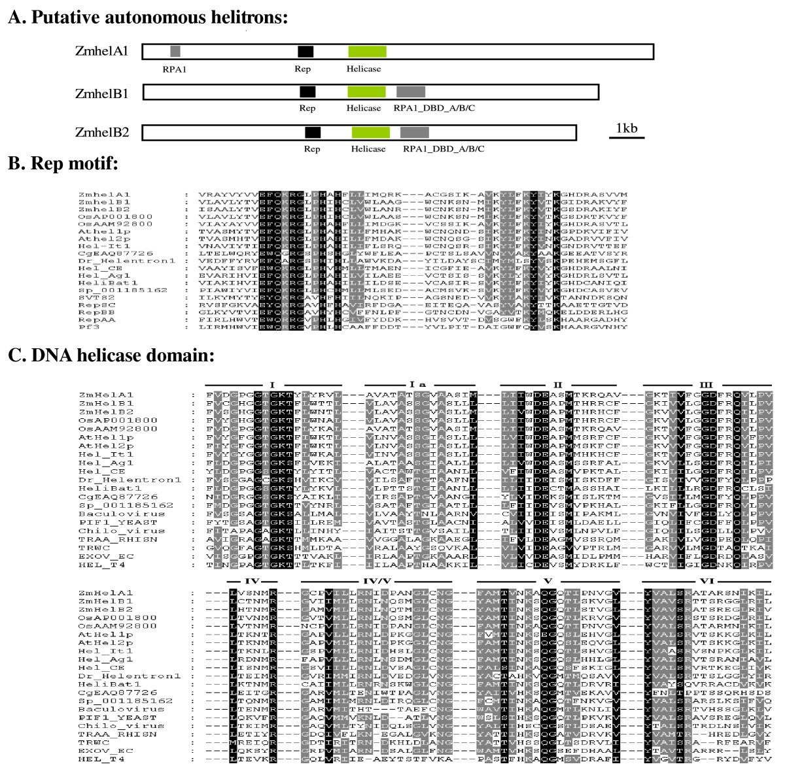

与图 4-2 为同一幅已发表图，未修改。用来看经典 Helitron 的 Rep/解旋酶结构。Helitron2/Helentron 以及稀有 DDE 超家族的专用对比图这次没有可再用的开放许可来源。

署名：Yongbin Dong、Xiaomin Lu、Weibin Song、Lei Shi、Mei Zhang、Hainan Zhao、Yinping Jiao、Jinsheng Lai，2011，BMC Genomics，DOI 10.1186/1471-2164-12-609，Figure 1，CC BY 2.0（https://creativecommons.org/licenses/by/2.0），未修改。

**图 13-20**　稀有 DDE/DDD 超家族示意拓扑与 Helitron2 结构对比

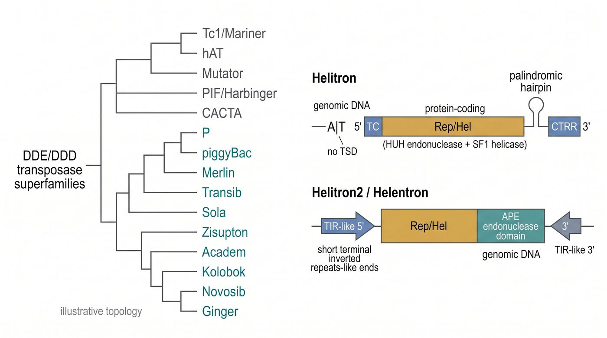

左，稀有 DDE/DDD 超家族与常见植物超家族的拓扑示意（不代表真实系统发育）；右，经典 Helitron 与 Helitron2/Helentron 的结构对比。示意图，由 AI 生成，非已发表图。

## 13.16 植物（包括葡萄）中各稀有类别的存在与否汇总

在植物基因组学尤其是葡萄属（*Vitis*）实战注释中，明确哪些稀有类别在绿色植物中确有分布、哪些几乎只见于动物或真菌，是快速排除数据库跨界假阳性与外源污染的前提。下表系统汇总了13.10至13.15节所讨论的全部稀有与易被忽视类别的核心特征、植物分布现状及葡萄中的可见性：

| 类别 | 结构要点 | 识别特征 | 植物中是否已报道 | 葡萄中能否见到 | 代表文献 DOI 或 [待确认] |
| :--- | :--- | :--- | :--- | :--- | :--- |
| **PLE (*Penelope*)** | Ⅰ类；TERT样RT + GIY-YIG内切酶；pLTR方向多变；可保留内含子 | RT与TERT聚为姐妹支；C端GIY-YIG域；6–12 bp TSD | 是（仅见于绿藻、苔藓、蕨类及部分裸子植物等基部类群） | 常规注释基本不可见 | [待确认]（Arkhipova et al. 2003; Arkhipova 2006） |
| **DIRS (*DIRS-1*)** | Ⅰ类；Gag + RT/RH + MT + 酪氨酸重组酶（YR）；两端ITR + 内部ICR | RT/RH与YR共定位；无TSD；ITR与ICR局部互补 | 是（仅见于绿藻、苔藓等基部绿色植物） | 常规注释基本不可见 | [待确认]（Cappello et al. 1985; Piednoël et al. 2011） |
| ***Ngaro* 及其他YR反转录元件** | Ⅰ类DIRS目；Gag + RT/RH + YR（缺MT域）；分裂同向重复（SDR） | RT/RH与YR共定位；`A1...B1-A2...B2`分裂同向重复；无TSD | 是（仅见于绿藻、苔藓等基部绿色植物） | 常规注释基本不可见 | [待确认]（Goodwin & Poulter 2004; Piednoël et al. 2011） |
| ***Crypton*** | Ⅱ类；仅编码酪氨酸重组酶（YR），无RT、无TIR | 检出真核YR域且排除RT/RH；两端4–6 bp短同向重组位点 | 极罕见或基本缺失（陆生植物未见确凿经典拷贝） | 尚未见确凿报道 | [待确认]（Goodwin et al. 2003; Kojima & Jurka 2011） |
| ***Maverick* / *Polinton*** | Ⅱ类自我合成型；全长10–25 kb；含pPolB、INT、PRO、ATPase、MCP/mCP | 长TIR与6 bp TSD；10–30 kb窗口内多病毒结构基因共现 | 陆生植物普遍缺失（仅单细胞绿藻见远缘Polinton样病毒） | 不可见 | [待确认]（Kapitonov & Jurka 2006; Krupovic & Koonin 2015） |
| ***Spy*** | Ⅱ类DDE型；短TIR；特异插入`AAA\|TTT`中央且无TSD | DDE转座酶系统发育锚定；插入断点精确位于`AAA\|TTT`且无TSD | 零星报道[待确认] | 尚未见确凿报道 | doi:10.1093/gbe/evu140 |
| ***Zisupton*** | Ⅱ类；较长TIR；8 bp TSD；大型转座酶含锌指/SAP域 | 特征转座酶HMM命中；长TIR与8 bp TSD | 极少（主要见于部分藻类/低等植物，被子植物罕见）[待确认] | 尚未见确凿报道 | doi:10.1093/molbev/msr208 |
| ***Academ*** | Ⅱ类DDE型；短TIR；通常3 bp TSD（部分亚支含解旋酶域） | DDE转座酶系统发育归入*Academ*支；短TIR与3 bp TSD | 极少或罕见[待确认] | 尚未见确凿报道 | doi:10.1073/pnas.1104208108 |
| ***Ginger*** | Ⅱ类；具TIR与4 bp TSD；转座酶与LTR整合酶高度同源 | 整合酶样DDE域但两侧为TIR与4 bp TSD（无RT/LTR） | 陆生植物罕见[待确认] | 尚未见确凿报道 | [待确认]（Bao et al. 2010） |
| ***Kolobok*** | Ⅱ类DDE型；具TIR；特异识别`TTAA`靶位点 | DDE转座酶归入*Kolobok*支；4 bp `TTAA` TSD | 极罕见[待确认] | 尚未见确凿报道 | doi:10.1073/pnas.1104208108 |
| ***Sola*（含*Zator*）** | Ⅱ类DDD型；*Sola*具4 bp TSD（分1/2/3支）；*Zator*具3 bp TSD | DDD转座酶系统发育锚定；对应4 bp或3 bp TSD | 部分植物谱系有零星报道[待确认] | 尚未见确凿报道 | doi:10.1093/molbev/msp013 |
| ***Novosib*** | Ⅱ类DDE型；具TIR与8 bp TSD | DDE转座酶系统发育归入*Novosib*支；8 bp TSD | 尚未见确凿报道 | 不可见 | doi:10.1073/pnas.1104208108 |
| ***Helitron2* / *Helentron*** | Ⅱ类滚环复制`HLE2`支；Rep/Hel（*Helentron*另含AP内切酶）；11–18 bp不对称短TIR + 3'发夹 | Rep/Hel（及AP域）系统发育归入`HLE2`；短TIR且无TSD | 陆生高等植物极罕见[待确认]（经典`HLE1` Helitron广泛存在） | 尚未见确凿报道（仅经典`HLE1`可见） | doi:10.1128/microbiolspec.mdna3-0049-2014 |

从上表可以提炼出一个极具实战指导意义的宏观规律：**绝大多数稀有转座子类别（PLE、DIRS、*Ngaro*、*Crypton*、*Maverick*/*Polinton*、*Novosib*、*Helentron*等）在被子植物尤其是栽培葡萄基因组中几乎绝迹，或仅残存于绿藻、苔藓等基部绿色植物谱系之中**。因此，如果在葡萄或任何核心被子植物的自动化注释汇总表中，突然冒出几十个甚至上百个*Crypton*、*Maverick*/*Polinton*或*DIRS*条目，研究者的第一反应绝不应该是“发现了植物演化的新大陆”，而应当立刻启动下一节所述的假阳性与外源污染核查程序。

**图 13-21**　第13.16节对照表中稀有转座子类别在植物与葡萄中的记载

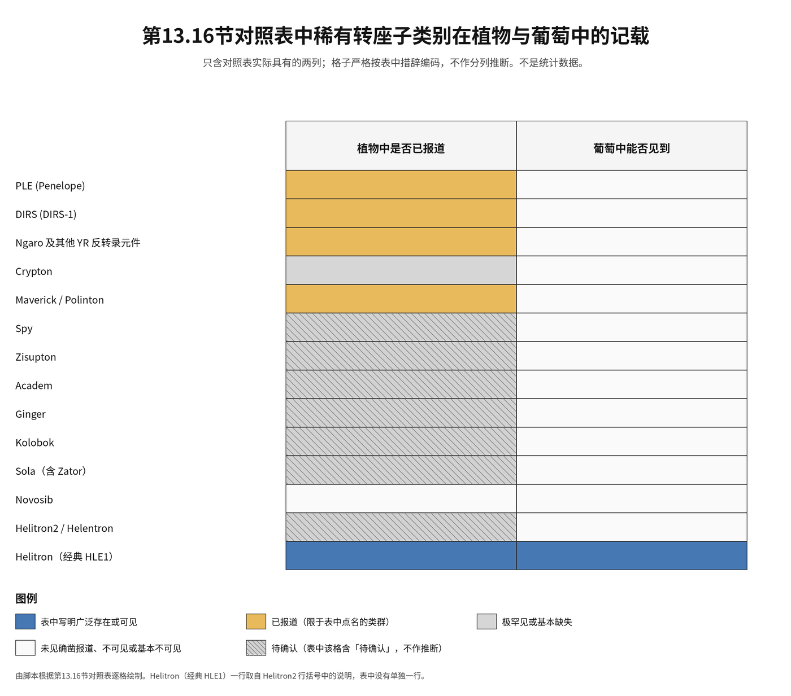

第13.16节对照表中各稀有类别在「植物中是否已报道」与「葡萄中能否见到」两列上的记载，由脚本按表中措辞逐格绘制。只含对照表实际具有的两列，不作动物、真菌、原生生物或更细植物类群的分列推断。含「待确认」的格子标为不确定，不加推测。经典 Helitron（HLE1）单独一行，取自同表 Helitron2 行括号中的说明。本图由脚本绘制，不是 AI 生成的示意图，也不是已发表图。

## 13.17 注释工具对稀有类别的常见误判和漏判，以及人工核查建议

在日常基因组注释项目中，主流自动化流水线对稀有转座子类别的误差主要呈现“**双向极端化**”：在真正含有稀有类群的基部植物、藻类或非模式真核生物中发生严重**系统性漏判**；而在本不含这些类群的高等被子植物（如葡萄、水稻、玉米）中，却频繁制造令人困惑的**跨界误判与污染假象**。

### 13.17.1 常见漏判与误判机制

1. **植物专用流水线的预设边界导致系统性漏判**：面向被子植物优化的EDTA（Ou et al. 2019，doi:10.1186/s13059-019-1905-y）在结构预测阶段仅部署了针对经典LTR、五大植物TIR超家族及经典`HLE1` *Helitron*的引擎。对于缺乏`TG...CA`末端和TSD的DIRS/*Ngaro*与*Crypton*、无TSD的*Spy*、带短TIR的*Helitron2*/*Helentron*，以及长度动辄超过20 kb的*Maverick*/*Polinton*，结构模块会直接将其过滤或完全视而不见。同样，专注于植物反转录元件蛋白域的TEsorter/REXdb默认不包含动物或真菌特有的稀有DNA转座子模型。
2. **全真核公共库跨界比对引发的“标签张冠李戴”**：当使用RepeatMasker或RepeatModeler2（Flynn et al. 2020，doi:10.1073/pnas.1921046117）搭配完整的全真核Dfam/Repbase库对葡萄基因组进行搜索时，局部低复杂度序列、短退化碎片或高度保守的酶活性基序（如DDE核心基序、解旋酶基序或AP内切酶基序），往往会偶然以较低得分跨物种命中动物或真菌中的*Academ*、*Kolobok*、*Zisupton*、*Ginger*或*PLE*条目，在最终统计表中产生零星的“幽灵超家族”。
3. **外源微生物与内生真菌污染制造的“真序列、假宿主”陷阱**：这是植物基因组测序实战中最隐蔽、最危险的一类误判。多年生木本植物（特别是田间采集的葡萄叶片、根系或野生葡萄组织）天然携带丰富的叶际与内生真菌（如子囊菌、担子菌）、细菌甚至微小节肢动物DNA。如果基因组组装前的去污染流程（如BlobToolKit或FCS-GX筛查）不够彻底，几条来自内生真菌的未挂载短支架（unplaced contigs）就会混入植物参考基因组FASTA文件中。由于真菌基因组天然富含*Crypton*、*DIRS*、*PLE*、*Zisupton*、*Ginger*和*Helentron*，注释工具会在这些污染支架上精准检出货真价实的稀有转座子！若不加以核查，就会闹出“首次在葡萄中发现活跃*Crypton*和*DIRS*”的严重学术乌龙。

### 13.17.2 稀有类别异常命中的五步人工核查建议

每当在葡萄或其他被子植物基因组的注释结果中发现表13.16中标记为“罕见”或“不可见”的稀有类别条目时，建议严格按照以下五步清单逐一核查：

1. **第一步：排查宿主归属与外源污染（最高优先级）**。立即定位该稀有转座子所在的染色体或支架（scaffold/contig）。如果它全部聚集在未挂载到19条主染色体的短支架上，提取该支架全长序列进行BLASTN比对NCBI nt库，并核查其GC含量、测序覆盖深度及邻近基因的物种归属；若该支架位于主染色体内部，则需利用原始PacBio HiFi或ONT长读长核查断点两侧是否存在唯一比对的长读长无缝跨越，同时检查其紧邻基因是否为确凿的植物直系同源基因，彻底排除真菌/微生物污染或错误拼接。
2. **第二步：核验全长结构与关键诊断蛋白域**。提取该候选家族的序列，执行六阅读框翻译并与Pfam/CDD/Dfam数据库比对，确认是否真实保留了该稀有类别不可或缺的诊断性蛋白域组合（例如：DIRS必须同时存在RT/RH与YR，*Crypton*必须有YR且无RT，*Maverick*/*Polinton*必须检出pPolB与衣壳蛋白，*PLE*必须检出TERT样RT与GIY-YIG域）。若仅凭不足150 bp的低分片段匹配就挂上了稀有类别标签，几乎可以断定为跨界比对噪音。
3. **第三步：多拷贝抽提与末端/TSD手工精修**。参照标准手动精修流程（Goubert et al. 2022，*Mobile DNA*，[待确认]），在基因组中抽提该候选序列相似度 $\ge 80\%$ 的多条拷贝并向两侧延伸1 kb至2 kb，用MAFFT多序列比对并绘制自比对点阵图，检查是否存在清晰的元件边界、符合该类群特征的末端结构（ITR、SDR、pLTR或TIR）以及特征TSD（如*Spy*的无TSD且夹于`AAA|TTT`之间，*Kolobok*的`TTAA` TSD）。单拷贝且无清晰边界的孤立命中极可能是退化碎片误标。
4. **第四步：核心蛋白域系统发育树独立锚定**。从候选拷贝中截取保守的RT、YR或DDE/DDD催化域氨基酸序列，与已知各超家族的代表性参考序列合并建树（最大似然法）。只有当目标序列以高自展支持率（Bootstrap $\ge 80\%$）稳定落入对应稀有类别的单系分支内部，而非孤立漂浮在常见植物超家族（如*Gypsy*、*hAT*、*Mutator*）的边缘时，方可初步采信。
5. **第五步：跨单倍型与近缘物种验证**。对于葡萄等拥有高质量双单倍型或泛基因组资源的类群（Shi et al. 2023，*Horticulture Research*，doi:10.1093/hr/uhad061；Guo et al. 2025，*Nature Genetics*，doi:10.1038/s41588-025-02111-7），检查该稀有元件是否在同物种其他独立组装的单倍型或近缘野生种的共线性位点上重复出现；若仅凭单次组装出现且无法在其他独立测序样本中复现，则应果断剔除或降级标记为`Unknown`。

**图 13-22**　稀有转座子异常命中的五步人工核查流程

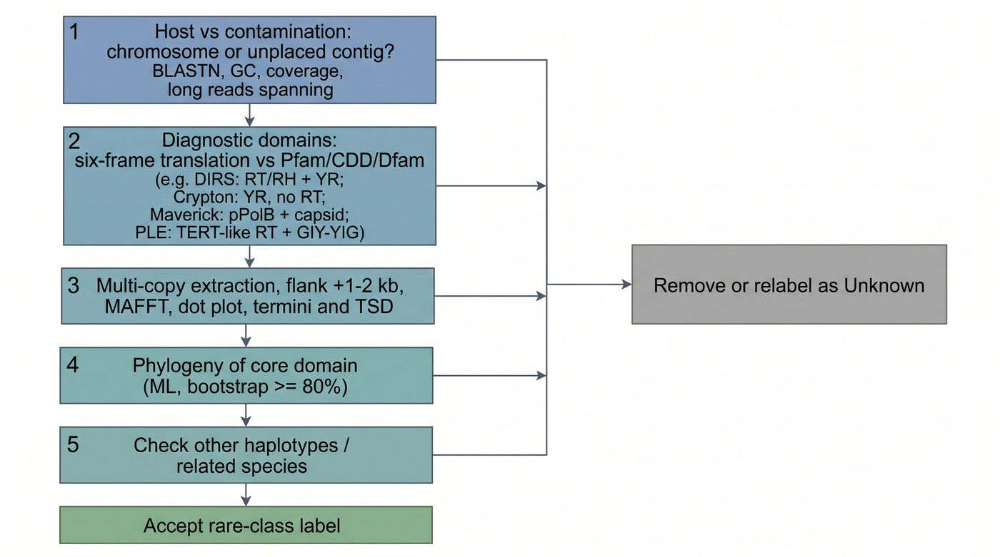

稀有转座子异常命中的五步人工核查流程。示意图，由 AI 生成，非已发表图。

## 13.18 本章小结

本章打破了传统教科书仅展示“理想完整模型”的叙述惯性，直接切入真实植物基因组注释与浏览器视图中千姿百态的转座子物理实体，完成了对基因组内转座子全谱系形态的系统解剖。

上半部分（13.1至13.9节）聚焦于植物基因组中普遍存在、直接影响全基因组统计与基因注释质量的九类常见形态：从仅占极少数但驱动扩张的**完整自主元件**，到拷贝数庞大却因缺乏编码区而成为分类难点的**非自主元件**（MITEs、LARD、TRIM、SINE、非自主*Helitron*与*Ac*/*Ds*缺失体）；从占据注释条目绝对多数、易造成拷贝数虚高的**碎片与5'截短体**，到记录基因组重组收缩效率并催生葡萄红皮逆转芽变的**solo-LTR**；从着丝粒与近着丝粒区层层叠压的**多层嵌套插入**，到需借长读长与多拷贝证据才能与组装错误剥离的**模板跳跃嵌合元件**；最后延伸至转座子与宿主基因组深度融合的三大演化界面——沦为宿主必需转录因子（*FAR1*/*FHY3*、*DAYSLEEPER*、*MUSTANG*）却极易在屏蔽时被误杀的**驯化转座子基因**，频频制造基因注释假基因污染的**基因捕获元件**（Pack-MULE与*Helitron*），以及在T2T无间隙基因组着丝粒核心区与卫星阵列交错共生、击穿传统过滤逻辑的**TE衍生串联重复与*CRM*类元件**。

下半部分（13.10至13.17节）则将视野拓展至常规植物工具极易遗漏或误判的**稀有与边缘类别**，逐一解析了PLE（*Penelope*）、DIRS、*Ngaro*、*Crypton*、*Maverick*/*Polinton*、*Spy*、*Zisupton*、*Academ*、*Ginger*、*Kolobok*、*Sola*/*Zator*、*Novosib*以及*Helitron2*/*Helentron*的分子结构与分布边界。通过跨类群汇总（13.16节）与五步人工核查框架（13.17节），明确了高等被子植物（尤其是葡萄属）与基部植物、真菌/动物在稀有类别分布上的鲜明鸿沟，为研究者规避跨界比对噪音与外源微生物污染提供了可落地的质控标尺。

归根结底，基因组里实际看到的转座子并非静止的分类学标本，而是扩增、截短、重组、嵌套、驯化与宿主清除博弈后留下的活体地层记录。唯有先看清这些真实形态及其在注释软件中的投影畸变，才能在后续的文库精修、群体多态性检测与演化推断中做到去伪存真。

**图 13-23**　九种常见转座子物理形态总览

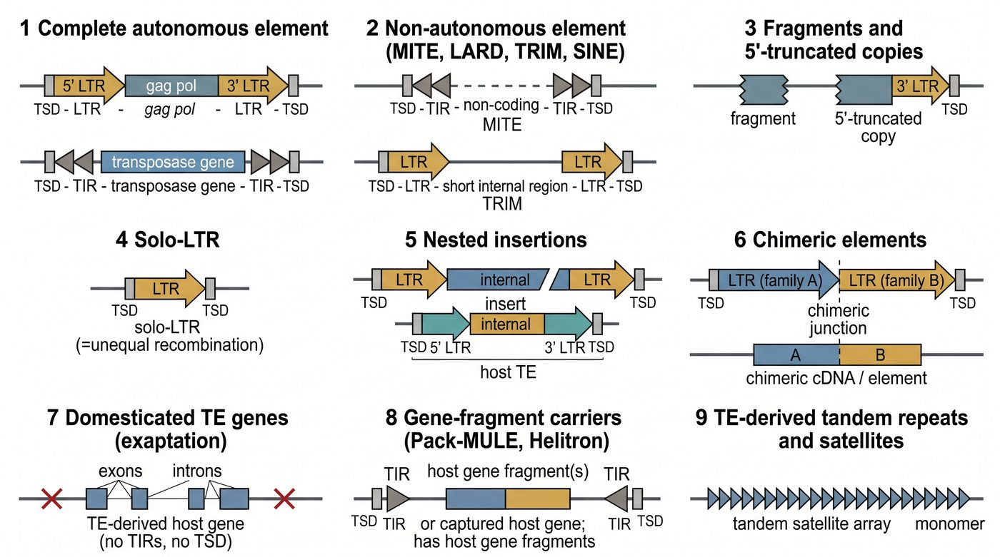

基因组中常见的九种转座子物理形态总览。第5格为示意，嵌套元件实际位于宿主元件两端 LTR 之间。示意图，由 AI 生成，非已发表图。

## 本章参考文献

- doi:10.1038/nrg2165
- doi:10.1093/nar/gkm286
- doi:10.1186/1471-2105-9-18
- doi:10.1104/pp.17.01310
- doi:10.1186/s13059-019-1905-y
- doi:10.1093/nar/gky730
- doi:10.1038/nature06148
- doi:10.1093/hr/uhad061
- doi:10.1126/science.1095011
- doi:10.1073/pnas.1921046117
- doi:10.1038/s41588-025-02111-7
- doi:10.1038/nrg2165-c1
- doi:10.1073/pnas.1104208108
- doi:10.1093/gbe/evu140
- doi:10.1093/molbev/msr208
- doi:10.1093/molbev/msp013
- doi:10.1128/microbiolspec.mdna3-0049-2014
