# 配图预览说明（非正式书稿，第2版 p2d）

本文件只用于排版预览，没有改仓库。阅读顺序为：前言，第1至4章，转座子类型逐类详解，第13章，第5至12章，书末附录A至C。第13章的章号未改。类型详解之后另有「类型详解附录：分类体系外与有争议的类型」，与书末附录A至C分开。图号按章编排为「图 X-Y」。已发表图共31幅，未修改，署名见各图下方。第2版补入的示意图中，图 13-15 已换为两端 TIR 相对朝内的修订稿；图 13-21 改为根据第13.16节对照表由脚本绘制的热图，不是 AI 生成图，也不是已发表图。其余生成示意图的图注仍标明「示意图，由 AI 生成，非已发表图」。


# 前言

## 编写定位

转座子（transposable elements，TEs）构成了绝大多数高等植物基因组的半壁江山，既是驱动基因组大小演化、染色体结构重排与基因调控网络重塑的核心力量，也是农艺性状变异与作物驯化的重要遗传来源。然而，在现有的教材与科研文献中，转座子研究长期呈现明显的学科割裂：经典分子遗传学与表观遗传学著作侧重于阐述转座机制与宿主沉默通路，较少涉及大规模全基因组注释与群体变异检测；而生物信息学手册往往停留在软件命令的罗列层面，缺乏对底层生物学假设、假阳性来源及群体遗传学统计偏差的系统剖析。

本书旨在弥合基础理论与计算实践之间的鸿沟，建立一套从发现史、分子机制、表观调控、演化动力学，到生物信息学注释、群体插入多态性分析与表型挖掘的完整知识体系。在物种范例的选择上，本书以葡萄属（*Vitis*）贯穿始终。栽培葡萄单倍体基因组大小约480至500 Mb，转座子占比约40%至50%，既避免了极小基因组在重复序列结构上的过度简化，又避免了超大型多倍体基因组在教学实操中的算力门槛；同时，葡萄作为高度杂合、长期无性繁殖的多年生木本果树，不仅拥有*Gret1*插入*VvmybA1*启动子决定果皮颜色的经典分子案例，也集中体现了现代T2T组装、多单倍型比较与泛基因组转座子注释的前沿挑战。

## 全书结构与阅读路径

全书共设13章。前十二章仍按四个递进模块组织，读者可根据自身的专业背景与科研需求选择连贯通读或按需切入；第13章为新增的形态观测专章，放在第12章之后：

- **基础理论篇（第1至6章）**：系统梳理转座子的发现史与“垃圾DNA”认知范式演变（第1章），厘清Wicker统一分类体系与Repbase体系的异同、其他分类方案的分歧、80-80-80规则的局限、自动注释工具的标签映射及命名规范（第2章），深入解析Ⅰ类反转录转座子与Ⅱ类DNA转座子的分子结构与生活史（第3、4章），阐明植物DNA甲基化、RdDM通路、异染色质维持与胁迫重编程机制（第5章），并从宏观尺度探讨基因组膨胀收缩平衡、区室化分布、嵌套插入、异位重组与功能外适应（第6章）。
- **方法与群体篇（第7至9章）**：循序渐进地讲解同源比对、从头聚类与结构预测算法原理、一致性文库精修、LAI质量评估与泛基因组联合注释策略（第7章），系统剖析短读长与长读长测序数据的转座子插入多态性（TIPs）检测、群体遗传学中性检验与TE-GWAS建模要点（第8章），总结转座子改写基因表达的五大途径、主要作物驯化案例及多年生无性繁殖作物的芽变与转座子负荷动力学（第9章）。
- **葡萄范例与实战篇（第10至11章）**：全面综述葡萄参考基因组的演进、转座子超家族组成、野生种与栽培种分化以及*Gret1*与果皮色泽演化的完整研究闭环（第10章），随后以公开葡萄参考基因组与群体重测序数据为对象，提供从数据清理、环境部署、EDTA从头注释、文库精修、爆发年代估算、染色体分布可视化到群体TIPs鉴定与IGV人工核验的端到端实战指南（第11章）。
- **前沿展望篇（第12章）**：探讨端粒到端粒（T2T）无间隙基因组、深度学习自动分类与精修、第三代测序单分子多组学以及转座子工程化应用等开放问题与未来方向。
- **类型详解篇（转座子类型逐类详解）**：按混合分类（Wicker 类与目、Dfam 超家族、REXdb 植物 LTR 谱系）逐条介绍 101 种类型的结构与来源，并附「分类体系外与有争议的类型」21 项。各条有结构示意图；有 CC BY 开放原图的条目同时附原图（未修改）。若按内容阅读，把它接在第4章之后、第13章之前。
- **形态观测篇（第13章）**：从基因组注释中实际看到的完整自主元件、非自主元件、碎片与截短体、solo-LTR、嵌套插入、嵌合与重组产物、被驯化的转座子基因、携带宿主基因片段的元件，以及转座子衍生的串联卫星；并梳理稀有类别在植物尤其是葡萄中的分布与注释误判。本章排在第12章之后；若按内容阅读，把它接在第4章之后再读第5章，可能更顺。

## 术语规范、代码约定与可重复计算原则

为确保全书概念严谨、跨章节无缝衔接，本书统一遵循以下编写规范：

1. **术语与分类规范**：全书统一使用“转座子（TE）”作为涵盖Ⅰ类反转录转座子与Ⅱ类DNA转座子的标准总称；超家族与层级命名以Wicker统一分类体系（doi:10.1038/nrg2165）及其三字母代码（如`RLG`、`RLC`、`DTA`、`DTC`、`DTH`、`DTM`、`DTT`、`DHH`）为基准，在涉及Repbase或RepeatMasker输出差异时均显式给出对照说明。
2. **示例代码约定**：第11章及文中涉及的命令行脚本均基于标准Linux（Bash）与R环境编写，仅使用公开、真实存在的生物信息学工具与标准参数；读者在自身计算集群运行时，需根据实际文件命名、组装版本坐标及可用CPU/内存资源灵活调整路径与线程参数。
3. **可重复计算原则**：转座子注释与群体TIPs分析高度依赖软件版本、参考文库状态与过滤阈值。本书倡导在科研实践中优先采用容器（Singularity/Apptainer或Docker）或隔离的Conda/Mamba环境固定软件版本，将原始基因组、精修后的冻结一致性文库、核心运行脚本与运行日志严格分离归档，并在跨物种或跨单倍型比较中坚持使用统一标尺，确保每一项统计数字均可追溯、可复现。


# 第1章 转座子的发现史与核心概念

## 1.1 玉米控制元件的发现与早期争议

### 1.1.1 染色体断裂-融合-桥循环与Ac/Ds系统的遗传学发现

转座子的发现并非始于现代分子生物学对DNA序列的直接读取，而是源于20世纪中期经典的细胞遗传学与孟德尔杂交实验。20世纪30年代至40年代，美国遗传学家Barbara McClintock以玉米（*Zea mays*）为研究材料，系统研究了染色体断裂后的行为。玉米具有易于观察的粗线期染色体形态以及丰富的胚乳和籽粒表型标记，是当时研究染色体结构变异的理想模式植物。McClintock在研究中发现，当玉米染色体发生断裂并失去端粒保护时，两条姐妹染色单体的断裂末端会在DNA复制后发生融合，形成双着丝粒染色体。在有丝分裂后期，双着丝粒染色体的两个着丝粒被拉向细胞两极，在纺锤体之间形成染色质桥并再次发生随机断裂。断裂后的新末端在下一轮细胞周期中继续融合与断裂，由此构成著名的断裂-融合-桥循环（breakage-fusion-bridge cycle，简称BFB循环）[待确认]。

在追踪第9号染色体短臂（9S）上的BFB循环时，McClintock于1944年至1948年间观察到一种与随机断裂截然不同的异常现象：在特定株系的玉米中，9号染色体短臂总是在一个固定且特定的位点发生断裂，导致该位点以远端的染色体片段丢失。她将这个引发位点特异性断裂的遗传因子命名为解离因子（*Dissociation*，简称*Ds*）。进一步的杂交实验表明，*Ds*自身并不能独立引发染色体断裂，它的活性严格依赖于基因组中另一个独立遗传的显性因子，McClintock将其命名为激活因子（*Activator*，简称*Ac*）。只有当细胞核中同时存在*Ac*和*Ds*时，*Ds*所在的位置才会发生染色体断裂（doi:10.1073/pnas.36.6.344）。

真正颠覆当时遗传学认知的发现出现在随后的追踪观察中。McClintock发现，*Ds*并不总是停留在9号染色体短臂的初始位置上，它能够在染色体上改变位置，甚至转移到其他非同源染色体上。当*Ds*移动到9号染色体短臂上控制籽粒糊粉层花青素合成的*C*基因位点内部或紧邻区域时，原本显性的*C*基因失去功能，使籽粒表现为无色（类似于隐性突变体*c*）。然而，这种无色表型并不稳定。只要细胞中存在*Ac*，在胚乳发育的有丝分裂过程中，*Ds*就会在某些体细胞中从*C*位点切离。*Ds*切离后，*C*基因恢复正常功能，该细胞及其后续分裂产生的所有子代细胞都能合成紫色花青素，最终在无色玉米籽粒表面形成紫色的嵌合斑点（doi:10.1073/pnas.36.6.344）。

通过分析斑点的大小、数量和分布，McClintock不仅推断出*Ds*切离发生的发育时期，还发现了*Ac*的剂量效应。玉米胚乳是三倍体组织，由两个母本极核和一个父本精核融合而成，因此可以通过正反交精确控制胚乳细胞中*Ac*的拷贝数（0、1、2或3个拷贝）。实验结果显示，随着*Ac*拷贝数的增加，*Ds*从*C*位点切离的时间反而显著推迟，导致籽粒表面的紫色斑点变得更小、更细碎；而在仅有1个*Ac*拷贝时，切离发生较早，形成大片紫色区域。这种反常的负剂量效应说明，*Ac*编码的产物在调控*Ds*移动时具有复杂的浓度依赖性机制（doi:10.1073/pnas.36.6.344）。此外，McClintock还证实*Ac*自身同样能够发生位置移动，即*Ac*是自主型元件，而*Ds*是非自主型元件。除了*Ac*/*Ds*系统外，她随后又在玉米中鉴定出*Suppressor-mutator*（*Spm*/*dSpm*）等其他可移动遗传系统[待确认]。

### 1.1.2 “控制元件”假说与经典孟德尔遗传学的冲突

基于上述遗传学证据，McClintock在1950年发表于《美国国家科学院院刊》（PNAS）的经典论文中正式提出，基因组中存在能够发生位置转移并调控邻近基因表达的遗传因子（doi:10.1073/pnas.36.6.344）。1951年，她在冷泉港定量生物学研讨会上系统阐述了这一发现，并将这类因子命名为控制元件（controlling elements）[待确认]。然而，这一极具前瞻性的报告在当时遭遇了学界罕见的冷遇与强烈质疑。

McClintock的理论在长达二三十年的时间里未能被主流遗传学界接受，背后存在多重历史与科学认知原因。首先，20世纪上半叶由Morgan学派建立的经典遗传学大厦，其核心基石之一是基因在染色体上呈线性排列且位置恒定不变。染色体虽然可以发生倒位、易位或缺失等宏观重排，但单个遗传因子像念珠一样固定在染色体特定坐标上的观念已深入人心。McClintock提出离散的遗传单元可以在基因组内自由移动，直接动摇了经典遗传学图谱构建的稳定性前提。

其次，研究范式的代际转移加剧了沟通壁垒。20世纪50年代初，遗传学的研究重心正迅速从玉米、果蝇等高等真核生物转向噬菌体和大肠杆菌等原核微生物。随着1953年DNA双螺旋结构的解析，分子生物学浪潮兴起，年轻一代研究者习惯于通过生化手段和简单的微生物突变体来解析基因结构。相比之下，McClintock的证据完全建立在复杂的玉米三倍体胚乳杂交、细胞学染色体观察和表型嵌合分析之上，其论文行文高度凝练且充满现象学描述，缺乏当时分子生物学家所期待的核酸或蛋白质层面的直接物证。

此外，McClintock本人对“控制元件”的功能定位也在一定程度上增加了同行的困惑。她认为*Ac*/*Ds*这类元件并非单纯的致突变因子，而是真核生物基因组中正常的发育调控系统，负责在细胞分化过程中开启或关闭特定基因。尽管后来的分子生物学证明，Jacob和Monod在细菌中发现的操纵子模型才是基因表达调控的普遍机制，而转座子在绝大多数情况下更接近基因组内的自私寄生元件，但McClintock关于“基因组并非静态蓝图，而是高度动态且能响应外界压力发生重组的系统”的核心洞见，最终被证明是完全正确的。直到原核与真核生物中相继发现明确的DNA移动分子证据后，学界才重新审视她的开创性工作。1983年，Barbara McClintock因发现可移动遗传元件独自获得诺贝尔生理学或医学奖。

### 1.1.3 原核生物插入序列与转座子的分子生物学验证

转座子从细胞遗传学推论转变为确凿的分子生物学事实，首先得益于20世纪60年代末至70年代初在原核生物中的突破。1968年至1969年，Jordan、Saedler、Starlinger以及Shapiro等研究者在研究大肠杆菌（*Escherichia coli*）半乳糖操纵子（*gal*）和乳糖操纵子（*lac*）的极性突变（polar mutation）时，发现这类突变并非由常规的碱基替换或小片段缺失引起，而是由一段长度约为800至1400 bp的外源DNA片段直接插入基因内部所致[待确认]。这种插入不仅破坏了被插入基因本身，还阻断了同一操纵子下游基因的转录。通过DNA异源双链电镜观察和分子杂交，研究者证实这些DNA片段是细菌基因组中固有的离散序列，能够在不同基因位点间移动，随后将其命名为插入序列（insertion sequence，简称IS元件，如IS1、IS2）[待确认]。

进入20世纪70年代，随着临床抗生素耐药性研究的深入，科学家在细菌质粒和染色体之间发现了结构更复杂的移动元件。1974年，Hedges和Jacob等人发现携带氨苄青霉素耐药基因的DNA片段能够在不同质粒之间整体转移，并将其命名为转座子（transposon，简称Tn）[待确认]。随后鉴定出的Tn3、Tn5、Tn10等细菌转座子被证明通常由两个末端反向重复序列（或两个IS元件）夹带中央的耐药基因及转座酶基因构成。由于细菌基因组小、易于开展限制性内切酶图谱分析和早期DNA测序，原核IS与Tn元件的发现首次在分子水平上证明了DNA片段确实能够脱离原有位置并整合到新的靶位点中。

原核生物的分子证据迅速推动了真核生物转座子的克隆热潮。在果蝇（*Drosophila melanogaster*）中，研究者相继克隆了*copia*反转录转座子和导致杂种劣育的*P*元件；在酵母（*Saccharomyces cerevisiae*）中鉴定了*Ty*元件[待确认]。1983年，Nina Fedoroff等人利用分子克隆技术，终于从玉米基因组中分离并测序了McClintock早在近四十年前发现的*Ac*和*Ds*元件[待确认]。分子序列清晰地揭示了二者之间的本质关系：自主型*Ac*元件全长约4.5 kb，两端具有11 bp的末端反向重复序列（TIR），内部编码一个功能完整的转座酶；而许多非自主型*Ds*元件实质上是*Ac*元件发生内部缺失后的衍生拷贝，它们保留了供转座酶识别的末端反向重复序列，但丧失了编码活性转座酶的能力，因此必须依赖同一细胞核内完整*Ac*元件反式提供的转座酶才能发生移动。至此，McClintock的经典遗传学观察与现代分子生物学实现了完整闭环。

### 1.1.4 术语的演变：从控制元件、跳跃基因到转座子

在长达七十余年的研究历程中，描述这类可移动DNA序列的术语经历了多次演变，不同术语背后隐含着特定的历史语境与科学内涵。在专业研究和文献阅读中，准确辨析这些术语的边界至关重要。

“控制元件”（controlling elements）是McClintock在20世纪50年代提出的原始术语，强调这类序列对邻近基因表达的开关调控作用。由于现代基因组学表明大多数转座子拷贝在基因组中处于表观遗传沉默状态，并不承担宿主正常的发育调控程序，因此“控制元件”一词现今主要作为历史概念出现在科学史回顾或经典玉米遗传学文献中。

“跳跃基因”（jumping genes）是大众科普和新闻媒体中最常使用的通俗称谓。这一称谓虽然形象，但在科学机理上存在明显的误导性。一方面，绝大多数转座子并不编码宿主所需的表型功能基因，将其统称为“基因”容易混淆转座子与宿主编码基因的界限；另一方面，“跳跃”一词暗示了物理位置上的“剪切-粘贴”移动，但在真核生物（尤其是高等植物）基因组中，占绝对主导地位的反转录转座子采用的是“复制-粘贴”机制，原始拷贝始终留在原地，仅通过RNA中间体在新的位点产生子代拷贝，并不发生物理意义上的跳离。

“移动遗传元件”（mobile genetic elements，简称MGEs）是一个涵盖范围最广的上位概念。在微生物学和基因组学中，MGEs不仅包括转座子，还涵盖质粒、噬菌体、整合子、接合转座元件、基因组岛以及能够自我剪接并归巢的Ⅰ型和Ⅱ型内含子等所有能够在基因组内或基因组间发生水平或垂直移动的遗传物质。

“转座子”（transposable elements，简称TEs，有时也称transposons）是目前真核生物基因组学领域最标准、严谨的学术术语。需要注意的是，在部分早期文献或特定微生物语境下，transposon一词曾特指Ⅱ类DNA转座子，以区别于反转录转座子（retrotransposons）；但在当代植物与动物基因组学教科书及国际分类标准中，transposable elements（转座子或转座元件）作为统称，涵盖了所有能够通过DNA中间体或RNA中间体在宿主基因组内改变位置或增加拷贝数的离散DNA序列。全书后续章节将统一采用“转座子（TE）”作为标准术语。

## 1.2 从“垃圾DNA”到基因组动态组分：认知范式的演变

### 1.2.1 C值悖论与转座子驱动的基因组膨胀

在分子生物学确立DNA为遗传物质之后，研究者很快测量了不同物种单倍体细胞核中的DNA总量，即C值（C-value）。按照直觉预期，生物体的形态结构越复杂、生理功能越精细，其基因组中所需的遗传信息量就应该越大，C值也应随之单调递增。然而，20世纪50年代至70年代积累的大量细胞光度测定数据彻底打破了这一直觉。1971年，Charles Thomas正式将生物体单倍体基因组大小与其形态复杂程度之间缺乏对应关系的现象概括为“C值悖论”（C-value paradox）[待确认]。

C值悖论在植物界表现得尤为极端。被子植物单倍体基因组大小跨越了超过两千倍的范围：模式植物拟南芥（*Arabidopsis thaliana*）的基因组仅约135 Mb，水稻（*Oryza sativa*）约380至430 Mb，栽培葡萄（*Vitis vinifera*）约480至500 Mb，玉米（*Zea mays*）达到约2.3 Gb，普通小麦（*Triticum aestivum*）作为异源六倍体高达约16 Gb，而百合科植物重楼属的*Paris japonica*单倍体基因组更是高达约149 Gb[待确认]。即便在亲缘关系很近、形态复杂性几乎没有差异的同属植物或两栖动物中，基因组大小也可能相差数十倍。然而，全基因组测序表明，这些基因组大小悬殊的被子植物所编码的蛋白质基因数量却相对保守，通常维持在2.5万至4万个左右（不计近期多倍化带来的整体倍增）。

随着非编码重复序列的发现，C值悖论的谜底逐步揭晓：真核生物基因组大小的剧烈差异，并非源于蛋白质编码基因数量的增减，而是主要由非编码重复DNA的丰度决定，其中转座子（尤其是植物中的LTR反转录转座子）的周期性爆发与清除是驱动基因组膨胀与收缩的最主要力量。例如，玉米基因组中转座子占比超过80%，而基因组紧凑的拟南芥中转座子仅占约20%；中等大小的葡萄基因组中，转座子占比通常在40%至50%之间[待确认]。进入21世纪后，T. Ryan Gregory提出用“C值之谜”（C-value enigma）取代“C值悖论”，指出核心科学问题已不再是“多余的DNA是什么”，而是“为何不同物种在演化过程中允许或限制了不同规模的转座子与非编码DNA在基因组中积累”[待确认]。

### 1.2.2 自私DNA假说与宿主-转座子协同演化

面对真核生物基因组中充斥着大量不编码蛋白质的重复序列，20世纪70年代至80年代的演化生物学家展开了激烈的理论探索。1972年，Susumu Ohno在讨论基因组中大量无功能序列和假基因时，首次在科学文献中广泛引入了“垃圾DNA”（junk DNA）这一术语[待确认]。不过，Ohno当时并未系统解释这些“垃圾”为何能够在大自然严苛的自然选择压力下长期留存甚至不断扩增。

1980年，《自然》（*Nature*）杂志同期背靠背发表了两篇里程碑式的理论文章，彻底重塑了学界对转座子本质的认识。W. Ford Doolittle与Carmen Sapienza（doi:10.1038/284601a0），以及Leslie Orgel与Francis Crick（doi:10.1038/284604a0）各自独立提出了“自私DNA假说”（selfish DNA hypothesis）。这两篇文章直指当时演化生物学中盛行的“表型范式”（phenotype paradigm）——即习惯性地假设基因组中每一段被保留下来的序列都必然对生物体（宿主的表型适应度）具有某种直接或间接的益处。

自私DNA假说引入了多层次自然选择的视角。Orgel、Crick、Doolittle和Sapienza指出，DNA序列本身就可以作为自然选择的单位。如果一段DNA序列（如转座子）具备在基因组内自我复制并插入新位点的能力，其复制速率超过了宿主通过缺失将其清除的速率，那么只要它对宿主表型适应度造成的负面代价（如破坏必需基因或增加复制能耗）不至于立刻导致宿主死亡或绝育，该序列就能纯粹凭借基因组内选择（intragenomic selection）在种群中持续存在并不断扩散。换言之，转座子不需要为宿主提供任何益处就能存活，它们本质上是寄居在宿主染色体上的分子寄生虫（doi:10.1038/284604a0；doi:10.1038/284601a0）。

自私DNA假说并非宣称转座子永远不可能产生有益功能，而是确立了研究转座子演化的零假设（null hypothesis）：在没有确凿的适应性选择证据之前，应当首先将转座子的存在与扩增理解为基因组内自私复制与宿主纯化选择之间动态博弈的结果。基于这一框架，研究者进一步发展出了宿主-转座子协同演化理论。宿主演化出了精密的表观遗传沉默机制（如DNA甲基化、小RNA通路和异染色质包装）以压制转座子的过度扩增，防止基因组崩溃；而转座子则不断演化出逃逸沉默或利用宿主胁迫响应通路的策略，双方形成类似宿主与病原体之间的长期演化军备竞赛。

### 1.2.3 “垃圾DNA”与功能元件之争：生化活性不等于适应性功能

尽管自私DNA假说在演化生物学界获得了广泛认同，但关于“垃圾DNA”是否真正无用的争论在进入功能基因组学时代后再次爆发，并成为21世纪生物学界最具代表性的概念交锋之一。2012年，人类基因组DNA元件百科全书计划（ENCODE）发表了系列重磅论文，通过对人类细胞系进行大规模的转录组、染色质可及性、组蛋白修饰和转录因子结合位点检测，宣称人类基因组中约80.4%的区域至少在一种细胞类型中具有某种“生化功能”（doi:10.1038/nature11247）。这一结论经媒体广泛传播后，迅速演变为“垃圾DNA概念已经彻底死亡”的流行论断，许多原本被视为自私重复序列的转座子也因检测到微弱转录本或蛋白结合信号而被笼统地贴上了“功能元件”的标签。

ENCODE的结论随即遭到演化生物学界的严厉批评。Dan Graur等人（doi:10.1093/gbe/evt028）与W. Ford Doolittle（doi:10.1073/pnas.1221376110）分别发表长文，从哲学定义、演化遗传学和分子生物学原理三个维度剖析了这场争论的核心症结：双方对“功能”（function）一词使用了完全不同的定义。

在生物学哲学与演化研究中，必须严格区分两种截然不同的功能概念。第一种是“因果角色功能”（causal role function），即分子生物学实验中观测到的任何生化活性，例如一段DNA被RNA聚合酶随机转录出低丰度RNA，或者因偶然包含一段短序列基序而被某个转录因子结合。第二种是“选择效应功能”（selected effect function），即一段序列之所以在演化历史中被纯化选择所保留，是因为它所执行的特定生化活动提高了宿主的生存或繁殖适应度（doi:10.1093/gbe/evt028；doi:10.1073/pnas.1221376110）。

理解这一区分对转座子研究具有极强的现实指导意义。首先，真核生物的转录机器和染色质修饰系统本身存在相当程度的背景噪音，长度庞大的转座子序列在随机突变过程中极易偶然产生类似转录因子结合位点的短基序，从而在ChIP-seq或RNA-seq实验中产生可检测的生化信号。其次，宿主的表观遗传沉默系统（如RdDM通路）本身就需要主动转录转座子以产生小RNA来维持沉默，这种转录活性恰恰是宿主“压制垃圾”的防御过程，而非转座子在执行有益的宿主生理功能。因此，生化活性只是适应性功能的必要条件而非充分条件。要证明某个转座子拷贝获得了真正的宿主适应性功能，必须结合跨物种序列保守性检验、群体遗传学选择信号以及严格的基因敲除或表型验证，绝不能仅凭测序信号将其等同于功能元件。

### 1.2.4 当代基因组学视角下的双重角色

跳出非黑即白的“完全无用论”与“万物皆有功能论”之争，当代基因组学对转座子的认知已经形成了一种更为辩证和动态的统一视角：转座子在短期演化尺度上主要是具有潜在破坏性的基因组寄生元件，但在长期演化尺度上却客观上构成了宿主基因组创新的庞大原材料库。

在个体和当代群体水平上，活跃的转座子绝大多数时候是基因组稳定性的威胁。转座子插入编码区会直接导致基因失活或移码突变；插入调控区可能破坏正常的转录节律；散落在染色体各处的高相似度转座子拷贝还会成为非等位同源重组（异位重组）的底物，引发染色体大片段缺失、倒位、重复甚至易位。此外，宿主为了维持庞大的转座子群体处于沉默状态，必须持续投入能量用于DNA复制、甲基化维持和小RNA合成，构成不可忽视的代谢与遗传负荷。

然而，正是这种持续不断的插入、切除和重组活动，为自然选择和人工驯化提供了远超单碱基点突变的剧烈变异来源。在漫长的演化历程中，极少数转座子插入事件恰好落在能够微调邻近基因表达的位置，或者其自带的启动子、增强子、剪接位点被宿主“征用”（外适应，exaptation），甚至其编码的转座酶经过突变改造成为宿主新的转录因子。在面对剧烈环境胁迫或作物驯化等强烈选择压力时，转座子引发的大效应表型变异往往能帮助物种或栽培品种迅速跨越适应度低谷。因此，现代转座子生物学不再纠结于给转座子贴上单一的“好”或“坏”的标签，而是致力于在基因组演化和群体遗传学的定量框架下，解析转座子扩增、宿主沉默与偶然功能驯化三者之间的动态平衡。

## 1.3 转座子的基本定义、结构特征与宿主基因组背景

### 1.3.1 转座子的核心定义与边界界定

在现代基因组学框架下，转座子（transposable elements，TEs）被定义为能够在宿主基因组内部改变物理位置或增加拷贝数的离散DNA序列（doi:10.1038/nrg2165）。这一定义包含三个不可或缺的核心要素：第一，转座子是“离散的”（discrete），意味着它具有相对明确的序列起止边界，能够作为一个独立的遗传单元被酶学机器识别和操作；第二，它具有“可移动性或可扩增性”，即在自身编码或借用宿主及同类元件的酶学系统催化下，能够通过特定的分子生化途径整合到基因组的新位点；第三，它的活动发生在“宿主基因组内部”，依赖宿主细胞的转录、翻译、DNA复制与损伤修复等基础生理过程完成生活史。

为了在基因组注释和演化分析中准确识别转座子，必须将其与其他几类常见的重复序列及移动元件加以严格区分。真核生物基因组中的重复序列大致可分为两大类：串联重复序列（tandem repeats）与散在重复序列（interspersed repeats）。串联重复序列包括着丝粒与端粒区的卫星DNA（satellite DNA）、小卫星（minisatellite）以及微卫星（microsatellite，又称简单序列重复SSR）。这类序列以头尾相连的方式紧密排列，其拷贝数增减主要依赖DNA复制过程中的链滑动（replication slippage）或减数分裂中的不等同源重组，而非酶促转座机制，因此不属于转座子。散在重复序列则分散分布在染色体的各个区域，其中绝大多数属于转座子及其退化残骸。

此外，转座子还需与片段重复（segmental duplications）及加工假基因（processed pseudogenes）相区分。片段重复是大段宿主染色体区域（通常大于1 kb）因非等位同源重组或复制错误产生的拷贝，不具备转座子特有的末端识别信号。加工假基因则是宿主正常mRNA偶然被非LTR反转录转座子（如LINE）的反转录酶捕获、反转录并整合回基因组后形成的无内含子DNA拷贝。尽管加工假基因借用了转座子的酶学机器，但它们缺乏维持持续转座所需的顺式作用元件，通常是一次性的“演化死胡同”，因而不被归类为转座子。

在另一端，转座子与逆转录病毒（retroviruses）之间存在深刻而微妙的演化联系。Ⅰ类转座子中的LTR反转录转座子在基因组结构、编码蛋白（如*gag*和*pol*）及反转录整合机制上与逆转录病毒高度相似。二者的经典区分标准在于是否具有编码包膜蛋白（envelope，*env*）的基因以及能否形成具备细胞外感染能力的病毒颗粒：典型逆转录病毒能够在细胞间水平传播，而绝大多数LTR反转录转座子缺乏功能性*env*基因，其整个生活史被严格限制在单个宿主细胞内部。不过，部分反转录转座子（如某些植物和昆虫中的*env*样元件）与内源性逆转录病毒（ERVs）之间呈现连续的演化过渡谱系，这也印证了转座子与病毒在深层演化史上的同源关系。

### 1.3.2 自主型与非自主型转座子及反式作用机制

根据自身是否编码转座所需的全套功能性酶学机器，转座子被划分为自主型（autonomous）与非自主型（non-autonomous）两大类（doi:10.1038/nrg2165）。这一区分不仅具有分类学意义，更是理解转座子群体动力学与宿主基因组扩增机制的关键。

自主型转座子内部保留了完整的开放阅读框（ORF），能够转录并翻译出催化自身移动所需的核心酶类。对于Ⅱ类DNA转座子而言，核心酶主要是转座酶（transposase，或Helitron编码的Rep/Helicase蛋白）；对于Ⅰ类反转录转座子而言，核心酶则包括结构蛋白Gag以及由Pol多聚蛋白加工而来的蛋白酶、逆转录酶（RT）、RNase H和整合酶（IN，非LTR元件则为核酸内切酶EN）。与此同时，自主型转座子两端还携带特定的顺式作用序列（cis-acting elements），例如DNA转座子的末端反向重复序列（TIR）或LTR反转录转座子的长末端重复序列（LTR）、引物结合位点（PBS）与多聚嘌呤区（PPT）。这些顺式元件充当酶蛋白特异性结合与切割的识别靶标。

非自主型转座子则完全丧失了编码活性转座酶或反转录酶的能力，但其序列两端依然保留了完整的顺式作用识别信号。非自主型转座子的起源主要有两种途径：其一是由自主型转座子在复制、反转录或DNA修复过程中发生内部大片段缺失或移码突变衍生而来，例如第1.1节提到的玉米*Ds*元件就是自主型*Ac*元件内部缺失后的产物，植物中常见的LARD（大型反转录转座子衍生物）和TRIM（末端重复反转录转座子微型元件）也是由完整LTR元件内部缺失形成；其二则是独立起源于宿主小RNA基因（如tRNA、7SL RNA或5S rRNA）并演化出能够劫持自主型元件酶学机器的末端序列，最典型的例子是动物和植物基因组中广泛存在的SINE元件，它们自身不编码任何蛋白，却能利用伴侣LINE元件的反转录酶完成扩增。

非自主型转座子得以在基因组中移动和扩增的分子基础是反式作用机制（*trans*-activation）。当细胞核内某个活跃的自主型转座子发生转录并在细胞质中翻译出转座酶或反转录酶后，这些酶蛋白被转运回细胞核（或在胞质病毒样颗粒中与RNA结合），它们并不局限于只作用于编码自己的那个自主型拷贝，而是能够在核内扩散，识别并结合位于同一条染色体甚至不同染色体上的非自主型拷贝的顺式末端序列，从而反式催化非自主型元件的切除、反转录与新位点整合。

从演化动力学的角度看，非自主型转座子实质上是“寄生虫的寄生虫”。由于非自主型元件序列通常远短于自主型元件，它们在转录、反转录或DNA转座复合物组装过程中的效率往往更高，且因插入片段较短而对宿主基因造成的破坏代价相对较小，更容易逃避强烈的纯化选择。因此，在绝大多数真核生物基因组中，非自主型转座子的拷贝数往往远远超过其对应的自主型“母本”拷贝。例如，植物基因组中高度富集的微型反向重复转座元件（MITEs）拷贝数可达数万个，而驱动它们移动的自主型*PIF/Harbinger*或*Tc1/Mariner*元件在基因组中可能仅存寥寥数个甚至已经完全失活。一旦基因组中所有自主型拷贝均因突变或宿主沉默而彻底丧失活性，依赖其反式作用的整个非自主型家族也会随之陷入永久性的休眠状态。

### 1.3.3 插入的分子特征：靶位点重复（TSD）与末端结构

转座子整合到宿主染色体上的过程并非毫无痕迹的平滑拼接，绝大多数转座机制都会在插入位点两侧留下极具诊断价值的分子特征——靶位点重复（target site duplication，简称TSD）。理解TSD的形成原理，是学习转座子生物学机理和开展生物信息学注释的基本功。

TSD的产生源于转座酶或整合酶切割宿主靶DNA时的几何学特征。在整合步骤中，酶复合物并不会在宿主双链DNA的同一碱基位置制造平末端双链断裂，而是在DNA双链的错开位置各切开一个单链缺口，形成交错双链切口（staggered double-strand break）。两条单链切口之间的碱基距离通常为2至20 bp不等，具体长度由特定转座子超家族的酶学空间构象严格决定。随后，转座子DNA的两端被共价连接到交错切口的游离末端上。此时，在转座子插入体的左右两侧，各留有一段与原始靶位点序列互补的单链缺口。宿主细胞内的DNA修复聚合酶迅速以单链突出端为模板填补这些缺口，并由DNA连接酶封闭切口。修复完成后，原本在宿主基因组中只出现一次的那段短靶序列，就在新插入转座子的5'端和3'端各出现了一次，形成一对方向完全相同、序列完全一致的正向重复序列，即TSD（doi:10.1038/nrg2165）。

不同转座子超家族产生的TSD长度具有高度的保守性和特征性，因此常被用作分类鉴定与从头预测的核心判据。例如，绝大多数植物LTR反转录转座子（包括*Ty1/Copia*和*Ty3/Gypsy*）插入时会产生4至6 bp（最常见为5 bp）的TSD；Ⅱ类DNA转座子中，*Tc1/Mariner*超家族特异性识别并复制2 bp的`TA`二核苷酸，*PIF/Harbinger*超家族产生3 bp（常为`TAA`/`TTA`）的TSD，*CACTA*超家族产生2至3 bp的TSD，玉米*Ac*/*Ds*所属的*hAT*超家族产生8 bp的TSD，而*Mutator*（MULE）超家族则通常产生8至11 bp（常见9 bp）的TSD；非LTR反转录转座子（LINE和SINE）由于靶标引物反转录（TPRT）过程中第二链切口位置相对灵活，其TSD长度通常在7至20 bp之间波动（doi:10.1038/nrg2165）。一个重要的例外是滚环复制型DNA转座子*Helitron*，它在整合过程中不制造交错双链切口，而是通常特异性插入宿主序列的`A`与`T`碱基之间，因此完全不产生TSD（doi:10.1038/nrg2165）。

在实际的基因组学研究和生物信息学分析中，TSD具有不可替代的实用价值。首先，在利用测序数据鉴定群体中的转座子插入多态性（TIPs）时，成对出现的特征性TSD是区分真实转座插入事件与染色体片段易位、串联重复或组装错误的最强分子证据。其次，TSD精确标定了转座子序列与宿主基因组序列的物理分界线。在构建高质量转座子一致性序列文库时，初学者常犯的一个典型错误是将两侧的TSD误当作转座子自身末端序列的一部分保留下来。必须明确：TSD来源于宿主DNA而非转座子本身，同一家族的不同拷贝插入不同位点时会产生序列各异的TSD，因此在提取和精修转座子标准边界时，必须将TSD剔除在外。最后，TSD的完整度还能间接反映插入事件的相对演化年龄：近期插入的年轻转座子两侧TSD通常完全一致，而经历了数百万年演化的古老拷贝，其TSD往往因随机点突变、小片段缺失或嵌套插入而发生退化甚至完全不可辨认。

### 1.3.4 跨界比较：原核生物、动物与植物基因组中的转座子格局

虽然转座子几乎遍布生命之树的所有主要分支，但不同生物类群的宿主基因组背景、有效群体大小、生活史特征及表观遗传调控体系存在巨大差异，导致转座子在原核生物、动物和植物基因组中的组成格局呈现出截然不同的宏观面貌。

在原核生物（细菌与古菌）中，基因组通常高度紧凑，大小多在0.5至10 Mb之间，蛋白质编码区占比高达85%至90%以上。由于原核生物有效群体大小极大、繁殖周期极短，自然选择对多余DNA带来的复制负担具有极高的清除效率。因此，原核生物基因组中的转座子占比通常较低（多在1%至10%之间），且几乎完全由结构简洁的Ⅱ类DNA转座子（如IS元件和复合型Tn转座子）构成，缺乏真核生物中广泛存在的经典LTR反转录转座子。尽管占比不高，原核转座子在介导质粒与染色体之间的基因重组、驱动抗生素耐药基因和毒力因子的水平基因转移方面发挥着关键作用。

进入真核生物后，基因组大小和转座子丰度均出现数量级的跃升，且动物与植物之间演化出了显著的组成分化。在动物界内部，不同门类的转座子图谱差异极大。以人类和小鼠为代表的哺乳动物基因组（约2.5至3.2 Gb）中，转座子占比约40%至45%，但其主导力量是非LTR反转录转座子（LINE与SINE）。例如，人类基因组中仅LINE-1（L1）和*Alu*（一种SINE）两类元件就占据了全基因组的近三分之一，而LTR类元件（主要为内源性逆转录病毒）占比较低，Ⅱ类DNA转座子在人类基因组中更是大多已沦为失去活性的古老化石（doi:10.1038/35057062）。相比之下，硬骨鱼类（如斑马鱼）和两栖动物基因组中则保留了极高多样性的活跃DNA转座子与LTR反转录转座子。

高等植物（尤其是被子植物）基因组则展现出另一套极具特色的转座子生态格局。在绝大多数已测序的植物基因组中，Ⅰ类LTR反转录转座子（特别是*Ty3/Gypsy*和*Ty1/Copia*两大超家族）占据了绝对的统治地位。它们不仅构成了植物基因组中占比最高的重复组分，而且直接决定了植物基因组大小的剧烈分化：在小基因组模式植物拟南芥中，LTR元件占比相对有限；而在玉米、小麦、大麦等大型禾本科作物基因组中，仅LTR反转录转座子就能占据全基因组碱基总量的60%至75%以上[待确认]。与哺乳动物形成鲜明对比的是，非LTR反转录转座子（LINE和SINE）在植物基因组中通常丰度较低，一般仅占全基因组的1%至5%左右。与此同时，植物基因组中的Ⅱ类DNA转座子（如*CACTA*、*hAT*、*Mutator*、*Helitron*以及大量短小的MITEs）虽然在总碱基占比上远不及LTR元件，但它们的拷贝数极为庞大，且强烈倾向于分布在基因丰富的染色质臂及基因上下游调控区内，对植物基因表达调控和表型创新具有不成比例的巨大影响。

作为本书贯穿始终的实践范例，葡萄属（*Vitis*）植物在植物基因组演化谱系中处于一个极具代表性的位置。栽培葡萄（*Vitis vinifera*）的单倍体基因组大小约为480至500 Mb，既不像拟南芥那样极度精简，也不像小麦或玉米那样因近期剧烈多倍化或极端重复序列膨胀而难以解析。在葡萄基因组中，转座子总体占比约在40%至50%之间，其中LTR反转录转座子（*Gypsy*与*Copia*）占据主导，同时包含结构多样的TIR DNA转座子、MITEs与*Helitron*元件[待确认]。更为重要的是，葡萄作为典型的多年生木本、高度杂合且长期依赖无性扦插繁殖的果树作物，其基因组中保存了大量因转座子插入、切除或重组引发的经典表型变异与体细胞芽变案例。从下一章开始，我们将系统深入转座子的分类体系、各类元件的分子生活史与分析方法，并在后续章节中以葡萄为活体标本，完成从理论认知到生物信息学实践的完整跨越。

## 本章参考文献

- doi:10.1073/pnas.36.6.344
- doi:10.1038/284601a0
- doi:10.1038/284604a0
- doi:10.1038/nature11247
- doi:10.1093/gbe/evt028
- doi:10.1073/pnas.1221376110
- doi:10.1038/nrg2165
- International Human Genome Sequencing Consortium, Whitehead Institute for Biomedical Research, Center for Genome Research:, Lander, E. S., et al. (2001). Initial sequencing and analysis of the human genome. *Nature*. doi:10.1038/35057062


# 第2章 转座子的分类体系与命名规范

## 2.1 分类学的演进：从Finnegan到多体系并立

### 2.1.1 Finnegan的二分法：基于转座中间体的Ⅰ类与Ⅱ类划分

20世纪70年代末至80年代，随着分子克隆和Sanger测序技术在原核与真核生物中的普及，研究者在玉米、果蝇、酵母、线虫、哺乳动物及细菌中相继分离出数十种结构迥异的可移动DNA元件。在最初的探索阶段，命名完全取决于发现者的研究对象或表型特征：玉米中的*Ac*/*Ds*和*Spm*、果蝇中的*copia*与*P*元件、酵母中的*Ty*元件、人类基因组中的*Alu*和*LINE-1*，彼此之间缺乏统一的归类坐标。这种以宿主物种或突变表型为中心的命名方式，很快阻碍了跨物种的演化比较——研究者迫切需要一套超越物种界限、直指分子本质的分类框架。

1989年，英国遗传学家David Finnegan在《遗传学趋势》（*Trends in Genetics*）上发表了奠基性的分类方案（Finnegan 1989，*Trends in Genetics*，[待确认]），首次依据转座过程中所经历的核酸中间体类型，将真核生物转座子划分为两大根本类别。第一类（Class I，Ⅰ类转座子），即反转录转座子（retrotransposons），其移动必须经过RNA中间体：宿主RNA聚合酶将原始转座子DNA转录为RNA，随后由元件自身编码（或反式借用）的逆转录酶将RNA反转录为互补双链DNA（cDNA），最终整合到宿主基因组的新位点上。由于原始拷贝在转录后依然保留在原位，Ⅰ类转座子遵循“复制-粘贴”（copy-and-paste）的扩增模式，每次成功的转座事件都会使基因组中该元件的拷贝数净增一个。

第二类（Class II，Ⅱ类转座子），即DNA转座子（DNA transposons），其移动不经过RNA中间体，而是直接以DNA分子本身作为移动载体。在Finnegan提出二分法的时代，已知的真核DNA转座子（如玉米*Ac*/*Ds*、果蝇*P*元件、线虫*Tc1*）均表现为由转座酶识别两端反向重复序列并将整个DNA片段从供体位点切下，再插入受体位点的“剪切-粘贴”（cut-and-paste）机制。

Finnegan的二分法在转座子生物学史上具有里程碑式的意义。它彻底打破了物种分类的藩篱，使学界意识到酵母的*Ty1*、果蝇的*copia*以及植物中的*Tnt1*尽管宿主亲缘关系相隔十亿年，但在分子生活史上属于同一大类；而同处玉米基因组中的*Ac*元件与*Cin4*元件则属于截然不同的演化谱系。直到今天，Ⅰ类（RNA中间体）与Ⅱ类（DNA中间体）的顶层二分法依然是所有转座子分类体系的基石。

然而，随着20世纪90年代末至21世纪初全基因组测序时代的到来，一系列违背经典模式的“非典型”DNA转座子被陆续发现，使得Finnegan的原始二分法面临严峻挑战。2001年，Kapitonov和Jurka在拟南芥、水稻和线虫基因组中鉴定出*Helitron*元件（Kapitonov & Jurka 2001，*Proceedings of the National Academy of Sciences*，[待确认]）。*Helitron*直接以DNA为中间体，理应归入Ⅱ类转座子，但它既没有经典的末端反向重复序列（terminal inverted repeats，TIR），也不采用“剪切-粘贴”机制，而是通过类似噬菌体和质粒的滚环复制（rolling-circle replication）机制，切割单链DNA并经由DNA复制合成新拷贝，客观上呈现出类似“复制-粘贴”的扩增特征。紧接着，研究者在真核生物中又发现了长达10至20 kb的*Maverick*（又称*Polinton*）元件，它们自身编码B家族DNA聚合酶，能够在切离后以单链或双链DNA为模板自我复制后再整合（Kapitonov & Jurka 2006，*Proceedings of the National Academy of Sciences*，[待确认]）。与此同时，在Ⅰ类转座子中，*DIRS*（*Dictyostelium* intermediate repeat sequence）元件被证明虽然经过RNA反转录，却不依赖经典整合酶，而是通过环状DNA中间体和酪氨酸重组酶（tyrosine recombinase）完成整合。这些新发现表明，仅靠“Ⅰ类/Ⅱ类”两个层级已远远不足以容纳真核生物转座子的结构与机制多样性，亟需建立一套多层次的统一分类体系。

### 2.1.2 Wicker统一分类体系的层级架构与逻辑

为了终结不同模式生物社群（如植物学界、果蝇学界与哺乳动物学界）各行其是的分类乱象，2007年，由Thomas Wicker领衔的国际多物种研究团队在《自然综述：遗传学》（*Nature Reviews Genetics*）上发表了题为《真核生物转座子的统一分类体系》的纲领性论文（Wicker et al. 2007，*Nature Reviews Genetics*，doi:10.1038/nrg2165）。该体系借鉴了经典生物分类学的林奈层级思想，构建了一套自上而下、逻辑严密的六级分类框架：纲（Class）、亚纲（Subclass）、目（Order）、超家族（Superfamily）、家族（Family）和亚家族（Subfamily）。

在顶层的**纲（Class）**一级，Wicker体系完全保留了Finnegan的经典划分，即依据转座中间体为RNA还是DNA，区分为Ⅰ类（反转录转座子）和Ⅱ类（DNA转座子）（Wicker et al. 2007，doi:10.1038/nrg2165）。为了妥善安置*Helitron*和*Maverick*这两类不发生双链切除的特殊DNA转座子，Wicker体系在Ⅱ类之下专门增设了**亚纲（Subclass）**一级：亚纲1（Subclass 1）涵盖所有在转座过程中双链DNA均被切离的经典元件（包括TIR型DNA转座子和*Crypton*）；亚纲2（Subclass 2）则专门收录仅切割单链或通过自我DNA合成实现扩增、不发生传统双链物理切离的DNA转座子（包括*Helitron*和*Maverick*）。Ⅰ类转座子由于机制均围绕逆转录展开，在Wicker 2007体系中未设亚纲。

在**目（Order）**一级，划分标准是元件的整体复制与整合机制、核心编码区的组织方式以及宏观结构特征（Wicker et al. 2007，doi:10.1038/nrg2165）。Ⅰ类转座子被划分为5个目：长末端重复序列反转录转座子（LTR）、*DIRS*（使用酪氨酸重组酶的反转录元件）、*Penelope*样元件（*Penelope*-like elements，PLE）、长散在核元件（long interspersed nuclear elements，LINE）以及短散在核元件（short interspersed nuclear elements，SINE）。Ⅱ类亚纲1包含2个目：末端反向重复序列元件（TIR）和利用酪氨酸重组酶的*Crypton*；Ⅱ类亚纲2包含2个目：*Helitron*和*Maverick*。这9个目构成了真核生物转座子宏观结构的主干图谱。

**超家族（Superfamily）**是Wicker体系中最核心、也是日常基因组学研究中最常使用的分类单元。同一个目内的不同超家族虽然共享相似的宏观转座策略，但在演化起源上相互独立或分化极早，其界定严格依赖两个方面的综合证据：一是核心催化蛋白（如逆转录酶或转座酶）的氨基酸序列同源性与系统发育聚类；二是具有高度诊断价值的精细结构特征，包括靶位点重复（target site duplication，TSD）的长度、末端反向重复序列（TIR）的保守特征碱基以及编码结构域的排列顺序（Wicker et al. 2007，doi:10.1038/nrg2165）。例如，在LTR目下，根据*pol*基因内部整合酶（INT）与逆转录酶（RT）的相对位置以及RT系统发育树，划分出*Copia*、*Gypsy*、*Bel-Pao*、*Retrovirus*和*ERV*五个超家族；在TIR目下，则依据转座酶系统发育与TSD特征划分出*Tc1/Mariner*、*hAT*、*Mutator*、*Merlin*、*Transib*、*P*、*PiggyBac*、*PIF/Harbinger*和*CACTA*九个主要超家族。

在超家族之下，**家族（Family）**和**亚家族（Subfamily）**不再依赖蛋白质结构域，而是基于DNA核苷酸序列的相似性进行界定（Wicker et al. 2007，doi:10.1038/nrg2165）。Wicker等人为此提出了著名的“80-80-80规则”（详见2.2.1节），旨在为大规模基因组测序时代的自动化聚类和家族统计提供可操作的定量标准。亚家族则用于进一步区分同一家族内部通过系统发育分析可明确辨别的晚近演化分支，通常对应同一家族在宿主演化史上不同时期的连续爆发波次。

### 2.1.3 Repbase体系与Wicker体系的核心分歧

Wicker统一分类体系发表后迅速在植物基因组学界获得广泛采纳，但也立刻引发了另一支极具影响力的分类学派——Repbase数据库创建者Vladimir Kapitonov与Jerzy Jurka的公开质疑。2008年，Kapitonov和Jurka在《自然综述：遗传学》上发表了正式评论文章《Repbase中实施的真核生物转座子通用分类体系》（Kapitonov & Jurka 2008，*Nature Reviews Genetics*，doi:10.1038/nrg2165-c1），系统阐述了Repbase分类体系的设计哲学，并尖锐指出了Wicker体系在机制一致性与演化单系性上的多处缺陷。这两套体系的分歧至今仍深刻影响着生物信息学工具的输出格式，研究者必须透彻理解其差异。

两者的第一大核心分歧在于**Ⅱ类转座子的顶层细分逻辑**。Kapitonov和Jurka指出，Wicker体系将*Crypton*与经典TIR元件共同归入Ⅱ类亚纲1是不合理的：经典TIR元件依赖DDE/DDD转座酶催化双链剪切-粘贴，而*Crypton*依赖酪氨酸重组酶通过环状DNA中间体进行位点特异性重组，二者在催化机制和演化起源上毫无亲缘关系（Kapitonov & Jurka 2008，doi:10.1038/nrg2165-c1）。因此，Repbase体系摒弃了亚纲1/2的划分，直接将Ⅱ类DNA转座子并列划分为四个主要演化大类：经典DNA转座子（编码DDE/DDD转座酶）、*Helitron*、*Polinton*（即Wicker体系中的*Maverick*）以及*Crypton*。

第二大核心分歧在于**对非自主型转座子的归类原则**。Wicker体系主张，非自主型元件应当尽可能归入其对应自主型元件所属的超家族或家族中，例如将微型反向重复转座元件（miniature inverted-repeat transposable elements，MITEs）分散归入*PIF/Harbinger*、*Tc1/Mariner*等TIR超家族，不为其单设分类层级。但Kapitonov和Jurka敏锐地指出，Wicker体系自身违背了这一原则：SINE元件本质上是依赖LINE元件逆转录酶反式动员的非自主型反转录转座子，Wicker体系却将SINE单列为一个与LINE平级的独立“目”，而没有采用同样标准处理MITEs、LARD或TRIM（Kapitonov & Jurka 2008，doi:10.1038/nrg2165-c1）。相比之下，Repbase作为面向实际注释的参考序列数据库，更注重序列实体的可操作性，对SINE（依据其起源的tRNA、7SL RNA或5S rRNA进一步细分）及多种非自主元件均设有独立且灵活的分类标签。

第三大核心分歧体现在**超家族的划分粒度与传统命名习惯**。Wicker 2007体系为了保持框架简洁，在TIR目下仅列出了9个经典超家族；而Repbase基于对数百种真核生物（包括原生生物、真菌、无脊椎动物和低等植物）基因组的长期人工精修，依据转座酶催化域的系统发育独立性，识别并维护了超过20个DNA转座子超家族，例如增补了*Chapaev*、*Kolobok*、*Sola*、*Zator*、*Ginger*、*Academ*、*Novosib*等在小众类群或特定演化支中发现的超家族（Kapitonov & Jurka 2008，doi:10.1038/nrg2165-c1）。在命名上，双方也存在显著的历史惯性差异：植物学界和Wicker体系习惯称呼的*CACTA*、*Mutator*和*Maverick*，在Repbase中分别对应*EnSpm*（以玉米*Enhancer/Suppressor-mutator*命名）、*MuDR*和*Polinton*。

### 2.1.4 多元分类方案的演进与跨体系对照：Piégu 2015、Arkhipova 2017、ICTV与Sequence Ontology

在Wicker 2007与Repbase 2008的经典辩论之后，随着高通量测序揭示出越来越多跨界、嵌合与病毒样移动元件，学界又相继提出了多种补充与重构方案，同时病毒学界与生物本体论学界也各自维护着独立的分类标准。理解这六大体系之间的层级错位与术语冲突，是读懂前沿文献与整合多源注释数据的关键。

**1. Piégu等（2015）的系统发育重构方案**
2015年，Piégu等人在《分子系统发育与演化》（*Molecular Phylogenetics and Evolution*）上发表了针对真核生物转座子分类的系统性批判与重构方案（Piégu et al. 2015，*Molecular Phylogenetics and Evolution*，[待确认]）。他们认为Wicker体系在“亚纲”和“目”的划分上过度依赖表面结构特征（例如是否具有TIR或LTR），而忽视了核心催化酶的真实演化同源性。Piégu等人提出以**核心复制/整合酶的系统发育单系性**作为最高指导原则：在Ⅱ类转座子中，他们取消了Wicker的亚纲1/2，直接依据酶学机制划分为四个独立的亚纲（或大类）：DDE转座酶类（对应经典TIR元件）、酪氨酸重组酶类（*Crypton*）、滚环复制HUH内切酶类（*Helitron*）以及DNA聚合酶自我合成类（*Polinton*/*Maverick*）；在Ⅰ类转座子中，他们同样强调依据整合酶类型（DDE整合酶、酪氨酸重组酶、APE/REL内切酶及GIY-YIG内切酶）将LTR、*DIRS*、LINE和*Penelope*（PLE）清晰区隔，并明确反对将非自主元件（如SINE）设为与自主元件平级的独立“目”。

**2. Arkhipova（2017）的“催化酶核心”与跨界统一讨论**
2017年，Irina Arkhipova在《移动DNA》（*Mobile DNA*）上发表了极具影响力的理论评述，探讨如何建立涵盖原核与真核生物的广义转座子分类框架（Arkhipova 2017，*Mobile DNA*，[待确认]）。Arkhipova指出，传统的Ⅰ类/Ⅱ类二分法本质上只是区分了是否使用逆转录酶（RT），却掩盖了**整合酶/转座酶（integrase/transposase）在两大类之间的深层演化共享**——例如，Ⅰ类LTR反转录转座子的整合酶与Ⅱ类经典TIR转座子的转座酶同属DDE/DDD超家族，而Ⅰ类*DIRS*与Ⅱ类*Crypton*同样共享酪氨酸重组酶。她主张分类体系不应强求把所有嵌合元件塞进僵化的单亲树状层级中，而应以核心酶的催化机制（如DDE/DDD、酪氨酸重组酶、丝氨酸重组酶、HUH滚环酶、逆转录酶）作为多维坐标，从而更自然地解释*Penelope*（编码端粒酶样RT与GIY-YIG内切酶）以及*Polinton*/*Maverick*（兼具病毒衣壳蛋白与转座子整合酶特征）等跨越传统边界的特殊类群。

**3. 国际病毒分类委员会（ICTV）对逆转录元件的病毒分类**
由于Ⅰ类LTR反转录转座子在基因组结构（`gag-pol`）与复制周期上与逆转录病毒高度同源，**国际病毒分类委员会（International Committee on Taxonomy of Viruses，ICTV）**长期将它们纳入病毒分类体系（现归入逆转录病毒界*Riboviria*下的*Ortervirales*目）[待确认]。在ICTV体系中，转座子学界熟知的三大LTR超家族对应着三个独立的病毒科（Family）：
- ***Pseudoviridae***（假病毒科）：对应Wicker体系的*Ty1/Copia*超家族（`RLC`）；
- ***Metaviridae***（转座病毒科）：对应Wicker体系的*Ty3/Gypsy*超家族（`RLG`）；
- ***Belpaoviridae***（Bel-Pao病毒科）：对应Wicker体系的*Bel-Pao*超家族（`RLB`）。
这一对应关系在近年来的**“*Gypsy*更名之争”**中发挥了关键作用。由于英语中“Gypsy”一词带有针对罗姆人群体的历史贬义色彩，国际转座子学界发起了广泛的更名倡议（Wei et al. 2022，*Mobile DNA*，[待确认]），呼吁在学术论文和数据库中逐步弃用*Gypsy*，改用酵母模式元件名***Ty3***或ICTV科名***Metaviridae***（并相应以***Ty1***或***Pseudoviridae***对应*Copia*）。然而，由于*Gypsy*在过去三十年间已深度硬编码进RepeatMasker、EDTA、Dfam等海量既有数据库与分析脚本中，当前学界正处于新旧名称长期并存的过渡期，研究者在检索与统计时必须同时兼容`Gypsy`、`Ty3`与`Metaviridae`三类标签。

**4. 序列本体论（Sequence Ontology，SO）的标准化术语体系**
与上述侧重演化分类的体系不同，**序列本体论（Sequence Ontology，SO）**是一套面向基因组注释文件（特别是标准GFF3格式第3列Feature字段）的受控词表与有向无环图本体（Eilbeck et al. 2005，*Genome Biology*，[待确认]）。SO并不试图解决演化分类学争议，而是为每一个基因组特征分配唯一的`SO:XXXXXXX`机器可读标识符，以确保基因组浏览器和下游解析脚本能够无歧义地理解注释层级。例如，`transposable_element`（SO:0000101）是顶层父节点，其下包含`LTR_retrotransposon`、`Copia_LTR_retrotransposon`、`Gypsy_LTR_retrotransposon`、`LINE_element`、`SINE_element`、`terminal_inverted_repeat_element`、`helitron`以及`solo_LTR`等细分术语。现代注释流程（如EDTA）输出的GFF3文件第9列中通常会显式附带`Sequence_ontology=SO:...`属性，以实现与主流基因组数据库（如Ensembl Plants）的无缝对接。

为了直观呈现上述主要体系在关键争议类群上的层级错位，下表汇总了五大代表性特殊元件及命名冲突在不同体系中的归属差异：

| 元件/类群 | Wicker 2007 (doi:10.1038/nrg2165) | Repbase / Kapitonov & Jurka 2008 (doi:10.1038/nrg2165-c1) | Piégu 2015 / Arkhipova 2017 [待确认] | ICTV / SO 对应术语 [待确认] |
| :--- | :--- | :--- | :--- | :--- |
| ***Helitron*** | Class II / Subclass 2 / Order Helitron (`DHH`) | Class II 下独立大类（并列于经典DNA、Polinton、Crypton） | 依据HUH滚环酶机制独立成类（取消Subclass 1/2） | SO: `helitron`（无ICTV对应） |
| ***Maverick* / *Polinton*** | Class II / Subclass 2 / Order Maverick (`DMM`) | Class II 下独立大类，命名为 **Polinton** | 依据B家族DNA聚合酶独立成类（讨论其病毒过渡属性） | SO: `polinton`（Polintovirus假说关联病毒学） |
| ***Crypton*** | Class II / Subclass 1 / Order Crypton (`DYC`) | Class II 下独立大类（与经典DDE DNA转座子分离） | 依据酪氨酸重组酶机制独立成类，与TIR分离 | SO: `crypton` |
| ***DIRS*** | Class I / Order DIRS (`RYD`/`RYN`/`RYV`) | Class I 下独立大类（YR-retrotransposons） | 依据酪氨酸重组酶整合机制与LTR严格分离 | SO: `DIRS_retrotransposon` |
| ***Penelope* (PLE)** | Class I / Order PLE (`RPP`) | Class I 下独立大类（Penelope-like elements） | 依据端粒酶样RT与GIY-YIG内切酶独立成类 | SO: `Penelope_retrotransposon` |
| ***Gypsy* / *Ty3*** | Class I / Order LTR / Superfamily Gypsy (`RLG`) | LTR / Gypsy（细分为多个内部谱系） | 属于DDE整合酶型LTR反转录转座子 | ICTV: ***Metaviridae***；更名倡议: ***Ty3***；SO: `Gypsy_LTR_retrotransposon` |


**图 2-1**　真核转座子分类总图

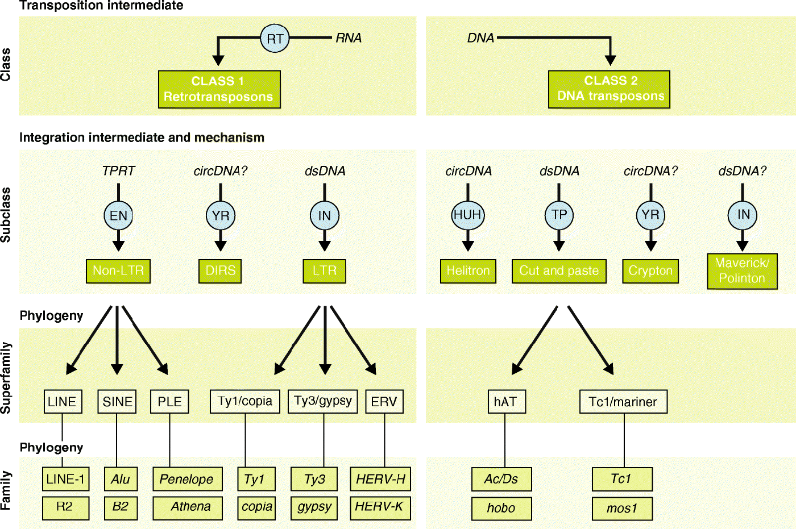

真核转座子分类总图。图中按转座中间体和关键酶，把转座子分成Ⅰ类（LTR、DIRS、PLE、LINE、SINE）和Ⅱ类（TIR 剪切-粘贴、Helitron 滚环等），并画出各类的典型结构模块。这是目前能公开再利用的、对 Wicker 2007 分类图最接近的替代。蓝点表示元件自己编码的酶。

署名：Guillaume Bourque、Kathleen H. Burns、Mary Gehring、Vera Gorbunova、Andrei Seluanov、Molly Hammell、Michaël Imbeault、Zsuzsanna Izsvák、Henry L. Levin、Todd S. Macfarlan、Dixie L. Mager、Cédric Feschotte，2018，Genome Biology，DOI 10.1186/s13059-018-1577-z，Fig. 1，CC BY 4.0（https://creativecommons.org/licenses/by/4.0/），未修改。

**图 2-2**　按复制酶、整合酶和结构组件排列的分类网格

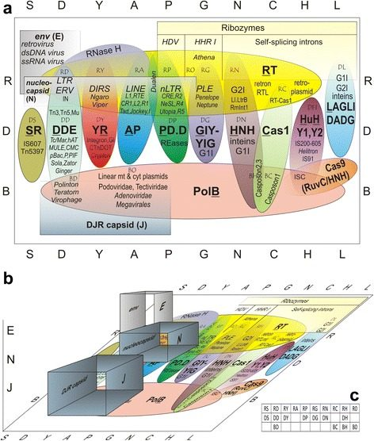

用复制酶、整合/内切酶和结构组件三个维度来排列转座子类型。图中既有已知组合的网格，也画出尚未填满的位置，用来说明层级分类之外，还有按分子机器重新组合的思路，以及嵌合、化石拷贝为什么会让边界变模糊。

署名：Irina R. Arkhipova，2017，Mobile DNA，DOI 10.1186/s13100-017-0103-2，Fig. 2，CC BY 4.0（https://creativecommons.org/licenses/by/4.0/），未修改。


### 2.1.5 基于蛋白质结构域系统发育的分类依据

在转座子的多层级分类中，一个贯穿始终的方法论问题是：为什么在家族层面可以使用DNA碱基相似度，而在超家族及更高层级上却必须依赖蛋白质结构域的系统发育分析？答案根植于转座子独特的分子演化规律。

绝大多数转座子拷贝一旦插入宿主基因组，便迅速遭受宿主表观遗传沉默机制的压制，不再承担维持宿主生存的功能，因此处于近乎完全中性的演化状态（缺乏纯化选择保护）。在中性突变率的驱动下，转座子的非编码区（如LTR序列、非翻译区和内部间隔区）以极快的速度积累点突变和插入缺失。通常只需经过数百万至数千万年的演化，同一超家族内不同家族之间的DNA核苷酸相似度就会衰减到随机噪声水平（低于50%），基于核酸序列的比对工具（如BLASTN）将完全失效。

然而，对于在演化谱系中持续保持转座活性的自主型转座子而言，其编码的核心催化酶（如逆转录酶和转座酶）必须维持精确的三维空间构象和催化活性中心，否则就会丧失扩增能力并在基因组内自然消亡。这种源于基因组内自私选择的强烈纯化选择压力，使得转座子核心蛋白质结构域的氨基酸序列在跨越数亿年甚至超过十亿年的深层演化尺度上，依然保留了清晰可辨的保守基序。因此，蛋白质结构域成为界定转座子超家族最可靠的分子化石与系统发育标记（Wicker et al. 2007，doi:10.1038/nrg2165）。

在Ⅰ类反转录转座子中，**逆转录酶（reverse transcriptase，RT）结构域**是公认的通用系统发育锚点。所有Ⅰ类自主元件的RT结构域都包含7个高度保守的氨基酸催化基序（通常编号为基序1至7，其中包含经典的催化三联体，如`YXDD`或`FDD`基序）。利用这7个保守区段构建的系统发育树，能够将真核生物所有反转录元件清晰地划分为LTR、DIRS、PLE和LINE等单系大类，并在LTR内部准确区分*Ty1/Copia*、*Ty3/Gypsy*、*Bel-Pao*等超家族。除了序列系统发育外，*pol*多聚蛋白内部不同功能结构域的线性排列顺序还提供了极强的独立共衍征（synapomorphy）：例如，*Ty1/Copia*超家族的结构域排列恒定为蛋白酶（PR）—整合酶（INT）—逆转录酶（RT）—核糖核酸酶H（RH）；而*Ty3/Gypsy*超家族则恒定为PR—RT—RH—INT（Wicker et al. 2007，doi:10.1038/nrg2165）。将RT系统发育与结构域排列顺序相结合，几乎可以百分之百无歧义地鉴定任何完整的自主型LTR元件。

在Ⅱ类经典TIR转座子中，分类的核心锚点则是**转座酶（transposase，TPase）的DDE或DDD催化结构域**。这类转座酶在三维结构上共享核糖核酸酶H样折叠（RNase H-like fold），其活性中心由三个空间上紧密相邻的酸性氨基酸残基（两个天冬氨酸D和一个谷氨酸E，或三个天冬氨酸D）组成，负责螯合二价镁离子（$\text{Mg}^{2+}$）以催化DNA磷酸二酯键的水解与转酯反应。不同TIR超家族在DDE/DDD基序之间的氨基酸间隔长度、两侧保守特征残基以及DNA结合域（如BED锌指、HTH结构域）上各具特色，结合该超家族特有的TSD长度与TIR末端碱基，共同构成了严密的超家族界定标准。而对于非DDE型的Ⅱ类元件，*Helitron*依赖Rep/Helicase双功能结构域（包含滚环复制特有的HUH基序和SF1解旋酶基序），*Maverick*/*Polinton*依赖B家族DNA聚合酶与反转录病毒样整合酶，*Crypton*则依赖酪氨酸重组酶的RHR基序和催化酪氨酸残基。

尽管蛋白质结构域系统发育是目前最严谨的高阶分类依据，研究者也必须清醒地认识到其固有的应用局限。第一，真核生物基因组中大量存在的非自主型元件（如MITEs、SINEs、LARDs、TRIMs）以及高度退化的古老碎片根本不包含任何编码区，完全无法通过蛋白质结构域直接定类，只能退而求其次，依据末端非编码结构特征或与已知自主型元件的局部核酸同源性进行间接归类。第二，转座子在漫长演化中也存在模块重组（domain shuffling）现象，例如某些反转录元件的*gag*基因、*env*样基因与*pol*基因可能拥有不同的演化来源，因此单凭单一结构域建树有时会掩盖嵌合起源的复杂历史，必要时需结合多结构域联合系统发育分析加以核验。

## 2.2 统一分类框架中的层级与边界争议

### 2.2.1 80-80-80规则的实用价值、理论局限与实操应对

在2007年提出的统一分类体系中，Wicker等人针对“如何界定一个转座子家族”这一困扰基因组注释多年的实操难题，给出了一条广为流传的定量操作标准，即**80-80-80规则**：两条转座子序列若要被归入同一个家族，必须同时满足三个条件——二者比对区域的序列长度不低于80 bp，比对覆盖度不低于参考序列全长的80%，且比对区域内的DNA碱基一致性（identity）不低于80%（Wicker et al. 2007，doi:10.1038/nrg2165）。

从生物信息学工程实践的角度看，80-80-80规则具有显著的实用价值。首先，它为大规模基因组重复序列的自动化聚类（例如使用CD-HIT-EST、VSEARCH等序列聚类软件去除冗余）提供了明确且易于编程实现的参数阈值，使得不同实验室在处理同一物种或近缘物种基因组时，能够依据统一标尺统计转座子家族数量并构建非冗余一致性文库。其次，“长度不低于80 bp”的下限设定有效过滤了真核生物基因组中广泛存在的短片段随机同源性（如低复杂度区域、简单重复或偶然相似的短基序），防止毫无亲缘关系的元件被错误合并。在植物比较基因组学中，80-80-80规则已成为衡量家族边界和计算家族拷贝数的事实标准。

然而，一旦将80-80-80规则置于严格的演化生物学和大规模基因组注释实战中审视，其深层缺陷便暴露无遗：

1. **对古老、碎片化与高度分化家族彻底失效**：在植物基因组中，绝大多数古老转座子拷贝自插入以来经历了数百万至数千万年的中性突变、小片段缺失以及年轻转座子的嵌套打断。这些高度分化的古老拷贝与祖先一致性序列的碱基一致性往往已跌破80%（落在65%至78%之间），且物理长度常被截断为不足全长30%的碎片。若机械执行80-80-80规则，同一古老家族的数百个残片会被强行拆分成几十个互不隶属的虚假“单拷贝小家族”，彻底扭曲家族拷贝数统计与演化年龄分布。
2. **同一阈值对短元件与长元件产生截然不同的过滤效应**：80-80-80规则对序列长度的敏感度极度不对称。对于长度仅150至300 bp的短元件（如MITEs或SINEs），80%的覆盖度仅要求比对上120至240 bp，且80%的一致性意味着仅需容忍20至50个碱基差异，极易因局部低复杂度序列或保守TIR导致不同家族被过度合并；相反，对于全长10至15 kb的大型LTR反转录转座子，80%的覆盖度意味着必须连续比对上8至12 kb，任何一次2至3 kb的内部缺失、solo-LTR重组（仅剩约800 bp，覆盖度不足10%）或年轻转座子嵌套插入，都会瞬间击穿80%覆盖度红线，导致同一家族的完整拷贝与缺失衍生物被人为割裂。此外，在长元件内部，受纯化选择保护的*pol*编码区（一致性常达88%）与快速演化的LTR非编码区（一致性可能已降至65%）演化速率高度异质，按全长比对还是仅按LTR区比对会得出截然不同的归类结果。
3. **聚类非传递性与物种演化速率脱节**：在数学集合论中，“相似度 $\ge 80\%$”不满足等价关系的传递律（A与B相似82%、B与C相似82%，但A与C可能仅相似74%），导致单链聚类产生雪球式过度合并，而贪心中心点聚类（如CD-HIT-EST）的结果高度依赖输入序列的排序顺序。同时，一年生草本植物（如拟南芥、水稻）的年均中性替代率显著高于多年生木本植物（如葡萄、杨树或裸子植物松柏类）（Smith & Donoghue 2008，*Science*，[待确认]），同样的“80%一致性”边界在草本中仅对应数百万年的年轻分支，在木本中却涵盖数千万年的古老谱系。
4. **与支序系统发育分类的根本冲突**：系统发育分类学家Seberg和Petersen在2009年发表专文对80-80-80规则提出尖锐批评，指出以固定相似度百分比划界实质上是早已被现代生物系统学摒弃的“表型数值分类学”（phenetics）回潮，而非基于共同祖先和单系群（monophyly）的支序系统学（cladistics）（Seberg & Petersen 2009，*Systematic Biology*，[待确认]）。

**实际基因组注释中的应对策略**：在现代植物基因组与泛基因组（如葡萄属多单倍型）实战注释中，生物信息学家并不会死板套用单一的80-80-80阈值，而是采取四项分层妥协策略：
- **构建文库阶段按长度与覆盖度方向差异化聚类**：在使用CD-HIT-EST或VSEARCH对候选一致性序列去冗余时，通常采用“较短序列覆盖度 $\ge 80\%$”（如CD-HIT-EST的`-aS 0.8`）以合并同一家族的截短拷贝，同时前置严格的长度过滤与超家族预分组（先按`RLG`、`RLC`、`DTA`等超家族拆分后再各自聚类），彻底杜绝短MITEs被错误吸收入长LTR家族的跨超家族合并灾难；
- **对LTR反转录转座子优先按LTR区聚类**：在EDTA和panEDTA等植物流程中，针对完整LTR元件往往先对其5'-LTR/3'-LTR区域执行80-80-80聚类以界定家族，再单独处理内部编码区，从而天然将solo-LTR与完整拷贝归入同一家族；
- **在亚家族细分与泛基因组去冗余时动态调高阈值**：当需要在近缘品种或同一物种双单倍型间区分近期独立爆发的年轻亚家族时，常将一致性阈值从`0.80`提高至`0.90`甚至`0.95`；
- **同源屏蔽阶段放宽至演化暮光区**：80-80-80规则仅用于构建非冗余一致性文库；一旦文库定稿，在用RepeatMasker（或配合Dfam profile HMMs的`nhmmer`）扫描全基因组打捞古老退化拷贝时，则完全放开80%一致性与80%覆盖度限制，允许捕获分歧度高达35%至40%、长度仅数十至数百bp的古老碎片。

### 2.2.2 嵌合元件、高度退化拷贝与水平转移带来的边界模糊

经典的林奈式层级分类体系有一个隐含的数学前提：所有被分类的实体都处于一棵严格分叉的演化树上，每个子节点只能拥有唯一的一个父节点。然而，转座子在宿主基因组中的真实演化历程充满了重组、退化与跨物种跳跃，大量真实存在的序列直接打破了严格树状分类的理想假设。

**嵌合型转座子（chimeric TEs）**是层级分类面临的最典型挑战。嵌合元件的产生主要有三种分子途径：其一是**反转录过程中的模板转换（template switching）**。由于Ⅰ类LTR反转录转座子的病毒样颗粒中通常同时包装两条RNA分子，当不同家族的RNA被共包装时，逆转录酶在合成cDNA的过程中可能从一条模板跳跃到另一条模板上，产生由A家族提供LTR调控区、B家族提供*gag*/*pol*编码区的重组型LTR元件。其二是**嵌套插入后的复合移动**。当一个转座子（如小型DNA转座子或MITE）插入到另一个活跃转座子的非必需区域内部后，宿主或转座酶可能将这个“元件套元件”的复合体作为一个整体进行转录或切离并继续扩增，形成跨超家族的嵌合体。其三是**宿主基因片段的捕获**。植物基因组中的*Pack-MULE*（Mutator样元件）和*Helitron*以频繁捕获、拼接宿主蛋白质编码基因的外显子而著称。一条嵌合元件在物理上同时携带来自两个不同超家族甚至宿主基因的遗传信息，无论将其硬性归入哪一个单一分类节点，都会丢失另一半关键的演化与结构信息。

**高度退化拷贝（highly degraded copies）**构成了基因组注释中庞大的“暮光区”（twilight zone）。随着插入年代推移，数千万年前爆发的古老转座子拷贝会不断遭受随机点突变、小片段缺失以及年轻转座子的反复打断与覆盖。最终，这些古老拷贝失去了完整的开放阅读框，两端的TIR、TSD和LTR边界彻底消融，仅剩下一段数百碱基长、与现代一致性序列一致性仅存60%至70%的残片。在自动化注释流程中，这些碎片往往既无法满足结构预测算法的边界要求，也难以跨越同源比对软件的显著性打分阈值，最终被大量归入“未分类”（Unknown）或仅能勉强定类到“目”一级的模糊标签。这种随时间推移而急剧下降的分类分辨率，意味着我们从基因组注释表中看到的转座子组成，天然偏向于近期活跃的年轻元件，而系统性地低估了古老转座子的历史贡献。

**转座子水平转移（horizontal transposon transfer，HTT）**则进一步模糊了跨物种分类与命名的边界。与主要依靠垂直遗传（亲代传给子代）的宿主基因不同，转座子能够跨越生殖隔离，借助昆虫媒介、寄生植物、病毒、真菌或附生微生物，在亲缘关系极远的物种之间发生水平传播。在动物界（如果蝇与脊椎动物之间）和植物界（如禾本科与双子叶植物之间、不同科属被子植物之间），已有大量确凿的LTR反转录转座子和DNA转座子水平转移案例被报道（El Baidouri et al. 2014，*Genome Research*，[待确认]）。例如，如果葡萄基因组中的某一个*Copia*家族与远缘木本植物或寄生植物中的某家族共享高达95%的核酸一致性，远超二者宿主基因组的演化分化程度，那么在跨物种泛基因组或数据库收录时，这两个序列在80-80-80规则下属于同一个家族，但传统的“物种前缀+家族编号”命名法却会将它们割裂为两个毫无关联的独立条目，掩盖了它们近期共享同一水平转移源头的演化事实。

### 2.2.3 非自主元件的归类难题：以MITEs、LARD与TRIM为例

在真核生物（尤其是高等植物）基因组中，不编码任何蛋白质的非自主型转座子在拷贝数上常常占据压倒性优势。然而，正因为缺乏核心编码结构域，非自主元件构成了所有分类体系中最棘手的“灰色地带”，集中体现了“按演化起源归类”与“按结构表型归类”之间的深刻矛盾。

**微型反向重复转座元件（MITEs）**是植物基因组中最具代表性的非自主Ⅱ类元件。MITEs通常长度极短（多在50至600 bp之间）、富含AT碱基、无编码能力、具有保守的末端反向重复序列（TIR）和明确的靶位点重复（TSD），且同一家族的拷贝长度高度均一、拷贝数可达数千至数万个。分子演化研究表明，绝大多数植物MITEs是由自主型TIR DNA转座子（尤其是*PIF/Harbinger*超家族产生的*Tourist*样MITEs，以及*Tc1/Mariner*超家族产生的*Stowaway*样MITEs，另有部分源自*hAT*、*Mutator*和*CACTA*）经由内部缺失演化而来，并依靠这些自主型元件反式提供的转座酶在基因组中大规模扩增。

在Wicker 2007统一分类体系中，MITEs并不作为一个独立的目或超家族存在，而是被要求根据其TIR和TSD特征分别归入对应的TIR超家族（Wicker et al. 2007，doi:10.1038/nrg2165）。这一设计在理论上遵循了演化起源原则，但在实际注释操作中却面临两大困难：其一，许多古老的MITEs家族在宿主基因组中对应的自主型“母本”早已彻底灭绝或退化殆尽，缺乏序列同源桥梁；其二，部分MITEs的TIR极短且发生突变，仅凭2至3 bp的TSD（如`TA`或`TAA`）很难在全基因组尺度上可靠区分其究竟源自*Tc1/Mariner*、*PIF/Harbinger*还是*CACTA*。因此，许多植物转座子预测软件和文献在实操中依然习惯将MITEs单列为一个独立统计类别，结果导致同一批MITEs在不同研究中时而被计入*PIF/Harbinger*，时而被单列为*MITE*，造成统计口径混乱。

类似的问题在Ⅰ类LTR反转录转座子的非自主衍生物——**LARD（大型反转录转座子衍生物）**与**TRIM（末端重复反转录转座子微型元件）**中表现得更为突出。LARD和TRIM两端均保留了成对的同向LTR序列、引物结合位点（PBS）、多聚嘌呤区（PPT）以及经典的4至6 bp TSD，但其内部编码区完全缺失，取而代之的是一段非编码序列（TRIM全长通常仅数百bp至1 kb，LARD全长则可达数kb以上）（Witte et al. 2001，*Proceedings of the National Academy of Sciences*，[待确认]；Kalendar et al. 2004，*Proceedings of the National Academy of Sciences*，[待确认]）。由于彻底丧失了*gag*和*pol*蛋白编码区，除非能在同一基因组中找到与该LARD或TRIM共享高相似度LTR序列的完整自主型拷贝，否则根本无法利用RT系统发育或结构域顺序判定它究竟隶属于*Ty1/Copia*还是*Ty3/Gypsy*超家族。在绝大多数植物基因组（包括葡萄基因组）的注释结果中，大量结构完整的LARD和TRIM最终只能停留在“LTR/unknown”这一粗糙层级上。

### 2.2.4 自动注释工具的分类体系差异与跨工具标签映射

在现代转座子生物信息学实战中，研究者极少只使用单一软件，而是常常需要联合调用**EDTA**（Ou et al. 2019，*Genome Biology*，doi:10.1186/s13059-019-1905-y）、**RepeatModeler2 / RepeatMasker**（Flynn et al. 2020，*Proceedings of the National Academy of Sciences*，doi:10.1073/pnas.1921046117）、**DeepTE**（Yan et al. 2020，*Bioinformatics*，[待确认]）以及基于REXdb蛋白域库的**TEsorter**（Neumann et al. 2019，*Mobile DNA*，[待确认]；Zhang et al. 2022，*Horticulture Research*，[待确认]）等工具，开展跨工具比较、未知序列重分类或泛基因组文库合并。然而，这四大主流工具底层各自沿用了不同的分类体系与标签语法，若不建立严格的**标签映射规则（label mapping）**就直接合并统计，极易造成严重的归类错乱、重复计算或整个超家族的遗漏。

四大工具的分类体系与粒度差异主要体现在以下四个方面：
1. **RepeatModeler2 / RepeatMasker（Repbase/Dfam体系）**：采用`大类/超家族-亚类`格式，粒度最细但历史同义词最多。例如，它将*CACTA*标为`DNA/CMC-EnSpm`，将*Mutator*标为`DNA/MULE-MuDR`，将*hAT*拆分为`DNA/hAT-Ac`、`DNA/hAT-Tip100`等十余个亚标签，且将*Helitron*单独置于`RC/Helitron`（滚环类）之下而非`DNA/`之下。
2. **EDTA（Wicker三字母代码与结构标签混合体系）**：面向植物优化，LTR类沿用RepeatMasker风格（`LTR/Copia`、`LTR/Gypsy`、`LTR/unknown`），但TIR DNA转座子直接采用Wicker三字母代码（`DNA/DTA`、`DNA/DTC`、`DNA/DTH`、`DNA/DTM`、`DNA/DTT`），并将短小非自主TIR元件拆分为独立的`MITE/`前缀（如`MITE/DTA`、`MITE/DTH`），同时将*Helitron*置于`DNA/Helitron`之下。如果脚本仅按`DNA/`前缀汇总Ⅱ类转座子，就会在EDTA结果中漏掉全部`MITE/`，或在RepeatMasker结果中漏掉全部`RC/Helitron`。
3. **DeepTE（层级化深度学习分类标签体系）**：针对植物、动物或真菌分别训练卷积神经网络，输出以`ClassI`、`ClassII`开头的层级下划线标签（如`ClassI_LTR_Copia`、`ClassI_LTR_Gypsy`、`ClassII_DNA_hAT_nMITE`、`ClassII_DNA_PIF_Harbinger_MITE`、`ClassII_Helitron`），其独特之处在于显式在标签末尾区分了自主/非MITE（`_nMITE`）与`_MITE`状态，且在无法细分超家族时会输出`ClassI_nLTR`或`unknown`等中层标签。
4. **TEsorter（基于REXdb的植物蛋白域亚谱系体系）**：依赖保守蛋白结构域HMM扫描，因此**仅能对保留编码区的自主型（或近自主型）元件定类**，对完全无编码区的MITEs、SINEs、LARDs和TRIMs一律输出为未分类。但其最大优势在于对植物LTR反转录转座子具备极高的亚谱系分辨率——不仅区分`LTR/Copia`与`LTR/Gypsy`，还进一步细分至`Copia/Ale`、`Copia/SIRE`、`Gypsy/CRM`、`Gypsy/Tekay`、`Gypsy/Athila`、`Gypsy/Retand`等演化谱系（Neumann et al. 2019，*Mobile DNA*，[待确认]；Zhang et al. 2022，*Horticulture Research*，[待确认]）。

在进行跨工具比较或合并多来源文库时，最佳实践是**先将所有工具的原始标签通过确定性映射表统一标准化为Wicker超家族层级（或三字母代码）**，并单独保留一列记录“自主/非自主（MITE/LARD/TRIM）”与“亚谱系（如CRM/Athila）”的附加属性。同时，对于“未分类（`Unknown`）”比例悬殊的不同文献结果，切忌直接横向对比某一超家族的绝对占比，而应使用统一冻结的标准化文库重新屏蔽。下表给出了四大主流工具常用输出标签的标准化映射对照：

| 统一标准分类（Wicker超家族 / 代码） | EDTA 输出标签 | RepeatModeler2 / RepeatMasker 标签 | DeepTE（植物模型）标签 [待确认] | TEsorter (REXdb) 标签 [待确认] |
| :--- | :--- | :--- | :--- | :--- |
| **LTR / *Ty1/Copia*** (`RLC`) | `LTR/Copia` | `LTR/Copia` | `ClassI_LTR_Copia` | `LTR/Copia`（细分 *Ale*、*Bianca*、*Ivana*、*SIRE*、*TAR*、*Tork* 等） |
| **LTR / *Ty3/Gypsy*** (`RLG`) | `LTR/Gypsy` | `LTR/Gypsy` | `ClassI_LTR_Gypsy` | `LTR/Gypsy`（细分 *CRM*、*Tekay*、*Reina*、*Athila*、*Retand* 等） |
| **LTR / 未分类** (`RLX`) | `LTR/unknown` | `LTR/Unknown`、`LTR` | `ClassI_LTR` | `LTR/unknown`（无编码区LARD/TRIM无法定类） |
| **LINE** (`RIX`) | `LINE/unknown`、`LINE/L1`（需`--sensitive 1`） | `LINE/L1`、`LINE/RTE-BovB` 等 | `ClassI_nLTR_LINE`、`ClassI_nLTR_LINE_L1` | `LINE`（依赖RT/EN蛋白域） |
| **SINE** (`RSX`) | `SINE/unknown`（需`--sensitive 1`） | `SINE/tRNA`、`SINE/7SL` 等 | `ClassI_nLTR_SINE` | 不适用（无编码区） |
| **TIR / *hAT*** (`DTA`) | `DNA/DTA`、`MITE/DTA` | `DNA/hAT-Ac`、`DNA/hAT-Tag1`、`DNA/hAT-Tip100` 等 | `ClassII_DNA_hAT_nMITE`、`ClassII_DNA_hAT_MITE` | `TIR/hAT`（仅自主拷贝） |
| **TIR / *CACTA*** (`DTC`) | `DNA/DTC`、`MITE/DTC` | `DNA/CMC-EnSpm` | `ClassII_DNA_CACTA_nMITE`、`ClassII_DNA_CACTA_MITE` | `TIR/CACTA`（仅自主拷贝） |
| **TIR / *PIF/Harbinger*** (`DTH`) | `DNA/DTH`、`MITE/DTH` | `DNA/PIF-Harbinger`、`DNA/PIF-ISL2EU` | `ClassII_DNA_PIF_Harbinger_nMITE` / `_MITE` | `TIR/PIF_Harbinger`（仅自主拷贝） |
| **TIR / *Mutator*** (`DTM`) | `DNA/DTM`、`MITE/DTM` | `DNA/MULE-MuDR`、`DNA/MuDR` | `ClassII_DNA_Mutator_nMITE` / `_MITE` | `TIR/Mutator`（仅自主拷贝） |
| **TIR / *Tc1/Mariner*** (`DTT`) | `DNA/DTT`、`MITE/DTT` | `DNA/TcMar-Stowaway`、`DNA/TcMar-Mariner` 等 | `ClassII_DNA_TcMar_nMITE` / `_MITE` | `TIR/Tc1_Mariner`（仅自主拷贝） |
| ***Helitron*** (`DHH`) | `DNA/Helitron` | `RC/Helitron` | `ClassII_Helitron` | `Helitron`（依赖Rep/Hel域） |
| **未分类重复序列** (`XXX`) | `Unknown` | `Unknown` | `unknown` | 未输出分类（`unclassified`） |


**图 2-3**　植物 LTR 反转录转座子的 REXdb 亚谱系与工具标签对照

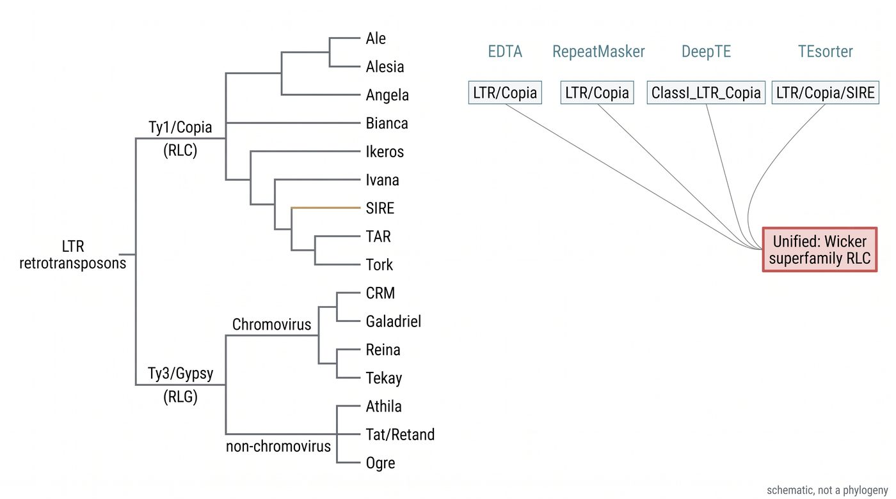

植物 LTR 反转录转座子按 REXdb 蛋白域划分的亚谱系示意，以及同一元件在不同注释工具中的标签对照。右侧仅以 Copia/SIRE 为例说明标签如何对应到 Wicker 超家族 RLC。树形为示意拓扑，不是真实系统发育。示意图，由 AI 生成，非已发表图。


## 2.3 命名规则与公共数据库标准

### 2.3.1 Wicker三字母代码命名法与标准命名格式

在统一分类体系建立之前，转座子家族的命名几乎完全依赖发现者的个人偏好或偶然灵感——例如以神话人物、历史事件、音乐流派或宿主突变表型命名（如*Copia*、*Gypsy*、*Mariner*、*Tourist*、*Stowaway*、*Gret1*）。这类富有文化色彩的传统名称虽然易于人类记忆，但对于计算机解析和大规模跨基因组统计却极不友好：仅凭“*Gret1*”或“*BARE1*”这样的字符串，研究者和生信脚本都无法直接判断它究竟属于Ⅰ类反转录转座子还是Ⅱ类DNA转座子，更无法得知其所属的目与超家族。

为了解决这一痛点，Wicker等人在2007年的统一分类体系中配套设计了一套高度结构化的**三字母代码命名法**（three-letter code），将“纲—目—超家族”三个核心分类层级直接编码进三个大写英文字母之中（Wicker et al. 2007，doi:10.1038/nrg2165）。这套编码规则简洁直观，已成为现代植物基因组学和众多自动化注释工具（如EDTA、TREP）的通用语言。

三字母代码的构成遵循严格的逐级定位逻辑：
- **第一位字母代表纲（Class）**：`R`代表Ⅰ类反转录转座子（Retrotransposon），`D`代表Ⅱ类DNA转座子（DNA transposon）。
- **第二位字母代表目（Order）**：在Ⅰ类（`R`）之下，`L`代表LTR，`Y`代表DIRS（取酪氨酸重组酶Tyrosine之音），`P`代表PLE（Penelope-like elements），`I`代表LINE，`S`代表SINE。在Ⅱ类（`D`）之下，`T`代表TIR，`Y`代表Crypton，`H`代表Helitron，`M`代表Maverick。
- **第三位字母代表超家族（Superfamily）**：在LTR目（`RL`）下，`RLC`代表*Copia*，`RLG`代表*Gypsy*，`RLB`代表*Bel-Pao*，`RLR`代表*Retrovirus*，`RLE`代表*ERV*；在TIR目（`DT`）下，`DTT`代表*Tc1/Mariner*，`DTA`代表*hAT*（取*Ac*之首字母），`DTM`代表*Mutator*，`DTC`代表*CACTA*，`DTH`代表*PIF/Harbinger*，`DTP`代表*P*，`DTB`代表*PiggyBac*，`DTE`代表*Merlin*，`DTR`代表*Transib*；对于目下仅含单一或未细分超家族的类群，第三位字母常重复第二位或采用特定字母，如`DHH`代表*Helitron*，`DMM`代表*Maverick*，`DYC`代表*Crypton*（Wicker et al. 2007，doi:10.1038/nrg2165）。

此外，三字母代码还引入了一个极具实用价值的通配符——字母`X`，专门用于表示在某一分类层级上**未知或尚未确定**（unknown/unclassified）的状态（Wicker et al. 2007，doi:10.1038/nrg2165）。例如，一条具有完整两端LTR和TSD、但因内部编码区完全缺失而无法区分*Copia*与*Gypsy*的非自主LTR元件，应编码为`RLX`；一条确认属于TIR DNA转座子但无法归入已知超家族的元件，编码为`DTX`；仅能确认属于反转录转座子但连“目”都无法判定的退化片段，编码为`RXX`；而完全无法判定大类的未知重复序列，则可标记为`XXX`。这种设计避免了强行归类带来的假阳性污染，忠实保留了注释过程中的不确定性信息。

在实际基因组注释文件（如FASTA文库头文件或GFF3特征表）中，完整的Wicker标准命名格式通常由三字母代码、家族名称、物种缩写以及可选的拷贝编号通过下划线和连字符拼接而成，形式为`三字母代码_家族名_物种缩写-拷贝号`（Wicker et al. 2007，doi:10.1038/nrg2165）。例如，在栽培葡萄（*Vitis vinifera*，常缩写为`Vvi`）中发现的经典*Gypsy*元件*Gret1*，按照规范可写作`RLG_Gret1_Vvi`，其基因组上的第1个具体拷贝则可记作`RLG_Gret1_Vvi-1`。在生物信息学实践中，遵循这一标准化命名格式能够让下游脚本通过简单的前缀切分，在毫秒级时间内完成全基因组各纲、目、超家族的拷贝数与碱基占比汇总，极大降低了数据清洗的出错率。

### 2.3.2 主流公共转座子数据库的定位与特点

高质量的转座子研究离不开公共参考序列数据库的支撑。经过三十余年的发展，国际转座子学界已经形成了若干定位互补、覆盖面各异的核心公共数据库。了解这些数据库的数据结构、维护机制与适用边界，是合理选择参考文库的前提。

**Repbase**（由遗传信息研究所GIRI的Jerzy Jurka于20世纪90年代初创立并长期维护）是转座子领域历史最悠久、影响力最深远的综合型参考数据库（Bao et al. 2015，*Mobile DNA*，[待确认]）。Repbase的核心特色在于其高标准的专家人工精修（manual curation）：每一条收录的真核生物转座子一致性序列，原则上都经过了边界核验、末端特征确认、编码区翻译检查与超家族归类。在长达二十多年的时间里，Repbase一直是全基因组重复序列屏蔽软件RepeatMasker的默认核心文库。然而，随着维护经费压力的增加，Repbase在2019年前后转向了付费订阅制，限制了其核心文库随开源软件自由分发的权限，这在一定程度上推动了开源替代数据库的加速发展。

**Dfam**是当前最具活力的完全开源、开放获取（open-access）的转座子数据库，目前已成为RepeatMasker和RepeatModeler的默认核心后端库（Storer et al. 2021，*Mobile DNA*，[待确认]）。与Repbase早期主要存储单一核苷酸一致性序列不同，Dfam在底层设计上引入了**轮廓隐马尔可夫模型（profile Hidden Markov Models，profile HMMs）**来表征每一个转座子家族（Wheeler et al. 2013，*Nucleic Acids Research*，[待确认]）。profile HMMs不仅记录了每个碱基位点的优势碱基，还定量刻画了不同位点的碱基替换概率以及插入/缺失（indel）的容忍度。在比对高度分化、年代久远的古老转座子拷贝时，基于profile HMMs的搜索灵敏度显著高于传统的一致性序列局部比对。近年来，Dfam进一步扩展为包含已精修家族（curated families）与社区提交的未精修从头预测家族（uncurated families）的双层架构，极大地扩充了对非模式物种的覆盖范围。

除了Repbase和Dfam这两大跨界综合数据库外，植物基因组学界还建立了多个**植物专用转座子数据库与参考文库**，以弥补综合库在植物类群上的不足。
- **TREP（TRansposable Elements Platform）**最初聚焦于小麦族（小麦、大麦等）植物，随后逐步扩展至更广泛的单子叶与双子叶植物（Wicker et al. 2002，*Plant Physiology*，[待确认]）。TREP以极高的人工精修质量著称，且严格贯彻Wicker三字母代码命名体系，非常适合作为植物转座子分类学的教学范本与高质量基准测试集。
- **PGSB Repeat Element Database（原MIPS-REdat）**是一个面向大型植物比较基因组学的重复序列集合，整合了大量已测序被子植物（包括模式植物、禾本科作物及部分木本植物）的重复序列，常用于跨物种同源检索（Spannagl et al. 2016，*Nucleic Acids Research*，[待确认]）。
- 此外，学界还维护着针对特定转座子大类的垂直数据库，例如专注于LTR反转录转座子和逆转录病毒蛋白结构域系统发育的**GyDB**（Gypsy Database）（Llorens et al. 2011，*Nucleic Acids Research*，[待确认]）、专注于植物反转录转座子蛋白域的**REXdb**（Neumann et al. 2019，*Mobile DNA*，[待确认]），以及专门收录真核生物SINE元件的**SINEBase**等（Vassetzky & Kramerov 2013，*Nucleic Acids Research*，[待确认]）。


**图 2-4**　Wicker 三字母命名拆解与四个数据库对照

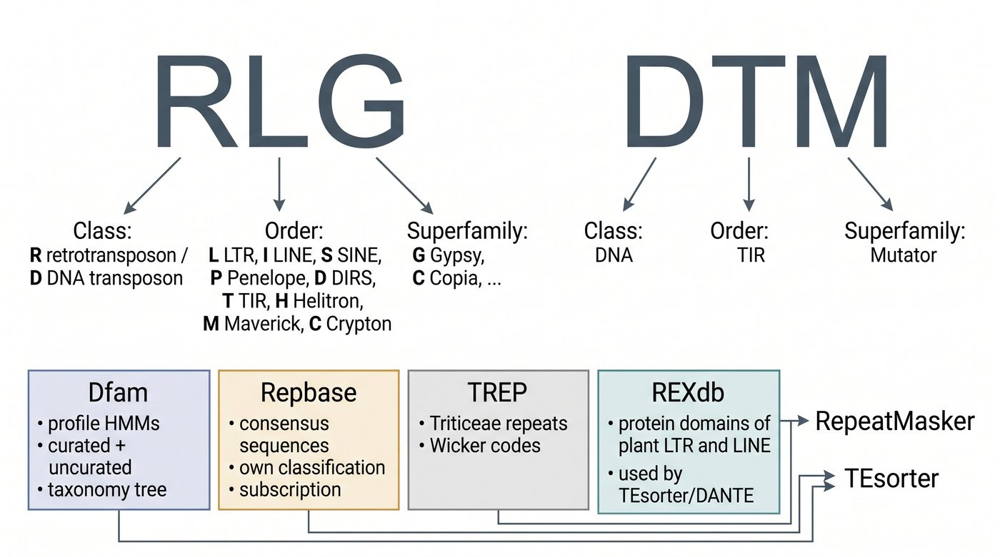

Wicker 三字母命名的拆解示意，以及 Dfam、Repbase、TREP、REXdb 四个数据库的内容与用途对照。图中从 Repbase、TREP 指向工具的箭头较淡，不易看清。示意图，由 AI 生成，非已发表图。


### 2.3.3 公共数据库维护中的现实问题与局限

尽管公共转座子数据库为基因组学研究提供了宝贵的基础设施，但它们绝非完美无缺的“标准答案库”。在实际科研中，盲目依赖公共数据库直接对新测序基因组进行同源屏蔽，往往会遭遇三大突出的现实问题。

第一是**数据库内部的冗余条目与碎片化污染**。由于公共数据库汇聚了来自全球不同实验室、不同测序年代和不同亲缘物种的提交记录，同一个转座子家族常常以多个不同的名称被反复收录。更常见的情况是，一条全长8 kb的完整LTR反转录转座子，其内部区域、单侧LTR片段以及不同截短版本的非自主衍生物，在数据库中可能作为四五条彼此独立的条目同时存在。当RepeatMasker使用包含大量冗余条目的数据库扫描基因组时，基因组上的同一个真实插入位点会同时匹配到多个高度相似的参考条目，导致注释结果被切得支离破碎，进而扭曲家族拷贝数统计和完整度评估。

第二是**错误分类与宿主基因混入的“传递效应”**。在早期基因组测序和大规模自动化提交阶段，部分被错误分类的序列进入了公共数据库——例如，将*Copia*误标为*Gypsy*，将嵌套插入的嵌合体当作单一家族收录，或者最危险的情况：将宿主基因组中天然存在的高拷贝蛋白质编码基因家族（如植物抗病基因NLR、组蛋白基因、泛素基因、细胞色素P450或F-box基因家族）误判为重复转座子收入库中。由于后续无数新测序物种的自动化注释流程都依赖与公共库的同源比对来传递分类标签，一条错误的数据库条目就像病毒一样，通过“以讹传讹”的同源注释链条，被复制到数十甚至上百个新发表的基因组注释结果中。如果库中混入了宿主抗病基因片段，使用该库对新基因组进行硬屏蔽后，下游的基因结构注释软件就会把大量真实的抗病基因彻底漏掉。

第三是**严重的物种覆盖偏倚（taxonomic bias）**。公共转座子数据库的收录分布极度不均匀，绝大多数高质量精修条目高度集中在少数明星模式生物（如人类、小鼠、果蝇、线虫、拟南芥、水稻、玉米、小麦）中。对于广大的非模式植物，尤其是多年生木本果树、林木以及野生近缘种，公共数据库中的覆盖率极低。以本书的范例物种葡萄属（*Vitis*）为例，虽然栽培葡萄（*Vitis vinifera*）是较早完成全基因组测序的果树之一，但在Repbase和Dfam等公共库中，经过严格人工精修的葡萄特异性转座子家族数量依然非常有限，远远无法涵盖葡萄属数十个野生种和栽培品种中极其丰富的谱系特异性LTR爆发家族与MITEs家族。如果仅用公共数据库直接屏蔽葡萄基因组，往往会漏检大量近期活跃的年轻转座子，导致基因组中转座子总占比被严重低估。

### 2.3.4 构建物种特异性一致性序列文库的必要性

正因为公共数据库存在物种覆盖不足、冗余与分类噪音等固有局限，当代高质量基因组注释的黄金法则非常明确：**绝不能仅依赖公共数据库进行单步同源屏蔽，而必须针对目标物种（或目标属的泛基因组）从头构建并精修物种特异性的一致性序列（consensus sequence）文库**。

所谓**一致性序列**，是指将基因组中属于同一转座子家族的多个同源拷贝进行多序列比对后，在每一个碱基位点上取出现频率最高的碱基（多数投票原则）重构出的代表性序列。从演化生物学的角度看，由于每个独立拷贝在插入基因组后所积累的随机点突变和小片段缺失在位置上是相互独立的，通过多拷贝比对取多数碱基，能够有效“抵消”各自独立的插入后突变，从而在数学上高度逼近该转座子家族在历史爆发瞬间的**祖先活性序列（ancestral active sequence）**。

构建物种特异性一致性序列文库为何是高质量注释的前提？其底层逻辑体现在三个核心层面：

首先，**大幅提升对退化拷贝的检测灵敏度与边界完整度**。假设某个古老转座子家族在距今数百万年前爆发，每个拷贝自插入以来平均积累了15%的随机点突变。如果直接用基因组中的任意一个拷贝去比对另一个拷贝，二者之间的序列分歧度将叠加至约30%（即一致性降至70%），已经逼近常规核酸比对工具的检测极限，极易造成漏检或只比对上局部保守片段。但如果先重构出该家族的祖先一致性序列，那么每一个退化拷贝与一致性序列之间的分歧度就减半回落至约15%（一致性达85%）。这一简单的演化几何学原理，使得基于一致性文库的同源屏蔽能够精准捕获大量隐藏在基因组深处的古老退化拷贝，并还原其完整边界。

其次，**全面捕获谱系特异性与近期活跃的转座子家族**。不同植物科属在分化后的数千万年间，各自经历了完全独立的转座子爆发事件。这些物种或属内特有的年轻转座子家族在远缘模式植物（如拟南芥或水稻）的公共库中根本不存在，但它们恰恰是驱动当前物种基因组大小分化、染色体结构变异以及群体表型多态性的最主要力量。只有通过从头预测与物种特异性文库构建，才能将这些决定物种演化特色的年轻家族完整纳入视野。

最后，**实现跨单倍型、跨品种与泛基因组研究的统一标尺**。对于像葡萄这样高度杂合、且包含众多栽培品种与野生近缘种的植物类群，若对每一个新组装的单倍型基因组分别进行孤立的从头预测，同一家族在不同单倍型中会被赋予不同的随机编号，导致无法直接比较不同品种间同一家族的扩张或清除动态。通过整合多份代表性基因组构建一套经过严格去冗余、去除宿主基因污染、并采用统一Wicker三字母代码命名的**葡萄属特异性一致性文库**，不仅能保护下游蛋白质编码基因注释免受误屏蔽干扰，更能为全书后续章节（第7章的注释方法、第8章的群体插入多态性分析以及第11章的葡萄实战工作流）奠定坚实、可重复的数据基石。

## 本章参考文献

- doi:10.1038/nrg2165
- doi:10.1038/nrg2165-c1
- doi:10.1186/s13059-019-1905-y
- doi:10.1073/pnas.1921046117


# 第3章 Ⅰ类转座子（反转录转座子）的结构与生活史

## 3.1 LTR反转录转座子的结构与反转录机制

### 3.1.1 完整LTR反转录转座子的模块结构

长末端重复序列反转录转座子（long terminal repeat retrotransposons，简称LTR反转录转座子）是真核生物（尤其是高等植物）基因组中丰度最高、对基因组大小演化影响最深远的转座子大类。一条结构完整的自主型LTR反转录转座子全长通常在4 kb至15 kb之间，个别大型植物家族甚至可超过20 kb。尽管不同超家族和物种间的序列分歧巨大，但几乎所有自主型LTR反转录转座子都遵循一套高度保守的模块化架构：两端由一对方向完全相同的长末端重复序列（5'-LTR和3'-LTR）夹带中央的内部编码区，两侧紧邻宿主基因组因插入而产生的4至6 bp（最常见为5 bp）靶位点重复（TSD）（doi:10.1038/nrg2165）。

**长末端重复序列（LTR）**的长度通常在数百bp至数kb之间（极少数植物家族可达5 kb以上）。由于反转录机制的特殊性，一个刚刚完成插入的年轻LTR转座子，其5'-LTR与3'-LTR的核苷酸序列是百分之百完全一致的。每一侧的LTR在功能上均可进一步划分为三个连续的亚区：U3（3'端特有区）、R（重复区）和U5（5'端特有区）。U3区携带宿主RNA聚合酶Ⅱ识别的启动子核心元件（如TATA框、CAAT框）以及响应环境胁迫或发育信号的顺式调控增强子；R区位于U3与U5之间，其5'边界是转录起始位点（TSS），3'边界则包含多聚腺苷酸化（poly(A)）加尾信号；U5区位于转录起始位点下游，参与维持RNA二级结构与反转录起始。值得注意的是，绝大多数经典LTR的两端都具有高度保守的短反向二核苷酸特征：5'端以`5'-TG...`起始，3'端以`...CA-3'`终止。这两个末端二核苷酸是整合酶特异性识别和切割双链cDNA的关键位点，也是生物信息学结构预测工具（如LTR_FINDER、LTR_retriever）界定LTR精确边界的核心判据。

紧邻5'-LTR下游（内部区域的5'端）和3'-LTR上游（内部区域的3'端），分别存在两个虽短却至关重要的非编码顺式作用元件：**引物结合位点（primer binding site，PBS）**和**多聚嘌呤区（polypurine tract，PPT）**。PBS通常是一段长度约12至18 bp的序列，与宿主细胞内某一种特定转移RNA（tRNA，最常见为起始甲硫氨酸tRNA，即$\text{tRNA}^{\text{Met}}$）的3'端接受臂高度互补配对，负责在反转录启动阶段锚定tRNA作为负链DNA合成的引物。PPT则是一段长约10至20 bp、几乎完全由腺嘌呤（A）和鸟嘌呤（G）组成的序列，它在反转录过程中能够抵抗核糖核酸酶H（RNase H）的降解，从而充当正链DNA合成的天然RNA引物。

位于PBS与PPT之间的中央区域是转座子的**内部编码区**，通常包含两个核心开放阅读框：*gag*与*pol*。在部分元件中，*gag*和*pol*融合成一个单一的连续长开放阅读框；而在更多情况下，二者彼此独立且存在阅读框移位（通常为-1移码）或终止密码子通读机制。这种设计具有精妙的化学计量学意义：病毒样颗粒的组装需要大量Gag结构蛋白，而催化反转录与整合的Pol酶类仅需极少量，通过低频率的核糖体移码或通读，转座子能够自然维持Gag与Pol蛋白之间约10:1至20:1的理想表达比例[待确认]。

*gag*基因编码结构蛋白（Gag），主要包含衣壳蛋白（capsid，CA）和核衣壳蛋白（nucleocapsid，NC）结构域。衣壳蛋白负责在细胞质中自组装成包裹转座子RNA的病毒样颗粒（virus-like particle，VLP）；核衣壳蛋白通常含有特征性的`CCHC`锌指基序，具有极强的核酸伴侣活性，能够结合单链RNA并促进反转录过程中的链转移退火。

*pol*基因则编码一个多聚蛋白前体，随后被自身包含的蛋白酶切割释放出四种核心催化酶：
- **天冬氨酸蛋白酶（protease，PR）**：负责将Gag和Pol多聚蛋白前体精准切割为具有独立功能的成熟蛋白亚基。
- **逆转录酶（reverse transcriptase，RT）**：以转座子单链RNA为模板合成负链DNA，并进一步以负链DNA为模板合成双链cDNA。
- **核糖核酸酶H（RNase H，RH）**：特异性降解RNA-DNA杂合双链中的RNA链，为正链DNA合成扫清障碍并精确保留PPT引物。
- **整合酶（integrase，INT）**：属于DDE催化家族，负责识别双链cDNA两端的`TG...CA`末端，切除末端多余的2 bp核苷酸（3'端加工），并在宿主染色体上制造交错双链切口，完成cDNA的共价整合。

### 3.1.2 Ty1/Copia与Ty3/Gypsy超家族的结构域排列与演化分化

在高等植物基因组中，LTR反转录转座子主要由两大超家族构成：*Ty1/Copia*（Wicker代码`RLC`，国际病毒分类委员会称为*Pseudoviridae*）与*Ty3/Gypsy*（Wicker代码`RLG`，又称*Metaviridae*）。二者在整体结构（两端LTR、PBS、PPT、*gag*和*pol*）和反转录生化机制上高度相似，但在*pol*基因内部四种催化结构域的线性排列顺序上存在一道不可逾越的演化分水岭（doi:10.1038/nrg2165）。

在*Ty1/Copia*超家族中，*pol*基因从5'端到3'端的结构域排列顺序恒定为：**PR — INT — RT — RH**，即整合酶（INT）位于逆转录酶（RT）的上游。而在*Ty3/Gypsy*超家族中，其排列顺序则恒定为：**PR — RT — RH — INT**，即整合酶（INT）位于逆转录酶（RT）和RNase H（RH）的下游（doi:10.1038/nrg2165）。值得注意的是，脊椎动物逆转录病毒（如HIV）与内源性逆转录病毒（ERV）的*pol*结构域排列同样是PR—RT—RH—INT，系统发育分析也证实*Ty3/Gypsy*与逆转录病毒的亲缘关系远比*Ty1/Copia*更为密切。

除了核心结构域排列顺序的经典差异外，这两大超家族在植物基因组中各自演化出了丰富而独特的亚谱系（lineages），并在染色体分布偏好与蛋白附加结构域上表现出显著分化。在*Ty3/Gypsy*超家族内部，植物中存在两大主要分支：*Chromovirus*（色质病毒样分支，包含*Tekay*、*CRM*、*Reina*、*Galadriel*等亚谱系）与非*Chromovirus*分支（包含*Athila*、*Tat*/*Ogre*等亚谱系）[待确认]。*Chromovirus*分支的一个标志性特征是在整合酶（INT）的C端携带了一个额外的**色质结构域（chromodomain）**。该结构域能够特异性识别宿主染色质上富含H3K9me2/3等异染色质组蛋白修饰的区域，从而将*Gypsy*元件的整合靶向引导至基因稀少、重组率极低的着丝粒与近着丝粒异染色质区。例如，着丝粒特异的*CRM*（centromeric retrotransposon）亚谱系甚至能够直接靶向富含CENH3组蛋白的功能着丝粒核心区。这种“主动躲避基因区”的靶向策略，大幅降低了插入对宿主必需基因的致死风险，使*Gypsy*元件得以在植物基因组中安全地积累至极高的拷贝数。

相比之下，*Ty1/Copia*超家族（在植物中常见*Ale*、*Angela*、*Bianca*、*Ivana*、*SIRE*、*TAR*、*Tork*等亚谱系）总体上缺乏异染色质靶向的色质结构域，其在染色体上的分布相对更加分散，在基因丰富的常染色质臂上出现频率显著高于*Gypsy*。有趣的是，部分植物*Copia*（如*SIRE*亚谱系，即Sireviruses）和*Gypsy*（如*Athila*亚谱系）在*pol*基因下游还演化出了一个类似逆转录病毒包膜蛋白的开放阅读框（*env*-like ORF），但由于植物细胞外层存在坚硬的细胞壁屏障，这些*env*样蛋白是否具备跨细胞感染能力至今仍缺乏确凿证据，目前普遍认为它们可能仅参与胞内转运或已被退化为无功能残迹[待确认]。

### 3.1.3 “复制-粘贴”生活史：从转录、胞质反转录到基因组整合

**图 3-1**　Ⅰ类和Ⅱ类转座子的复制机制

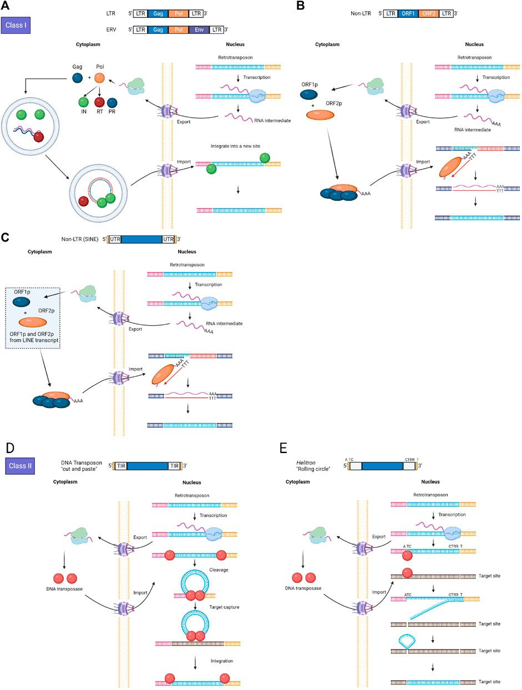

Ⅰ类和Ⅱ类转座子复制机制对照。(A) LTR/ERV；(B) LINE 的靶标引物反转录；(C) SINE 依赖 LINE；(D) 带 TIR 的 DNA 转座子剪切-粘贴；(E) DNA 转座子滚环复制。本文是哺乳动物综述，图是通用机制，不是葡萄的例子。

署名：Mei Han、Matthew H. Perkins、Leonardo Santana Novaes、Tao Xu、Hao Chang，2023，Frontiers in Genetics，DOI 10.3389/fgene.2023.1290146，Figure 1，CC BY 4.0（https://creativecommons.org/licenses/by/4.0/），未修改。


LTR反转录转座子的扩增遵循经典的“复制-粘贴”机制，其完整生活史跨越细胞核与细胞质两个空间区室，是一场高度精密的分子接力过程。

**第一步：细胞核内的转录。** 在解除表观遗传沉默（例如遭遇高温、干旱、病原菌侵染或组织培养等胁迫）后，宿主RNA聚合酶Ⅱ（Pol II）结合到5'-LTR的U3启动子区，并从5'-LTR内部U3与R的交界处启动转录。RNA聚合酶Ⅱ一路通读过5'-LTR的R和U5区、PBS、*gag*、*pol*、PPT，最终在3'-LTR内部R与U5的交界处识别多聚腺苷酸化信号并终止转录，加上5'端帽子结构和3'端poly(A)尾。这里蕴含着一个极其精巧的几何学细节：所生成的全长转座子mRNA并不包含完整的两端LTR！它的5'端缺失了U3区（结构为`R-U5-...`），而3'端缺失了U5区（结构为`...-U3-R`）。如何从一条两端均不完整的RNA模板中重新合成出两端均包含完整`U3-R-U5`的DNA双链，正是接下来反转录步骤的核心奥秘。

**第二步：核输出、翻译与胞质病毒样颗粒（VLP）组装。** 全长转座子RNA被转运至细胞质后，承担双重角色：一部分作为mRNA在宿主核糖体上翻译产生Gag结构蛋白和Gag-Pol融合蛋白；另一部分则作为基因组RNA模板（通常为两条RNA分子构成二聚体），被Gag蛋白特异性识别并包裹，在细胞质中自组装成封闭的病毒样颗粒（VLP）。VLP不仅将转座子RNA与细胞质中的核酸降解酶隔离开来，还将逆转录酶、RNase H、整合酶以及捕获的宿主特定tRNA高度浓缩在微小的反应腔内，极大提高了后续反转录的效率。

**第三步：tRNA引导的负链反转录与第一次链转移。** 在VLP内部，宿主tRNA的3'端与转座子RNA上的PBS互补退火，其游离的3'-OH充当引物。逆转录酶（RT）以转座子RNA为模板，沿5'端方向延伸合成负链DNA，依次拷贝5'-U5和5'-R区，直至到达RNA模板的最5'末端而停止。这段短短的负链DNA被称为“负链强停DNA”（minus-strand strong-stop DNA）。紧接着，RNase H活性降解掉与这段负链DNA配对的RNA模板（即5'端的R和U5区），使负链DNA上的R区单链暴露出来。由于转座子RNA的3'端同样含有一个完全相同的R区，暴露出的负链DNA发生**第一次链转移（first strand transfer）**——在核衣壳蛋白的协助下，从RNA的5'端跳跃并退火结合到RNA的3'端R区上。随后，逆转录酶继续以RNA为模板，沿整个内部区域向5'方向延伸，合成覆盖`U3-PPT-pol-gag-PBS`的完整负链cDNA。

**第四步：PPT引导的正链合成与第二次链转移。** 在负链cDNA合成的同时，RNase H将杂合双链中的大部分RNA模板降解，但唯独完整保留了耐受RNase H切割的PPT寡核苷酸片段。PPT随即充当天然RNA引物，引导逆转录酶以负链cDNA为模板，向3'方向合成正链DNA，依次拷贝3'-LTR的`U3-R-U5`以及位于负链最末端（原本由tRNA模板拷贝而来）的PBS互补序列，形成“正链强停DNA”。随后，RNase H切掉tRNA引物，暴露出正链强停DNA末端的PBS序列。该序列与负链cDNA另一端的PBS互补配对，发生**第二次链转移（second strand transfer）**。链转移完成后，正链和负链互为模板向两端双向延伸补齐。经过这两次精妙的链转移，原本在RNA中残缺的U3和U5区在两端均被完美复制补全，最终生成一条两端拥有完全相同、结构完整的`U3-R-U5`双链cDNA分子。

**第五步：核输入与整合酶介导的基因组插入。** 合成完毕的双链cDNA与整合酶（INT）等蛋白结合形成整合前复合物（pre-integration complex，PIC），通过核孔主动转运（或借细胞有丝分裂核膜解体之机）进入细胞核。整合酶识别双链cDNA两端的`TG...CA`保守末端，先从每条链的3'端切除2个核苷酸（3'端加工），暴露出活性的`CA-3'-OH`。随后，整合酶在宿主染色体靶位点上制造相距4至6 bp（典型为5 bp）的交错双链切口，并催化链转移反应将cDNA两端共价连接到宿主DNA切口上。最后，宿主细胞的DNA损伤修复系统填补两侧单链缺口并封闭连接，在插入位点两侧留下标志性的5 bp TSD。至此，一个崭新的、两端LTR序列100%一致的LTR反转录转座子拷贝便永久落户于宿主基因组中，而位于原位点的母本拷贝丝毫未损。

### 3.1.4 单LTR（solo-LTR）的形成与非自主衍生物（LARD、TRIM）

**图 3-2**　植物基因组中 solo-LTR 与全长元件的比值

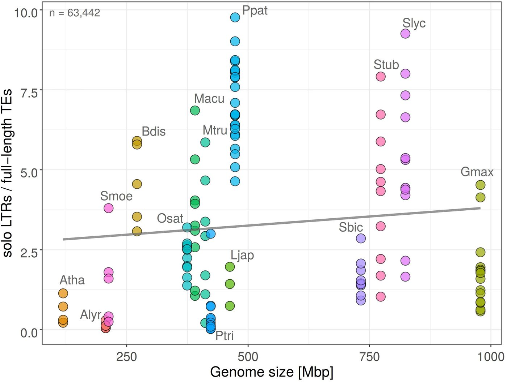

15 种植物中，solo-LTR 与全长 LTR 反转录转座子的数量比对基因组大小作图。每个点是一条染色体，不同颜色是不同物种。这是统计图，不是“两条 LTR 不等交换后只剩一个 LTR”的结构示意。

署名：Pavel Jedlicka、Matej Lexa、Eduard Kejnovsky，2020，Frontiers in Plant Science，DOI 10.3389/fpls.2020.00644，Figure 3，CC BY 4.0（https://creativecommons.org/licenses/by/4.0/），未修改。

**图 3-3**　基因转换与 solo-LTR 形成的关系

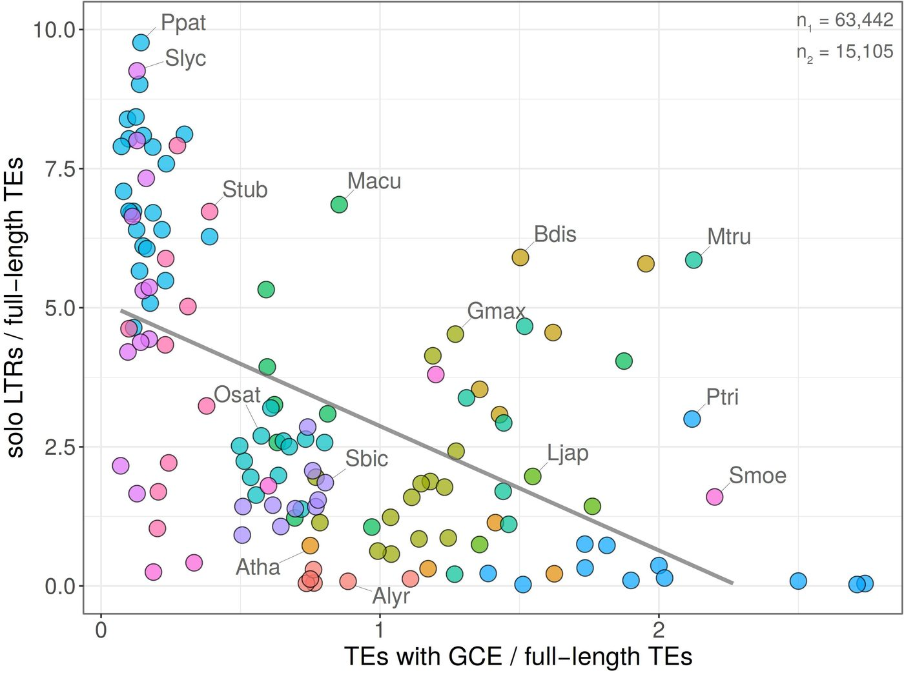

基因转换事件的多少，对 solo-LTR/全长元件比值作图。图中显示：基因转换多的染色体，solo-LTR 比例往往更低。说明 solo-LTR 不是 LTR 序列匀质化的唯一途径。

署名：Pavel Jedlicka、Matej Lexa、Eduard Kejnovsky，2020，Frontiers in Plant Science，DOI 10.3389/fpls.2020.00644，Figure 8，CC BY 4.0（https://creativecommons.org/licenses/by/4.0/），未修改。


**图 3-4**　solo-LTR 的形成

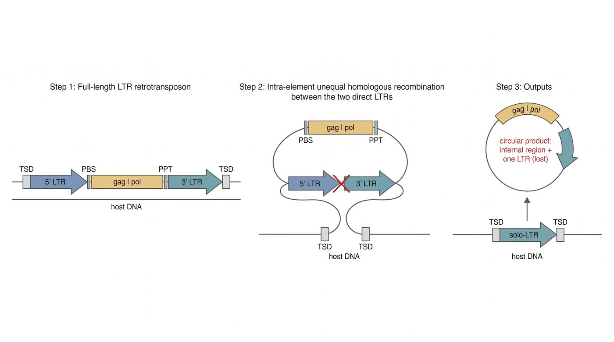

solo-LTR 的形成。完整 LTR 元件两端同向的 LTR 之间发生不等同源重组，内部区和一个 LTR 被切除，染色体上只留下一个 LTR，两侧的 TSD 仍在。示意图，由 AI 生成，非已发表图。


如果LTR反转录转座子只进不出，植物基因组将在极短的演化时间内无限膨胀直至崩溃。实际上，宿主基因组中存在一种极其高效且与LTR结构直接挂钩的自我清除机制——**单LTR（solo-LTR）的形成**。

由于一条完整的LTR反转录转座子两端拥有长度数百bp至数kb、序列高度一致的同向重复序列（5'-LTR与3'-LTR），它们在DNA复制或减数分裂重组过程中极易发生**元件内不等同源重组（intra-element unequal homologous recombination）**。具体而言，当同一条染色体上的5'-LTR与3'-LTR发生错配联会并完成同源交换时，位于两个LTR之间的整个内部编码区（*gag*、*pol*、PBS、PPT）连同一个杂合LTR会被环化切除，形成一个游离的环状DNA分子（在细胞分裂过程中迅速丢失），而留在染色体原位上的仅仅是一个由原始5'-LTR前半段与3'-LTR后半段拼接而成的单一LTR序列，即**solo-LTR**。

辨别一个solo-LTR与普通LTR断裂残片的黄金分子特征在于其两侧的TSD：由于solo-LTR是通过保留原始元件最外侧边界的同源重组产生的，它两侧依然完好地保留着原始完整元件插入时留下的那一对相同的4至6 bp TSD。在许多植物基因组（如水稻、拟南芥和葡萄）中，solo-LTR的拷贝数往往远远超过完整LTR拷贝的数量。比较基因组学中常使用“solo-LTR与完整LTR的比值（solo:intact ratio）”来定量衡量一个物种清除冗余DNA、对抗基因组膨胀的重组效率。一般而言，LTR长度越长、重组率越高的染色体常染色质区，越容易发生同源重组并积累高比例的solo-LTR；而在重组受抑制的着丝粒异染色质区，完整拷贝和嵌套拷贝则更容易被长期保留。

除了通过同源重组彻底清除内部区域的solo-LTR外，LTR反转录转座子在演化中还频繁衍生出两类结构完整、但完全丧失编码能力的非自主型元件：**LARD**（large retrotransposon derivatives，大型反转录转座子衍生物）与**TRIM**（terminal-repeat retrotransposons in miniature，末端重复反转录转座子微型元件）[待确认]。

**LARD**最初在大麦等禾本科植物中被系统描述，全长通常在4 kb以上，两端拥有长达数kb的完整同向LTR、保守的PBS和PPT以及清晰的5 bp TSD，但其内部区域完全不含任何可识别的*gag*或*pol*开放阅读框，取而代之的是一段长度数kb、富含二级结构的非编码序列[待确认]。**TRIM**则是由Witte等人最早在马铃薯、拟南芥等双子叶植物中鉴定的极度精简型非自主LTR元件[待确认]。TRIM的全长通常仅有300 bp至1000 bp，两端LTR极短（多在100至250 bp之间），中间仅隔着约100至300 bp的内部非编码区，但依然完整保留了`TG...CA`末端、PBS、PPT及5 bp TSD。

LARD和TRIM虽然不编码任何蛋白质，却保留了转录、包装进VLP、反转录和整合所需的全部顺式作用信号。只要宿主基因组中存在共享同源LTR或VLP包装信号的活跃自主型LTR反转录转座子，LARD和TRIM就能反式劫持其Gag、RT和INT蛋白机器完成“复制-粘贴”扩增。由于TRIM体型极小、对宿主基因破坏力低，它们在许多植物（包括葡萄、水稻和十字花科植物）的基因邻近区域和内含子中广泛分布，常作为顺式调控元件的潜在供体参与基因表达演化。

## 3.2 非LTR反转录转座子：LINE与SINE

### 3.2.1 LINE元件的结构特征与5'端截短现象

与两端带有长末端重复序列、在细胞质VLP中完成反转录的LTR元件不同，非LTR反转录转座子（non-LTR retrotransposons）采用一套截然不同的结构设计与原位整合策略。非LTR反转录转座子主要包括两大目：自主型的**长散在核元件（LINE，long interspersed nuclear elements）**与非自主型的**短散在核元件（SINE，short interspersed nuclear elements）**（doi:10.1038/nrg2165）。

一条结构完整的自主型LINE元件全长通常在4 kb至7 kb之间，两端没有任何长末端重复序列（既无LTR也无TIR），其结构由5'端至3'端依次由**5'非翻译区（5' UTR）**、**两个开放阅读框（ORF1和ORF2）**以及**3'非翻译区（3' UTR）和3'端poly(A)尾**（部分演化分支为简单串联重复尾）构成。LINE的5' UTR极具特色：它内部包含一个由宿主RNA聚合酶Ⅱ识别的**内部启动子（internal promoter）**，转录起始位点位于元件的最5'端边界。这种内部启动子设计使得LINE转录出的mRNA能够包含完整的5' UTR信息，从而保证子代拷贝在整合到新位点后依然自带启动子并保持转录活性。

在编码区方面，**ORF1**编码一种RNA结合蛋白（ORF1p），通常具有卷曲螺旋（coiled-coil）结构域和核酸伴侣活性，能够以三聚体形式大量结合LINE的mRNA，形成核糖核蛋白复合物（RNP），保护RNA免受降解并协助其在细胞核内与靶DNA退火。**ORF2**编码一种多功能大型酶蛋白（ORF2p），集中了LINE转座所需的两大核心催化结构域：**核酸内切酶（endonuclease，EN）**与**逆转录酶（reverse transcriptase，RT）**。依据核酸内切酶的演化起源，真核生物LINE可分为两大演化谱系：较古老的分支（如*R2*类元件）在C端编码限制性内切酶样（REL）结构域，常具有高度位点特异性（例如特异性插入核糖体RNA基因内部）；而在植物和哺乳动物中占绝对主导地位的现代分支（如哺乳动物的L1和植物中的L1、*RTE*类元件）则在N端编码无嘌呤/无嘧啶内切酶样（APE-like）结构域，识别基因组中广泛分布的富含AT的松散靶位点（例如人类L1偏好`5'-TTTT/AA-3'`）[待确认]。

LINE元件在真核生物基因组中留下了一个极具标志性的分子现象——**高频的5'端截短（5' truncation）**。在绝大多数植物和动物基因组中，高达90%以上的LINE拷贝都是不完整的，它们完好地保留了3'端的poly(A)尾和3' UTR，但5'端却发生了不同程度的随机缺失，缺失长度从几百bp到几乎覆盖整个ORF2和ORF1不等。这种普遍的5'端截短直接源于LINE从3'端向5'端进行的原位反转录机制：逆转录酶在合成cDNA的过程中进程性（processivity）有限，容易在半途中从RNA模板上解离脱落，或者遭遇宿主细胞内DNA修复酶的提前截断，导致反转录在尚未抵达RNA的5'端之前便草草结束。由于缺失了位于5' UTR的内部启动子和核心编码区，绝大多数新产生的5'截短LINE拷贝自诞生之日起就丧失了再次转座的能力，沦为基因组中静默的“死拷贝”（dead-on-arrival）。此外，LINE插入两侧的靶位点重复（TSD）长度并不像LTR元件那样严格固定在5 bp，而是在7至20 bp之间剧烈波动，有时甚至伴随靶位点小片段缺失。

### 3.2.2 靶标引物反转录（TPRT）机制

LINE元件最核心的分子生物学创新在于其独特的反转录与整合偶联机制——**靶标引物反转录（target-primed reverse transcription，简称TPRT）**。该机制最初由Luan等人于1993年在研究家蚕*R2*元件时通过体外生化实验首次阐明[待确认]，随后被证实是所有非LTR反转录转座子（包括LINE和SINE）共有的扩增引擎。

与LTR反转录转座子“先在细胞质VLP中合成完整双链cDNA、再运入细胞核由整合酶插入”的两步分离策略完全不同，LINE元件的反转录与基因组整合是在**细胞核内的染色体靶位点上同步原位完成**的。其分子步骤如下：

1. **转录与顺式偏好的RNP组装**：宿主Pol II从LINE的5' UTR内部启动子启动转录，产生全长带poly(A)尾的mRNA。mRNA出核翻译产生ORF1p和ORF2p。值得注意的是，LINE表现出强烈的**顺式偏好（*cis*-preference）**，即新翻译出来的ORF1p和ORF2p在核糖体附近优先结合编码它们自身的那一条LINE mRNA，共同组装成核糖核蛋白颗粒（RNP）。这种顺式偏好极大地避免了酶蛋白被基因组中大量退化的无功能LINE RNA稀释，是自主型LINE在演化中维持扩增效率的关键策略。
2. **核输入与靶DNA底链切口**：RNP复合体进入细胞核，搜寻染色体上的适宜靶位点。ORF2p的核酸内切酶（EN）结构域在宿主靶DNA双链的其中一条链（底链）上切开一个单链缺口，暴露出一个游离的`3'-OH`末端（在APE型LINE中，该切口通常位于一段富含胸腺嘧啶`TTTT`序列的3'端）。
3. **退火与原位负链cDNA合成**：LINE mRNA的3'端poly(A)尾与靶DNA切口处暴露出的富含T的单链区段发生碱基互补配对（退火）。紧接着，ORF2p的逆转录酶（RT）直接利用宿主染色体断裂处的游离`3'-OH`作为引物，以LINE mRNA为模板，在染色体切口处原位启动负链cDNA的合成。这正是“靶标引物反转录”名称的由来——不需要像LTR元件那样借用宿主tRNA，宿主染色体DNA自身就是引物。
4. **顶链切割、正链合成与TSD形成**：随着负链cDNA沿mRNA模板向5'方向延伸，宿主DNA的另一条链（顶链）在距离底链切口下游约7至20 bp的位置发生第二链切割（该切割可由ORF2p或宿主修复核酸酶介导）。随后，mRNA模板被降解或置换，负链cDNA的3'端通过微同源配对（microhomology）与顶链切口退火，启动正链cDNA的合成。最后，宿主DNA聚合酶与连接酶修补两侧缺口。由于底链切口与顶链切口之间存在7至20 bp的交错距离，修复填补后便在新整合的LINE拷贝两侧生成了长度可变的TSD。

TPRT机制完美解释了LINE元件的两个典型基因组特征：第一，由于第二链切口位置不像经典DDE整合酶那样具有刚性的空间几何约束，导致非LTR元件的TSD长度高度可变；第二，如果逆转录酶在合成负链cDNA中途脱落，或者顶链提前发生微同源配对截断了反转录进程，就会直接产生5'端截短的插入拷贝。

### 3.2.3 SINE元件的起源与对LINE的反式寄生关系

短散在核元件（SINE）是一类全长仅约80至500 bp、完全不编码任何蛋白质的非自主型非LTR反转录转座子（doi:10.1038/nrg2165）。尽管SINE体型微小且自身毫无酶学活性，它们却是某些真核生物（如灵长类动物）基因组中拷贝数最为庞大的转座子家族，堪称基因组中最成功的分子寄生者。

与源自自主型元件内部缺失的*Ds*、MITEs或TRIM不同，**SINE元件拥有独立于LINE的演化起源**——它们几乎全部起源于宿主细胞内由**RNA聚合酶Ⅲ（Pol III）**转录的小型功能性非编码RNA基因的反转录拷贝。根据5'端头部序列的同源来源，真核生物SINE主要分为三大类：
- **tRNA衍生型SINE**：最为古老和普遍，广泛分布于植物、无脊椎动物和绝大多数脊椎动物中。绝大多数植物SINE均属于此类。
- **7SL RNA衍生型SINE**：起源于信号识别颗粒中的7SL RNA，最著名的代表是人类和灵长类基因组中拷贝数超过百万的*Alu*元件以及啮齿类中的*B1*元件[待确认]。
- **5S rRNA衍生型SINE**：起源于核糖体5S rRNA，常见于部分鱼类、软体动物和少数植物中。

一条典型的SINE元件在结构上呈现清晰的三段式嵌合架构：**5'端头部**保留了原始tRNA、7SL RNA或5S rRNA的同源序列，内部包含完整的Pol III内部启动子（如tRNA衍生型SINE中高度保守的A框和B框，相距约30至40 bp），确保SINE自身能够在宿主核内高效转录；**中间主体区（body）**起源不明或源自不同SINE家族间的重组片段，有时包含保守的中央核心结构域；**3'端尾部**则是一段poly(A)尾、富含A的简单重复序列，或者是一段与特定伴侣LINE元件的3' UTR高度同源的序列。

SINE自身不编码核酸内切酶和逆转录酶，它必须依赖同一细胞核内活跃的伴侣LINE元件提供的ORF2p（有时亦需ORF1p），通过反式劫持TPRT机制完成扩增。根据SINE的3'端尾部与伴侣LINE之间的识别严格程度，学界将SINE对LINE的寄生关系分为两种模式：
- **严格识别型（stringent recognition）**：在许多植物、鱼类和昆虫中，特定LINE的ORF2p必须特异性识别其自身3' UTR末端的一段保守茎环结构才能启动反转录。相应的，寄生于这类LINE的SINE元件（如植物中许多*RTE*伴侣型SINE）必须在3'端演化出与该伴侣LINE的3' UTR高度同源的序列，才能成功“欺骗”并劫持LINE的反转录酶。
- **宽松识别型（relaxed recognition）**：以哺乳动物L1和部分植物L1类LINE为代表，其ORF2p对3'端序列的要求相对宽松，只要RNA分子具有poly(A)尾就能被识别并启动TPRT。例如，人类*Alu*元件正是利用这一宽松特性，借助自身携带的poly(A)尾，以极高的效率反式劫持L1的ORF2p完成海量扩增。

从演化关系看，SINE的兴衰与伴侣LINE的命运紧密绑定。虽然自主型LINE具有强烈的顺式偏好，但SINE凭借Pol III启动子的超高转录活性、极短的序列长度（逆转录酶极易一次性合成全长而不发生截短）以及对宿主基因较低的破坏代价，在基因组内的扩增效率往往远超其伴侣LINE本身。

### 3.2.4 植物与动物中LINE/SINE的丰度差异与局部功能影响

跨界比较揭示了一个引人深思的演化反差：在人类和小鼠等哺乳动物基因组中，非LTR反转录转座子（尤其是L1和*Alu*/*B1*）占据了全基因组30%以上的碱基总量，是塑造哺乳动物基因组结构与演化的绝对主角；然而，在几乎所有已测序的高等植物（包括拟南芥、水稻、玉米、小麦和葡萄）基因组中，LINE和SINE的总体丰度却普遍处于低谷，二者合计通常仅占植物全基因组的1%至5%左右[待确认]。

为何植物与哺乳动物在非LTR反转录转座子的丰度上存在如此悬殊的差异？目前学术界认为这并非单一原因所致，而是多方面演化力量共同作用的结果。首先，植物基因组中LTR反转录转座子（尤其是*Gypsy*和*Copia*）的爆发势头极其迅猛，在基因组生态位中占据了压倒性优势；同时，植物具有极高的不等同源重组和非法重组清除速率，基因组DNA的半衰期远短于哺乳动物，导致缺乏长期爆发能力的古老LINE拷贝被迅速清除。其次，植物演化出了极为严密且多层次的RNA导向DNA甲基化（RdDM）与异染色质沉默体系（详见第5章），能够针对高拷贝转座子迅速产生24-nt siRNA并建立跨代遗传的稳定甲基化沉默，极大压缩了LINE元件的活跃窗口。相比之下，哺乳动物在胚胎发育和生殖细胞形成过程中会经历全基因组范围的DNA甲基化擦除与重编程，这为L1和*Alu*等非LTR元件在生殖系中反复逃逸沉默并实现爆发提供了周期性的机会窗口。

然而，初学者在植物基因组研究中切忌陷入“占比低等于不重要”的认知误区。尽管LINE和SINE在植物全基因组碱基总量中所占比例微不足道，但它们在局部基因区、表观遗传变异与作物重要农艺性状形成中却屡屡扮演关键角色。与高度富集于着丝粒异染色质区的*Gypsy*元件不同，植物中的SINE和许多年轻LINE拷贝经常插入到基因丰富的常染色质臂、基因内含子以及启动子侧翼区域。

植物学界最著名的案例之一发生在油棕（*Elaeis guineensis*）中。在通过组织培养大规模微繁油棕时，常出现一种名为“套果”（mantled）的严重体细胞克隆变异，导致花器官同源异型转化、果实败育和产量暴跌。全基因组甲基化与遗传学研究最终揭开了谜底：油棕花器官发育关键MADS-box基因*DEFICIENS*（*EgDEF1*）的内含子中插入了一个名为*Karma*的LINE反转录转座子（doi:10.1038/nature15365）。在正常植株中，*Karma*元件处于高度DNA甲基化沉默状态（称为“Good Karma”表观等位基因），*EgDEF1*基因正常剪接表达；而在组织培养胁迫下，*Karma*元件发生去甲基化（称为“Bad Karma”表观等位基因），导致*EgDEF1*转录本在*Karma*内部发生异常可变剪接与提前终止，最终引发毁灭性的套果表型（doi:10.1038/nature15365）。类似地，在葡萄、马铃薯、玉米和拟南芥中，也已报道多例SINE或LINE插入改变邻近基因甲基化边界、调控胁迫响应转录或成为分子标记用于品种与克隆系鉴定的实例。因此，在植物转座子注释与功能挖掘中，对LINE和SINE的精准识别同样不可或缺。

## 3.3 DIRS、PLE及其他特殊反转录元件

### 3.3.1 DIRS元件：酪氨酸重组酶与环状DNA中间体机制


**图 3-5**　DIRS-1 的末端结构与环状中间体

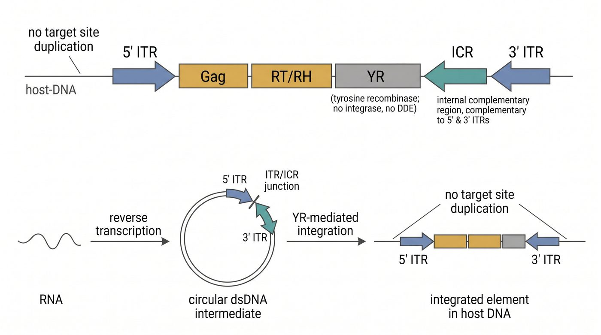

DIRS-1 的非典型末端（5 端 ITR、3 端 ITR 与内部互补区 ICR），编码 Gag、RT/RH 和酪氨酸重组酶 YR，经环状双链 DNA 中间体整合，不产生 TSD。环状中间体上只标了 ITR/ICR 交界，没有单独标出 ICR；编码区也未画出表 13.16 所列的甲基转移酶（MT）结构域。示意图，由 AI 生成，非已发表图。


在绝大多数教科书和植物基因组学文献中，Ⅰ类反转录转座子常被简化为“LTR”与“非LTR（LINE/SINE）”两大阵营。然而，随着跨界基因组测序向原生生物、真菌、无脊椎动物及低等植物延伸，研究者陆续发现了若干打破常规认知的特殊反转录元件。在Wicker统一分类体系中，**DIRS**（*Dictyostelium* intermediate repeat sequence，盘基网柄菌中间重复序列，三字母代码`RYD`）与**PLE**（*Penelope*-like elements，佩内洛普样元件，三字母代码`RPP`）被确立为与LTR、LINE、SINE平级的两个独立目（doi:10.1038/nrg2165）。剖析这两类“非主流”元件的分子机制，不仅能完善对Ⅰ类转座子演化全景的理解，更能揭示转座子在演化中自由拼装催化模块的底层逻辑。

DIRS元件最早于20世纪80年代在黏菌——盘基网柄菌（*Dictyostelium discoideum*）中被发现（最初命名为DIRS-1）[待确认]。随后，基因组挖掘证实DIRS目下至少包含*DIRS*、*Ngaro*和*VIPER*三个超家族，广泛分布于真核生物的多个主要演化支中（doi:10.1038/nrg2165）。

从宏观结构上看，DIRS元件全长通常在4 kb至6 kb之间，其末端重复结构与经典LTR反转录转座子截然不同。典型DIRS元件的两端并非同向重复的LTR，而是**末端反向重复序列（inverted terminal repeats，ITRs）**，或者在*Ngaro*超家族中表现为**分裂正向重复序列（split direct repeats，SDRs，即`A1-...-B1-A2-...-B2`的交替排列）**；在DIRS内部区域还存在一段与两端ITR互补配对的**内部互补区（internal complementary region，ICR）**。

DIRS元件最具革命性的分子特征在于其内部编码区。与经典LTR元件一样，DIRS编码一个类似*gag*的结构蛋白以及包含逆转录酶（RT）和核糖核酸酶H（RH）的*pol*区（部分DIRS还携带一个甲基转移酶样结构域MT）；但是，DIRS**完全不编码经典LTR元件所依赖的DDE型整合酶（INT），也不编码LINE元件的核酸内切酶（EN），而是编码一个酪氨酸重组酶（tyrosine recombinase，YR）**（doi:10.1038/nrg2165）。酪氨酸重组酶是一类古老的位点特异性重组酶，在原核生物噬菌体（如大肠杆菌$\lambda$噬菌体整合酶）和细菌质粒中极为常见，它利用活性中心的保守酪氨酸残基对DNA骨架进行亲核攻击，通过形成共价蛋白-DNA中间体和霍利迪交叉（Holliday junction）完成DNA链的交换与整合。

由酪氨酸重组酶主导的整合机制，赋予了DIRS元件一套独一无二的生活史路径：
1. **转录与反转录**：宿主RNA聚合酶Ⅱ转录产生全长DIRS RNA，随后在逆转录酶和RNase H的催化下合成双链cDNA。
2. **环状双链DNA中间体的形成**：借助两端ITR（或SDR）与内部互补区（ICR）的序列配对，DIRS在反转录过程中通过特殊的链转移步骤，直接合成出一个**游离的闭环双链DNA中间体（circular dsDNA intermediate）**，而不是像LTR元件那样形成带有游离末端的线性双链cDNA。
3. **位点特异性重组整合**：DIRS编码的酪氨酸重组酶识别环状DNA中间体上的特定重组位点以及宿主染色体上的靶位点，催化二者之间发生保守的位点特异性重组，将整个环状DNA线性化并无缝嵌入宿主基因组。

这一独特的整合机制留下了一个极具诊断价值的基因组分子特征：**DIRS元件整合到宿主基因组时完全不产生靶位点重复（TSD）**（doi:10.1038/nrg2165）。由于酪氨酸重组酶介导的是精确的链交换而非DDE整合酶或核酸内切酶制造的交错双链切口，插入位点两侧不会出现任何宿主序列的重复拷贝。这一特征使得DIRS在结构上同时打破了“反转录转座子必有TSD”和“末端反向重复序列仅见于Ⅱ类DNA转座子”这两条常被初学者误信的经验教条。

### 3.3.2 Penelope样元件（PLE）：结构特征与TPRT变体

PLE 的结构实例见图 13-6。


**Penelope样元件（PLE）**最初是在研究果蝇（*Drosophila virilis*）杂种劣育（hybrid dysgenesis）现象时被意外发现的[待确认]。杂种劣育是指特定品系杂交后代中出现性腺萎缩、高突变率和染色体断裂等综合征，原本以为仅由Ⅱ类DNA转座子（如*D. melanogaster*中的*P*元件）引发，但研究者在*D. virilis*中克隆出的致病元件*Penelope*却被证实是一种结构极其怪异的反转录转座子[待确认]。

PLE在结构上呈现出一系列令人困惑的“混搭”特征，使其在很长一段时间内难以被归入LTR或非LTR中的任何一类。一条典型的自主型PLE全长约3 kb至4 kb，其最显著的外观特征是两端常常带有**假长末端重复序列（pseudo-LTRs，简称pLTRs）**。之所以称之为“假LTR”，是因为与经典LTR元件两端严格同向且长度一致的LTR不同，PLE两端的pLTRs既可以呈同向排列，也可以呈反向排列，甚至在部分拷贝中完全缺失或仅保留一端。此外，许多PLE拷贝在内部编码区中竟然保留了**剪接体识别的内含子（introns）**——这在绝大多数反转录转座子中极为罕见，因为经过RNA剪接中间体的反转录过程通常会将内含子彻底剔除，PLE中内含子的留存说明其部分RNA模板是在尚未完成剪接前就被反转录并整合回了基因组。

在编码区方面，典型自主型PLE仅包含一个单一的开放阅读框，编码一种融合了**逆转录酶（RT）**与**GIY-YIG型核酸内切酶（EN）**的多功能蛋白（doi:10.1038/nrg2165）。系统发育分析揭示了PLE极其古老的演化地位：PLE的逆转录酶结构域与经典LTR元件或LINE元件的RT亲缘关系都较远，反而与所有真核生物维持染色体末端长度所必需的**端粒酶逆转录酶（telomerase reverse transcriptase，TERT）**聚为最近的姐妹支[待确认]。而其C端的核酸内切酶属于GIY-YIG超家族（以保守的氨基酸基序命名），这与LINE元件使用的APE型或REL型核酸内切酶毫无同源关系，却与原核生物和真核细胞器中的归巢内含子（homing endonucleases）及细菌DNA修复酶UvrC同源。

在转座机制上，PLE并不像LTR元件那样在胞质VLP中合成线性cDNA，而是采用了一种**靶标引物反转录（TPRT）的变体机制**。PLE编码的GIY-YIG核酸内切酶在宿主靶DNA上制造交错切口，利用宿主DNA的游离3'-OH作为引物，以PLE RNA为模板原位反转录合成cDNA。由于采用TPRT机制，PLE在基因组中同样表现出两大与LINE相似的分子特征：一是频繁发生**5'端截短**；二是在插入位点两侧产生**长度可变的TSD**（通常在6至12 bp之间）（doi:10.1038/nrg2165）。至于其两端的pLTRs，目前普遍认为它们并非像经典LTR那样通过双链转移机制生成，而是在连续的串联转录或串联整合过程中偶然形成的副产物。

在PLE目内部，还存在一个演化上极其迷人的特殊亚群——**端粒相关PLE（如*Athena*元件）**。这类PLE完全丧失了GIY-YIG核酸内切酶结构域，因此无法在染色体内部随机切割靶位点；相反，它们直接利用染色体端粒天然暴露的游离3'-OH末端作为引物，通过类似端粒酶的方式将自身反转录拷贝直接添加到染色体末端，在蛭形轮虫、部分真菌及少数低等真核生物的端粒维持中发挥着类似于端粒酶的生物学功能[待确认]。这一发现为“真核生物端粒酶起源于古老反转录转座子驯化”的假说提供了强有力的活体演化证据。

### 3.3.3 特殊反转录元件在植物中的分布稀缺性与演化起源

如果将视线拉回到高等植物（特别是被子植物）以及本书的范例物种葡萄属（*Vitis*），一个鲜明的生物地理学与基因组学格局便会浮现：**DIRS和PLE在绝大多数已测序的被子植物基因组中极度稀缺，甚至完全缺失**。在拟南芥、水稻、玉米、小麦以及栽培葡萄等主流被子植物参考基因组中，常规基因组注释几乎检不出任何完整的DIRS或PLE拷贝；然而，在绿色植物谱系的基部类群（如绿藻、苔藓、石松类、蕨类以及部分裸子植物）中，研究者却零星鉴定出了结构可辨的DIRS（尤其是*Ngaro*类）和PLE元件[待确认]。

这种在真核生物生命之树上呈现“广泛而零散的斑块状分布（patchy distribution）”，引发了关于特殊反转录元件演化起源与消亡机制的深入讨论。

目前学界的主流假说认为，DIRS和PLE并非晚近独立起源的新元件，而是扎根于真核生物演化极早期的**古老祖先谱系**，很可能在最后真核生物共同祖先（LECA）时期就已经存在。它们与LTR、LINE的共存，生动展示了转座子演化中的**“模块化拼装”（modular evolution）**法则：在长达十数亿年的演化史中，核心逆转录酶（RT）模块就像乐高积木的底座，反复与不同来源的DNA切割/整合模块发生重组——RT与DDE整合酶结合演化出LTR反转录转座子，与APE/REL内切酶结合演化出LINE，与GIY-YIG内切酶结合演化出PLE，而与源自噬菌体的酪氨酸重组酶结合则演化出了DIRS。

既然DIRS和PLE在真核生物早期就已广泛存在，为何它们在陆生植物（尤其是被子植物）演化辐射过程中大面积销声匿迹？这一现象通常归因于三重演化过滤机制的叠加效应：
1. **随机丢失（stochastic loss）与低拷贝瓶颈**：与能够在单次爆发中产生数万个拷贝的*Gypsy*和*Copia*不同，DIRS和PLE在大多数宿主基因组中长期维持着极低的拷贝数（往往仅存数个至数十个拷贝）。在植物漫长的物种分化、种群瓶颈和全基因组复制后的二倍体化基因丢失过程中，低拷贝元件极易因遗传漂变或随机大片段缺失而被彻底从基因组中抹除。
2. **宿主基因组内生态位竞争**：被子植物基因组中LTR反转录转座子的扩增能力极强，且伴随极高的不等同源重组清除速率，导致整个基因组DNA的周转速度极快。未能演化出高效扩增策略或异染色质靶向躲避机制的DIRS和PLE，在基因组生态位竞争中处于绝对劣势。
3. **植物表观遗传防御体系的强力压制**：陆生植物演化出的多层次小RNA与DNA甲基化沉默网络（尤其是RdDM通路）对低拷贝入侵元件具有极高的识别与封锁效率。一旦仅存的几个自主型DIRS或PLE拷贝被彻底甲基化锁定，整个目就会在该植物谱系中走向不可逆的灭绝。当然，在部分谱系中也不排除通过真菌、昆虫或寄生植物介导的偶然水平转移（HTT）重新引入这些特殊元件的可能性。

### 3.3.4 常规注释流程中易被漏检的原因与识别策略

对于从事植物基因组学和生物信息学实践的研究者而言，理解DIRS和PLE的另一个重要现实意义在于：**必须清醒地认识到，当前主流的全基因组转座子自动化注释流程对这类特殊反转录元件存在严重的系统性盲区**。在声称“某物种基因组中不含DIRS或PLE”之前，必须先排除“并非生物学缺失，而是注释工具漏检”的方法学假象。

常规注释流程漏检DIRS和PLE主要源于四个技术瓶颈：
1. **结构预测算法的特征假设不匹配**：当前植物基因组注释的标配整合工具（如EDTA、LTR_retriever）在预测Ⅰ类元件时，核心结构搜索模块专门针对经典LTR反转录转座子设计——它们严格搜寻“相距1至15 kb、方向相同、末端为`TG...CA`、且两侧带有4至6 bp TSD”的成对重复序列。DIRS元件两端为反向重复（ITR）或分裂正向重复（SDR），且完全没有TSD；PLE的pLTR长度和方向高度不稳定，且TSD长度剧烈波动。因此，这两类元件在进入结构预测流程的第一步就会被直接过滤淘汰。
2. **从头重复序列聚类算法的拷贝数阈值限制**：像RepeatModeler（底层调用RECON和RepeatScout）这类不依赖预设结构特征的从头预测工具，核心原理是通过寻找基因组中高频重复出现的*k*-mer或局部比对簇来构建一致性序列。然而，DIRS和PLE在植物基因组中即使存在，往往也仅以极低拷贝数（例如1至5个拷贝，且多为退化片段）存在，根本无法达到从头聚类算法所需的最低拷贝数阈值，因而在构库阶段即被当作单拷贝宿主序列忽略。
3. **公共参考数据库的严重覆盖不足**：在Repbase和Dfam等公共数据库中，植物来源的DIRS和PLE精修条目寥寥无几。由于非编码区演化极快，直接用动物（如果蝇、斑马鱼）或黏菌的DIRS/PLE核苷酸序列去对植物基因组进行RepeatMasker同源比对，其灵敏度几乎为零。
4. **错误归类导致的“隐身”**：即便个别拷贝数稍高的DIRS或PLE片段偶然被从头预测工具捕获，由于常规分类器缺乏针对酪氨酸重组酶或GIY-YIG结构域的判别规则，这些序列也极易被错误地贴上`Unknown`、`LTR/unknown`甚至`DNA/TIR`（因DIRS具有末端反向重复序列）的错误标签，隐藏在庞大的未分类列表之中。

因此，如果一项研究的目标是全面普查某一植物类群（例如跨越整个葡萄科或更广泛的双子叶植物谱系）中反转录转座子的深层演化历史，绝不能止步于常规的EDTA或RepeatModeler汇总表，而必须采用**基于蛋白质结构域轮廓隐马尔可夫模型（profile HMM）的靶向挖掘策略**：
- 首先，将目标基因组进行六阅读框翻译，或提取全基因组预测的重复序列与长开放阅读框；
- 其次，使用HMMER等高灵敏度蛋白域搜索工具，专门针对**酪氨酸重组酶（YR）**、**GIY-YIG核酸内切酶**以及**TERT样逆转录酶**等特征性保守结构域进行全基因组扫描；
- 最后，对筛出的阳性候选位点提取上下游各5至10 kb的侧翼序列，通过点阵图（dotplot）人工核查是否存在ITR/SDR/ICR（DIRS特征）或pLTR/可变TSD（PLE特征），并结合RT结构域系统发育树进行最终确证。

通过本章的系统梳理，我们完整走过了Ⅰ类反转录转座子从经典LTR（*Copia*与*Gypsy*）、非LTR（LINE与SINE）到特殊元件（DIRS与PLE）的结构与生活史图谱。下一章，我们将转向另一大阵营——不经RNA中间体、直接以DNA分子进行移动与扩增的Ⅱ类DNA转座子。

## 本章参考文献

- doi:10.1038/nrg2165
- Ong-Abdullah, M., Ordway, J. M., Jiang, N., et al. (2015). Loss of Karma transposon methylation underlies the mantled somaclonal variant of oil palm. *Nature*. doi:10.1038/nature15365


# 第4章 Ⅱ类转座子（DNA转座子）的结构与生活史

## 4.1 经典“剪切-粘贴”型TIR DNA转座子

### 4.1.1 末端反向重复序列与DDE/DDD转座酶的催化机制

在Wicker统一分类体系中，Ⅱ类亚纲1的末端反向重复序列（terminal inverted repeat，TIR）元件是真核生物中最早被发现、机制研究最透彻的DNA转座子大类（doi:10.1038/nrg2165）。Barbara McClintock在玉米中发现的*Ac*/*Ds*系统即属于此类。与Ⅰ类反转录转座子必须借助RNA中间体和逆转录酶不同，经典TIR DNA转座子直接以双链DNA分子作为移动载体，通过“剪切-粘贴”（cut-and-paste）机制在宿主染色体间转移。

一条完整的自主型TIR DNA转座子全长通常在1 kb至15 kb之间，其基本结构由两端的**末端反向重复序列（TIR）**和中央编码**转座酶（transposase，TPase）**的开放阅读框组成。TIR是位于转座子5'端和3'端、序列互补且方向相反的DNA片段，长度因超家族而异，短则约10 bp，长可达数百bp。在部分结构复杂的超家族（如*hAT*和*CACTA*）中，紧邻TIR内侧还存在多拷贝串联或散在排列的**亚末端重复序列（subterminal repeats）**，它们与TIR协同作用，共同构成转座酶特异性识别和结合的顺式作用平台。

绝大多数经典TIR DNA转座子编码的转座酶都属于**DDE/DDD催化超家族**。尽管不同超家族转座酶的整体氨基酸序列分歧极大，但它们的催化核心在三维空间构象上高度保守，均呈现核糖核酸酶H样折叠（RNase H-like fold），活性中心包含三个空间上紧密相邻的酸性氨基酸残基（两个天冬氨酸D和一个谷氨酸E，或三个天冬氨酸D）。这三个酸性残基负责精确螯合两个二价金属离子（生理条件下主要为$\text{Mg}^{2+}$），通过双金属离子催化机制完成DNA磷酸二酯键的水解与转酯反应。

经典“剪切-粘贴”转座的分子过程可以分为四个紧密衔接的生化步骤：

1. **转座体（transpososome）组装**：转座酶分子通过其N端的DNA结合域（如螺旋-转角-螺旋HTH结构域或BED锌指结构域）特异性识别并结合转座子两端的TIR及亚末端重复序列。随后，结合在两端的转座酶亚基发生寡聚化（通常形成二聚体或四聚体），将相距数kb的转座子5'端和3'端拉近并配对，组装成结构高度稳定的核蛋白复合体——突触复合体（synaptic complex，又称转座体）。这一步骤保证了双端切割的严格同步，避免单端盲目切割引发宿主染色体灾难性断裂。
2. **双链切割与供体位点切离**：在转座体内部，转座酶的DDE/DDD催化中心首先激活水分子，对转座子两端特定链的磷酸二酯键进行亲核水解，暴露出转座子3'端游离的`3'-OH`基团。紧接着，第二条链（互补链）的切割在不同超家族中演化出了多样的生化路径：例如，在*Tc1/Mariner*超家族中，转座酶直接对互补链进行第二次水解切割；而在*hAT*超家族（如玉米*Ac*）中，暴露出的宿主侧翼DNA的`3'-OH`会反向攻击互补链，在**宿主供体DNA末端**形成一个共价闭合的发夹（hairpin）结构，从而将双链转座子彻底释放下来[待确认]。
3. **靶DNA捕获与链转移（整合）**：携带完整双链转座子DNA的转座体脱离供体位点，在细胞核内扩散并捕获宿主染色体上的新靶位点。转座酶催化转座子两端游离的`3'-OH`基团作为亲核试剂，以直接转酯反应攻击靶DNA双链上的磷酸二酯键。两个`3'-OH`的攻击位点在靶DNA双链上并非正对，而是错开2至11 bp（具体距离由各超家族转座酶的空间几何构象严格决定），形成交错整合。
4. **靶位点缺口修复与TSD形成**：链转移完成后，转座子已共价接入新位点，但整合连接处的两侧各遗留一段单链DNA缺口。宿主细胞内的DNA损伤修复聚合酶和连接酶随即填补单链缺口并封闭切口，最终在新生插入位点两侧生成一对方向相同、序列完全一致的靶位点重复（TSD）（doi:10.1038/nrg2165）。

### 4.1.2 植物中五大主要TIR超家族的特征比较

在Wicker统一分类体系划分的9个TIR超家族中，有5个超家族在高等植物（包括葡萄属植物）基因组中分布最为广泛、拷贝数最为庞大、对植物基因结构和表型演化影响最为深远，分别是**hAT**、**Mutator/MULE**、**CACTA**、**PIF/Harbinger**与**Tc1/Mariner**（doi:10.1038/nrg2165）。熟记这五大超家族的分子指纹，是开展植物转座子分类与注释的基本功。

- **hAT超家族（Wicker代码：`DTA`）**：得名于三个最早发现的代表性元件——玉米的*Ac*、果蝇的*hobo*和金鱼草的*Tam3*。自主型*hAT*元件全长通常在2.5 kb至5 kb之间，两端具有较短的TIR（一般为10至20 bp）以及功能重要的亚末端重复序列。*hAT*超家族最经典的分子标志是插入时恒定产生**8 bp的TSD**（doi:10.1038/nrg2165）。*hAT*元件在植物中极为活跃，常偏好插入基因丰富的常染色质区，是经典的突变诱发因子。
- **Mutator/MULE超家族（Wicker代码：`DTM`，Repbase中常称`MuDR`）**：最早在玉米的*Mutator*高突变品系中发现。自主型元件（如*MuDR*）全长通常在3 kb至6 kb之间，编码一个DDE转座酶（MURA），部分家族还编码一个辅助调控蛋白（MURB）。与*hAT*不同，*Mutator*超家族的TIR往往非常长，可达50 bp至500 bp以上；插入时产生**8至11 bp（最常见为9 bp）的TSD**（doi:10.1038/nrg2165）。*Mutator*超家族在植物基因组演化中有一个极为著名的特征——**Pack-MULE**现象，即非自主型*Mutator*元件能够高频捕获、拼接并扩增宿主编码基因的外显子片段，在水稻、玉米和双子叶植物中参与了大量嵌合假基因及少量新功能基因的起源[待确认]。
- **CACTA超家族（Wicker代码：`DTC`，Repbase中常称`EnSpm`）**：得名于其TIR最外侧高度保守的5个碱基特征序列`5'-CACTA...TAGTG-3'`，代表性元件包括玉米的*Suppressor-mutator*（*Spm*/*En*）和大豆的*Tgm*。自主型*CACTA*元件是植物TIR转座子中的“巨无霸”，全长常在8 kb至15 kb以上，编码两个主要蛋白：负责催化切割整合的转座酶（TnpD）以及负责特异性结合亚末端重复序列、调控转座与表观沉默的DNA结合蛋白（TnpA）。*CACTA*元件的TIR长度通常为10至30 bp，内部紧邻高度重复的亚末端基序，插入时产生**2至3 bp（植物中绝大多数为3 bp）的TSD**（doi:10.1038/nrg2165）。在小麦、大麦等大型禾本科基因组及部分木本植物中，*CACTA*是占比最高的Ⅱ类转座子。
- **PIF/Harbinger超家族（Wicker代码：`DTH`）**：最早在玉米（*PIF*）和拟南芥（*Harbinger*）中被鉴定。自主型*PIF/Harbinger*元件全长通常在3 kb至6 kb之间，其显著的编码特征是包含两个独立的开放阅读框：ORF1编码一个含有Myb/SANT样DNA结合结构域的蛋白，负责识别TIR并将复合体定位于细胞核；ORF2编码核心的DDE转座酶。该超家族的TIR长度一般为10至25 bp，具有极强的靶位点序列偏好性，几乎专一性地插入三核苷酸`TAA`或`TTA`处，产生**3 bp的TSD**（doi:10.1038/nrg2165）。此外，*PIF/Harbinger*超家族是植物中庞大*Tourist*类MITEs家族的直接演化母本。
- **Tc1/Mariner超家族（Wicker代码：`DTT`）**：以线虫*Tc1*和果蝇*Mariner*命名，是自然界中跨界分布最广泛、水平转移最频繁的DNA转座子超家族。自主型元件结构极其精简，全长仅约1.3 kb至2.5 kb，编码单一的DDE/DDD转座酶，TIR长度通常在20至40 bp之间。其最绝对、无一例外的分子特征是专一性插入二核苷酸`TA`位点，产生**2 bp（`TA`）的TSD**（doi:10.1038/nrg2165）。在高等植物基因组中，自主型*Mariner*元件（如大豆中的*Soymar1*或水稻中的*Osmar*）的拷贝数通常极低且大多已失活，但由其演化并反式动员的*Stowaway*类MITEs却在植物基因组中达到了数以万计的惊人规模。

### 4.1.3 切离修复与“足迹”效应：移码突变与等位基因多样性

经典“剪切-粘贴”型TIR转座子与Ⅰ类反转录转座子在引发宿主突变的方式上存在一个根本差异：反转录转座子一旦插入基因内部，除了罕见的solo-LTR同源重组外，几乎是永久滞留的；而TIR DNA转座子在转座酶存在的情况下，可以从已插入的基因位点**物理切离**，使突变表型发生高频回复。然而，这种切离回复在分子水平上极少能将DNA序列完美还原为插入前的野生型状态，而是几乎总会在原位点留下微小的序列疤痕——学界称之为**转座子足迹（transposon footprint）**。

足迹的形成根植于宿主细胞修复双链断裂（DSB）的分子机制。当TIR转座子从供体位点切离后，宿主染色体上留下一个裸露的双链断裂口，断裂口两侧依然保留着当年插入时生成的两份TSD。在植物和动物的体细胞中，修复此类双链断裂最主要的途径是**非同源末端连接（non-homologous end joining，NHEJ）**。由于NHEJ不需要同源模板，直接对断裂末端进行核酸外切酶微加工、聚合酶填补和快速连接，因此几乎必然改变原位点的碱基数目。

以玉米*Ac*/*Ds*所属的*hAT*超家族为例，其足迹形成机制尤为精妙：正如4.1.1节所述，*hAT*转座酶在切离时会在宿主供体DNA的两个断裂末端各自形成一个共价闭合的**发夹环**（包含两份8 bp TSD的末端）。宿主修复核酸酶（如Artemis样核酸酶）必须先将这两个发夹环切开才能进行NHEJ连接。如果切口恰好落在发夹顶端正中，且随后发生少量碱基切除或回文补齐，连接后原位点往往会多出一段长度为6 bp、7 bp或8 bp的回文状小插入序列（源自两份TSD的残余部分），有时则伴随数个碱基的小片段缺失。

这种看似微不足道的几个碱基的“足迹”，在遗传学和作物演化上却具有巨大的表型效应：
- **引发移码突变（frameshift mutation）**：如果转座子原本插入在一个蛋白质编码基因的外显子中，切离后留下的足迹长度若不是3的整数倍（例如插入7 bp或8 bp，或缺失2 bp），就会导致下游所有密码子阅读框发生彻底错位，产生提前终止密码子，使该基因依然保持功能丧失（隐性突变）状态，尽管转座子本身已经离开了该位点。
- **创制丰富的等位基因多样性（allelic diversity）**：如果切离后留下的足迹长度恰好是3的整数倍（例如插入6 bp或9 bp，或缺失3 bp），则不会引起移码，而是在该蛋白质的特定位置净增加或减少了2至3个氨基酸残基。这种框内（in-frame）微突变往往不会彻底破坏蛋白质功能，而是微调酶的催化活性、底物亲和力或蛋白质稳定性，从而在单次转座子插入-切离循环中，衍生出一系列表型强度各异的新等位基因。经典的玉米遗传学研究表明，*Ac*/*Ds*从控制淀粉合成的*Waxy*（*Wx*）基因或控制花青素合成的*Bronze1*（*Bz1*）基因切离后，能够产生从完全失活、部分恢复到活性改变的连续等位基因系列[待确认]。此外，在基因启动子区留下的足迹还可能微调转录因子结合亲和力，成为数量性状变异的直接来源。

### 4.1.4 “剪切-粘贴”元件如何实现拷贝数净增长

在初学转座子生物学时，几乎所有学生都会产生一个极为敏锐的逻辑疑问：既然经典TIR DNA转座子采用的是“剪切-粘贴”机制——从一个位置切下来，贴到另一个位置去——那么每次转座结束后，基因组中该元件的总拷贝数应该始终维持不变（1变成1）；既然如此，为什么玉米、小麦和葡萄等植物基因组中依然存在数以万计的TIR DNA转座子拷贝？

答案在于，经典TIR DNA转座子的移动并非孤立发生在静止的染色体上，而是巧妙地偶联了宿主细胞的**DNA复制周期（S期）**与**同源重组修复（homologous recombination，HR）**机制，通过两条核心途径实现了拷贝数的净增长。

**途径一：利用DNA复制叉的时间差（复制偶联转座）。** 在细胞周期的S期，染色体上的DNA复制叉沿双链向前推进。此时，同一条染色体上同时存在已经完成复制的区域（已形成两条完全相同的姐妹染色单体）和尚未被复制叉扫过的未复制区域。如果一个TIR转座子恰好在**复制叉刚刚经过之后**，从其中一条新合成的姐妹染色单体上切离下来，并整合到了**复制叉前方尚未复制的染色体区域**中，奇妙的事情就发生了：当复制叉继续向前推进并扫过这个新插入位点时，新插入的转座子会被宿主DNA聚合酶再复制一次，形成两个拷贝；而原本切离位点所在的另一条姐妹染色单体上依然完好保留着一个原始拷贝。最终，细胞完成有丝分裂后，两个子代基因组中，一个维持1个拷贝，另一个则拥有了2个拷贝，整个元件家族实现了拷贝数的净增。玉米*Ac*/*Ds*系统早在20世纪60年代就被经典遗传学实验证实高度偏好在DNA复制期间从已复制区向未复制区跳跃，这一机制被称为“复制偶联转座”[待确认]。

**途径二：切离后的姐妹染色单体同源重组修复（缺口修复模型）。** 即使TIR转座子并非跳向未复制区，只要它在细胞周期的S期晚期或G2期（此时姐妹染色单体已经存在并紧密配对）发生切离，就有很大概率触发拷贝数扩增。转座子切离后，供体位点产生的双链断裂口除了可以被NHEJ途径快速粘合（留下足迹）外，还可以被宿主细胞的**同源重组修复途径（特别是合成依赖性链退火，SDSA）**精准修复。在同源重组修复过程中，断裂末端入侵旁边完好无损的姐妹染色单体（或同源染色体），以姐妹染色单体上依然存在的那个转座子拷贝作为模板，从头合成一段全新的DNA来填补缺口。修复完成后，**供体位点重新长出了一个完整的转座子拷贝**，而刚才切离出去的那个拷贝已经成功整合到了基因组的新位点上，净结果依然是拷贝数+1！

更令人拍案叫绝的是，SDSA同源重组修复机制还顺带解释了**非自主型内部缺失拷贝的起源**。在以姐妹染色单体上的完整转座子为模板进行DNA合成填补缺口时，如果修复聚合酶在尚未合成完整个转座子内部编码区之前就提前解离脱落，断裂的两端直接通过微同源退火粘合，那么在供体位点重新“长”出来的就不再是完整的自主型元件，而是一个两端TIR完好、中间缺失了大片编码区的**非自主型衍生拷贝**（例如*Ac*衍生出*Ds*，或*Spm*衍生出*dSpm*）。由此可见，“剪切-粘贴”只是单分子层面的生化动作，在细胞周期与DNA修复系统的宏大舞台上，TIR DNA转座子同样演化出了高效的拷贝数扩增引擎。

## 4.2 MITEs（微型反向重复转座元件）的起源与扩增

### 4.2.1 MITEs的结构定义与基因组学特征

**图 4-1**　MITE 的主要结构特征

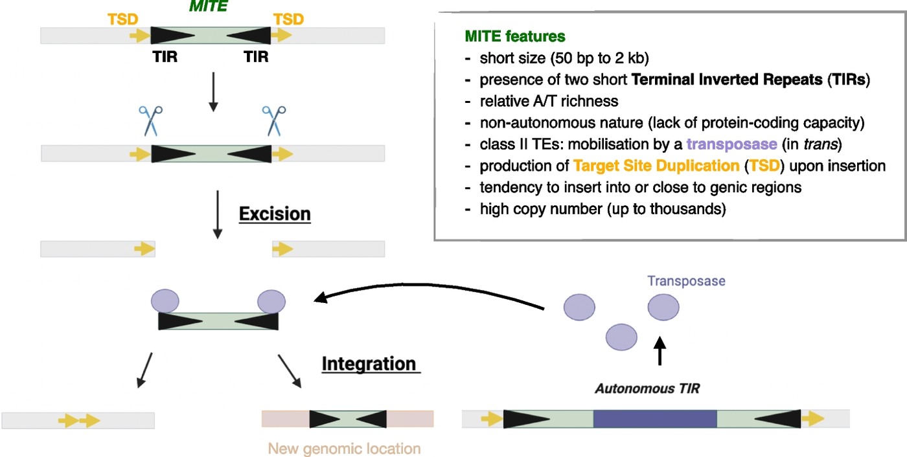

MITE 是Ⅱ类非自主转座子：两端是末端反向重复（黑色箭头），外侧通常是富含 AT 的靶位点重复（黄色）。它们自身不编码转座酶，要靠对应的自主元件提供酶，以剪切-粘贴的方式移动，并且常常插在基因附近。

署名：Abirami Soundiramourtty、Marie Mirouze，2025，Mobile DNA，DOI 10.1186/s13100-025-00375-8，Fig. 1，CC BY 4.0（https://creativecommons.org/licenses/by/4.0/），未修改。


在高等植物基因组中，如果按碱基总占比排名，Ⅰ类LTR反转录转座子稳居第一；但如果按**独立插入拷贝数**排名，一类体型微小、不编码任何蛋白质的Ⅱ类非自主DNA转座子——**微型反向重复转座元件（miniature inverted-repeat transposable elements，简称MITEs）**——常常高居榜首。

MITEs的发现始于20世纪90年代初。1992年，Thomas Bureau和Susan Wessler在分析玉米、高粱和大麦等禾本科植物基因侧翼序列时，发现了一类长度仅约130 bp、两端带有14 bp TIR、侧翼为3 bp `TAA`/`TTA` TSD且富含AT碱基的高拷贝短重复序列，将其命名为*Tourist*[待确认]。1994年，他们又在多种单子叶和双子叶植物基因附近鉴定出另一类同样短小、但侧翼恒定为2 bp `TA` TSD的元件家族，命名为*Stowaway*[待确认]。随后，随着水稻、拟南芥、葡萄及众多植物全基因组测序的完成，研究者意识到*Tourist*和*Stowaway*并非孤例，而是代表着广泛存在于植物乃至动物基因组中的一大类结构特殊的非自主DNA转座子，统称为MITEs。

一个典型的MITEs家族通常同时具备以下六个标志性结构与基因组学特征：
1. **极短的序列长度**：全长通常在50 bp至600 bp之间（极少数家族可达800 bp左右），远短于长度数kb的自主型DNA转座子。
2. **完全无编码能力**：内部不含任何功能性转座酶开放阅读框，属于严格的非自主型元件。
3. **保守的TIR与特征性TSD**：两端具有清晰可辨的末端反向重复序列（通常大于10 bp），且插入位点两侧带有长度固定的2至9 bp TSD。
4. **高AT含量与稳定的二级结构**：许多MITEs序列富含A和T碱基，且由于两端TIR较长或内部存在反向互补区，其单链DNA或转录后的RNA极易折叠形成热力学高度稳定的**茎环（发夹）二级结构**。
5. **极高的拷贝数**：与普通内部缺失型非自主元件（往往仅有数个至数十个拷贝）截然不同，单个成功的MITEs家族在植物基因组中常拥有数百、数千甚至数万个拷贝。
6. **家族内部尺寸高度均一**：同一MITEs家族的成百上千个拷贝在序列长度上惊人地一致，极少出现像LINE那样的随机截短或像普通*Ds*元件那样长短不一的异质性。这一特征表明，绝大多数MITEs家族都是由极少数“母本”拷贝在短时间内经历爆发式扩增（burst amplification）形成的。

### 4.2.2 MITEs与自主TIR超家族的演化起源及反式动员

由于MITEs完全不编码任何蛋白质，早期学界曾长期争论它们的演化起源以及驱动其爆发扩增的分子引擎。随着全基因组序列的积累与生化验证的突破，谜底终于揭晓：**绝大多数MITEs都是由特定的自主型TIR DNA转座子经由内部大片段缺失演化而来，并依赖同源（或远缘）自主型元件反式提供的转座酶完成动员**（doi:10.1038/nrg2165）。

通过比对TIR末端序列、亚末端基序以及严格保守的TSD长度，研究者成功将植物中绝大多数MITEs家族精准锚定到了其对应的自主型TIR超家族：
- ***Tourist*样MITEs**（TSD为3 bp `TAA`/`TTA`）起源于**PIF/Harbinger（`DTH`）**超家族；
- ***Stowaway*样MITEs**（TSD为2 bp `TA`）起源于**Tc1/Mariner（`DTT`）**超家族；
- 此外，植物基因组中也广泛存在源自**hAT（`DTA`，8 bp TSD）**、**Mutator（`DTM`，9 bp TSD）**和**CACTA（`DTC`，3 bp TSD）**超家族的MITEs家族。

MITEs反式动员最经典的直接实验证据来自水稻（*Oryza sativa*）中的***mPing*/*Ping*/*Pong*系统**[待确认]。*mPing*是一个全长仅430 bp、属于*Tourist*类（*PIF/Harbinger*超家族）的活跃MITE，在大多数水稻品种中拷贝数不足50个，但在日本粳稻品种“银坊主”（Gimbozu）及其衍生系中却爆发扩增至超过1000个拷贝。研究者通过遗传学和酵母/拟南芥异源转座实验证实，*mPing*本身不编码任何蛋白，它的高频切离与爆发扩增完全由水稻基因组中另外两个全长超过5 kb的自主型*PIF/Harbinger*元件——*Ping*和*Pong*——反式提供的ORF1（Myb/SANT蛋白）和ORF2（DDE转座酶）催化驱动[待确认]。

更引人深思的是，MITEs的反式动员并不总是要求基因组中存在与自身TIR序列高度一致的“直系”自主型母本。在水稻基因组中，研究者发现*Stowaway*类MITEs的拷贝数高达数万个，但基因组中却找不到任何与这些*Stowaway*共享高序列相似度的自主型*Mariner*元件。后续的功能验证揭示了**跨家族反式动员（cross-mobilization）**机制：水稻中的某些自主型*Mariner*元件（如*Osmar*家族）所编码的转座酶对TIR序列的识别具有相当程度的容错性，能够反式结合并动员TIR序列仅有部分保守特征的远缘*Stowaway* MITEs[待确认]。这一发现完美解释了为何在许多植物（包括葡萄和禾本科作物）中，自主型母本早已退化或极其稀少，而对应的MITEs家族却能实现惊人的大规模扩增。

### 4.2.3 基因侧翼区富集规律与基因表达调控贡献

与高度集中于着丝粒和近着丝粒异染色质区的*Ty3/Gypsy*反转录转座子形成鲜明对比，MITEs在几乎所有已测序的高等植物基因组中都呈现出极度显著的**基因区亲和性**。全基因组分布统计一致表明，MITEs强烈富集在基因密度高的常染色质臂上，尤其是蛋白质编码基因的**5'端启动子区（上游1至2 kb）、内含子以及3'端非翻译区（3' UTR）**，而在外显子编码区内部则极少出现。

造成MITEs在基因侧翼区高度富集的演化动力是**插入偏好性**与**插入后纯化选择**双重过滤的结果。一方面，驱动MITEs移动的*PIF/Harbinger*和*Tc1/Mariner*转座酶天然偏好识别富含AT碱基（`TAA`/`TA`）且染色质结构疏松、开放的DNA区域，而植物基因的启动子、内含子和3' UTR恰恰是全基因组中染色质最开放、AT含量最高的区段；另一方面，由于MITEs插入外显子会直接破坏蛋白质编码而被纯化选择迅速淘汰，但插入启动子、内含子或3' UTR时，因其体型极短（仅数百bp），远不像插入一条10 kb的LTR反转录转座子那样剧烈破坏基因结构或引入大范围异染色质沉默，因而更容易在自然选择下幸存下来。

正是由于紧邻成千上万个宿主基因，MITEs成为了植物基因表达调控演化中最活跃的“微调器”，其分子贡献主要体现在四个层面：
1. **提供新的顺式调控元件（cis-regulatory elements）**：许多MITEs序列内部天然携带或经轻微突变后产生转录因子结合位点与胁迫响应基序。例如，在水稻“银坊主”中，大量新插入基因上游启动子区的*mPing*元件并未导致邻近基因失活，反而赋予了许多原本组成型表达或低表达的基因对低温、高盐等非生物胁迫的诱导表达能力[待确认]。
2. **引入可变剪接与可变多聚腺苷酸化位点**：插入内含子中的MITEs可能提供隐蔽的剪接供体或受体位点；而由于MITEs富含AT碱基，插入基因3' UTR区的MITEs极易引入新的多聚腺苷酸化信号（`AAUAAA`样基序），改变mRNA的3'端长度、稳定性或翻译效率。
3. **介导局部表观遗传调控与小RNA产生**：作为高拷贝重复序列，MITEs是宿主RNA导向DNA甲基化（RdDM）通路的主要靶标，容易产生大量24-nt siRNA并吸引DNA甲基化。当一个MITEs位于基因启动子或内含子中时，其甲基化状态的动态变化可以直接微调邻近基因的转录水平。
4. **充当植物微RNA（miRNA）的新生演化摇篮**：由于MITEs两端具有较长的反向重复序列，一旦被宿主RNA聚合酶Ⅱ通读转录进mRNA（例如位于内含子或3' UTR中），其RNA片段会自发折叠成近乎完美的双链发夹（stem-loop）结构——这恰好是植物Dicer样蛋白（DCL1）加工产生21-nt miRNA的理想底物。在拟南芥、水稻、小麦和葡萄等植物中，均已鉴定出多例直接由MITEs发夹结构演化而来的物种特异性或谱系特异性miRNA基因[待确认]。

### 4.2.4 MITEs与普通内部缺失型非自主DNA转座子的扩增动力学差异

既然MITEs和玉米*Ds*元件一样，在起源上大多属于自主型TIR DNA转座子的内部缺失衍生物，那么一个核心的演化生物学问题随之浮现：**为什么绝大多数普通的内部缺失型非自主拷贝（如常规*Ds*或缺失型*CACTA*）在基因组中只能维持低至中等拷贝数（几个到几十个），而唯独MITEs能够突破瓶颈，爆发式扩增至数千甚至数万个尺寸高度均一的拷贝？**

综合比较基因组学与转座动力学研究，MITEs与普通非自主DNA转座子在扩增动力学上的巨大鸿沟源于四个协同优势：

第一，**内部负调控序列的彻底丢失**。许多自主型DNA转座子（如*Ac*或*Mariner*）在进化中为了防止过度扩增杀死宿主，演化出了自我抑制机制（如过量抑制效应overproduction inhibition，或内部编码区携带抑制转座酶结合的负调控基序）。普通内部缺失型元件往往仅缺失了部分编码区，仍保留较长的内部序列，容易受到与自主型元件相似的调控限制；而MITEs在极端精简的过程中彻底丢弃了几乎全部内部序列，仅保留最精干的高亲和力TIR末端，从而摆脱了自主型元件的内部负调控约束，甚至能比自主型母本更高效地结合转座酶。

第二，**最佳物理长度带来的转座体组装动力学优势**。在DNA转座的第一步中，结合在两端的转座酶必须将5'端和3'端拉近并弯曲DNA形成突触复合体。当元件长度在数百bp（如150至500 bp）的“黄金窗口”内时，双链DNA的持久长度与环化弯曲动力学最有利于两端的快速配对与稳定组装，同时在复制偶联转座与SDSA同源重组修复过程中，极短的模板长度使得修复聚合酶几乎可以100%一次性合成全长而不发生中途脱落。这不仅赋予了MITEs极高的扩增速率，也直接造就了MITEs家族内部“尺寸高度均一”的独特面貌。

第三，**对宿主纯化选择和表观遗传沉默的短期逃逸能力**。一条长达3至5 kb的普通非自主DNA转座子插入基因区或启动子区时，往往会造成严重的基因结构破坏或强烈的异染色质扩散沉默，迅速被纯化选择清除。而短小精悍的MITEs对基因功能的破坏阈值极高，在基因丰富的常染色质臂上具有极高的存活率。在爆发初期，当单个高活性MITE拷贝开始迅速扩增时，由于其缺乏内部编码区且在基因区受到常染色质环境的局部庇护，它能够在宿主RdDM小RNA沉默体系全面建立并彻底封锁整个家族之前，抢先完成多轮指数级扩增，在基因组中留下数以千计的庞大遗产。

## 4.3 Helitron与Maverick/Polinton：滚环复制与自合成元件

**图 4-2**　玉米自主 Helitron 的基因结构

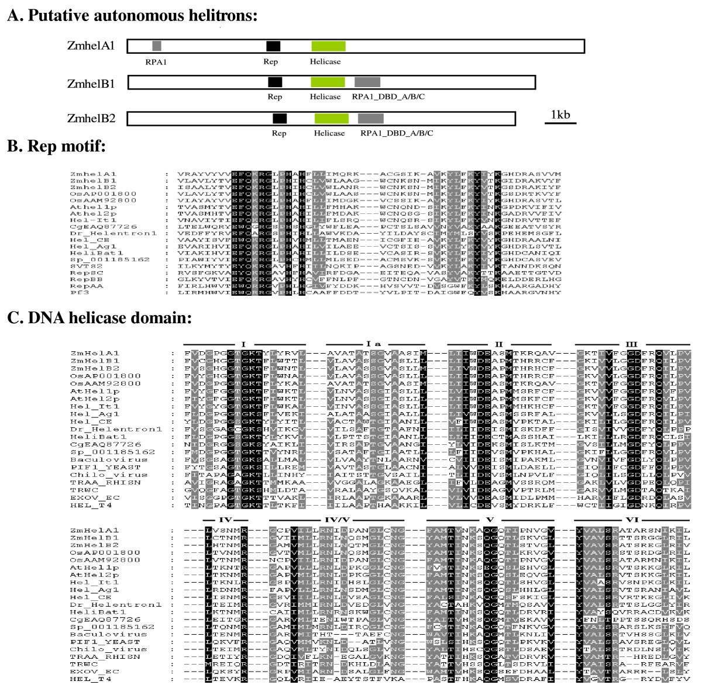

玉米中推测的自主 Helitron（ZmhelA、ZmhelB）结构。A 画出 Rep、解旋酶和 RPA 结构域的排列；B、C 是这些结构域的多序列比对。材料是玉米，不是葡萄。

署名：Yongbin Dong、Xiaomin Lu、Weibin Song、Lei Shi、Mei Zhang、Hainan Zhao、Yinping Jiao、Jinsheng Lai，2011，BMC Genomics，DOI 10.1186/1471-2164-12-609，Figure 1，CC BY 2.0（https://creativecommons.org/licenses/by/2.0），未修改。

Maverick/Polinton 的基因排布见图 13-8。


### 4.3.1 Helitron的结构特征与滚环复制模型

在21世纪初之前，真核生物Ⅱ类DNA转座子几乎等同于“携带TIR、产生TSD、采用剪切-粘贴机制”的经典元件。2001年，Kapitonov和Jurka利用计算机辅助基因组挖掘，在拟南芥、水稻和秀丽隐杆线虫基因组中意外发现了一类彻底颠覆这一传统认知的DNA转座子，并将其命名为**Helitron**（Wicker统一分类体系中归为Ⅱ类亚纲2、Helitron目，三字母代码`DHH`）（doi:10.1038/nrg2165）[待确认]。

从结构外观上看，Helitron与经典TIR DNA转座子格格不入：它**完全没有末端反向重复序列（TIR）**，在插入宿主基因组时也**完全不产生靶位点重复（TSD）**（doi:10.1038/nrg2165）。相反，Helitron拥有一套高度保守却极其微小的非对称末端信号：其5'端起始于保守的二核苷酸`5'-TC`，3'端终止于保守的四核苷酸`3'-CTRR`（其中R代表嘌呤A或G，最常见为`CTAG`）；在距离3'末端上游约10至12 bp处，存在一段长约16至20 bp的回文序列，能够折叠形成一个热力学稳定的**3'端发夹（hairpin）二级结构**。在靶位点选择上，Helitron具有极高的专一性，几乎总是精确地插入宿主双链DNA的腺嘌呤（`A`）与胸腺嘧啶（`T`）碱基之间（即插入后宿主侧翼呈现`5'-A [TC...CTRR] T-3'`的格局）。

一条完整的自主型Helitron全长通常在5 kb至15 kb之间，其核心编码区编码一种名为**Rep/Helicase（简称RepHel）**的多功能融合蛋白（doi:10.1038/nrg2165）。该蛋白由两大催化模块构成：N端的**Rep结构域**包含滚环复制起始蛋白特有的**HUH基序**（两个组氨酸残基夹带一个疏水残基，负责结合二价金属离子）以及两个催化性的酪氨酸残基（属于Y2型滚环复制酶）；C端的**Helicase结构域**属于超家族1（SF1）型5'→3' DNA解旋酶，负责解开双链DNA。此外，绝大多数植物自主型Helitron还在内部编码1至3个与宿主复制蛋白A（RPA）同源的单链DNA结合蛋白，用于在复制过程中保护暴露出的单链Helitron DNA免遭降解并防止其自发退火。

由于RepHel蛋白与原核生物IS91家族转座子、单链DNA质粒及双生病毒（geminiviruses）的滚环复制酶高度同源，学界提出了Helitron的**滚环复制（rolling-circle replication，RCR）转座模型**。与经典TIR元件必须将双链同时切离的“剪切-粘贴”机制不同，Helitron在转座过程中仅切割单链，通过“剥离-复制-粘贴”（peel-and-paste）实现真正的DNA水平“复制-粘贴”扩增：

1. **5'端单链切口与共价连接**：RepHel蛋白特异性识别Helitron的`5'-TC`末端，利用第一个催化酪氨酸残基对其中一条DNA链进行亲核攻击，切开单链缺口并与Helitron的5'磷酸末端形成共价的磷酸酪氨酸键，同时在宿主供体链上暴露出一个游离的`3'-OH`。
2. **解旋与链置换合成**：RepHel的SF1解旋酶沿5'→3'方向解开Helitron双链；与此同时，宿主细胞的DNA聚合酶以游离的`3'-OH`为引物，以另一条完整的Helitron链为模板，在原位重新合成一条全新的Helitron链，并将原有的那条旧单链逐步“剥离”置换出来（由RPA样蛋白包裹保护）。
3. **3'端发夹终止与环状单链中间体释放**：当解旋与置换推进至Helitron的3'末端时，3'端发夹结构与`CTRR`基序充当终止信号，促使RepHel蛋白暂停并动用第二个催化酪氨酸残基切割3'末端。切割完成后，被置换出来的单链Helitron首尾相连形成一个游离的**单链环状DNA中间体**（或直接在蛋白复合体引导下转运至新靶位点），而供体位点由于新链的同步合成，依然完好无损地保留着一个完整的双链Helitron拷贝。
4. **靶位点整合与双链化**：RepHel复合体识别宿主基因组中新的`5'-AT-3'`靶位点，在`A`与`T`之间制造单链切口，通过转酯反应将单链Helitron共价插入该位点。随后，在宿主细胞下一轮DNA复制或错配修复过程中，以插入的单链Helitron为模板合成互补链，最终在新位点形成一个完整的双链Helitron拷贝。由于整合过程仅涉及单个磷酸二酯键的精确断裂与连接，不存在交错双链切口，因此不会产生任何TSD。

### 4.3.2 Helitron介导的宿主基因捕获与嵌合外显子演化

在植物基因组演化史上，Helitron最引人瞩目、也最具生物学影响力的特性并非其单纯的拷贝数扩增，而是它惊人的**宿主基因片段捕获（gene capture，又称转导复制transduplication）能力**。尽管*Pack-MULE*（*Mutator*超家族）和部分*CACTA*元件也能捕获宿主基因片段，但Helitron在玉米等禾本科植物及多种双子叶植物中所展现出的基因捕获规模与频率堪称植物界之最。

Helitron捕获宿主基因片段的分子机制与其滚环复制的“3'端终止漏读”特性直接相关。在滚环复制的链置换步骤中，如果一个Helitron拷贝的3'端发夹结构发生点突变或缺失，导致终止信号失效，RepHel解旋酶便不会在原3'末端停下，而是继续沿着宿主染色体向下游“通读”（3' read-through），将紧邻Helitron 3'端的宿主蛋白质编码基因的外显子、内含子甚至启动子序列一并剥离下来，直到在下游数百bp甚至数kb远处偶然遇到一个类似发夹和`CTRR`的隐蔽序列才终止切割。另一种补充假说（填充DNA模型）认为，在Helitron整合或双链断裂修复过程中，宿主微同源介导的末端连接也可能将游离的宿主基因片段随机拼接进Helitron内部。

一旦一个携带了宿主基因片段的Helitron完成整合，它便成为一个非自主型（或仍具活性的）嵌合元件。在随后的演化中，如果该嵌合元件再次被反式动员并发生第二轮、第三轮3'端通读，它就能将来自染色体不同位置、完全不相关的多个宿主基因的外显子依次捕获并串联在同一个Helitron内部，形成高度复杂的**嵌合外显子结构**。

玉米（*Zea mays*）是研究Helitron基因捕获最经典的模式系统。比较基因组学研究表明，玉米基因组中存在数以万计由Helitron携带的宿主基因片段，单个玉米自交系中就有数千个基因片段曾被Helitron捕获并扩增[待确认]。更为震撼的是，当研究者比对玉米不同自交系（如B73与Mo17）的同源染色体区段时，发现二者之间存在大量破坏基因共线性的存在/缺失变异（PAV）——其中相当大一部分正是由近期活跃的Helitron携带不同宿主基因片段在各自品系中独立插入造成的[待确认]。在拟南芥、水稻、大豆以及葡萄等双子叶植物基因组中，也普遍观察到了Helitron捕获宿主基因片段的现象，只是其总体规模通常小于玉米。

面对基因组中海量被Helitron捕获的基因片段，初学者极易陷入一个常见的概念误区，即认为“只要Helitron捕获了宿主外显子，就等于创造了大量新的功能基因”。严格的演化与功能基因组学分析表明，事实远非如此：
- **绝大多数被捕获的基因片段迅速沦为假基因**：由于捕获过程是随机截断的，这些片段通常缺乏完整的起始密码子、启动子或正确的阅读框，且在插入后迅速遭受宿主DNA甲基化沉默，处于中性演化状态，很快积累移码突变和提前终止密码子。
- **少数嵌合拷贝构成演化创新的试验田**：尽管绝大多数捕获片段最终走向退化，但在庞大的基数下，仍有极小比例的嵌合Helitron能够保留转录活性，并利用内部捕获的剪接位点产生全新的嵌合mRNA。其中极少数拷贝在经历自然选择筛选后，可能演化出新的蛋白质功能域组合（外显子洗牌，exon shuffling），或者其转录出的反义RNA通过RNA干扰途径反过来精细调控原宿主母本基因的表达水平。此外，Helitron将完整或截短的基因拷贝搬运到新的染色质环境中，也为基因家族的表达分化提供了宝贵的原始素材。

### 4.3.3 Maverick/Polinton：大片段自合成DNA转座子与病毒演化关联

在Wicker统一分类体系的Ⅱ类亚纲2中，与Helitron并列的另一个独立目是**Maverick**（三字母代码`DMM`，在Repbase体系中称为**Polinton**，取Polymerase和Integrase首音节组合而成）（doi:10.1038/nrg2165；doi:10.1038/nrg2165-c1）。如果说MITEs是Ⅱ类DNA转座子极致精简的微型极端，那么Maverick/Polinton则是走向完全相反方向的重装巨兽。

一条完整的自主型Maverick/Polinton全长通常在**10 kb至20 kb**之间，个别家族甚至可达40 kb，是真核生物已知体型最庞大、编码基因最复杂的DNA转座子。其两端具有长达数百bp的末端反向重复序列（TIR），整合到宿主基因组时在两侧产生**5至6 bp的TSD**（doi:10.1038/nrg2165）。

Maverick/Polinton之所以被归入Ⅱ类亚纲2并被称为**“自合成DNA转座子”（self-synthesizing DNA transposons）**，源于其高度自主的复制机制。不同于依赖宿主DNA聚合酶的经典TIR元件和Helitron，Maverick/Polinton自身编码一整套多达10个左右的复杂蛋白质，其中最核心的两个酶是**蛋白引导的B家族DNA聚合酶（protein-primed family B DNA polymerase，pPolB）**以及一个与逆转录病毒同源的**DDE型整合酶（c-integrase）**（doi:10.1038/nrg2165）。在转座过程中，整合酶催化Maverick/Polinton的切除（通常被认为释放出单链或双链线状DNA中间体），随后该元件利用自身编码的B家族DNA聚合酶，以末端蛋白为引物，直接将游离的DNA中间体复制扩增为完整的双链DNA分子，最后再由整合酶将其整合到宿主基因组的新位点上。整个过程完全不经过RNA中间体，却实现了高度自主的“复制-粘贴”扩增。

更令演化生物学家着迷的是Maverick/Polinton与真核生物双链DNA病毒之间深不可测的亲缘关系。除B家族DNA聚合酶和整合酶外，绝大多数Maverick/Polinton内部还完整编码一系列典型的**病毒形态发生蛋白**：包括一个腺病毒样成熟半胱氨酸蛋白酶（PRO）、一个负责将病毒DNA泵入衣壳的包装ATP酶（ATPase），以及构成二十面体病毒外壳的**主要衣壳蛋白（MCP）和次要衣壳蛋白（mCP）**[待确认]。基于这些确凿的病毒结构基因，Krupovic等人提出了著名的“Polintovirus”假说，指出Maverick/Polinton本质上可能代表了能够兼具“基因组内转座子”与“胞外病毒颗粒”双重生活史的过渡型元件，甚至被视为真核生物腺病毒（adenoviruses）、噬病毒体（virophages，如*Mavirus*）以及核质大DNA病毒（NCLDVs）共同的古老演化枢纽[待确认]。

从跨界分布格局来看，Maverick/Polinton广泛存在于动物（线虫、昆虫、鱼类、两栖类、鸟类及部分低等脊椎动物）、真菌和原生生物中，但在**高等陆生植物（尤其是包括葡萄在内的所有被子植物）基因组中几乎完全绝迹**。与第3.3节讨论的DIRS和PLE类似，这种在植物界的大面积缺失反映了植物演化史上独特的基因组过滤机制与宿主防御生态。尽管如此，了解Maverick/Polinton对于建立完整的转座子知识体系仍不可或缺——它清晰地划定了转座子与真核病毒之间那条模糊而迷人的演化边界。

### 4.3.4 Helitron从头预测的假阳性困境与生物信息学挑战

在结束Ⅱ类DNA转座子的讨论之前，必须结合本书“从发现到实践”的定位，着重剖析一个在植物基因组学实战中极易踩坑的方法学顽疾：**Helitron在生物信息学从头预测（*de novo* prediction）中存在极高的假阳性率**。

回顾前面两节介绍的各类转座子，LTR反转录转座子拥有数百bp至数kb的成对同向长重复、`TG...CA`边界、5 bp TSD以及保守的*gag*/*pol*编码域；经典TIR DNA转座子和MITEs拥有清晰的反向重复TIR以及长度严格的TSD。这些冗长而特异的结构特征，使得算法在全基因组尺度上能够以极高的特异度将它们与随机背景DNA区分开来。

然而，Helitron几乎剥离了所有便于算法识别的强结构锚点：它**没有TIR，没有TSD**，两端的序列特征仅仅浓缩为5'端的2个碱基（`TC`）、3'端的4个碱基（`CTRR`）以及一段16至20 bp、允许存在错配的短发夹结构。一个简单的概率计算就能揭示这一结构特征带来的灾难性后果：在像栽培葡萄（约500 Mb）或玉米（约2.3 Gb）这样庞大的植物基因组中，随机出现`5'-TC`、`3'-CTRR`以及相距数kb的短回文发夹序列的组合，纯粹由概率偶然产生的数量高达数百万次！

当前广泛使用的Helitron从头结构预测软件（如HelitronScanner，其核心算法利用局部互补可变阶马尔可夫模型评估5'和3'末端基序的得分）虽然在发现非自主型Helitron方面具有较高的灵敏度，但在默认参数下直接扫描大型植物基因组时，往往会输出海量的假阳性预测结果。这种高假阳性困境在植物基因组学研究中引发了两类严重的连锁问题：

第一是**“Helitron扩张假象”污染比较基因组学结论**。在近年来发表的部分植物基因组论文中，由于直接将整合注释流程（如未经严格过滤的早期自动化流程）输出的Helitron统计结果照单全收，经常出现同一科属的近缘植物中，某物种Helitron占比被报道为15%、而另一物种仅占0.5%的荒谬反差。仔细核查原始GFF3注释文件往往会发现，那15%的所谓“Helitron”中，绝大部分其实是随机截取的基因间区序列、碎片化的LTR内部区域，甚至是跨越了整个宿主编码基因的虚假区间。

第二是**严重干扰下游宿主基因结构注释**。如果将包含大量假阳性Helitron（尤其是误捕获了真实单拷贝宿主基因外显子的虚假预测）的未精修文库直接输入RepeatMasker对基因组进行硬屏蔽，就会导致大量真实的宿主蛋白质编码基因被错误屏蔽，从而在下游基因预测中造成严重的基因漏检。

为了在植物（包括葡萄）转座子注释实践中有效规避Helitron的假阳性陷阱，研究者必须遵循以下四条严格的质控与核验准则：
1. **强制要求多拷贝同源支持**：一条真实的Helitron家族必然在基因组中经历了滚环扩增，因此除极少数古老残存单拷贝外，合格的候选预测应当能在全基因组范围内通过BLAST找到多个（例如至少3至5个）从5'端到3'端边界一致的同源拷贝。孤立出现的单拷贝结构预测应默认视为高风险假阳性予以剔除。
2. **核验RepHel编码域与宿主基因污染排查**：对于候选的自主型Helitron，必须通过蛋白质结构域搜索（如HMMER或BLASTX）确证其内部确实编码HUH-Rep与SF1-Helicase结构域；同时，所有候选Helitron一致性序列都应与植物已知蛋白质数据库（去除转座子蛋白后）比对，警惕将正常的多拷贝宿主基因家族（如NLR抗病基因或激酶家族）误判为携带基因片段的Helitron。
3. **利用群体或单倍型“空位点”证据进行黄金验证**：在葡萄等高度杂合二倍体或多品种重测序体系中，验证一个可疑Helitron插入最确凿的方法是比对两个单倍型或不同品种的同源区段。如果在一个单倍型中存在完整的`5'-A [TC...CTRR] T-3'`插入，而在另一个单倍型的精确对应位置呈现无缝连接的`5'-AT-3'`空位点（empty site）且无任何TSD，即可百分之百确证其为真实的Helitron转座事件。
4. **审慎评估非自主Helitron的统计口径**：在撰写论文或比较不同物种的转座子组成时，应对经过多拷贝边界验证的高置信度Helitron与仅凭末端基序预测的候选区间加以明确区分，切忌将未经精修的原始预测占比直接作为演化结论的依据。

至此，我们系统完成了真核生物Ⅰ类反转录转座子与Ⅱ类DNA转座子全部主要类群的结构与生活史解析。面对基因组内如此庞大、活跃且机制各异的移动元件军团，宿主细胞究竟演化出了怎样的免疫与防御体系来维持基因组的长期稳定？下一章，我们将深入植物表观遗传学的核心战场，探讨宿主沉默机制与转座子的动态博弈。

## 本章参考文献

- doi:10.1038/nrg2165
- doi:10.1038/nrg2165-c1


# 转座子类型逐类详解

> 阅读说明：本篇接在第4章之后、第13章之前。分类采用 Wicker 类与目、Dfam 超家族、REXdb 植物 LTR 谱系的对照。示意图由脚本绘制，不是已发表图；已发表原图均未修改，许可与出处见各图注。

版本：v2　日期：2026-11-23 14:59 CST

## 本章导读

本章按“类 → 目 → 超家族 → 谱系/形态”的顺序，逐一介绍 101 种转座子类型。分类骨架采用基于转座机制、序列相似性与结构关系的统一层级分类（Wicker 等 2007, doi:10.1038/nrg2165）；超家族的现行归属参照 Dfam 数据库（Storer 等 2021, doi:10.1186/s13100-020-00230-y）；植物 LTR 逆转录转座子的谱系细分采用 REXdb 框架（Neumann 等 2019, doi:10.1186/s13100-018-0144-1），REXdb v4.0 新增的谱系名取自其 README 分类树（doi:10.5281/zenodo.10160279）。Copia 谱系的早期命名见 Wicker 和 Keller 2007（doi:10.1101/gr.6214107）。

每个条目依次写：定义与命名、结构与长度与末端、靶位点重复（TSD）、编码蛋白与结构域顺序、转座机制、自主与非自主搭档、识别特征与工具、分类争议，最后是「发现与分布」。

阅读时请注意：

1. 「发现与分布」里的每一条陈述都带引文，并且只写已打开的论文摘要或开放全文能支持的内容。只有标题可核实的论文，只用来说明该文存在及其命名，不用来支持任何内容论断。
2. 「未检索到葡萄专门报道」表示按文末所述方式检索后没有找到，不表示葡萄基因组里没有这类转座子。
3. [待确认] 表示这一处的说法目前没有可核对的出处：要么原始论文没找到，要么原先附的引文与说法对不上，已经去掉。
4. 前八节中的引文已逐句复核：只有当被引论文可得文本里确实出现该类型名称、且句中的数值（长度、TSD 等）也出现时才保留。没有引文的句子是教科书层级的一般性概述，写作和引用时仍需回到原文核对。
5. 分类有分歧的地方集中写在各条目的「分类争议」里。

### 本版新增内容

- 每条开头增加“名称对照”，把 Wicker 体系、Dfam 节点与 REXdb 路径并列，并注明来源。
- 每条增加结构示意图；有 CC BY 开放原图的条目同时附原图（未修改，图注含出处与许可）。
- 有可用 Dfam 植物共识序列的超家族，示意图下方加两端各 30 bp 的序列条，并写明序列号。
- LTR 部分（T001–T045）每条末尾增加“本版补充说明”：Neumann 等 2019 的域顺序是超家族层面的判别顺序，5′-TG…CA-3′ 是筛选条件，并列出 Fig. 4 中各谱系的 TSD、PBS、平均长度等值。
- 书末增加附录“分类体系外与有争议的类型”，共 21 项。

## 分类树与总表

```
转座子
├─ I 类：逆转录转座子（RNA 中间体，复制—粘贴）
│  ├─ LTR 目 [T001]
│  │  ├─ Ty1/Copia 超家族 [T002] → 谱系：Ale T011、Alesia T012、Angela T013、Bianca T014、Ivana T015、Ikeros T016、TAR T017、Tork T018、SIRE T019、Osser T020、Bryco T021、Lyco T022、Gymco-I–IV T023–T026、Alexandra T027、Ferco T028、Bryana T029
│  │  ├─ Ty3/Gypsy 超家族 [T003] → 色质病毒样：Chlamyvir T030、Tcn1 T031、CRM T032、Galadriel T033、Tekay T034、Reina T035、Ferney T036；Phygy T037、Selgy T038；OTA 分支：Athila T039、Tatius T040、Tat 亚谱系 TatI–III T041–T043、Ogre T044、Retand T045
│  │  ├─ Bel-Pao 超家族 [T004]、Retrovirus/ERV 超家族 [T005]、Caulimoviridae/EPRV [T006]
│  │  └─ 非自主衍生物与形态：TRIM T007、LARD T008、solo-LTR T009、Cassandra T010
│  ├─ DIRS 目：DIRS T046、Ngaro T047、VIPER T048
│  ├─ PLE（Penelope 样）[T049]
│  ├─ LINE 目 [T050]：L1 T052、RTE T053、R2 T054、I T055、Jockey T056、CR1 T057、L2 T058、R1 T059、Rex-Babar T060、Dualen T061、Tad1 T062、CRE/R4 相关支 T063
│  └─ SINE 目 [T051]：tRNA 源 T064、7SL 源 T065、5S 源 T066
├─ II 类：DNA 转座子
│  ├─ TIR 目 [T067]：hAT T068、Mutator/MULE T069、CACTA T070、PIF/Harbinger T071、Tc1/mariner T072、MITE（非自主）T073、Merlin T074、Transib T075、P T076、piggyBac T077、Academ T078、Kolobok T079、Ginger T080、Dada T081、IS3EU T082、Novosib T083、Sola T084、Zator T085、Zisupton T086、Spy T087；Pack-MULE（形态）T093
│  ├─ Crypton [T088]
│  ├─ Helitron：Helitron T089、Helitron2 T090、Helentron T091；携带宿主基因片段的形态 T094
│  └─ Maverick/Polinton [T092]
└─ 基因组中的存在形态：完整自主元件 T095、非自主元件 T096、碎片与截短体 T097、嵌套插入 T098、嵌合元件 T099、被驯化的转座子来源基因 T100、转座子衍生卫星 T101
```

| 编号 | 类 | 目 | 名称 | 层级 | 别名/对应名称 |
|---|---|---|---|---|---|
| T001 | I | LTR | LTR反转录转座子（目） | order | LTR retrotransposon |
| T002 | I | LTR | Ty1/Copia 超家族 | superfamily | Pseudoviridae; Copia; RLC |
| T003 | I | LTR | Ty3/Gypsy 超家族 | superfamily | Metaviridae; Gypsy; RLG |
| T004 | I | LTR | Bel-Pao 超家族 | superfamily | BEL; Pao; RLB |
| T005 | I | LTR | Retrovirus / ERV 超家族 | superfamily | 内源性逆转录病毒; RLR; RLE; ERV1/2/3 |
| T006 | I | LTR | Caulimoviridae / 内源副反转录病毒（EPRV） | superfamily_or_virus | pararetrovirus; Caulimovirus; Badnavirus |
| T007 | I | LTR | TRIM | nonautonomous | terminal-repeat retrotransposon in miniature |
| T008 | I | LTR | LARD | nonautonomous | large retrotransposon derivative |
| T009 | I | LTR | solo-LTR | form | 单LTR |
| T010 | I | LTR | Cassandra | nonautonomous | 5S-TRIM |
| T011 | I | LTR | Ale | lineage | Retrofit（部分旧称）; Copia/Ale |
| T012 | I | LTR | Alesia | lineage | Copia/Alesia |
| T013 | I | LTR | Angela | lineage | BARE1; WIS（近缘家族）; Copia/Angela |
| T014 | I | LTR | Bianca | lineage | Copia/Bianca |
| T015 | I | LTR | Ivana | lineage | Oryco（部分旧称）; Copia/Ivana |
| T016 | I | LTR | Ikeros | lineage | Copia/Ikeros |
| T017 | I | LTR | TAR | lineage | Copia/TAR |
| T018 | I | LTR | Tork | lineage | Copia/Tork |
| T019 | I | LTR | SIRE | lineage | Maximus; Sirevirus（狭义）; Agrovirus; Copia/SIRE |
| T020 | I | LTR | Osser | lineage | Copia/Osser |
| T021 | I | LTR | Bryco | lineage | Copia/Bryco |
| T022 | I | LTR | Lyco | lineage | Copia/Lyco |
| T023 | I | LTR | Gymco-I | lineage | Copia/Gymco-I |
| T024 | I | LTR | Gymco-II | lineage | Copia/Gymco-II |
| T025 | I | LTR | Gymco-III | lineage | Copia/Gymco-III |
| T026 | I | LTR | Gymco-IV | lineage | Copia/Gymco-IV |
| T027 | I | LTR | Alexandra | lineage | Copia/Alexandra |
| T028 | I | LTR | Ferco | lineage | Copia/Ferco |
| T029 | I | LTR | Bryana | lineage | Copia/Bryana |
| T030 | I | LTR | Chlamyvir | lineage | Gypsy/chromovirus/Chlamyvir |
| T031 | I | LTR | Tcn1 | lineage | Gypsy/chromovirus/Tcn1 |
| T032 | I | LTR | CRM | lineage | centromeric retrotransposon; CR; Gypsy/CRM |
| T033 | I | LTR | Galadriel | lineage | Gypsy/Galadriel |
| T034 | I | LTR | Tekay | lineage | Gypsy/Tekay; del |
| T035 | I | LTR | Reina | lineage | Gypsy/Reina |
| T036 | I | LTR | Ferney | lineage | Gypsy/Ferney |
| T037 | I | LTR | Phygy | lineage | Gypsy/Phygy |
| T038 | I | LTR | Selgy | lineage | Gypsy/Selgy |
| T039 | I | LTR | Athila | lineage | Gypsy/OTA/Athila |
| T040 | I | LTR | Tatius | lineage | Gypsy/OTA/Tatius |
| T041 | I | LTR | TatI | lineage | Gypsy/OTA/Tat/TatI |
| T042 | I | LTR | TatII | lineage | Gypsy/OTA/Tat/TatII |
| T043 | I | LTR | TatIII | lineage | Gypsy/OTA/Tat/TatIII |
| T044 | I | LTR | Ogre | lineage | Gypsy/OTA/Tat/Ogre |
| T045 | I | LTR | Retand | lineage | Gypsy/OTA/Tat/Retand |
| T046 | I | DIRS | DIRS | superfamily | DIRS-1; RYD; tyrosine recombinase retrotransposon |
| T047 | I | DIRS | Ngaro | superfamily | RYN |
| T048 | I | DIRS | VIPER | superfamily | Viper; TATE; RYV |
| T049 | I | PLE | PLE / Penelope | order_or_superfamily | Penelope-like; RPP; GIY-YIG |
| T050 | I | LINE | LINE（目） | order | non-LTR retrotransposon; RIxx |
| T051 | I | SINE | SINE（目） | order | short interspersed nuclear element; RSxx |
| T052 | I | LINE | L1 | clade | LINE-1; CIN4/Ta11; RIL |
| T053 | I | LINE | RTE | clade | RIT; BovB（动物亚支） |
| T054 | I | LINE | R2 | clade | RIR |
| T055 | I | LINE | I | clade | RII |
| T056 | I | LINE | Jockey | clade | RIJ; I-Jockey |
| T057 | I | LINE | CR1 | clade | LINE/CR1 |
| T058 | I | LINE | L2 | clade | LINE/L2 |
| T059 | I | LINE | R1 | clade | LINE/R1; LOA |
| T060 | I | LINE | Rex-Babar | clade | Rex1 |
| T061 | I | LINE | Dualen | clade | RandI/Dualen |
| T062 | I | LINE | Tad1 | clade | LINE/Tad1 |
| T063 | I | LINE | CRE / R4 相关支 | clade_group | CRE; Dong-R4; NeSL |
| T064 | I | SINE | tRNA 源 SINE | type | SINE2; RST |
| T065 | I | SINE | 7SL 源 SINE | type | SINE1; Alu; RSL |
| T066 | I | SINE | 5S 源 SINE | type | SINE3; RSS |
| T067 | II | TIR | TIR DNA转座子（目） | order | cut-and-paste; Dxx |
| T068 | II | TIR | hAT | superfamily | Ac/Ds; Tam3; hobo; DTA |
| T069 | II | TIR | Mutator / MULE | superfamily | MuDR; DTM |
| T070 | II | TIR | CACTA | superfamily | EnSpm; CMC（含Mirage、Chapaev的归并）；DTC |
| T071 | II | TIR | PIF / Harbinger | superfamily | DTH; Tourist的自主对应 |
| T072 | II | TIR | Tc1 / Mariner | superfamily | DTT; TcMar; Stowaway的自主对应 |
| T073 | II | TIR | MITE | nonautonomous | Tourist; Stowaway; miniature inverted-repeat transposable element |
| T074 | II | TIR | Merlin | superfamily | DTE |
| T075 | II | TIR | Transib | superfamily | DTR; 与RAG1相关 |
| T076 | II | TIR | P 元件 | superfamily | DNA/P; DTP |
| T077 | II | TIR | piggyBac | superfamily | DTB |
| T078 | II | TIR | Academ | superfamily | Academ-1/2/H |
| T079 | II | TIR | Kolobok | superfamily | T2等亚支 |
| T080 | II | TIR | Ginger | superfamily | Ginger-1; Ginger-2 |
| T081 | II | TIR | Dada | superfamily | DNA/Dada |
| T082 | II | TIR | IS3EU | superfamily | DNA/IS3EU |
| T083 | II | TIR | Novosib | superfamily | DNA/Novosib |
| T084 | II | TIR | Sola（含 Sola-1/2/3） | superfamily | Zator有时被讨论为近缘，须分条；Sola1/2/3 |
| T085 | II | TIR | Zator | superfamily | DNA/Zator |
| T086 | II | TIR | Zisupton | superfamily | DNA/Zisupton |
| T087 | II | TIR | Spy | subtype_or_superfamily | PIF-Spy |
| T088 | II | Crypton | Crypton | order_or_superfamily | DYC; Crypton-A/C/F/H/I/R/S/V/X |
| T089 | II | Helitron | Helitron（经典 HLE1 / Helitron-1） | order_or_superfamily | DHH; RC/Helitron |
| T090 | II | Helitron | Helitron2 | superfamily_or_lineage | Helitron-2; RC/Helitron-2 |
| T091 | II | Helitron | Helentron | superfamily_or_lineage | RC/Helentron |
| T092 | II | Maverick | Maverick / Polinton | order_or_superfamily | Polinton; Maverick-Mavirus; DMM |
| T093 | II | TIR | Pack-MULE | form | 基因捕获型MULE |
| T094 | II | Helitron | 携带宿主基因片段的 Helitron / LTR 捕获体 | form | gene capture; transduplication |
| T095 | - | - | 完整的自主元件 | form | autonomous complete TE |
| T096 | - | - | 非自主元件（总论） | form | nonautonomous TE |
| T097 | - | - | 碎片与截短体 | form | fragments; 5-prime truncation |
| T098 | - | - | 嵌套插入 | form | nested insertion |
| T099 | - | - | 嵌合元件与重组产物 | form | chimera; recombinant TE |
| T100 | - | - | 被驯化的TE来源基因 | form | domestication; exaptation |
| T101 | - | - | TE衍生的串联重复与卫星 | form | TE-derived satellite |


## 第一部分　LTR 逆转录转座子：目、超家族与非自主衍生物

### T001 LTR反转录转座子（LTR retrotransposon）

**名称对照**：Wicker 体系：I 类 / LTR 目；Dfam 节点：Long_Terminal_Repeat_Element；REXdb 路径：Class_I/LTR。（来源：类与目据 Arkhipova 2017, doi:10.1186/s13100-017-0103-2；Dfam 4.0 分类树，2026-11-23 读取；REXdb v4.0 说明文件，doi:10.5281/zenodo.10160279）

#### 定义与命名

LTR反转录转座子是真核生物 I 类转座子（反转录转座子）下的核心目（order），在 2007 年建立的真核转座子统一分类体系中以三字母代码 `RL` 开头，其中首位 `R` 代表反转录转座子，第二位 `L` 代表长末端重复序列（long terminal repeat，LTR）（Wicker 等 2007, doi:10.1038/nrg2165）。该目元件的共同特征是两侧具有正向重复的 LTR 序列，通过 RNA 中间体经反转录过程在宿主基因组中扩增（Wicker 等 2007, doi:10.1038/nrg2165）。2007 年统一分类体系在 LTR 目下划分 5 个超家族，分别是 Copia（RLC）、Gypsy（RLG）、Bel-Pao（RLB）、Retrovirus（RLR）与 ERV（RLE）（Wicker 等 2007, doi:10.1038/nrg2165）。Dfam 现行分类及 2021 年发布的序列模型体系在 `LTR` 节点下主要收录 Copia、Gypsy、Pao 以及 ERV1、ERV2、ERV3 等分支，并在注释映射中纳入部分衍生物与病毒近缘类群（Storer 等 2021, doi:10.1186/s13100-020-00230-y）。植物 LTR 反转录转座子在 Copia 与 Gypsy 两大超家族之下的谱系细分，现行以 2019 年基于反转录转座子蛋白结构域建立的系统分类框架及 REXdb Viridiplantae v4.0 为基准（Neumann 等 2019, doi:10.1186/s13100-018-0144-1；v4.0 版本更新细节待确认）。

#### 结构、长度与末端

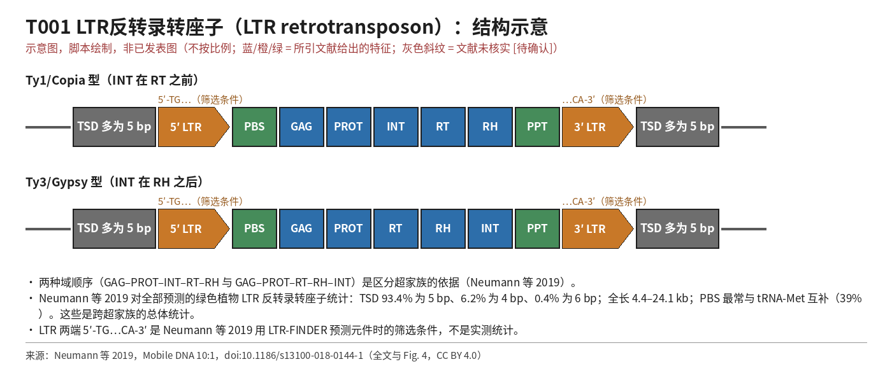

图 T001-1　LTR反转录转座子（LTR retrotransposon）：结构示意。示意图，脚本绘制，非已发表图；每个特征的来源写在图下方。序列：Dfam 4.0 绿色植物家族中没有本类型可用的共识序列（无此类家族、两端 30 bp 含 N，或分类标注无法核实），不画序列。


典型的自主型 LTR 反转录转座子由 5' LTR、内部编码区与 3' LTR 三部分组成，全长通常在 4 kb 至 15 kb 之间，少数大型植物元件可超过 20 kb [待确认]。单个 LTR 的长度跨度较大，多在 100 bp 至数 kb 之间，内部依次包含 U3、R 和 U5 三个功能亚区，分别承担转录启动调控、转录起始与加尾信号定位等功能 [待确认]。绝大多数完整元件的 LTR 末端存在短反向重复序列，最经典的末端二核苷酸为 5'-TG...CA-3'，但部分家族存在非经典末端变异 [待确认]。在内部区域两端，5' LTR 下游紧邻引物结合位点（primer binding site，PBS），其序列通常与宿主细胞中某种 tRNA 的 3' 端互补，用于启动负链 DNA 合成；3' LTR 上游紧邻富含嘌呤的多聚嘌呤区（polypurine tract，PPT），用于启动正链 DNA 合成 [待确认]。（见本条“本版补充说明”）

#### TSD

LTR 反转录转座子整合进入宿主染色体时，整合酶在靶位点 DNA 双链上产生交错切口，随后由宿主 DNA 修复系统补平缺口，在元件 5' 端和 3' 端外侧形成一对长度相同的正向重复序列，称为靶位点重复（target site duplication，TSD） [待确认]。整个 LTR 目的 TSD 长度通常为 4 bp 至 6 bp，其中植物常见超家族以 5 bp 最为典型 [待确认]。

#### 编码蛋白与结构域顺序

完整的自主型 LTR 反转录转座子在内部区域编码 `gag` 与 `pol` 两个核心功能区，部分超家族或特定植物谱系还在 `pol` 下游携带 `env` 样开放阅读框（Havecker 等 2004, doi:10.1186/gb-2004-5-6-225）。`gag` 编码衣壳样结构蛋白，负责在细胞质内组装病毒样颗粒（virus-like particle，VLP）并保护转录本 RNA；`pol` 编码完成转座周期必需的酶类，包括天冬氨酸蛋白酶（PR/PROT）、整合酶（INT）、反转录酶（RT）与核糖核酸酶 H（RH/RNase H）（Neumann 等 2019, doi:10.1186/s13100-018-0144-1）。`pol` 内结构域的排列顺序是区分 LTR 目内超家族的核心分子标志：Copia 超家族遵循 PROT-INT-RT-RH 顺序，而 Gypsy、Bel-Pao 及逆转录病毒相关类群遵循 PROT-RT-RH-INT 顺序（Neumann 等 2019, doi:10.1186/s13100-018-0144-1）。

#### 转座机制

LTR 反转录转座子采用复制粘贴式机制扩增，每次成功转座都会在保留原拷贝的基础上产生新拷贝 [待确认]。过程始于宿主 RNA 聚合酶 II 识别 5' LTR 中 U3 区的启动子，从 5' R 区起始转录并在 3' R 区终止加尾，生成全长单链 RNA 转录本 [待确认]。该 RNA 既作为翻译 `gag` 与 `pol` 蛋白的信使 RNA，也被包裹进入细胞质内的病毒样颗粒作为反转录模板 [待确认]。在病毒样颗粒内，反转录酶以结合在 PBS 上的宿主 tRNA 为引物合成负链强停 DNA，经链转移至 3' R 区后继续延伸合成全长负链 cDNA；随后 RNase H 降解 RNA 模板，保留抗降解的 PPT 片段作为正链引物，经第二次链转移合成双链 cDNA [待确认]。最后，双链 cDNA 随整合酶进入细胞核并插入宿主基因组新位点，伴随产生 TSD [待确认]。由于反转录机制决定了新插入拷贝的 5' LTR 与 3' LTR 序列完全一致，后续随演化时间独立积累碱基替代，因此两个 LTR 之间的序列分歧度常被用于推算单个完整拷贝的插入时间 [待确认]。

#### 自主与非自主搭档

完整编码 `gag` 与 `pol` 蛋白且保留两端 LTR、PBS 与 PPT 的元件属于自主型，能够独立驱动自身转座 [待确认]。当内部编码区发生大片段缺失或失活，但仍保留两端 LTR 及顺式作用元件时，则形成非自主型衍生物，它们无法自行合成反转录与整合机器，必须反式借用同细胞内自主型元件编码的蛋白完成扩增 [待确认]。植物中两类代表性的非自主搭档为微型末端重复反转录转座子（TRIM）与大型反转录转座子衍生物（LARD） [待确认]。此外，单个完整元件的两翼 LTR 之间经常发生不等同源重组，直接切除内部编码区及其中一个 LTR，在基因组中仅残留一个孤立的 solo-LTR，该过程是植物基因组清除冗余 LTR 序列并抑制基因组无限膨胀的重要平衡机制 [待确认]。

#### 识别特征与工具

全基因组水平从头识别完整 LTR 反转录转座子主要依据结构特征：两段序列高度相似且间隔适中的正向重复 LTR、保守的 5'-TG...CA-3' 末端、紧邻两翼的 4 bp 至 6 bp TSD、内部 PBS 与 PPT 以及可识别的 `gag-pol` 蛋白结构域 [待确认]。常用的结构预测软件包括 LTR_FINDER（Xu 和 Wang 2007, doi:10.1093/nar/gkm286）、LTRharvest（Ellinghaus 等 2008, doi:10.1186/1471-2105-9-18）以及用于注释内部 PBS、PPT 和蛋白结构域的 LTRdigest（Steinbiss 等 2009, doi:10.1093/nar/gkp759）。LTR_retriever 能够整合上游候选结果并通过严格边界与结构域过滤大幅降低假阳性，同时衍生出基于完整 LTR 比例评估基因组组装连续性的 LAI 指标（Ou 和 Jiang 2018, doi:10.1104/pp.17.01310）。综合注释流程 EDTA 整合了 LTR 候选识别与去冗余库构建步骤（Ou 等 2019, doi:10.1186/s13059-019-1905-y）；针对植物 LTR 元件的超家族与谱系级精准分类，目前广泛采用基于 REXdb 蛋白结构域隐马尔可夫模型（HMM）的 TEsorter（Zhang 等 2022, doi:10.1093/hr/uhac017；Neumann 等 2019, doi:10.1186/s13100-018-0144-1）。（见本条“本版补充说明”）

#### 分类争议

LTR 目层面的分类争议集中在边界界定与病毒命名衔接两方面。首先，2007 年统一分类体系将 Retrovirus（RLR）与 ERV（RLE）并列为独立超家族，而 Dfam 现行体系及病毒分类学则倾向于将外源性逆转录病毒与其内源化整合拷贝统一纳入 Retroviridae/ERV 谱系框架中（Wicker 等 2007, doi:10.1038/nrg2165；Storer 等 2021, doi:10.1186/s13100-020-00230-y）。其次，内源副反转录病毒（Caulimoviridae）虽不具备典型双 LTR 整合结构，但因与 LTR 元件共享反转录酶系统发育近缘关系，在 REXdb 与 Dfam 中常与 LTR 类群并列收录以避免注释混淆，学界对其是否属于狭义 LTR 目存在界定差异（Neumann 等 2019, doi:10.1186/s13100-018-0144-1；Storer 等 2021, doi:10.1186/s13100-020-00230-y）。此外，植物部分 Copia 与 Gypsy 谱系携带 `env` 样开放阅读框，曾引发关于植物是否存在逆转录病毒的讨论，现行分类已明确将其归回植物 LTR 谱系而非 ERV（Neumann 等 2019, doi:10.1186/s13100-018-0144-1）。

#### 发现与分布

**发现与命名**

- Boeke 等 (1985) Ty elements transpose through an RNA intermediate. Cell. doi:10.1016/0092-8674(85)90197-7。摘要原句：“If the donor TyH3 is marked with an intron-containing fragment, the intron is correctly spliced out of the Ty during transposition, suggesting that the Ty RNA is the intermediate for transposition”；支持范围：Ty1 transposes via an RNA intermediate (first LTR retrotransposon mechanism)
- Xiong 和 Eickbush (1990) Origin and evolution of retroelements based upon their reverse transcriptase sequences. The EMBO Journal. doi:10.1002/j.1460-2075.1990.tb07536.x。摘要原句：“To study the evolutionary relationship of reverse transcriptase (RT) containing genetic elements, a phylogenetic tree of 82 retroelements from animals, plants, protozoans and bacteria was constructed”；涉及生物：retroelements across eukaryotes；支持范围：RT-based phylogeny separating LTR and non-LTR retroelements
- Wicker 等 (2007) A unified classification system for eukaryotic transposable elements. Nature Rev Genetics. doi:10.1038/nrg2165。摘要原句：“Here we propose the first unified hierarchical classification system, designed on the basis of the transposition mechanism, sequence similarities and structural relationships, that can be easily applied by non-experts”；支持范围：hierarchical classification (class, subclass, order, superfamily)

**植物中的报道**

- Bennetzen 和 Wang (2014) The contributions of transposable elements to the structure, function, and evolution of plant genomes. Annual Rev of Plant Biology. doi:10.1146/annurev-arplant-050213-035811。摘要原句：“Although the origins and attitudes of TEs have the hallmarks of selfish DNA, there are numerous cases where TE components have been co-opted by the host to create new genes or modify gene regulation”；涉及生物：plants；支持范围：LTR retrotransposons in plant genomes
- Kumar 和 Bennetzen (1999) Plant retrotransposons. Annual Rev of Genetics. doi:10.1146/annurev.genet.33.1.479。摘要原句：“Retrotransposons are mobile genetic elements that transpose through reverse transcription of an RNA intermediate”；涉及生物：plants
- Neumann 等 (2019) Systematic survey of plant LTR-retrotransposons elucidates phylogenetic relationships of their polyprotein domains and provides a reference for element classification. Mobile DNA. doi:10.1186/s13100-018-0144-1。摘要原句：“BackgroundPlant LTR-retrotransposons are classified into two superfamilies, Ty1/copia and Ty3/gypsy”；涉及生物：Viridiplantae；支持范围：REXdb survey of plant LTR retrotransposon lineages

**葡萄中的报道**

- Velasco 等 (2007) A high quality draft consensus sequence of the genome of a heterozygous grapevine variety. PLoS ONE. doi:10.1371/journal.pone.0001326。正文原句：“The repeats were included in group I (retrotransposons: Copia, Gypsy, LINE) and group II (DNA transposons: Mutator, CACTA, hAT) according to Feschotte et al. [75] . The most abundant TEs were Gypsy/athila-like elements followed by Copia…”；涉及生物：Vitis vinifera；支持范围：most abundant TEs in the grape draft genome
- Shi 等 (2023) The complete reference genome for grapevine (Vitis vinifera L.) genetics and breeding. Horticulture Research. doi:10.1093/hr/uhad061。正文原句：“The TEs mainly consisted of the long terminal repeat (LTR) type (47.54%), predominantly Gypsy (20.22%) and Copia (19.67%)…”；涉及生物：Vitis vinifera PN40024；支持范围：TE composition of the T2T grape genome
- Carrier 等 (2012) Transposable elements are a major cause of somatic polymorphism in Vitis vinifera L. PLoS ONE. doi:10.1371/journal.pone.0032973。正文原句：“Selection of mobile elements and confirmation of their insertion polymorphism We selected for detailed analyses four representative mobile elements among class I LTR transposable elements: Gret-1 , Copia-10 , Gypsy-19 and Cauliv-1 . These four elements have very different copy numbers and polymorphic sites in the partial…”；涉及生物：Vitis vinifera；支持范围：Gret-1, Copia-10, Gypsy-19, Cauliv-1 insertion polymorphism

#### 本版补充说明

① 域顺序：GAG–PROT–INT–RT–RH（Ty1/Copia）与 GAG–PROT–RT–RH–INT（Ty3/Gypsy）是 Neumann 等 2019（doi:10.1186/s13100-018-0144-1）在超家族层面给出的判别顺序；本条若写某谱系“遵循”该顺序，指的是沿用超家族的顺序，不是该文对本谱系另行测定。

② 末端：5′-TG…CA-3′ 是该文用 LTR-FINDER 预测元件时设定的筛选条件，不是对各谱系的实测统计；本条中“末端保守为 5′-TG…CA-3′”一类说法应按此理解。

③ TSD 统计（93.4% 为 5 bp、6.2% 为 4 bp、0.4% 为 6 bp）与全长 4.4–24.1 kb 是该文对全部预测元件的总体统计，不是某一超家族或谱系的值；各谱系的值见 Fig. 4 与 T011–T045。

### T002 Ty1/Copia超家族（Ty1/Copia）

**名称对照**：Wicker 体系：I 类 / LTR 目 / Copia 超家族（代码 RLC）；Dfam 节点：Long_Terminal_Repeat_Element;Ty1-Copia；REXdb 路径：Class_I/LTR/Ty1/copia。（来源：代码据 Wu 等 2025, doi:10.3390/biom15030346；Dfam 4.0 分类树，2026-11-23 读取；REXdb v4.0 说明文件，doi:10.5281/zenodo.10160279）

#### 定义与命名

Ty1/Copia 超家族是 I 类转座子 LTR 目下的两大植物主导超家族之一，在 2007 年统一分类体系中三字母代码为 `RLC`（Wicker 等 2007, doi:10.1038/nrg2165）。该超家族以最早在酿酒酵母中发现的 Ty1 元件和在黑腹果蝇中发现的 Copia 元件联合命名；在国际病毒分类委员会（ICTV）体系中对应 Pseudoviridae 科，在 Dfam 现行分类中对应 `LTR/Copia` 节点（Wicker 等 2007, doi:10.1038/nrg2165）。根据 2019 年基于反转录转座子蛋白结构域建立的 REXdb 分类体系，绿色植物中的 Ty1/Copia 进一步划分为 16 个系统发育谱系：Ale、Alesia、Angela、Bianca、Bryco、Gymco-I、Gymco-II、Gymco-III、Gymco-IV、Ikeros、Ivana、Lyco、Osser、SIRE、TAR 与 Tork（Neumann 等 2019, doi:10.1186/s13100-018-0144-1）。

#### 结构、长度与末端

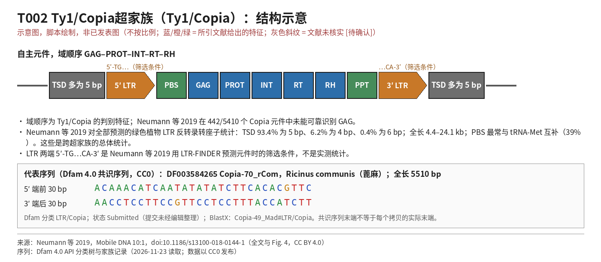

图 T002-1　Ty1/Copia超家族（Ty1/Copia）：结构示意。示意图，脚本绘制，非已发表图；每个特征的来源写在图下方。序列条：Dfam DF003584265（Copia-70_rCom，蓖麻 Ricinus communis，Dfam 4.0，CC0；状态 Submitted）前、后各 30 bp。该共识序列两端不是 5′-TG…CA-3′，提交的共识边界可能与真实 LTR 末端不一致，仅作序列样例。

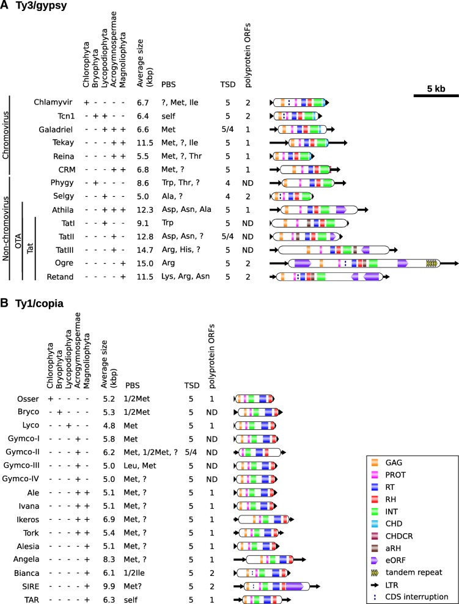

图 T002-P1　绿色植物 Ty1/copia 与 Ty3/gypsy 各谱系的分布、平均长度、PBS、TSD、ORF 数与代表元件结构。原图：Neumann 等（2019），Fig. 4。Systematic survey of plant LTR-retrotransposons elucidates phylogenetic relationships of their polyprotein domains and provides a reference for element classification. Mob DNA. doi:10.1186/s13100-018-0144-1。许可：CC BY 4.0（https://creativecommons.org/licenses/by/4.0/）。未修改。


完整的自主型 Ty1/Copia 元件全长多在 4 kb 至 9 kb 之间，整体平均长度通常短于 Ty3/Gypsy 超家族，但部分大型谱系（如 Angela 与 SIRE）全长可达 10 kb 左右 [待确认]。单个 LTR 长度一般为 150 bp 至 1.5 kb，多数家族两端呈现保守的 5'-TG...CA-3' 末端二核苷酸 [待确认]。5' LTR 下游具 PBS（植物 Copia 元件最常与甲硫氨酸启动 tRNA 互补，具体不同谱系 tRNA 偏好细节待确认），3' LTR 上游具 PPT。相比 Ty3/Gypsy，部分 Copia 谱系（如 Ale）结构极为紧凑，内部非编码区较短，LTR 长度常仅数百 bp（Neumann 等 2019, doi:10.1186/s13100-018-0144-1）。（见本条“本版补充说明”）

#### TSD

整合进入宿主基因组时形成正向重复的 TSD，典型长度为 5 bp [待确认]。在极少数家族或修复异常位点中可见 4 bp 或 6 bp 变异（待确认）。

#### 编码蛋白与结构域顺序

Ty1/Copia 超家族最核心的分子鉴别特征是 `pol` 区域内整合酶（INT）位于反转录酶（RT）与核糖核酸酶 H（RH）的上游，完整结构域排列顺序为 **GAG - PROT - INT - RT - RH**（Neumann 等 2019, doi:10.1186/s13100-018-0144-1）。这一顺序与 Ty3/Gypsy、Bel-Pao 及逆转录病毒的 PROT-RT-RH-INT 顺序截然相反，是最稳定的超家族判别依据 [待确认]。在许多植物 Copia 元件中，`gag` 与 `pol` 位于同一个连续开放阅读框内，翻译后由自身编码的蛋白酶切割成熟；部分家族则通过核糖体移码或终止密码子通读调控 `gag` 与 `pol` 的化学计量比（Havecker 等 2004, doi:10.1186/gb-2004-5-6-225）。在植物谱系中，SIRE 谱系具有显著的结构特例，其在 `pol` 下游额外携带一个 `env` 样开放阅读框（Neumann 等 2019, doi:10.1186/s13100-018-0144-1）。

#### 转座机制

遵循标准的 LTR 反转录转座子复制粘贴机制：由 5' LTR 启动子驱动全长 RNA 转录，在细胞质内组装形成病毒样颗粒并完成以 tRNA-PBS 和 PPT 为引物的双链 cDNA 合成，最终由整合酶将双链 cDNA 整合至宿主染色体并产生 5 bp TSD [待确认]。不少植物 Copia 元件的 5' LTR U3 区含有与逆境胁迫、激素信号或组织发育相关的顺式调控基序，使其在正常发育状态下受表观遗传沉默抑制，而在非生物或生物胁迫、组织培养及杂交冲击条件下可被转录激活 [待确认]。

#### 自主与非自主搭档

自主型 Ty1/Copia 元件携带完整 `gag` 与 `pol` 结构域，可驱动自身及同源非自主元件扩增 [待确认]。非自主衍生物丧失部分或全部内部编码序列但保留 LTR、PBS 与 PPT，依赖同家族自主型元件反式提供的蛋白机器完成反转录与整合；植物中的部分 TRIM 元件在序列与末端特征上显示出与 Copia 谱系相关的演化来源（具体 TRIM 与 Copia 搭档配对的专文 DOI 待确认）。同元件两翼 LTR 间的不等同源重组同样在 Copia 家族中频繁发生，产生大量 solo-LTR [待确认]。

#### 识别特征与工具

Ty1/Copia 的从头结构检出依赖 LTRharvest（Ellinghaus 等 2008, doi:10.1186/1471-2105-9-18）、LTR_FINDER（Xu 和 Wang 2007, doi:10.1093/nar/gkm286）、LTR_retriever（Ou 和 Jiang 2018, doi:10.1104/pp.17.01310）与 EDTA（Ou 等 2019, doi:10.1186/s13059-019-1905-y）。将其与 Ty3/Gypsy 准确区分并细分至植物 16 个谱系，核心依据是 `pol` 内 INT-RT-RH 的结构域顺序以及各结构域的 HMM 比对得分，标准工具为基于 REXdb 的 TEsorter（Zhang 等 2022, doi:10.1093/hr/uhac017；Neumann 等 2019, doi:10.1186/s13100-018-0144-1），辅助蛋白域注释亦可使用 LTRdigest（Steinbiss 等 2009, doi:10.1093/nar/gkp759）与 GyDB（Llorens 等 2011, doi:10.1093/nar/gkq1061）。对于丧失内部编码区的非自主 Copia 衍生物或 solo-LTR，需依靠其 LTR 序列与完整自主型参考拷贝的核酸同源性进行归类 [待确认]。

#### 分类争议

主要争议集中在病毒学与转座子学命名体系的并行，以及植物内部谱系的历史划分差异。ICTV 体系使用 Pseudoviridae 及其下属名（如 Pseudovirus、Hemivirus、Sirevirus），而基因组学与植物转座子研究界普遍沿用 Ty1/Copia 与 RLC 命名（Wicker 等 2007, doi:10.1038/nrg2165；Llorens 等 2011, doi:10.1093/nar/gkq1061）。在植物谱系层面，早期不同文献对 Angela/Tork、Ivana/Oryco 以及 Maximus/SIRE 等谱系的命名和边界定义并不统一，2019 年 REXdb 系统发育分类统一了这些对应关系（如将 Maximus 统一归入 SIRE，将 Oryco 统一归入 Ivana）（Neumann 等 2019, doi:10.1186/s13100-018-0144-1）。此外，由于 SIRE 谱系携带 `env` 样开放阅读框，早期个别研究曾将其视作植物逆转录病毒候选者，现行分类已明确其属于 Ty1/Copia 超家族的独立谱系（Neumann 等 2019, doi:10.1186/s13100-018-0144-1）。

#### 发现与分布

**发现与命名**

- Wicker 等 (2007) A unified classification system for eukaryotic transposable elements. Nature Rev Genetics. doi:10.1038/nrg2165。摘要原句：“Here we propose the first unified hierarchical classification system, designed on the basis of the transposition mechanism, sequence similarities and structural relationships, that can be easily applied by non-experts”；支持范围：hierarchical classification (class, subclass, order, superfamily) [注意：所引句不含该名称，仅支持上位/总体论断]
- Boeke 等 (1985) Ty elements transpose through an RNA intermediate. Cell. doi:10.1016/0092-8674(85)90197-7。摘要原句：“If the donor TyH3 is marked with an intron-containing fragment, the intron is correctly spliced out of the Ty during transposition, suggesting that the Ty RNA is the intermediate for transposition”；支持范围：Ty1 element (type member of Ty1/Copia) [注意：所引句不含该名称，仅支持上位/总体论断]
- Mount 和 Rubin (1985) Complete nucleotide sequence of the Drosophila transposable element copia: homology between copia and retroviral proteins. Molecular and Cellular Biology. doi:10.1128/mcb.5.7.1630-1638.1985。摘要原句：“We have determined the complete nucleotide sequence of the copia element present at the white-apricot allele of the white locus in Drosophila melanogaster”；涉及生物：Drosophila melanogaster；支持范围：complete sequence of copia and homology to retroviral proteins [注意：所引句不含该名称，仅支持上位/总体论断]

**植物中的报道**

- Kumar 和 Bennetzen (1999) Plant retrotransposons. Annual Rev of Genetics. doi:10.1146/annurev.genet.33.1.479。摘要原句：“Retrotransposons are mobile genetic elements that transpose through reverse transcription of an RNA intermediate”；涉及生物：plants
- Neumann 等 (2019) Systematic survey of plant LTR-retrotransposons elucidates phylogenetic relationships of their polyprotein domains and provides a reference for element classification. Mobile DNA. doi:10.1186/s13100-018-0144-1。摘要原句：“BackgroundPlant LTR-retrotransposons are classified into two superfamilies, Ty1/copia and Ty3/gypsy”；涉及生物：Viridiplantae；支持范围：REXdb survey of plant LTR retrotransposon lineages
- Hirochika 等 (1996) Retrotransposons of rice involved in mutations induced by tissue culture. Proceedings of the National Academy of Sciences. doi:10.1073/pnas.93.15.7783。摘要原句：“Five retrotransposon families of rice (Tos1-Tos5) have been reported previously”；支持范围：Tos17 copia-like retrotransposon activated by tissue culture [注意：所引句不含该名称，仅支持上位/总体论断]
- Grandbastien 等 (1989) Tnt1, a mobile retroviral-like transposable element of tobacco isolated by plant cell genetics. Nature. doi:10.1038/337376a0。摘要原句：“Here, we report the isolation of the first tobacco (Nicotiana tabacum) transposable element, Tnt1, which seems to be the most complete mobile retrotransposon characterized in higher plants”；涉及生物：tobacco (Nicotiana tabacum)；支持范围：Tnt1 retroviral-like element [注意：所引句不含该名称，仅支持上位/总体论断]
- Wicker 和 Keller (2007) Genome-wide comparative analysis of copia retrotransposons in Triticeae, rice, and Arabidopsis reveals conserved ancient evolutionary lineages and distinct dynamics of individual copia families. Genome Research. doi:10.1101/gr.6214107。正文原句：“…Triticeae sequences are the closely related Angela , BARE1 , and WIS families. copia elements from grasses and their Arabidopsis homologs can be separated into six major evolutionary lineages Approximately 500 amino acids covering the reverse transcriptase domain (the most conserved region of the copia elements) from 77…”；涉及生物：barley, wheat, rice, Arabidopsis；支持范围：six copia lineages across monocots and dicots [注意：所引句不含该名称，仅支持上位/总体论断]

**葡萄中的报道**

- Shi 等 (2023) The complete reference genome for grapevine (Vitis vinifera L.) genetics and breeding. Horticulture Research. doi:10.1093/hr/uhad061。正文原句：“The TEs mainly consisted of the long terminal repeat (LTR) type (47.54%), predominantly Gypsy (20.22%) and Copia (19.67%)…”；涉及生物：Vitis vinifera PN40024；支持范围：TE composition of the T2T grape genome [注意：所引句不含该名称，仅支持上位/总体论断]
- Moisy 等 (2008) Characterization of ten novel Ty1/copia-like retrotransposon families of the grapevine genome. BMC Genomics. doi:10.1186/1471-2164-9-469。摘要原句：“To characterize retrotransposon families in the grapevine genome (the fourth crop plant genome sequenced) we have combined two approaches: a PCR-based method for the isolation of RnaseH-LTR sequences with a computer-based sequence similarity search in the whole-genome sequence of PN40024.ResultsSupported by a phylogenic…”；涉及生物：Vitis vinifera；支持范围：ten novel Ty1/copia families plus Tvv1 Vine-1 and Gret1
- Pelsy 和 Merdinoglu (2002) Complete sequence of Tvv1, a family of Ty 1 copia-like retrotransposons of Vitis vinifera L., reconstituted by chromosome walking. Theoretical and Applied Genetics. doi:10.1007/s00122-002-0969-2。摘要原句：“The reconstitution of a family of retroelements, named Tvv1, was achieved by six successive steps”；涉及生物：Vitis vinifera；支持范围：Tvv1 Ty1/copia family [注意：所引句不含该名称，仅支持上位/总体论断]
- Verriès 等 (2000) Cloning and characterization of Vine-1, a LTR-retrotransposon-like element in Vitis vinifera L., and other Vitis species. Genome. doi:10.1139/g99-139。摘要原句：“We report the organization of a grapevine chimeric gene Adhr-Vine-1, composed by an Adhr gene, into which a retroelement, Vine-1, was inserted”；涉及生物：Vitis vinifera；支持范围：Vine-1 LTR retrotransposon [注意：所引句不含该名称，仅支持上位/总体论断]
- Labra 等 (2004) Vine-1 retrotransposon-based sequence-specific amplified polymorphism for Vitis vinifera L. genotyping. Plant Breeding. doi:10.1046/j.1439-0523.2003.00965.x。摘要原句：“The development and application of this procedure to the LTR of the Vine-1 element from grapevine is reported”；涉及生物：Vitis vinifera；支持范围：Vine-1 SSAP markers [注意：所引句不含该名称，仅支持上位/总体论断]
- Pelsy (2007) Untranslated leader region polymorphism of Tvv1, a retrotransposon family, is a novel marker useful for analyzing genetic diversity and relatedness in the genus Vitis. Theoretical and Applied Genetics. doi:10.1007/s00122-007-0643-9。摘要原句：“Grapevine retrotransposons belonging to the Tvv1 family share a single, highly conserved open reading frame but differ by their untranslated leader (UTL) region, which is highly variable in size”；涉及生物：Vitis vinifera；支持范围：Tvv1 UTR polymorphism [注意：所引句不含该名称，仅支持上位/总体论断]
- Carrier 等 (2012) Transposable elements are a major cause of somatic polymorphism in Vitis vinifera L. PLoS ONE. doi:10.1371/journal.pone.0032973。正文原句：“Selection of mobile elements and confirmation of their insertion polymorphism We selected for detailed analyses four representative mobile elements among class I LTR transposable elements: Gret-1 , Copia-10 , Gypsy-19 and Cauliv-1 . These four elements have very different copy numbers and polymorphic sites in the partial…”；涉及生物：Vitis vinifera；支持范围：Gret-1, Copia-10, Gypsy-19, Cauliv-1 insertion polymorphism [注意：所引句不含该名称，仅支持上位/总体论断]
- Park 等 (2021) Horizontal Transfer of LTR Retrotransposons Contributes to the Genome Diversity of Vitis. International Journal of Molecular Sciences. doi:10.3390/ijms221910446。正文原句：“In our analysis, the major difference in LTR retrotransposon content in the Vitis genomes appeared in the native LTR retrotransposon families, such as Tork , Athila , and Tat ( Figure 5 d,e and Figure 6 , and Supplementary Figure S7 )”；涉及生物：Vitis；支持范围：horizontal transfer of LTR retrotransposons; Tork, CRM, Reina, Athila, Tat families in four Vitis genomes [注意：所引句不含该名称，仅支持上位/总体论断]

#### 本版补充说明

① 域顺序：GAG–PROT–INT–RT–RH（Ty1/Copia）与 GAG–PROT–RT–RH–INT（Ty3/Gypsy）是 Neumann 等 2019（doi:10.1186/s13100-018-0144-1）在超家族层面给出的判别顺序；本条若写某谱系“遵循”该顺序，指的是沿用超家族的顺序，不是该文对本谱系另行测定。

② 末端：5′-TG…CA-3′ 是该文用 LTR-FINDER 预测元件时设定的筛选条件，不是对各谱系的实测统计；本条中“末端保守为 5′-TG…CA-3′”一类说法应按此理解。

③ TSD 统计（93.4% 为 5 bp、6.2% 为 4 bp、0.4% 为 6 bp）与全长 4.4–24.1 kb 是该文对全部预测元件的总体统计，不是某一超家族或谱系的值；各谱系的值见 Fig. 4 与 T011–T045。

### T003 Ty3/Gypsy超家族（Ty3/Gypsy）

**名称对照**：Wicker 体系：I 类 / LTR 目 / Gypsy 超家族（代码 RLG）；Dfam 节点：Gypsy-ERV;Gypsy；REXdb 路径：Class_I/LTR/Ty3/gypsy。（来源：代码据 Wu 等 2025, doi:10.3390/biom15030346；Dfam 4.0 分类树，2026-11-23 读取；REXdb v4.0 说明文件，doi:10.5281/zenodo.10160279）

#### 定义与命名

Ty3/Gypsy 超家族是 I 类转座子 LTR 目下的另一大核心超家族，在 2007 年统一分类体系中三字母代码为 `RLG`（Wicker 等 2007, doi:10.1038/nrg2165）。该超家族以酿酒酵母的 Ty3 元件与黑腹果蝇的 Gypsy 元件命名；在 ICTV 病毒分类体系中对应 Metaviridae 科，在 Dfam 现行分类中对应 `LTR/Gypsy` 节点（Wicker 等 2007, doi:10.1038/nrg2165；Storer 等 2021, doi:10.1186/s13100-020-00230-y）。根据 2019 年 REXdb 系统发育分类框架，绿色植物的 Ty3/Gypsy 划分为两大主支：非染色质病毒支（non-chromovirus），包含 Athila 与 Tat（进一步细分为 TatI、TatII、TatIII、Ogre、Retand 等谱系）；以及染色质病毒支（chromovirus），在被子植物中主要包含 CRM、Galadriel、Reina 与 Tekay，在苔藓、蕨类与藻类中还包括 Chlamyvir、Tcn1、Phygy 与 Selgy 等谱系（Neumann 等 2019, doi:10.1186/s13100-018-0144-1）。

#### 结构、长度与末端

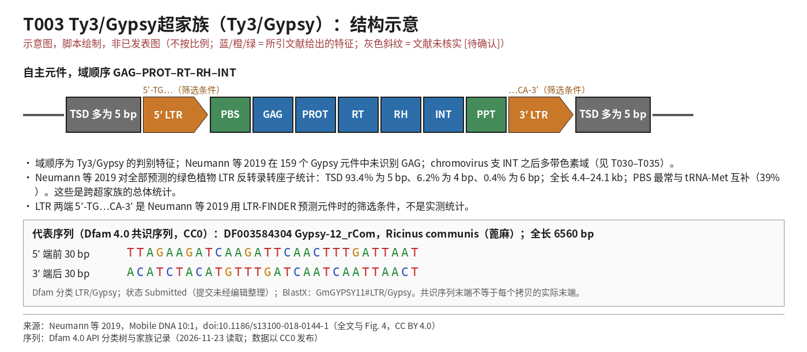

图 T003-1　Ty3/Gypsy超家族（Ty3/Gypsy）：结构示意。示意图，脚本绘制，非已发表图；每个特征的来源写在图下方。序列条：Dfam DF003584304（Gypsy-12_rCom，蓖麻 Ricinus communis，Dfam 4.0，CC0；状态 Submitted）前、后各 30 bp。该共识序列两端不是 5′-TG…CA-3′，提交的共识边界可能与真实 LTR 末端不一致，仅作序列样例。


图 T003-P1　绿色植物 Ty1/copia 与 Ty3/gypsy 各谱系的分布、平均长度、PBS、TSD、ORF 数与代表元件结构。原图：Neumann 等（2019），Fig. 4。Systematic survey of plant LTR-retrotransposons elucidates phylogenetic relationships of their polyprotein domains and provides a reference for element classification. Mob DNA. doi:10.1186/s13100-018-0144-1。许可：CC BY 4.0（https://creativecommons.org/licenses/by/4.0/）。未修改。


自主型 Ty3/Gypsy 元件的典型全长为 5 kb 至 15 kb，整体尺寸普遍大于 Ty1/Copia；部分非染色质病毒谱系（如 Ogre 与 Retand）因内部存在较长的非编码区或附加开放阅读框，全长常超过 15 kb 甚至突破 20 kb [待确认]。单个 LTR 长度变化幅度大，常见范围为 300 bp 至 3 kb 以上，末端高度保守为 5'-TG...CA-3' [待确认]。内部两端同样具备 PBS 与 PPT，LTR 内含 U3、R、U5 调控亚区 [待确认]。（见本条“本版补充说明”）

#### TSD

整合进入宿主基因组时形成正向重复的 TSD，典型长度为 5 bp [待确认]。少数谱系或个别位点可见 4 bp 或 6 bp 变异（待确认）。

#### 编码蛋白与结构域顺序

Ty3/Gypsy 超家族的核心结构特征是 `pol` 区域内反转录酶（RT）与核糖核酸酶 H（RH）位于整合酶（INT）上游，完整结构域顺序为 **GAG - PROT - RT - RH - INT**（Neumann 等 2019, doi:10.1186/s13100-018-0144-1）。该排列顺序与 Bel-Pao 和逆转录病毒一致，但与 Ty1/Copia 明显不同 [待确认]。在染色质病毒支（chromovirus）中，整合酶 C 端额外携带一个染色质结构域（chromodomain，CHD 或特化的着丝粒靶向基序 CHDCR），能够结合特定的组蛋白修饰或着丝粒蛋白，引导元件定向整合至异染色质或着丝粒区域（Neumann 等 2019, doi:10.1186/s13100-018-0144-1；Llorens 等 2011, doi:10.1093/nar/gkq1061）。在非染色质病毒支中，Athila 与部分 Tat 谱系常在 `pol` 下游携带 `env` 样开放阅读框或功能尚不完全明确的附加开放阅读框（Neumann 等 2019, doi:10.1186/s13100-018-0144-1）。

#### 转座机制

采用典型的 LTR 反转录转座子复制粘贴机制，经宿主 RNA 聚合酶 II 转录、细胞质病毒样颗粒内反转录合成双链 cDNA 以及整合酶介导的染色体整合完成扩增 [待确认]。与随机整合相比，染色质病毒支元件借助整合酶 C 端的染色质结构域表现出明显的靶向整合偏好，例如 CRM 谱系特异性靶向着丝粒区域，降低了插入必需功能基因导致宿主致死的风险，从而有助于自身在基因组中长期高拷贝存留（Neumann 等 2019, doi:10.1186/s13100-018-0144-1）。

#### 自主与非自主搭档

完整编码 `gag` 与 `pol` 的 Ty3/Gypsy 元件为自主型，既能自我扩增，也可为同家族缺失内部编码区的非自主衍生物提供反式转座机器 [待确认]。植物中的大型反转录转座子衍生物（LARD）多被认为起源于大型 Ty3/Gypsy（或部分 Copia）元件内部编码区缺失后的衍生形式，长度常超过 4 kb 且不含完整 `pol`（LARD 起源配对专文 DOI 待确认）。高拷贝 Ty3/Gypsy 元件也频繁发生两翼 LTR 间的不等同源重组，形成大量 solo-LTR，部分完整元件之间还常形成嵌套插入（nested insertion）结构，构成异染色质区的主体骨架 [待确认]。

#### 识别特征与工具

结构从头识别采用 LTRharvest（Ellinghaus 等 2008, doi:10.1186/1471-2105-9-18）、LTR_FINDER（Xu 和 Wang 2007, doi:10.1093/nar/gkm286）、LTR_retriever（Ou 和 Jiang 2018, doi:10.1104/pp.17.01310）与 EDTA（Ou 等 2019, doi:10.1186/s13059-019-1905-y）。在超家族及谱系鉴定层面，因 Ty3/Gypsy 与 Bel-Pao、ERV 具有相同的 PROT-RT-RH-INT 排列顺序，必须结合蛋白结构域 HMM 比对与系统发育归类，同时核查整合酶 C 端是否存在染色质结构域以区分染色质病毒支与非染色质病毒支（Neumann 等 2019, doi:10.1186/s13100-018-0144-1）。植物项目首选基于 REXdb 的 TEsorter 完成至 CRM、Tekay、Reina、Galadriel、Athila、Tat/Ogre/Retand 等谱系的自动化分类（Zhang 等 2022, doi:10.1093/hr/uhac017）。

#### 分类争议

第一项争议是命名规范问题：近年来部分研究者指出「Gypsy」一词在社会语境中带有族群歧视色彩，倡议统一改用 Ty3 或 Metaviridae 替代，但 2007 年统一分类体系（RLG）、Dfam 现行节点与 REXdb 仍保留 Ty3/Gypsy 或 Gypsy 标签以确保生物信息学数据库与下游工具的向后兼容（Wicker 等 2007, doi:10.1038/nrg2165；Storer 等 2021, doi:10.1186/s13100-020-00230-y；Neumann 等 2019, doi:10.1186/s13100-018-0144-1；更名倡议专文 DOI 待确认）。第二项争议涉及内部谱系合并与命名对应，例如早期文献中的 Del 谱系在 2019 年 REXdb 框架下统一归入 Tekay，早期笼统并称的 OTA（Ogre/Tat/Athila）复合群在系统发育上被清晰拆分为独立的 Athila 谱系与 Tat 谱系及其子支（Neumann 等 2019, doi:10.1186/s13100-018-0144-1）。

#### 发现与分布

**发现与命名**

- Wicker 等 (2007) A unified classification system for eukaryotic transposable elements. Nature Rev Genetics. doi:10.1038/nrg2165。摘要原句：“Here we propose the first unified hierarchical classification system, designed on the basis of the transposition mechanism, sequence similarities and structural relationships, that can be easily applied by non-experts”；支持范围：hierarchical classification (class, subclass, order, superfamily) [注意：所引句不含该名称，仅支持上位/总体论断]
- Marlor 等 (1986) The Drosophila melanogaster gypsy transposable element encodes putative gene products homologous to retroviral proteins. Molecular and Cellular Biology. doi:10.1128/mcb.6.4.1129-1134.1986。摘要原句：“We determined the complete nucleotide sequence of the gypsy element present at the forked locus of Drosophila melanogaster in the f1 allele”；涉及生物：Drosophila melanogaster；支持范围：gypsy encodes retrovirus-like gene products [注意：所引句不含该名称，仅支持上位/总体论断]
- Hansen 等 (1988) Ty3, a yeast retrotransposon associated with tRNA genes, has homology to animal retroviruses. Molecular and Cellular Biology. doi:10.1128/mcb.8.12.5245-5256.1988。摘要原句：“Ty3, a retrotransposon of Saccharomyces cerevisiae, is found within 20 base pairs (bp) of the 5' ends of different tRNA genes”；涉及生物：Saccharomyces cerevisiae；支持范围：Ty3 sequence and relationship to retroviruses

**植物中的报道**

- Kumar 和 Bennetzen (1999) Plant retrotransposons. Annual Rev of Genetics. doi:10.1146/annurev.genet.33.1.479。摘要原句：“Retrotransposons are mobile genetic elements that transpose through reverse transcription of an RNA intermediate”；涉及生物：plants
- Neumann 等 (2019) Systematic survey of plant LTR-retrotransposons elucidates phylogenetic relationships of their polyprotein domains and provides a reference for element classification. Mobile DNA. doi:10.1186/s13100-018-0144-1。摘要原句：“BackgroundPlant LTR-retrotransposons are classified into two superfamilies, Ty1/copia and Ty3/gypsy”；涉及生物：Viridiplantae；支持范围：REXdb survey of plant LTR retrotransposon lineages
- Marín 和 Lloréns (2000) Ty3/Gypsy retrotransposons: description of new Arabidopsis thaliana elements and evolutionary perspectives derived from comparative genomic data. Molecular Biology and Evolution. doi:10.1093/oxfordjournals.molbev.a026385。摘要原句：“We performed a comprehensive analysis of the evolution of the Ty3/GYPSY: group of long-terminal-repeat retrotransposons (also known as METAVIRIDAE:)”；涉及生物：Arabidopsis thaliana；支持范围：new Arabidopsis Ty3/gypsy elements
- Llorens 等 (2011) The Gypsy Database (GyDB) of mobile genetic elements: release 2.0. Nucleic Acids Research. doi:10.1093/nar/gkq1061。摘要原句：“This article introduces the second release of the Gypsy Database of Mobile Genetic Elements (GyDB 2.0): a research project devoted to the evolutionary dynamics of viruses and transposable elements based on their phylogenetic classification (per lineage and protein domain)”；支持范围：GyDB gypsy database classification [注意：所引句不含该名称，仅支持上位/总体论断]

**葡萄中的报道**

- Shi 等 (2023) The complete reference genome for grapevine (Vitis vinifera L.) genetics and breeding. Horticulture Research. doi:10.1093/hr/uhad061。正文原句：“The TEs mainly consisted of the long terminal repeat (LTR) type (47.54%), predominantly Gypsy (20.22%) and Copia (19.67%)…”；涉及生物：Vitis vinifera PN40024；支持范围：TE composition of the T2T grape genome [注意：所引句不含该名称，仅支持上位/总体论断]
- Moisy 等 (2008) Characterization of ten novel Ty1/copia-like retrotransposon families of the grapevine genome. BMC Genomics. doi:10.1186/1471-2164-9-469。摘要原句：“To characterize retrotransposon families in the grapevine genome (the fourth crop plant genome sequenced) we have combined two approaches: a PCR-based method for the isolation of RnaseH-LTR sequences with a computer-based sequence similarity search in the whole-genome sequence of PN40024.ResultsSupported by a phylogenic…”；涉及生物：Vitis vinifera；支持范围：ten novel Ty1/copia families plus Tvv1 Vine-1 and Gret1 [注意：所引句不含该名称，仅支持上位/总体论断]
- Kobayashi 等 (2004) Retrotransposon-induced mutations in grape skin color. Science. doi:10.1126/science.1095011。仅标题可核实，只用于说明该文存在及其命名/主题，不据此作内容论断
- Pereira 等 (2005) Genomic analysis of Grapevine Retrotransposon 1 (Gret 1) in Vitis vinifera. Theoretical and Applied Genetics. doi:10.1007/s00122-005-0009-0。摘要原句：“The complete sequence of the first retrotransposon isolated in Vitis vinifera, Gret 1, was used to design primers that permitted its analysis in the genome of grapevine cultivars”；涉及生物：Vitis vinifera；支持范围：Gret1 genomic analysis [注意：所引句不含该名称，仅支持上位/总体论断]
- Cochetel 等 (2023) A super-pangenome of the North American wild grape species. Genome Biology. doi:10.1186/s13059-023-03133-2。正文原句：“Remarkably, 56% of the private TEs were long terminal repeats (LTR) Gypsy retrotransposons, which represented only 24% of the core TEs (Fig. 2 e)”；涉及生物：Vitis species；支持范围：Gypsy over-represented in private TEs [注意：所引句不含该名称，仅支持上位/总体论断]
- Carrier 等 (2012) Transposable elements are a major cause of somatic polymorphism in Vitis vinifera L. PLoS ONE. doi:10.1371/journal.pone.0032973。正文原句：“Selection of mobile elements and confirmation of their insertion polymorphism We selected for detailed analyses four representative mobile elements among class I LTR transposable elements: Gret-1 , Copia-10 , Gypsy-19 and Cauliv-1 . These four elements have very different copy numbers and polymorphic sites in the partial…”；涉及生物：Vitis vinifera；支持范围：Gret-1, Copia-10, Gypsy-19, Cauliv-1 insertion polymorphism [注意：所引句不含该名称，仅支持上位/总体论断]
- Park 等 (2021) Horizontal Transfer of LTR Retrotransposons Contributes to the Genome Diversity of Vitis. International Journal of Molecular Sciences. doi:10.3390/ijms221910446。正文原句：“In our analysis, the major difference in LTR retrotransposon content in the Vitis genomes appeared in the native LTR retrotransposon families, such as Tork , Athila , and Tat ( Figure 5 d,e and Figure 6 , and Supplementary Figure S7 )”；涉及生物：Vitis；支持范围：horizontal transfer of LTR retrotransposons; Tork, CRM, Reina, Athila, Tat families in four Vitis genomes [注意：所引句不含该名称，仅支持上位/总体论断]

#### 本版补充说明

① 域顺序：GAG–PROT–INT–RT–RH（Ty1/Copia）与 GAG–PROT–RT–RH–INT（Ty3/Gypsy）是 Neumann 等 2019（doi:10.1186/s13100-018-0144-1）在超家族层面给出的判别顺序；本条若写某谱系“遵循”该顺序，指的是沿用超家族的顺序，不是该文对本谱系另行测定。

② 末端：5′-TG…CA-3′ 是该文用 LTR-FINDER 预测元件时设定的筛选条件，不是对各谱系的实测统计；本条中“末端保守为 5′-TG…CA-3′”一类说法应按此理解。

③ TSD 统计（93.4% 为 5 bp、6.2% 为 4 bp、0.4% 为 6 bp）与全长 4.4–24.1 kb 是该文对全部预测元件的总体统计，不是某一超家族或谱系的值；各谱系的值见 Fig. 4 与 T011–T045。

### T004 Bel-Pao超家族（Bel-Pao）

**名称对照**：Wicker 体系：I 类 / LTR 目（Wicker 超家族名单原文未读，未核实）；Dfam 节点：Long_Terminal_Repeat_Element;Bel-Pao；REXdb 路径：无对应节点。（来源：Wicker 2007 原文本书未读；Dfam 4.0 分类树，2026-11-23 读取；REXdb v4.0 说明文件，doi:10.5281/zenodo.10160279）

#### 定义与命名

Bel-Pao 超家族是 I 类转座子 LTR 目下的五大经典超家族之一，在 2007 年统一分类体系中三字母代码为 `RLB`（Wicker 等 2007, doi:10.1038/nrg2165）。该超家族以黑腹果蝇中鉴定的 BEL 元件与家蚕中鉴定的 Pao 元件共同命名；在 Dfam 现行分类体系中对应 `LTR/Pao` 节点，在 ICTV 病毒分类体系中对应 Belpaoviridae 科（Belpaoviridae 建科文献 DOI 待确认）。

#### 结构、长度与末端

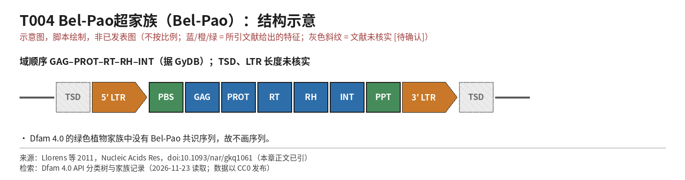

图 T004-1　Bel-Pao超家族（Bel-Pao）：结构示意。示意图，脚本绘制，非已发表图；每个特征的来源写在图下方。序列：Dfam 4.0 绿色植物家族中没有本类型可用的共识序列（无此类家族、两端 30 bp 含 N，或分类标注无法核实），不画序列。


完整的自主型 Bel-Pao 元件全长通常在 4.5 kb 至 10 kb 之间，两端为正向重复的 LTR，单个 LTR 长度多为数百 bp 至约 1 kb（具体跨物种精确长度统计文献 DOI 待确认）。与其余 LTR 超家族一致，其 LTR 末端多保留保守的 5'-TG...CA-3' 反向重复二核苷酸，内部区域包含位于 5' LTR 下游的 PBS 与位于 3' LTR 上游的 PPT [待确认]。（见本条“本版补充说明”）

#### TSD

整合进入宿主基因组时，整合酶介导产生 4 bp 至 6 bp 的正向靶位点重复，以 5 bp 最为常见 [待确认]。

#### 编码蛋白与结构域顺序

自主型 Bel-Pao 元件编码 `gag` 与 `pol` 蛋白，`pol` 内结构域排列顺序与 Ty3/Gypsy 及逆转录病毒相同，为 **GAG - PROT - RT - RH - INT**（Llorens 等 2011, doi:10.1093/nar/gkq1061）。尽管结构域顺序与 Ty3/Gypsy 一致，但 Bel-Pao 在反转录酶、RNase H 与整合酶的氨基酸序列上构成高度独立的单系分支，与 Ty3/Gypsy 和逆转录病毒分界清晰（Llorens 等 2011, doi:10.1093/nar/gkq1061）。部分 Bel-Pao 元件的 `gag` 蛋白含有特征性的锌指基序（CCHC），少数动物成员（如线虫中的 Tas 类元件）在 `pol` 下游携带 `env` 样开放阅读框（具体 `env` 样蛋白分布与功能验证文献 DOI 待确认）。

#### 转座机制

Bel-Pao 超家族遵循经典的 LTR 反转录转座子复制粘贴扩增机制：宿主 RNA 聚合酶 II 从 5' LTR 启动子转录全长 RNA，经翻译组装病毒样颗粒并在胞质内以 PBS 和 PPT 为引物完成双链 cDNA 反转录，随后由整合酶催化双链 cDNA 整合至宿主基因组新位点并形成 TSD [待确认]。

#### 自主与非自主搭档

与其余 LTR 超家族类似，宿主基因组中除具备完整 `gag` 和 `pol` 的自主型 Bel-Pao 拷贝外，也存在内部编码区缺失的非自主衍生物及两翼 LTR 不等同源重组形成的 solo-LTR（针对 Bel-Pao 专属非自主搭档谱系的系统分类研究较少，待确认）。

#### 识别特征与工具

在动物基因组中，完整 Bel-Pao 元件的结构检出同样依赖 LTRharvest（Ellinghaus 等 2008, doi:10.1186/1471-2105-9-18）、LTR_FINDER（Xu 和 Wang 2007, doi:10.1093/nar/gkm286）与 RepeatModeler2（Flynn 等 2020, doi:10.1073/pnas.1921046117）。由于其 `pol` 结构域顺序与 Ty3/Gypsy 完全一致（均为 PROT-RT-RH-INT），仅凭结构域顺序无法将其与 Ty3/Gypsy 区分，必须依赖针对反转录酶与整合酶的 HMM 序列模型比对和系统发育树定位，主要参考数据库包括 Dfam与 GyDB（Llorens 等 2011, doi:10.1093/nar/gkq1061）。在植物与葡萄注释中，采用面向植物优化的 EDTA（Ou 等 2019, doi:10.1186/s13059-019-1905-y）与基于 REXdb 的 TEsorter（Zhang 等 2022, doi:10.1093/hr/uhac017）可有效避免将植物 Gypsy 退化拷贝误判为 Bel-Pao。

#### 分类争议

早期文献曾一度将 BEL 与 Pao 视为彼此独立的小类群，或将其附属于 Gypsy 的外群分支；2007 年统一分类体系明确将两者合并确立为 LTR 目下独立的 Bel-Pao（RLB）超家族（Wicker 等 2007, doi:10.1038/nrg2165）。现行数据库在标签命名上略有差异：Dfam 使用简化标签 `LTR/Pao`，GyDB 与部分转座子文献沿用 Bel/Pao 或 Bel-Pao（Llorens 等 2011, doi:10.1093/nar/gkq1061），而病毒分类体系则将其单列为 Belpaoviridae（待确认）。在整合多工具注释结果时，需统一 `RLB`、`BEL`、`Pao` 与 `Bel-Pao` 的映射关系。

#### 发现与分布

**发现与命名**

- Wicker 等 (2007) A unified classification system for eukaryotic transposable elements. Nature Rev Genetics. doi:10.1038/nrg2165。摘要原句：“Here we propose the first unified hierarchical classification system, designed on the basis of the transposition mechanism, sequence similarities and structural relationships, that can be easily applied by non-experts”；支持范围：hierarchical classification (class, subclass, order, superfamily) [注意：所引句不含该名称，仅支持上位/总体论断]
- Frame 等 (2001) New BEL-like LTR-retrotransposons in Fugu rubripes, Caenorhabditis elegans, and Drosophila melanogaster. Gene. doi:10.1016/s0378-1119(00)00567-9。摘要原句：“The BEL group of retroelements is present in greater numbers, variety and taxonomic range than may have been thought previously”；涉及生物：Fugu rubripes, Caenorhabditis elegans, Drosophila melanogaster；支持范围：BEL-like LTR retrotransposons in animals [注意：所引句不含该名称，仅支持上位/总体论断]
- Malik 等 (2000) Poised for contagion: evolutionary origins of the infectious abilities of invertebrate retroviruses. Genome Research. doi:10.1101/gr.145000。摘要原句：“First, the gypsy and related LTR retrotransposable elements (the insect errantiviruses) have acquired their envelope-like gene from a class of insect baculoviruses (double-stranded DNA viruses with no RNA stage)”；涉及生物：invertebrates (Drosophila, C. elegans etc.)；支持范围：Gypsy/BEL/retrovirus origins by RT phylogeny [注意：所引句不含该名称，仅支持上位/总体论断]

**植物中的报道**

- 未检索到已核实的植物报道 [待确认]。

**葡萄中的报道**

- 未检索到葡萄专门报道（检索方式见文末「证据与检索方法」）。这只说明检索没有找到，不能据此推断葡萄基因组中不存在。

#### 本版补充说明

① 域顺序：GAG–PROT–INT–RT–RH（Ty1/Copia）与 GAG–PROT–RT–RH–INT（Ty3/Gypsy）是 Neumann 等 2019（doi:10.1186/s13100-018-0144-1）在超家族层面给出的判别顺序；本条若写某谱系“遵循”该顺序，指的是沿用超家族的顺序，不是该文对本谱系另行测定。

② 末端：5′-TG…CA-3′ 是该文用 LTR-FINDER 预测元件时设定的筛选条件，不是对各谱系的实测统计；本条中“末端保守为 5′-TG…CA-3′”一类说法应按此理解。

③ TSD 统计（93.4% 为 5 bp、6.2% 为 4 bp、0.4% 为 6 bp）与全长 4.4–24.1 kb 是该文对全部预测元件的总体统计，不是某一超家族或谱系的值；各谱系的值见 Fig. 4 与 T011–T045。

### T005 逆转录病毒与内源性逆转录病毒超家族（Retrovirus / ERV）

**名称对照**：Wicker 体系：I 类 / LTR 目（Wicker 超家族名单原文未读，未核实）；Dfam 节点：Gypsy-ERV;Retroviridae；REXdb 路径：无对应节点。（来源：Wicker 2007 原文本书未读；Dfam 4.0 分类树，2026-11-23 读取；REXdb v4.0 说明文件，doi:10.5281/zenodo.10160279）

#### 定义与命名

逆转录病毒（Retrovirus，对应 ICTV 分类的 Retroviridae 科）是一类编码包膜蛋白、能以感染性病毒颗粒形式在宿主细胞和个体间水平传播的外源性反转录病毒；当其前病毒（provirus）整合进入宿主生殖系细胞染色体并随宿主繁殖垂直遗传给后代时，即成为宿主基因组中的内源性逆转录病毒（endogenous retrovirus，ERV）（Havecker 等 2004, doi:10.1186/gb-2004-5-6-225）。2007 年统一分类体系在 LTR 目下将 Retrovirus（三字母代码 `RLR`）与 ERV（三字母代码 `RLE`）分列为两个超家族（Wicker 等 2007, doi:10.1038/nrg2165）。Dfam 现行分类体系及 2021 年发布的数据标准则依据反转录酶和结构蛋白的系统发育关系，在 `LTR` 节点下将内源性逆转录病毒细分为 `ERV1`（Class I，对应伽马与艾普西隆逆转录病毒近缘支）、`ERVK` / `ERV2`（Class II，对应贝塔等逆转录病毒近缘支）、`ERVL` / `ERV3`（Class III，对应泡沫逆转录病毒近缘支）及 `ERV4` 等分支（Storer 等 2021, doi:10.1186/s13100-020-00230-y）。

#### 结构、长度与末端

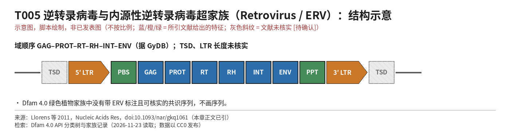

图 T005-1　逆转录病毒与内源性逆转录病毒超家族（Retrovirus / ERV）：结构示意。示意图，脚本绘制，非已发表图；每个特征的来源写在图下方。序列：Dfam 4.0 绿色植物家族中没有本类型可用的共识序列（无此类家族、两端 30 bp 含 N，或分类标注无法核实），不画序列。


完整前病毒与年轻完整 ERV 的全长通常为 7 kb 至 11 kb，两端为长度约 300 bp 至 1.2 kb 的正向重复 LTR（含 U3、R、U5 三个功能亚区），末端高度保守为 5'-TG...CA-3'（各 ERV 亚类精确长度分布文献 DOI 待确认）。内部区域两端同样包含 PBS 与 PPT，完整编码区依次排列 `gag`、`pro`、`pol` 与 `env` [待确认]。由于长期滞留宿主基因组并遭受突变与缺失，脊椎动物基因组中绝大多数 ERV 拷贝已丧失完整开放阅读框或缺失 `env` 基因（Havecker 等 2004, doi:10.1186/gb-2004-5-6-225）。（见本条“本版补充说明”）

#### TSD

前病毒整合进入宿主染色体时产生 4 bp 至 6 bp 的正向靶位点重复，不同逆转录病毒演化支具有相对固定的长度偏好（如部分支系为 4 bp、5 bp 或 6 bp）（各属精确 TSD 长度对应关系文献 DOI 待确认）。

#### 编码蛋白与结构域顺序

核心结构域排列顺序为 **GAG - PROT - RT - RH - INT - ENV**（Llorens 等 2011, doi:10.1093/nar/gkq1061）。与典型 Ty3/Gypsy 元件相比，完整逆转录病毒和年轻 ERV 在 `pol` 下游编码真正的包膜糖蛋白（ENV），包含表面亚基与跨膜亚基，负责病毒颗粒与宿主细胞表面受体结合并介导膜融合感染；复杂逆转录病毒（如慢病毒与泡沫病毒相关类群）还可编码额外的调控蛋白，部分 ERV 成员在 `pol` 中还携带脱氧尿苷三磷酸酶（dUTPase）等辅助结构域（Llorens 等 2011, doi:10.1093/nar/gkq1061；复杂逆转录病毒附属基因细节待确认）。

#### 转座机制

外源性逆转录病毒通过包膜蛋白识别靶细胞受体并进入胞质，在病毒核心内利用自身反转录酶以 PBS 与 PPT 为引物合成双链 cDNA，随后进入细胞核由整合酶整合至宿主染色体成为前病毒；前病毒经宿主 RNA 聚合酶 II 转录并翻译结构蛋白与酶类后，在细胞膜出芽形成新的感染性病毒颗粒 [待确认]。进入生殖系基因组形成 ERV 后，保留活性的拷贝既可通过细胞外再感染途径产生新整合，更常见的是在 `env` 失活或缺失后转变为纯细胞内反转录转座模式，以类似常规 LTR 反转录转座子的复制粘贴方式在宿主基因组中扩增（`env` 丢失与胞内扩增效率关联专文 DOI 待确认）。

#### 自主与非自主搭档

同时保留功能性 `gag`、`pol`（及或 `env`）的 ERV 拷贝属于自主型；脊椎动物基因组中绝大多数 ERV 拷贝因内部大片段缺失或移码突变而成为非自主衍生物，依赖同家族自主型拷贝反式提供的酶系进行扩增，此外哺乳动物基因组中存在数量庞大的由两翼 LTR 不等同源重组形成的 solo-LTR（Storer 等 2021, doi:10.1186/s13100-020-00230-y）。

#### 识别特征与工具

在脊椎动物基因组中，ERV 的识别通常结合从头 LTR 结构预测工具（LTRharvest，Ellinghaus 等 2008, doi:10.1186/1471-2105-9-18；LTR_FINDER，Xu 和 Wang 2007, doi:10.1093/nar/gkm286；RepeatModeler2，Flynn 等 2020, doi:10.1073/pnas.1921046117）与基于 Dfam（Storer 等 2021, doi:10.1186/s13100-020-00230-y）及 GyDB（Llorens 等 2011, doi:10.1093/nar/gkq1061）的蛋白结构域 HMM 检索，并可辅以脊椎动物专用前病毒识别工具如 RetroTector（RetroTector 文献 DOI 待确认）。在植物与葡萄研究中，为防止将 SIRE 与 Athila/Tat 误判为 ERV，应优先采用基于植物专用库 REXdb 的 TEsorter 完成谱系级鉴定（Zhang 等 2022, doi:10.1093/hr/uhac017；Neumann 等 2019, doi:10.1186/s13100-018-0144-1）。

#### 分类争议

第一项争议在于 Retrovirus 与 ERV 的层级拆分。2007 年统一分类体系将外源性 Retrovirus（RLR）与内源性 ERV（RLE）列为 LTR 目下两个并列超家族，但从分子演化角度看，ERV 并非单一单系群，而是多个不同属外源性逆转录病毒在演化史上多次独立整合进入脊椎动物生殖系的产物；因此 Dfam 现行分类体系及现代病毒学主张将其统一置于 Retroviridae/ERV 框架下，并按 ERV1、ERV2、ERV3 等系统发育分支细分（Wicker 等 2007, doi:10.1038/nrg2165；Storer 等 2021, doi:10.1186/s13100-020-00230-y）。第二项争议源于早期植物研究中的术语混用：由于植物 SIRE 与 Athila/Tat 元件携带 `env` 样开放阅读框，早期文献偶将其称为植物逆转录病毒或植物 ERV，现行植物转座子分类标准已明确否定该混用，强调两者分别归属 Ty1/Copia 与 Ty3/Gypsy，不可与脊椎动物 ERV 混为一谈（Neumann 等 2019, doi:10.1186/s13100-018-0144-1）。

#### 发现与分布

**发现与命名**

- Wicker 等 (2007) A unified classification system for eukaryotic transposable elements. Nature Rev Genetics. doi:10.1038/nrg2165。摘要原句：“Here we propose the first unified hierarchical classification system, designed on the basis of the transposition mechanism, sequence similarities and structural relationships, that can be easily applied by non-experts”；支持范围：hierarchical classification (class, subclass, order, superfamily) [注意：所引句不含该名称，仅支持上位/总体论断]
- Weiss (2006) The discovery of endogenous retroviruses. Retrovirology. doi:10.1186/1742-4690-3-67。摘要原句：“When endogenous retroviruses (ERV) were discovered in the late 1960s, the Mendelian inheritance of retroviral genomes by their hosts was an entirely new concept”；支持范围：history of discovery of endogenous retroviruses

**植物中的报道**

- Wright 和 Voytas (2002) Athila4 of Arabidopsis and Calypso of soybean define a lineage of endogenous plant retroviruses. Genome Research. doi:10.1101/gr.196001。摘要原句：“The Athila retroelements of Arabidopsis thaliana encode a putative envelope gene, suggesting that they are infectious retroviruses”；涉及生物：Arabidopsis thaliana, soybean；支持范围：plant gypsy-type endogenous retrovirus-like lineage (not vertebrate ERV) [注意：所引句不含该名称，仅支持上位/总体论断]

**葡萄中的报道**

- 未检索到葡萄专门报道（检索方式见文末「证据与检索方法」）。这只说明检索没有找到，不能据此推断葡萄基因组中不存在。

#### 本版补充说明

① 域顺序：GAG–PROT–INT–RT–RH（Ty1/Copia）与 GAG–PROT–RT–RH–INT（Ty3/Gypsy）是 Neumann 等 2019（doi:10.1186/s13100-018-0144-1）在超家族层面给出的判别顺序；本条若写某谱系“遵循”该顺序，指的是沿用超家族的顺序，不是该文对本谱系另行测定。

② 末端：5′-TG…CA-3′ 是该文用 LTR-FINDER 预测元件时设定的筛选条件，不是对各谱系的实测统计；本条中“末端保守为 5′-TG…CA-3′”一类说法应按此理解。

③ TSD 统计（93.4% 为 5 bp、6.2% 为 4 bp、0.4% 为 6 bp）与全长 4.4–24.1 kb 是该文对全部预测元件的总体统计，不是某一超家族或谱系的值；各谱系的值见 Fig. 4 与 T011–T045。

### T006 副反转录病毒与内源副反转录病毒（Caulimoviridae / EPRV）

**名称对照**：Wicker 体系：未核实；Dfam 节点：Gypsy-ERV;Pararetroviridae；REXdb 路径：Class_I/pararetrovirus。（来源：Wicker 2007 原文本书未读；Dfam 4.0 分类树，2026-11-23 读取；REXdb v4.0 说明文件，doi:10.5281/zenodo.10160279）

#### 定义与命名

副反转录病毒科（Caulimoviridae，英文常统称 plant pararetrovirus）是一类感染维管植物的环状双链 DNA 病毒，其复制周期包含经 RNA 中间体进行反转录的步骤，但不具备真逆转录病毒必需的基因组整合阶段（专文 DOI 待确认）。当该科病毒的部分片段或近完整基因组意外整合进入宿主植物细胞核染色体并随宿主世代垂直遗传时，即称为内源副反转录病毒（endogenous pararetrovirus，EPRV）（专文 DOI 待确认）。该类群在病毒分类体系中下辖 Caulimovirus、Badnavirus、Petuvirus、Tungrovirus、Cavemovirus、Soymovirus、Solendovirus、Rosadnavirus 等属，以及广泛内源化的 Florendovirus 谱系（各属分类修订专文 DOI 待确认）。在 2007 年真核转座子统一分类体系中，Caulimoviridae 并未列为 LTR 目下的经典转座子超家族 [待确认]；然而由于其反转录酶与 LTR 反转录转座子具有明确的系统发育近缘关系，2019 年建立的植物 REXdb 数据库与 2021 年发布的 Dfam 序列模型体系均在 LTR 相关分类框架中单列 pararetrovirus / Caulimoviridae 节点，以便在全基因组重复序列注释中准确区分并防止误判为 Ty3/Gypsy 或 ERV [待确认]。

#### 结构、长度与末端

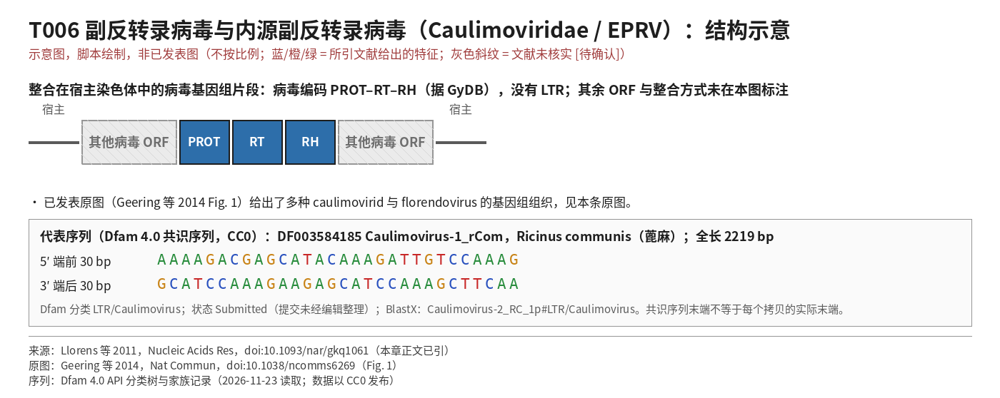

图 T006-1　副反转录病毒与内源副反转录病毒（Caulimoviridae / EPRV）：结构示意。示意图，脚本绘制，非已发表图；每个特征的来源写在图下方。序列条：Dfam DF003584185（Caulimovirus-1_rCom，蓖麻 Ricinus communis，Dfam 4.0，CC0；状态 Submitted）前、后各 30 bp。

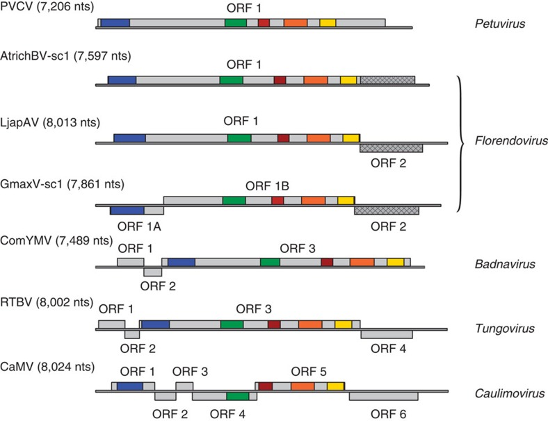

图 T006-P1　多种 caulimovirid 与内源 florendovirus 的基因组组织。原图：Geering 等（2014），Fig. 1。Endogenous florendoviruses are major components of plant genomes and hallmarks of virus evolution. Nat Commun. doi:10.1038/ncomms6269。许可：CC BY 4.0（https://creativecommons.org/licenses/by/4.0/）。未修改。


游离态副反转录病毒颗粒携带长度约 7 kb 至 9.5 kb 的环状双链 DNA 基因组，双链上带有特定位点的缺口，分子结构上**不具备**真 LTR 反转录转座子两端的长末端重复序列（专文 DOI 待确认）。整合进入宿主染色体形成 EPRV 后，其拷贝形态高度异质：既可以是长度仅数百 bp 至数 kb 的碎片化插入，也可以是包含串联重复、倒位重排或近全长病毒基因组的复合插入位点（专文 DOI 待确认）。由于缺乏 LTR 结构，EPRV 末端不存在经典的 5'-TG...CA-3' 反向重复二核苷酸，内部仍可保留病毒启动子区以及与宿主 tRNA 互补的负链引物结合位点（PBS）和正链多聚嘌呤区（PPT）（专文 DOI 待确认）。（见本条“本版补充说明”）

#### TSD

副反转录病毒不编码整合酶，其基因组整合进入宿主核染色体的过程并非酶促特异性切口整合，而是依赖宿主双链断裂修复过程中的非法重组或非同源末端连接（NHEJ），因此 EPRV 插入位点两侧**不产生**典型、等长的靶位点重复（TSD）（专文 DOI 待确认）。

#### 编码蛋白与结构域顺序

典型 Caulimoviridae 基因组编码病毒运动蛋白（MP）、衣壳相关蛋白（GAG/CP）、天冬氨酸蛋白酶（PROT/PR）、反转录酶（RT）与核糖核酸酶 H（RH/RNase H），核心酶类结构域排列顺序为 **PROT - RT - RH**（Llorens 等 2011, doi:10.1093/nar/gkq1061）。与 Ty1/Copia、Ty3/Gypsy 及逆转录病毒相比，副反转录病毒最关键的结构域鉴别特征是**完全缺失整合酶（INT）结构域**，且多数属缺乏典型包膜蛋白基因，但在不同病毒属中常携带编码蚜虫传毒辅助因子、反式激活因子或功能未知蛋白的附加开放阅读框（Llorens 等 2011, doi:10.1093/nar/gkq1061；各属附加基因功能专文 DOI 待确认）。

#### 转座机制

副反转录病毒并非严格意义上的经典转座子。游离病毒在宿主细胞核内以闭环微染色体形式存在，由宿主 RNA 聚合酶 II 转录产生超长于基因组全长的前基因组 RNA（pgRNA），随后转运至细胞质内作为翻译模板并经自身反转录酶反转录合成新的环状双链 DNA（专文 DOI 待确认）。其整合进入宿主核基因组属于复制周期之外的偶发事件，主要通过宿主 DNA 双链断裂修复途径捕获病毒 DNA 碎片或串联体实现（专文 DOI 待确认）。绝大多数 EPRV 整合后因片段化、重排、提前终止密码子及宿主表观遗传沉默而彻底丧失活性；仅在少数植物类群（如香蕉、烟草、矮牵牛等）中，部分完整或串联排列的 EPRV 拷贝在胁迫或杂交条件下可经同源重组或转录激活重新释放游离感染性病毒（具体活化案例专文 DOI 待确认）。

#### 自主与非自主搭档

由于 EPRV 缺乏整合酶且不遵循经典转座子的自主/非自主反式转座体系，基因组中不存在传统意义上依赖整合酶反式驱动的自主/非自主搭档关系。宿主基因组中占绝对多数的 EPRV 为碎片化或失活的化石拷贝，仅极少数完整串联拷贝在特定遗传背景下保留向游离病毒复原的潜能（专文 DOI 待确认）。

#### 识别特征与工具

由于 EPRV 缺乏双 LTR 边界与 TSD，基于双 LTR 结构的传统预测软件（如 LTRharvest、LTR_FINDER、LTR_retriever）无法将其作为完整 LTR 元件检出（Ou 和 Jiang 2018, doi:10.1104/pp.17.01310）。识别 EPRV 主要依赖针对 PROT、RT、RH 及 MP/GAG 保守蛋白结构域的隐马尔可夫模型（HMM）搜索与系统发育定位。在植物基因组注释实践中，基于 REXdb 数据库的 TEsorter 能够将携带 pararetrovirus 特征蛋白域的序列单独归类为 `pararetrovirus`，避免其混入 Ty3/Gypsy 统计中（Zhang 等 2022, doi:10.1093/hr/uhac017）；也可借助 RepeatModeler2 结合 Dfam 与 GyDB 序列模型进行同源注释与人工复核（Flynn 等 2020, doi:10.1073/pnas.1921046117；Llorens 等 2011, doi:10.1093/nar/gkq1061）。

#### 分类争议

主要争议在于 EPRV 是否应归入转座子体系。从严格机制看，副反转录病毒不含 LTR、不编码整合酶、不以常规复制粘贴方式在染色体间自主转座，本质上属于整合入宿主基因组的内源病毒元件（EVE）而非真转座子，因此 2007 年统一分类体系未将其列为 LTR 超家族 [待确认]。但在基因组重复序列注释实践中，因其 RT 与 RH 结构域与 Ty3/Gypsy 具有显著序列相似性且常以多拷贝重复形式存在于植物基因组中，REXdb、GyDB 与 Dfam 均将其纳入扩展参考库并置于 LTR 邻近或病毒关联节点下（Llorens 等 2011, doi:10.1093/nar/gkq1061）。在撰写基因组重复序列统计报告时，建议将其与典型 LTR 反转录转座子分开计数。

#### 发现与分布

**发现与命名**

- Hull 等 (2000) Viral sequences integrated into plant genomes. Trends in Plant Science. doi:10.1016/s1360-1385(00)01723-4。仅标题可核实，只用于说明该文存在及其命名/主题，不据此作内容论断
- Harper 等 (2002) Viral sequences integrated into plant genomes. Annual Rev of Phytopathology. doi:10.1146/annurev.phyto.40.120301.105642。摘要原句：“Sequences of various DNA plant viruses have been found integrated into the host genome”
- Staginnus 和 Richert-Pöggeler (2006) Endogenous pararetroviruses: two-faced travelers in the plant genome. Trends in Plant Science. doi:10.1016/j.tplants.2006.08.008。摘要原句：“Endogenous plant pararetroviruses (EPRVs) were identified as integrated counterparts of most members of the plant virus family Caulimoviridae and represent repetitive elements that are ubiquitous in the plant kingdom”；支持范围：endogenous pararetroviruses in plant genomes

**植物中的报道**

- Geering 等 (2014) Endogenous florendoviruses are major components of plant genomes and hallmarks of virus evolution. Nature Communications. doi:10.1038/ncomms6269。摘要原句：“The extent and importance of endogenous viral elements have been extensively described in animals but are much less well understood in plants”；涉及生物：flowering plants；支持范围：florendoviruses in plant genomes [注意：所引句不含该名称，仅支持上位/总体论断]
- Diop 等 (2018) Tracheophyte genomes keep track of the deep evolution of the Caulimoviridae. Scientific Reports. doi:10.1038/s41598-017-16399-x。摘要原句：“The Caulimoviridae is the most common group of EVEs in plants, although their presence has often been overlooked in plant genome studies”；支持范围：Caulimoviridae endogenous elements across tracheophytes

**葡萄中的报道**

- Carrier 等 (2012) Transposable elements are a major cause of somatic polymorphism in Vitis vinifera L. PLoS ONE. doi:10.1371/journal.pone.0032973。正文原句：“Selection of mobile elements and confirmation of their insertion polymorphism We selected for detailed analyses four representative mobile elements among class I LTR transposable elements: Gret-1 , Copia-10 , Gypsy-19 and Cauliv-1 . These four elements have very different copy numbers and polymorphic sites in the partial…”；涉及生物：Vitis vinifera；支持范围：Gret-1, Copia-10, Gypsy-19, Cauliv-1 insertion polymorphism [注意：所引句不含该名称，仅支持上位/总体论断]
- Bertsch 等 (2009) Retention of the virus-derived sequences in the nuclear genome of grapevine as a potential pathway to virus resistance. Biology Direct. doi:10.1186/1745-6150-4-21。正文原句：“Presentation of the hypothesis The 913 apparent sequence matches with the putative viral nucleotide sequences were identified using the Grape Genome Browser . Blast analysis of these virus-related inserts revealed sixteen potential ORFs that exhibited the highest, 30–60% identity to the protein sequences of five distinct…”；支持范围：endogenous pararetrovirus-like inserts in grapevine genome

#### 本版补充说明

① 域顺序：GAG–PROT–INT–RT–RH（Ty1/Copia）与 GAG–PROT–RT–RH–INT（Ty3/Gypsy）是 Neumann 等 2019（doi:10.1186/s13100-018-0144-1）在超家族层面给出的判别顺序；本条若写某谱系“遵循”该顺序，指的是沿用超家族的顺序，不是该文对本谱系另行测定。

② 末端：5′-TG…CA-3′ 是该文用 LTR-FINDER 预测元件时设定的筛选条件，不是对各谱系的实测统计；本条中“末端保守为 5′-TG…CA-3′”一类说法应按此理解。

③ TSD 统计（93.4% 为 5 bp、6.2% 为 4 bp、0.4% 为 6 bp）与全长 4.4–24.1 kb 是该文对全部预测元件的总体统计，不是某一超家族或谱系的值；各谱系的值见 Fig. 4 与 T011–T045。

### T007 微型末端重复反转录转座子（TRIM）

**名称对照**：Wicker 体系：I 类 / LTR 目（非自主衍生物）；Dfam 节点：Long_Terminal_Repeat_Element;TRIM；REXdb 路径：无对应节点。（来源：类与目据 Arkhipova 2017, doi:10.1186/s13100-017-0103-2；Dfam 4.0 分类树，2026-11-23 读取；REXdb v4.0 说明文件，doi:10.5281/zenodo.10160279）

#### 定义与命名

微型末端重复反转录转座子（terminal-repeat retrotransposon in miniature，TRIM）是一类高度精简的非自主型 LTR 反转录转座子衍生物 [待确认]。在 2007 年统一分类体系中，TRIM 不作为独立超家族设立，而是作为 LTR 目下的非自主型结构类别列出 [待确认]；Dfam 现行分类体系亦将已鉴定的植物 TRIM 家族归入 LTR 相关非自主条目进行管理 [待确认]。TRIM 最初在马铃薯与拟南芥等植物基因组中被系统描述，以极短的全长、极短的 LTR 以及完全丧失编码能力的内部序列为显著特征（最初命名专文 DOI 待确认）。

#### 结构、长度与末端

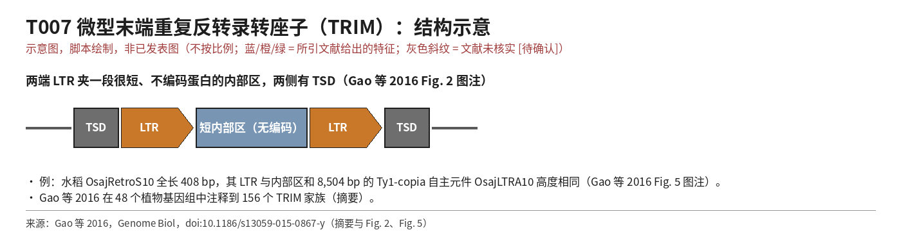

图 T007-1　微型末端重复反转录转座子（TRIM）：结构示意。示意图，脚本绘制，非已发表图；每个特征的来源写在图下方。序列：Dfam 4.0 绿色植物家族中没有本类型可用的共识序列（无此类家族、两端 30 bp 含 N，或分类标注无法核实），不画序列。

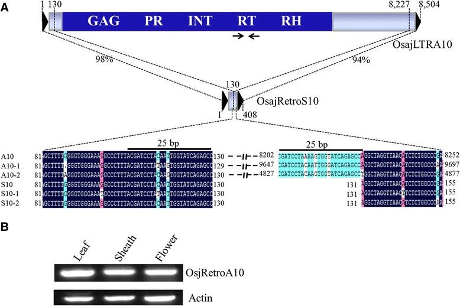

图 T007-P1　水稻 TRIM OsajRetroS10（408 bp）与 Ty1-copia 自主元件 OsajLTRA10 的结构与末端序列比对。原图：Gao 等（2016），Fig. 5。Landscape and evolutionary dynamics of terminal repeat retrotransposons in miniature in plant genomes. Genome Biol. doi:10.1186/s13059-015-0867-y。许可：CC BY 4.0（https://creativecommons.org/licenses/by/4.0/）。未修改。


TRIM 具有完整的 LTR 反转录转座子基本骨架，由 5' LTR、极短的内部非编码区和 3' LTR 构成，但整体尺寸大幅缩减，全长通常在 300 bp 至 1000 bp 之间（部分定义放宽至 1.5 kb 以下，精确阈值文献 DOI 待确认）。单个 LTR 长度一般为 100 bp 至 350 bp，内部非编码区往往仅 100 bp 至 300 bp（专文 DOI 待确认）。尽管尺寸极小，活跃的 TRIM 拷贝仍严格保留反转录所需的顺式作用元件，包括两端经典的 5'-TG...CA-3' 末端二核苷酸、紧邻 5' LTR 下游的 PBS 以及紧邻 3' LTR 上游的 PPT [待确认]。（见本条“本版补充说明”）

#### TSD

与自主型 LTR 反转录转座子一致，TRIM 整合进入宿主基因组时在元件两侧形成正向靶位点重复，典型长度为 5 bp [待确认]。

#### 编码蛋白与结构域顺序

TRIM 的内部区域极短，**不编码**任何完整的 `gag`、`pol` 或其他转座相关蛋白，因此不存在 `pol` 结构域排列顺序 [待确认]。

#### 转座机制

TRIM 自身无法合成衣壳蛋白、反转录酶、RNase H 与整合酶，必须依赖同细胞内自主型 LTR 反转录转座子反式提供的蛋白机器完成扩增 [待确认]。其扩增过程同样遵循 RNA 中间体复制粘贴模式：由 5' LTR 中的启动子驱动转录产生全长单链 RNA，随后被反式搭档提供的衣壳与酶系识别，以自身保留的 PBS 与 PPT 为引物完成双链 cDNA 合成，并由整合酶整合至宿主基因组新位点，伴随产生 5 bp TSD [待确认]。与完整大型 LTR 元件类似，TRIM 两翼 LTR 之间也可发生不等同源重组，进而形成单拷贝的 solo-LTR [待确认]。

#### 自主与非自主搭档

TRIM 本身即属于非自主型元件，其进化起源普遍被认为源自完整自主型 LTR 反转录转座子（多与 Ty1/Copia 或 Ty3/Gypsy 相关）内部编码区发生大片段缺失后的极端精简衍生物 [待确认]。在绝大多数植物基因组中，特定 TRIM 家族究竟由哪一个具体的自主型家族反式驱动，往往因序列长期分化而难以直接通过核酸同源性配对确认（具体配对验证专文 DOI 待确认）。

#### 识别特征与工具

常规 LTR 结构预测流程（如 LTRharvest 与 LTR_FINDER）默认最小元件长度和内部区域长度阈值通常针对数 kb 的完整自主型元件设置，若直接采用默认参数极易漏检全长不足 1 kb 的 TRIM [待确认]。检出 TRIM 时需专门下调最小 LTR 长度（如降至 80–100 bp）和最小内部区长度（如降至 100 bp），并严格联合检验 5'-TG...CA-3' 末端、5 bp TSD、PBS/PPT 信号以及高拷贝序列一致性，以排除串联重复与微卫星造成的假阳性 [待确认]。由于缺乏蛋白编码域，TEsorter 无法对 TRIM 进行基于蛋白域的谱系分类（Zhang 等 2022, doi:10.1093/hr/uhac017），通常需结合专门的短非自主 LTR 筛选脚本、RepeatModeler2（Flynn 等 2020, doi:10.1073/pnas.1921046117）及手工边界校对确认。（见本条“本版补充说明”）

#### 分类争议

第一项争议是 TRIM 的尺寸上限与非自主 LTR 的划分边界：不同研究对 TRIM 最大全长的界定在 1 kb 至 1.5 kb 之间存在浮动，导致介于 1 kb 与 4 kb 之间的中等长度非自主 LTR 元件在 TRIM 与 LARD 之间存在归类灰区（专文 DOI 待确认）。第二项争议在于 TRIM 并非单一系统发育单系群，而是不同自主型 LTR 家族在演化史上多次独立缺失内部编码区趋同形成的结构形态，因此在严格系统发育分类中不可将其视为与 Copia、Gypsy 并列的独立超家族 [待确认]。

#### 发现与分布

**发现与命名**

- Witte 等 (2001) Terminal-repeat retrotransposons in miniature (TRIM) are involved in restructuring plant genomes. Proceedings of the National Academy of Sciences. doi:10.1073/pnas.241341898。摘要原句：“A new group of long terminal repeats (LTR) retrotransposons, termed terminal-repeat retrotransposons in miniature (TRIM), are described that are present in both monocotyledonous and dicotyledonous plant”；涉及生物：plants (Arabidopsis, rice, others)；支持范围：TRIM named and described
- Kalendar 等 (2004) Large retrotransposon derivatives: abundant, conserved but nonautonomous retroelements of barley and related genomes. Genetics. doi:10.1534/genetics.166.3.1437。摘要原句：“These features describe a novel group of elements, called LARDs or large retrotransposon derivatives (LARDs)”；涉及生物：barley and Triticeae；支持范围：large retrotransposon derivatives (LARD) and TRIM-like nonautonomous elements [注意：所引句不含该名称，仅支持上位/总体论断]

**植物中的报道**

- Chaparro 等 (2015) Terminal-repeat retrotransposons with GAG domain in plant genomes: a new testimony on the complex world of transposable elements. Genome Biology and Evolution. doi:10.1093/gbe/evv001。摘要原句：“A novel structure of nonautonomous long terminal repeat (LTR) retrotransposons called terminal repeat with GAG domain (TR-GAG) has been described in plants, both in monocotyledonous, dicotyledonous and basal angiosperm genomes”；涉及生物：plants；支持范围：TR-GAG terminal-repeat retrotransposons in plant genomes [注意：所引句不含该名称，仅支持上位/总体论断]

**葡萄中的报道**

- 未检索到葡萄专门报道（检索方式见文末「证据与检索方法」）。这只说明检索没有找到，不能据此推断葡萄基因组中不存在。

#### 本版补充说明

① 域顺序：GAG–PROT–INT–RT–RH（Ty1/Copia）与 GAG–PROT–RT–RH–INT（Ty3/Gypsy）是 Neumann 等 2019（doi:10.1186/s13100-018-0144-1）在超家族层面给出的判别顺序；本条若写某谱系“遵循”该顺序，指的是沿用超家族的顺序，不是该文对本谱系另行测定。

② 末端：5′-TG…CA-3′ 是该文用 LTR-FINDER 预测元件时设定的筛选条件，不是对各谱系的实测统计；本条中“末端保守为 5′-TG…CA-3′”一类说法应按此理解。

③ TSD 统计（93.4% 为 5 bp、6.2% 为 4 bp、0.4% 为 6 bp）与全长 4.4–24.1 kb 是该文对全部预测元件的总体统计，不是某一超家族或谱系的值；各谱系的值见 Fig. 4 与 T011–T045。

### T008 大型反转录转座子衍生物（LARD）

**名称对照**：Wicker 体系：I 类 / LTR 目（非自主衍生物）；Dfam 节点：无对应节点；REXdb 路径：无对应节点。（来源：类与目据 Arkhipova 2017, doi:10.1186/s13100-017-0103-2；Dfam 4.0 分类树，2026-11-23 读取；REXdb v4.0 说明文件，doi:10.5281/zenodo.10160279）

#### 定义与命名

大型反转录转座子衍生物（large retrotransposon derivative，LARD）是一类尺寸较大、但内部缺乏完整功能性蛋白编码能力的非自主型 LTR 反转录转座子 [待确认]。在 2007 年统一分类体系中，LARD 与 TRIM 并列作为 LTR 目下的非自主型结构类别，而非独立超家族 [待确认]。LARD 最初在大麦等禾本科植物基因组中被发现并命名，其核心特征是拥有长达数 kb 的 LTR 与非编码内部区域，但内部完全缺失或严重破坏了 `gag-pol` 编码框（最初命名专文 DOI 待确认）。

#### 结构、长度与末端

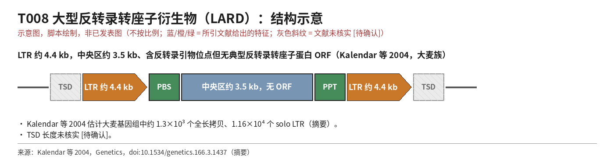

图 T008-1　大型反转录转座子衍生物（LARD）：结构示意。示意图，脚本绘制，非已发表图；每个特征的来源写在图下方。序列：Dfam 4.0 绿色植物家族中没有本类型可用的共识序列（无此类家族、两端 30 bp 含 N，或分类标注无法核实），不画序列。


LARD 的典型全长超过 4 kb，常见范围为 4 kb 至 12 kb 以上，尺寸与大型自主型 Ty1/Copia 或 Ty3/Gypsy 元件相当（精确跨物种长度分布专文 DOI 待确认）。其单个 LTR 通常较长，可达 1 kb 至 4 kb 以上，两端保留保守的 5'-TG...CA-3' 反向重复二核苷酸；内部区域同样长达数 kb，但主要由非编码序列、短重复片段或高度退化的残余序列构成（专文 DOI 待确认）。与 TRIM 相同，能够活跃扩增的 LARD 严格保留 5' LTR 下游的 PBS 与 3' LTR 上游的 PPT [待确认]。（见本条“本版补充说明”）

#### TSD

整合进入宿主染色体时在元件外侧形成正向靶位点重复，典型长度为 5 bp [待确认]。

#### 编码蛋白与结构域顺序

LARD 内部**不具备**完整的 `pol` 编码区，也不编码功能性的衣壳、蛋白酶、反转录酶、RNase H 或整合酶蛋白 [待确认]。部分演化较年轻的 LARD 内部可能残留零散的 `gag` 或 `pol` 退化片段，但均无法独立完成蛋白翻译与催化功能（专文 DOI 待确认）。

#### 转座机制

LARD 采用与自主型 LTR 反转录转座子相同的复制粘贴机制，但自身无法提供转座所需酶系，必须由同细胞内共表达的自主型 LTR 反转录转座子反式提供病毒样颗粒组装蛋白、反转录酶与整合酶 [待确认]。其 5' LTR 启动子驱动全长 RNA 转录，随后借用反式酶系在 PBS 与 PPT 引导下合成双链 cDNA 并整合进入宿主基因组新位点，伴随产生 5 bp TSD [待确认]。由于 LARD 拥有较长的两翼 LTR，其发生两翼 LTR 不等同源重组并产生 solo-LTR 的频率通常较高 [待确认]。

#### 自主与非自主搭档

LARD 属于典型的非自主型元件，普遍认为由大型自主型 Ty3/Gypsy 或 Ty1/Copia 元件在演化中发生内部编码区缺失或替换后形成 [待确认]。由于缺乏内部编码区但保留长段非编码内部序列，有假说认为 LARD 的长内部区可能具有维持特定 RNA 二级结构或包装长度以适配自主型搭档病毒样颗粒的作用（机制假说专文 DOI 待确认）。部分 LARD 家族可通过 LTR 与 PBS 序列的高相似度追溯其对应的自主型母本家族（专文 DOI 待确认）。

#### 识别特征与工具

LARD 因全长和 LTR 长度与自主型元件相近，可直接被 LTRharvest（Ellinghaus 等 2008, doi:10.1186/1471-2105-9-18）、LTR_FINDER（Xu 和 Wang 2007, doi:10.1093/nar/gkm286）、LTR_retriever（Ou 和 Jiang 2018, doi:10.1104/pp.17.01310）与 EDTA（Ou 等 2019, doi:10.1186/s13059-019-1905-y）等标准结构预测工具检出。将其与自主型 LTR 区分的关键步骤是对内部序列执行蛋白结构域检索（如使用 TEsorter 或 LTRdigest），确认其缺乏完整 `pol` 结构域（Zhang 等 2022, doi:10.1093/hr/uhac017；Steinbiss 等 2009, doi:10.1093/nar/gkp759）。在实际注释中，需进一步结合拷贝数与家族一致性评估：真正活跃扩增的 LARD 往往表现为多拷贝高度一致的同源家族，而孤立单拷贝的无编码区元件更可能是随机缺失形成的退化自主型拷贝（待确认）。

#### 分类争议

核心争议在于「LARD」与「退化/失活的自主型 LTR 拷贝」在基因组注释中的实操界线。自动化流程（如 EDTA 结合 TEsorter）通常把有完整双 LTR 但检不出完整蛋白域的元件统一归为 `LTR/unknown`，并不会自动区分其究竟是长期独立扩增的 LARD 家族还是刚发生内部缺失的 Copia/Gypsy 退化拷贝（Ou 等 2019, doi:10.1186/s13059-019-1905-y；Zhang 等 2022, doi:10.1093/hr/uhac017）。此外，与 TRIM 一样，LARD 是多起源的非自主形态集合，不构成独立的系统发育超家族 [待确认]。

#### 发现与分布

**发现与命名**

- Kalendar 等 (2004) Large retrotransposon derivatives: abundant, conserved but nonautonomous retroelements of barley and related genomes. Genetics. doi:10.1534/genetics.166.3.1437。摘要原句：“These features describe a novel group of elements, called LARDs or large retrotransposon derivatives (LARDs)”；涉及生物：barley and related grasses；支持范围：LARD named

**植物中的报道**

- Chaparro 等 (2015) Terminal-repeat retrotransposons with GAG domain in plant genomes: a new testimony on the complex world of transposable elements. Genome Biology and Evolution. doi:10.1093/gbe/evv001。摘要原句：“A novel structure of nonautonomous long terminal repeat (LTR) retrotransposons called terminal repeat with GAG domain (TR-GAG) has been described in plants, both in monocotyledonous, dicotyledonous and basal angiosperm genomes”；涉及生物：plants；支持范围：TR-GAG terminal-repeat retrotransposons in plant genomes [注意：所引句不含该名称，仅支持上位/总体论断]

**葡萄中的报道**

- 未检索到葡萄专门报道（检索方式见文末「证据与检索方法」）。这只说明检索没有找到，不能据此推断葡萄基因组中不存在。

#### 本版补充说明

① 域顺序：GAG–PROT–INT–RT–RH（Ty1/Copia）与 GAG–PROT–RT–RH–INT（Ty3/Gypsy）是 Neumann 等 2019（doi:10.1186/s13100-018-0144-1）在超家族层面给出的判别顺序；本条若写某谱系“遵循”该顺序，指的是沿用超家族的顺序，不是该文对本谱系另行测定。

② 末端：5′-TG…CA-3′ 是该文用 LTR-FINDER 预测元件时设定的筛选条件，不是对各谱系的实测统计；本条中“末端保守为 5′-TG…CA-3′”一类说法应按此理解。

③ TSD 统计（93.4% 为 5 bp、6.2% 为 4 bp、0.4% 为 6 bp）与全长 4.4–24.1 kb 是该文对全部预测元件的总体统计，不是某一超家族或谱系的值；各谱系的值见 Fig. 4 与 T011–T045。

### T009 单长末端重复序列（solo-LTR）

**名称对照**：Wicker 体系：形态，不是分类单元；Dfam 节点：无对应节点；REXdb 路径：无对应节点。（来源：类与目据 Arkhipova 2017, doi:10.1186/s13100-017-0103-2；Dfam 4.0 分类树，2026-11-23 读取；REXdb v4.0 说明文件，doi:10.5281/zenodo.10160279）

#### 定义与命名

单长末端重复序列（solo-LTR，中文简称单 LTR）并非独立的转座子超家族或分类单元，而是完整 LTR 反转录转座子（包括自主型元件以及 TRIM、LARD 等非自主型元件）在宿主基因组中经历不等同源重组后遗留的特定结构形态 [待确认]。无论其原始母本属于 Ty1/Copia、Ty3/Gypsy、Bel-Pao 还是 ERV，只要内部区域与其中一个 LTR 被重组切除、在原位点仅留下单个 LTR，均统称为 solo-LTR [待确认]。

#### 结构、长度与末端

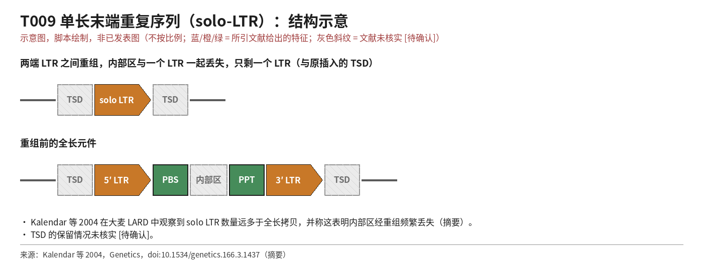

图 T009-1　单长末端重复序列（solo-LTR）：结构示意。示意图，脚本绘制，非已发表图；每个特征的来源写在图下方。序列：Dfam 4.0 绿色植物家族中没有本类型可用的共识序列（无此类家族、两端 30 bp 含 N，或分类标注无法核实），不画序列。


solo-LTR 由单一的 LTR 序列构成，不含内部编码区、PBS 或 PPT [待确认]。其长度直接取决于母本元件单个 LTR 的长度，跨度从 TRIM 来源的约 100 bp 至大型 Gypsy 或 LARD 来源的数 kb 不等 [待确认]。完整的 solo-LTR 仍保留原 LTR 内部的 U3、R、U5 序列以及两端的短反向重复二核苷酸（最经典为 5'-TG...CA-3'） [待确认]。（见本条“本版补充说明”）

#### TSD

由于不等同源重组仅切除原元件 5' LTR 与 3' LTR 之间的内部片段及一个冗余 LTR，原整合位点外侧的一对靶位点重复并未受破坏，因此新形成的 solo-LTR 两侧依然完整保留母本插入时产生的 4 bp 至 6 bp（植物中典型为 5 bp）正向 TSD [待确认]。两翼存在等长正向 TSD 是区分真正 solo-LTR 与普通截短 LTR 碎片的核心判据 [待确认]。

#### 编码蛋白与结构域顺序

solo-LTR 完全不含内部 `gag` 与 `pol` 区域，因此**不编码**任何转座酶或反转录相关蛋白，不存在结构域排列顺序 [待确认]。

#### 转座机制

solo-LTR 本身**丧失转座能力**，既不能自主转座，也无法作为非自主搭档完成反转录扩增，因为其缺乏完整的双 LTR 链转移结构以及 PBS 与 PPT。其形成机制是染色体内的**不等同源重组**（unequal homologous recombination）：同一个完整 LTR 反转录转座子两端的 5' LTR 与 3' LTR 作为高度同源的正向重复序列发生错配联会与交换，将夹在中间的内部编码区连同其中一个 LTR 以环状 DNA 形式切除并丢失，最终在染色体原位仅保留一个嵌合型的单个 LTR [待确认]。尽管丧失移动能力，保留完整 U3 启动子与调控基序的 solo-LTR 仍可作为宿主基因的异源启动子、增强子或加尾信号，持续影响邻近基因的转录调控 [待确认]。

#### 自主与非自主搭档

solo-LTR 是完整 LTR 元件（自主型或非自主型）经重组清除后的终点降解形态，不参与自主/非自主转座搭档体系 [待确认]。在基因组演化分析中，全基因组或特定家族的「solo-LTR 与完整 LTR 拷贝数比值（solo:intact ratio）」是衡量该物种基因组 DNA 清除速率与基因组收缩动态的核心定量指标 [待确认]。

#### 识别特征与工具

基于双 LTR 结构的从头预测软件无法直接检出 solo-LTR，因为其仅存在单个 LTR 拷贝。全基因组识别 solo-LTR 的标准流程是先利用 LTR_retriever 或 EDTA 构建高质量非冗余 LTR 序列库，再通过 RepeatMasker 或 BLAST 对基因组执行同源比对，并结合脚本筛选出「仅匹配单个完整 LTR、两侧无对应内部编码区匹配且两翼具备 4 bp 至 6 bp 正向 TSD」的位点 [待确认]。LTR_retriever 配套流程提供了专门的 solo-LTR 识别与统计脚本（Ou 和 Jiang 2018, doi:10.1104/pp.17.01310）。

#### 分类争议

solo-LTR 本身不存在系统发育分类争议，但实际分析中常见两类方法学误区与界定分歧。其一是切忌将 solo-LTR 视作独立超家族进行并列统计，而应按其 LTR 序列同源性归回对应的 Ty1/Copia 或 Ty3/Gypsy 超家族及谱系下统计 [待确认]。其二是严格判定标准差异：部分研究仅依据「孤立匹配单个 LTR 且周围一定窗口内无内部序列」即计为 solo-LTR，而更严格的标准要求同时验证两侧存在完好 TSD，以排除因基因组组装缺口或嵌套插入打断造成的假性 solo-LTR [待确认]。

#### 发现与分布

**发现与命名**

- Shirasu 等 (2000) A contiguous 66-kb barley DNA sequence provides evidence for reversible genome expansion. Genome Research. doi:10.1101/gr.10.7.908。摘要原句：“Amplification of retrotransposons has been postulated to be a major mechanism increasing genome size and leading to "genomic obesity." To gain insights into the relation between retrotransposons and genome expansion in a large genome, we have studied a 66-kb contiguous sequence at the Rar1 locus of barley in detail”；涉及生物：barley (Hordeum vulgare)；支持范围：solo-LTR formation and reversible genome expansion [注意：所引句不含该名称，仅支持上位/总体论断]
- Vitte 和 Panaud (2003) Formation of solo-LTRs through unequal homologous recombination counterbalances amplifications of LTR retrotransposons in rice Oryza sativa L. Molecular Biology and Evolution. doi:10.1093/molbev/msg055。摘要原句：“We show that solo-LTR formation through homologous unequal recombination has occurred in rice within the past 5 Myr for the three elements”；涉及生物：rice (Oryza sativa)；支持范围：solo-LTRs by unequal homologous recombination
- Devos 等 (2002) Genome size reduction through illegitimate recombination counteracts genome expansion in Arabidopsis. Genome Research. doi:10.1101/gr.132102。摘要原句：“It is well documented that, in addition to polyploidization, retrotransposon amplification has been a major cause of genome expansion”；涉及生物：Arabidopsis thaliana；支持范围：illegitimate recombination removes LTR retrotransposons [注意：所引句不含该名称，仅支持上位/总体论断]

**植物中的报道**

- Shirasu 等 (2000) A contiguous 66-kb barley DNA sequence provides evidence for reversible genome expansion. Genome Research. doi:10.1101/gr.10.7.908。同一论文，原句见上；支持范围：solo LTRs and reversible genome expansion [注意：所引句不含该名称，仅支持上位/总体论断]
- Vitte 和 Panaud (2003) Formation of solo-LTRs through unequal homologous recombination counterbalances amplifications of LTR retrotransposons in rice Oryza sativa L. Molecular Biology and Evolution. doi:10.1093/molbev/msg055。同一论文，原句见上；支持范围：solo-LTR formation [注意：所引句不含该名称，仅支持上位/总体论断]
- Devos 等 (2002) Genome size reduction through illegitimate recombination counteracts genome expansion in Arabidopsis. Genome Research. doi:10.1101/gr.132102。同一论文，原句见上；支持范围：genome size reduction by recombination [注意：所引句不含该名称，仅支持上位/总体论断]

**葡萄中的报道**

- Kobayashi 等 (2004) Retrotransposon-induced mutations in grape skin color. Science. doi:10.1126/science.1095011。仅标题可核实，只用于说明该文存在及其命名/主题，不据此作内容论断
- Yang 等 (2022) Removal of a 10-kb Gret1 transposon from VvMybA1 of Vitis vinifera cv. Chardonnay. Horticulture Research. doi:10.1093/hr/uhac201。摘要原句：“Many white grape cultivars have a nonfunctional VvMybA1 gene due to the presence of a 10-kb Gret1 transposon in its promoter”；涉及生物：Vitis vinifera Chardonnay；支持范围：Gret1 removal from VvMybA1 [注意：所引句不含该名称，仅支持上位/总体论断]
- Nakajima 等 (2023) Targeted deletion of grape retrotransposon associated with fruit skin color via CRISPR/Cas9 in Vitis labrascana 'Shine Muscat'. PLOS ONE. doi:10.1371/journal.pone.0286698。正文原句：“To induce transformed plants, AECs were cultured as before but without 2,4-D. Detection of solo LTR and CRISPR/Cas9-induced mutations at Gret#4 target site Genomic DNA was extracted from calluses and regenerated plants with a DNeasy Plant Mini Kit (Qiagen, Germany) according to the supplier’s…”；涉及生物：Vitis labruscana；支持范围：solo LTR after deletion of grape retrotransposon [注意：所引句不含该名称，仅支持上位/总体论断]

#### 本版补充说明

① 域顺序：GAG–PROT–INT–RT–RH（Ty1/Copia）与 GAG–PROT–RT–RH–INT（Ty3/Gypsy）是 Neumann 等 2019（doi:10.1186/s13100-018-0144-1）在超家族层面给出的判别顺序；本条若写某谱系“遵循”该顺序，指的是沿用超家族的顺序，不是该文对本谱系另行测定。

② 末端：5′-TG…CA-3′ 是该文用 LTR-FINDER 预测元件时设定的筛选条件，不是对各谱系的实测统计；本条中“末端保守为 5′-TG…CA-3′”一类说法应按此理解。

③ TSD 统计（93.4% 为 5 bp、6.2% 为 4 bp、0.4% 为 6 bp）与全长 4.4–24.1 kb 是该文对全部预测元件的总体统计，不是某一超家族或谱系的值；各谱系的值见 Fig. 4 与 T011–T045。

### T010 卡珊德拉元件（Cassandra）

**名称对照**：Wicker 体系：I 类 / LTR 目（非自主衍生物）；Dfam 节点：Gypsy-ERV;Retroviridae（RepeatMasker 子类型标为 Cassandra）；REXdb 路径：无对应节点。（来源：类与目据 Arkhipova 2017, doi:10.1186/s13100-017-0103-2；Dfam 4.0 分类树，2026-11-23 读取；REXdb v4.0 说明文件，doi:10.5281/zenodo.10160279）

#### 定义与命名

卡珊德拉元件（Cassandra，又称 5S-TRIM）是一类广泛存在于维管植物基因组中、结构高度保守的 TRIM 样非自主型 LTR 反转录转座子，其最显著的分子特征是在 5' LTR 与 3' LTR 内部均携带一段高度保守的 5S rRNA 相关序列及 RNA 聚合酶 III（Pol III）内部启动子基序（首次命名专文 DOI 待确认）。在 2007 年统一分类体系的框架下，Cassandra 属于 LTR 目下的非自主型 TRIM 样元件，并非独立超家族 [待确认]。需要特别指出的是，Dfam 现行分类体系将 `LTR/Cassandra` 节点映射在 `Retroviridae` 分类分支之下，这仅属于数据库本体层级中的历史标签对应，绝不可据此将 Cassandra 误认为逆转录病毒或内源性逆转录病毒（ERV） [待确认]。

#### 结构、长度与末端

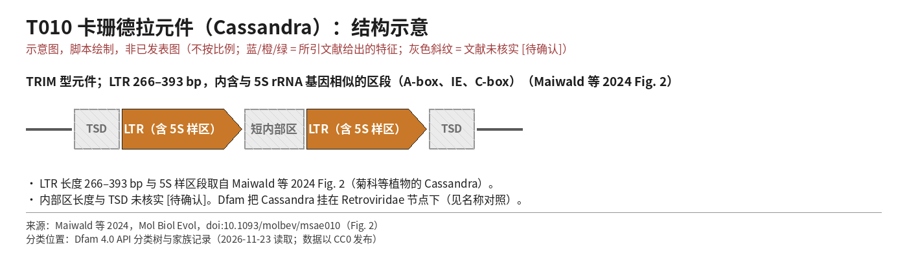

图 T010-1　卡珊德拉元件（Cassandra）：结构示意。示意图，脚本绘制，非已发表图；每个特征的来源写在图下方。序列：Dfam 4.0 绿色植物家族中没有本类型可用的共识序列（无此类家族、两端 30 bp 含 N，或分类标注无法核实），不画序列。

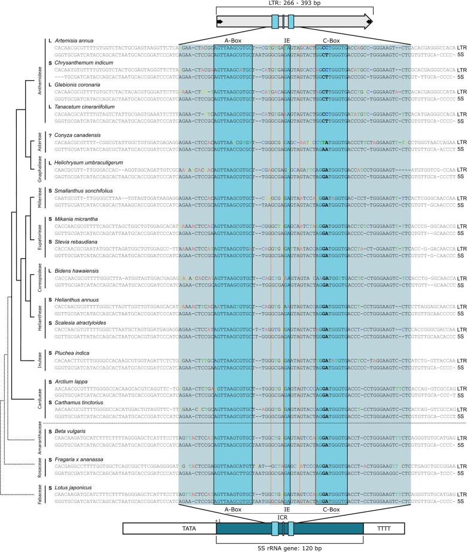

图 T010-P1　Cassandra LTR（266–393 bp）中与 5S rRNA 基因相似的区段（A-box、IE、C-box）的序列比对。原图：Maiwald 等（2024），Fig. 2。Evolving Together: Cassandra Retrotransposons Gradually Mirror Promoter Mutations of the 5S rRNA Genes. Mol Biol Evol. doi:10.1093/molbev/msae010。许可：CC BY 4.0（https://creativecommons.org/licenses/by/4.0/）。未修改。


Cassandra 的整体结构与典型 TRIM 一致，由 5' LTR、极短的内部非编码区和 3' LTR 构成，全长通常在 500 bp 至 850 bp 之间，单个 LTR 长度多为 200 bp 至 350 bp，内部非编码区一般仅数十至百余 bp（精确跨物种长度范围专文 DOI 待确认）。元件两端保留保守的 5'-TG...CA-3' 反向重复二核苷酸，内部区域紧邻 5' LTR 下游具 PBS（通常与甲硫氨酸启动 tRNA 互补，具体细节待确认），紧邻 3' LTR 上游具 PPT（专文 DOI 待确认）。与普通 TRIM 相比，Cassandra 两个 LTR 内部各自嵌入一段约 120 bp 的 5S rRNA 同源区，包含典型的 Pol III 内部控制区基序（A box、IE 与 C box）（专文 DOI 待确认）。（见本条“本版补充说明”）

#### TSD

整合进入宿主基因组时在元件两翼形成正向靶位点重复，典型长度为 5 bp（专文 DOI 待确认）。

#### 编码蛋白与结构域顺序

Cassandra 为典型的非自主型小型元件，内部非编码区极短，**不编码**任何 `gag`、`pol` 或其他转座相关蛋白，无蛋白结构域顺序（专文 DOI 待确认）。

#### 转座机制

Cassandra 采用非自主型 LTR 反转录转座子的复制粘贴扩增模式，但其转录启动机制独具特色：传统 LTR 反转录转座子依赖宿主 RNA 聚合酶 II 从 5' LTR 的 U3 区启动转录，而 Cassandra 凭借 LTR 内携带的 5S rRNA 样内部启动子，可由宿主 RNA 聚合酶 III 驱动转录产生 RNA 中间体（具体 Pol III 转录机制与转录本加工验证专文 DOI 待确认）。随后，该 RNA 中间体借助宿主基因组中自主型 LTR 反转录转座子反式提供的反转录酶与整合酶，以自身 PBS 和 PPT 为引物完成双链 cDNA 合成并整合至新位点，伴随产生 5 bp TSD（专文 DOI 待确认）。Cassandra 两翼 LTR 之间同样可发生不等同源重组形成 solo-LTR（专文 DOI 待确认）。

#### 自主与非自主搭档

Cassandra 属于高度特化的非自主型 TRIM 样元件，必须依赖自主型 LTR 反转录转座子反式提供酶系完成扩增；由于 Cassandra 在陆生植物中具有极古老的演化历史且自身不含蛋白编码区，其在不同植物类群中具体借用的自主型搭档家族尚未完全明确（待确认）。

#### 识别特征与工具

常规默认参数的 LTR 预测软件因最小长度阈值限制容易漏检 Cassandra；鉴定该元件需下调 LTRharvest 或 LTR_FINDER 的最小 LTR 与内部区长度参数，并结合 5S rRNA 保守序列同源检索（如使用 Infernal/Rfam 或 BLAST 扫描 5S rDNA 基序）联合判定：若一对间距数百 bp 的正向重复序列均包含 5S rRNA 样内部启动子基序，且两端具 5'-TG...CA-3' 末端与 5 bp TSD、内部具 PBS 与 PPT，即可确认为 Cassandra 元件（专文 DOI 待确认）。在同源注释层面，Dfam 收录有 `LTR/Cassandra` 序列模型可供 RepeatMasker 检索 [待确认]。（见本条“本版补充说明”）

#### 分类争议

当前最突出的分类与注释陷阱来自数据库层级映射：Dfam 现行分类体系将 `LTR/Cassandra` 放置在 `Retroviridae` 节点之下 [待确认]。这一归位仅源于早期数据库分类树整合时的标签挂载，并不代表 Cassandra 在系统发育或生物学本质上属于逆转录病毒或 ERV。在植物与葡萄转座子注释、统计图表制作及书稿撰写中，若上游工具直接继承了 Dfam 的父类路径，必须手动修正，将 Cassandra 明确归回植物非自主型 LTR / TRIM 样元件类别，严禁将其归入 Retrovirus / ERV 统计项。此外，在基因组非编码 RNA 注释中，需将 Cassandra 内部携带的 5S rDNA 样片段与真正的串联排列 5S rRNA 基因簇严格区分（专文 DOI 待确认）。

#### 发现与分布

**发现与命名**

- Kalendar 等 (2008) Cassandra retrotransposons carry independently transcribed 5S RNA. Proceedings of the National Academy of Sciences. doi:10.1073/pnas.0709698105。摘要原句：“These elements, named Cassandra, universally carry conserved 5S RNA sequences and associated RNA polymerase (pol) III promoters and terminators in their long terminal repeats (LTRs)”；涉及生物：plants (angiosperm genomes)；支持范围：Cassandra TRIM-like elements carrying 5S rRNA

**植物中的报道**

- Kalendar 等 (2008) Cassandra retrotransposons carry independently transcribed 5S RNA. Proceedings of the National Academy of Sciences. doi:10.1073/pnas.0709698105。同一论文，原句见上；支持范围：Cassandra elements
- Maiwald 等 (2021) The Cassandra retrotransposon landscape in sugar beet (Beta vulgaris) and related Amaranthaceae: recombination and re-shuffling lead to a high structural variability. Annals of Botany. doi:10.1093/aob/mcaa176。摘要原句：“In contrast, the non-coding Cassandra terminal repeat retrotransposons in miniature (TRIMs) are widespread in many plants”；涉及生物：sugar beet and Amaranthaceae；支持范围：Cassandra landscape
- Maiwald 等 (2024) Evolving Together: Cassandra Retrotransposons Gradually Mirror Promoter Mutations of the 5S rRNA Genes. Molecular Biology and Evolution. doi:10.1093/molbev/msae010。摘要原句：“The 5S rRNA genes are among the most conserved nucleotide sequences across all species”；支持范围：Cassandra 5S promoter mutation [注意：所引句不含该名称，仅支持上位/总体论断]

**葡萄中的报道**

- 未检索到葡萄专门报道（检索方式见文末「证据与检索方法」）。这只说明检索没有找到，不能据此推断葡萄基因组中不存在。


#### 本版补充说明

① 域顺序：GAG–PROT–INT–RT–RH（Ty1/Copia）与 GAG–PROT–RT–RH–INT（Ty3/Gypsy）是 Neumann 等 2019（doi:10.1186/s13100-018-0144-1）在超家族层面给出的判别顺序；本条若写某谱系“遵循”该顺序，指的是沿用超家族的顺序，不是该文对本谱系另行测定。

② 末端：5′-TG…CA-3′ 是该文用 LTR-FINDER 预测元件时设定的筛选条件，不是对各谱系的实测统计；本条中“末端保守为 5′-TG…CA-3′”一类说法应按此理解。

③ TSD 统计（93.4% 为 5 bp、6.2% 为 4 bp、0.4% 为 6 bp）与全长 4.4–24.1 kb 是该文对全部预测元件的总体统计，不是某一超家族或谱系的值；各谱系的值见 Fig. 4 与 T011–T045。

## 第二部分　Copia 超家族谱系（一）

### T011 Ale谱系（Copia/Ale）

**名称对照**：Wicker 体系：I 类 / LTR 目 / Copia（代码 RLC）；Wicker 不分谱系；Dfam 节点：Ty1-Copia（Dfam 无谱系节点）；REXdb 路径：Class_I/LTR/Ty1/copia/Ale。（来源：代码据 Wu 等 2025, doi:10.3390/biom15030346；Dfam 4.0 分类树，2026-11-23 读取；REXdb v4.0 说明文件，doi:10.5281/zenodo.10160279）

#### 定义与命名

Ale 是 I 类转座子 LTR 目 Ty1/Copia 超家族（RLC）下的核心植物谱系之一（Neumann 等 2019, doi:10.1186/s13100-018-0144-1）。该谱系在 2007 年建立的植物 Copia 早期分类中即被列为六大主要谱系之一（早期分类专文 DOI 待确认），在 2019 年基于蛋白结构域建立的 REXdb 绿色植物系统分类框架中定名为 `Ale`，并明确对应早期文献中的旧名 `Retrofit`（Neumann 等 2019, doi:10.1186/s13100-018-0144-1）。在 Dfam 现行分类体系中，该类群归入 `LTR/Copia` 节点之下 [待确认]。

#### 结构、长度与末端

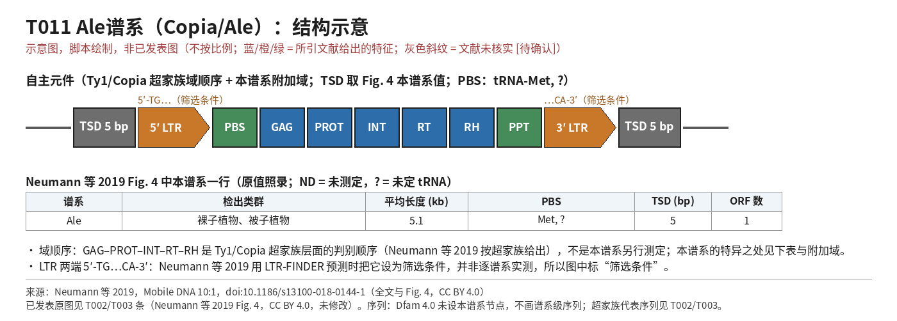

图 T011-1　Ale谱系（Copia/Ale）：结构示意。示意图，脚本绘制，非已发表图；每个特征的来源写在图下方。序列：Dfam 4.0 未设本谱系节点，没有谱系级共识序列；超家族代表序列见 T002/T003。


Ale 谱系元件整体结构高度紧凑，全长通常在 4.5 kb 至 5.5 kb 之间，是植物 Ty1/Copia 超家族中尺寸较短的代表性谱系 [待确认]。其单个 LTR 长度一般较短，多集中在 150 bp 至 400 bp 左右，内部非编码区亦较为精简 [待确认]。完整拷贝的 LTR 两端通常保留保守的 5'-TG...CA-3' 反向重复二核苷酸，5' LTR 下游具与宿主 tRNA 互补的引物结合位点（PBS），3' LTR 上游具多聚嘌呤区（PPT） [待确认]。（见本条“本版补充说明”）

#### TSD

整合进入宿主基因组时在元件两侧形成正向靶位点重复，典型长度为 5 bp [待确认]。

#### 编码蛋白与结构域顺序

自主型 Ale 元件编码完整的 `gag` 与 `pol` 蛋白，严格遵循 Ty1/Copia 超家族的经典结构域排列顺序：**GAG - PROT - INT - RT - RH**（Neumann 等 2019, doi:10.1186/s13100-018-0144-1）。在多数 Ale 元件中，`gag` 与 `pol` 位于单一连续开放阅读框内，不携带 `env` 样附加开放阅读框（Neumann 等 2019, doi:10.1186/s13100-018-0144-1）。（见本条“本版补充说明”）

#### 转座机制

遵循标准的 LTR 反转录转座子复制粘贴扩增机制：由宿主 RNA 聚合酶 II 从 5' LTR 启动子转录全长 RNA，在胞质病毒样颗粒内以 PBS 和 PPT 为引物完成双链 cDNA 反转录，随后由整合酶催化整合至宿主染色体新位点并产生 5 bp TSD [待确认]。

#### 自主与非自主搭档

完整编码 `gag-pol` 的拷贝为自主型；基因组中同时存在内部编码区缺失的非自主衍生物及两翼 LTR 不等同源重组形成的 solo-LTR [待确认]。关于 Ale 谱系专属的非自主搭档家族配对细节待确认。

#### 识别特征与工具

结构从头识别采用 LTRharvest（Ellinghaus 等 2008, doi:10.1186/1471-2105-9-18）、LTR_FINDER（Xu 和 Wang 2007, doi:10.1093/nar/gkm286）、LTR_retriever（Ou 和 Jiang 2018, doi:10.1104/pp.17.01310）与 EDTA（Ou 等 2019, doi:10.1186/s13059-019-1905-y）。将其精准归入 Ale 谱系并与近缘的 Alesia 区分，标准工具为基于 REXdb 蛋白结构域 HMM 模型的 TEsorter（Zhang 等 2022, doi:10.1093/hr/uhac017；Neumann 等 2019, doi:10.1186/s13100-018-0144-1）。

#### 分类争议

早期文献曾将该类群的部分代表家族分别称为 Retrofit 或 Hopscotch 等，导致不同物种间的谱系名称不统一；2019 年 REXdb 系统发育分类已将其统一规范为 `Ale` 谱系，并将系统发育上与 Ale 相近但独立成支的 Alesia 单独分列（Neumann 等 2019, doi:10.1186/s13100-018-0144-1）。

#### 发现与分布

**发现与命名**

- Wicker 和 Keller (2007) Genome-wide comparative analysis of copia retrotransposons in Triticeae, rice, and Arabidopsis reveals conserved ancient evolutionary lineages and distinct dynamics of individual copia families. Genome Research. doi:10.1101/gr.6214107。正文原句：“…the respective names. Major evolutionary lineages are indicated by curly brackets. A reverse transcriptase sequence from yeast (ScRT) served as outgroup. The sequences cluster into six major evolutionary lineages ( Angela , Ale , Bianca , Ivana , Maximus , and TAR ) ( Fig. 1 ). We defined the lineages primarily as large…”；涉及生物：barley, wheat, rice, Arabidopsis；支持范围：six ancient copia lineages named (Angela, Ale, Bianca, Ivana, Maximus, TAR)

**植物中的报道**

- Neumann 等 (2019) Systematic survey of plant LTR-retrotransposons elucidates phylogenetic relationships of their polyprotein domains and provides a reference for element classification. Mobile DNA. doi:10.1186/s13100-018-0144-1。正文原句：“…and Keller [ 24 ] examined 599 Ty1/copia elements from barley, wheat, rice and Arabiopsis thaliana , and classified these into six ancient lineages (Maximus, Ivana, Ale, Angela, TAR and Bianca, Table 1 ) all of which were predicted to have existed before the divergence of monocots and dicots. However, because of the…”；涉及生物：Viridiplantae；支持范围：REXdb survey of plant LTR retrotransposon lineages
- Wicker 和 Keller (2007) Genome-wide comparative analysis of copia retrotransposons in Triticeae, rice, and Arabidopsis reveals conserved ancient evolutionary lineages and distinct dynamics of individual copia families. Genome Research. doi:10.1101/gr.6214107。同一论文，原句见上；支持范围：six copia lineages across monocots and dicots

**葡萄中的报道**

- 未检索到葡萄专门报道（检索方式见文末「证据与检索方法」）。这只说明检索没有找到，不能据此推断葡萄基因组中不存在。

#### 本版补充说明

① 域顺序：GAG–PROT–INT–RT–RH（Ty1/Copia）与 GAG–PROT–RT–RH–INT（Ty3/Gypsy）是 Neumann 等 2019（doi:10.1186/s13100-018-0144-1）在超家族层面给出的判别顺序；本条若写某谱系“遵循”该顺序，指的是沿用超家族的顺序，不是该文对本谱系另行测定。

② 末端：5′-TG…CA-3′ 是该文用 LTR-FINDER 预测元件时设定的筛选条件，不是对各谱系的实测统计；本条中“末端保守为 5′-TG…CA-3′”一类说法应按此理解。

③ 该文 Fig. 4 给出本谱系：检出类群 裸子植物、被子植物；平均长度 5.1 kb；PBS Met, ?；TSD 5 bp；ORF 数 1（ND 为未测定）。正文中标 [待确认] 的“TSD 典型长度 5 bp”与 Fig. 4 一致。

### T012 Alesia谱系（Copia/Alesia）

**名称对照**：Wicker 体系：I 类 / LTR 目 / Copia（代码 RLC）；Wicker 不分谱系；Dfam 节点：Ty1-Copia（Dfam 无谱系节点）；REXdb 路径：Class_I/LTR/Ty1/copia/Alesia。（来源：代码据 Wu 等 2025, doi:10.3390/biom15030346；Dfam 4.0 分类树，2026-11-23 读取；REXdb v4.0 说明文件，doi:10.5281/zenodo.10160279）

#### 定义与命名

Alesia 是 I 类转座子 LTR 目 Ty1/Copia 超家族（RLC）下的独立植物谱系，在 2019 年基于反转录转座子蛋白结构域建立的 REXdb 绿色植物系统分类框架中正式确立，规范命名为 `Alesia`（Neumann 等 2019, doi:10.1186/s13100-018-0144-1）。在系统发育树上，Alesia 与 Ale 谱系亲缘关系最为接近，但构成统计支持度明确的独立单系分支（Neumann 等 2019, doi:10.1186/s13100-018-0144-1）。在 Dfam 现行分类体系中，该谱系归入 `LTR/Copia` 节点之下 [待确认]。

#### 结构、长度与末端

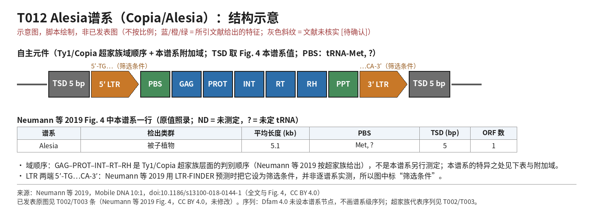

图 T012-1　Alesia谱系（Copia/Alesia）：结构示意。示意图，脚本绘制，非已发表图；每个特征的来源写在图下方。序列：Dfam 4.0 未设本谱系节点，没有谱系级共识序列；超家族代表序列见 T002/T003。


自主型 Alesia 元件整体结构与近缘的 Ale 谱系相似，偏向紧凑型，全长多在 4.5 kb 至 6 kb 之间，单个 LTR 长度通常为数百 bp（精确跨物种长度分布统计待确认）。完整拷贝两翼具正向重复 LTR，末端保守为 5'-TG...CA-3'，内部两端具备 PBS 与 PPT [待确认]。（见本条“本版补充说明”）

#### TSD

整合进入宿主染色体时在元件外侧产生正向靶位点重复，典型长度为 5 bp [待确认]。

#### 编码蛋白与结构域顺序

自主型 Alesia 元件遵循 Ty1/Copia 超家族标准结构域排列顺序：**GAG - PROT - INT - RT - RH**（Neumann 等 2019, doi:10.1186/s13100-018-0144-1）。其内部不含 `env` 样开放阅读框（Neumann 等 2019, doi:10.1186/s13100-018-0144-1）。（见本条“本版补充说明”）

#### 转座机制

遵循经典的 LTR 反转录转座子复制粘贴扩增机制：5' LTR 启动子驱动全长 RNA 转录，在胞质病毒样颗粒内借由 PBS 与 PPT 引导反转录合成双链 cDNA，再由整合酶整合进入宿主基因组新位点并伴随形成 5 bp TSD [待确认]。

#### 自主与非自主搭档

完整携带 `gag-pol` 的拷贝为自主型；基因组中可伴随存在内部缺失的非自主衍生物以及两翼 LTR 不等同源重组形成的 solo-LTR [待确认]。Alesia 谱系专属的非自主搭档关系尚缺乏专门报道，待确认。

#### 识别特征与工具

常规结构检出使用 LTRharvest（Ellinghaus 等 2008, doi:10.1186/1471-2105-9-18）、LTR_FINDER（Xu 和 Wang 2007, doi:10.1093/nar/gkm286）、LTR_retriever（Ou 和 Jiang 2018, doi:10.1104/pp.17.01310）与 EDTA（Ou 等 2019, doi:10.1186/s13059-019-1905-y）。由于 Alesia 在结构长度和蛋白序列上与 Ale 较为接近，仅凭结构特征无法区分，必须依赖基于 REXdb 蛋白域 HMM 的 TEsorter 进行谱系级精准鉴定（Zhang 等 2022, doi:10.1093/hr/uhac017；Neumann 等 2019, doi:10.1186/s13100-018-0144-1）。

#### 分类争议

在 2007 年早期的植物 Copia 六大谱系划分中，Alesia 尚未被单列，其成员在早期研究中容易被并入 Ale 谱系或归为未分类 Copia；2019 年 REXdb 系统发育分析基于多结构域联合建树将其确立为独立谱系，现已成为植物转座子细分类的标准节点（Neumann 等 2019, doi:10.1186/s13100-018-0144-1）。

#### 发现与分布

**发现与命名**

- Neumann 等 (2019) Systematic survey of plant LTR-retrotransposons elucidates phylogenetic relationships of their polyprotein domains and provides a reference for element classification. Mobile DNA. doi:10.1186/s13100-018-0144-1。正文原句：“…of Ty1/copia elements REXdb Wicker and Keller a GyDB b ICTV c Ale Ale Sirevirus/Retrofit ((Koala, Melmoth, Retrofit) pseudovirus (Melmoth, Retrofit, Hopscotch) Alesia Ale – – Angela Angela – pseudovirus (BARE-1) Bianca Bianca – – Bryco – – – Lyco – – – Gymco-I, II, III, IV – – – Ikeros Angela Tork (Sto-4) pseudovirus (Sto-4)…”；涉及生物：Viridiplantae；支持范围：Alesia defined as REXdb lineage (Table 1 maps Alesia to Wicker-Keller Ale)

**植物中的报道**

- Neumann 等 (2019) Systematic survey of plant LTR-retrotransposons elucidates phylogenetic relationships of their polyprotein domains and provides a reference for element classification. Mobile DNA. doi:10.1186/s13100-018-0144-1。同一论文，原句见上；支持范围：REXdb survey of plant LTR retrotransposon lineages

**葡萄中的报道**

- 未检索到葡萄专门报道（检索方式见文末「证据与检索方法」）。这只说明检索没有找到，不能据此推断葡萄基因组中不存在。

#### 本版补充说明

① 域顺序：GAG–PROT–INT–RT–RH（Ty1/Copia）与 GAG–PROT–RT–RH–INT（Ty3/Gypsy）是 Neumann 等 2019（doi:10.1186/s13100-018-0144-1）在超家族层面给出的判别顺序；本条若写某谱系“遵循”该顺序，指的是沿用超家族的顺序，不是该文对本谱系另行测定。

② 末端：5′-TG…CA-3′ 是该文用 LTR-FINDER 预测元件时设定的筛选条件，不是对各谱系的实测统计；本条中“末端保守为 5′-TG…CA-3′”一类说法应按此理解。

③ 该文 Fig. 4 给出本谱系：检出类群 被子植物；平均长度 5.1 kb；PBS Met, ?；TSD 5 bp；ORF 数 1（ND 为未测定）。正文中标 [待确认] 的“TSD 典型长度 5 bp”与 Fig. 4 一致。

### T013 Angela谱系（Copia/Angela）

**名称对照**：Wicker 体系：I 类 / LTR 目 / Copia（代码 RLC）；Wicker 不分谱系；Dfam 节点：Ty1-Copia（Dfam 无谱系节点）；REXdb 路径：Class_I/LTR/Ty1/copia/Angela。（来源：代码据 Wu 等 2025, doi:10.3390/biom15030346；Dfam 4.0 分类树，2026-11-23 读取；REXdb v4.0 说明文件，doi:10.5281/zenodo.10160279）

#### 定义与命名

Angela 是 I 类转座子 LTR 目 Ty1/Copia 超家族（RLC）下的核心植物谱系之一，在 2007 年早期植物 Copia 六大谱系分类及 2019 年 REXdb 绿色植物系统分类框架中均作为独立谱系确立，规范命名为 `Angela`（Neumann 等 2019, doi:10.1186/s13100-018-0144-1）。该谱系包含禾本科植物中著名的高拷贝家族，如大麦中的 `BARE1` 与小麦中的 `WIS` 等近缘家族（Neumann 等 2019, doi:10.1186/s13100-018-0144-1；BARE1 与 WIS 原始命名专文 DOI 待确认）。在 Dfam 现行分类体系中归入 `LTR/Copia` 节点之下 [待确认]。

#### 结构、长度与末端

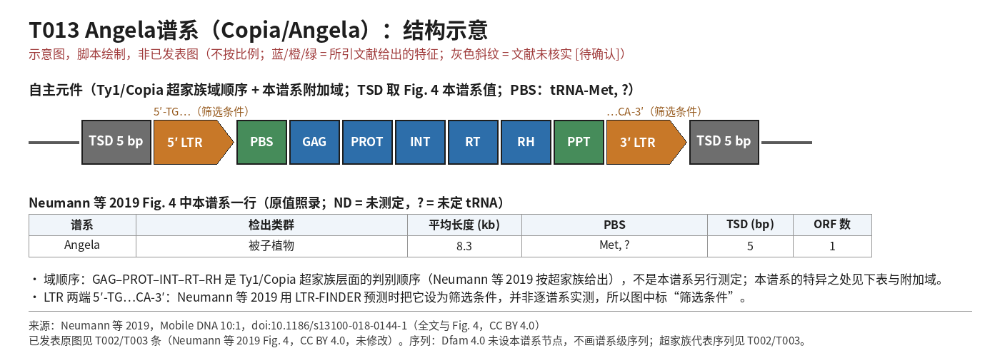

图 T013-1　Angela谱系（Copia/Angela）：结构示意。示意图，脚本绘制，非已发表图；每个特征的来源写在图下方。序列：Dfam 4.0 未设本谱系节点，没有谱系级共识序列；超家族代表序列见 T002/T003。


Angela 谱系属于植物 Ty1/Copia 超家族中尺寸较大的谱系，自主型元件全长通常在 7 kb 至 9.5 kb 之间，单个 LTR 长度较长，常在 1 kb 至 2 kb 左右 [待确认]。元件两翼 LTR 末端保留保守的 5'-TG...CA-3' 反向重复二核苷酸，5' LTR 下游具经典 PBS，3' LTR 上游具 PPT [待确认]。（见本条“本版补充说明”）

#### TSD

整合进入宿主基因组时在元件两侧产生正向靶位点重复，典型长度为 5 bp [待确认]。

#### 编码蛋白与结构域顺序

自主型 Angela 元件编码 `gag` 与 `pol` 蛋白，严格遵循 Ty1/Copia 超家族的 **GAG - PROT - INT - RT - RH** 结构域排列顺序，不携带 `env` 样开放阅读框（Neumann 等 2019, doi:10.1186/s13100-018-0144-1）。（见本条“本版补充说明”）

#### 转座机制

采用标准的 LTR 反转录转座子复制粘贴扩增机制：由宿主 RNA 聚合酶 II 从 5' LTR 启动子转录全长 RNA，经胞质病毒样颗粒内反转录合成双链 cDNA 后，由整合酶整合至宿主基因组新位点并伴随产生 5 bp TSD [待确认]。由于 Angela 元件的单个 LTR 较长，其两翼 LTR 间的不等同源重组效率通常较高，在基因组中易伴随产生大量 solo-LTR [待确认]。

#### 自主与非自主搭档

完整编码 `gag-pol` 的 Angela 拷贝为自主型，既能自我扩增，也可在基因组中伴生内部编码区缺失的非自主衍生物以及高丰度的 solo-LTR [待确认]。在禾本科中，部分高拷贝非自主衍生物（如与 BARE1 相关的 BARE2 衍生物）与自主型 Angela 家族存在明确的演化关联（具体配对专文 DOI 待确认）。

#### 识别特征与工具

完整元件的结构识别依赖 LTRharvest（Ellinghaus 等 2008, doi:10.1186/1471-2105-9-18）、LTR_FINDER（Xu 和 Wang 2007, doi:10.1093/nar/gkm286）、LTR_retriever（Ou 和 Jiang 2018, doi:10.1104/pp.17.01310）与 EDTA（Ou 等 2019, doi:10.1186/s13059-019-1905-y）。谱系级分类使用基于 REXdb 蛋白结构域 HMM 的 TEsorter（Zhang 等 2022, doi:10.1093/hr/uhac017；Neumann 等 2019, doi:10.1186/s13100-018-0144-1）。

#### 分类争议

早期文献常直接以具体物种的高拷贝家族名（如 BARE1、WIS）指代该类群，或将其与 Tork 谱系在宽泛意义上混淆；2019 年 REXdb 系统分类明确将 Angela、Tork 与系统发育上靠近 Angela 的 Ikeros 各自确立为独立谱系，规范了跨物种命名标准（Neumann 等 2019, doi:10.1186/s13100-018-0144-1）。

#### 发现与分布

**发现与命名**

- Wicker 和 Keller (2007) Genome-wide comparative analysis of copia retrotransposons in Triticeae, rice, and Arabidopsis reveals conserved ancient evolutionary lineages and distinct dynamics of individual copia families. Genome Research. doi:10.1101/gr.6214107。正文原句：“…the respective names. Major evolutionary lineages are indicated by curly brackets. A reverse transcriptase sequence from yeast (ScRT) served as outgroup. The sequences cluster into six major evolutionary lineages ( Angela , Ale , Bianca , Ivana , Maximus , and TAR ) ( Fig. 1 ). We defined the lineages primarily as large…”；涉及生物：barley, wheat, rice, Arabidopsis；支持范围：six ancient copia lineages named (Angela, Ale, Bianca, Ivana, Maximus, TAR)

**植物中的报道**

- Neumann 等 (2019) Systematic survey of plant LTR-retrotransposons elucidates phylogenetic relationships of their polyprotein domains and provides a reference for element classification. Mobile DNA. doi:10.1186/s13100-018-0144-1。正文原句：“…Keller [ 24 ] examined 599 Ty1/copia elements from barley, wheat, rice and Arabiopsis thaliana , and classified these into six ancient lineages (Maximus, Ivana, Ale, Angela, TAR and Bianca, Table 1 ) all of which were predicted to have existed before the divergence of monocots and dicots. However, because of the relatively…”；涉及生物：Viridiplantae；支持范围：REXdb survey of plant LTR retrotransposon lineages
- Wicker 和 Keller (2007) Genome-wide comparative analysis of copia retrotransposons in Triticeae, rice, and Arabidopsis reveals conserved ancient evolutionary lineages and distinct dynamics of individual copia families. Genome Research. doi:10.1101/gr.6214107。同一论文，原句见上；支持范围：six copia lineages across monocots and dicots

**葡萄中的报道**

- 未检索到葡萄专门报道（检索方式见文末「证据与检索方法」）。这只说明检索没有找到，不能据此推断葡萄基因组中不存在。

#### 本版补充说明

① 域顺序：GAG–PROT–INT–RT–RH（Ty1/Copia）与 GAG–PROT–RT–RH–INT（Ty3/Gypsy）是 Neumann 等 2019（doi:10.1186/s13100-018-0144-1）在超家族层面给出的判别顺序；本条若写某谱系“遵循”该顺序，指的是沿用超家族的顺序，不是该文对本谱系另行测定。

② 末端：5′-TG…CA-3′ 是该文用 LTR-FINDER 预测元件时设定的筛选条件，不是对各谱系的实测统计；本条中“末端保守为 5′-TG…CA-3′”一类说法应按此理解。

③ 该文 Fig. 4 给出本谱系：检出类群 被子植物；平均长度 8.3 kb；PBS Met, ?；TSD 5 bp；ORF 数 1（ND 为未测定）。正文中标 [待确认] 的“TSD 典型长度 5 bp”与 Fig. 4 一致。

### T014 Bianca谱系（Copia/Bianca）

**名称对照**：Wicker 体系：I 类 / LTR 目 / Copia（代码 RLC）；Wicker 不分谱系；Dfam 节点：Ty1-Copia（Dfam 无谱系节点）；REXdb 路径：Class_I/LTR/Ty1/copia/Bianca。（来源：代码据 Wu 等 2025, doi:10.3390/biom15030346；Dfam 4.0 分类树，2026-11-23 读取；REXdb v4.0 说明文件，doi:10.5281/zenodo.10160279）

#### 定义与命名

Bianca 是 I 类转座子 LTR 目 Ty1/Copia 超家族（RLC）下的六大经典植物谱系之一，在 2019 年 REXdb 绿色植物系统分类框架中确立为独立谱系，规范命名为 `Bianca`（Neumann 等 2019, doi:10.1186/s13100-018-0144-1）。在 Dfam 现行分类体系中归入 `LTR/Copia` 节点之下 [待确认]。

#### 结构、长度与末端


图 T014-1　Bianca谱系（Copia/Bianca）：结构示意。示意图，脚本绘制，非已发表图；每个特征的来源写在图下方。序列：Dfam 4.0 未设本谱系节点，没有谱系级共识序列；超家族代表序列见 T002/T003。


自主型 Bianca 元件全长一般处于中等水平，多在 5 kb 至 7.5 kb 之间，单个 LTR 长度通常为数百 bp 至约 1 kb（精确跨物种长度统计待确认）。完整拷贝两翼具正向重复 LTR，末端保守为 5'-TG...CA-3'，3' LTR 上游具 PPT [待确认]。Bianca 谱系最独特的结构特征在于其引物结合位点（PBS）：2019 年 REXdb 系统研究指出，与绝大多数使用甲硫氨酸启动 tRNA（tRNA-Met）作为反转录引物的植物 LTR 元件不同，Bianca 的 PBS 序列常对应经过编辑的半分子异亮氨酸 tRNA（1/2 tRNA-Ile）（Neumann 等 2019, doi:10.1186/s13100-018-0144-1）。（见本条“本版补充说明”）

#### TSD

整合进入宿主基因组时在元件两侧形成正向靶位点重复，典型长度为 5 bp [待确认]。

#### 编码蛋白与结构域顺序

自主型 Bianca 元件编码 `gag` 与 `pol` 蛋白，严格遵循 Ty1/Copia 超家族的 **GAG - PROT - INT - RT - RH** 结构域排列顺序，不携带 `env` 样开放阅读框（Neumann 等 2019, doi:10.1186/s13100-018-0144-1）。在反转录酶等核心结构域的系统发育树上，Bianca 常位于被子植物 Copia 谱系中分化较早的独立分支（Neumann 等 2019, doi:10.1186/s13100-018-0144-1）。（见本条“本版补充说明”）

#### 转座机制

遵循经典的 LTR 反转录转座子复制粘贴扩增机制，经全长 RNA 转录、胞质病毒样颗粒内反转录合成双链 cDNA 及整合酶介导的染色体整合完成扩增 [待确认]。在负链 cDNA 起始阶段，其特异性利用与编辑后 1/2 tRNA-Ile 互补的 PBS 启动反转录（Neumann 等 2019, doi:10.1186/s13100-018-0144-1）。

#### 自主与非自主搭档

完整携带 `gag-pol` 的拷贝为自主型；基因组中同时存在内部编码区缺失的非自主衍生物以及两翼 LTR 不等同源重组形成的 solo-LTR [待确认]。关于 Bianca 谱系专属非自主搭档家族的报道较少，待确认。

#### 识别特征与工具

结构预测依赖 LTRharvest（Ellinghaus 等 2008, doi:10.1186/1471-2105-9-18）、LTR_FINDER（Xu 和 Wang 2007, doi:10.1093/nar/gkm286）、LTR_retriever（Ou 和 Jiang 2018, doi:10.1104/pp.17.01310）与 EDTA（Ou 等 2019, doi:10.1186/s13059-019-1905-y）。需要注意，若仅依赖默认 tRNA-Met 库筛查 PBS（如部分默认参数下的 LTRdigest 检索），可能因 Bianca 使用 1/2 tRNA-Ile 而漏检其 PBS 信号（Steinbiss 等 2009, doi:10.1093/nar/gkp759；Neumann 等 2019, doi:10.1186/s13100-018-0144-1）。谱系级准确归类应采用基于 REXdb 蛋白结构域 HMM 的 TEsorter（Zhang 等 2022, doi:10.1093/hr/uhac017）。

#### 分类争议

Bianca 作为独立谱系的地位在 2007 年早期植物 Copia 分类及 2019 年 REXdb 体系中高度一致，几乎不存在合并争议；讨论主要集中于其在 Copia 超家族深层系统发育树中的基部位置及特殊 PBS 引物机制的起源演化（Neumann 等 2019, doi:10.1186/s13100-018-0144-1）。

#### 发现与分布

**发现与命名**

- Wicker 和 Keller (2007) Genome-wide comparative analysis of copia retrotransposons in Triticeae, rice, and Arabidopsis reveals conserved ancient evolutionary lineages and distinct dynamics of individual copia families. Genome Research. doi:10.1101/gr.6214107。正文原句：“…the respective names. Major evolutionary lineages are indicated by curly brackets. A reverse transcriptase sequence from yeast (ScRT) served as outgroup. The sequences cluster into six major evolutionary lineages ( Angela , Ale , Bianca , Ivana , Maximus , and TAR ) ( Fig. 1 ). We defined the lineages primarily as large…”；涉及生物：barley, wheat, rice, Arabidopsis；支持范围：six ancient copia lineages named (Angela, Ale, Bianca, Ivana, Maximus, TAR)

**植物中的报道**

- Neumann 等 (2019) Systematic survey of plant LTR-retrotransposons elucidates phylogenetic relationships of their polyprotein domains and provides a reference for element classification. Mobile DNA. doi:10.1186/s13100-018-0144-1。正文原句：“…examined 599 Ty1/copia elements from barley, wheat, rice and Arabiopsis thaliana , and classified these into six ancient lineages (Maximus, Ivana, Ale, Angela, TAR and Bianca, Table 1 ) all of which were predicted to have existed before the divergence of monocots and dicots. However, because of the relatively small sampling…”；涉及生物：Viridiplantae；支持范围：REXdb survey of plant LTR retrotransposon lineages
- Wicker 和 Keller (2007) Genome-wide comparative analysis of copia retrotransposons in Triticeae, rice, and Arabidopsis reveals conserved ancient evolutionary lineages and distinct dynamics of individual copia families. Genome Research. doi:10.1101/gr.6214107。同一论文，原句见上；支持范围：six copia lineages across monocots and dicots

**葡萄中的报道**

- 未检索到葡萄专门报道（检索方式见文末「证据与检索方法」）。这只说明检索没有找到，不能据此推断葡萄基因组中不存在。

#### 本版补充说明

① 域顺序：GAG–PROT–INT–RT–RH（Ty1/Copia）与 GAG–PROT–RT–RH–INT（Ty3/Gypsy）是 Neumann 等 2019（doi:10.1186/s13100-018-0144-1）在超家族层面给出的判别顺序；本条若写某谱系“遵循”该顺序，指的是沿用超家族的顺序，不是该文对本谱系另行测定。

② 末端：5′-TG…CA-3′ 是该文用 LTR-FINDER 预测元件时设定的筛选条件，不是对各谱系的实测统计；本条中“末端保守为 5′-TG…CA-3′”一类说法应按此理解。

③ 该文 Fig. 4 给出本谱系：检出类群 被子植物；平均长度 6.1 kb；PBS 1/2Ile；TSD 5 bp；ORF 数 2（ND 为未测定）。正文中标 [待确认] 的“TSD 典型长度 5 bp”与 Fig. 4 一致。

### T015 Ivana谱系（Copia/Ivana）

**名称对照**：Wicker 体系：I 类 / LTR 目 / Copia（代码 RLC）；Wicker 不分谱系；Dfam 节点：Ty1-Copia（Dfam 无谱系节点）；REXdb 路径：Class_I/LTR/Ty1/copia/Ivana。（来源：代码据 Wu 等 2025, doi:10.3390/biom15030346；Dfam 4.0 分类树，2026-11-23 读取；REXdb v4.0 说明文件，doi:10.5281/zenodo.10160279）

#### 定义与命名

Ivana 是 I 类转座子 LTR 目 Ty1/Copia 超家族（RLC）下的六大经典植物谱系之一（Neumann 等 2019, doi:10.1186/s13100-018-0144-1）。在 2019 年基于蛋白结构域建立的 REXdb 绿色植物系统分类框架中，该谱系统一定名为 `Ivana`，并明确对应早期文献中的旧名 `Oryco`（Neumann 等 2019, doi:10.1186/s13100-018-0144-1）。在 Dfam 现行分类体系中归入 `LTR/Copia` 节点之下 [待确认]。

#### 结构、长度与末端


图 T015-1　Ivana谱系（Copia/Ivana）：结构示意。示意图，脚本绘制，非已发表图；每个特征的来源写在图下方。序列：Dfam 4.0 未设本谱系节点，没有谱系级共识序列；超家族代表序列见 T002/T003。


Ivana 谱系与 Ale 类似，属于结构紧凑型植物 Copia 元件，完整自主型拷贝的全长多在 4.5 kb 至 5.5 kb 之间，单个 LTR 长度通常较短，多在 150 bp 至 400 bp 左右，内部非编码区精简 [待确认]。元件两翼 LTR 末端保守为 5'-TG...CA-3'，内部两端具备 PBS 与 PPT [待确认]。（见本条“本版补充说明”）

#### TSD

整合进入宿主染色体时在元件两侧产生正向靶位点重复，典型长度为 5 bp [待确认]。

#### 编码蛋白与结构域顺序

自主型 Ivana 元件编码完整的 `gag` 与 `pol` 蛋白，严格遵循 Ty1/Copia 超家族的 **GAG - PROT - INT - RT - RH** 结构域排列顺序，不携带 `env` 样开放阅读框（Neumann 等 2019, doi:10.1186/s13100-018-0144-1）。（见本条“本版补充说明”）

#### 转座机制

遵循经典的 LTR 反转录转座子复制粘贴扩增机制：由宿主 RNA 聚合酶 II 从 5' LTR 启动子转录全长 RNA，经胞质病毒样颗粒内以 PBS 和 PPT 为引物完成双链 cDNA 合成后，由整合酶整合进入宿主染色体新位点并产生 5 bp TSD [待确认]。

#### 自主与非自主搭档

完整编码 `gag-pol` 的拷贝为自主型；基因组中同时存在内部缺失的非自主衍生物及两翼 LTR 不等同源重组形成的 solo-LTR [待确认]。关于 Ivana 谱系专属非自主搭档家族的配对验证文献待确认。

#### 识别特征与工具

结构从头预测采用 LTRharvest（Ellinghaus 等 2008, doi:10.1186/1471-2105-9-18）、LTR_FINDER（Xu 和 Wang 2007, doi:10.1093/nar/gkm286）、LTR_retriever（Ou 和 Jiang 2018, doi:10.1104/pp.17.01310）与 EDTA（Ou 等 2019, doi:10.1186/s13059-019-1905-y）。由于 Ivana 与 Ale 均具有较短的全长与 LTR 长度，仅凭尺寸无法区分，必须依赖基于 REXdb 蛋白结构域 HMM 模型的 TEsorter 完成准确谱系归类（Zhang 等 2022, doi:10.1093/hr/uhac017；Neumann 等 2019, doi:10.1186/s13100-018-0144-1）。

#### 分类争议

主要历史分歧在于命名不统一：早期基于水稻等物种的研究普遍使用 `Oryco` 命名该谱系，另一些研究使用 `Ivana`；2019 年 REXdb 系统发育分类正式统一采用 `Ivana` 作为规范谱系名，并将 `Oryco` 列为历史同义旧名（Neumann 等 2019, doi:10.1186/s13100-018-0144-1）。

#### 发现与分布

**发现与命名**

- Wicker 和 Keller (2007) Genome-wide comparative analysis of copia retrotransposons in Triticeae, rice, and Arabidopsis reveals conserved ancient evolutionary lineages and distinct dynamics of individual copia families. Genome Research. doi:10.1101/gr.6214107。正文原句：“…the respective names. Major evolutionary lineages are indicated by curly brackets. A reverse transcriptase sequence from yeast (ScRT) served as outgroup. The sequences cluster into six major evolutionary lineages ( Angela , Ale , Bianca , Ivana , Maximus , and TAR ) ( Fig. 1 ). We defined the lineages primarily as large…”；涉及生物：barley, wheat, rice, Arabidopsis；支持范围：six ancient copia lineages named (Angela, Ale, Bianca, Ivana, Maximus, TAR)

**植物中的报道**

- Neumann 等 (2019) Systematic survey of plant LTR-retrotransposons elucidates phylogenetic relationships of their polyprotein domains and provides a reference for element classification. Mobile DNA. doi:10.1186/s13100-018-0144-1。正文原句：“2 ). Wicker and Keller [ 24 ] examined 599 Ty1/copia elements from barley, wheat, rice and Arabiopsis thaliana , and classified these into six ancient lineages (Maximus, Ivana, Ale, Angela, TAR and Bianca, Table 1 ) all of which were predicted to have existed before the divergence of monocots and dicots. However, because of…”；涉及生物：Viridiplantae；支持范围：REXdb survey of plant LTR retrotransposon lineages
- Wicker 和 Keller (2007) Genome-wide comparative analysis of copia retrotransposons in Triticeae, rice, and Arabidopsis reveals conserved ancient evolutionary lineages and distinct dynamics of individual copia families. Genome Research. doi:10.1101/gr.6214107。同一论文，原句见上；支持范围：six copia lineages across monocots and dicots

**葡萄中的报道**

- 未检索到葡萄专门报道（检索方式见文末「证据与检索方法」）。这只说明检索没有找到，不能据此推断葡萄基因组中不存在。

#### 本版补充说明

① 域顺序：GAG–PROT–INT–RT–RH（Ty1/Copia）与 GAG–PROT–RT–RH–INT（Ty3/Gypsy）是 Neumann 等 2019（doi:10.1186/s13100-018-0144-1）在超家族层面给出的判别顺序；本条若写某谱系“遵循”该顺序，指的是沿用超家族的顺序，不是该文对本谱系另行测定。

② 末端：5′-TG…CA-3′ 是该文用 LTR-FINDER 预测元件时设定的筛选条件，不是对各谱系的实测统计；本条中“末端保守为 5′-TG…CA-3′”一类说法应按此理解。

③ 该文 Fig. 4 给出本谱系：检出类群 裸子植物、被子植物；平均长度 5.1 kb；PBS Met, ?；TSD 5 bp；ORF 数 1（ND 为未测定）。正文中标 [待确认] 的“TSD 典型长度 5 bp”与 Fig. 4 一致。

### T016 Ikeros谱系（Copia/Ikeros）

**名称对照**：Wicker 体系：I 类 / LTR 目 / Copia（代码 RLC）；Wicker 不分谱系；Dfam 节点：Ty1-Copia（Dfam 无谱系节点）；REXdb 路径：Class_I/LTR/Ty1/copia/Ikeros。（来源：代码据 Wu 等 2025, doi:10.3390/biom15030346；Dfam 4.0 分类树，2026-11-23 读取；REXdb v4.0 说明文件，doi:10.5281/zenodo.10160279）

#### 定义与命名

Ikeros 是 I 类转座子 LTR 目 Ty1/Copia 超家族（RLC）下的独立植物谱系（Neumann 等 2019, doi:10.1186/s13100-018-0144-1）。在 2007 年早期的植物 Copia 分类中，Ikeros 仅作为具体家族被提及，未与六大谱系并列（早期分类专文 DOI 待确认）；2019 年 REXdb 绿色植物系统分类框架基于多结构域系统发育分析将其提升并正式确立为独立谱系，规范命名为 `Ikeros`（Neumann 等 2019, doi:10.1186/s13100-018-0144-1）。在 Dfam 现行分类体系中归入 `LTR/Copia` 节点之下 [待确认]。

#### 结构、长度与末端


图 T016-1　Ikeros谱系（Copia/Ikeros）：结构示意。示意图，脚本绘制，非已发表图；每个特征的来源写在图下方。序列：Dfam 4.0 未设本谱系节点，没有谱系级共识序列；超家族代表序列见 T002/T003。


自主型 Ikeros 元件全长多在 5 kb 至 7 kb 左右，单个 LTR 长度通常为数百 bp 至约 1 kb（精确跨物种长度分布统计待确认）。完整拷贝两翼具正向重复 LTR，末端保守为 5'-TG...CA-3'，内部两端具备 PBS 与 PPT [待确认]。（见本条“本版补充说明”）

#### TSD

整合进入宿主基因组时在元件两侧形成正向靶位点重复，典型长度为 5 bp [待确认]。

#### 编码蛋白与结构域顺序

自主型 Ikeros 元件编码 `gag` 与 `pol` 蛋白，严格遵循 Ty1/Copia 超家族的 **GAG - PROT - INT - RT - RH** 结构域排列顺序，不携带 `env` 样开放阅读框（Neumann 等 2019, doi:10.1186/s13100-018-0144-1）。在部分蛋白结构域系统发育树上，Ikeros 与 Angela 谱系位置相对靠近，但在联合结构域分析中保持独立单系分支（Neumann 等 2019, doi:10.1186/s13100-018-0144-1）。（见本条“本版补充说明”）

#### 转座机制

遵循经典的 LTR 反转录转座子复制粘贴扩增机制：5' LTR 启动子驱动全长 RNA 转录，在胞质病毒样颗粒内借由 PBS 与 PPT 引导合成双链 cDNA，随后由整合酶整合至宿主染色体新位点并产生 5 bp TSD [待确认]。

#### 自主与非自主搭档

完整携带 `gag-pol` 的拷贝为自主型；基因组中可伴生内部缺失的非自主衍生物及两翼 LTR 不等同源重组形成的 solo-LTR [待确认]。关于 Ikeros 专属非自主搭档的专门研究待确认。

#### 识别特征与工具

结构检出采用 LTRharvest（Ellinghaus 等 2008, doi:10.1186/1471-2105-9-18）、LTR_FINDER（Xu 和 Wang 2007, doi:10.1093/nar/gkm286）、LTR_retriever（Ou 和 Jiang 2018, doi:10.1104/pp.17.01310）与 EDTA（Ou 等 2019, doi:10.1186/s13059-019-1905-y）。将其与在部分树上位置相近的 Angela 谱系准确区分，需使用基于 REXdb 蛋白结构域 HMM 的 TEsorter（Zhang 等 2022, doi:10.1093/hr/uhac017；Neumann 等 2019, doi:10.1186/s13100-018-0144-1）。

#### 分类争议

主要争议在于其分类层级定位：2007 年早期植物 Copia 分类仅将其视为家族级别，而 2019 年 REXdb 系统发育研究基于跨 80 种绿色植物的蛋白域聚类将其正式确立为独立谱系；在部分单结构域系统发育树中 Ikeros 与 Angela 靠近，因此在自动化注释中需以完整多结构域 HMM 联合判别为准（Neumann 等 2019, doi:10.1186/s13100-018-0144-1）。

#### 发现与分布

**发现与命名**

- Neumann 等 (2019) Systematic survey of plant LTR-retrotransposons elucidates phylogenetic relationships of their polyprotein domains and provides a reference for element classification. Mobile DNA. doi:10.1186/s13100-018-0144-1。正文原句：“…pseudovirus (Melmoth, Retrofit, Hopscotch) Alesia Ale – – Angela Angela – pseudovirus (BARE-1) Bianca Bianca – – Bryco – – – Lyco – – – Gymco-I, II, III, IV – – – Ikeros Angela Tork (Sto-4) pseudovirus (Sto-4) Ivana Ivana Sirevirus/Oryco (Araco, Oryco1–1, Oryco1–2, Poco, Vitico1–1) – Osser – Osser hemivirus (Osser) SIRE…”；涉及生物：Viridiplantae；支持范围：Ikeros defined as REXdb lineage (Table 1)
- Wicker 和 Keller (2007) Genome-wide comparative analysis of copia retrotransposons in Triticeae, rice, and Arabidopsis reveals conserved ancient evolutionary lineages and distinct dynamics of individual copia families. Genome Research. doi:10.1101/gr.6214107。正文原句：“…For eight of the 20 copia families, only a single complete element is deposited at TREP. Nine families have two to four members ( Ale , Barbara , Bianca , HORPIA2 , Ikeros , Inga , Maximus , Oref , and TAR1 ) and most abundant are the closely related Angela , BARE1 , and WIS families for which 15, 17, and 26 complete copies…”；涉及生物：barley, wheat, rice, Arabidopsis；支持范围：Ikeros appears as a named copia family before REXdb

**植物中的报道**

- Neumann 等 (2019) Systematic survey of plant LTR-retrotransposons elucidates phylogenetic relationships of their polyprotein domains and provides a reference for element classification. Mobile DNA. doi:10.1186/s13100-018-0144-1。同一论文，原句见上；支持范围：REXdb survey of plant LTR retrotransposon lineages

**葡萄中的报道**

- 未检索到葡萄专门报道（检索方式见文末「证据与检索方法」）。这只说明检索没有找到，不能据此推断葡萄基因组中不存在。

#### 本版补充说明

① 域顺序：GAG–PROT–INT–RT–RH（Ty1/Copia）与 GAG–PROT–RT–RH–INT（Ty3/Gypsy）是 Neumann 等 2019（doi:10.1186/s13100-018-0144-1）在超家族层面给出的判别顺序；本条若写某谱系“遵循”该顺序，指的是沿用超家族的顺序，不是该文对本谱系另行测定。

② 末端：5′-TG…CA-3′ 是该文用 LTR-FINDER 预测元件时设定的筛选条件，不是对各谱系的实测统计；本条中“末端保守为 5′-TG…CA-3′”一类说法应按此理解。

③ 该文 Fig. 4 给出本谱系：检出类群 裸子植物、被子植物；平均长度 6.9 kb；PBS Met, ?；TSD 5 bp；ORF 数 1（ND 为未测定）。正文中标 [待确认] 的“TSD 典型长度 5 bp”与 Fig. 4 一致。

### T017 TAR谱系（Copia/TAR）

**名称对照**：Wicker 体系：I 类 / LTR 目 / Copia（代码 RLC）；Wicker 不分谱系；Dfam 节点：Ty1-Copia（Dfam 无谱系节点）；REXdb 路径：Class_I/LTR/Ty1/copia/TAR。（来源：代码据 Wu 等 2025, doi:10.3390/biom15030346；Dfam 4.0 分类树，2026-11-23 读取；REXdb v4.0 说明文件，doi:10.5281/zenodo.10160279）

#### 定义与命名

TAR 是 I 类转座子 LTR 目 Ty1/Copia 超家族（RLC）下的六大经典植物谱系之一，在 2019 年 REXdb 绿色植物系统分类框架中正式确立为独立谱系，规范命名为 `TAR`（Neumann 等 2019, doi:10.1186/s13100-018-0144-1）。在 Dfam 现行分类体系中归入 `LTR/Copia` 节点之下 [待确认]。

#### 结构、长度与末端

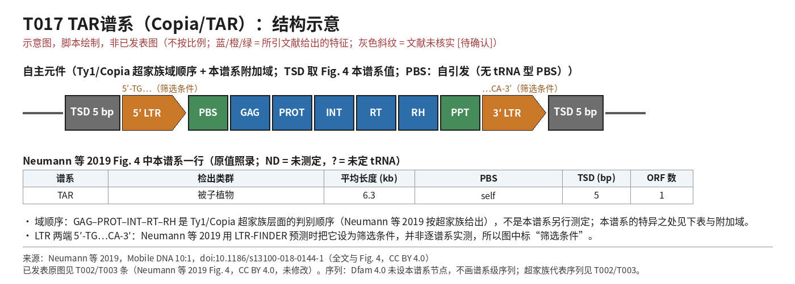

图 T017-1　TAR谱系（Copia/TAR）：结构示意。示意图，脚本绘制，非已发表图；每个特征的来源写在图下方。序列：Dfam 4.0 未设本谱系节点，没有谱系级共识序列；超家族代表序列见 T002/T003。


自主型 TAR 元件全长多在 5 kb 至 7 kb 之间，单个 LTR 长度一般为数百 bp 至约 1 kb（精确跨物种长度分布统计待确认）。完整拷贝两翼具正向重复 LTR，末端保守为 5'-TG...CA-3'，3' LTR 上游具 PPT [待确认]。在反转录起始结构上，2019 年 REXdb 系统研究记录到 TAR 谱系元件常缺乏典型的宿主 tRNA 互补 PBS，而是采用自引发（self-priming）机制起始反转录（Neumann 等 2019, doi:10.1186/s13100-018-0144-1）。（见本条“本版补充说明”）

#### TSD

整合进入宿主染色体时在元件两侧产生正向靶位点重复，典型长度为 5 bp [待确认]。

#### 编码蛋白与结构域顺序

自主型 TAR 元件编码 `gag` 与 `pol` 蛋白，严格遵循 Ty1/Copia 超家族的 **GAG - PROT - INT - RT - RH** 结构域排列顺序，不携带 `env` 样开放阅读框（Neumann 等 2019, doi:10.1186/s13100-018-0144-1）。（见本条“本版补充说明”）

#### 转座机制

遵循 LTR 反转录转座子的复制粘贴扩增机制，经全长 RNA 转录、胞质病毒样颗粒内反转录合成双链 cDNA 及整合酶介导的染色体整合完成扩增 [待确认]。与多数依赖宿主 tRNA 结合 PBS 启动负链合成的 Copia 谱系不同，TAR 谱系常通过转录本自身 RNA 分子内折回配对实现自引发起始反转录（Neumann 等 2019, doi:10.1186/s13100-018-0144-1；自引发二级结构分子机制专文 DOI 待确认）。

#### 自主与非自主搭档

完整编码 `gag-pol` 的拷贝为自主型；基因组中同时存在内部缺失的非自主衍生物及两翼 LTR 不等同源重组形成的 solo-LTR [待确认]。关于 TAR 谱系专属非自主搭档家族的配对研究待确认。

#### 识别特征与工具

结构从头识别采用 LTRharvest（Ellinghaus 等 2008, doi:10.1186/1471-2105-9-18）、LTR_FINDER（Xu 和 Wang 2007, doi:10.1093/nar/gkm286）、LTR_retriever（Ou 和 Jiang 2018, doi:10.1104/pp.17.01310）与 EDTA（Ou 等 2019, doi:10.1186/s13059-019-1905-y）。鉴于 TAR 常采用自引发机制而非经典 tRNA-PBS，在使用 LTRdigest 等工具进行辅助注释时不可将缺失经典 PBS 作为排除 TAR 的依据（Steinbiss 等 2009, doi:10.1093/nar/gkp759；Neumann 等 2019, doi:10.1186/s13100-018-0144-1）。谱系级精准分类应使用基于 REXdb 蛋白结构域 HMM 的 TEsorter（Zhang 等 2022, doi:10.1093/hr/uhac017）。

#### 分类争议

主要需注意避免与 Tork 谱系混淆或随意合并：早期部分研究曾将 Tork 与 TAR 归入宽泛的 Tork/TAR 复合群，但 2019 年 REXdb 系统发育分类已明确两者在蛋白结构域演化树上分属独立单系支且在反转录引发特征上存在差异，应严格分列为 `TAR` 与 `Tork`（Neumann 等 2019, doi:10.1186/s13100-018-0144-1）。

#### 发现与分布

**发现与命名**

- Wicker 和 Keller (2007) Genome-wide comparative analysis of copia retrotransposons in Triticeae, rice, and Arabidopsis reveals conserved ancient evolutionary lineages and distinct dynamics of individual copia families. Genome Research. doi:10.1101/gr.6214107。正文原句：“…the respective names. Major evolutionary lineages are indicated by curly brackets. A reverse transcriptase sequence from yeast (ScRT) served as outgroup. The sequences cluster into six major evolutionary lineages ( Angela , Ale , Bianca , Ivana , Maximus , and TAR ) ( Fig. 1 ). We defined the lineages primarily as large…”；涉及生物：barley, wheat, rice, Arabidopsis；支持范围：six ancient copia lineages named (Angela, Ale, Bianca, Ivana, Maximus, TAR)

**植物中的报道**

- Neumann 等 (2019) Systematic survey of plant LTR-retrotransposons elucidates phylogenetic relationships of their polyprotein domains and provides a reference for element classification. Mobile DNA. doi:10.1186/s13100-018-0144-1。正文原句：“…[ 24 ] examined 599 Ty1/copia elements from barley, wheat, rice and Arabiopsis thaliana , and classified these into six ancient lineages (Maximus, Ivana, Ale, Angela, TAR and Bianca, Table 1 ) all of which were predicted to have existed before the divergence of monocots and dicots. However, because of the relatively small…”；涉及生物：Viridiplantae；支持范围：REXdb survey of plant LTR retrotransposon lineages
- Wicker 和 Keller (2007) Genome-wide comparative analysis of copia retrotransposons in Triticeae, rice, and Arabidopsis reveals conserved ancient evolutionary lineages and distinct dynamics of individual copia families. Genome Research. doi:10.1101/gr.6214107。同一论文，原句见上；支持范围：six copia lineages across monocots and dicots

**葡萄中的报道**

- 未检索到葡萄专门报道（检索方式见文末「证据与检索方法」）。这只说明检索没有找到，不能据此推断葡萄基因组中不存在。

#### 本版补充说明

① 域顺序：GAG–PROT–INT–RT–RH（Ty1/Copia）与 GAG–PROT–RT–RH–INT（Ty3/Gypsy）是 Neumann 等 2019（doi:10.1186/s13100-018-0144-1）在超家族层面给出的判别顺序；本条若写某谱系“遵循”该顺序，指的是沿用超家族的顺序，不是该文对本谱系另行测定。

② 末端：5′-TG…CA-3′ 是该文用 LTR-FINDER 预测元件时设定的筛选条件，不是对各谱系的实测统计；本条中“末端保守为 5′-TG…CA-3′”一类说法应按此理解。

③ 该文 Fig. 4 给出本谱系：检出类群 被子植物；平均长度 6.3 kb；PBS 自引发；TSD 5 bp；ORF 数 1（ND 为未测定）。正文中标 [待确认] 的“TSD 典型长度 5 bp”与 Fig. 4 一致。

### T018 Tork谱系（Copia/Tork）

**名称对照**：Wicker 体系：I 类 / LTR 目 / Copia（代码 RLC）；Wicker 不分谱系；Dfam 节点：Ty1-Copia（Dfam 无谱系节点）；REXdb 路径：Class_I/LTR/Ty1/copia/Tork。（来源：代码据 Wu 等 2025, doi:10.3390/biom15030346；Dfam 4.0 分类树，2026-11-23 读取；REXdb v4.0 说明文件，doi:10.5281/zenodo.10160279）

#### 定义与命名

Tork 是 I 类转座子 LTR 目 Ty1/Copia 超家族（RLC）下的独立植物谱系，在 2019 年基于反转录转座子蛋白结构域建立的 REXdb 绿色植物系统分类框架中规范命名为 `Tork`，与 TAR、Angela、Ivana、Ale、Bianca 等谱系并列（Neumann 等 2019, doi:10.1186/s13100-018-0144-1）。该谱系名称源于早期在烟草等植物中鉴定的 Tnt1/Tto1 等经典 Copia 家族所属的类群（Tnt1 原始发现专文 DOI 待确认）。在 Dfam 现行分类体系中归入 `LTR/Copia` 节点之下 [待确认]。

#### 结构、长度与末端

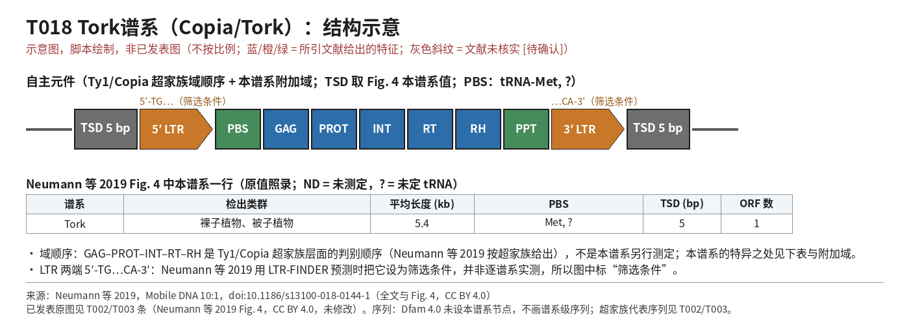

图 T018-1　Tork谱系（Copia/Tork）：结构示意。示意图，脚本绘制，非已发表图；每个特征的来源写在图下方。序列：Dfam 4.0 未设本谱系节点，没有谱系级共识序列；超家族代表序列见 T002/T003。


自主型 Tork 元件全长多在 5 kb 至 7 kb 之间，单个 LTR 长度通常为 400 bp 至 1 kb 左右（精确跨物种长度分布统计待确认）。完整拷贝两翼具正向重复 LTR，末端高度保守为 5'-TG...CA-3'，5' LTR 下游具经典 PBS，3' LTR 上游具 PPT [待确认]。（见本条“本版补充说明”）

#### TSD

整合进入宿主基因组时在元件两侧形成正向靶位点重复，典型长度为 5 bp [待确认]。

#### 编码蛋白与结构域顺序

自主型 Tork 元件编码完整的 `gag` 与 `pol` 蛋白，严格遵循 Ty1/Copia 超家族的 **GAG - PROT - INT - RT - RH** 结构域排列顺序，不携带 `env` 样开放阅读框（Neumann 等 2019, doi:10.1186/s13100-018-0144-1）。（见本条“本版补充说明”）

#### 转座机制

遵循经典的 LTR 反转录转座子复制粘贴扩增机制：5' LTR 启动子驱动全长 RNA 转录，在胞质病毒样颗粒内借由 PBS 与 PPT 引导完成双链 cDNA 反转录，随后由整合酶整合至宿主基因组新位点并伴随产生 5 bp TSD [待确认]。部分 Tork 谱系代表家族（如烟草 Tnt1）的 5' LTR U3 区携带胁迫响应顺式作用元件，在原生质体制备、组织培养或生物与非生物胁迫条件下可被强烈转录激活（Tnt1 胁迫激活专文 DOI 待确认）。

#### 自主与非自主搭档

完整编码 `gag-pol` 的拷贝为自主型；基因组中同时存在内部编码区缺失的非自主衍生物及两翼 LTR 不等同源重组形成的 solo-LTR [待确认]。关于 Tork 谱系专属非自主搭档家族的系统配对研究待确认。

#### 识别特征与工具

完整元件的结构识别采用 LTRharvest（Ellinghaus 等 2008, doi:10.1186/1471-2105-9-18）、LTR_FINDER（Xu 和 Wang 2007, doi:10.1093/nar/gkm286）、LTR_retriever（Ou 和 Jiang 2018, doi:10.1104/pp.17.01310）与 EDTA（Ou 等 2019, doi:10.1186/s13059-019-1905-y）。谱系级精准分类采用基于 REXdb 蛋白结构域 HMM 的 TEsorter（Zhang 等 2022, doi:10.1093/hr/uhac017；Neumann 等 2019, doi:10.1186/s13100-018-0144-1）。

#### 分类争议

早期部分植物转座子分类文献曾将 Tork 与 TAR（甚至 Angela）在较宽泛的层级上合并讨论；2019 年 REXdb 系统发育分类已明确将 `Tork` 与 `TAR` 作为并列的独立谱系分列，在转座子注释、统计与谱系比较中切勿将 Tork 与 TAR 随意合并（Neumann 等 2019, doi:10.1186/s13100-018-0144-1）。

#### 发现与分布

**发现与命名**

- Neumann 等 (2019) Systematic survey of plant LTR-retrotransposons elucidates phylogenetic relationships of their polyprotein domains and provides a reference for element classification. Mobile DNA. doi:10.1186/s13100-018-0144-1。正文原句：“…and 30 Ty3/gypsy elements from 26 Viridiplantae species. They identified five plant lineages of Ty1/copia elements, referred to as Oryco, Sire, Retrofit, Osser and Tork (Table 1 ). Ty3/gypsy elements in plants were found to belong to two major lineages, chromovirus and Tat/Athila, the former composed of the Del, Reina, CRM…”；涉及生物：Viridiplantae；支持范围：Tork lineage in unified table with prior names

**植物中的报道**

- Neumann 等 (2019) Systematic survey of plant LTR-retrotransposons elucidates phylogenetic relationships of their polyprotein domains and provides a reference for element classification. Mobile DNA. doi:10.1186/s13100-018-0144-1。同一论文，原句见上；支持范围：REXdb survey of plant LTR retrotransposon lineages
- Grandbastien 等 (1989) Tnt1, a mobile retroviral-like transposable element of tobacco isolated by plant cell genetics. Nature. doi:10.1038/337376a0。摘要原句：“Here, we report the isolation of the first tobacco (Nicotiana tabacum) transposable element, Tnt1, which seems to be the most complete mobile retrotransposon characterized in higher plants”；涉及生物：tobacco (Nicotiana tabacum)；支持范围：Tnt1 retroviral-like element [注意：所引句不含该名称，仅支持上位/总体论断]

**葡萄中的报道**

- Park 等 (2021) Horizontal Transfer of LTR Retrotransposons Contributes to the Genome Diversity of Vitis. International Journal of Molecular Sciences. doi:10.3390/ijms221910446。正文原句：“Among them, Tork was the largest family, and 3.0–5.5% of the family members were newly generated by paralogs of the horizontally transferred LTR retrotransposons ( Figure 5 d)”；涉及生物：Vitis；支持范围：horizontal transfer of LTR retrotransposons; Tork, CRM, Reina, Athila, Tat families in four Vitis genomes

#### 本版补充说明

① 域顺序：GAG–PROT–INT–RT–RH（Ty1/Copia）与 GAG–PROT–RT–RH–INT（Ty3/Gypsy）是 Neumann 等 2019（doi:10.1186/s13100-018-0144-1）在超家族层面给出的判别顺序；本条若写某谱系“遵循”该顺序，指的是沿用超家族的顺序，不是该文对本谱系另行测定。

② 末端：5′-TG…CA-3′ 是该文用 LTR-FINDER 预测元件时设定的筛选条件，不是对各谱系的实测统计；本条中“末端保守为 5′-TG…CA-3′”一类说法应按此理解。

③ 该文 Fig. 4 给出本谱系：检出类群 裸子植物、被子植物；平均长度 5.4 kb；PBS Met, ?；TSD 5 bp；ORF 数 1（ND 为未测定）。正文中标 [待确认] 的“TSD 典型长度 5 bp”与 Fig. 4 一致。

### T019 SIRE谱系（Copia/SIRE）

**名称对照**：Wicker 体系：I 类 / LTR 目 / Copia（代码 RLC）；Wicker 不分谱系；Dfam 节点：Ty1-Copia（Dfam 无谱系节点）；REXdb 路径：Class_I/LTR/Ty1/copia/SIRE。（来源：代码据 Wu 等 2025, doi:10.3390/biom15030346；Dfam 4.0 分类树，2026-11-23 读取；REXdb v4.0 说明文件，doi:10.5281/zenodo.10160279）

#### 定义与命名

SIRE 是 I 类转座子 LTR 目 Ty1/Copia 超家族（RLC）下的六大核心植物谱系之一，在 2019 年 REXdb 绿色植物系统分类框架中规范命名为 `SIRE`（Neumann 等 2019, doi:10.1186/s13100-018-0144-1）。该谱系即 2007 年早期植物 Copia 六大谱系分类中的 `Maximus` 谱系，在病毒学与早期文献中亦常对应狭义的 `Sirevirus` 或 `Agrovirus`（Neumann 等 2019, doi:10.1186/s13100-018-0144-1；Sirevirus 原始命名专文 DOI 待确认）。在 Dfam 现行分类体系中归入 `LTR/Copia` 节点之下 [待确认]。

#### 结构、长度与末端

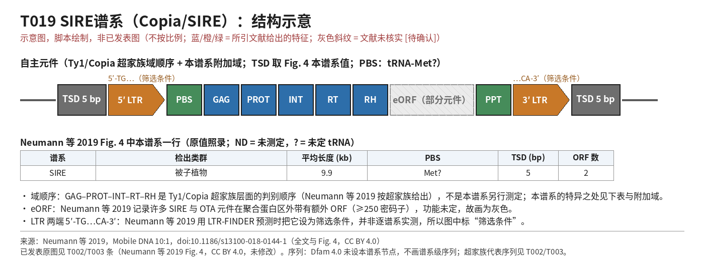

图 T019-1　SIRE谱系（Copia/SIRE）：结构示意。示意图，脚本绘制，非已发表图；每个特征的来源写在图下方。序列：Dfam 4.0 未设本谱系节点，没有谱系级共识序列；超家族代表序列见 T002/T003。


SIRE 是植物 Ty1/Copia 超家族中尺寸最大的谱系之一，完整自主型元件全长通常在 8 kb 至 11 kb 之间，单个 LTR 长度较长，多在 1 kb 至 2 kb 左右 [待确认]。元件两翼 LTR 末端保守为 5'-TG...CA-3'，5' LTR 下游具经典 PBS，3' LTR 上游具 PPT [待确认]。（见本条“本版补充说明”）

#### TSD

整合进入宿主基因组时在元件两侧形成正向靶位点重复，典型长度为 5 bp [待确认]。

#### 编码蛋白与结构域顺序

自主型 SIRE 元件严格遵循 Ty1/Copia 超家族的 **GAG - PROT - INT - RT - RH** 结构域排列顺序（Neumann 等 2019, doi:10.1186/s13100-018-0144-1）。该谱系最显著的结构特征是在 `pol` 编码区下游的 3' 端常携带一个额外的开放阅读框，称为 `env` 样开放阅读框（eORF）（Neumann 等 2019, doi:10.1186/s13100-018-0144-1）。该 eORF 在氨基酸序列上与脊椎动物逆转录病毒的包膜蛋白并无同源性，其确切生物学功能目前尚未完全阐明（Neumann 等 2019, doi:10.1186/s13100-018-0144-1；eORF 功能研究专文 DOI 待确认）。（见本条“本版补充说明”）

#### 转座机制

遵循经典的 LTR 反转录转座子复制粘贴扩增机制：5' LTR 启动子驱动全长 RNA 转录，在胞质病毒样颗粒内借由 PBS 与 PPT 引导反转录合成双链 cDNA，随后由整合酶整合进入宿主染色体新位点并产生 5 bp TSD [待确认]。尽管携带 3' 端 eORF，目前没有确凿证据表明 SIRE 能够形成具有细胞间感染能力的游离逆转录病毒颗粒（Neumann 等 2019, doi:10.1186/s13100-018-0144-1）。

#### 自主与非自主搭档

完整编码 `gag-pol`（及或 eORF）的拷贝为自主型；基因组中普遍伴生内部编码区缺失的非自主衍生物以及因长 LTR 不等同源重组形成的大量 solo-LTR [待确认]。关于 SIRE 谱系专属非自主搭档家族的配对研究待确认。

#### 识别特征与工具

结构从头识别采用 LTRharvest（Ellinghaus 等 2008, doi:10.1186/1471-2105-9-18）、LTR_FINDER（Xu 和 Wang 2007, doi:10.1093/nar/gkm286）、LTR_retriever（Ou 和 Jiang 2018, doi:10.1104/pp.17.01310）与 EDTA（Ou 等 2019, doi:10.1186/s13059-019-1905-y）。谱系级精准分类采用基于 REXdb 蛋白结构域 HMM 的 TEsorter，可准确识别 SIRE 的 `pol` 结构域特征并避免将其误判为 ERV（Zhang 等 2022, doi:10.1093/hr/uhac017；Neumann 等 2019, doi:10.1186/s13100-018-0144-1）。

#### 分类争议

第一项争议是历史命名并存：早期文献中 `Maximus`、`Sirevirus`、`Agrovirus` 与 `SIRE` 混用，2019 年 REXdb 系统发育分类已统一采用 `SIRE` 作为规范谱系名（Neumann 等 2019, doi:10.1186/s13100-018-0144-1）。第二项也是最关键的争议在于属性定性：由于 SIRE 在 `pol` 下游携带 3' 端 eORF，早期个别研究曾将其称作「植物内源性逆转录病毒（plant ERV）」；2019 年 REXdb 系统分类明确反对这一称谓，强调 SIRE 的 `pol` 结构域顺序（INT-RT-RH）与系统发育位置均确凿属于 Ty1/Copia 超家族，与脊椎动物 Retrovirus / ERV 无直接同源演化关系，绝不可将其称作植物内源逆转录病毒（Neumann 等 2019, doi:10.1186/s13100-018-0144-1）。

#### 发现与分布

**发现与命名**

- Wicker 和 Keller (2007) Genome-wide comparative analysis of copia retrotransposons in Triticeae, rice, and Arabidopsis reveals conserved ancient evolutionary lineages and distinct dynamics of individual copia families. Genome Research. doi:10.1101/gr.6214107。正文原句：“…the respective names. Major evolutionary lineages are indicated by curly brackets. A reverse transcriptase sequence from yeast (ScRT) served as outgroup. The sequences cluster into six major evolutionary lineages ( Angela , Ale , Bianca , Ivana , Maximus , and TAR ) ( Fig. 1 ). We defined the lineages primarily as large…”；涉及生物：barley, wheat, rice, Arabidopsis；支持范围：six ancient copia lineages named (Angela, Ale, Bianca, Ivana, Maximus, TAR) [注意：所引句不含该名称，仅支持上位/总体论断]
- Laten 等 (1998) SIRE-1, a copia/Ty1-like retroelement from soybean, encodes a retroviral envelope-like protein. Proceedings of the National Academy of Sciences. doi:10.1073/pnas.95.12.6897。摘要原句：“The soybean genome hosts a family of several hundred, relatively homogeneous copies of a large, copia/Ty1-like retroelement designated SIRE-1”；涉及生物：soybean (Glycine max)；支持范围：SIRE-1 encodes envelope-like protein
- Havecker 等 (2005) The Sireviruses, a plant-specific lineage of the Ty1/copia retrotransposons, interact with a family of proteins related to dynein light chain 8. Plant Physiology. doi:10.1104/pp.105.065680。摘要原句：“Plant genomes are rich in long terminal repeat retrotransposons, and here we describe a plant-specific lineage of Ty1/copia elements called the Sireviruses”；涉及生物：plants；支持范围：Sireviruses as plant-specific Ty1/copia lineage

**植物中的报道**

- Neumann 等 (2019) Systematic survey of plant LTR-retrotransposons elucidates phylogenetic relationships of their polyprotein domains and provides a reference for element classification. Mobile DNA. doi:10.1186/s13100-018-0144-1。正文原句：“…related species [ 25 , 26 ] or focused on a particular lineage of LTR-retrotransposons, e.g. chromoviruses [ 11 , 27 – 31 ], Athila [ 32 ], Ogre [ 33 ], Tat [ 34 ] or SIRE [ 35 – 37 ]. Although these studies demonstrated the potential of a phylogeny-based classification their results are difficult to unify and generalize…”；涉及生物：Viridiplantae；支持范围：REXdb survey of plant LTR retrotransposon lineages
- Wicker 和 Keller (2007) Genome-wide comparative analysis of copia retrotransposons in Triticeae, rice, and Arabidopsis reveals conserved ancient evolutionary lineages and distinct dynamics of individual copia families. Genome Research. doi:10.1101/gr.6214107。同一论文，原句见上；支持范围：six copia lineages across monocots and dicots [注意：所引句不含该名称，仅支持上位/总体论断]
- Laten 等 (1998) SIRE-1, a copia/Ty1-like retroelement from soybean, encodes a retroviral envelope-like protein. Proceedings of the National Academy of Sciences. doi:10.1073/pnas.95.12.6897。同一论文，原句见上；支持范围：SIRE-1
- Havecker 等 (2005) The Sireviruses, a plant-specific lineage of the Ty1/copia retrotransposons, interact with a family of proteins related to dynein light chain 8. Plant Physiology. doi:10.1104/pp.105.065680。同一论文，原句见上；支持范围：Sireviruses lineage

**葡萄中的报道**

- 未检索到葡萄专门报道（检索方式见文末「证据与检索方法」）。这只说明检索没有找到，不能据此推断葡萄基因组中不存在。


#### 本版补充说明

① 域顺序：GAG–PROT–INT–RT–RH（Ty1/Copia）与 GAG–PROT–RT–RH–INT（Ty3/Gypsy）是 Neumann 等 2019（doi:10.1186/s13100-018-0144-1）在超家族层面给出的判别顺序；本条若写某谱系“遵循”该顺序，指的是沿用超家族的顺序，不是该文对本谱系另行测定。

② 末端：5′-TG…CA-3′ 是该文用 LTR-FINDER 预测元件时设定的筛选条件，不是对各谱系的实测统计；本条中“末端保守为 5′-TG…CA-3′”一类说法应按此理解。

③ 该文 Fig. 4 给出本谱系：检出类群 被子植物；平均长度 9.9 kb；PBS Met?；TSD 5 bp；ORF 数 2（ND 为未测定）。正文中标 [待确认] 的“TSD 典型长度 5 bp”与 Fig. 4 一致。

## 第三部分　Copia 超家族谱系（二）

### T020 Osser谱系（Copia/Osser）

**名称对照**：Wicker 体系：I 类 / LTR 目 / Copia（代码 RLC）；Wicker 不分谱系；Dfam 节点：Ty1-Copia（Dfam 无谱系节点）；REXdb 路径：Class_I/LTR/Ty1/copia/Osser。（来源：代码据 Wu 等 2025, doi:10.3390/biom15030346；Dfam 4.0 分类树，2026-11-23 读取；REXdb v4.0 说明文件，doi:10.5281/zenodo.10160279）

#### 定义与命名

Osser 是 I 类转座子 LTR 目 Ty1/Copia 超家族（RLC）下的古老植物谱系，在 2019 年基于反转录转座子蛋白结构域建立的 REXdb 绿色植物系统分类框架中被确立为 16 个核心谱系之一，规范命名为 `Osser`（Neumann 等 2019, doi:10.1186/s13100-018-0144-1）。在绿色植物 Ty1/Copia 超家族的系统发育分析中，Osser 处于最基部位置，常被用作构建植物 Copia 谱系系统发育树的外群（Neumann 等 2019, doi:10.1186/s13100-018-0144-1）。在 Dfam 现行分类体系中，该类群归入 `LTR/Copia` 节点之下 [待确认]。

#### 结构、长度与末端


图 T020-1　Osser谱系（Copia/Osser）：结构示意。示意图，脚本绘制，非已发表图；每个特征的来源写在图下方。序列：Dfam 4.0 未设本谱系节点，没有谱系级共识序列；超家族代表序列见 T002/T003。


自主型 Osser 元件遵循典型 Ty1/Copia 元件的基本结构，由 5' LTR、内部编码区与 3' LTR 构成，两翼 LTR 末端多保留保守的 5'-TG...CA-3' 反向重复二核苷酸，3' LTR 上游具多聚嘌呤区（PPT）（精确跨物种全长与单 LTR 长度统计待确认）。在引物结合位点（PBS）特征上，2019 年 REXdb 系统研究指出，Osser 谱系的 PBS 可对应半分子甲硫氨酸 tRNA（1/2 tRNA-Met），不同于多数被子植物 Copia 谱系使用完整 tRNA 3' 端作为引物的经典模式（Neumann 等 2019, doi:10.1186/s13100-018-0144-1）。（见本条“本版补充说明”）

#### TSD

整合进入宿主基因组时在元件两侧形成正向靶位点重复，典型长度为 5 bp（具体物种变异范围待确认）。

#### 编码蛋白与结构域顺序

自主型 Osser 元件编码 `gag` 与 `pol` 蛋白，严格遵循 Ty1/Copia 超家族的 **GAG - PROT - INT - RT - RH** 结构域排列顺序，不携带 `env` 样开放阅读框（Neumann 等 2019, doi:10.1186/s13100-018-0144-1）。（见本条“本版补充说明”）

#### 转座机制

遵循标准的 LTR 反转录转座子复制粘贴扩增机制：由 5' LTR 启动子驱动全长 RNA 转录，在胞质病毒样颗粒内借由 PBS 与 PPT 引导反转录合成双链 cDNA，再由整合酶整合至宿主染色体新位点并伴随产生 TSD [待确认]。其负链合成起始可利用 1/2 tRNA-Met 互补序列（Neumann 等 2019, doi:10.1186/s13100-018-0144-1）。

#### 自主与非自主搭档

完整携带 `gag-pol` 的拷贝为自主型；基因组中可能伴生内部编码区缺失的非自主衍生物及两翼 LTR 不等同源重组形成的 solo-LTR（Osser 专属非自主搭档家族的配对研究待确认）。

#### 识别特征与工具

结构从头识别采用 LTRharvest（Ellinghaus 等 2008, doi:10.1186/1471-2105-9-18）、LTR_FINDER（Xu 和 Wang 2007, doi:10.1093/nar/gkm286）、LTR_retriever（Ou 和 Jiang 2018, doi:10.1104/pp.17.01310）与 EDTA（Ou 等 2019, doi:10.1186/s13059-019-1905-y）。谱系级鉴定依赖基于 REXdb 蛋白结构域 HMM 的 TEsorter（Zhang 等 2022, doi:10.1093/hr/uhac017；Neumann 等 2019, doi:10.1186/s13100-018-0144-1）。

#### 分类争议

Osser 在 2019 年 REXdb 框架下作为基部独立谱系地位明确，几乎不存在归属争议；因其在系统发育树上分化极早，在跨门类比较中常被用作锚定植物 Copia 超家族根部的外群（Neumann 等 2019, doi:10.1186/s13100-018-0144-1）。

#### 发现与分布

**发现与命名**

- Neumann 等 (2019) Systematic survey of plant LTR-retrotransposons elucidates phylogenetic relationships of their polyprotein domains and provides a reference for element classification. Mobile DNA. doi:10.1186/s13100-018-0144-1。正文原句：“…24 Ty1/copia and 30 Ty3/gypsy elements from 26 Viridiplantae species. They identified five plant lineages of Ty1/copia elements, referred to as Oryco, Sire, Retrofit, Osser and Tork (Table 1 ). Ty3/gypsy elements in plants were found to belong to two major lineages, chromovirus and Tat/Athila, the former composed of the Del,…”；涉及生物：Viridiplantae；支持范围：lineage listed in REXdb Table 1

**植物中的报道**

- Neumann 等 (2019) Systematic survey of plant LTR-retrotransposons elucidates phylogenetic relationships of their polyprotein domains and provides a reference for element classification. Mobile DNA. doi:10.1186/s13100-018-0144-1。同一论文，原句见上；支持范围：REXdb survey of plant LTR retrotransposon lineages

**葡萄中的报道**

- 未检索到葡萄专门报道（检索方式见文末「证据与检索方法」）。这只说明检索没有找到，不能据此推断葡萄基因组中不存在。

#### 本版补充说明

① 域顺序：GAG–PROT–INT–RT–RH（Ty1/Copia）与 GAG–PROT–RT–RH–INT（Ty3/Gypsy）是 Neumann 等 2019（doi:10.1186/s13100-018-0144-1）在超家族层面给出的判别顺序；本条若写某谱系“遵循”该顺序，指的是沿用超家族的顺序，不是该文对本谱系另行测定。

② 末端：5′-TG…CA-3′ 是该文用 LTR-FINDER 预测元件时设定的筛选条件，不是对各谱系的实测统计；本条中“末端保守为 5′-TG…CA-3′”一类说法应按此理解。

③ 该文 Fig. 4 给出本谱系：检出类群 绿藻门；平均长度 5.2 kb；PBS 1/2Met；TSD 5 bp；ORF 数 1（ND 为未测定）。正文中标 [待确认] 的“TSD 典型长度 5 bp”与 Fig. 4 一致。

### T021 Bryco谱系（Copia/Bryco）

**名称对照**：Wicker 体系：I 类 / LTR 目 / Copia（代码 RLC）；Wicker 不分谱系；Dfam 节点：Ty1-Copia（Dfam 无谱系节点）；REXdb 路径：Class_I/LTR/Ty1/copia/Bryco。（来源：代码据 Wu 等 2025, doi:10.3390/biom15030346；Dfam 4.0 分类树，2026-11-23 读取；REXdb v4.0 说明文件，doi:10.5281/zenodo.10160279）

#### 定义与命名

Bryco 是 I 类转座子 LTR 目 Ty1/Copia 超家族（RLC）下的独立植物谱系，在 2019 年基于反转录转座子蛋白结构域建立的 REXdb 绿色植物系统分类框架中被正式确立，规范命名为 `Bryco`（Neumann 等 2019, doi:10.1186/s13100-018-0144-1）。该名称源于其主要宿主类群苔藓植物（Bryophyta）与 Copia 超家族的组合（Neumann 等 2019, doi:10.1186/s13100-018-0144-1）。在 Dfam 现行分类体系中归入 `LTR/Copia` 节点之下 [待确认]。

#### 结构、长度与末端

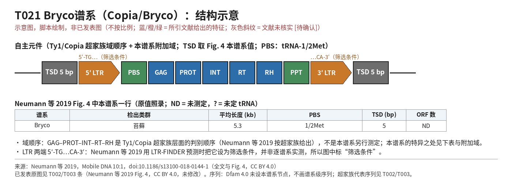

图 T021-1　Bryco谱系（Copia/Bryco）：结构示意。示意图，脚本绘制，非已发表图；每个特征的来源写在图下方。序列：Dfam 4.0 未设本谱系节点，没有谱系级共识序列；超家族代表序列见 T002/T003。


自主型 Bryco 元件具备典型 LTR 反转录转座子的三段式结构（5' LTR、内部编码区与 3' LTR），两翼 LTR 末端多保留保守的 5'-TG...CA-3' 反向重复二核苷酸，内部两端具 PBS 与 PPT（Bryco 跨物种精确全长与 LTR 长度范围统计待确认）。（见本条“本版补充说明”）

#### TSD

整合进入宿主染色体时在元件两侧形成正向靶位点重复，典型长度为 5 bp（具体变异情况待确认）。

#### 编码蛋白与结构域顺序

自主型 Bryco 元件编码 `gag` 与 `pol` 蛋白，严格遵循 Ty1/Copia 超家族的 **GAG - PROT - INT - RT - RH** 结构域排列顺序，不携带 `env` 样开放阅读框（Neumann 等 2019, doi:10.1186/s13100-018-0144-1）。（见本条“本版补充说明”）

#### 转座机制

遵循经典的 LTR 反转录转座子复制粘贴扩增机制：由 5' LTR 启动子驱动全长 RNA 转录，在胞质病毒样颗粒内借由 PBS 与 PPT 引导反转录合成双链 cDNA，再由整合酶整合进入宿主基因组新位点并伴随产生 TSD [待确认]。

#### 自主与非自主搭档

完整编码 `gag-pol` 的拷贝为自主型；基因组中可伴生内部缺失的非自主衍生物及两翼 LTR 不等同源重组形成的 solo-LTR（Bryco 专属非自主搭档研究待确认）。

#### 识别特征与工具

结构从头预测采用 LTRharvest（Ellinghaus 等 2008, doi:10.1186/1471-2105-9-18）、LTR_FINDER（Xu 和 Wang 2007, doi:10.1093/nar/gkm286）、LTR_retriever（Ou 和 Jiang 2018, doi:10.1104/pp.17.01310）与 EDTA（Ou 等 2019, doi:10.1186/s13059-019-1905-y）。谱系级精准分类采用基于 REXdb 蛋白结构域 HMM 的 TEsorter（Zhang 等 2022, doi:10.1093/hr/uhac017；Neumann 等 2019, doi:10.1186/s13100-018-0144-1）。

#### 分类争议

Bryco 于 2019 年 REXdb 系统分类中首次作为苔藓植物代表性 Copia 谱系确立，分类边界清晰；随着后续更多苔藓与角苔、地钱基因组的测序，REXdb v4.0 又新增了其他苔藓相关谱系（如 Bryana），需在更新版参考库中注意区分（Neumann 等 2019, doi:10.1186/s13100-018-0144-1；v4.0 具体修订文献 DOI 待确认）。

#### 发现与分布

**发现与命名**

- Neumann 等 (2019) Systematic survey of plant LTR-retrotransposons elucidates phylogenetic relationships of their polyprotein domains and provides a reference for element classification. Mobile DNA. doi:10.1186/s13100-018-0144-1。正文原句：“…Ale Ale Sirevirus/Retrofit ((Koala, Melmoth, Retrofit) pseudovirus (Melmoth, Retrofit, Hopscotch) Alesia Ale – – Angela Angela – pseudovirus (BARE-1) Bianca Bianca – – Bryco – – – Lyco – – – Gymco-I, II, III, IV – – – Ikeros Angela Tork (Sto-4) pseudovirus (Sto-4) Ivana Ivana Sirevirus/Oryco (Araco, Oryco1–1, Oryco1–2, Poco,…”；涉及生物：Viridiplantae；支持范围：lineage listed in REXdb Table 1

**植物中的报道**

- Neumann 等 (2019) Systematic survey of plant LTR-retrotransposons elucidates phylogenetic relationships of their polyprotein domains and provides a reference for element classification. Mobile DNA. doi:10.1186/s13100-018-0144-1。同一论文，原句见上；支持范围：REXdb survey of plant LTR retrotransposon lineages

**葡萄中的报道**

- 未检索到葡萄专门报道（检索方式见文末「证据与检索方法」）。这只说明检索没有找到，不能据此推断葡萄基因组中不存在。

#### 本版补充说明

① 域顺序：GAG–PROT–INT–RT–RH（Ty1/Copia）与 GAG–PROT–RT–RH–INT（Ty3/Gypsy）是 Neumann 等 2019（doi:10.1186/s13100-018-0144-1）在超家族层面给出的判别顺序；本条若写某谱系“遵循”该顺序，指的是沿用超家族的顺序，不是该文对本谱系另行测定。

② 末端：5′-TG…CA-3′ 是该文用 LTR-FINDER 预测元件时设定的筛选条件，不是对各谱系的实测统计；本条中“末端保守为 5′-TG…CA-3′”一类说法应按此理解。

③ 该文 Fig. 4 给出本谱系：检出类群 苔藓；平均长度 5.3 kb；PBS 1/2Met；TSD 5 bp；ORF 数 ND（ND 为未测定）。正文中标 [待确认] 的“TSD 典型长度 5 bp”与 Fig. 4 一致。

### T022 Lyco谱系（Copia/Lyco）

**名称对照**：Wicker 体系：I 类 / LTR 目 / Copia（代码 RLC）；Wicker 不分谱系；Dfam 节点：Ty1-Copia（Dfam 无谱系节点）；REXdb 路径：Class_I/LTR/Ty1/copia/Lyco。（来源：代码据 Wu 等 2025, doi:10.3390/biom15030346；Dfam 4.0 分类树，2026-11-23 读取；REXdb v4.0 说明文件，doi:10.5281/zenodo.10160279）

#### 定义与命名

Lyco 是 I 类转座子 LTR 目 Ty1/Copia 超家族（RLC）下的独立植物谱系，在 2019 年基于反转录转座子蛋白结构域建立的 REXdb 绿色植物系统分类框架中正式确立，规范命名为 `Lyco`（Neumann 等 2019, doi:10.1186/s13100-018-0144-1）。该名称源于其核心宿主类群石松类植物（Lycopodiopsida）与 Copia 超家族的组合（Neumann 等 2019, doi:10.1186/s13100-018-0144-1）。在 Dfam 现行分类体系中归入 `LTR/Copia` 节点之下 [待确认]。

#### 结构、长度与末端


图 T022-1　Lyco谱系（Copia/Lyco）：结构示意。示意图，脚本绘制，非已发表图；每个特征的来源写在图下方。序列：Dfam 4.0 未设本谱系节点，没有谱系级共识序列；超家族代表序列见 T002/T003。


自主型 Lyco 元件具备完整的 5' LTR、内部编码区与 3' LTR 结构，两翼 LTR 末端多保留保守的 5'-TG...CA-3' 反向重复二核苷酸，内部两端具备 PBS 与 PPT（Lyco 跨物种精确全长与单 LTR 长度统计待确认）。（见本条“本版补充说明”）

#### TSD

整合进入宿主基因组时在元件两侧产生正向靶位点重复，典型长度为 5 bp（具体变异范围待确认）。

#### 编码蛋白与结构域顺序

自主型 Lyco 元件编码 `gag` 与 `pol` 蛋白，严格遵循 Ty1/Copia 超家族的 **GAG - PROT - INT - RT - RH** 结构域排列顺序，不携带 `env` 样开放阅读框（Neumann 等 2019, doi:10.1186/s13100-018-0144-1）。（见本条“本版补充说明”）

#### 转座机制

遵循经典的 LTR 反转录转座子复制粘贴扩增机制：5' LTR 启动子驱动全长 RNA 转录，在胞质病毒样颗粒内借由 PBS 与 PPT 引导反转录合成双链 cDNA，随后由整合酶整合进入宿主染色体新位点并产生 TSD [待确认]。

#### 自主与非自主搭档

完整编码 `gag-pol` 的拷贝为自主型；基因组中可伴生内部编码区缺失的非自主衍生物及两翼 LTR 不等同源重组形成的 solo-LTR（Lyco 专属非自主搭档研究待确认）。

#### 识别特征与工具

结构从头识别采用 LTRharvest（Ellinghaus 等 2008, doi:10.1186/1471-2105-9-18）、LTR_FINDER（Xu 和 Wang 2007, doi:10.1093/nar/gkm286）、LTR_retriever（Ou 和 Jiang 2018, doi:10.1104/pp.17.01310）与 EDTA（Ou 等 2019, doi:10.1186/s13059-019-1905-y）。谱系级准确鉴定采用基于 REXdb 蛋白结构域 HMM 的 TEsorter（Zhang 等 2022, doi:10.1093/hr/uhac017；Neumann 等 2019, doi:10.1186/s13100-018-0144-1）。

#### 分类争议

Lyco 在 2019 年 REXdb 系统发育分类中作为石松类特征谱系确立，目前无显著合并或拆分的分类争议（Neumann 等 2019, doi:10.1186/s13100-018-0144-1）。

#### 发现与分布

**发现与命名**

- Neumann 等 (2019) Systematic survey of plant LTR-retrotransposons elucidates phylogenetic relationships of their polyprotein domains and provides a reference for element classification. Mobile DNA. doi:10.1186/s13100-018-0144-1。正文原句：“…((Koala, Melmoth, Retrofit) pseudovirus (Melmoth, Retrofit, Hopscotch) Alesia Ale – – Angela Angela – pseudovirus (BARE-1) Bianca Bianca – – Bryco – – – Lyco – – – Gymco-I, II, III, IV – – – Ikeros Angela Tork (Sto-4) pseudovirus (Sto-4) Ivana Ivana Sirevirus/Oryco (Araco, Oryco1–1, Oryco1–2, Poco, Vitico1–1) – Osser – Osser…”；涉及生物：Viridiplantae；支持范围：lineage listed in REXdb Table 1

**植物中的报道**

- Neumann 等 (2019) Systematic survey of plant LTR-retrotransposons elucidates phylogenetic relationships of their polyprotein domains and provides a reference for element classification. Mobile DNA. doi:10.1186/s13100-018-0144-1。同一论文，原句见上；支持范围：REXdb survey of plant LTR retrotransposon lineages

**葡萄中的报道**

- 未检索到葡萄专门报道（检索方式见文末「证据与检索方法」）。这只说明检索没有找到，不能据此推断葡萄基因组中不存在。

#### 本版补充说明

① 域顺序：GAG–PROT–INT–RT–RH（Ty1/Copia）与 GAG–PROT–RT–RH–INT（Ty3/Gypsy）是 Neumann 等 2019（doi:10.1186/s13100-018-0144-1）在超家族层面给出的判别顺序；本条若写某谱系“遵循”该顺序，指的是沿用超家族的顺序，不是该文对本谱系另行测定。

② 末端：5′-TG…CA-3′ 是该文用 LTR-FINDER 预测元件时设定的筛选条件，不是对各谱系的实测统计；本条中“末端保守为 5′-TG…CA-3′”一类说法应按此理解。

③ 该文 Fig. 4 给出本谱系：检出类群 石松类；平均长度 4.8 kb；PBS Met；TSD 5 bp；ORF 数 1（ND 为未测定）。正文中标 [待确认] 的“TSD 典型长度 5 bp”与 Fig. 4 一致。

### T023 Gymco-I谱系（Copia/Gymco-I）

**名称对照**：Wicker 体系：I 类 / LTR 目 / Copia（代码 RLC）；Wicker 不分谱系；Dfam 节点：Ty1-Copia（Dfam 无谱系节点）；REXdb 路径：Class_I/LTR/Ty1/copia/Gymco-I。（来源：代码据 Wu 等 2025, doi:10.3390/biom15030346；Dfam 4.0 分类树，2026-11-23 读取；REXdb v4.0 说明文件，doi:10.5281/zenodo.10160279）

#### 定义与命名

Gymco-I 是 I 类转座子 LTR 目 Ty1/Copia 超家族（RLC）下的独立植物谱系，在 2019 年基于反转录转座子蛋白结构域建立的 REXdb 绿色植物系统分类框架中正式确立，与 Gymco-II、Gymco-III、Gymco-IV 并列构成裸子植物中特有的四个 Copia 谱系分支，规范命名为 `Gymco-I`（Neumann 等 2019, doi:10.1186/s13100-018-0144-1）。在 Dfam 现行分类体系中归入 `LTR/Copia` 节点之下 [待确认]。

#### 结构、长度与末端

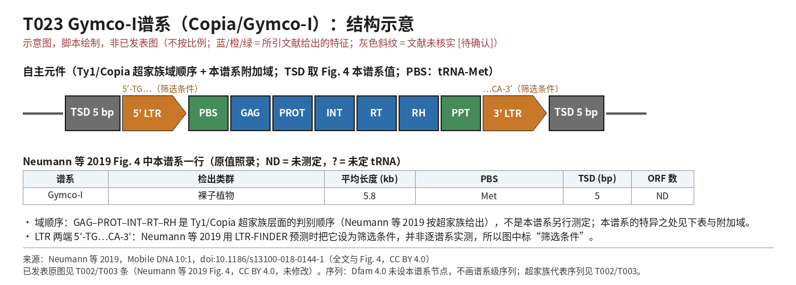

图 T023-1　Gymco-I谱系（Copia/Gymco-I）：结构示意。示意图，脚本绘制，非已发表图；每个特征的来源写在图下方。序列：Dfam 4.0 未设本谱系节点，没有谱系级共识序列；超家族代表序列见 T002/T003。


自主型 Gymco-I 元件具备 5' LTR、内部编码区与 3' LTR 的完整结构，两翼 LTR 末端多保留保守的 5'-TG...CA-3' 反向重复二核苷酸，内部两端具备 PBS 与 PPT（Gymco-I 在裸子植物中的精确全长与单 LTR 长度分布统计待确认）。（见本条“本版补充说明”）

#### TSD

整合进入宿主基因组时在元件两侧形成正向靶位点重复，典型长度为 5 bp（具体变异情况待确认）。

#### 编码蛋白与结构域顺序

自主型 Gymco-I 元件编码 `gag` 与 `pol` 蛋白，严格遵循 Ty1/Copia 超家族的 **GAG - PROT - INT - RT - RH** 结构域排列顺序，不携带 `env` 样开放阅读框（Neumann 等 2019, doi:10.1186/s13100-018-0144-1）。（见本条“本版补充说明”）

#### 转座机制

遵循经典的 LTR 反转录转座子复制粘贴扩增机制：5' LTR 启动子驱动全长 RNA 转录，在胞质病毒样颗粒内借由 PBS 与 PPT 引导反转录合成双链 cDNA，再由整合酶整合至宿主染色体新位点并伴随产生 TSD [待确认]。

#### 自主与非自主搭档

完整编码 `gag-pol` 的拷贝为自主型；在庞大的裸子植物基因组中常伴生大量内部缺失或退化的非自主拷贝及 solo-LTR（Gymco-I 专属非自主搭档研究待确认）。

#### 识别特征与工具

结构从头识别采用 LTRharvest（Ellinghaus 等 2008, doi:10.1186/1471-2105-9-18）、LTR_FINDER（Xu 和 Wang 2007, doi:10.1093/nar/gkm286）、LTR_retriever（Ou 和 Jiang 2018, doi:10.1104/pp.17.01310）与 EDTA（Ou 等 2019, doi:10.1186/s13059-019-1905-y）。将其与其余三个 Gymco 谱系及被子植物 Copia 谱系区分，需使用基于 REXdb 蛋白结构域 HMM 的 TEsorter（Zhang 等 2022, doi:10.1093/hr/uhac017；Neumann 等 2019, doi:10.1186/s13100-018-0144-1）。

#### 分类争议

在 2019 年 REXdb 发布之前，裸子植物中的 Copia 元件常缺乏统一谱系归属而笼统归为未分类 Copia；2019 年基于多结构域建树将其清晰拆分为 Gymco-I 至 Gymco-IV 四个独立谱系，目前在植物转座子分类中得到广泛沿用（Neumann 等 2019, doi:10.1186/s13100-018-0144-1）。

#### 发现与分布

**发现与命名**

- Neumann 等 (2019) Systematic survey of plant LTR-retrotransposons elucidates phylogenetic relationships of their polyprotein domains and provides a reference for element classification. Mobile DNA. doi:10.1186/s13100-018-0144-1。正文原句：“…((Koala, Melmoth, Retrofit) pseudovirus (Melmoth, Retrofit, Hopscotch) Alesia Ale – – Angela Angela – pseudovirus (BARE-1) Bianca Bianca – – Bryco – – – Lyco – – – Gymco-I, II, III, IV – – – Ikeros Angela Tork (Sto-4) pseudovirus (Sto-4) Ivana Ivana Sirevirus/Oryco (Araco, Oryco1–1, Oryco1–2, Poco, Vitico1–1) – Osser – Osser…”；涉及生物：Viridiplantae；支持范围：lineage listed in REXdb Table 1

**植物中的报道**

- Neumann 等 (2019) Systematic survey of plant LTR-retrotransposons elucidates phylogenetic relationships of their polyprotein domains and provides a reference for element classification. Mobile DNA. doi:10.1186/s13100-018-0144-1。同一论文，原句见上；支持范围：REXdb survey of plant LTR retrotransposon lineages

**葡萄中的报道**

- 未检索到葡萄专门报道（检索方式见文末「证据与检索方法」）。这只说明检索没有找到，不能据此推断葡萄基因组中不存在。

#### 本版补充说明

① 域顺序：GAG–PROT–INT–RT–RH（Ty1/Copia）与 GAG–PROT–RT–RH–INT（Ty3/Gypsy）是 Neumann 等 2019（doi:10.1186/s13100-018-0144-1）在超家族层面给出的判别顺序；本条若写某谱系“遵循”该顺序，指的是沿用超家族的顺序，不是该文对本谱系另行测定。

② 末端：5′-TG…CA-3′ 是该文用 LTR-FINDER 预测元件时设定的筛选条件，不是对各谱系的实测统计；本条中“末端保守为 5′-TG…CA-3′”一类说法应按此理解。

③ 该文 Fig. 4 给出本谱系：检出类群 裸子植物；平均长度 5.8 kb；PBS Met；TSD 5 bp；ORF 数 ND（ND 为未测定）。正文中标 [待确认] 的“TSD 典型长度 5 bp”与 Fig. 4 一致。

### T024 Gymco-II谱系（Copia/Gymco-II）

**名称对照**：Wicker 体系：I 类 / LTR 目 / Copia（代码 RLC）；Wicker 不分谱系；Dfam 节点：Ty1-Copia（Dfam 无谱系节点）；REXdb 路径：Class_I/LTR/Ty1/copia/Gymco-II。（来源：代码据 Wu 等 2025, doi:10.3390/biom15030346；Dfam 4.0 分类树，2026-11-23 读取；REXdb v4.0 说明文件，doi:10.5281/zenodo.10160279）

#### 定义与命名

Gymco-II 是 I 类转座子 LTR 目 Ty1/Copia 超家族（RLC）下的独立植物谱系，在 2019 年基于反转录转座子蛋白结构域建立的 REXdb 绿色植物系统分类框架中正式确立，属于裸子植物相关 Copia 谱系之一，规范命名为 `Gymco-II`（Neumann 等 2019, doi:10.1186/s13100-018-0144-1）。在 Dfam 现行分类体系中归入 `LTR/Copia` 节点之下 [待确认]。

#### 结构、长度与末端

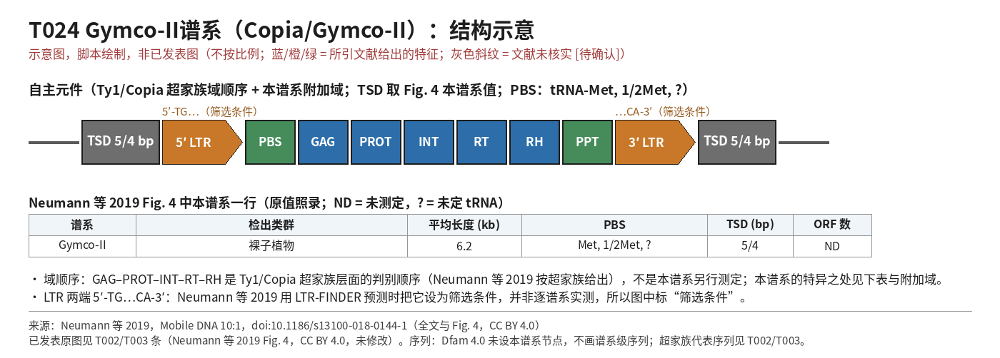

图 T024-1　Gymco-II谱系（Copia/Gymco-II）：结构示意。示意图，脚本绘制，非已发表图；每个特征的来源写在图下方。序列：Dfam 4.0 未设本谱系节点，没有谱系级共识序列；超家族代表序列见 T002/T003。


自主型 Gymco-II 元件由 5' LTR、内部编码区和 3' LTR 构成，两翼 LTR 末端多保留保守的 5'-TG...CA-3' 反向重复二核苷酸，内部两端具备 PBS 与 PPT（Gymco-II 精确全长与单 LTR 长度范围统计待确认）。（见本条“本版补充说明”）

#### TSD

整合进入宿主染色体时在元件两侧形成正向靶位点重复，典型长度为 5 bp（具体变异情况待确认）。

#### 编码蛋白与结构域顺序

自主型 Gymco-II 元件编码 `gag` 与 `pol` 蛋白，严格遵循 Ty1/Copia 超家族的 **GAG - PROT - INT - RT - RH** 结构域排列顺序，不携带 `env` 样开放阅读框（Neumann 等 2019, doi:10.1186/s13100-018-0144-1）。（见本条“本版补充说明”）

#### 转座机制

遵循经典的 LTR 反转录转座子复制粘贴扩增机制：由宿主 RNA 聚合酶 II 从 5' LTR 启动子转录全长 RNA，经胞质病毒样颗粒内以 PBS 和 PPT 为引物完成双链 cDNA 合成，随后由整合酶整合至宿主基因组新位点并产生 TSD [待确认]。

#### 自主与非自主搭档

完整编码 `gag-pol` 的拷贝为自主型；基因组中可伴生内部编码区缺失的非自主衍生物及两翼 LTR 不等同源重组形成的 solo-LTR（Gymco-II 专属非自主搭档研究待确认）。

#### 识别特征与工具

结构从头识别采用 LTRharvest（Ellinghaus 等 2008, doi:10.1186/1471-2105-9-18）、LTR_FINDER（Xu 和 Wang 2007, doi:10.1093/nar/gkm286）、LTR_retriever（Ou 和 Jiang 2018, doi:10.1104/pp.17.01310）与 EDTA（Ou 等 2019, doi:10.1186/s13059-019-1905-y）。谱系级精准分类采用基于 REXdb 蛋白结构域 HMM 的 TEsorter（Zhang 等 2022, doi:10.1093/hr/uhac017；Neumann 等 2019, doi:10.1186/s13100-018-0144-1）。

#### 分类争议

Gymco-II 在 2019 年 REXdb 多结构域系统发育树中独立成支，目前无显著合并或拆分争议，但在裸子植物基因组注释中需通过蛋白域模型与 Gymco-I、Gymco-III、Gymco-IV 严格区分（Neumann 等 2019, doi:10.1186/s13100-018-0144-1）。

#### 发现与分布

**发现与命名**

- Neumann 等 (2019) Systematic survey of plant LTR-retrotransposons elucidates phylogenetic relationships of their polyprotein domains and provides a reference for element classification. Mobile DNA. doi:10.1186/s13100-018-0144-1。正文原句：“…differentiating some groups included the PBS type and the presence of eORFs (Fig. 4 ). PBSs complementary to 1/2tRNA-Met were detected in Osser, Bryco and portion of Gymco-II elements (Additional files 1 and 5 ). Bianca elements had PBSs complementary to the post-transriptionally edited 1/2tRNA-Ile. The first base of this…”；涉及生物：Viridiplantae；支持范围：lineage listed in REXdb Table 1

**植物中的报道**

- Neumann 等 (2019) Systematic survey of plant LTR-retrotransposons elucidates phylogenetic relationships of their polyprotein domains and provides a reference for element classification. Mobile DNA. doi:10.1186/s13100-018-0144-1。同一论文，原句见上；支持范围：REXdb survey of plant LTR retrotransposon lineages

**葡萄中的报道**

- 未检索到葡萄专门报道（检索方式见文末「证据与检索方法」）。这只说明检索没有找到，不能据此推断葡萄基因组中不存在。

#### 本版补充说明

① 域顺序：GAG–PROT–INT–RT–RH（Ty1/Copia）与 GAG–PROT–RT–RH–INT（Ty3/Gypsy）是 Neumann 等 2019（doi:10.1186/s13100-018-0144-1）在超家族层面给出的判别顺序；本条若写某谱系“遵循”该顺序，指的是沿用超家族的顺序，不是该文对本谱系另行测定。

② 末端：5′-TG…CA-3′ 是该文用 LTR-FINDER 预测元件时设定的筛选条件，不是对各谱系的实测统计；本条中“末端保守为 5′-TG…CA-3′”一类说法应按此理解。

③ 该文 Fig. 4 给出本谱系：检出类群 裸子植物；平均长度 6.2 kb；PBS Met, 1/2Met, ?；TSD 5/4 bp；ORF 数 ND（ND 为未测定）。本谱系 TSD 不是单一的 5 bp，正文“典型长度为 5 bp”一类写法以 Fig. 4 为准。

### T025 Gymco-III谱系（Copia/Gymco-III）

**名称对照**：Wicker 体系：I 类 / LTR 目 / Copia（代码 RLC）；Wicker 不分谱系；Dfam 节点：Ty1-Copia（Dfam 无谱系节点）；REXdb 路径：Class_I/LTR/Ty1/copia/Gymco-III。（来源：代码据 Wu 等 2025, doi:10.3390/biom15030346；Dfam 4.0 分类树，2026-11-23 读取；REXdb v4.0 说明文件，doi:10.5281/zenodo.10160279）

#### 定义与命名

Gymco-III 是 I 类转座子 LTR 目 Ty1/Copia 超家族（RLC）下的独立植物谱系，在 2019 年基于反转录转座子蛋白结构域建立的 REXdb 绿色植物系统分类框架中正式确立，属于裸子植物相关 Copia 谱系之一，规范命名为 `Gymco-III`（Neumann 等 2019, doi:10.1186/s13100-018-0144-1）。在 Dfam 现行分类体系中归入 `LTR/Copia` 节点之下 [待确认]。

#### 结构、长度与末端


图 T025-1　Gymco-III谱系（Copia/Gymco-III）：结构示意。示意图，脚本绘制，非已发表图；每个特征的来源写在图下方。序列：Dfam 4.0 未设本谱系节点，没有谱系级共识序列；超家族代表序列见 T002/T003。


自主型 Gymco-III 元件具备 5' LTR、内部编码区与 3' LTR 结构，两翼 LTR 末端多保留保守的 5'-TG...CA-3' 反向重复二核苷酸，内部两端具 PBS 与 PPT（Gymco-III 精确全长与单 LTR 长度范围统计待确认）。（见本条“本版补充说明”）

#### TSD

整合进入宿主染色体时在元件两侧形成正向靶位点重复，典型长度为 5 bp（具体变异情况待确认）。

#### 编码蛋白与结构域顺序

自主型 Gymco-III 元件编码 `gag` 与 `pol` 蛋白，严格遵循 Ty1/Copia 超家族的 **GAG - PROT - INT - RT - RH** 结构域排列顺序，不携带 `env` 样开放阅读框（Neumann 等 2019, doi:10.1186/s13100-018-0144-1）。（见本条“本版补充说明”）

#### 转座机制

遵循经典的 LTR 反转录转座子复制粘贴扩增机制：5' LTR 启动子驱动全长 RNA 转录，在胞质病毒样颗粒内借由 PBS 与 PPT 引导反转录合成双链 cDNA，随后由整合酶整合进入宿主染色体新位点并产生 TSD [待确认]。

#### 自主与非自主搭档

完整编码 `gag-pol` 的拷贝为自主型；基因组中可伴生内部缺失的非自主衍生物及两翼 LTR 不等同源重组形成的 solo-LTR（Gymco-III 专属非自主搭档研究待确认）。

#### 识别特征与工具

结构从头识别采用 LTRharvest（Ellinghaus 等 2008, doi:10.1186/1471-2105-9-18）、LTR_FINDER（Xu 和 Wang 2007, doi:10.1093/nar/gkm286）、LTR_retriever（Ou 和 Jiang 2018, doi:10.1104/pp.17.01310）与 EDTA（Ou 等 2019, doi:10.1186/s13059-019-1905-y）。谱系级精准分类采用基于 REXdb 蛋白结构域 HMM 的 TEsorter（Zhang 等 2022, doi:10.1093/hr/uhac017；Neumann 等 2019, doi:10.1186/s13100-018-0144-1）。

#### 分类争议

Gymco-III 在 2019 年 REXdb 系统发育分类中作为独立单系支确立，目前无显著分类争议（Neumann 等 2019, doi:10.1186/s13100-018-0144-1）。

#### 发现与分布

**发现与命名**

- Neumann 等 (2019) Systematic survey of plant LTR-retrotransposons elucidates phylogenetic relationships of their polyprotein domains and provides a reference for element classification. Mobile DNA. doi:10.1186/s13100-018-0144-1。正文原句：“…((Koala, Melmoth, Retrofit) pseudovirus (Melmoth, Retrofit, Hopscotch) Alesia Ale – – Angela Angela – pseudovirus (BARE-1) Bianca Bianca – – Bryco – – – Lyco – – – Gymco-I, II, III, IV – – – Ikeros Angela Tork (Sto-4) pseudovirus (Sto-4) Ivana Ivana Sirevirus/Oryco (Araco, Oryco1–1, Oryco1–2, Poco, Vitico1–1) – Osser – Osser…”；涉及生物：Viridiplantae；支持范围：lineage listed in REXdb Table 1

**植物中的报道**

- Neumann 等 (2019) Systematic survey of plant LTR-retrotransposons elucidates phylogenetic relationships of their polyprotein domains and provides a reference for element classification. Mobile DNA. doi:10.1186/s13100-018-0144-1。同一论文，原句见上；支持范围：REXdb survey of plant LTR retrotransposon lineages

**葡萄中的报道**

- 未检索到葡萄专门报道（检索方式见文末「证据与检索方法」）。这只说明检索没有找到，不能据此推断葡萄基因组中不存在。

#### 本版补充说明

① 域顺序：GAG–PROT–INT–RT–RH（Ty1/Copia）与 GAG–PROT–RT–RH–INT（Ty3/Gypsy）是 Neumann 等 2019（doi:10.1186/s13100-018-0144-1）在超家族层面给出的判别顺序；本条若写某谱系“遵循”该顺序，指的是沿用超家族的顺序，不是该文对本谱系另行测定。

② 末端：5′-TG…CA-3′ 是该文用 LTR-FINDER 预测元件时设定的筛选条件，不是对各谱系的实测统计；本条中“末端保守为 5′-TG…CA-3′”一类说法应按此理解。

③ 该文 Fig. 4 给出本谱系：检出类群 裸子植物；平均长度 5.0 kb；PBS Leu, Met；TSD 5 bp；ORF 数 ND（ND 为未测定）。正文中标 [待确认] 的“TSD 典型长度 5 bp”与 Fig. 4 一致。

### T026 Gymco-IV谱系（Copia/Gymco-IV）

**名称对照**：Wicker 体系：I 类 / LTR 目 / Copia（代码 RLC）；Wicker 不分谱系；Dfam 节点：Ty1-Copia（Dfam 无谱系节点）；REXdb 路径：Class_I/LTR/Ty1/copia/Gymco-IV。（来源：代码据 Wu 等 2025, doi:10.3390/biom15030346；Dfam 4.0 分类树，2026-11-23 读取；REXdb v4.0 说明文件，doi:10.5281/zenodo.10160279）

#### 定义与命名

Gymco-IV 是 I 类转座子 LTR 目 Ty1/Copia 超家族（RLC）下的独立植物谱系，在 2019 年基于反转录转座子蛋白结构域建立的 REXdb 绿色植物系统分类框架中正式确立，属于裸子植物相关 Copia 谱系之一，规范命名为 `Gymco-IV`（Neumann 等 2019, doi:10.1186/s13100-018-0144-1）。在 Dfam 现行分类体系中归入 `LTR/Copia` 节点之下 [待确认]。

#### 结构、长度与末端

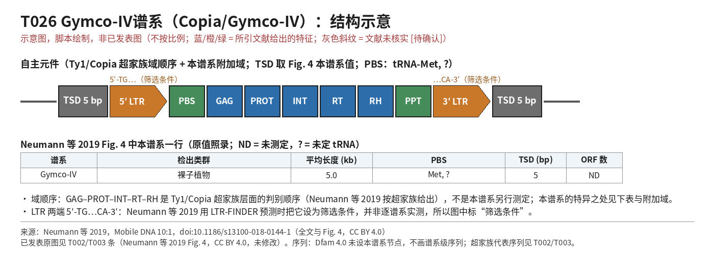

图 T026-1　Gymco-IV谱系（Copia/Gymco-IV）：结构示意。示意图，脚本绘制，非已发表图；每个特征的来源写在图下方。序列：Dfam 4.0 未设本谱系节点，没有谱系级共识序列；超家族代表序列见 T002/T003。


自主型 Gymco-IV 元件具备 5' LTR、内部编码区与 3' LTR 结构，两翼 LTR 末端多保留保守的 5'-TG...CA-3' 反向重复二核苷酸，内部两端具备 PBS 与 PPT（Gymco-IV 精确全长与单 LTR 长度范围统计待确认）。（见本条“本版补充说明”）

#### TSD

整合进入宿主染色体时在元件两侧形成正向靶位点重复，典型长度为 5 bp（具体变异情况待确认）。

#### 编码蛋白与结构域顺序

自主型 Gymco-IV 元件编码 `gag` 与 `pol` 蛋白，严格遵循 Ty1/Copia 超家族的 **GAG - PROT - INT - RT - RH** 结构域排列顺序，不携带 `env` 样开放阅读框（Neumann 等 2019, doi:10.1186/s13100-018-0144-1）。（见本条“本版补充说明”）

#### 转座机制

遵循经典的 LTR 反转录转座子复制粘贴扩增机制：5' LTR 启动子驱动全长 RNA 转录，在胞质病毒样颗粒内借由 PBS 与 PPT 引导反转录合成双链 cDNA，随后由整合酶整合进入宿主染色体新位点并产生 TSD [待确认]。

#### 自主与非自主搭档

完整编码 `gag-pol` 的拷贝为自主型；基因组中可伴生内部编码区缺失的非自主衍生物及两翼 LTR 不等同源重组形成的 solo-LTR（Gymco-IV 专属非自主搭档研究待确认）。

#### 识别特征与工具

结构从头识别采用 LTRharvest（Ellinghaus 等 2008, doi:10.1186/1471-2105-9-18）、LTR_FINDER（Xu 和 Wang 2007, doi:10.1093/nar/gkm286）、LTR_retriever（Ou 和 Jiang 2018, doi:10.1104/pp.17.01310）与 EDTA（Ou 等 2019, doi:10.1186/s13059-019-1905-y）。谱系级精准分类采用基于 REXdb 蛋白结构域 HMM 的 TEsorter（Zhang 等 2022, doi:10.1093/hr/uhac017；Neumann 等 2019, doi:10.1186/s13100-018-0144-1）。

#### 分类争议

Gymco-IV 在 2019 年 REXdb 系统发育分类中作为独立单系支确立，目前无显著分类争议（Neumann 等 2019, doi:10.1186/s13100-018-0144-1）。

#### 发现与分布

**发现与命名**

- Neumann 等 (2019) Systematic survey of plant LTR-retrotransposons elucidates phylogenetic relationships of their polyprotein domains and provides a reference for element classification. Mobile DNA. doi:10.1186/s13100-018-0144-1。正文原句：“…((Koala, Melmoth, Retrofit) pseudovirus (Melmoth, Retrofit, Hopscotch) Alesia Ale – – Angela Angela – pseudovirus (BARE-1) Bianca Bianca – – Bryco – – – Lyco – – – Gymco-I, II, III, IV – – – Ikeros Angela Tork (Sto-4) pseudovirus (Sto-4) Ivana Ivana Sirevirus/Oryco (Araco, Oryco1–1, Oryco1–2, Poco, Vitico1–1) – Osser – Osser…”；涉及生物：Viridiplantae；支持范围：lineage listed in REXdb Table 1

**植物中的报道**

- Neumann 等 (2019) Systematic survey of plant LTR-retrotransposons elucidates phylogenetic relationships of their polyprotein domains and provides a reference for element classification. Mobile DNA. doi:10.1186/s13100-018-0144-1。同一论文，原句见上；支持范围：REXdb survey of plant LTR retrotransposon lineages

**葡萄中的报道**

- 未检索到葡萄专门报道（检索方式见文末「证据与检索方法」）。这只说明检索没有找到，不能据此推断葡萄基因组中不存在。

#### 本版补充说明

① 域顺序：GAG–PROT–INT–RT–RH（Ty1/Copia）与 GAG–PROT–RT–RH–INT（Ty3/Gypsy）是 Neumann 等 2019（doi:10.1186/s13100-018-0144-1）在超家族层面给出的判别顺序；本条若写某谱系“遵循”该顺序，指的是沿用超家族的顺序，不是该文对本谱系另行测定。

② 末端：5′-TG…CA-3′ 是该文用 LTR-FINDER 预测元件时设定的筛选条件，不是对各谱系的实测统计；本条中“末端保守为 5′-TG…CA-3′”一类说法应按此理解。

③ 该文 Fig. 4 给出本谱系：检出类群 裸子植物；平均长度 5.0 kb；PBS Met, ?；TSD 5 bp；ORF 数 ND（ND 为未测定）。正文中标 [待确认] 的“TSD 典型长度 5 bp”与 Fig. 4 一致。

### T027 Alexandra谱系（Copia/Alexandra）

**名称对照**：Wicker 体系：I 类 / LTR 目 / Copia（代码 RLC）；Wicker 不分谱系；Dfam 节点：Ty1-Copia（Dfam 无谱系节点）；REXdb 路径：Class_I/LTR/Ty1/copia/Alexandra。（来源：代码据 Wu 等 2025, doi:10.3390/biom15030346；Dfam 4.0 分类树，2026-11-23 读取；REXdb v4.0 说明文件，doi:10.5281/zenodo.10160279）

#### 定义与命名

Alexandra 是 I 类转座子 LTR 目 Ty1/Copia 超家族（RLC）下在 REXdb Viridiplantae v4.0 版本中新增的植物谱系，规范命名为 `Alexandra`（REXdb v4.0 更新说明及该谱系正式发表出处 DOI 待确认）。在 2019 年发表的 REXdb 原始论文的 16 个 Copia 谱系名单中尚未收录此名 [待确认]。在 Dfam 现行分类体系中归入 `LTR/Copia` 节点之下 [待确认]。

#### 结构、长度与末端

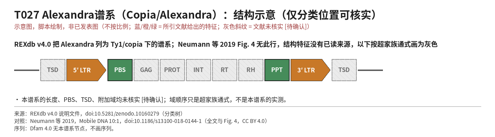

图 T027-1　Alexandra谱系（Copia/Alexandra）：结构示意。示意图，脚本绘制，非已发表图；每个特征的来源写在图下方。序列：Dfam 4.0 未设本谱系节点，没有谱系级共识序列；超家族代表序列见 T002/T003。


作为 Ty1/Copia 超家族成员，自主型 Alexandra 元件遵循 5' LTR、内部编码区与 3' LTR 的三段式骨架，两翼 LTR 末端多为 5'-TG...CA-3'，内部两端具 PBS 与 PPT（Alexandra 谱系特有的全长范围、单 LTR 长度及 PBS 特征待确认）。（见本条“本版补充说明”）

#### TSD

整合进入宿主染色体时预期形成正向靶位点重复，遵循 Ty1/Copia 超家族的典型 5 bp 特征（该谱系实测 TSD 统计待确认）。

#### 编码蛋白与结构域顺序

自主型 Alexandra 元件遵循 Ty1/Copia 超家族的 **GAG - PROT - INT - RT - RH** 结构域排列顺序（是否携带特殊附加结构域或开放阅读框待确认）。（见本条“本版补充说明”）

#### 转座机制

遵循经典的 LTR 反转录转座子复制粘贴扩增机制：由 5' LTR 启动子驱动全长 RNA 转录，在胞质病毒样颗粒内完成双链 cDNA 反转录并由整合酶整合进入宿主染色体新位点（是否存在特殊转录或引发机制待确认）。

#### 自主与非自主搭档

完整携带 `gag-pol` 的拷贝为自主型；基因组中可能存在内部缺失的非自主衍生物及 solo-LTR（具体搭档关系待确认）。

#### 识别特征与工具

结构从头识别采用 LTRharvest（Ellinghaus 等 2008, doi:10.1186/1471-2105-9-18）、LTR_FINDER（Xu 和 Wang 2007, doi:10.1093/nar/gkm286）、LTR_retriever（Ou 和 Jiang 2018, doi:10.1104/pp.17.01310）与 EDTA（Ou 等 2019, doi:10.1186/s13059-019-1905-y）。谱系级鉴定必须使用已更新至 REXdb Viridiplantae v4.0 数据库的 TEsorter 或相应蛋白结构域 HMM 模型，旧版 v3.0 数据库无法检出该谱系标签（Zhang 等 2022, doi:10.1093/hr/uhac017；v4.0 数据库版本细节待确认）。

#### 分类争议

由于 Alexandra 未出现在 2019 年 REXdb 原始论文的 16 谱系名单中，不同版本数据库（v3.0 与 v4.0）的注释结果在跨项目比较时会出现标签不一致 [待确认]；在正式引用该谱系名时，需核对并注明其首次发表文献出处与 REXdb 版本号（待确认）。

#### 发现与分布

**发现与命名**

- (2023) REXdb Viridiplantae database v4.0 (README and classification tree). Zenodo. doi:10.5281/zenodo.10160279。REXdb 分类树原句：“--Alexandra * (REXdb Viridiplantae v4.0 README classification tree; asterisk marks new lineage)”；支持范围：REXdb Viridiplantae v4.0 adds these lineages

**植物中的报道**

- 未检索到已核实的植物报道 [待确认]。

**葡萄中的报道**

- 未检索到葡萄专门报道（检索方式见文末「证据与检索方法」）。这只说明检索没有找到，不能据此推断葡萄基因组中不存在。

#### 本版补充说明

① 域顺序：GAG–PROT–INT–RT–RH（Ty1/Copia）与 GAG–PROT–RT–RH–INT（Ty3/Gypsy）是 Neumann 等 2019（doi:10.1186/s13100-018-0144-1）在超家族层面给出的判别顺序；本条若写某谱系“遵循”该顺序，指的是沿用超家族的顺序，不是该文对本谱系另行测定。

② 末端：5′-TG…CA-3′ 是该文用 LTR-FINDER 预测元件时设定的筛选条件，不是对各谱系的实测统计；本条中“末端保守为 5′-TG…CA-3′”一类说法应按此理解。

③ 该文 Fig. 4 没有本谱系（本谱系见于 REXdb v4.0），长度、PBS、TSD 仍为 [待确认]。

### T028 Ferco谱系（Copia/Ferco）

**名称对照**：Wicker 体系：I 类 / LTR 目 / Copia（代码 RLC）；Wicker 不分谱系；Dfam 节点：Ty1-Copia（Dfam 无谱系节点）；REXdb 路径：Class_I/LTR/Ty1/copia/Ferco。（来源：代码据 Wu 等 2025, doi:10.3390/biom15030346；Dfam 4.0 分类树，2026-11-23 读取；REXdb v4.0 说明文件，doi:10.5281/zenodo.10160279）

#### 定义与命名

Ferco 是 I 类转座子 LTR 目 Ty1/Copia 超家族（RLC）下在 REXdb Viridiplantae v4.0 版本中新增的植物谱系，规范命名为 `Ferco`（REXdb v4.0 更新说明及该谱系正式发表出处 DOI 待确认）。2019 年发表的 REXdb 原始论文的 16 个 Copia 谱系名单中未包含此名 [待确认]。在 Dfam 现行分类体系中归入 `LTR/Copia` 节点之下 [待确认]。

#### 结构、长度与末端

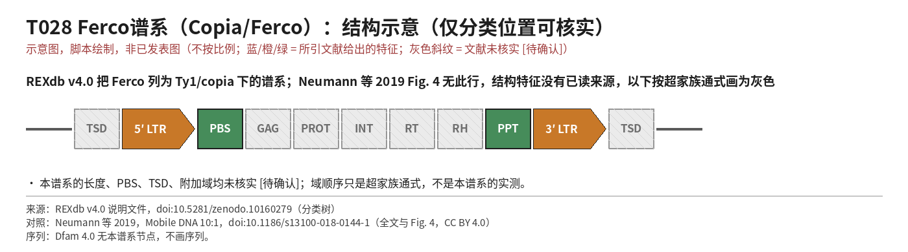

图 T028-1　Ferco谱系（Copia/Ferco）：结构示意。示意图，脚本绘制，非已发表图；每个特征的来源写在图下方。序列：Dfam 4.0 未设本谱系节点，没有谱系级共识序列；超家族代表序列见 T002/T003。


作为 Ty1/Copia 超家族成员，自主型 Ferco 元件遵循 5' LTR、内部编码区与 3' LTR 的三段式骨架，两翼 LTR 末端多为 5'-TG...CA-3'，内部两端具 PBS 与 PPT（Ferco 谱系特有的全长范围、单 LTR 长度及 PBS 特征待确认）。（见本条“本版补充说明”）

#### TSD

整合进入宿主染色体时预期形成正向靶位点重复，遵循 Ty1/Copia 超家族的典型 5 bp 特征（该谱系实测 TSD 统计待确认）。

#### 编码蛋白与结构域顺序

自主型 Ferco 元件遵循 Ty1/Copia 超家族的 **GAG - PROT - INT - RT - RH** 结构域排列顺序（是否携带特殊附加结构域或开放阅读框待确认）。（见本条“本版补充说明”）

#### 转座机制

遵循经典的 LTR 反转录转座子复制粘贴扩增机制：由 5' LTR 启动子驱动全长 RNA 转录，在胞质病毒样颗粒内完成双链 cDNA 反转录并由整合酶整合进入宿主染色体新位点（是否存在特殊转录或引发机制待确认）。

#### 自主与非自主搭档

完整携带 `gag-pol` 的拷贝为自主型；基因组中可能伴生内部缺失的非自主衍生物及 solo-LTR（具体搭档关系待确认）。

#### 识别特征与工具

结构从头识别采用 LTRharvest（Ellinghaus 等 2008, doi:10.1186/1471-2105-9-18）、LTR_FINDER（Xu 和 Wang 2007, doi:10.1093/nar/gkm286）、LTR_retriever（Ou 和 Jiang 2018, doi:10.1104/pp.17.01310）与 EDTA（Ou 等 2019, doi:10.1186/s13059-019-1905-y）。谱系级鉴定必须使用已更新至 REXdb Viridiplantae v4.0 数据库的 TEsorter 或相应蛋白结构域 HMM 模型（Zhang 等 2022, doi:10.1093/hr/uhac017；v4.0 数据库版本细节待确认）。

#### 分类争议

由于 Ferco 未出现在 2019 年 REXdb 原始论文的 16 谱系名单中，在使用不同版本 REXdb 进行跨物种比较时需注意版本差异，并在正式引用前核对原始发表文献出处（待确认）。

#### 发现与分布

**发现与命名**

- (2023) REXdb Viridiplantae database v4.0 (README and classification tree). Zenodo. doi:10.5281/zenodo.10160279。REXdb 分类树原句：“--Ferco     * (REXdb Viridiplantae v4.0 README classification tree; asterisk marks new lineage)”；支持范围：REXdb Viridiplantae v4.0 adds these lineages

**植物中的报道**

- 未检索到已核实的植物报道 [待确认]。

**葡萄中的报道**

- 未检索到葡萄专门报道（检索方式见文末「证据与检索方法」）。这只说明检索没有找到，不能据此推断葡萄基因组中不存在。

#### 本版补充说明

① 域顺序：GAG–PROT–INT–RT–RH（Ty1/Copia）与 GAG–PROT–RT–RH–INT（Ty3/Gypsy）是 Neumann 等 2019（doi:10.1186/s13100-018-0144-1）在超家族层面给出的判别顺序；本条若写某谱系“遵循”该顺序，指的是沿用超家族的顺序，不是该文对本谱系另行测定。

② 末端：5′-TG…CA-3′ 是该文用 LTR-FINDER 预测元件时设定的筛选条件，不是对各谱系的实测统计；本条中“末端保守为 5′-TG…CA-3′”一类说法应按此理解。

③ 该文 Fig. 4 没有本谱系（本谱系见于 REXdb v4.0），长度、PBS、TSD 仍为 [待确认]。

### T029 Bryana谱系（Copia/Bryana）

**名称对照**：Wicker 体系：I 类 / LTR 目 / Copia（代码 RLC）；Wicker 不分谱系；Dfam 节点：Ty1-Copia（Dfam 无谱系节点）；REXdb 路径：Class_I/LTR/Ty1/copia/Bryana。（来源：代码据 Wu 等 2025, doi:10.3390/biom15030346；Dfam 4.0 分类树，2026-11-23 读取；REXdb v4.0 说明文件，doi:10.5281/zenodo.10160279）

#### 定义与命名

Bryana 是 I 类转座子 LTR 目 Ty1/Copia 超家族（RLC）下在 REXdb Viridiplantae v4.0 版本中新增的植物谱系，规范命名为 `Bryana`（REXdb v4.0 更新说明及该谱系正式发表出处 DOI 待确认）。2019 年发表的 REXdb 原始论文的 16 个 Copia 谱系名单中未包含此名 [待确认]。在 Dfam 现行分类体系中归入 `LTR/Copia` 节点之下 [待确认]。

#### 结构、长度与末端

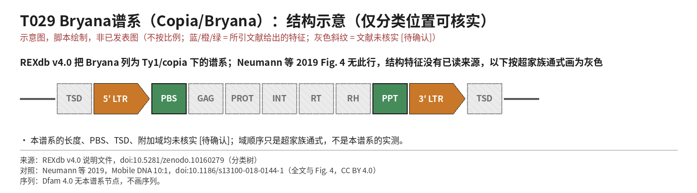

图 T029-1　Bryana谱系（Copia/Bryana）：结构示意。示意图，脚本绘制，非已发表图；每个特征的来源写在图下方。序列：Dfam 4.0 未设本谱系节点，没有谱系级共识序列；超家族代表序列见 T002/T003。


作为 Ty1/Copia 超家族成员，自主型 Bryana 元件遵循 5' LTR、内部编码区与 3' LTR 的三段式骨架，两翼 LTR 末端多为 5'-TG...CA-3'，内部两端具 PBS 与 PPT（Bryana 谱系特有的全长范围、单 LTR 长度及 PBS 特征待确认）。（见本条“本版补充说明”）

#### TSD

整合进入宿主染色体时预期形成正向靶位点重复，遵循 Ty1/Copia 超家族的典型 5 bp 特征（该谱系实测 TSD 统计待确认）。

#### 编码蛋白与结构域顺序

自主型 Bryana 元件遵循 Ty1/Copia 超家族的 **GAG - PROT - INT - RT - RH** 结构域排列顺序（是否携带特殊附加结构域或开放阅读框待确认）。（见本条“本版补充说明”）

#### 转座机制

遵循经典的 LTR 反转录转座子复制粘贴扩增机制：由 5' LTR 启动子驱动全长 RNA 转录，在胞质病毒样颗粒内完成双链 cDNA 反转录并由整合酶整合进入宿主染色体新位点（是否存在特殊转录或引发机制待确认）。

#### 自主与非自主搭档

完整携带 `gag-pol` 的拷贝为自主型；基因组中可能伴生内部缺失的非自主衍生物及 solo-LTR（具体搭档关系待确认）。

#### 识别特征与工具

结构从头识别采用 LTRharvest（Ellinghaus 等 2008, doi:10.1186/1471-2105-9-18）、LTR_FINDER（Xu 和 Wang 2007, doi:10.1093/nar/gkm286）、LTR_retriever（Ou 和 Jiang 2018, doi:10.1104/pp.17.01310）与 EDTA（Ou 等 2019, doi:10.1186/s13059-019-1905-y）。谱系级鉴定必须使用已更新至 REXdb Viridiplantae v4.0 数据库的 TEsorter 或相应蛋白结构域 HMM 模型（Zhang 等 2022, doi:10.1093/hr/uhac017；v4.0 数据库版本细节待确认）。

#### 分类争议

由于 Bryana 未出现在 2019 年 REXdb 原始论文的 16 谱系名单中，在跨项目比较及使用不同版本 REXdb 数据库时需注意与 Bryco 等苔藓相关谱系的版本兼容问题，并在正式引用前核对原始发表文献出处（待确认）。

#### 发现与分布

**发现与命名**

- (2023) REXdb Viridiplantae database v4.0 (README and classification tree). Zenodo. doi:10.5281/zenodo.10160279。REXdb 分类树原句：“--Bryana    * (REXdb Viridiplantae v4.0 README classification tree; asterisk marks new lineage)”；支持范围：REXdb Viridiplantae v4.0 adds these lineages

**植物中的报道**

- 未检索到已核实的植物报道 [待确认]。

**葡萄中的报道**

- 未检索到葡萄专门报道（检索方式见文末「证据与检索方法」）。这只说明检索没有找到，不能据此推断葡萄基因组中不存在。


#### 本版补充说明

① 域顺序：GAG–PROT–INT–RT–RH（Ty1/Copia）与 GAG–PROT–RT–RH–INT（Ty3/Gypsy）是 Neumann 等 2019（doi:10.1186/s13100-018-0144-1）在超家族层面给出的判别顺序；本条若写某谱系“遵循”该顺序，指的是沿用超家族的顺序，不是该文对本谱系另行测定。

② 末端：5′-TG…CA-3′ 是该文用 LTR-FINDER 预测元件时设定的筛选条件，不是对各谱系的实测统计；本条中“末端保守为 5′-TG…CA-3′”一类说法应按此理解。

③ 该文 Fig. 4 没有本谱系（本谱系见于 REXdb v4.0），长度、PBS、TSD 仍为 [待确认]。

## 第四部分　Gypsy 超家族：色质病毒样谱系

### T030 Chlamyvir谱系（Gypsy/Chlamyvir）

**名称对照**：Wicker 体系：I 类 / LTR 目 / Gypsy（代码 RLG）；Wicker 不分谱系；Dfam 节点：Gypsy-ERV;Gypsy（Dfam 无谱系节点）；REXdb 路径：Class_I/LTR/Ty3/gypsy/chromovirus/Chlamyvir。（来源：代码据 Wu 等 2025, doi:10.3390/biom15030346；Dfam 4.0 分类树，2026-11-23 读取；REXdb v4.0 说明文件，doi:10.5281/zenodo.10160279）

#### 定义与命名

Chlamyvir 是 I 类转座子 LTR 目 Ty3/Gypsy 超家族（RLG）染色质病毒支（chromovirus）下的古老植物谱系，在 2019 年基于反转录转座子蛋白结构域建立的 REXdb 绿色植物系统分类框架中正式确立，完整路径常记作 `Gypsy/chromovirus/Chlamyvir`（Neumann 等 2019, doi:10.1186/s13100-018-0144-1）。在 Dfam 现行分类体系中，该类群归入 `LTR/Gypsy` 节点之下 [待确认]。

#### 结构、长度与末端

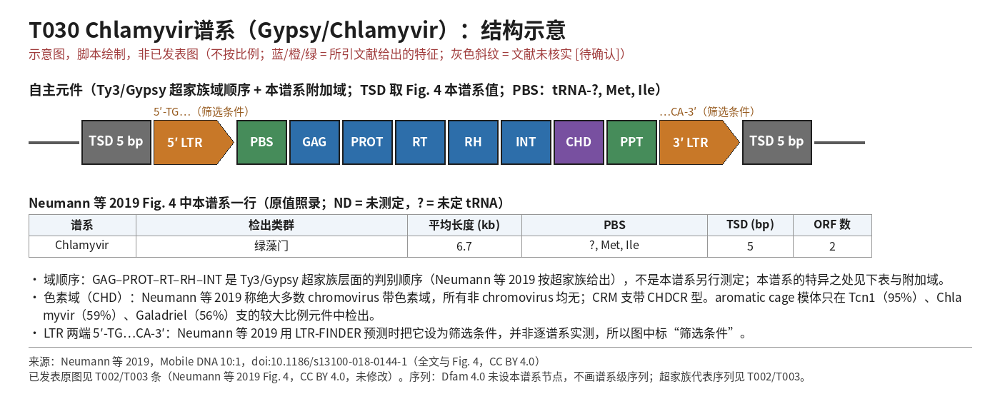

图 T030-1　Chlamyvir谱系（Gypsy/Chlamyvir）：结构示意。示意图，脚本绘制，非已发表图；每个特征的来源写在图下方。序列：Dfam 4.0 未设本谱系节点，没有谱系级共识序列；超家族代表序列见 T002/T003。


自主型 Chlamyvir 元件具备典型 LTR 反转录转座子的 5' LTR、内部编码区与 3' LTR 三段式结构，两翼 LTR 末端多保留保守的 5'-TG...CA-3' 反向重复二核苷酸，内部两端具备引物结合位点（PBS）与多聚嘌呤区（PPT）（Chlamyvir 精确全长与单 LTR 长度分布统计待确认）。（见本条“本版补充说明”）

#### TSD

整合进入宿主基因组时在元件两侧形成正向靶位点重复，遵循 Ty3/Gypsy 超家族的典型 5 bp 特征（该谱系实测变异范围待确认）。

#### 编码蛋白与结构域顺序

自主型 Chlamyvir 元件编码 `gag` 与 `pol` 蛋白，遵循 Ty3/Gypsy 超家族染色质病毒支的标准结构域排列顺序：**GAG - PROT - RT - RH - INT - CHD**（Neumann 等 2019, doi:10.1186/s13100-018-0144-1）。整合酶（INT）C 端携带染色质结构域（chromodomain，CHD），其具体亚型与组蛋白结合特性尚待进一步功能验证（待确认）。（见本条“本版补充说明”）

#### 转座机制

遵循经典的 LTR 反转录转座子复制粘贴扩增机制：由宿主 RNA 聚合酶 II 从 5' LTR 启动子转录全长 RNA，在胞质病毒样颗粒内借由 PBS 与 PPT 引导反转录合成双链 cDNA，随后由整合酶整合进入宿主染色体新位点并伴随产生 TSD [待确认]。

#### 自主与非自主搭档

完整编码 `gag-pol` 的拷贝为自主型；基因组中可伴生内部编码区缺失的非自主衍生物及两翼 LTR 不等同源重组形成的 solo-LTR（Chlamyvir 专属非自主搭档研究待确认）。

#### 识别特征与工具

结构从头识别采用 LTRharvest（Ellinghaus 等 2008, doi:10.1186/1471-2105-9-18）、LTR_FINDER（Xu 和 Wang 2007, doi:10.1093/nar/gkm286）、LTR_retriever（Ou 和 Jiang 2018, doi:10.1104/pp.17.01310）与 EDTA（Ou 等 2019, doi:10.1186/s13059-019-1905-y）。谱系级精准鉴定采用基于 REXdb 蛋白结构域 HMM 模型的 TEsorter（Zhang 等 2022, doi:10.1093/hr/uhac017；Neumann 等 2019, doi:10.1186/s13100-018-0144-1）。

#### 分类争议

Chlamyvir 在 2019 年 REXdb 系统发育分类中作为藻类特异的染色质病毒支谱系确立，分类界限清晰，目前无显著合并或拆分争议（Neumann 等 2019, doi:10.1186/s13100-018-0144-1）。

#### 发现与分布

**发现与命名**

- Gorinsek 等 (2004) Evolutionary genomics of chromoviruses in eukaryotes. Molecular Biology and Evolution. doi:10.1093/molbev/msh057。摘要原句：“The diversity, origin, and evolution of chromoviruses in Eukaryota were examined using the massive amount of genome sequence data for different eukaryotic lineages”；涉及生物：eukaryotes (fungi, plants, animals)；支持范围：chromovirus clades CRM, Chlamyvir, Galadriel, Reina, Del (Tekay) [注意：所引句不含该名称，仅支持上位/总体论断]

**植物中的报道**

- Neumann 等 (2019) Systematic survey of plant LTR-retrotransposons elucidates phylogenetic relationships of their polyprotein domains and provides a reference for element classification. Mobile DNA. doi:10.1186/s13100-018-0144-1。正文原句：“1 ], c [ 75 ] Table 2 Unification of classification of Ty3/gypsy elements REXdb GyDB ICTV other chromovirus|CRM chromoviruses|CRM (Beetle1, CRM) – CRM [ 27 ] chromovirus|Chlamyvir – – Chlamyvir [ 27 ] chromovirus|Galadriel chromoviruses|Galadriel (Galadriel, Monkey, Tntom1) – Galadriel [ 27 ] chromovirus|Tcn1 a only…”；涉及生物：Viridiplantae；支持范围：REXdb survey of plant LTR retrotransposon lineages
- Gorinsek 等 (2004) Evolutionary genomics of chromoviruses in eukaryotes. Molecular Biology and Evolution. doi:10.1093/molbev/msh057。同一论文，原句见上；支持范围：chromoviruses across eukaryotes [注意：所引句不含该名称，仅支持上位/总体论断]

**葡萄中的报道**

- 未检索到葡萄专门报道（检索方式见文末「证据与检索方法」）。这只说明检索没有找到，不能据此推断葡萄基因组中不存在。

#### 本版补充说明

① 域顺序：GAG–PROT–INT–RT–RH（Ty1/Copia）与 GAG–PROT–RT–RH–INT（Ty3/Gypsy）是 Neumann 等 2019（doi:10.1186/s13100-018-0144-1）在超家族层面给出的判别顺序；本条若写某谱系“遵循”该顺序，指的是沿用超家族的顺序，不是该文对本谱系另行测定。

② 末端：5′-TG…CA-3′ 是该文用 LTR-FINDER 预测元件时设定的筛选条件，不是对各谱系的实测统计；本条中“末端保守为 5′-TG…CA-3′”一类说法应按此理解。

③ 该文 Fig. 4 给出本谱系：检出类群 绿藻门；平均长度 6.7 kb；PBS ?, Met, Ile；TSD 5 bp；ORF 数 2（ND 为未测定）。正文中标 [待确认] 的“TSD 典型长度 5 bp”与 Fig. 4 一致。

### T031 Tcn1谱系（Gypsy/Tcn1）

**名称对照**：Wicker 体系：I 类 / LTR 目 / Gypsy（代码 RLG）；Wicker 不分谱系；Dfam 节点：Gypsy-ERV;Gypsy（Dfam 无谱系节点）；REXdb 路径：Class_I/LTR/Ty3/gypsy/chromovirus/Tcn1。（来源：代码据 Wu 等 2025, doi:10.3390/biom15030346；Dfam 4.0 分类树，2026-11-23 读取；REXdb v4.0 说明文件，doi:10.5281/zenodo.10160279）

#### 定义与命名

Tcn1 是 I 类转座子 LTR 目 Ty3/Gypsy 超家族（RLG）染色质病毒支（chromovirus）下的古老谱系，在 2019 年 REXdb 绿色植物系统分类框架中正式收录为独立谱系，完整路径常记作 `Gypsy/chromovirus/Tcn1`（Neumann 等 2019, doi:10.1186/s13100-018-0144-1）。在系统发育上，Tcn1 与真菌中的 Tf1/Sushi 类染色质病毒元件亲缘关系相近（Neumann 等 2019, doi:10.1186/s13100-018-0144-1）。在 Dfam 现行分类体系中归入 `LTR/Gypsy` 节点之下 [待确认]。

#### 结构、长度与末端

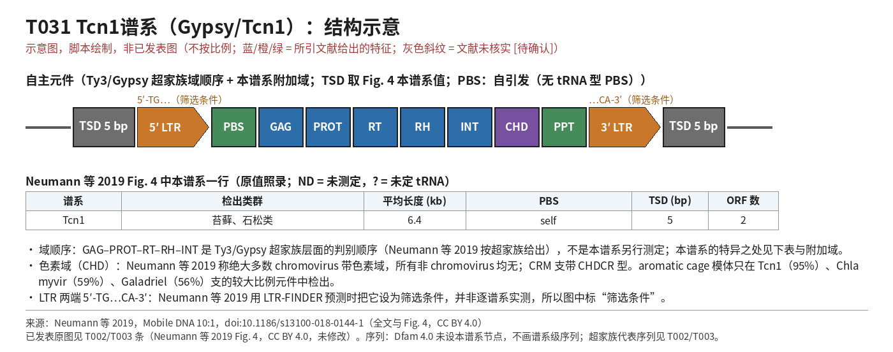

图 T031-1　Tcn1谱系（Gypsy/Tcn1）：结构示意。示意图，脚本绘制，非已发表图；每个特征的来源写在图下方。序列：Dfam 4.0 未设本谱系节点，没有谱系级共识序列；超家族代表序列见 T002/T003。


自主型 Tcn1 元件具备 5' LTR、内部编码区与 3' LTR 的完整结构，两翼 LTR 末端多保留保守的 5'-TG...CA-3' 反向重复二核苷酸，3' LTR 上游具 PPT（精确跨物种全长与单 LTR 长度分布统计待确认）。在负链反转录起始结构方面，2019 年 REXdb 系统研究指出，与近缘的真菌 Tf1 类似，Tcn1 谱系元件常缺乏经典宿主 tRNA 互补 PBS，可能采用自引发（self-priming）机制起始反转录（Neumann 等 2019, doi:10.1186/s13100-018-0144-1）。（见本条“本版补充说明”）

#### TSD

整合进入宿主染色体时在元件两侧形成正向靶位点重复，遵循 Ty3/Gypsy 超家族的典型 5 bp 特征（具体变异情况待确认）。

#### 编码蛋白与结构域顺序

自主型 Tcn1 元件编码 `gag` 与 `pol` 蛋白，遵循 Ty3/Gypsy 超家族染色质病毒支的标准结构域排列顺序：**GAG - PROT - RT - RH - INT - CHD**（Neumann 等 2019, doi:10.1186/s13100-018-0144-1）。其整合酶 C 端携带染色质结构域（CHD）（Neumann 等 2019, doi:10.1186/s13100-018-0144-1）。（见本条“本版补充说明”）

#### 转座机制

遵循 LTR 反转录转座子的复制粘贴扩增机制，经全长 RNA 转录、胞质病毒样颗粒内反转录合成双链 cDNA 及整合酶介导的染色体整合完成扩增 [待确认]。其反转录负链合成可能不依赖宿主 tRNA 引物，而是通过 RNA 转录本自身二级结构折回实现自引发起始（Neumann 等 2019, doi:10.1186/s13100-018-0144-1；植物 Tcn1 自引发机制实验验证文献 DOI 待确认）。

#### 自主与非自主搭档

完整编码 `gag-pol` 的拷贝为自主型；基因组中可伴生内部缺失的非自主衍生物及两翼 LTR 不等同源重组形成的 solo-LTR（Tcn1 专属非自主搭档研究待确认）。

#### 识别特征与工具

结构从头识别采用 LTRharvest（Ellinghaus 等 2008, doi:10.1186/1471-2105-9-18）、LTR_FINDER（Xu 和 Wang 2007, doi:10.1093/nar/gkm286）、LTR_retriever（Ou 和 Jiang 2018, doi:10.1104/pp.17.01310）与 EDTA（Ou 等 2019, doi:10.1186/s13059-019-1905-y）。鉴于其可能采用自引发机制，注释时不可将缺失经典 tRNA-PBS 作为排除依据；谱系级鉴定依赖基于 REXdb 蛋白结构域 HMM 的 TEsorter（Zhang 等 2022, doi:10.1093/hr/uhac017；Neumann 等 2019, doi:10.1186/s13100-018-0144-1）。

#### 分类争议

Tcn1 最早在真菌中被命名，后续在苔藓与石松植物中发现的同源分支在 2019 年 REXdb 框架下沿用 `Tcn1` 谱系名，其跨界分布究竟源于古老垂直遗传还是水平转移仍有演化讨论（Neumann 等 2019, doi:10.1186/s13100-018-0144-1；跨界起源专项研究 DOI 待确认）。

#### 发现与分布

**发现与命名**

- Novikova 等 (2010) Evolutionary genomics revealed interkingdom distribution of Tcn1-like chromodomain-containing Gypsy LTR retrotransposons among fungi and plants. BMC Genomics. doi:10.1186/1471-2164-11-231。摘要原句：“It appeared that one of the clades, namely Tcn1 clade, was present in basidiomycetes and non-seed plants including mosses (Bryophyta) and lycophytes (genus Selaginella).ConclusionsThe interkingdom distribution is not typical for chromodomain-containing LTR retrotransposons clades which are usually very specific for a…”；涉及生物：fungi and plants；支持范围：Tcn1-like chromodomain Gypsy retrotransposons

**植物中的报道**

- Neumann 等 (2019) Systematic survey of plant LTR-retrotransposons elucidates phylogenetic relationships of their polyprotein domains and provides a reference for element classification. Mobile DNA. doi:10.1186/s13100-018-0144-1。正文原句：“…CRM) – CRM [ 27 ] chromovirus|Chlamyvir – – Chlamyvir [ 27 ] chromovirus|Galadriel chromoviruses|Galadriel (Galadriel, Monkey, Tntom1) – Galadriel [ 27 ] chromovirus|Tcn1 a only Tf1/Sushi-related clades of chromoviruses in non-Viridiplantae spp.: Maggy (Maggy, Dane-1), marY1 (marY1), Pyret (Pyret, Cgret, Cft-1, Skippy),…”；涉及生物：Viridiplantae；支持范围：REXdb survey of plant LTR retrotransposon lineages
- Novikova 等 (2010) Evolutionary genomics revealed interkingdom distribution of Tcn1-like chromodomain-containing Gypsy LTR retrotransposons among fungi and plants. BMC Genomics. doi:10.1186/1471-2164-11-231。同一论文，原句见上；支持范围：Tcn1-like elements in plants [注意：所引句不含该名称，仅支持上位/总体论断]

**葡萄中的报道**

- 未检索到葡萄专门报道（检索方式见文末「证据与检索方法」）。这只说明检索没有找到，不能据此推断葡萄基因组中不存在。

#### 本版补充说明

① 域顺序：GAG–PROT–INT–RT–RH（Ty1/Copia）与 GAG–PROT–RT–RH–INT（Ty3/Gypsy）是 Neumann 等 2019（doi:10.1186/s13100-018-0144-1）在超家族层面给出的判别顺序；本条若写某谱系“遵循”该顺序，指的是沿用超家族的顺序，不是该文对本谱系另行测定。

② 末端：5′-TG…CA-3′ 是该文用 LTR-FINDER 预测元件时设定的筛选条件，不是对各谱系的实测统计；本条中“末端保守为 5′-TG…CA-3′”一类说法应按此理解。

③ 该文 Fig. 4 给出本谱系：检出类群 苔藓、石松类；平均长度 6.4 kb；PBS 自引发；TSD 5 bp；ORF 数 2（ND 为未测定）。正文中标 [待确认] 的“TSD 典型长度 5 bp”与 Fig. 4 一致。

### T032 CRM谱系（Gypsy/CRM）

**名称对照**：Wicker 体系：I 类 / LTR 目 / Gypsy（代码 RLG）；Wicker 不分谱系；Dfam 节点：Gypsy-ERV;Gypsy（Dfam 无谱系节点）；REXdb 路径：Class_I/LTR/Ty3/gypsy/chromovirus/CRM。（来源：代码据 Wu 等 2025, doi:10.3390/biom15030346；Dfam 4.0 分类树，2026-11-23 读取；REXdb v4.0 说明文件，doi:10.5281/zenodo.10160279）

#### 定义与命名

CRM（centromeric retrotransposon，简称 CR 或 CRM）是 I 类转座子 LTR 目 Ty3/Gypsy 超家族（RLG）染色质病毒支（chromovirus）下最具代表性的着丝粒偏好谱系，在 2019 年 REXdb 绿色植物系统分类框架中规范命名为 `CRM`（Neumann 等 2019, doi:10.1186/s13100-018-0144-1）。在 Dfam 现行分类体系中归入 `LTR/Gypsy` 节点之下 [待确认]。

#### 结构、长度与末端

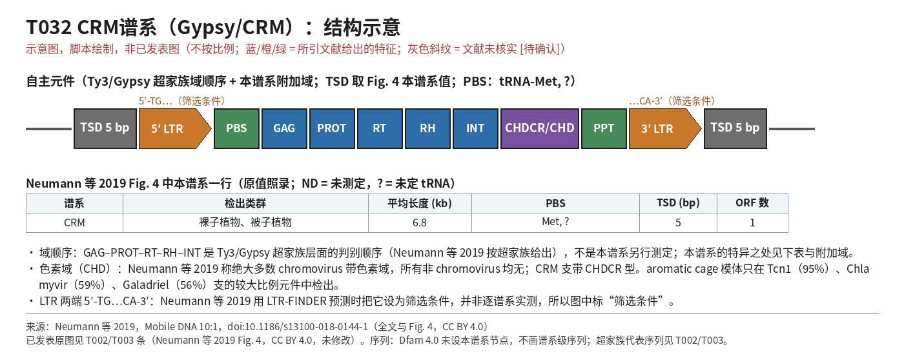

图 T032-1　CRM谱系（Gypsy/CRM）：结构示意。示意图，脚本绘制，非已发表图；每个特征的来源写在图下方。序列：Dfam 4.0 未设本谱系节点，没有谱系级共识序列；超家族代表序列见 T002/T003。

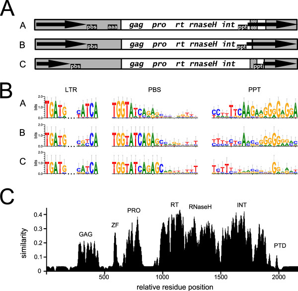

图 T032-P1　植物着丝粒反转录转座子（CRM）各组的结构、LTR 末端序列标志、PBS 与 PPT。原图：Neumann 等（2011），Fig. 4。Plant centromeric retrotransposons: a structural and cytogenetic perspective. Mob DNA. doi:10.1186/1759-8753-2-4。许可：CC BY 2.0（https://creativecommons.org/licenses/by/2.0/）。未修改。


自主型 CRM 元件全长通常在 6 kb 至 9 kb 之间，单个 LTR 长度多在 500 bp 至 1.5 kb 左右（精确跨物种长度分布统计待确认）。完整拷贝两翼具正向重复 LTR，末端保守为 5'-TG...CA-3'，5' LTR 下游具经典 PBS，3' LTR 上游具 PPT [待确认]。（见本条“本版补充说明”）

#### TSD

整合进入宿主基因组时在元件两侧形成正向靶位点重复，典型长度为 5 bp [待确认]。

#### 编码蛋白与结构域顺序

自主型 CRM 元件编码 `gag` 与 `pol` 蛋白，遵循 Ty3/Gypsy 超家族染色质病毒支的经典结构域排列顺序：**GAG - PROT - RT - RH - INT - CHD/CHDCR**（Neumann 等 2019, doi:10.1186/s13100-018-0144-1）。其最核心的分子鉴别特征位于整合酶（INT）C 端：部分 CRM 成员携带特化的着丝粒靶向染色质结构域，称为 **CHDCR**（或 CR 基序），该基序在序列上明显区别于经典芳香族笼（aromatic cage）型染色质结构域，赋予元件特异性识别并定向整合至着丝粒区域的能力（Neumann 等 2019, doi:10.1186/s13100-018-0144-1；CHDCR 发现与功能验证专文 DOI 待确认）。（见本条“本版补充说明”）

#### 转座机制

遵循 LTR 反转录转座子的复制粘贴扩增机制：由 5' LTR 启动子驱动全长 RNA 转录，在胞质病毒样颗粒内借由 PBS 与 PPT 引导反转录合成双链 cDNA，最终由整合酶催化整合进入宿主染色体并产生 5 bp TSD [待确认]。与随机整合不同，携带 CHDCR 基序的 CRM 元件能够定向靶向着丝粒区域，与着丝粒特异性组蛋白 H3 变体（CENH3）及着丝粒串联卫星重复序列交织共存（Neumann 等 2019, doi:10.1186/s13100-018-0144-1）。

#### 自主与非自主搭档

完整编码 `gag-pol` 的拷贝为自主型；在着丝粒与近着丝粒区域，CRM 元件常发生频繁的嵌套插入、内部缺失形成非自主衍生物以及两翼 LTR 不等同源重组产生 solo-LTR [待确认]。

#### 识别特征与工具

结构从头识别采用 LTRharvest（Ellinghaus 等 2008, doi:10.1186/1471-2105-9-18）、LTR_FINDER（Xu 和 Wang 2007, doi:10.1093/nar/gkm286）、LTR_retriever（Ou 和 Jiang 2018, doi:10.1104/pp.17.01310）与 EDTA（Ou 等 2019, doi:10.1186/s13059-019-1905-y）。谱系级鉴定首选基于 REXdb 蛋白结构域 HMM 的 TEsorter，可同步检出整合酶 C 端的 CHDCR 特征域（Zhang 等 2022, doi:10.1093/hr/uhac017；Neumann 等 2019, doi:10.1186/s13100-018-0144-1）。由于 CRM 高度聚集于着丝粒，在短读长草图基因组中极易因组装坍缩而被严重低估，需结合长读长 T2T 组装进行准确评估 [待确认]。

#### 分类争议

早年文献按物种分别命名为 CRR（水稻）、CRM（玉米）、CRW（小麦）等，2019 年 REXdb 系统发育分类统一以 `CRM` 作为跨物种谱系名（Neumann 等 2019, doi:10.1186/s13100-018-0144-1）。此外，并非所有系统发育归属 CRM 谱系的成员都严格局限于着丝粒核心区，部分缺失典型 CHDCR 的分支可分布于近着丝粒区，因此分类归属必须以蛋白结构域系统发育位置而非单纯染色体定位为准（Neumann 等 2019, doi:10.1186/s13100-018-0144-1）。

#### 发现与分布

**发现与命名**

- Gorinsek 等 (2004) Evolutionary genomics of chromoviruses in eukaryotes. Molecular Biology and Evolution. doi:10.1093/molbev/msh057。摘要原句：“The diversity, origin, and evolution of chromoviruses in Eukaryota were examined using the massive amount of genome sequence data for different eukaryotic lineages”；涉及生物：eukaryotes (fungi, plants, animals)；支持范围：chromovirus clades CRM, Chlamyvir, Galadriel, Reina, Del (Tekay) [注意：所引句不含该名称，仅支持上位/总体论断]
- Zhong 等 (2002) Centromeric retroelements and satellites interact with maize kinetochore protein CENH3. The Plant Cell. doi:10.1105/tpc.006106。摘要原句：“Maize centromeres are composed of CentC tandem repeat arrays, centromeric retrotransposons (CRs), and a variety of other repeats”；涉及生物：maize (Zea mays)；支持范围：CRM centromeric retroelement [注意：所引句不含该名称，仅支持上位/总体论断]

**植物中的报道**

- Neumann 等 (2019) Systematic survey of plant LTR-retrotransposons elucidates phylogenetic relationships of their polyprotein domains and provides a reference for element classification. Mobile DNA. doi:10.1186/s13100-018-0144-1。正文原句：“…Osser and Tork (Table 1 ). Ty3/gypsy elements in plants were found to belong to two major lineages, chromovirus and Tat/Athila, the former composed of the Del, Reina, CRM and Galadriel clades, the latter of the Tat and Athila clades (Table 2 ). Wicker and Keller [ 24 ] examined 599 Ty1/copia elements from barley, wheat, rice…”；涉及生物：Viridiplantae；支持范围：REXdb survey of plant LTR retrotransposon lineages
- Zhong 等 (2002) Centromeric retroelements and satellites interact with maize kinetochore protein CENH3. The Plant Cell. doi:10.1105/tpc.006106。同一论文，原句见上；支持范围：CRM centromeric retroelement [注意：所引句不含该名称，仅支持上位/总体论断]
- Neumann 等 (2011) Plant centromeric retrotransposons: a structural and cytogenetic perspective. Mobile DNA. doi:10.1186/1759-8753-2-4。摘要原句：“BackgroundThe centromeric and pericentromeric regions of plant chromosomes are colonized by Ty3/gypsy retrotransposons, which, on the basis of their reverse transcriptase sequences, form the chromovirus CRM clade”
- Sharma 和 Presting (2014) Evolution of centromeric retrotransposons in grasses. Genome Biology and Evolution. doi:10.1093/gbe/evu096。摘要原句：“Centromeric retrotransposons (CRs) constitute a family of plant retroelements, some of which have the ability to target their insertion almost exclusively to the functional centromeres”；涉及生物：grasses；支持范围：CRM evolution in grasses [注意：所引句不含该名称，仅支持上位/总体论断]
- Gorinsek 等 (2004) Evolutionary genomics of chromoviruses in eukaryotes. Molecular Biology and Evolution. doi:10.1093/molbev/msh057。同一论文，原句见上；支持范围：chromoviruses across eukaryotes [注意：所引句不含该名称，仅支持上位/总体论断]

**葡萄中的报道**

- Park 等 (2021) Horizontal Transfer of LTR Retrotransposons Contributes to the Genome Diversity of Vitis. International Journal of Molecular Sciences. doi:10.3390/ijms221910446。正文原句：“In the Gypsy superfamily, a total of eight families were identified, but only CRM and Reina contained horizontally transferred elements ( Figure 5 e)”；涉及生物：Vitis；支持范围：horizontal transfer of LTR retrotransposons; Tork, CRM, Reina, Athila, Tat families in four Vitis genomes

#### 本版补充说明

① 域顺序：GAG–PROT–INT–RT–RH（Ty1/Copia）与 GAG–PROT–RT–RH–INT（Ty3/Gypsy）是 Neumann 等 2019（doi:10.1186/s13100-018-0144-1）在超家族层面给出的判别顺序；本条若写某谱系“遵循”该顺序，指的是沿用超家族的顺序，不是该文对本谱系另行测定。

② 末端：5′-TG…CA-3′ 是该文用 LTR-FINDER 预测元件时设定的筛选条件，不是对各谱系的实测统计；本条中“末端保守为 5′-TG…CA-3′”一类说法应按此理解。

③ 该文 Fig. 4 给出本谱系：检出类群 裸子植物、被子植物；平均长度 6.8 kb；PBS Met, ?；TSD 5 bp；ORF 数 1（ND 为未测定）。正文中标 [待确认] 的“TSD 典型长度 5 bp”与 Fig. 4 一致。

### T033 Galadriel谱系（Gypsy/Galadriel）

**名称对照**：Wicker 体系：I 类 / LTR 目 / Gypsy（代码 RLG）；Wicker 不分谱系；Dfam 节点：Gypsy-ERV;Gypsy（Dfam 无谱系节点）；REXdb 路径：Class_I/LTR/Ty3/gypsy/chromovirus/Galadriel。（来源：代码据 Wu 等 2025, doi:10.3390/biom15030346；Dfam 4.0 分类树，2026-11-23 读取；REXdb v4.0 说明文件，doi:10.5281/zenodo.10160279）

#### 定义与命名

Galadriel 是 I 类转座子 LTR 目 Ty3/Gypsy 超家族（RLG）染色质病毒支（chromovirus）下的独立植物谱系，在 2019 年 REXdb 绿色植物系统分类框架中规范命名为 `Galadriel`（Neumann 等 2019, doi:10.1186/s13100-018-0144-1）。在 Dfam 现行分类体系中归入 `LTR/Gypsy` 节点之下 [待确认]。

#### 结构、长度与末端

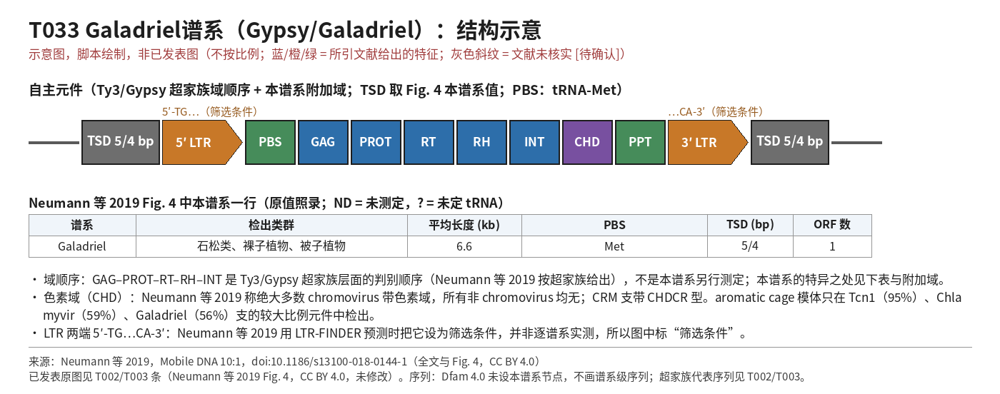

图 T033-1　Galadriel谱系（Gypsy/Galadriel）：结构示意。示意图，脚本绘制，非已发表图；每个特征的来源写在图下方。序列：Dfam 4.0 未设本谱系节点，没有谱系级共识序列；超家族代表序列见 T002/T003。


自主型 Galadriel 元件全长多在 5.5 kb 至 8 kb 之间，单个 LTR 长度通常为数百 bp 至约 1 kb（精确跨物种长度分布统计待确认）。完整拷贝两翼具正向重复 LTR，末端保守为 5'-TG...CA-3'，5' LTR 下游具经典 PBS，3' LTR 上游具 PPT [待确认]。（见本条“本版补充说明”）

#### TSD

整合进入宿主基因组时在元件两侧形成正向靶位点重复，典型长度为 5 bp [待确认]。

#### 编码蛋白与结构域顺序

自主型 Galadriel 元件编码 `gag` 与 `pol` 蛋白，遵循 Ty3/Gypsy 超家族染色质病毒支的标准结构域排列顺序：**GAG - PROT - RT - RH - INT - CHD**（Neumann 等 2019, doi:10.1186/s13100-018-0144-1）。2019 年 REXdb 系统研究指出，部分 Galadriel 成员的整合酶 C 端携带经典的芳香族笼（aromatic cage）型染色质结构域（CHD），该结构域由保守的芳香族氨基酸残基构成，可识别特定组蛋白甲基化修饰（Neumann 等 2019, doi:10.1186/s13100-018-0144-1）。（见本条“本版补充说明”）

#### 转座机制

遵循经典的 LTR 反转录转座子复制粘贴扩增机制：由宿主 RNA 聚合酶 II 从 5' LTR 启动子转录全长 RNA，在胞质病毒样颗粒内借由 PBS 与 PPT 引导反转录合成双链 cDNA，随后由整合酶催化整合至宿主染色体新位点并伴随产生 5 bp TSD [待确认]。整合酶 C 端的芳香族笼型染色质结构域可能参与引导元件向特定染色质环境整合（Neumann 等 2019, doi:10.1186/s13100-018-0144-1）。

#### 自主与非自主搭档

完整编码 `gag-pol` 的拷贝为自主型；基因组中可伴生内部编码区缺失的非自主衍生物及两翼 LTR 不等同源重组形成的 solo-LTR（Galadriel 专属非自主搭档研究待确认）。

#### 识别特征与工具

结构从头识别采用 LTRharvest（Ellinghaus 等 2008, doi:10.1186/1471-2105-9-18）、LTR_FINDER（Xu 和 Wang 2007, doi:10.1093/nar/gkm286）、LTR_retriever（Ou 和 Jiang 2018, doi:10.1104/pp.17.01310）与 EDTA（Ou 等 2019, doi:10.1186/s13059-019-1905-y）。谱系级精准分类采用基于 REXdb 蛋白结构域 HMM 的 TEsorter（Zhang 等 2022, doi:10.1093/hr/uhac017；Neumann 等 2019, doi:10.1186/s13100-018-0144-1）。

#### 分类争议

Galadriel 在 2019 年 REXdb 系统发育分类中作为染色质病毒支的独立谱系地位明确，目前无显著合并或拆分争议（Neumann 等 2019, doi:10.1186/s13100-018-0144-1）。

#### 发现与分布

**发现与命名**

- Gorinsek 等 (2004) Evolutionary genomics of chromoviruses in eukaryotes. Molecular Biology and Evolution. doi:10.1093/molbev/msh057。摘要原句：“The diversity, origin, and evolution of chromoviruses in Eukaryota were examined using the massive amount of genome sequence data for different eukaryotic lineages”；涉及生物：eukaryotes (fungi, plants, animals)；支持范围：chromovirus clades CRM, Chlamyvir, Galadriel, Reina, Del (Tekay) [注意：所引句不含该名称，仅支持上位/总体论断]

**植物中的报道**

- Neumann 等 (2019) Systematic survey of plant LTR-retrotransposons elucidates phylogenetic relationships of their polyprotein domains and provides a reference for element classification. Mobile DNA. doi:10.1186/s13100-018-0144-1。正文原句：“…Tork (Table 1 ). Ty3/gypsy elements in plants were found to belong to two major lineages, chromovirus and Tat/Athila, the former composed of the Del, Reina, CRM and Galadriel clades, the latter of the Tat and Athila clades (Table 2 ). Wicker and Keller [ 24 ] examined 599 Ty1/copia elements from barley, wheat, rice and…”；涉及生物：Viridiplantae；支持范围：REXdb survey of plant LTR retrotransposon lineages
- Gorinsek 等 (2004) Evolutionary genomics of chromoviruses in eukaryotes. Molecular Biology and Evolution. doi:10.1093/molbev/msh057。同一论文，原句见上；支持范围：chromoviruses across eukaryotes [注意：所引句不含该名称，仅支持上位/总体论断]

**葡萄中的报道**

- 未检索到葡萄专门报道（检索方式见文末「证据与检索方法」）。这只说明检索没有找到，不能据此推断葡萄基因组中不存在。

#### 本版补充说明

① 域顺序：GAG–PROT–INT–RT–RH（Ty1/Copia）与 GAG–PROT–RT–RH–INT（Ty3/Gypsy）是 Neumann 等 2019（doi:10.1186/s13100-018-0144-1）在超家族层面给出的判别顺序；本条若写某谱系“遵循”该顺序，指的是沿用超家族的顺序，不是该文对本谱系另行测定。

② 末端：5′-TG…CA-3′ 是该文用 LTR-FINDER 预测元件时设定的筛选条件，不是对各谱系的实测统计；本条中“末端保守为 5′-TG…CA-3′”一类说法应按此理解。

③ 该文 Fig. 4 给出本谱系：检出类群 石松类、裸子植物、被子植物；平均长度 6.6 kb；PBS Met；TSD 5/4 bp；ORF 数 1（ND 为未测定）。本谱系 TSD 不是单一的 5 bp，正文“典型长度为 5 bp”一类写法以 Fig. 4 为准。

### T034 Tekay谱系（Gypsy/Tekay）

**名称对照**：Wicker 体系：I 类 / LTR 目 / Gypsy（代码 RLG）；Wicker 不分谱系；Dfam 节点：Gypsy-ERV;Gypsy（Dfam 无谱系节点）；REXdb 路径：Class_I/LTR/Ty3/gypsy/chromovirus/Tekay。（来源：代码据 Wu 等 2025, doi:10.3390/biom15030346；Dfam 4.0 分类树，2026-11-23 读取；REXdb v4.0 说明文件，doi:10.5281/zenodo.10160279）

#### 定义与命名

Tekay 是 I 类转座子 LTR 目 Ty3/Gypsy 超家族（RLG）染色质病毒支（chromovirus）下的种子植物主干谱系之一，在 2019 年 REXdb 绿色植物系统分类框架中规范命名为 `Tekay`（Neumann 等 2019, doi:10.1186/s13100-018-0144-1）。在早期植物转座子分类文献中，该谱系常被称为 `Del`（以百合中的 Del1 元件命名，具体对应关系在 2019 年 REXdb 框架下统一归入 Tekay）（Neumann 等 2019, doi:10.1186/s13100-018-0144-1；Del 原始命名专文 DOI 待确认）。在 Dfam 现行分类体系中归入 `LTR/Gypsy` 节点之下 [待确认]。

#### 结构、长度与末端


图 T034-1　Tekay谱系（Gypsy/Tekay）：结构示意。示意图，脚本绘制，非已发表图；每个特征的来源写在图下方。序列：Dfam 4.0 未设本谱系节点，没有谱系级共识序列；超家族代表序列见 T002/T003。


Tekay 是染色质病毒支中尺寸偏大的谱系，自主型元件全长通常在 8 kb 至 13 kb 之间，单个 LTR 长度较长，常在 1 kb 至 3 kb 左右（精确跨物种极值统计待确认）。完整拷贝两翼具正向重复 LTR，末端保守为 5'-TG...CA-3'，5' LTR 下游具经典 PBS，3' LTR 上游具 PPT [待确认]。（见本条“本版补充说明”）

#### TSD

整合进入宿主基因组时在元件两侧形成正向靶位点重复，典型长度为 5 bp [待确认]。

#### 编码蛋白与结构域顺序

自主型 Tekay 元件编码 `gag` 与 `pol` 蛋白，遵循 Ty3/Gypsy 超家族染色质病毒支的标准结构域排列顺序：**GAG - PROT - RT - RH - INT - CHD**（Neumann 等 2019, doi:10.1186/s13100-018-0144-1）。其整合酶 C 端携带染色质结构域（CHD）（Neumann 等 2019, doi:10.1186/s13100-018-0144-1）。（见本条“本版补充说明”）

#### 转座机制

遵循经典的 LTR 反转录转座子复制粘贴扩增机制：5' LTR 启动子驱动全长 RNA 转录，在胞质病毒样颗粒内借由 PBS 与 PPT 引导反转录合成双链 cDNA，随后由整合酶整合进入宿主染色体新位点并伴随产生 5 bp TSD [待确认]。借助染色质结构域，Tekay 元件倾向于在异染色质区与近着丝粒区富集整合，降低对常染色质功能基因的破坏风险（Neumann 等 2019, doi:10.1186/s13100-018-0144-1）。

#### 自主与非自主搭档

完整编码 `gag-pol` 的拷贝为自主型；由于 Tekay 拷贝数庞大且单个 LTR 较长，宿主基因组中普遍存在大量内部缺失的非自主衍生物、嵌套插入体以及两翼 LTR 不等同源重组形成的 solo-LTR [待确认]。

#### 识别特征与工具

结构从头识别采用 LTRharvest（Ellinghaus 等 2008, doi:10.1186/1471-2105-9-18）、LTR_FINDER（Xu 和 Wang 2007, doi:10.1093/nar/gkm286）、LTR_retriever（Ou 和 Jiang 2018, doi:10.1104/pp.17.01310）与 EDTA（Ou 等 2019, doi:10.1186/s13059-019-1905-y）。谱系级精准分类采用基于 REXdb 蛋白结构域 HMM 的 TEsorter（Zhang 等 2022, doi:10.1093/hr/uhac017；Neumann 等 2019, doi:10.1186/s13100-018-0144-1）。

#### 分类争议

主要历史分歧在于旧名 `Del` 与现行规范名 `Tekay` 的对应关系：早期文献多用 `Del` 指代该谱系，2019 年 REXdb 系统分类统一规范为 `Tekay`，在跨文献整合与数据比较时需将历史注释中的 `Del` 映射至 `Tekay`（Neumann 等 2019, doi:10.1186/s13100-018-0144-1）。

#### 发现与分布

**发现与命名**

- Gorinsek 等 (2004) Evolutionary genomics of chromoviruses in eukaryotes. Molecular Biology and Evolution. doi:10.1093/molbev/msh057。摘要原句：“The diversity, origin, and evolution of chromoviruses in Eukaryota were examined using the massive amount of genome sequence data for different eukaryotic lineages”；涉及生物：eukaryotes (fungi, plants, animals)；支持范围：chromovirus clades CRM, Chlamyvir, Galadriel, Reina, Del (Tekay) [注意：所引句不含该名称，仅支持上位/总体论断]
- Neumann 等 (2019) Systematic survey of plant LTR-retrotransposons elucidates phylogenetic relationships of their polyprotein domains and provides a reference for element classification. Mobile DNA. doi:10.1186/s13100-018-0144-1。正文原句：“…(TF1), V-clade (Amn-ichi, Amn-ni, Amn-san, Sushi-ichi) – Tcn1 [ 27 , 31 ] chromovirus|Reina chromoviruses|Reina (Reina, Gloin, Gimli, Ifg7) – Reina [ 27 ] chromovirus|Tekay chromoviruses|Del (Del, Bagy-1, Legolas, Peabody, Retrosat-2) Metavirus (Del1) Tekay [ 27 ] non-chromovirus|OTA|Athila Athila/Tat|Athila (Athila4–1,…”；涉及生物：Viridiplantae；支持范围：Tekay listed as REXdb name (Table 2, Del clade)

**植物中的报道**

- Neumann 等 (2019) Systematic survey of plant LTR-retrotransposons elucidates phylogenetic relationships of their polyprotein domains and provides a reference for element classification. Mobile DNA. doi:10.1186/s13100-018-0144-1。同一论文，原句见上；支持范围：REXdb survey of plant LTR retrotransposon lineages
- Gorinsek 等 (2004) Evolutionary genomics of chromoviruses in eukaryotes. Molecular Biology and Evolution. doi:10.1093/molbev/msh057。同一论文，原句见上；支持范围：chromoviruses across eukaryotes [注意：所引句不含该名称，仅支持上位/总体论断]

**葡萄中的报道**

- 未检索到葡萄专门报道（检索方式见文末「证据与检索方法」）。这只说明检索没有找到，不能据此推断葡萄基因组中不存在。

#### 本版补充说明

① 域顺序：GAG–PROT–INT–RT–RH（Ty1/Copia）与 GAG–PROT–RT–RH–INT（Ty3/Gypsy）是 Neumann 等 2019（doi:10.1186/s13100-018-0144-1）在超家族层面给出的判别顺序；本条若写某谱系“遵循”该顺序，指的是沿用超家族的顺序，不是该文对本谱系另行测定。

② 末端：5′-TG…CA-3′ 是该文用 LTR-FINDER 预测元件时设定的筛选条件，不是对各谱系的实测统计；本条中“末端保守为 5′-TG…CA-3′”一类说法应按此理解。

③ 该文 Fig. 4 给出本谱系：检出类群 裸子植物、被子植物；平均长度 11.5 kb；PBS Met, ?, Ile；TSD 5 bp；ORF 数 1（ND 为未测定）。正文中标 [待确认] 的“TSD 典型长度 5 bp”与 Fig. 4 一致。

### T035 Reina谱系（Gypsy/Reina）

**名称对照**：Wicker 体系：I 类 / LTR 目 / Gypsy（代码 RLG）；Wicker 不分谱系；Dfam 节点：Gypsy-ERV;Gypsy（Dfam 无谱系节点）；REXdb 路径：Class_I/LTR/Ty3/gypsy/chromovirus/Reina。（来源：代码据 Wu 等 2025, doi:10.3390/biom15030346；Dfam 4.0 分类树，2026-11-23 读取；REXdb v4.0 说明文件，doi:10.5281/zenodo.10160279）

#### 定义与命名

Reina 是 I 类转座子 LTR 目 Ty3/Gypsy 超家族（RLG）染色质病毒支（chromovirus）下的独立种子植物谱系，在 2019 年 REXdb 绿色植物系统分类框架中规范命名为 `Reina`（Neumann 等 2019, doi:10.1186/s13100-018-0144-1）。在 Dfam 现行分类体系中归入 `LTR/Gypsy` 节点之下 [待确认]。

#### 结构、长度与末端

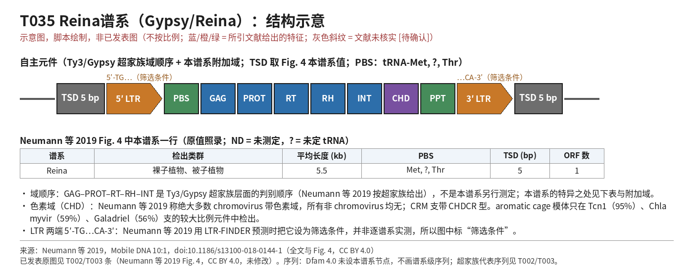

图 T035-1　Reina谱系（Gypsy/Reina）：结构示意。示意图，脚本绘制，非已发表图；每个特征的来源写在图下方。序列：Dfam 4.0 未设本谱系节点，没有谱系级共识序列；超家族代表序列见 T002/T003。


Reina 属于染色质病毒支中结构相对紧凑的谱系，自主型元件全长多在 5 kb 至 6.5 kb 之间，整体尺寸明显短于同支的 Tekay 谱系，单个 LTR 长度一般较短，多集中在 300 bp 至 600 bp 左右（精确跨物种极值统计待确认）。完整拷贝两翼具正向重复 LTR，末端保守为 5'-TG...CA-3'，5' LTR 下游具经典 PBS，3' LTR 上游具 PPT [待确认]。（见本条“本版补充说明”）

#### TSD

整合进入宿主基因组时在元件两侧形成正向靶位点重复，典型长度为 5 bp [待确认]。

#### 编码蛋白与结构域顺序

自主型 Reina 元件编码 `gag` 与 `pol` 蛋白，遵循 Ty3/Gypsy 超家族染色质病毒支的标准结构域排列顺序：**GAG - PROT - RT - RH - INT - CHD**（Neumann 等 2019, doi:10.1186/s13100-018-0144-1）。其整合酶 C 端携带染色质结构域（CHD）（Neumann 等 2019, doi:10.1186/s13100-018-0144-1）。（见本条“本版补充说明”）

#### 转座机制

遵循经典的 LTR 反转录转座子复制粘贴扩增机制：5' LTR 启动子驱动全长 RNA 转录，在胞质病毒样颗粒内借由 PBS 与 PPT 引导反转录合成双链 cDNA，随后由整合酶整合至宿主染色体新位点并伴随产生 5 bp TSD [待确认]。

#### 自主与非自主搭档

完整编码 `gag-pol` 的拷贝为自主型；基因组中同时存在内部缺失的非自主衍生物及两翼 LTR 不等同源重组形成的 solo-LTR（Reina 专属非自主搭档研究待确认）。

#### 识别特征与工具

结构从头识别采用 LTRharvest（Ellinghaus 等 2008, doi:10.1186/1471-2105-9-18）、LTR_FINDER（Xu 和 Wang 2007, doi:10.1093/nar/gkm286）、LTR_retriever（Ou 和 Jiang 2018, doi:10.1104/pp.17.01310）与 EDTA（Ou 等 2019, doi:10.1186/s13059-019-1905-y）。谱系级精准分类采用基于 REXdb 蛋白结构域 HMM 的 TEsorter（Zhang 等 2022, doi:10.1093/hr/uhac017；Neumann 等 2019, doi:10.1186/s13100-018-0144-1）。

#### 分类争议

Reina 在 2019 年 REXdb 系统发育分类中作为种子植物染色质病毒支的独立谱系地位明确，目前无显著合并或拆分争议（Neumann 等 2019, doi:10.1186/s13100-018-0144-1）。

#### 发现与分布

**发现与命名**

- Gorinsek 等 (2004) Evolutionary genomics of chromoviruses in eukaryotes. Molecular Biology and Evolution. doi:10.1093/molbev/msh057。摘要原句：“The diversity, origin, and evolution of chromoviruses in Eukaryota were examined using the massive amount of genome sequence data for different eukaryotic lineages”；涉及生物：eukaryotes (fungi, plants, animals)；支持范围：chromovirus clades CRM, Chlamyvir, Galadriel, Reina, Del (Tekay) [注意：所引句不含该名称，仅支持上位/总体论断]

**植物中的报道**

- Neumann 等 (2019) Systematic survey of plant LTR-retrotransposons elucidates phylogenetic relationships of their polyprotein domains and provides a reference for element classification. Mobile DNA. doi:10.1186/s13100-018-0144-1。正文原句：“Retrofit, Osser and Tork (Table 1 ). Ty3/gypsy elements in plants were found to belong to two major lineages, chromovirus and Tat/Athila, the former composed of the Del, Reina, CRM and Galadriel clades, the latter of the Tat and Athila clades (Table 2 ). Wicker and Keller [ 24 ] examined 599 Ty1/copia elements from barley,…”；涉及生物：Viridiplantae；支持范围：REXdb survey of plant LTR retrotransposon lineages
- Gorinsek 等 (2004) Evolutionary genomics of chromoviruses in eukaryotes. Molecular Biology and Evolution. doi:10.1093/molbev/msh057。同一论文，原句见上；支持范围：chromoviruses across eukaryotes [注意：所引句不含该名称，仅支持上位/总体论断]

**葡萄中的报道**

- Park 等 (2021) Horizontal Transfer of LTR Retrotransposons Contributes to the Genome Diversity of Vitis. International Journal of Molecular Sciences. doi:10.3390/ijms221910446。正文原句：“In the Gypsy superfamily, a total of eight families were identified, but only CRM and Reina contained horizontally transferred elements ( Figure 5 e)”；涉及生物：Vitis；支持范围：horizontal transfer of LTR retrotransposons; Tork, CRM, Reina, Athila, Tat families in four Vitis genomes

#### 本版补充说明

① 域顺序：GAG–PROT–INT–RT–RH（Ty1/Copia）与 GAG–PROT–RT–RH–INT（Ty3/Gypsy）是 Neumann 等 2019（doi:10.1186/s13100-018-0144-1）在超家族层面给出的判别顺序；本条若写某谱系“遵循”该顺序，指的是沿用超家族的顺序，不是该文对本谱系另行测定。

② 末端：5′-TG…CA-3′ 是该文用 LTR-FINDER 预测元件时设定的筛选条件，不是对各谱系的实测统计；本条中“末端保守为 5′-TG…CA-3′”一类说法应按此理解。

③ 该文 Fig. 4 给出本谱系：检出类群 裸子植物、被子植物；平均长度 5.5 kb；PBS Met, ?, Thr；TSD 5 bp；ORF 数 1（ND 为未测定）。正文中标 [待确认] 的“TSD 典型长度 5 bp”与 Fig. 4 一致。

### T036 Ferney谱系（Gypsy/Ferney）

**名称对照**：Wicker 体系：I 类 / LTR 目 / Gypsy（代码 RLG）；Wicker 不分谱系；Dfam 节点：Gypsy-ERV;Gypsy（Dfam 无谱系节点）；REXdb 路径：Class_I/LTR/Ty3/gypsy/chromovirus/Ferney。（来源：代码据 Wu 等 2025, doi:10.3390/biom15030346；Dfam 4.0 分类树，2026-11-23 读取；REXdb v4.0 说明文件，doi:10.5281/zenodo.10160279）

#### 定义与命名

Ferney 是 I 类转座子 LTR 目 Ty3/Gypsy 超家族（RLG）染色质病毒支（chromovirus）下在 REXdb Viridiplantae v4.0 版本中新增的植物谱系，规范命名为 `Ferney`（REXdb v4.0 更新说明及该谱系正式发表出处 DOI 待确认）。在 2019 年发表的 REXdb 原始论文的 Gypsy 谱系名单中尚未收录此名 [待确认]。在 Dfam 现行分类体系中归入 `LTR/Gypsy` 节点之下 [待确认]。

#### 结构、长度与末端


图 T036-1　Ferney谱系（Gypsy/Ferney）：结构示意。示意图，脚本绘制，非已发表图；每个特征的来源写在图下方。序列：Dfam 4.0 未设本谱系节点，没有谱系级共识序列；超家族代表序列见 T002/T003。


作为 Ty3/Gypsy 超家族染色质病毒支成员，自主型 Ferney 元件遵循 5' LTR、内部编码区与 3' LTR 的三段式骨架，两翼 LTR 末端多为 5'-TG...CA-3'，内部两端具 PBS 与 PPT（Ferney 谱系特有的全长范围、单 LTR 长度及 PBS 特征待确认）。（见本条“本版补充说明”）

#### TSD

整合进入宿主染色体时预期形成正向靶位点重复，遵循 Ty3/Gypsy 超家族的典型 5 bp 特征（该谱系实测 TSD 统计待确认）。

#### 编码蛋白与结构域顺序

自主型 Ferney 元件遵循 Ty3/Gypsy 超家族染色质病毒支的 **GAG - PROT - RT - RH - INT - CHD** 结构域排列顺序（其整合酶 C 端染色质结构域具体亚型特征待确认）。（见本条“本版补充说明”）

#### 转座机制

遵循经典的 LTR 反转录转座子复制粘贴扩增机制：由 5' LTR 启动子驱动全长 RNA 转录，在胞质病毒样颗粒内完成双链 cDNA 反转录并由整合酶整合进入宿主染色体新位点（是否存在特殊靶向整合偏好待确认）。

#### 自主与非自主搭档

完整携带 `gag-pol` 的拷贝为自主型；基因组中可能伴生内部缺失的非自主衍生物及 solo-LTR（具体搭档关系待确认）。

#### 识别特征与工具

结构从头识别采用 LTRharvest（Ellinghaus 等 2008, doi:10.1186/1471-2105-9-18）、LTR_FINDER（Xu 和 Wang 2007, doi:10.1093/nar/gkm286）、LTR_retriever（Ou 和 Jiang 2018, doi:10.1104/pp.17.01310）与 EDTA（Ou 等 2019, doi:10.1186/s13059-019-1905-y）。谱系级鉴定必须使用已更新至 REXdb Viridiplantae v4.0 数据库的 TEsorter 或相应蛋白结构域 HMM 模型，旧版数据库无法检出该谱系标签（Zhang 等 2022, doi:10.1093/hr/uhac017；v4.0 数据库版本细节待确认）。

#### 分类争议

由于 Ferney 未出现在 2019 年 REXdb 原始论文的谱系名单中，不同版本数据库（v3.0 与 v4.0）的注释结果在跨项目比较时会出现标签不一致 [待确认]；在正式引用该谱系名时，需核对并注明其首次发表文献出处与 REXdb 版本号（待确认）。

#### 发现与分布

**发现与命名**

- (2023) REXdb Viridiplantae database v4.0 (README and classification tree). Zenodo. doi:10.5281/zenodo.10160279。REXdb 分类树原句：“--Ferney  * (REXdb Viridiplantae v4.0 README classification tree; asterisk marks new lineage)”；支持范围：REXdb Viridiplantae v4.0 adds these lineages

**植物中的报道**

- 未检索到已核实的植物报道 [待确认]。

**葡萄中的报道**

- 未检索到葡萄专门报道（检索方式见文末「证据与检索方法」）。这只说明检索没有找到，不能据此推断葡萄基因组中不存在。


#### 本版补充说明

① 域顺序：GAG–PROT–INT–RT–RH（Ty1/Copia）与 GAG–PROT–RT–RH–INT（Ty3/Gypsy）是 Neumann 等 2019（doi:10.1186/s13100-018-0144-1）在超家族层面给出的判别顺序；本条若写某谱系“遵循”该顺序，指的是沿用超家族的顺序，不是该文对本谱系另行测定。

② 末端：5′-TG…CA-3′ 是该文用 LTR-FINDER 预测元件时设定的筛选条件，不是对各谱系的实测统计；本条中“末端保守为 5′-TG…CA-3′”一类说法应按此理解。

③ 该文 Fig. 4 没有本谱系（本谱系见于 REXdb v4.0），长度、PBS、TSD 仍为 [待确认]。

## 第五部分　Gypsy 超家族：苔藓/石松特有谱系与 OTA 分支

### T037 Phygy谱系（Gypsy/Phygy）

**名称对照**：Wicker 体系：I 类 / LTR 目 / Gypsy（代码 RLG）；Wicker 不分谱系；Dfam 节点：Gypsy-ERV;Gypsy（Dfam 无谱系节点）；REXdb 路径：Class_I/LTR/Ty3/gypsy/non-chromovirus/Phygy。（来源：代码据 Wu 等 2025, doi:10.3390/biom15030346；Dfam 4.0 分类树，2026-11-23 读取；REXdb v4.0 说明文件，doi:10.5281/zenodo.10160279）

#### 定义与命名

Phygy 是 I 类转座子 LTR 目 Ty3/Gypsy 超家族（RLG）非染色质病毒支（non-chromovirus）下的独立植物谱系，在 2019 年基于反转录转座子蛋白结构域建立的 REXdb 绿色植物系统分类框架中正式确立，规范命名为 `Phygy`（Neumann 等 2019, doi:10.1186/s13100-018-0144-1）。该名称源于其主要宿主苔藓植物小立碗藓（*Physcomitrella*）与 Gypsy 超家族的组合（Neumann 等 2019, doi:10.1186/s13100-018-0144-1）。在 Dfam 现行分类体系中，该类群归入 `LTR/Gypsy` 节点之下 [待确认]。

#### 结构、长度与末端


图 T037-1　Phygy谱系（Gypsy/Phygy）：结构示意。示意图，脚本绘制，非已发表图；每个特征的来源写在图下方。序列：Dfam 4.0 未设本谱系节点，没有谱系级共识序列；超家族代表序列见 T002/T003。


Phygy 属于 Ty3/Gypsy 超家族中尺寸较短的谱系，自主型元件结构紧凑，全长明显短于种子植物中的 Athila、Ogre 等大型非染色质病毒元件（Neumann 等 2019, doi:10.1186/s13100-018-0144-1；精确跨物种全长与单 LTR 长度极值统计待确认）。完整拷贝由 5' LTR、内部编码区与 3' LTR 构成，两翼 LTR 末端多保留保守的 5'-TG...CA-3' 反向重复二核苷酸，内部两端具引物结合位点（PBS）与多聚嘌呤区（PPT） [待确认]。（见本条“本版补充说明”）

#### TSD

整合进入宿主基因组时在元件两侧形成正向靶位点重复，遵循 Ty3/Gypsy 超家族的典型 5 bp 特征（该谱系实测变异范围待确认）。

#### 编码蛋白与结构域顺序

自主型 Phygy 元件编码 `gag` 与 `pol` 蛋白，遵循 Ty3/Gypsy 超家族非染色质病毒支的标准结构域排列顺序：**GAG - PROT - RT - RH - INT**（Neumann 等 2019, doi:10.1186/s13100-018-0144-1）。其整合酶（INT）C 端不携带染色质结构域（CHD），且不含 `env` 样开放阅读框（Neumann 等 2019, doi:10.1186/s13100-018-0144-1）。（见本条“本版补充说明”）

#### 转座机制

遵循经典的 LTR 反转录转座子复制粘贴扩增机制：由宿主 RNA 聚合酶 II 从 5' LTR 启动子转录全长 RNA，在胞质病毒样颗粒内借由 PBS 与 PPT 引导反转录合成双链 cDNA，随后由整合酶整合进入宿主染色体新位点并伴随产生 TSD [待确认]。

#### 自主与非自主搭档

完整编码 `gag-pol` 的拷贝为自主型；基因组中可伴生内部编码区缺失的非自主衍生物及两翼 LTR 不等同源重组形成的 solo-LTR（Phygy 专属非自主搭档研究待确认）。

#### 识别特征与工具

结构从头识别采用 LTRharvest（Ellinghaus 等 2008, doi:10.1186/1471-2105-9-18）、LTR_FINDER（Xu 和 Wang 2007, doi:10.1093/nar/gkm286）、LTR_retriever（Ou 和 Jiang 2018, doi:10.1104/pp.17.01310）与 EDTA（Ou 等 2019, doi:10.1186/s13059-019-1905-y）。谱系级精准鉴定采用基于 REXdb 蛋白结构域 HMM 的 TEsorter（Zhang 等 2022, doi:10.1093/hr/uhac017；Neumann 等 2019, doi:10.1186/s13100-018-0144-1）。

#### 分类争议

Phygy 在 2019 年 REXdb 系统发育分类中作为苔藓特异的非染色质病毒支独立谱系确立，目前无显著合并或拆分争议（Neumann 等 2019, doi:10.1186/s13100-018-0144-1）。

#### 发现与分布

**发现与命名**

- Neumann 等 (2019) Systematic survey of plant LTR-retrotransposons elucidates phylogenetic relationships of their polyprotein domains and provides a reference for element classification. Mobile DNA. doi:10.1186/s13100-018-0144-1。正文原句：“…and TatV [ 34 ] non-chromovirus|OTA|Tat|Retand Athila/Tat|Tat (Cinful-1, Tat4–1, RIRE2, RetroSor1) Metavirus (Tat4) Retand [ 65 ]; TatVI [ 34 ] non-chromovirus|Phygy – – – non-chromovirus|Selgy – – – a Tcn1 clade belongs to Tf1/Sushi group of retrotransposons which occur in fungi and vertebrate species We have attempted to…”；涉及生物：Viridiplantae；支持范围：Phygy and Selgy listed in REXdb Table 2 with no earlier name

**植物中的报道**

- Neumann 等 (2019) Systematic survey of plant LTR-retrotransposons elucidates phylogenetic relationships of their polyprotein domains and provides a reference for element classification. Mobile DNA. doi:10.1186/s13100-018-0144-1。同一论文，原句见上；支持范围：REXdb survey of plant LTR retrotransposon lineages

**葡萄中的报道**

- 未检索到葡萄专门报道（检索方式见文末「证据与检索方法」）。这只说明检索没有找到，不能据此推断葡萄基因组中不存在。

#### 本版补充说明

① 域顺序：GAG–PROT–INT–RT–RH（Ty1/Copia）与 GAG–PROT–RT–RH–INT（Ty3/Gypsy）是 Neumann 等 2019（doi:10.1186/s13100-018-0144-1）在超家族层面给出的判别顺序；本条若写某谱系“遵循”该顺序，指的是沿用超家族的顺序，不是该文对本谱系另行测定。

② 末端：5′-TG…CA-3′ 是该文用 LTR-FINDER 预测元件时设定的筛选条件，不是对各谱系的实测统计；本条中“末端保守为 5′-TG…CA-3′”一类说法应按此理解。

③ 该文 Fig. 4 给出本谱系：检出类群 苔藓；平均长度 8.6 kb；PBS Trp, Thr, ?；TSD 4 bp；ORF 数 ND（ND 为未测定）。本谱系 TSD 不是单一的 5 bp，正文“典型长度为 5 bp”一类写法以 Fig. 4 为准。

### T038 Selgy谱系（Gypsy/Selgy）

**名称对照**：Wicker 体系：I 类 / LTR 目 / Gypsy（代码 RLG）；Wicker 不分谱系；Dfam 节点：Gypsy-ERV;Gypsy（Dfam 无谱系节点）；REXdb 路径：Class_I/LTR/Ty3/gypsy/non-chromovirus/Selgy。（来源：代码据 Wu 等 2025, doi:10.3390/biom15030346；Dfam 4.0 分类树，2026-11-23 读取；REXdb v4.0 说明文件，doi:10.5281/zenodo.10160279）

#### 定义与命名

Selgy 是 I 类转座子 LTR 目 Ty3/Gypsy 超家族（RLG）非染色质病毒支（non-chromovirus）下的独立植物谱系，在 2019 年基于反转录转座子蛋白结构域建立的 REXdb 绿色植物系统分类框架中正式确立，规范命名为 `Selgy`（Neumann 等 2019, doi:10.1186/s13100-018-0144-1）。该名称源于其主要宿主石松类卷柏（*Selaginella*）与 Gypsy 超家族的组合（Neumann 等 2019, doi:10.1186/s13100-018-0144-1）。在 Dfam 现行分类体系中归入 `LTR/Gypsy` 节点之下 [待确认]。

#### 结构、长度与末端

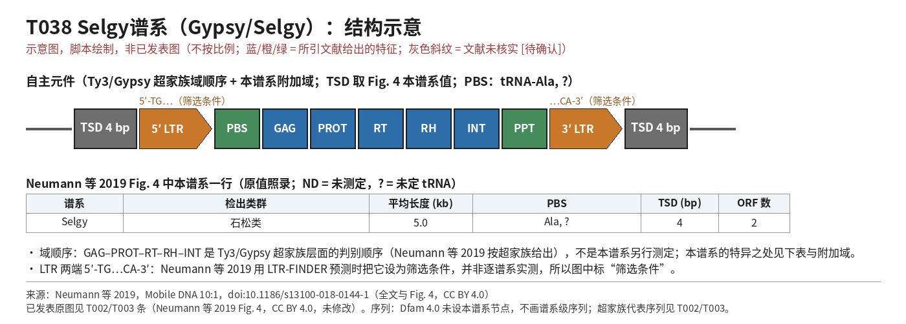

图 T038-1　Selgy谱系（Gypsy/Selgy）：结构示意。示意图，脚本绘制，非已发表图；每个特征的来源写在图下方。序列：Dfam 4.0 未设本谱系节点，没有谱系级共识序列；超家族代表序列见 T002/T003。


Selgy 与 Phygy 类似，属于 Ty3/Gypsy 超家族中整体尺寸较短的紧凑型谱系（Neumann 等 2019, doi:10.1186/s13100-018-0144-1；精确跨物种全长与单 LTR 长度统计待确认）。完整拷贝由 5' LTR、内部编码区与 3' LTR 构成，两翼 LTR 末端多保留保守的 5'-TG...CA-3' 反向重复二核苷酸，内部两端具备 PBS 与 PPT [待确认]。（见本条“本版补充说明”）

#### TSD

整合进入宿主染色体时在元件两侧形成正向靶位点重复，遵循 Ty3/Gypsy 超家族的典型 5 bp 特征（具体变异情况待确认）。

#### 编码蛋白与结构域顺序

自主型 Selgy 元件编码 `gag` 与 `pol` 蛋白，遵循 Ty3/Gypsy 超家族非染色质病毒支的标准结构域排列顺序：**GAG - PROT - RT - RH - INT**（Neumann 等 2019, doi:10.1186/s13100-018-0144-1）。其整合酶 C 端不携带染色质结构域，亦不含 `env` 样开放阅读框（Neumann 等 2019, doi:10.1186/s13100-018-0144-1）。（见本条“本版补充说明”）

#### 转座机制

遵循经典的 LTR 反转录转座子复制粘贴扩增机制：5' LTR 启动子驱动全长 RNA 转录，在胞质病毒样颗粒内借由 PBS 与 PPT 引导反转录合成双链 cDNA，随后由整合酶整合进入宿主染色体新位点并伴随产生 TSD [待确认]。

#### 自主与非自主搭档

完整编码 `gag-pol` 的拷贝为自主型；基因组中可伴生内部编码区缺失的非自主衍生物及两翼 LTR 不等同源重组形成的 solo-LTR（Selgy 专属非自主搭档研究待确认）。

#### 识别特征与工具

结构从头识别采用 LTRharvest（Ellinghaus 等 2008, doi:10.1186/1471-2105-9-18）、LTR_FINDER（Xu 和 Wang 2007, doi:10.1093/nar/gkm286）、LTR_retriever（Ou 和 Jiang 2018, doi:10.1104/pp.17.01310）与 EDTA（Ou 等 2019, doi:10.1186/s13059-019-1905-y）。谱系级精准鉴定采用基于 REXdb 蛋白结构域 HMM 的 TEsorter（Zhang 等 2022, doi:10.1093/hr/uhac017；Neumann 等 2019, doi:10.1186/s13100-018-0144-1）。

#### 分类争议

Selgy 在 2019 年 REXdb 系统发育分类中作为石松类特异的非染色质病毒支独立谱系确立，目前无显著合并或拆分争议（Neumann 等 2019, doi:10.1186/s13100-018-0144-1）。

#### 发现与分布

**发现与命名**

- Neumann 等 (2019) Systematic survey of plant LTR-retrotransposons elucidates phylogenetic relationships of their polyprotein domains and provides a reference for element classification. Mobile DNA. doi:10.1186/s13100-018-0144-1。正文原句：“…Athila/Tat|Tat (Cinful-1, Tat4–1, RIRE2, RetroSor1) Metavirus (Tat4) Retand [ 65 ]; TatVI [ 34 ] non-chromovirus|Phygy – – – non-chromovirus|Selgy – – – a Tcn1 clade belongs to Tf1/Sushi group of retrotransposons which occur in fungi and vertebrate species We have attempted to overcome the limitations of previous studies by…”；涉及生物：Viridiplantae；支持范围：Phygy and Selgy listed in REXdb Table 2 with no earlier name

**植物中的报道**

- Neumann 等 (2019) Systematic survey of plant LTR-retrotransposons elucidates phylogenetic relationships of their polyprotein domains and provides a reference for element classification. Mobile DNA. doi:10.1186/s13100-018-0144-1。同一论文，原句见上；支持范围：REXdb survey of plant LTR retrotransposon lineages

**葡萄中的报道**

- 未检索到葡萄专门报道（检索方式见文末「证据与检索方法」）。这只说明检索没有找到，不能据此推断葡萄基因组中不存在。

#### 本版补充说明

① 域顺序：GAG–PROT–INT–RT–RH（Ty1/Copia）与 GAG–PROT–RT–RH–INT（Ty3/Gypsy）是 Neumann 等 2019（doi:10.1186/s13100-018-0144-1）在超家族层面给出的判别顺序；本条若写某谱系“遵循”该顺序，指的是沿用超家族的顺序，不是该文对本谱系另行测定。

② 末端：5′-TG…CA-3′ 是该文用 LTR-FINDER 预测元件时设定的筛选条件，不是对各谱系的实测统计；本条中“末端保守为 5′-TG…CA-3′”一类说法应按此理解。

③ 该文 Fig. 4 给出本谱系：检出类群 石松类；平均长度 5.0 kb；PBS Ala, ?；TSD 4 bp；ORF 数 2（ND 为未测定）。本谱系 TSD 不是单一的 5 bp，正文“典型长度为 5 bp”一类写法以 Fig. 4 为准。

### T039 Athila谱系（Gypsy/Athila）

**名称对照**：Wicker 体系：I 类 / LTR 目 / Gypsy（代码 RLG）；Wicker 不分谱系；Dfam 节点：Gypsy-ERV;Gypsy（Dfam 无谱系节点）；REXdb 路径：Class_I/LTR/Ty3/gypsy/non-chromovirus/OTA/Athila。（来源：代码据 Wu 等 2025, doi:10.3390/biom15030346；Dfam 4.0 分类树，2026-11-23 读取；REXdb v4.0 说明文件，doi:10.5281/zenodo.10160279）

#### 定义与命名

Athila 是 I 类转座子 LTR 目 Ty3/Gypsy 超家族（RLG）非染色质病毒支 OTA 超级支（Ogre/Tat/Athila）下的核心植物谱系，在 2019 年 REXdb 绿色植物系统分类框架中完整路径记作 `Gypsy/non-chromovirus/OTA/Athila`（Neumann 等 2019, doi:10.1186/s13100-018-0144-1）。在 Dfam 现行分类体系中归入 `LTR/Gypsy` 节点之下 [待确认]。

#### 结构、长度与末端

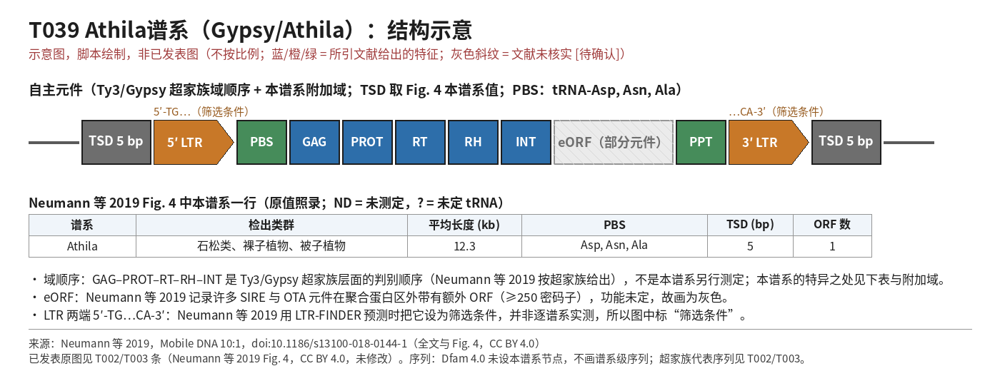

图 T039-1　Athila谱系（Gypsy/Athila）：结构示意。示意图，脚本绘制，非已发表图；每个特征的来源写在图下方。序列：Dfam 4.0 未设本谱系节点，没有谱系级共识序列；超家族代表序列见 T002/T003。


Athila 属于尺寸较大的植物 Gypsy 谱系，自主型元件全长通常在 10 kb 至 14 kb 之间，单个 LTR 长度多在 1 kb 至 2 kb 左右 [待确认]。其显著结构特征是内部区域常包含大段非编码序列，使得整体长度显著大于普通染色质病毒支元件（Neumann 等 2019, doi:10.1186/s13100-018-0144-1）。完整拷贝两翼 LTR 末端保守为 5'-TG...CA-3'，5' LTR 下游具经典 PBS，3' LTR 上游具 PPT [待确认]。（见本条“本版补充说明”）

#### TSD

整合进入宿主基因组时在元件两侧形成正向靶位点重复，典型长度为 5 bp [待确认]。

#### 编码蛋白与结构域顺序

自主型 Athila 元件编码 `gag` 与 `pol` 蛋白，遵循 Ty3/Gypsy 超家族的 **GAG - PROT - RT - RH - INT** 结构域排列顺序，不携带整合酶 C 端的染色质结构域（Neumann 等 2019, doi:10.1186/s13100-018-0144-1）。与同属 OTA 超级支的 Tat 支不同，Athila 携带常规真核型 RNase H（而非 Tat 支特有的古菌型 aRH）（Neumann 等 2019, doi:10.1186/s13100-018-0144-1）。此外，Athila 在 `pol` 下游常携带一个额外的 `env` 样开放阅读框（eORF），该 eORF 与脊椎动物逆转录病毒的包膜蛋白并无直接同源关系（Neumann 等 2019, doi:10.1186/s13100-018-0144-1）。（见本条“本版补充说明”）

#### 转座机制

遵循经典的 LTR 反转录转座子复制粘贴扩增机制：由宿主 RNA 聚合酶 II 从 5' LTR 启动子转录全长 RNA，经胞质病毒样颗粒内以 PBS 和 PPT 为引物完成双链 cDNA 合成后，由整合酶整合进入宿主染色体新位点并伴随产生 5 bp TSD [待确认]。尽管携带 `env` 样开放阅读框，目前并无证据表明 Athila 能够形成具有细胞间感染能力的游离逆转录病毒颗粒（Neumann 等 2019, doi:10.1186/s13100-018-0144-1）。

#### 自主与非自主搭档

完整编码 `gag-pol` 的拷贝为自主型；由于 Athila 拷贝数高、全长及 LTR 较长，宿主基因组中普遍存在大量内部缺失的非自主衍生物、嵌套插入体以及两翼 LTR 不等同源重组形成的 solo-LTR [待确认]。

#### 识别特征与工具

结构从头识别采用 LTRharvest（Ellinghaus 等 2008, doi:10.1186/1471-2105-9-18）、LTR_FINDER（Xu 和 Wang 2007, doi:10.1093/nar/gkm286）、LTR_retriever（Ou 和 Jiang 2018, doi:10.1104/pp.17.01310）与 EDTA（Ou 等 2019, doi:10.1186/s13059-019-1905-y）。谱系级精准分类采用基于 REXdb 蛋白结构域 HMM 的 TEsorter，可有效将其与 Tat 支及脊椎动物 ERV 区分（Zhang 等 2022, doi:10.1093/hr/uhac017；Neumann 等 2019, doi:10.1186/s13100-018-0144-1）。

#### 分类争议

早期文献因 Athila 携带 `env` 样开放阅读框，偶将其视作「植物内源性逆转录病毒（plant ERV）」；2019 年 REXdb 系统发育分类明确否定该混用，确认其隶属 Ty3/Gypsy 超家族 OTA 超级支，绝不可与脊椎动物 ERV 混淆（Neumann 等 2019, doi:10.1186/s13100-018-0144-1）。

#### 发现与分布

**发现与命名**

- Pélissier 等 (1995) Athila, a new retroelement from Arabidopsis thaliana. Plant Molecular Biology. doi:10.1007/bf00020976。摘要原句：“An analysis of Arabidopsis thaliana heterochromatic regions allowed the identification of a new family of retroelements called Athila”；涉及生物：Arabidopsis thaliana；支持范围：Athila first described
- Wright 和 Voytas (2002) Athila4 of Arabidopsis and Calypso of soybean define a lineage of endogenous plant retroviruses. Genome Research. doi:10.1101/gr.196001。摘要原句：“The Athila retroelements of Arabidopsis thaliana encode a putative envelope gene, suggesting that they are infectious retroviruses”；涉及生物：Arabidopsis thaliana and soybean；支持范围：Athila4 and Calypso define an endogenous plant retrovirus lineage

**植物中的报道**

- Neumann 等 (2019) Systematic survey of plant LTR-retrotransposons elucidates phylogenetic relationships of their polyprotein domains and provides a reference for element classification. Mobile DNA. doi:10.1186/s13100-018-0144-1。正文原句：“…elements, referred to as Oryco, Sire, Retrofit, Osser and Tork (Table 1 ). Ty3/gypsy elements in plants were found to belong to two major lineages, chromovirus and Tat/Athila, the former composed of the Del, Reina, CRM and Galadriel clades, the latter of the Tat and Athila clades (Table 2 ). Wicker and Keller [ 24 ] examined…”；涉及生物：Viridiplantae；支持范围：REXdb survey of plant LTR retrotransposon lineages
- Pélissier 等 (1995) Athila, a new retroelement from Arabidopsis thaliana. Plant Molecular Biology. doi:10.1007/bf00020976。同一论文，原句见上；支持范围：Athila
- Wright 和 Voytas (2002) Athila4 of Arabidopsis and Calypso of soybean define a lineage of endogenous plant retroviruses. Genome Research. doi:10.1101/gr.196001。同一论文，原句见上；支持范围：Athila4, Calypso

**葡萄中的报道**

- Park 等 (2021) Horizontal Transfer of LTR Retrotransposons Contributes to the Genome Diversity of Vitis. International Journal of Molecular Sciences. doi:10.3390/ijms221910446。正文原句：“In our analysis, the major difference in LTR retrotransposon content in the Vitis genomes appeared in the native LTR retrotransposon families, such as Tork , Athila , and Tat ( Figure 5 d,e and Figure 6 , and Supplementary Figure S7 )”；涉及生物：Vitis；支持范围：horizontal transfer of LTR retrotransposons; Tork, CRM, Reina, Athila, Tat families in four Vitis genomes
- Velasco 等 (2007) A high quality draft consensus sequence of the genome of a heterozygous grapevine variety. PLoS ONE. doi:10.1371/journal.pone.0001326。正文原句：“The repeats were included in group I (retrotransposons: Copia, Gypsy, LINE) and group II (DNA transposons: Mutator, CACTA, hAT) according to Feschotte et al. [75] . The most abundant TEs were Gypsy/athila-like elements followed by Copia…”；涉及生物：Vitis vinifera；支持范围：Gypsy/athila-like elements most abundant

#### 本版补充说明

① 域顺序：GAG–PROT–INT–RT–RH（Ty1/Copia）与 GAG–PROT–RT–RH–INT（Ty3/Gypsy）是 Neumann 等 2019（doi:10.1186/s13100-018-0144-1）在超家族层面给出的判别顺序；本条若写某谱系“遵循”该顺序，指的是沿用超家族的顺序，不是该文对本谱系另行测定。

② 末端：5′-TG…CA-3′ 是该文用 LTR-FINDER 预测元件时设定的筛选条件，不是对各谱系的实测统计；本条中“末端保守为 5′-TG…CA-3′”一类说法应按此理解。

③ 该文 Fig. 4 给出本谱系：检出类群 石松类、裸子植物、被子植物；平均长度 12.3 kb；PBS Asp, Asn, Ala；TSD 5 bp；ORF 数 1（ND 为未测定）。正文中标 [待确认] 的“TSD 典型长度 5 bp”与 Fig. 4 一致。

### T040 Tatius谱系（Gypsy/Tatius）

**名称对照**：Wicker 体系：I 类 / LTR 目 / Gypsy（代码 RLG）；Wicker 不分谱系；Dfam 节点：Gypsy-ERV;Gypsy（Dfam 无谱系节点）；REXdb 路径：Class_I/LTR/Ty3/gypsy/non-chromovirus/OTA/Tatius。（来源：代码据 Wu 等 2025, doi:10.3390/biom15030346；Dfam 4.0 分类树，2026-11-23 读取；REXdb v4.0 说明文件，doi:10.5281/zenodo.10160279）

#### 定义与命名

Tatius 是 I 类转座子 LTR 目 Ty3/Gypsy 超家族（RLG）非染色质病毒支 OTA 超级支下在 REXdb Viridiplantae v4.0 版本中新增的植物谱系，完整路径记作 `Gypsy/OTA/Tatius`（REXdb v4.0 更新说明及该谱系正式发表出处 DOI 待确认）。在 2019 年发表的 REXdb 原始论文的 OTA 谱系名单中尚未收录此名 [待确认]。在 Dfam 现行分类体系中归入 `LTR/Gypsy` 节点之下 [待确认]。

#### 结构、长度与末端

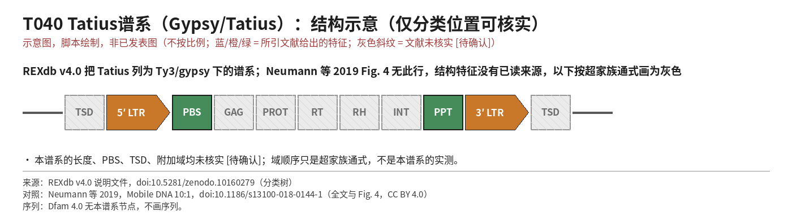

图 T040-1　Tatius谱系（Gypsy/Tatius）：结构示意。示意图，脚本绘制，非已发表图；每个特征的来源写在图下方。序列：Dfam 4.0 未设本谱系节点，没有谱系级共识序列；超家族代表序列见 T002/T003。


作为 Ty3/Gypsy 超家族 OTA 超级支成员，自主型 Tatius 元件遵循 5' LTR、内部编码区与 3' LTR 的三段式骨架，两翼 LTR 末端多为 5'-TG...CA-3'，内部两端具 PBS 与 PPT（Tatius 谱系特有的全长范围、单 LTR 长度及非编码区特征待确认）。（见本条“本版补充说明”）

#### TSD

整合进入宿主染色体时预期形成正向靶位点重复，遵循 Ty3/Gypsy 超家族的典型 5 bp 特征（该谱系实测 TSD 统计待确认）。

#### 编码蛋白与结构域顺序

自主型 Tatius 元件遵循 Ty3/Gypsy 超家族非染色质病毒支的 **GAG - PROT - RT - RH - INT** 结构域排列顺序（其 RNase H 类型是否为古菌型 aRH 以及是否携带 eORF 尚待核对原始发表文献，待确认）。（见本条“本版补充说明”）

#### 转座机制

遵循经典的 LTR 反转录转座子复制粘贴扩增机制：5' LTR 启动子驱动全长 RNA 转录，在胞质病毒样颗粒内完成双链 cDNA 反转录并由整合酶整合进入宿主染色体新位点 [待确认]。

#### 自主与非自主搭档

完整编码 `gag-pol` 的拷贝为自主型；基因组中可能伴生内部缺失的非自主衍生物及 solo-LTR（具体搭档关系待确认）。

#### 识别特征与工具

结构从头识别采用 LTRharvest（Ellinghaus 等 2008, doi:10.1186/1471-2105-9-18）、LTR_FINDER（Xu 和 Wang 2007, doi:10.1093/nar/gkm286）、LTR_retriever（Ou 和 Jiang 2018, doi:10.1104/pp.17.01310）与 EDTA（Ou 等 2019, doi:10.1186/s13059-019-1905-y）。谱系级鉴定必须使用已更新至 REXdb Viridiplantae v4.0 数据库的 TEsorter 或相应蛋白结构域 HMM 模型，旧版 v3.0 数据库无法检出该谱系标签（Zhang 等 2022, doi:10.1093/hr/uhac017；v4.0 数据库版本细节待确认）。

#### 分类争议

由于 Tatius 未出现在 2019 年 REXdb 原始论文的 OTA 谱系名单中，不同版本数据库（v3.0 与 v4.0）的注释结果在跨项目比较时会出现标签不一致 [待确认]；在正式引用该谱系名时，需核对并注明其首次发表文献出处与 REXdb 版本号（待确认）。

#### 发现与分布

**发现与命名**

- (2023) REXdb Viridiplantae database v4.0 (README and classification tree). Zenodo. doi:10.5281/zenodo.10160279。REXdb 分类树原句：“--Tatius  * (REXdb Viridiplantae v4.0 README classification tree; asterisk marks new lineage)”；支持范围：REXdb Viridiplantae v4.0 adds these lineages

**植物中的报道**

- 未检索到已核实的植物报道 [待确认]。

**葡萄中的报道**

- 未检索到葡萄专门报道（检索方式见文末「证据与检索方法」）。这只说明检索没有找到，不能据此推断葡萄基因组中不存在。

#### 本版补充说明

① 域顺序：GAG–PROT–INT–RT–RH（Ty1/Copia）与 GAG–PROT–RT–RH–INT（Ty3/Gypsy）是 Neumann 等 2019（doi:10.1186/s13100-018-0144-1）在超家族层面给出的判别顺序；本条若写某谱系“遵循”该顺序，指的是沿用超家族的顺序，不是该文对本谱系另行测定。

② 末端：5′-TG…CA-3′ 是该文用 LTR-FINDER 预测元件时设定的筛选条件，不是对各谱系的实测统计；本条中“末端保守为 5′-TG…CA-3′”一类说法应按此理解。

③ 该文 Fig. 4 没有本谱系（本谱系见于 REXdb v4.0），长度、PBS、TSD 仍为 [待确认]。

### T041 TatI亚谱系（Gypsy/TatI）

**名称对照**：Wicker 体系：I 类 / LTR 目 / Gypsy（代码 RLG）；Wicker 不分谱系；Dfam 节点：Gypsy-ERV;Gypsy（Dfam 无谱系节点）；REXdb 路径：Class_I/LTR/Ty3/gypsy/non-chromovirus/OTA/Tat/TatI。（来源：代码据 Wu 等 2025, doi:10.3390/biom15030346；Dfam 4.0 分类树，2026-11-23 读取；REXdb v4.0 说明文件，doi:10.5281/zenodo.10160279）

#### 定义与命名

TatI 是 I 类转座子 LTR 目 Ty3/Gypsy 超家族（RLG）非染色质病毒支 OTA 超级支 Tat 分支下的独立亚谱系，在 2019 年 REXdb 绿色植物系统分类框架中正式确立，完整路径记作 `Gypsy/non-chromovirus/OTA/Tat/TatI`（Neumann 等 2019, doi:10.1186/s13100-018-0144-1）。2019 年研究依据系统发育关系并结合引物结合位点（PBS）、靶位点重复（TSD）及附加开放阅读框（eORF）等结构特征，将 Tat 分支细分为 TatI、TatII、TatIII、Ogre 与 Retand 五个亚谱系（Neumann 等 2019, doi:10.1186/s13100-018-0144-1）。在 Dfam 现行分类体系中归入 `LTR/Gypsy` 节点之下 [待确认]。

#### 结构、长度与末端

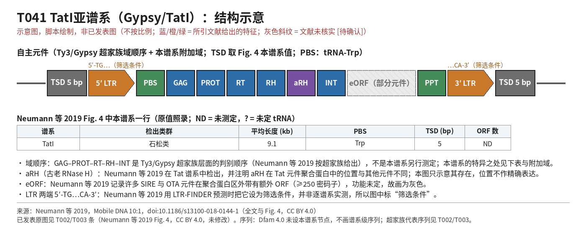

图 T041-1　TatI亚谱系（Gypsy/TatI）：结构示意。示意图，脚本绘制，非已发表图；每个特征的来源写在图下方。序列：Dfam 4.0 未设本谱系节点，没有谱系级共识序列；超家族代表序列见 T002/T003。


自主型 TatI 元件由 5' LTR、内部编码区与 3' LTR 构成，两翼 LTR 末端多保留保守的 5'-TG...CA-3' 反向重复二核苷酸，内部两端具备 PBS 与 PPT（TatI 精确全长与单 LTR 长度范围及特有 PBS 类型统计待确认）。（见本条“本版补充说明”）

#### TSD

整合进入宿主染色体时在元件两侧形成正向靶位点重复，典型长度为 5 bp（TatI 亚谱系是否存在特征性 TSD 长度变异待确认）。

#### 编码蛋白与结构域顺序

自主型 TatI 元件遵循 Ty3/Gypsy 超家族 Tat 分支的特征性结构域排列顺序：**GAG - PROT - RT - RH - aRH - INT**（或以古菌型核糖核酸酶 H **aRH** 取代/伴随经典 RH，具体位置与结构域组织以 2019 年 REXdb 界定为准），不含整合酶 C 端染色质结构域（Neumann 等 2019, doi:10.1186/s13100-018-0144-1）。携带古菌型 RNase H（archaeal RNase H，aRH）是整个 Tat 分支区别于 Athila 及其他 Gypsy 谱系的最核心分子标志（Neumann 等 2019, doi:10.1186/s13100-018-0144-1）。（见本条“本版补充说明”）

#### 转座机制

遵循经典的 LTR 反转录转座子复制粘贴扩增机制：5' LTR 启动子驱动全长 RNA 转录，在胞质病毒样颗粒内借由 PBS 与 PPT 引导反转录合成双链 cDNA，随后由整合酶整合进入宿主染色体新位点并伴随产生 TSD [待确认]。

#### 自主与非自主搭档

完整编码 `gag-pol`（含 aRH）的拷贝为自主型；基因组中可伴生内部缺失的非自主衍生物及两翼 LTR 不等同源重组形成的 solo-LTR（TatI 专属非自主搭档研究待确认）。

#### 识别特征与工具

结构从头识别采用 LTRharvest（Ellinghaus 等 2008, doi:10.1186/1471-2105-9-18）、LTR_FINDER（Xu 和 Wang 2007, doi:10.1093/nar/gkm286）、LTR_retriever（Ou 和 Jiang 2018, doi:10.1104/pp.17.01310）与 EDTA（Ou 等 2019, doi:10.1186/s13059-019-1905-y）。将其与 TatII、TatIII、Ogre、Retand 精准区分，需依赖基于 REXdb 蛋白结构域 HMM（含 aRH 模型）的 TEsorter（Zhang 等 2022, doi:10.1093/hr/uhac017；Neumann 等 2019, doi:10.1186/s13100-018-0144-1）。

#### 分类争议

在 2019 年 REXdb 细化之前，TatI、TatII、TatIII 常被笼统合并为单一的 Tat 谱系；2019 年研究基于多结构域系统发育与 PBS/TSD/eORF 特征将其正式拆分为独立亚谱系（Neumann 等 2019, doi:10.1186/s13100-018-0144-1）。

#### 发现与分布

**发现与命名**

- Wright 和 Voytas (1998) Potential retroviruses in plants: Tat1 is related to a group of Arabidopsis thaliana Ty3/gypsy retrotransposons that encode envelope-like proteins. Genetics. doi:10.1093/genetics/149.2.703。摘要原句：“Tat1 was originally identified as an insertion near the Arabidopsis thaliana SAM1 gene”；涉及生物：Arabidopsis thaliana；支持范围：Tat1 related to Arabidopsis Ty3/gypsy elements encoding envelope-like proteins [注意：所引句不含该名称，仅支持上位/总体论断]
- Ustyantsev 等 (2015) Convergent evolution of ribonuclease h in LTR retrotransposons and retroviruses. Molecular Biology and Evolution. doi:10.1093/molbev/msv008。摘要原句：“Two notable structural differences between these groups of genetic elements are 1) the presence in retroviruses of an additional envelope gene, env, which mediates infection, and 2) a specific dual ribonuclease H (RNH) domain encoded by the retroviral pol gene”；涉及生物：LTR retrotransposons and retroviruses；支持范围：TatI-VI naming (cited in REXdb Table 2) [注意：所引句不含该名称，仅支持上位/总体论断]

**植物中的报道**

- Neumann 等 (2019) Systematic survey of plant LTR-retrotransposons elucidates phylogenetic relationships of their polyprotein domains and provides a reference for element classification. Mobile DNA. doi:10.1186/s13100-018-0144-1。正文原句：“…(Del1) Tekay [ 27 ] non-chromovirus|OTA|Athila Athila/Tat|Athila (Athila4–1, Diaspora, Bagy-2, Cyclops-2) Metavirus (Athila) Athila [ 32 ] non-chromovirus|OTA|Tat|TatI – – TatI [ 34 ] non-chromovirus|OTA|Tat|TatII – – TatII [ 34 ] non-chromovirus|OTA|Tat|TatIII – – TatIII [ 34 ] non-chromovirus|OTA|Tat|Ogre Athila/Tat|Tat…”；涉及生物：Viridiplantae；支持范围：REXdb survey of plant LTR retrotransposon lineages
- Wright 和 Voytas (1998) Potential retroviruses in plants: Tat1 is related to a group of Arabidopsis thaliana Ty3/gypsy retrotransposons that encode envelope-like proteins. Genetics. doi:10.1093/genetics/149.2.703。同一论文，原句见上；支持范围：Tat1 [注意：所引句不含该名称，仅支持上位/总体论断]

**葡萄中的报道**

- Park 等 (2021) Horizontal Transfer of LTR Retrotransposons Contributes to the Genome Diversity of Vitis. International Journal of Molecular Sciences. doi:10.3390/ijms221910446。正文原句：“In our analysis, the major difference in LTR retrotransposon content in the Vitis genomes appeared in the native LTR retrotransposon families, such as Tork , Athila , and Tat ( Figure 5 d,e and Figure 6 , and Supplementary Figure S7 )”；涉及生物：Vitis；支持范围：horizontal transfer of LTR retrotransposons; Tork, CRM, Reina, Athila, Tat families in four Vitis genomes [Park 2021 以 Tat 分支名汇报，未区分 TatI/II/III] [注意：所引句不含该名称，仅支持上位/总体论断]

#### 本版补充说明

① 域顺序：GAG–PROT–INT–RT–RH（Ty1/Copia）与 GAG–PROT–RT–RH–INT（Ty3/Gypsy）是 Neumann 等 2019（doi:10.1186/s13100-018-0144-1）在超家族层面给出的判别顺序；本条若写某谱系“遵循”该顺序，指的是沿用超家族的顺序，不是该文对本谱系另行测定。

② 末端：5′-TG…CA-3′ 是该文用 LTR-FINDER 预测元件时设定的筛选条件，不是对各谱系的实测统计；本条中“末端保守为 5′-TG…CA-3′”一类说法应按此理解。

③ 该文 Fig. 4 给出本谱系：检出类群 石松类；平均长度 9.1 kb；PBS Trp；TSD 5 bp；ORF 数 ND（ND 为未测定）。正文中标 [待确认] 的“TSD 典型长度 5 bp”与 Fig. 4 一致。

### T042 TatII亚谱系（Gypsy/TatII）

**名称对照**：Wicker 体系：I 类 / LTR 目 / Gypsy（代码 RLG）；Wicker 不分谱系；Dfam 节点：Gypsy-ERV;Gypsy（Dfam 无谱系节点）；REXdb 路径：Class_I/LTR/Ty3/gypsy/non-chromovirus/OTA/Tat/TatII。（来源：代码据 Wu 等 2025, doi:10.3390/biom15030346；Dfam 4.0 分类树，2026-11-23 读取；REXdb v4.0 说明文件，doi:10.5281/zenodo.10160279）

#### 定义与命名

TatII 是 I 类转座子 LTR 目 Ty3/Gypsy 超家族（RLG）非染色质病毒支 OTA 超级支 Tat 分支下的独立亚谱系，在 2019 年 REXdb 绿色植物系统分类框架中正式确立，完整路径记作 `Gypsy/non-chromovirus/OTA/Tat/TatII`（Neumann 等 2019, doi:10.1186/s13100-018-0144-1）。在 Dfam 现行分类体系中归入 `LTR/Gypsy` 节点之下 [待确认]。

#### 结构、长度与末端

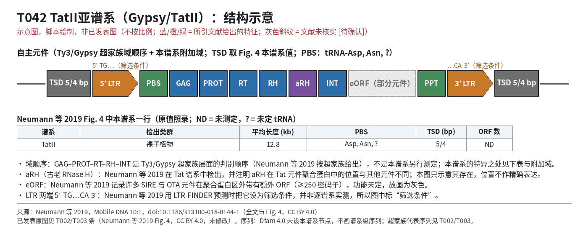

图 T042-1　TatII亚谱系（Gypsy/TatII）：结构示意。示意图，脚本绘制，非已发表图；每个特征的来源写在图下方。序列：Dfam 4.0 未设本谱系节点，没有谱系级共识序列；超家族代表序列见 T002/T003。


自主型 TatII 元件具备 5' LTR、内部编码区与 3' LTR 结构，两翼 LTR 末端多保留保守的 5'-TG...CA-3' 反向重复二核苷酸，内部两端具备 PBS 与 PPT（TatII 精确全长与单 LTR 长度分布统计待确认）。（见本条“本版补充说明”）

#### TSD

整合进入宿主染色体时在元件两侧形成正向靶位点重复，典型长度为 5 bp（具体变异情况待确认）。

#### 编码蛋白与结构域顺序

自主型 TatII 元件遵循 Ty3/Gypsy 超家族 Tat 分支的结构域特征，编码 `gag` 与 `pol` 蛋白（排列顺序为 PROT - RT - RH/aRH - INT），携带 Tat 分支标志性的古菌型核糖核酸酶 H（aRH），不携带整合酶 C 端染色质结构域（Neumann 等 2019, doi:10.1186/s13100-018-0144-1）。

#### 转座机制

遵循经典的 LTR 反转录转座子复制粘贴扩增机制：5' LTR 启动子驱动全长 RNA 转录，在胞质病毒样颗粒内借由 PBS 与 PPT 引导反转录合成双链 cDNA，随后由整合酶整合进入宿主染色体新位点并产生 TSD [待确认]。

#### 自主与非自主搭档

完整编码 `gag-pol` 的拷贝为自主型；基因组中可伴生内部缺失的非自主衍生物及两翼 LTR 不等同源重组形成的 solo-LTR（TatII 专属非自主搭档研究待确认）。

#### 识别特征与工具

结构从头识别采用 LTRharvest（Ellinghaus 等 2008, doi:10.1186/1471-2105-9-18）、LTR_FINDER（Xu 和 Wang 2007, doi:10.1093/nar/gkm286）、LTR_retriever（Ou 和 Jiang 2018, doi:10.1104/pp.17.01310）与 EDTA（Ou 等 2019, doi:10.1186/s13059-019-1905-y）。谱系级精准分类采用基于 REXdb 蛋白结构域 HMM 的 TEsorter（Zhang 等 2022, doi:10.1093/hr/uhac017；Neumann 等 2019, doi:10.1186/s13100-018-0144-1）。

#### 分类争议

TatII 于 2019 年 REXdb 系统发育研究中从宽泛的 Tat 复合群中拆分确立为独立亚谱系，目前在植物转座子细分类中作为标准节点使用（Neumann 等 2019, doi:10.1186/s13100-018-0144-1）。

#### 发现与分布

**发现与命名**

- Wright 和 Voytas (1998) Potential retroviruses in plants: Tat1 is related to a group of Arabidopsis thaliana Ty3/gypsy retrotransposons that encode envelope-like proteins. Genetics. doi:10.1093/genetics/149.2.703。摘要原句：“Tat1 was originally identified as an insertion near the Arabidopsis thaliana SAM1 gene”；涉及生物：Arabidopsis thaliana；支持范围：Tat1 related to Arabidopsis Ty3/gypsy elements encoding envelope-like proteins [注意：所引句不含该名称，仅支持上位/总体论断]
- Ustyantsev 等 (2015) Convergent evolution of ribonuclease h in LTR retrotransposons and retroviruses. Molecular Biology and Evolution. doi:10.1093/molbev/msv008。摘要原句：“Two notable structural differences between these groups of genetic elements are 1) the presence in retroviruses of an additional envelope gene, env, which mediates infection, and 2) a specific dual ribonuclease H (RNH) domain encoded by the retroviral pol gene”；涉及生物：LTR retrotransposons and retroviruses；支持范围：TatI-VI naming (cited in REXdb Table 2) [注意：所引句不含该名称，仅支持上位/总体论断]

**植物中的报道**

- Neumann 等 (2019) Systematic survey of plant LTR-retrotransposons elucidates phylogenetic relationships of their polyprotein domains and provides a reference for element classification. Mobile DNA. doi:10.1186/s13100-018-0144-1。正文原句：“A|Athila Athila/Tat|Athila (Athila4–1, Diaspora, Bagy-2, Cyclops-2) Metavirus (Athila) Athila [ 32 ] non-chromovirus|OTA|Tat|TatI – – TatI [ 34 ] non-chromovirus|OTA|Tat|TatII – – TatII [ 34 ] non-chromovirus|OTA|Tat|TatIII – – TatIII [ 34 ] non-chromovirus|OTA|Tat|Ogre Athila/Tat|Tat (Ogre) – Ogre [ 33 ]; TatIV(Ogre) and…”；涉及生物：Viridiplantae；支持范围：REXdb survey of plant LTR retrotransposon lineages
- Wright 和 Voytas (1998) Potential retroviruses in plants: Tat1 is related to a group of Arabidopsis thaliana Ty3/gypsy retrotransposons that encode envelope-like proteins. Genetics. doi:10.1093/genetics/149.2.703。同一论文，原句见上；支持范围：Tat1 [注意：所引句不含该名称，仅支持上位/总体论断]

**葡萄中的报道**

- 未检索到葡萄专门报道（检索方式见文末「证据与检索方法」）。这只说明检索没有找到，不能据此推断葡萄基因组中不存在。

#### 本版补充说明

① 域顺序：GAG–PROT–INT–RT–RH（Ty1/Copia）与 GAG–PROT–RT–RH–INT（Ty3/Gypsy）是 Neumann 等 2019（doi:10.1186/s13100-018-0144-1）在超家族层面给出的判别顺序；本条若写某谱系“遵循”该顺序，指的是沿用超家族的顺序，不是该文对本谱系另行测定。

② 末端：5′-TG…CA-3′ 是该文用 LTR-FINDER 预测元件时设定的筛选条件，不是对各谱系的实测统计；本条中“末端保守为 5′-TG…CA-3′”一类说法应按此理解。

③ 该文 Fig. 4 给出本谱系：检出类群 裸子植物；平均长度 12.8 kb；PBS Asp, Asn, ?；TSD 5/4 bp；ORF 数 ND（ND 为未测定）。本谱系 TSD 不是单一的 5 bp，正文“典型长度为 5 bp”一类写法以 Fig. 4 为准。

### T043 TatIII亚谱系（Gypsy/TatIII）

**名称对照**：Wicker 体系：I 类 / LTR 目 / Gypsy（代码 RLG）；Wicker 不分谱系；Dfam 节点：Gypsy-ERV;Gypsy（Dfam 无谱系节点）；REXdb 路径：Class_I/LTR/Ty3/gypsy/non-chromovirus/OTA/Tat/TatIII。（来源：代码据 Wu 等 2025, doi:10.3390/biom15030346；Dfam 4.0 分类树，2026-11-23 读取；REXdb v4.0 说明文件，doi:10.5281/zenodo.10160279）

#### 定义与命名

TatIII 是 I 类转座子 LTR 目 Ty3/Gypsy 超家族（RLG）非染色质病毒支 OTA 超级支 Tat 分支下的独立亚谱系，在 2019 年 REXdb 绿色植物系统分类框架中正式确立，完整路径记作 `Gypsy/non-chromovirus/OTA/Tat/TatIII`（Neumann 等 2019, doi:10.1186/s13100-018-0144-1）。在 Dfam 现行分类体系中归入 `LTR/Gypsy` 节点之下 [待确认]。

#### 结构、长度与末端


图 T043-1　TatIII亚谱系（Gypsy/TatIII）：结构示意。示意图，脚本绘制，非已发表图；每个特征的来源写在图下方。序列：Dfam 4.0 未设本谱系节点，没有谱系级共识序列；超家族代表序列见 T002/T003。


自主型 TatIII 元件由 5' LTR、内部编码区与 3' LTR 构成，两翼 LTR 末端多保留保守的 5'-TG...CA-3' 反向重复二核苷酸，内部两端具备 PBS 与 PPT（TatIII 精确全长与单 LTR 长度分布统计待确认）。（见本条“本版补充说明”）

#### TSD

整合进入宿主染色体时在元件两侧形成正向靶位点重复，典型长度为 5 bp（具体变异情况待确认）。

#### 编码蛋白与结构域顺序

自主型 TatIII 元件遵循 Ty3/Gypsy 超家族 Tat 分支的结构域特征，编码 `gag` 与 `pol` 蛋白（排列顺序为 PROT - RT - RH/aRH - INT），携带古菌型核糖核酸酶 H（aRH），不携带整合酶 C 端染色质结构域（Neumann 等 2019, doi:10.1186/s13100-018-0144-1）。

#### 转座机制

遵循经典的 LTR 反转录转座子复制粘贴扩增机制：5' LTR 启动子驱动全长 RNA 转录，在胞质病毒样颗粒内借由 PBS 与 PPT 引导反转录合成双链 cDNA，随后由整合酶整合进入宿主染色体新位点并伴随产生 TSD [待确认]。

#### 自主与非自主搭档

完整编码 `gag-pol` 的拷贝为自主型；基因组中可伴生内部缺失的非自主衍生物及两翼 LTR 不等同源重组形成的 solo-LTR（TatIII 专属非自主搭档研究待确认）。

#### 识别特征与工具

结构从头识别采用 LTRharvest（Ellinghaus 等 2008, doi:10.1186/1471-2105-9-18）、LTR_FINDER（Xu 和 Wang 2007, doi:10.1093/nar/gkm286）、LTR_retriever（Ou 和 Jiang 2018, doi:10.1104/pp.17.01310）与 EDTA（Ou 等 2019, doi:10.1186/s13059-019-1905-y）。谱系级精准分类采用基于 REXdb 蛋白结构域 HMM 的 TEsorter（Zhang 等 2022, doi:10.1093/hr/uhac017；Neumann 等 2019, doi:10.1186/s13100-018-0144-1）。

#### 分类争议

TatIII 于 2019 年 REXdb 系统发育研究中从宽泛的 Tat 复合群中拆分确立为独立亚谱系，目前无显著分类争议（Neumann 等 2019, doi:10.1186/s13100-018-0144-1）。

#### 发现与分布

**发现与命名**

- Wright 和 Voytas (1998) Potential retroviruses in plants: Tat1 is related to a group of Arabidopsis thaliana Ty3/gypsy retrotransposons that encode envelope-like proteins. Genetics. doi:10.1093/genetics/149.2.703。摘要原句：“Tat1 was originally identified as an insertion near the Arabidopsis thaliana SAM1 gene”；涉及生物：Arabidopsis thaliana；支持范围：Tat1 related to Arabidopsis Ty3/gypsy elements encoding envelope-like proteins [注意：所引句不含该名称，仅支持上位/总体论断]
- Ustyantsev 等 (2015) Convergent evolution of ribonuclease h in LTR retrotransposons and retroviruses. Molecular Biology and Evolution. doi:10.1093/molbev/msv008。摘要原句：“Two notable structural differences between these groups of genetic elements are 1) the presence in retroviruses of an additional envelope gene, env, which mediates infection, and 2) a specific dual ribonuclease H (RNH) domain encoded by the retroviral pol gene”；涉及生物：LTR retrotransposons and retroviruses；支持范围：TatI-VI naming (cited in REXdb Table 2) [注意：所引句不含该名称，仅支持上位/总体论断]

**植物中的报道**

- Neumann 等 (2019) Systematic survey of plant LTR-retrotransposons elucidates phylogenetic relationships of their polyprotein domains and provides a reference for element classification. Mobile DNA. doi:10.1186/s13100-018-0144-1。正文原句：“…Bagy-2, Cyclops-2) Metavirus (Athila) Athila [ 32 ] non-chromovirus|OTA|Tat|TatI – – TatI [ 34 ] non-chromovirus|OTA|Tat|TatII – – TatII [ 34 ] non-chromovirus|OTA|Tat|TatIII – – TatIII [ 34 ] non-chromovirus|OTA|Tat|Ogre Athila/Tat|Tat (Ogre) – Ogre [ 33 ]; TatIV(Ogre) and TatV [ 34 ] non-chromovirus|OTA|Tat|Retand…”；涉及生物：Viridiplantae；支持范围：REXdb survey of plant LTR retrotransposon lineages
- Wright 和 Voytas (1998) Potential retroviruses in plants: Tat1 is related to a group of Arabidopsis thaliana Ty3/gypsy retrotransposons that encode envelope-like proteins. Genetics. doi:10.1093/genetics/149.2.703。同一论文，原句见上；支持范围：Tat1 [注意：所引句不含该名称，仅支持上位/总体论断]

**葡萄中的报道**

- 未检索到葡萄专门报道（检索方式见文末「证据与检索方法」）。这只说明检索没有找到，不能据此推断葡萄基因组中不存在。

#### 本版补充说明

① 域顺序：GAG–PROT–INT–RT–RH（Ty1/Copia）与 GAG–PROT–RT–RH–INT（Ty3/Gypsy）是 Neumann 等 2019（doi:10.1186/s13100-018-0144-1）在超家族层面给出的判别顺序；本条若写某谱系“遵循”该顺序，指的是沿用超家族的顺序，不是该文对本谱系另行测定。

② 末端：5′-TG…CA-3′ 是该文用 LTR-FINDER 预测元件时设定的筛选条件，不是对各谱系的实测统计；本条中“末端保守为 5′-TG…CA-3′”一类说法应按此理解。

③ 该文 Fig. 4 给出本谱系：检出类群 裸子植物；平均长度 14.7 kb；PBS Arg, His, ?；TSD 5 bp；ORF 数 ND（ND 为未测定）。正文中标 [待确认] 的“TSD 典型长度 5 bp”与 Fig. 4 一致。

### T044 Ogre亚谱系（Gypsy/Ogre）

**名称对照**：Wicker 体系：I 类 / LTR 目 / Gypsy（代码 RLG）；Wicker 不分谱系；Dfam 节点：Gypsy-ERV;Gypsy（Dfam 无谱系节点）；REXdb 路径：Class_I/LTR/Ty3/gypsy/non-chromovirus/OTA/Tat/Ogre。（来源：代码据 Wu 等 2025, doi:10.3390/biom15030346；Dfam 4.0 分类树，2026-11-23 读取；REXdb v4.0 说明文件，doi:10.5281/zenodo.10160279）

#### 定义与命名

Ogre 是 I 类转座子 LTR 目 Ty3/Gypsy 超家族（RLG）非染色质病毒支 OTA 超级支 Tat 分支下极具代表性的超大型植物亚谱系，在 2019 年 REXdb 绿色植物系统分类框架中完整路径记作 `Gypsy/non-chromovirus/OTA/Tat/Ogre`（Neumann 等 2019, doi:10.1186/s13100-018-0144-1）。该名称源自其异常庞大的元件尺寸（最初在豌豆等豆科植物中被发现并命名，原始命名专文 DOI 待确认）。在 Dfam 现行分类体系中归入 `LTR/Gypsy` 节点之下 [待确认]。

#### 结构、长度与末端


图 T044-1　Ogre亚谱系（Gypsy/Ogre）：结构示意。示意图，脚本绘制，非已发表图；每个特征的来源写在图下方。序列：Dfam 4.0 未设本谱系节点，没有谱系级共识序列；超家族代表序列见 T002/T003。


Ogre 是陆生植物中已知全长最长的 LTR 反转录转座子谱系之一，完整自主型元件全长常超过 15 kb，在豆科等大型基因组植物中甚至可达 20 kb 至 25 kb 以上 [待确认]。其单个 LTR 长度亦极为庞大，常达 3 kb 至 5 kb 以上，内部常包含大段非编码区及内含子样结构 [待确认]。完整拷贝两翼 LTR 末端保守为 5'-TG...CA-3'，内部两端具备 PBS 与 PPT [待确认]。（见本条“本版补充说明”）

#### TSD

整合进入宿主染色体时在元件两侧形成正向靶位点重复，典型长度为 5 bp [待确认]。

#### 编码蛋白与结构域顺序

自主型 Ogre 元件编码 `gag` 与 `pol` 蛋白，遵循 Tat 分支的特征性结构域组织（PROT - RT - RH/aRH - INT），携带标志性的古菌型核糖核酸酶 H（aRH），不携带整合酶 C 端染色质结构域；部分 Ogre 元件在 `gag` 上游或 `pol` 两侧还携带额外的开放阅读框，并可能通过剪接加工产生编码蛋白（Neumann 等 2019, doi:10.1186/s13100-018-0144-1；Ogre 内含子剪接机制专文 DOI 待确认）。

#### 转座机制

遵循经典的 LTR 反转录转座子复制粘贴扩增机制：5' LTR 启动子驱动全长 RNA 转录，经胞质病毒样颗粒内反转录合成双链 cDNA 后，由整合酶整合进入宿主染色体新位点并伴随产生 5 bp TSD [待确认]。

#### 自主与非自主搭档

完整编码 `gag-pol` 的拷贝为自主型；由于 Ogre 全长极大且单个 LTR 长达数 kb，在宿主基因组中极易发生两翼 LTR 不等同源重组形成大型 solo-LTR，或发生内部截短形成非自主衍生物 [待确认]。

#### 识别特征与工具

需要特别注意，由于 Ogre 全长常超过 15 kb 至 25 kb，而 LTRharvest 与 LTR_FINDER 等软件的默认最大元件间距参数往往设在 15 kb 左右，若不调大最大距离阈值（如放宽至 25–30 kb）极易漏检完整 Ogre 拷贝 [待确认]。谱系级精准分类采用基于 REXdb 蛋白结构域 HMM 的 TEsorter（Zhang 等 2022, doi:10.1093/hr/uhac017）。

#### 分类争议

早期文献中 Ogre 与 Retand、Tat 之间的界限较为模糊，常统称为 Ogre/Tat 类群；2019 年 REXdb 系统发育分类已将其清晰界定为 Tat 分支下的独立亚谱系 `Ogre`（Neumann 等 2019, doi:10.1186/s13100-018-0144-1）。

#### 发现与分布

**发现与命名**

- Macas 和 Neumann (2007) Ogre elements--a distinct group of plant Ty3/gypsy-like retrotransposons. Gene. doi:10.1016/j.gene.2006.08.007。摘要原句：“Ogre elements are a group of LTR retrotransposons recently discovered in legume plants, where they constitute almost 40% of the genome in some species”；涉及生物：pea and other plants；支持范围：Ogre elements as a distinct Ty3/gypsy group
- Neumann 等 (2003) Highly abundant pea LTR retrotransposon Ogre is constitutively transcribed and partially spliced. Plant Molecular Biology. doi:10.1023/b:plan.0000006945.77043.ce。摘要原句：“We have isolated and characterized a novel giant retroelement, named Ogre, which is over 22 kb long and makes up at least 5% of the pea (Pisum sativum L.) genome”；涉及生物：pea (Pisum sativum)；支持范围：Ogre constitutively transcribed, partially spliced

**植物中的报道**

- Neumann 等 (2019) Systematic survey of plant LTR-retrotransposons elucidates phylogenetic relationships of their polyprotein domains and provides a reference for element classification. Mobile DNA. doi:10.1186/s13100-018-0144-1。正文原句：“…in a group of closely related species [ 25 , 26 ] or focused on a particular lineage of LTR-retrotransposons, e.g. chromoviruses [ 11 , 27 – 31 ], Athila [ 32 ], Ogre [ 33 ], Tat [ 34 ] or SIRE [ 35 – 37 ]. Although these studies demonstrated the potential of a phylogeny-based classification their results are difficult to…”；涉及生物：Viridiplantae；支持范围：REXdb survey of plant LTR retrotransposon lineages
- Macas 和 Neumann (2007) Ogre elements--a distinct group of plant Ty3/gypsy-like retrotransposons. Gene. doi:10.1016/j.gene.2006.08.007。同一论文，原句见上；支持范围：Ogre group
- Neumann 等 (2003) Highly abundant pea LTR retrotransposon Ogre is constitutively transcribed and partially spliced. Plant Molecular Biology. doi:10.1023/b:plan.0000006945.77043.ce。同一论文，原句见上；支持范围：Ogre transcription

**葡萄中的报道**

- 未检索到葡萄专门报道（检索方式见文末「证据与检索方法」）。这只说明检索没有找到，不能据此推断葡萄基因组中不存在。

#### 本版补充说明

① 域顺序：GAG–PROT–INT–RT–RH（Ty1/Copia）与 GAG–PROT–RT–RH–INT（Ty3/Gypsy）是 Neumann 等 2019（doi:10.1186/s13100-018-0144-1）在超家族层面给出的判别顺序；本条若写某谱系“遵循”该顺序，指的是沿用超家族的顺序，不是该文对本谱系另行测定。

② 末端：5′-TG…CA-3′ 是该文用 LTR-FINDER 预测元件时设定的筛选条件，不是对各谱系的实测统计；本条中“末端保守为 5′-TG…CA-3′”一类说法应按此理解。

③ 该文 Fig. 4 给出本谱系：检出类群 被子植物；平均长度 15.0 kb；PBS Arg；TSD 5 bp；ORF 数 2（ND 为未测定）。正文中标 [待确认] 的“TSD 典型长度 5 bp”与 Fig. 4 一致。

### T045 Retand亚谱系（Gypsy/Retand）

**名称对照**：Wicker 体系：I 类 / LTR 目 / Gypsy（代码 RLG）；Wicker 不分谱系；Dfam 节点：Gypsy-ERV;Gypsy（Dfam 无谱系节点）；REXdb 路径：Class_I/LTR/Ty3/gypsy/non-chromovirus/OTA/Tat/Retand。（来源：代码据 Wu 等 2025, doi:10.3390/biom15030346；Dfam 4.0 分类树，2026-11-23 读取；REXdb v4.0 说明文件，doi:10.5281/zenodo.10160279）

#### 定义与命名

Retand 是 I 类转座子 LTR 目 Ty3/Gypsy 超家族（RLG）非染色质病毒支 OTA 超级支 Tat 分支下的核心植物亚谱系之一，在 2019 年 REXdb 绿色植物系统分类框架中完整路径记作 `Gypsy/non-chromovirus/OTA/Tat/Retand`（Neumann 等 2019, doi:10.1186/s13100-018-0144-1）。在 Dfam 现行分类体系中归入 `LTR/Gypsy` 节点之下 [待确认]。

#### 结构、长度与末端

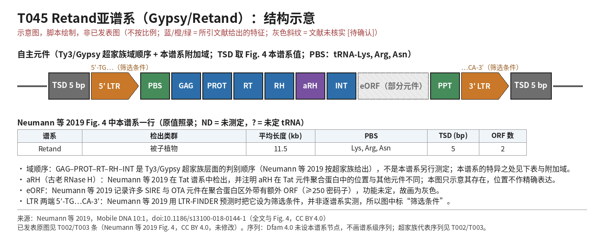

图 T045-1　Retand亚谱系（Gypsy/Retand）：结构示意。示意图，脚本绘制，非已发表图；每个特征的来源写在图下方。序列：Dfam 4.0 未设本谱系节点，没有谱系级共识序列；超家族代表序列见 T002/T003。


Retand 属于大型植物 Gypsy 亚谱系，自主型元件全长通常在 10 kb 至 16 kb 之间，单个 LTR 长度常达 1 kb 至 3 kb 以上（精确跨物种极值统计待确认）。完整拷贝两翼 LTR 末端保守为 5'-TG...CA-3'，5' LTR 下游具经典 PBS，3' LTR 上游具 PPT，内部区域除 `gag-pol` 外常包含大段非编码区或串联重复片段（Neumann 等 2019, doi:10.1186/s13100-018-0144-1）。（见本条“本版补充说明”）

#### TSD

整合进入宿主基因组时在元件两侧形成正向靶位点重复，典型长度为 5 bp [待确认]。

#### 编码蛋白与结构域顺序

自主型 Retand 元件编码 `gag` 与 `pol` 蛋白，遵循 Tat 分支的特征性结构域组织（PROT - RT - RH/aRH - INT），携带古菌型核糖核酸酶 H（aRH），不携带整合酶 C 端染色质结构域，部分成员在 `pol` 下游可携带附加开放阅读框（Neumann 等 2019, doi:10.1186/s13100-018-0144-1）。

#### 转座机制

遵循经典的 LTR 反转录转座子复制粘贴扩增机制：5' LTR 启动子驱动全长 RNA 转录，在胞质病毒样颗粒内借由 PBS 与 PPT 引导反转录合成双链 cDNA，随后由整合酶整合进入宿主染色体新位点并伴随产生 5 bp TSD [待确认]。

#### 自主与非自主搭档

完整编码 `gag-pol` 的拷贝为自主型；在基因组中常伴生内部编码区缺失的非自主衍生物、嵌套插入体以及两翼 LTR 不等同源重组形成的 solo-LTR [待确认]。

#### 识别特征与工具

结构从头识别采用 LTRharvest（Ellinghaus 等 2008, doi:10.1186/1471-2105-9-18）、LTR_FINDER（Xu 和 Wang 2007, doi:10.1093/nar/gkm286）、LTR_retriever（Ou 和 Jiang 2018, doi:10.1104/pp.17.01310）与 EDTA（Ou 等 2019, doi:10.1186/s13059-019-1905-y）。谱系级精准分类采用基于 REXdb 蛋白结构域 HMM 的 TEsorter（Zhang 等 2022, doi:10.1093/hr/uhac017；Neumann 等 2019, doi:10.1186/s13100-018-0144-1）。

#### 分类争议

Retand 最早在石竹科植物中被命名，2019 年 REXdb 系统发育分类将其确立为 Tat 分支下的独立亚谱系，与 Ogre、TatI、TatII、TatIII 明确区分，目前无显著分类争议（Neumann 等 2019, doi:10.1186/s13100-018-0144-1）。

#### 发现与分布

**发现与命名**

- Kejnovsky 等 (2006) Retand: a novel family of gypsy-like retrotransposons harboring an amplified tandem repeat. Molecular Genetics and Genomics. doi:10.1007/s00438-006-0140-x。摘要原句：“In this paper we describe a pair of novel Ty3/gypsy retrotransposons isolated from the dioecious plant Silene latifolia, consisting of a non-autonomous element Retand-1 (3.7 kb) and its autonomous partner Retand-2 (11.1 kb)”；涉及生物：Silene latifolia；支持范围：Retand family with amplified tandem repeat

**植物中的报道**

- Neumann 等 (2019) Systematic survey of plant LTR-retrotransposons elucidates phylogenetic relationships of their polyprotein domains and provides a reference for element classification. Mobile DNA. doi:10.1186/s13100-018-0144-1。正文原句：“…non-chromovirus|OTA|Tat|TatIII – – TatIII [ 34 ] non-chromovirus|OTA|Tat|Ogre Athila/Tat|Tat (Ogre) – Ogre [ 33 ]; TatIV(Ogre) and TatV [ 34 ] non-chromovirus|OTA|Tat|Retand Athila/Tat|Tat (Cinful-1, Tat4–1, RIRE2, RetroSor1) Metavirus (Tat4) Retand [ 65 ]; TatVI [ 34 ] non-chromovirus|Phygy – – – non-chromovirus|Selgy – – –…”；涉及生物：Viridiplantae；支持范围：REXdb survey of plant LTR retrotransposon lineages
- Kejnovsky 等 (2006) Retand: a novel family of gypsy-like retrotransposons harboring an amplified tandem repeat. Molecular Genetics and Genomics. doi:10.1007/s00438-006-0140-x。同一论文，原句见上；支持范围：Retand

**葡萄中的报道**

- 未检索到葡萄专门报道（检索方式见文末「证据与检索方法」）。这只说明检索没有找到，不能据此推断葡萄基因组中不存在。


#### 本版补充说明

① 域顺序：GAG–PROT–INT–RT–RH（Ty1/Copia）与 GAG–PROT–RT–RH–INT（Ty3/Gypsy）是 Neumann 等 2019（doi:10.1186/s13100-018-0144-1）在超家族层面给出的判别顺序；本条若写某谱系“遵循”该顺序，指的是沿用超家族的顺序，不是该文对本谱系另行测定。

② 末端：5′-TG…CA-3′ 是该文用 LTR-FINDER 预测元件时设定的筛选条件，不是对各谱系的实测统计；本条中“末端保守为 5′-TG…CA-3′”一类说法应按此理解。

③ 该文 Fig. 4 给出本谱系：检出类群 被子植物；平均长度 11.5 kb；PBS Lys, Arg, Asn；TSD 5 bp；ORF 数 2（ND 为未测定）。正文中标 [待确认] 的“TSD 典型长度 5 bp”与 Fig. 4 一致。

## 第六部分　DIRS、PLE 与 LINE/SINE 目

### T046 DIRS超家族（DIRS）

**名称对照**：Wicker 体系：I 类 / DIRS 目；Dfam 节点：Tyrosine_Recombinase_Elements;DIRS；REXdb 路径：Class_I/DIRS。（来源：类与目据 Arkhipova 2017, doi:10.1186/s13100-017-0103-2；Dfam 4.0 分类树，2026-11-23 读取；REXdb v4.0 说明文件，doi:10.5281/zenodo.10160279）

#### 定义与命名

DIRS（Dictyostelium intermediate repeat sequence，又称 DIRS-1 或酪氨酸重组酶反转录转座子）是 I 类转座子 DIRS 目下的核心超家族，在 2007 年建立的真核转座子统一分类体系中三字母代码为 `RYD`，其中首位 `R` 代表反转录转座子，第二位 `Y` 代表酪氨酸重组酶（tyrosine recombinase，YR），第三位 `D` 代表 DIRS 超家族（Wicker 等 2007, doi:10.1038/nrg2165）。在 Dfam 现行分类体系及 2021 年发布的数据标准中，该类群归入 `Retroposon` 或独立 `DIRS` 相关节点之下，作为区别于经典 LTR、LINE 与 PLE 的独立反转录转座子分支管理 [待确认]。

#### 结构、长度与末端


图 T046-1　DIRS超家族（DIRS）：结构示意。示意图，脚本绘制，非已发表图；每个特征的来源写在图下方。序列：Dfam 4.0 绿色植物家族中没有本类型可用的共识序列（无此类家族、两端 30 bp 含 N，或分类标注无法核实），不画序列。


完整的自主型 DIRS 元件全长通常在 4 kb 至 6.5 kb 之间（精确跨门类长度分布统计待确认）。与 LTR 反转录转座子两端为正向重复不同，DIRS 元件的末端结构极为特殊：其 5' 端和 3' 端是一对反向末端重复序列（inverted terminal repeat，ITR），且元件内部靠近 3' 端处还存在一段内部互补区（internal complementary region，ICR），ICR 由分别与左侧 ITR 和右侧 ITR 互补的序列拼接而成 [待确认]。元件末端不具备典型 LTR 的 5'-TG...CA-3' 整合酶识别特征，也不含 LINE 典型的 3' poly(A) 尾 [待确认]。

#### TSD

DIRS 元件整合进入宿主基因组时**不产生**靶位点重复（TSD 为 0 bp） [待确认]。这一特征源于其整合过程由酪氨酸重组酶催化位点特异性或环状 DNA 重组完成，而非由整合酶在靶位点 DNA 双链上产生交错切口 [待确认]。

#### 编码蛋白与结构域顺序

自主型 DIRS 元件内部通常包含三个部分重叠的开放阅读框，编码衣壳样蛋白（GAG）、反转录酶（RT）、核糖核酸酶 H（RH）、甲基转移酶（MT）以及酪氨酸重组酶（YR），核心结构域排列顺序为 **GAG - RT - RH - MT - YR** [待确认]。与 LTR 反转录转座子相比，DIRS 完全缺失天冬氨酸蛋白酶（PROT）与经典 DDE 型整合酶（INT）；而与同属 DIRS 目的 Ngaro 和 VIPER 超家族相比，携带甲基转移酶（MT）结构域是 DIRS 超家族的关键鉴别特征 [待确认]。

#### 转座机制

DIRS 采用独特的游离环状双链 DNA 中间体机制完成复制粘贴扩增 [待确认]。转录产生的全长 RNA 经反转录酶合成 cDNA 时，借助两端反向末端重复（ITR）与内部互补区（ICR）之间的碱基配对和模板转换，形成闭合的游离环状双链 DNA 中间体；随后由自身编码的酪氨酸重组酶（YR）催化该环状 DNA 与宿主染色体靶位点发生重组整合，整个过程不产生 TSD（环状中间体精细分子模型专文 DOI 待确认）。

#### 自主与非自主搭档

完整编码 GAG、RT、RH、MT 与 YR 的拷贝为自主型；宿主基因组中可伴生内部编码区缺失或截短、但保留 ITR 与 ICR 顺式重组信号的非自主衍生物，依赖同家族自主型拷贝反式提供的酶系完成扩增（DIRS 非自主搭档专项验证文献 DOI 待确认）。由于两端为反向重复而非正向重复，DIRS 不会像 LTR 元件那样通过不等同源重组形成常规 solo-LTR。

#### 识别特征与工具

因缺乏正向重复 LTR 与 TSD，基于双 LTR 结构的传统预测软件（如 LTRharvest、LTR_FINDER、LTR_retriever）无法将其作为完整元件检出（Ou 和 Jiang 2018, doi:10.1104/pp.17.01310）。识别 DIRS 需依赖针对 RT、RH、MT 与 YR 保守蛋白结构域的隐马尔可夫模型（HMM）检索，结合两端 ITR 与内部 ICR 的结构比对；常用工具包括 RepeatModeler2（Flynn 等 2020, doi:10.1073/pnas.1921046117）、基于 Dfam 的 RepeatMasker 注释以及 GyDB 蛋白结构域参考库。

#### 分类争议

早期文献曾将 DIRS 归入广义 LTR 反转录转座子的异类分支；2007 年统一分类体系因其采用酪氨酸重组酶整合、无 TSD 且末端为 ITR+ICR 结构，正式将其与 Ngaro、VIPER 共同提升为独立于 LTR 目的 DIRS 目（Wicker 等 2007, doi:10.1038/nrg2165）。在部分数据库与注释流程中，DIRS 目下的层级归属与标签命名仍存在细微差异（如部分旧版 RepeatMasker 标签曾标注为 `LTR/DIRS`），在整合统计时需统一归入 I 类 DIRS 目。

#### 发现与分布

**发现与命名**

- Cappello 等 (1985) Sequence of Dictyostelium DIRS-1: an apparent retrotransposon with inverted terminal repeats and an internal circle junction sequence. Cell. doi:10.1016/0092-8674(85)90016-9。摘要原句：“The Dictyostelium discoideum transposon DIRS-1 contains long terminal repeats that are inverted (ITRs) and nonidentical”；涉及生物：Dictyostelium discoideum；支持范围：DIRS-1 first described
- Goodwin 和 Poulter (2004) A new group of tyrosine recombinase-encoding retrotransposons. Molecular Biology and Evolution. doi:10.1093/molbev/msh072。摘要原句：“A wide variety of novel tyrosine recombinase (YR)-encoding retrotransposons were identified using data emerging from the various eukaryotic genome sequencing projects”；涉及生物：fungi, animals, protists；支持范围：tyrosine recombinase retrotransposons (DIRS and Ngaro) [注意：所引句不含该名称，仅支持上位/总体论断]
- Poulter 和 Goodwin (2005) DIRS-1 and the other tyrosine recombinase retrotransposons. Cytogenetic and Genome Research. doi:10.1159/000084991。摘要原句：“DIRS-1 is a retroelement from the slime mold Dictyostelium discoideum”

**植物中的报道**

- 未检索到已核实的植物报道 [待确认]。

**葡萄中的报道**

- 未检索到葡萄专门报道（检索方式见文末「证据与检索方法」）。这只说明检索没有找到，不能据此推断葡萄基因组中不存在。

### T047 Ngaro超家族（Ngaro）

**名称对照**：Wicker 体系：I 类 / DIRS 目（Wicker 超家族名单原文未读，未核实）；Dfam 节点：Tyrosine_Recombinase_Elements;Ngaro；REXdb 路径：无单独节点（REXdb 只有 DIRS）。（来源：Wicker 2007 原文本书未读；Dfam 4.0 分类树，2026-11-23 读取；REXdb v4.0 说明文件，doi:10.5281/zenodo.10160279）

#### 定义与命名

Ngaro 是 I 类转座子 DIRS 目下的三大经典超家族之一（与 DIRS、VIPER 并列），在 2007 年统一分类体系中三字母代码为 `RYN`，其中 `R` 代表反转录转座子，`Y` 代表酪氨酸重组酶，`N` 代表 Ngaro 超家族（Wicker 等 2007, doi:10.1038/nrg2165）。在 Dfam 现行分类体系中，该类群归入 `DIRS/Ngaro` 或对应酪氨酸重组酶反转录转座子分支下管理 [待确认]。

#### 结构、长度与末端


图 T047-1　Ngaro超家族（Ngaro）：结构示意。示意图，脚本绘制，非已发表图；每个特征的来源写在图下方。序列：Dfam 4.0 绿色植物家族中没有本类型可用的共识序列（无此类家族、两端 30 bp 含 N，或分类标注无法核实），不画序列。


完整的自主型 Ngaro 元件全长通常在 4 kb 至 6 kb 之间（精确跨物种长度分布统计待确认）。Ngaro 与 DIRS 超家族在末端结构上存在根本区别：Ngaro 不具备反向末端重复（ITR）和内部互补区（ICR），而是采用**分裂正向重复（split direct repeats）**结构，即 5' 端由串联的 A1 重复段构成，内部靠近 3' 端和末端依次分布 B1、A2 与 B2 重复段，形成 `A1 - 内部编码区 - B1 - A2 - B2` 的独特排列（分裂正向重复结构解析专文 DOI 待确认）。

#### TSD

与 DIRS 超家族一致，Ngaro 由酪氨酸重组酶催化整合进入宿主基因组，整合过程**不产生**靶位点重复（TSD 为 0 bp） [待确认]。

#### 编码蛋白与结构域顺序

自主型 Ngaro 元件编码衣壳样蛋白（GAG）、反转录酶（RT）、核糖核酸酶 H（RH）和酪氨酸重组酶（YR），核心结构域排列顺序为 **GAG - RT - RH - YR** [待确认]。与 DIRS 超家族相比，Ngaro 最显著的蛋白结构域差异是**缺失甲基转移酶（MT）结构域**，且同样不含经典整合酶（INT）与天冬氨酸蛋白酶（PROT） [待确认]。

#### 转座机制

Ngaro 同样通过游离环状双链 DNA 中间体完成复制粘贴扩增：全长 RNA 转录本在反转录过程中借助分裂正向重复（A1/A2 与 B1/B2）的配对与链转移合成闭合环状双链 DNA，随后由自身编码的酪氨酸重组酶催化整合进入宿主染色体，不形成 TSD（Ngaro 环状中间体机制专文 DOI 待确认）。

#### 自主与非自主搭档

完整编码 GAG、RT、RH 与 YR 的拷贝为自主型；基因组中可存在内部编码区缺失但保留分裂正向重复顺式信号的非自主衍生物，依赖同家族自主型拷贝反式提供酶系完成扩增（具体搭档案例专文 DOI 待确认）。

#### 识别特征与工具

Ngaro 无法被常规双 LTR 预测软件完整检出，识别主要依赖 RepeatModeler2（Flynn 等 2020, doi:10.1073/pnas.1921046117）从头聚类结合 Dfam与 GyDB的蛋白结构域 HMM 检索，确认其具备 `RT-RH-YR` 组合、缺失 `MT` 结构域且两翼呈分裂正向重复结构。

#### 分类争议

2007 年统一分类体系确立 Ngaro 为 DIRS 目下独立超家族后，其与 DIRS 超家族的界限清晰；学界讨论主要集中在 Ngaro 与同样具分裂正向重复和缺失 MT 结构域的 VIPER 超家族之间的深层系统发育关系（Wicker 等 2007, doi:10.1038/nrg2165；两者系统发育比较专文 DOI 待确认）。

#### 发现与分布

**发现与命名**

- Poulter 和 Goodwin (2005) DIRS-1 and the other tyrosine recombinase retrotransposons. Cytogenetic and Genome Research. doi:10.1159/000084991。摘要原句：“DIRS-1 is a retroelement from the slime mold Dictyostelium discoideum”
- Goodwin 和 Poulter (2004) A new group of tyrosine recombinase-encoding retrotransposons. Molecular Biology and Evolution. doi:10.1093/molbev/msh072。摘要原句：“We refer to these latter elements as the Ngaro group after a representative from zebrafish”；涉及生物：fungi, animals, protists；支持范围：Ngaro group described

**植物中的报道**

- 未检索到已核实的植物报道 [待确认]。

**葡萄中的报道**

- 未检索到葡萄专门报道（检索方式见文末「证据与检索方法」）。这只说明检索没有找到，不能据此推断葡萄基因组中不存在。

### T048 VIPER超家族（VIPER）

**名称对照**：Wicker 体系：I 类 / DIRS 目（Wicker 超家族名单原文未读，未核实）；Dfam 节点：Viper-group;Viper；REXdb 路径：无单独节点（REXdb 只有 DIRS）。（来源：Wicker 2007 原文本书未读；Dfam 4.0 分类树，2026-11-23 读取；REXdb v4.0 说明文件，doi:10.5281/zenodo.10160279）

#### 定义与命名

VIPER（vestigial interposed retroelement，又称 Viper）是 I 类转座子 DIRS 目下的第三大经典超家族，在 2007 年统一分类体系中三字母代码为 `RYV`（Wicker 等 2007, doi:10.1038/nrg2165）。在动质体等原生生物及部分泛真核转座子文献中，还存在一个与 VIPER 亲缘相近或归属尚存讨论的标签 `TATE`（telomere-associated transposable element，具体与 VIPER 的归并关系专文 DOI 待确认）。在 Dfam 现行分类体系中，VIPER 归入 DIRS 相关分支下管理 [待确认]。

#### 结构、长度与末端


图 T048-1　VIPER超家族（VIPER）：结构示意。示意图，脚本绘制，非已发表图；每个特征的来源写在图下方。序列：Dfam 4.0 绿色植物家族中没有本类型可用的共识序列（无此类家族、两端 30 bp 含 N，或分类标注无法核实），不画序列。


完整的自主型 VIPER 元件全长通常在 4 kb 至 5 kb 左右（精确跨物种长度分布统计待确认）。其末端结构与 Ngaro 超家族相似，采用分裂正向重复（split direct repeats）骨架，而非 DIRS 的反向末端重复加内部互补区结构（VIPER 末端结构解析专文 DOI 待确认）。元件不含典型 LTR 的 5'-TG...CA-3' 末端，亦无 LINE 典型的 3' poly(A) 尾 [待确认]。

#### TSD

与 DIRS 目内其他超家族一致，VIPER 经由酪氨酸重组酶整合进入宿主染色体，整合过程**不产生**靶位点重复（TSD 为 0 bp） [待确认]。

#### 编码蛋白与结构域顺序

自主型 VIPER 元件编码衣壳样蛋白（GAG-like）、反转录酶（RT）、核糖核酸酶 H（RH）与酪氨酸重组酶（YR），核心结构域排列顺序为 **GAG - RT - RH - YR**，同样缺失甲基转移酶（MT）、天冬氨酸蛋白酶（PROT）与经典整合酶（INT） [待确认]。尽管结构域组成与 Ngaro 相同，VIPER 在反转录酶与酪氨酸重组酶的系统发育树上构成独立分支 [待确认]。

#### 转座机制

推断遵循 DIRS 目典型的酪氨酸重组酶介导环状双链 DNA 中间体扩增机制：由全长 RNA 经反转录及分裂正向重复介导的模板转换合成环状双链 DNA，随后由酪氨酸重组酶催化整合进入宿主基因组且不产生 TSD [待确认]。

#### 自主与非自主搭档

完整编码 GAG、RT、RH 与 YR 的拷贝为自主型；在锥虫等宿主基因组中，VIPER 拷贝常高度退化或发生内部缺失形成非自主衍生物（最初即因其在宿主基因组中多以退化片段形式存在而得名「vestigial」）（专文 DOI 待确认）。

#### 识别特征与工具

识别 VIPER 主要依赖针对 RT、RH 与 YR 蛋白结构域的 HMM 检索与系统发育比对，参考数据库包括 Dfam与 GyDB，结合 RepeatModeler2（Flynn 等 2020, doi:10.1073/pnas.1921046117）进行重复家族聚类。在植物与葡萄转座子注释中无需专门针对 VIPER 进行结构扫描，若泛真核参考库产生零星命中应优先排查外源污染或低分值误匹配。

#### 分类争议

主要争议集中在两个方面：其一是 `TATE` 标签的归属，部分研究将端粒相关的 TATE 元件归为 VIPER 的近缘分支或独立小支，尚未在所有数据库中完全统一（专文 DOI 待确认）；其二是 VIPER 与 Ngaro 在蛋白结构域组成和分裂正向重复骨架上高度相似，两者在 DIRS 目内的深层演化分歧仍依赖更多原生生物基因组数据进行解析（Wicker 等 2007, doi:10.1038/nrg2165）。

#### 发现与分布

**发现与命名**

- Lorenzi 等 (2006) The VIPER elements of trypanosomes constitute a novel group of tyrosine recombinase-enconding retrotransposons. Molecular and Biochemical Parasitology. doi:10.1016/j.molbiopara.2005.10.002。摘要原句：“VIPER was initially characterized as a 2326bp LTR-like retroelement associated to SIRE, a short interspersed repetitive element specific of Trypanosoma cruzi”；涉及生物：trypanosomes；支持范围：VIPER tyrosine recombinase retrotransposon

**植物中的报道**

- 未检索到已核实的植物报道 [待确认]。

**葡萄中的报道**

- 未检索到葡萄专门报道（检索方式见文末「证据与检索方法」）。这只说明检索没有找到，不能据此推断葡萄基因组中不存在。

### T049 Penelope样反转录转座子（PLE / Penelope）

**名称对照**：Wicker 体系：I 类 / PLE 目；Dfam 节点：Retrotransposon;Penelope-like_Elements；REXdb 路径：Class_I/Penelope。（来源：类与目据 Arkhipova 2017, doi:10.1186/s13100-017-0103-2；Dfam 4.0 分类树，2026-11-23 读取；REXdb v4.0 说明文件，doi:10.5281/zenodo.10160279）

#### 定义与命名

Penelope 样反转录转座子（Penelope-like element，简称 PLE）是 I 类转座子下的五大目之一，在 2007 年统一分类体系中三字母代码以 `RP` 开头，其唯一经典超家族为 Penelope（代码 `RPP`）（Wicker 等 2007, doi:10.1038/nrg2165）。该类群以最早在果蝇（*Drosophila virilis*）杂种不育体系中发现的 Penelope 元件命名（原始发现专文 DOI 待确认）。在 Dfam 现行分类体系中，PLE 归入独立节点 `LINE/Penelope` 或 `PLE` 相关分支下，与经典 LINE 和 LTR 严格区分 [待确认]。

#### 结构、长度与末端


图 T049-1　Penelope样反转录转座子（PLE / Penelope）：结构示意。示意图，脚本绘制，非已发表图；每个特征的来源写在图下方。序列：Dfam 4.0 绿色植物家族中没有本类型可用的共识序列（无此类家族、两端 30 bp 含 N，或分类标注无法核实），不画序列。


图 T049-P1　绿安乐蜥 PLE 在 pLTR 与 ORF 交界处的锤头状核酶序列与切割实验。原图：Frangieh 等（2024），Fig. 3。Internal initiation of reverse transcription in a Penelope-like retrotransposon. Mob DNA. doi:10.1186/s13100-024-00322-z。许可：CC BY 4.0（https://creativecommons.org/licenses/by/4.0/）。未修改。


完整的自主型 PLE 元件全长通常在 3 kb 至 4.5 kb 之间（精确跨门类长度范围专文 DOI 待确认）。PLE 具有极具辨识度的末端特征：元件两侧常带有长度约数百 bp 的**假长末端重复序列（pseudo-LTR，pLTR）**，这些 pLTR 既可以是正向重复，也可以是反向重复，且常因串联整合形成复杂的复合拷贝 [待确认]。此外，部分 PLE 元件在编码区内保留有功能性**内含子**，这在以 RNA 为中间体的反转录转座子中极为罕见 [待确认]。

#### TSD

PLE 整合进入宿主基因组时，在元件两翼形成长度可变的靶位点重复（TSD），典型长度多在 6 bp 至 12 bp 之间（常见为 8 bp 左右） [待确认]。

#### 编码蛋白与结构域顺序

自主型 PLE 元件编码一个大的单一开放阅读框，包含反转录酶（RT）与 **GIY-YIG 型核酸内切酶（EN）** 两个核心结构域，排列顺序为 **RT - GIY-YIG EN** [待确认]。PLE 的反转录酶在系统发育上更接近真核生物端粒酶反转录酶（TERT），而其 GIY-YIG 型核酸内切酶则与 I 组内含子归巢核酸内切酶同源，与 LINE 编码的 APE/RLE 内切酶以及 LTR 编码的 DDE 型整合酶均无同源关系 [待确认]。部分定位于染色体端粒区域的特化 PLE 分支（如 Athena 类元件）缺失 GIY-YIG 内切酶结构域（端粒 PLE 专文 DOI 待确认）。

#### 转座机制

PLE 采用类似 LINE 的**靶位点引物反转录（target-primed reverse transcription，TPRT）**机制，但切割宿主靶位点 DNA 的酶是自身编码的 GIY-YIG 型核酸内切酶而非 LINE 的 APE/RLE 内切酶 [待确认]。部分 PLE 在反转录过程中能够保留其内部内含子，表明其转录本在进入反转录前可逃避宿主剪接体的完全剪接 [待确认]。

#### 自主与非自主搭档

完整编码 RT 与 GIY-YIG EN 的拷贝为自主型；基因组中普遍存在 5' 端截短或内部缺失的非自主拷贝，且由于串联插入频繁，常形成头尾相连的复合结构 [待确认]。

#### 识别特征与工具

识别 PLE 的核心依据是同时检出与端粒酶近缘的 RT 结构域以及特征性的 GIY-YIG 核酸内切酶结构域，辅以两翼 pLTR 与可变长 TSD 核查。常用工具包括 RepeatModeler2（Flynn 等 2020, doi:10.1073/pnas.1921046117）、基于 Dfam 的 RepeatMasker 注释以及 GyDB 蛋白结构域 HMM 检索。

#### 分类争议

2007 年统一分类体系将 PLE 确立为与 LTR、DIRS、LINE、SINE 并列的独立目（Wicker 等 2007, doi:10.1038/nrg2165）。但在 Dfam 与 RepeatMasker 的传统标签体系中，PLE 长期被挂在 `LINE/Penelope` 路径之下 [待确认]。鉴于 PLE 拥有独立的端粒酶近缘 RT 和 GIY-YIG 内切酶，在严谨的演化分析与书稿分类中应将其作为独立目（PLE）与经典 LINE 分开统计。

#### 发现与分布

**发现与命名**

- Evgen'ev 等 (1997) Penelope, a new family of transposable elements and its possible role in hybrid dysgenesis in Drosophila virilis. Proceedings of the National Academy of Sciences. doi:10.1073/pnas.94.1.196。摘要原句：“The insertion sequence responsible for the mutant phenotype of a dysgenic yellow allele has been characterized and named Penelope”；涉及生物：Drosophila virilis；支持范围：Penelope first described
- Arkhipova (2006) Distribution and phylogeny of Penelope-like elements in eukaryotes. Systematic Biology. doi:10.1080/10635150601077683。摘要原句：“Penelope-like elements (PLEs) are a relatively little studied class of eukaryotic retroelements, distinguished by the presence of the GIY-YIG endonuclease domain, the ability of some representatives to retain introns, and the similarity of PLE-encoded reverse transcriptases to telomerases”；涉及生物：eukaryotes；支持范围：Penelope-like elements distribution
- Gladyshev 和 Arkhipova (2007) Telomere-associated endonuclease-deficient Penelope-like retroelements in diverse eukaryotes. Proceedings of the National Academy of Sciences. doi:10.1073/pnas.0702741104。摘要原句：“Penelope-like elements (PLEs) are a recently described class of eukaryotic retroelements characterized by a GIY-YIG endonuclease domain and by a reverse transcriptase domain with similarity to telomerases and group II introns”；涉及生物：diverse eukaryotes；支持范围：telomere-associated Penelope-like elements

**植物中的报道**

- Lin 等 (2016) An Ancient Transkingdom Horizontal Transfer of Penelope-Like Retroelements from Arthropods to Conifers. Genome Biology and Evolution. doi:10.1093/gbe/evw076。摘要原句：“Here, we describe the first case of HTT from animals to plants, involving TEs known as Penelope-like elements, or PLEs, a group of retrotransposons closely related to eukaryotic telomerases”；涉及生物：conifers；支持范围：Penelope-like elements in conifers

**葡萄中的报道**

- 未检索到葡萄专门报道（检索方式见文末「证据与检索方法」）。这只说明检索没有找到，不能据此推断葡萄基因组中不存在。

### T050 长散在核元件（LINE）

**名称对照**：Wicker 体系：I 类 / LINE 目；Dfam 节点：Class_I_Retrotransposition;LINE；REXdb 路径：Class_I/LINE。（来源：类与目据 Arkhipova 2017, doi:10.1186/s13100-017-0103-2；Dfam 4.0 分类树，2026-11-23 读取；REXdb v4.0 说明文件，doi:10.5281/zenodo.10160279）

#### 定义与命名

长散在核元件（long interspersed nuclear element，LINE，又称非 LTR 反转录转座子，non-LTR retrotransposon）是 I 类转座子下的核心自主型目之一，在 2007 年统一分类体系中三字母代码以 `RI` 开头（Wicker 等 2007, doi:10.1038/nrg2165）。2007 年统一分类体系在 LINE 目下划分 5 个超家族：R2（`RIR`）、RTE（`RIT`）、Jockey（`RIJ`）、L1（`RIL`）与 I（`RII`）（Wicker 等 2007, doi:10.1038/nrg2165）。Dfam 现行分类体系及 2021 年发布的数据标准在 `LINE` 节点下采用了更精细的系统发育分支划分，除 L1、RTE、R2、I、Jockey 外，还细列出 CR1、L2、Rex1、Tx1、Tad1、Proto2、Dong-R4、CRE 等众多分支（Storer 等 2021, doi:10.1186/s13100-020-00230-y）。

#### 结构、长度与末端


图 T050-1　长散在核元件（LINE）：结构示意。示意图，脚本绘制，非已发表图；每个特征的来源写在图下方。序列：Dfam 4.0 绿色植物家族中没有本类型可用的共识序列（无此类家族、两端 30 bp 含 N，或分类标注无法核实），不画序列。


完整的自主型 LINE 元件全长通常在 4 kb 至 7 kb 之间，但在真核生物基因组中，绝大多数 LINE 拷贝由于反转录过程提前终止而表现为长度仅数百 bp 至数 kb 的 **5' 端截短拷贝** [待确认]。LINE 两端**不具备**长末端重复序列（LTR），其 5' 非翻译区（5' UTR）内部自带 RNA 聚合酶 II 内部启动子，3' 非翻译区（3' UTR）末端通常以多聚腺苷酸尾（poly(A) tail）或简单串联重复序列结束 [待确认]。

#### TSD

LINE 整合进入宿主基因组时在元件两翼形成长度可变的靶位点重复（TSD），典型长度为 5 bp 至 20 bp（常见于 7 bp 至 20 bp 范围）；在部分位点中，整合过程也可能伴随靶位点小片段缺失而不产生经典 TSD [待确认]。

#### 编码蛋白与结构域顺序

不同 LINE 超家族的开放阅读框数量与内切酶类型存在分化。较古老的 R2 等支系通常仅含单个开放阅读框，编码反转录酶（RT）与限制性内切酶样核酸内切酶（RLE）；而 L1、I、Jockey 等较进化的支系通常包含两个开放阅读框（ORF1 与 ORF2）：ORF1 编码具有核酸伴侣活性的 RNA 结合蛋白（GAG 样功能），ORF2 编码**无嘌呤/无嘧啶核酸内切酶（APE）**与反转录酶（RT），部分支系（如 I 超家族）在 ORF2 末尾还携带核糖核酸酶 H（RH）结构域，核心排列顺序为 **ORF1 - EN(APE) - RT - (RH)**（Llorens 等 2011, doi:10.1093/nar/gkq1061）。

#### 转座机制

LINE 采用经典的**靶位点引物反转录（target-primed reverse transcription，TPRT）**机制完成复制粘贴扩增 [待确认]。宿主 RNA 聚合酶 II 从 5' UTR 内部启动子转录全长 RNA，该 RNA 转运至细胞质翻译 ORF1 与 ORF2 蛋白，并与自身蛋白结合形成核糖核蛋白复合物（RNP，表现出强烈的顺式偏好性）重新进入细胞核；随后 ORF2 的核酸内切酶切开宿主染色体 DNA 单链，暴露出的游离 3'-OH 末端直接作为引物，以 LINE RNA 的 3' 端为模板在染色体切口处原位反转录合成 cDNA 负链，再经第二链切口、正链合成与宿主修复完成整合，同时在两侧形成可变长 TSD [待确认]。反转录酶在原位延伸过程中极易脱落，这是基因组中充斥大量 5' 端截短 LINE 拷贝的直接原因 [待确认]。

#### 自主与非自主搭档

完整编码 ORF1 与 ORF2 的 LINE 拷贝为自主型。LINE 编码的反转录与内切酶机器不仅驱动自身扩增，更是 I 类转座子中整个 **SINE 目**（短散在核元件）以及宿主细胞内加工假基因（processed pseudogene）赖以扩增的反式蛋白来源 [待确认]。此外，基因组中还存在大量 5' 端截短或内部缺失的非自主 LINE 拷贝。

#### 识别特征与工具

因缺乏两端重复结构且大量拷贝呈 5' 端截短形态，LINE 的从头识别高度依赖序列聚类与蛋白结构域比对。常用工具包括 RepeatModeler2（Flynn 等 2020, doi:10.1073/pnas.1921046117）、基于 Dfam 序列模型的 RepeatMasker（Storer 等 2021, doi:10.1186/s13100-020-00230-y）以及针对反转录酶和内切酶结构域的 HMM 检索；在植物综合注释流程 EDTA 中，LINE 的注释通常需结合 RepeatModeler2 或同源库补充以弥补纯结构预测的不足（Ou 等 2019, doi:10.1186/s13059-019-1905-y）。

#### 分类争议

主要分歧在于超家族颗粒度：2007 年统一分类体系仅在 LINE 目下设立 R2、RTE、Jockey、L1、I 五个宽泛超家族（Wicker 等 2007, doi:10.1038/nrg2165），而 Dfam 现行体系及分子演化研究界基于反转录酶系统发育树将 LINE 细分为二十余个分支（clades），并将部分传统归入 LINE 的 Penelope 元件在演化分类中独立为 PLE 目（Storer 等 2021, doi:10.1186/s13100-020-00230-y）。

#### 发现与分布

**发现与命名**

- Malik 等 (1999) The age and evolution of non-LTR retrotransposable elements. Molecular Biology and Evolution. doi:10.1093/oxfordjournals.molbev.a026164。摘要原句：“A comprehensive phylogenetic analysis was conducted of non-long-terminal-repeat (non-LTR) retrotransposons based on an extended sequence alignment of their reverse transcriptase (RT) domain”；涉及生物：eukaryotes；支持范围：non-LTR clades and their age
- Kapitonov 等 (2009) Simple and fast classification of non-LTR retrotransposons based on phylogeny of their RT domain protein sequences. Gene. doi:10.1016/j.gene.2009.07.019。摘要原句：“In this paper we focus on a rapid and reliable procedure for classification of autonomous non-LTR retrotransposons based on alignment and clustering of their reverse transcriptase (RT) domains”；支持范围：RT-based classification of non-LTR retrotransposons

**植物中的报道**

- Wright 等 (1996) Multiple non-LTR retrotransposons in the genome of Arabidopsis thaliana. Genetics. doi:10.1093/genetics/142.2.569。摘要原句：“DNA sequence analysis near the Arabidopsis thaliana ABI3 gene revealed the presence of a non-LTR retrotransposon insertion that we have designated Ta11-1”；涉及生物：Arabidopsis thaliana；支持范围：multiple non-LTR retrotransposons
- Noma 等 (1999) Non-LTR retrotransposons (LINEs) as ubiquitous components of plant genomes. Molecular and General Genetics MGG. doi:10.1007/s004380050943。摘要原句：“During the course of work aimed at isolating a rice gene from Oryza australiensis by PCR, the oligonucleotide primers used were found to generate a fragment that showed sequence homology to the endonuclease (EN) region of the maize non-LTR retrotransposon (LINE) Cin4”；支持范围：LINEs ubiquitous in plant genomes
- Schmidt (1999) LINEs, SINEs and repetitive DNA: non-LTR retrotransposons in plant genomes. Plant Molecular Biology. doi:10.1023/a:1006212929794。摘要原句：“Retroelements and remnants thereof constitute a large fraction of the repetitive DNA of plant genomes”；涉及生物：plants；支持范围：LINEs and SINEs in plants
- Leeton 和 Smyth (1993) An abundant LINE-like element amplified in the genome of Lilium speciosum. Molecular and General Genetics MGG. doi:10.1007/bf00282789。摘要原句：“The genomes of Lilium species are very large, containing 30-40 million kilobase pairs of DNA. An abundant fragment of 3.5 kb was released by BamHI digestion of genomic DNA of Lilium speciosum”；涉及生物：lily (Lilium speciosum)；支持范围：LINE-like element

**葡萄中的报道**

- Carrier 等 (2012) Transposable elements are a major cause of somatic polymorphism in Vitis vinifera L. PLoS ONE. doi:10.1371/journal.pone.0032973。正文原句：“The most abundant ones in sequenced clones were LINES retrotransposons, followed by Gypsy and Copia-like…”；涉及生物：Vitis vinifera；支持范围：LINE members among repeat classes in Pinot clones
- Velasco 等 (2007) A high quality draft consensus sequence of the genome of a heterozygous grapevine variety. PLoS ONE. doi:10.1371/journal.pone.0001326。正文原句：“The repeats were included in group I (retrotransposons: Copia, Gypsy, LINE) and group II (DNA transposons: Mutator, CACTA, hAT) according to Feschotte et al. [75] . The most abundant TEs were Gypsy/athila-like elements followed by Copia…”；涉及生物：Vitis vinifera；支持范围：LINE group in grape TE annotation

### T051 短散在核元件（SINE）

**名称对照**：Wicker 体系：I 类 / SINE 目；Dfam 节点：LINE-dependent_Retroposon;SINE；REXdb 路径：Class_I/SINE。（来源：类与目据 Arkhipova 2017, doi:10.1186/s13100-017-0103-2；Dfam 4.0 分类树，2026-11-23 读取；REXdb v4.0 说明文件，doi:10.5281/zenodo.10160279）

#### 定义与命名

短散在核元件（short interspersed nuclear element，SINE）是 I 类转座子下完全由非自主型短元件构成的独立目，在 2007 年统一分类体系中三字母代码以 `RS` 开头（Wicker 等 2007, doi:10.1038/nrg2165）。2007 年统一分类体系依据其 5' 端头部非编码 RNA 的演化起源，将 SINE 目划分为 3 个超家族：tRNA 来源（`RST`）、7SL RNA 来源（`RSL`）和 5S rRNA 来源（`RSS`）（Wicker 等 2007, doi:10.1038/nrg2165）。Dfam 现行分类体系及 2021 年发布的数据标准则在启动子来源（tRNA、7SL、5S 等）的基础上，结合体部保守核心域（如 Core、Deu、V、Meta 等）与 3' 端搭档特征进行更精细的复合命名与分层（Storer 等 2021, doi:10.1186/s13100-020-00230-y）。

#### 结构、长度与末端


图 T051-1　短散在核元件（SINE）：结构示意。示意图，脚本绘制，非已发表图；每个特征的来源写在图下方。序列：Dfam 4.0 绿色植物家族中没有本类型可用的共识序列（无此类家族、两端 30 bp 含 N，或分类标注无法核实），不画序列。


SINE 尺寸极短，全长通常在 100 bp 至 500 bp 之间，无长末端重复序列（LTR），呈典型的「头部–体部–尾部」三段式结构 [待确认]。5' 端**头部**起源于宿主细胞内由 RNA 聚合酶 III（Pol III）转录的小非编码 RNA（tRNA、7SL RNA 或 5S rRNA），保留了 Pol III 内部启动子基序（例如 tRNA 来源 SINE 的 A box 与 B box）；中间**体部**起源于未知序列、演化保守核心域或自主型 LINE 片段；3' 端**尾部**通常为长度可变的 poly(A) 尾、富含 A/T 的简单重复或与特定自主型 LINE 3' 端高度同源的序列，用于招募搭档 LINE 的反转录酶 [待确认]。

#### TSD

因借用自主型 LINE 的酶系经 TPRT 机制整合，SINE 整合进入宿主染色体时在元件两翼形成与搭档 LINE 一致的可变长靶位点重复（TSD），典型长度为 5 bp 至 20 bp [待确认]。

#### 编码蛋白与结构域顺序

SINE 属于纯粹的非编码、非自主型反转录转座子，全长**不编码**任何蛋白质，不存在蛋白结构域顺序 [待确认]。

#### 转座机制

SINE 的扩增由宿主 **RNA 聚合酶 III** 识别其 5' 端内部启动子驱动转录产生短单链 RNA，随后在细胞质或细胞核内劫持同细胞中活跃表达的自主型 **LINE** 元件所编码的反转录酶与核酸内切酶（ORF2p），借由自身 3' 端尾部序列与 LINE 反转录机器结合，通过**靶位点引物反转录（TPRT）**机制原位合成 cDNA 并整合进入宿主基因组新位点，伴随产生可变长 TSD [待确认]。

#### 自主与非自主搭档

整个 SINE 目全部由非自主型元件构成，严格依赖特定自主型 LINE 家族提供反式转座机器 [待确认]。在哺乳动物中，经典的 Alu（7SL 来源）依赖 L1 超家族反式驱动；在植物及部分动物中，多数 tRNA 来源 SINE 依赖 L1 或 RTE 超家族的 LINE 搭档完成扩增（植物 SINE 与 LINE 搭档配对专文 DOI 待确认）。

#### 识别特征与工具

由于 SINE 长度极短、不编码任何蛋白且不同家族间体部序列高度分化，常规基于蛋白域或长重复结构的软件无法检出。识别 SINE 需结合 Pol III 内部启动子基序（A/B box）、3' 端 poly(A) 或简单重复尾、两翼 5–20 bp TSD 以及全基因组多拷贝一致性进行结构与同源联合筛查；常用工具包括 RepeatModeler2（Flynn 等 2020, doi:10.1073/pnas.1921046117）、基于 Dfam 的 RepeatMasker（Storer 等 2021, doi:10.1186/s13100-020-00230-y）以及专门的 SINE 从头结构预测工具（如 SINE_Scan、AnnoSINE 等，专文 DOI 待确认）。

#### 分类争议

2007 年统一分类体系按头部 RNA 来源将 SINE 简明划分为 tRNA、7SL 与 5S 三个超家族（Wicker 等 2007, doi:10.1038/nrg2165）；然而大量研究表明，许多 SINE 家族在演化中发生了头部、体部保守核心域与尾部的模块重组（嵌合起源），因此 Dfam 现行分类体系主张结合启动子类型与体部核心域进行多维细分，而非仅依赖单一头部来源归类（Storer 等 2021, doi:10.1186/s13100-020-00230-y）。

#### 发现与分布

**发现与命名**

- Okada (1991) SINEs: Short interspersed repeated elements of the eukaryotic genome. Trends in Ecology & Evolution. doi:10.1016/0169-5347(91)90226-n。摘要原句：“Amongst these, there are two kinds of retroposons (sequence elements derived from nonviral cellular RNA): SINEs (short interspersed elements) and LINEs (long interspersed elements)”；支持范围：SINEs defined
- Kramerov 和 Vassetzky (2011) SINEs. WIREs RNA. doi:10.1002/wrna.91。摘要原句：“Short interspersed elements (SINEs) are mobile genetic elements that invade the genomes of many eukaryotes”；涉及生物：eukaryotes
- Kramerov 和 Vassetzky (2011) Origin and evolution of SINEs in eukaryotic genomes. Heredity. doi:10.1038/hdy.2011.43。摘要原句：“Short interspersed elements (SINEs) are one of the two most prolific mobile genomic elements in most of the higher eukaryotes”；涉及生物：eukaryotes；支持范围：origin and evolution of SINEs

**植物中的报道**

- Deragon 和 Zhang (2006) Short interspersed elements (SINEs) in plants: origin, classification, and use as phylogenetic markers. Systematic Biology. doi:10.1080/10635150601047843。摘要原句：“Short interspersed elements (SINEs) are a class of dispersed mobile sequences that use RNA as an intermediate in an amplification process called retroposition”；涉及生物：plants；支持范围：plant SINEs
- Wenke 等 (2011) Targeted identification of short interspersed nuclear element families shows their widespread existence and extreme heterogeneity in plant genomes. The Plant Cell. doi:10.1105/tpc.111.088682。摘要原句：“Short interspersed nuclear elements (SINEs) are non-long terminal repeat retrotransposons that are highly abundant, heterogeneous, and mostly not annotated in eukaryotic genomes”；涉及生物：plants；支持范围：SINE families in plant genomes
- Seibt 等 (2016) Short interspersed nuclear elements (SINEs) are abundant in Solanaceae and have a family-specific impact on gene structure and genome organization. The Plant Journal. doi:10.1111/tpj.13170。摘要原句：“Short interspersed nuclear elements (SINEs) are highly abundant non-autonomous retrotransposons that are widespread in plants”；涉及生物：Solanaceae；支持范围：SINEs in Solanaceae
- Lenoir 等 (2001) The evolutionary origin and genomic organization of SINEs in Arabidopsis thaliana. Molecular Biology and Evolution. doi:10.1093/oxfordjournals.molbev.a003778。摘要原句：“We have characterized the two families of SINE retroposons present in Arabidopsis thaliana”；涉及生物：Arabidopsis thaliana；支持范围：SINEs in Arabidopsis

**葡萄中的报道**

- Benjak 等 (2008) Genome-wide analysis of the "cut-and-paste" transposons of grapevine. PLoS ONE. doi:10.1371/journal.pone.0003107。正文原句：“In the case of Pifvine-2 we found a 154 bp-long deletion present 216 bp downstream of the target site, while in the case of Pifvine-3 there is an insertion of a putative SINE element (155 bp-long with 13 bp-long TSDs) 22 bp after the target site. 10.1371/journal.pone.0003107.g006 Figure 6 Examples of the insertion…”；支持范围：putative SINE near Pifvine-3 insertion (incidental)


## 第七部分　LINE 分支（一）

### T052 L1分支（LINE/L1）

**名称对照**：Wicker 体系：I 类 / LINE 目（L1 的代码 RIL 见 Arkhipova 2017）；Dfam 节点：L1-group;L1；REXdb 路径：Class_I/LINE（REXdb 不分支系）。（来源：代码据 Wu 等 2025, doi:10.3390/biom15030346；Dfam 4.0 分类树，2026-11-23 读取；REXdb v4.0 说明文件，doi:10.5281/zenodo.10160279）

#### 定义与命名

L1（又称 LINE-1）是 I 类转座子 LINE 目下的核心超家族与主要系统发育分支，在 2007 年真核转座子统一分类体系中三字母代码为 `RIL`（Wicker 等 2007, doi:10.1038/nrg2165），在 Dfam 现行分类体系中对应 `LINE/L1` 节点（Storer 等 2021, doi:10.1186/s13100-020-00230-y）。该分支在哺乳动物基因组中以人类 L1 元件为典型代表，在陆生植物中则以玉米 CIN4 与拟南芥 Ta11 等家族为经典代表（CIN4 与 Ta11 原始命名专文 DOI 待确认）。

#### 结构、长度与末端


图 T052-1　L1分支（LINE/L1）：结构示意。示意图，脚本绘制，非已发表图；每个特征的来源写在图下方。序列条：Dfam DF003584393（L1-17_rCom，蓖麻 Ricinus communis，Dfam 4.0，CC0；状态 Submitted）前、后各 30 bp。


完整的自主型 L1 元件全长通常在 5 kb 至 7 kb 之间，不含长末端重复序列（LTR） [待确认]。元件 5' 端为包含内部 RNA 聚合酶 II 启动子的 5' 非翻译区（5' UTR），3' 端为 3' UTR 并以多聚腺苷酸尾（poly(A) tail）结束 [待确认]。由于反转录酶在靶位点延伸过程中极易提前脱落，宿主基因组中绝大多数 L1 拷贝表现为长度仅数百 bp 至数 kb 的 **5' 端截短拷贝**，且常伴随 5' 端倒位重排 [待确认]。

#### TSD

L1 整合进入宿主基因组时在元件两翼形成长度可变的靶位点重复（TSD），典型长度为 5 bp 至 20 bp（常见于 7 bp 至 20 bp 范围）；在部分非典型整合位点也可能伴随靶位点微缺失而不形成 TSD [待确认]。

#### 编码蛋白与结构域顺序

完整的自主型 L1 元件包含两个开放阅读框（ORF1 与 ORF2）：ORF1 编码具有核酸伴侣活性的 RNA 结合蛋白，负责与自身转录本结合形成核糖核蛋白复合物（RNP）；ORF2 编码**无嘌呤/无嘧啶核酸内切酶（APE）**与反转录酶（RT），部分植物 L1 成员在 ORF2 下游还携带核糖核酸酶 H（RH）样结构域（植物 L1 携带 RH 的分布比例专文 DOI 待确认），核心结构域排列顺序为 **ORF1 - EN(APE) - RT**。

#### 转座机制

L1 采用经典的**靶位点引物反转录（TPRT）**机制完成复制粘贴扩增：宿主 RNA 聚合酶 II 从 5' UTR 内部启动子转录全长 RNA，经胞质翻译出 ORF1p 与 ORF2p 后，蛋白强烈顺式偏好地结合自身 RNA 形成 RNP 并进入细胞核；ORF2p 的 APE 内切酶在宿主 DNA 富含 A/T 的位点切开单链，暴露的 3'-OH 直接作为引物以 L1 RNA 3' 端 poly(A) 为模板原位合成负链 cDNA，随后经第二链切口、正链合成与宿主修复完成整合并产生可变长 TSD [待确认]。

#### 自主与非自主搭档

完整编码功能性 ORF1 与 ORF2 的 L1 拷贝为自主型。L1 编码的 ORF2p 机器不仅驱动自身及 5' 端截短的非自主 L1 拷贝扩增，还是大量 **SINE**（如哺乳动物 Alu 以及多种植物 tRNA 来源 SINE）与宿主细胞加工假基因赖以反式扩增的核心酶源 [待确认]。

#### 识别特征与工具

因缺乏两端重复结构且绝大多数拷贝呈 5' 端截短形态，L1 识别高度依赖从头重复聚类与蛋白结构域比对。常用工具包括 RepeatModeler2（Flynn 等 2020, doi:10.1073/pnas.1921046117）、基于 Dfam 序列模型的 RepeatMasker（Storer 等 2021, doi:10.1186/s13100-020-00230-y）以及 GyDB 蛋白域参考库；在植物综合注释流程 EDTA 中，L1 通常需结合 RepeatModeler2 或同源库补充注释（Ou 等 2019, doi:10.1186/s13059-019-1905-y）。

#### 分类争议

2007 年统一分类体系将 L1 作为 LINE 目下五大超家族之一（`RIL`）（Wicker 等 2007, doi:10.1038/nrg2165）；Dfam 现行分类体系则在 `LINE/L1` 下按物种与反转录酶演化进一步细分出 Tx1 等近缘分支与众多物种特异亚家族（Storer 等 2021, doi:10.1186/s13100-020-00230-y）。此外，植物 L1 在系统发育上自成单系分支，与哺乳动物 L1 分歧极深，跨界注释时不可直接套用哺乳动物 L1 一致序列。

#### 发现与分布

**发现与命名**

- Scott 等 (1987) Origin of the human L1 elements: proposed progenitor genes deduced from a consensus DNA sequence. Genomics. doi:10.1016/0888-7543(87)90003-6。摘要原句：“A consensus sequence for the human long interspersed repeated DNA element, L1Hs (LINE or KpnI sequence), is presented”；涉及生物：human；支持范围：L1 consensus sequence

**植物中的报道**

- Leeton 和 Smyth (1993) An abundant LINE-like element amplified in the genome of Lilium speciosum. Molecular and General Genetics MGG. doi:10.1007/bf00282789。摘要原句：“The genomes of Lilium species are very large, containing 30-40 million kilobase pairs of DNA. An abundant fragment of 3.5 kb was released by BamHI digestion of genomic DNA of Lilium speciosum”；涉及生物：lily (Lilium speciosum)；支持范围：LINE-like element [注意：所引句不含该名称，仅支持上位/总体论断]
- Heitkam 和 Schmidt (2009) BNR - a LINE family from Beta vulgaris - contains a RRM domain in open reading frame 1 and defines a L1 sub-clade present in diverse plant genomes. The Plant Journal. doi:10.1111/j.1365-313x.2009.03923.x。摘要原句：“We characterized a novel type of plant non-LTR retrotransposons, identified as the BNR family, in sugar beet (Beta vulgaris) genomes”；涉及生物：Beta vulgaris；支持范围：BNR L1 clade in plants [注意：所引句不含该名称，仅支持上位/总体论断]
- Wright 等 (1996) Multiple non-LTR retrotransposons in the genome of Arabidopsis thaliana. Genetics. doi:10.1093/genetics/142.2.569。摘要原句：“DNA sequence analysis near the Arabidopsis thaliana ABI3 gene revealed the presence of a non-LTR retrotransposon insertion that we have designated Ta11-1”；涉及生物：Arabidopsis thaliana；支持范围：non-LTR retrotransposons [注意：所引句不含该名称，仅支持上位/总体论断]

**葡萄中的报道**

- Carrier 等 (2012) Transposable elements are a major cause of somatic polymorphism in Vitis vinifera L. PLoS ONE. doi:10.1371/journal.pone.0032973。正文原句：“The most abundant ones in sequenced clones were LINES retrotransposons, followed by Gypsy and Copia-like…”；涉及生物：Vitis vinifera；支持范围：LINE members among repeat classes in Pinot clones [注意：所引句不含该名称，仅支持上位/总体论断]

### T053 RTE分支（LINE/RTE）

**名称对照**：Wicker 体系：I 类 / LINE 目（Wicker 超家族名单原文未读，未核实）；Dfam 节点：RTE-like；REXdb 路径：Class_I/LINE（REXdb 不分支系）。（来源：Wicker 2007 原文本书未读；Dfam 4.0 分类树，2026-11-23 读取；REXdb v4.0 说明文件，doi:10.5281/zenodo.10160279）

#### 定义与命名

RTE（retrotransposable element）是 I 类转座子 LINE 目下的五大经典超家族之一，在 2007 年统一分类体系中三字母代码为 `RIT`（Wicker 等 2007, doi:10.1038/nrg2165），在 Dfam 现行分类体系中对应 `LINE/RTE`（及其下属 `RTE-BovB`、`RTE-X` 等分支）。动物界著名的跨物种水平转移代表分支 `BovB`（最早在反刍动物中发现）即属于 RTE 超家族下的核心亚支（BovB 水平转移专文 DOI 待确认）。

#### 结构、长度与末端


图 T053-1　RTE分支（LINE/RTE）：结构示意。示意图，脚本绘制，非已发表图；每个特征的来源写在图下方。序列：Dfam 4.0 绿色植物家族中没有本类型可用的共识序列（无此类家族、两端 30 bp 含 N，或分类标注无法核实），不画序列。


完整的自主型 RTE 元件结构高度精简，全长通常在 3 kb 至 4 kb 之间，明显短于 L1 超家族 [待确认]。RTE 两端无 LTR，5' UTR 极短，3' UTR 末端多以简单串联重复序列（如富含 A/T 的短微卫星重复）结束，而非典型的长 poly(A) 尾 [待确认]。与 L1 一样，基因组中大量 RTE 拷贝因反转录提前终止而表现为 5' 端截短形态 [待确认]。

#### TSD

整合进入宿主基因组时在元件两翼形成长度可变的靶位点重复（TSD），典型长度为 5 bp 至 20 bp [待确认]。

#### 编码蛋白与结构域顺序

自主型 RTE 元件最显著的结构特征是**通常仅含单一开放阅读框（ORF）**，缺失典型 L1 所具备的独立 ORF1 编码区 [待确认]。该单一 ORF 编码**无嘌呤/无嘧啶核酸内切酶（APE）**与反转录酶（RT），核心结构域排列顺序为 **EN(APE) - RT**，不含核糖核酸酶 H（RH）结构域 [待确认]。

#### 转座机制

遵循 LINE 目典型的**靶位点引物反转录（TPRT）**复制粘贴机制：由 5' 端内部启动子驱动转录，翻译产生的 APE-RT 融合蛋白识别自身 RNA 3' 端并在宿主 DNA 切口处原位启动负链 cDNA 合成，经第二链合成与修复整合至新位点并伴随产生可变长 TSD [待确认]。在动物界中，RTE（尤其是 BovB 亚支）因频繁借由吸血节肢动物等媒介在爬行类与哺乳类之间发生水平转移而闻名（专文 DOI 待确认）。

#### 自主与非自主搭档

完整编码 APE 与 RT 的拷贝为自主型。RTE 元件的反转录酶能够特异性识别 3' 端共享同源尾部的非自主 SINE，在动物与部分植物中驱动特定 SINE 家族（如动物中的 Bov-tA 等）的反式扩增（具体配对专文 DOI 待确认）。

#### 识别特征与工具

识别 RTE 依赖从头聚类工具 RepeatModeler2（Flynn 等 2020, doi:10.1073/pnas.1921046117）结合 Dfam与 GyDB的蛋白结构域 HMM 比对，核心鉴别特征为单一 ORF 编码 `EN(APE)-RT` 且反转录酶系统发育定位于 RTE 分支。

#### 分类争议

2007 年统一分类体系将 RTE 列为 LINE 目下独立超家族（`RIT`）（Wicker 等 2007, doi:10.1038/nrg2165）；Dfam 现行分类体系则在 RTE 之下进一步细分出 `RTE-BovB`、`RTE-RTE`、`RTE-X` 等多个分支以反映其内部演化多样性 [待确认]。

#### 发现与分布

**发现与命名**

- Malik 等 (1999) The age and evolution of non-LTR retrotransposable elements. Molecular Biology and Evolution. doi:10.1093/oxfordjournals.molbev.a026164。摘要原句：“All identified non-LTR elements could be grouped into 11 distinct clades”；涉及生物：eukaryotes；支持范围：RTE among non-LTR clades [注意：所引句不含该名称，仅支持上位/总体论断]

**植物中的报道**

- Wright 等 (1996) Multiple non-LTR retrotransposons in the genome of Arabidopsis thaliana. Genetics. doi:10.1093/genetics/142.2.569。摘要原句：“DNA sequence analysis near the Arabidopsis thaliana ABI3 gene revealed the presence of a non-LTR retrotransposon insertion that we have designated Ta11-1”；涉及生物：Arabidopsis thaliana；支持范围：non-LTR retrotransposons [注意：所引句不含该名称，仅支持上位/总体论断]

**葡萄中的报道**

- 未检索到葡萄专门报道（检索方式见文末「证据与检索方法」）。这只说明检索没有找到，不能据此推断葡萄基因组中不存在。

### T054 R2分支（LINE/R2）

**名称对照**：Wicker 体系：I 类 / LINE 目（Wicker 超家族名单原文未读，未核实）；Dfam 节点：R2-like;R2；REXdb 路径：Class_I/LINE（REXdb 不分支系）。（来源：Wicker 2007 原文本书未读；Dfam 4.0 分类树，2026-11-23 读取；REXdb v4.0 说明文件，doi:10.5281/zenodo.10160279）

#### 定义与命名

R2 是 I 类转座子 LINE 目下演化最古老的超家族之一，在 2007 年统一分类体系中位列 LINE 目五大经典超家族之一，三字母代码为 `RIR`（核对 2007 年体系编码规则，），在 Dfam 现行分类体系中对应 `LINE/R2`（含 `R2-NeSL`、`R2-Hero` 等细分节点） [待确认]。该分支最著名的生物学特征是高度位点特异性地靶向插入宿主核糖体 DNA（28S rDNA）基因座中（R2 原始发现与位点特异性机制专文 DOI 待确认）。

#### 结构、长度与末端


图 T054-1　R2分支（LINE/R2）：结构示意。示意图，脚本绘制，非已发表图；每个特征的来源写在图下方。序列：Dfam 4.0 绿色植物家族中没有本类型可用的共识序列（无此类家族、两端 30 bp 含 N，或分类标注无法核实），不画序列。


完整的自主型 R2 元件全长通常在 3.5 kb 至 4.5 kb 之间，两端无 LTR，5' 端缺乏经典内部 RNA 聚合酶 II 启动子（常借由宿主 28S rRNA 基因的 RNA 聚合酶 I 共转录，并经自身 5' 端核酶自我切割释放成熟转录本，核酶机制专文 DOI 待确认），3' 端多以短 poly(A) 或富含 A 的尾巴结束。基因组中同样存在大量 5' 端截短拷贝 [待确认]。

#### TSD

由于 R2 编码的限制性内切酶样核酸内切酶（RLE）在靶位点 28S rDNA 特定序列处产生高度精确的切口，其整合过程常产生极短的靶位点重复或微缺失，而非 L1 那样的长可变 TSD（精确 TSD 长度分布专文 DOI 待确认）。

#### 编码蛋白与结构域顺序

自主型 R2 元件仅含**单一开放阅读框**，依次编码 N 端 DNA 结合域（锌指与 Myb 基序）、中间的反转录酶（RT）以及 C 端的**限制性内切酶样核酸内切酶（RLE，含 PD-(D/E)XK 基序）**，核心结构域排列顺序为 **RT - EN(RLE)** [待确认]。内切酶类型（RLE 而非 APE）以及内切酶位于 RT 下游的排列顺序，是 R2 超家族区别于 L1、RTE、I 与 Jockey 的最核心分子标志 [待确认]。

#### 转座机制

R2 是分子生物学中最早通过体外生化实验阐明**靶位点引物反转录（TPRT）**机制的模式转座子（体外 TPRT 经典实验专文 DOI 待确认）。R2 蛋白特异性识别 28S rDNA 靶位点序列，利用 C 端 RLE 内切酶切开下链 DNA，以暴露的 3'-OH 为引物直接反转录自身 RNA，再切开上链并完成第二链合成与整合 [待确认]。

#### 自主与非自主搭档

完整编码 RT 与 RLE 的拷贝为自主型；基因组中常见 5' 端截短的非自主拷贝，由于其高度严格的靶位点特异性与顺式偏好，一般不驱动泛基因组的 SINE 家族扩增（待确认）。

#### 识别特征与工具

识别 R2 的核心依据是检出单一 ORF 编码的 `RT - EN(RLE)` 结构域顺序（内切酶位于 RT 下游），并核查其是否定向插入 28S rDNA 串联重复单元内。常用工具包括 RepeatModeler2（Flynn 等 2020, doi:10.1073/pnas.1921046117）、基于 Dfam 的 RepeatMasker以及 GyDB 蛋白域 HMM 检索。

#### 分类争议

2007 年统一分类体系将所有携带 RLE 内切酶的古老 LINE 元件统归于 R2 超家族（`RIR`） [待确认]；Dfam 现行分类体系及分子系统发育研究则进一步将其细分为 `R2`、`R4`、`CRE`、`NeSL`、`Hero` 等多个独立分支 [待确认]。

#### 发现与分布

**发现与命名**

- Burke 等 (1987) The site-specific ribosomal insertion element type II of Bombyx mori (R2Bm) contains the coding sequence for a reverse transcriptase-like enzyme. Molecular and Cellular Biology. doi:10.1128/mcb.7.6.2221-2230.1987。摘要原句：“We have analyzed by genomic blotting and sequence analysis one class of these elements which we have named R2”；涉及生物：Bombyx mori；支持范围：R2Bm site-specific rDNA insertion element with RT
- Jakubczak 等 (1991) Retrotransposable elements R1 and R2 interrupt the rRNA genes of most insects. Proceedings of the National Academy of Sciences. doi:10.1073/pnas.88.8.3295。摘要原句：“A large number of insect species have been screened for the presence of the retrotransposable elements R1 and R2”；涉及生物：insects；支持范围：R1 and R2 interrupt rRNA genes in most insects

**植物中的报道**

- 未检索到已核实的植物报道 [待确认]。

**葡萄中的报道**

- 未检索到葡萄专门报道（检索方式见文末「证据与检索方法」）。这只说明检索没有找到，不能据此推断葡萄基因组中不存在。

### T055 I分支（LINE/I）

**名称对照**：Wicker 体系：I 类 / LINE 目（Wicker 超家族名单原文未读，未核实）；Dfam 节点：I-group;I；REXdb 路径：Class_I/LINE（REXdb 不分支系）。（来源：Wicker 2007 原文本书未读；Dfam 4.0 分类树，2026-11-23 读取；REXdb v4.0 说明文件，doi:10.5281/zenodo.10160279）

#### 定义与命名

I（又称 I 因子超家族）是 I 类转座子 LINE 目下的五大经典超家族之一，在 2007 年统一分类体系中三字母代码为 `RII`（Wicker 等 2007, doi:10.1038/nrg2165），在 Dfam 现行分类体系中对应 `LINE/I` 节点（且在 `wicker_equiv` 映射字段中明确对应 `I`）。该分支以最早在黑腹果蝇（*Drosophila melanogaster*）I-R 杂种不育体系中发现的 I 因子命名（I 因子原始发现专文 DOI 待确认）。在文献检索与脚本匹配中，切忌使用单字母 `I` 直接检索，应使用 `LINE/I`、`RII` 或 `I-factor` 以避免大量无关噪声。

#### 结构、长度与末端


图 T055-1　I分支（LINE/I）：结构示意。示意图，脚本绘制，非已发表图；每个特征的来源写在图下方。序列：Dfam 4.0 绿色植物家族中没有本类型可用的共识序列（无此类家族、两端 30 bp 含 N，或分类标注无法核实），不画序列。


完整的自主型 I 元件全长通常在 5 kb 至 6 kb 之间，两端无 LTR，5' UTR 含内部启动子，3' 端常以短串联重复序列（如黑腹果蝇 I 因子中的 `TAA` 重复）而非经典长 poly(A) 尾结束（I 因子结构专文 DOI 待确认）。基因组中同样存在大量 5' 端截短拷贝 [待确认]。

#### TSD

整合进入宿主基因组时在元件两翼形成长度可变的靶位点重复（TSD），典型长度为 5 bp 至 20 bp（通常在 10 bp 至 14 bp 左右） [待确认]。

#### 编码蛋白与结构域顺序

自主型 I 元件包含两个开放阅读框（ORF1 与 ORF2）：ORF1 编码含 CCHC 锌指基序的 GAG 样核酸结合蛋白；ORF2 依次编码**无嘌呤/无嘧啶核酸内切酶（APE）**、反转录酶（RT）以及**核糖核酸酶 H（RH）**，核心结构域排列顺序为 **ORF1 - EN(APE) - RT - RH** [待确认]。ORF2 末尾携带 RH 结构域是 I 超家族区别于 L1、RTE 与 Jockey 的重要结构特征之一 [待确认]。

#### 转座机制

遵循 LINE 目经典的**靶位点引物反转录（TPRT）**复制粘贴机制：由 5' 端内部启动子驱动全长 RNA 转录，翻译出 ORF1 与 ORF2 蛋白后形成 RNP 进入细胞核，经 APE 内切酶切口、RT 原位反转录及 RH 参与的 RNA 模板降解与第二链合成完成整合，伴随产生可变长 TSD [待确认]。

#### 自主与非自主搭档

完整编码 ORF1 与 ORF2 的拷贝为自主型；基因组中可存在 5' 端截短或内部缺失的非自主拷贝 [待确认]。

#### 识别特征与工具

识别 I 超家族需结合 RepeatModeler2（Flynn 等 2020, doi:10.1073/pnas.1921046117）、基于 Dfam 的 RepeatMasker与 GyDB 蛋白域 HMM 检索，重点确认 ORF2 中同时存在 `EN(APE)-RT-RH` 且反转录酶系统发育定位于 `LINE/I` 分支。

#### 分类争议

在系统发育分析中，I、Jockey 与 R1 等分支在深层演化树上亲缘关系相近（常归入广义 R1-like 或 I-Jockey 超类群）；2007 年统一分类体系将 I（`RII`）与 Jockey（`RIJ`）分列为独立超家族，Dfam 现行体系亦保留 `LINE/I` 独立节点（Wicker 等 2007, doi:10.1038/nrg2165）。

#### 发现与分布

**发现与命名**

- 未找到已核实的原始发现/命名论文 [待确认]（已按名称在 Europe PMC 检索标题，未检出可核对的原始论文）。

**植物中的报道**

- 未检索到已核实的植物报道 [待确认]。

**葡萄中的报道**

- 未检索到葡萄专门报道（检索方式见文末「证据与检索方法」）。这只说明检索没有找到，不能据此推断葡萄基因组中不存在。

### T056 Jockey分支（LINE/Jockey）

**名称对照**：Wicker 体系：I 类 / LINE 目（Wicker 超家族名单原文未读，未核实）；Dfam 节点：I-group;Jockey；REXdb 路径：Class_I/LINE（REXdb 不分支系）。（来源：Wicker 2007 原文本书未读；Dfam 4.0 分类树，2026-11-23 读取；REXdb v4.0 说明文件，doi:10.5281/zenodo.10160279）

#### 定义与命名

Jockey 是 I 类转座子 LINE 目下的五大经典超家族之一，在 2007 年统一分类体系中三字母代码为 `RIJ`（Wicker 等 2007, doi:10.1038/nrg2165），在 Dfam 现行分类体系中对应 `LINE/I-Jockey` 节点。该分支以最早在黑腹果蝇基因组中发现的 Jockey 元件命名，果蝇中负责维持端粒长度的著名端粒逆转座子 `HeT-A` 与 `TART` 亦归属于 Jockey 分支（原始发现与端粒功能专文 DOI 待确认）。

#### 结构、长度与末端


图 T056-1　Jockey分支（LINE/Jockey）：结构示意。示意图，脚本绘制，非已发表图；每个特征的来源写在图下方。序列：Dfam 4.0 绿色植物家族中没有本类型可用的共识序列（无此类家族、两端 30 bp 含 N，或分类标注无法核实），不画序列。


完整的自主型 Jockey 元件全长通常在 4.5 kb 至 6 kb 之间，两端无 LTR，5' 端含内部 RNA 聚合酶 II 启动子，3' 端以 poly(A) 尾结束 [待确认]。基因组中常存在大量 5' 端截短拷贝 [待确认]。

#### TSD

常规散在整合的 Jockey 元件在两翼形成长度可变的靶位点重复（TSD），典型长度为 5 bp 至 20 bp [待确认]；而特化用于端粒延伸的成员（如 HeT-A、TART）直接加接于染色体末端，不产生经典 TSD（专文 DOI 待确认）。

#### 编码蛋白与结构域顺序

自主型 Jockey 元件包含两个开放阅读框（ORF1 与 ORF2）：ORF1 编码含锌指基序的 GAG 样核酸结合蛋白，ORF2 编码**无嘌呤/无嘧啶核酸内切酶（APE）**与反转录酶（RT），核心结构域排列顺序为 **ORF1 - EN(APE) - RT**，通常不含核糖核酸酶 H（RH）结构域 [待确认]。

#### 转座机制

遵循 LINE 目经典的**靶位点引物反转录（TPRT）**复制粘贴机制 [待确认]。在果蝇等缺乏经典端粒酶的双翅目昆虫中，Jockey 分支下的特化成员（如 TART 与 HeT-A）演化出靶向染色体末端的逆转座机制，取代端粒酶承担维持端粒长度的关键功能（端粒替代机制专文 DOI 待确认）。

#### 自主与非自主搭档

完整编码 ORF1 与 ORF2 的拷贝为自主型；基因组中存在大量 5' 端截短或内部缺失的非自主拷贝，例如果蝇端粒区的 HeT-A 即缺失反转录酶编码区，需依赖同支自主型成员反式提供反转录机器（专文 DOI 待确认）。

#### 识别特征与工具

识别 Jockey 依赖 RepeatModeler2（Flynn 等 2020, doi:10.1073/pnas.1921046117）、基于 Dfam 的 RepeatMasker以及 GyDB 蛋白域 HMM 检索，核心判据为 `ORF1 - EN(APE) - RT` 结构域组合及反转录酶系统发育定位于 `LINE/I-Jockey`。

#### 分类争议

2007 年统一分类体系将 Jockey（`RIJ`）与 I（`RII`）并列为独立超家族（Wicker 等 2007, doi:10.1038/nrg2165）；Dfam 现行分类体系则在节点命名上采用 `LINE/I-Jockey` 以体现其与 I 分支的近缘关系 [待确认]。

#### 发现与分布

**发现与命名**

- Priimägi 等 (1988) The Drosophila mobile element jockey belongs to LINEs and contains coding sequences homologous to some retroviral proteins. Gene. doi:10.1016/0378-1119(88)90197-7。摘要原句：“A detailed investigation of the Drosophila melanogaster mobile dispersed repetitive element jockey was performed”；涉及生物：Drosophila melanogaster；支持范围：jockey belongs to LINEs
- Mizrokhi 等 (1988) jockey, a mobile Drosophila element similar to mammalian LINEs, is transcribed from the internal promoter by RNA polymerase II. Cell. doi:10.1016/s0092-8674(88)80013-8。摘要原句：“The mobile element jockey is similar in structural organization and coding potential to the LINEs of various organisms”；涉及生物：Drosophila melanogaster

**植物中的报道**

- 未检索到已核实的植物报道 [待确认]。

**葡萄中的报道**

- 未检索到葡萄专门报道（检索方式见文末「证据与检索方法」）。这只说明检索没有找到，不能据此推断葡萄基因组中不存在。

### T057 CR1分支（LINE/CR1）

**名称对照**：Wicker 体系：I 类 / LINE 目（Wicker 超家族名单原文未读，未核实）；Dfam 节点：CR1-group;CR1；REXdb 路径：Class_I/LINE（REXdb 不分支系）。（来源：Wicker 2007 原文本书未读；Dfam 4.0 分类树，2026-11-23 读取；REXdb v4.0 说明文件，doi:10.5281/zenodo.10160279）

#### 定义与命名

CR1（chicken repeat 1）是 Dfam 现行分类体系中 LINE 目下的独立核心大支，对应 `LINE/CR1` 节点（Storer 等 2021, doi:10.1186/s13100-020-00230-y）。该分支以最早在鸡（*Gallus gallus*）基因组中发现的高拷贝散在重复序列 CR1 命名（CR1 原始发现专文 DOI 待确认）。在 2007 年统一分类体系的五大粗分超家族中，CR1 未单列独立三字母代码，通常在宽泛意义上归入 Jockey 或 L1 邻近类群，而在现代精细系统发育分类与 Dfam 中确立为独立大支（Storer 等 2021, doi:10.1186/s13100-020-00230-y）。

#### 结构、长度与末端


图 T057-1　CR1分支（LINE/CR1）：结构示意。示意图，脚本绘制，非已发表图；每个特征的来源写在图下方。序列：Dfam 4.0 绿色植物家族中没有本类型可用的共识序列（无此类家族、两端 30 bp 含 N，或分类标注无法核实），不画序列。


完整的自主型 CR1 元件全长通常在 4.5 kb 左右，两端无 LTR，5' UTR 含内部启动子，3' 端不以经典 poly(A) 尾结束，而是以高度保守的短串联重复序列（例如鸡 CR1 典型的 8 bp `ATTCTRTG` 重复基序）结尾（CR1 末端结构专文 DOI 待确认）。与其余 LINE 一样，宿主基因组中绝大多数 CR1 拷贝为长度仅数百 bp 的 5' 端截短拷贝 [待确认]。

#### TSD

整合进入宿主基因组时在元件两翼形成长度可变的靶位点重复（TSD），但部分 CR1 拷贝在整合时可能不形成明显 TSD 或伴随靶位点微缺失（专文 DOI 待确认）。

#### 编码蛋白与结构域顺序

完整的自主型 CR1 元件包含两个开放阅读框（ORF1 与 ORF2）：ORF1 编码含酯酶样或核酸结合特征的蛋白，ORF2 编码**无嘌呤/无嘧啶核酸内切酶（APE）**与反转录酶（RT），核心结构域排列顺序为 **ORF1 - EN(APE) - RT**，不含核糖核酸酶 H（RH）结构域（CR1 蛋白域分析专文 DOI 待确认）。

#### 转座机制

遵循 LINE 目经典的**靶位点引物反转录（TPRT）**复制粘贴机制：反转录酶特异性识别自身 3' 端保守重复基序（而非通用 poly(A) 尾），在 APE 内切酶切开的靶位点处原位合成 cDNA 并完成整合（专文 DOI 待确认）。

#### 自主与非自主搭档

完整编码 ORF1 与 ORF2 的拷贝为自主型；CR1 的反转录机器能够驱动 3' 端共享同源尾部序列的非自主 SINE（如部分爬行类与鸟类 SINE）反式扩增（专文 DOI 待确认）。

#### 识别特征与工具

识别 CR1 主要依赖 RepeatModeler2（Flynn 等 2020, doi:10.1073/pnas.1921046117）、基于 Dfam 的 RepeatMasker（Storer 等 2021, doi:10.1186/s13100-020-00230-y）以及 GyDB 蛋白域 HMM 检索，核心判据为 `ORF1 - EN(APE) - RT` 结构域、特征性 3' 端非 poly(A) 短重复尾以及反转录酶系统发育定位于 `LINE/CR1`。

#### 分类争议

在 2007 年统一分类体系中 CR1 未单列超家族，而在 Dfam 现行分类体系中 `LINE/CR1`、`LINE/L2` 与 `LINE/Rex1` 均被确立为独立大支，三者在反转录酶系统发育树上关系密切，共同构成 CR1-like 超支（Storer 等 2021, doi:10.1186/s13100-020-00230-y）。

#### 发现与分布

**发现与命名**

- Burch 等 (1993) Chicken repeat 1 elements contain a pol-like open reading frame and belong to the non-long terminal repeat class of retrotransposons. Proceedings of the National Academy of Sciences. doi:10.1073/pnas.90.17.8199。摘要原句：“Chicken genomes contain approximately 30,000 chicken repeat 1 (CR1) elements scattered among single-copy sequences, but no information has yet been presented to account for how these elements could have dispersed”；涉及生物：chicken (Gallus gallus)；支持范围：CR1 non-LTR retrotransposon

**植物中的报道**

- 未检索到已核实的植物报道 [待确认]。

**葡萄中的报道**

- 未检索到葡萄专门报道（检索方式见文末「证据与检索方法」）。这只说明检索没有找到，不能据此推断葡萄基因组中不存在。

### T058 L2分支（LINE/L2）

**名称对照**：Wicker 体系：I 类 / LINE 目（Wicker 超家族名单原文未读，未核实）；Dfam 节点：L2-group;L2；REXdb 路径：Class_I/LINE（REXdb 不分支系）。（来源：Wicker 2007 原文本书未读；Dfam 4.0 分类树，2026-11-23 读取；REXdb v4.0 说明文件，doi:10.5281/zenodo.10160279）

#### 定义与命名

L2（LINE-2）是 Dfam 现行分类体系中 LINE 目下的独立核心大支，对应 `LINE/L2` 节点 [待确认]。在系统发育树上，L2 与 CR1 及 Rex1 分支亲缘关系极为相近，共同隶属于广义 CR1-like 演化支（L2 系统发育定位专文 DOI 待确认）。在文献与脚本检索中，切忌仅用短名 `L2` 进行文本匹配（易与核糖体蛋白 L2、病毒基因 L2 等混淆），必须使用完整标签 `LINE/L2`。

#### 结构、长度与末端


图 T058-1　L2分支（LINE/L2）：结构示意。示意图，脚本绘制，非已发表图；每个特征的来源写在图下方。序列：Dfam 4.0 绿色植物家族中没有本类型可用的共识序列（无此类家族、两端 30 bp 含 N，或分类标注无法核实），不画序列。


完整的自主型 L2 元件全长通常在 3 kb 至 4.5 kb 左右，两端无 LTR，3' 端通常以短串联重复序列（而非经典长 poly(A) 尾）结尾（专文 DOI 待确认）。在哺乳动物（如人类）基因组中，L2 已高度古老失活，几乎全部以严重截短的 3' 端碎片形式存在（专文 DOI 待确认）。

#### TSD

整合进入宿主基因组时在元件两翼形成长度可变的靶位点重复（TSD），典型长度为 5 bp 至 20 bp，但古老退化拷贝的 TSD 多已因突变积累而难以辨认 [待确认]。

#### 编码蛋白与结构域顺序

完整的自主型 L2 元件（在鱼类等仍保留活性拷贝的物种中可见）通常编码 ORF1 与 ORF2，其中 ORF2 编码**无嘌呤/无嘧啶核酸内切酶（APE）**与反转录酶（RT），核心结构域排列顺序为 **ORF1 - EN(APE) - RT**，不含核糖核酸酶 H（RH）结构域 [待确认]。

#### 转座机制

遵循 LINE 目经典的**靶位点引物反转录（TPRT）**复制粘贴机制：由 5' 端内部启动子驱动转录，反转录酶识别自身 3' 端特征尾部序列并在 APE 切口处原位合成 cDNA 完成整合 [待确认]。

#### 自主与非自主搭档

完整编码 ORF1 与 ORF2 的拷贝为自主型。L2 的历史性功能之一是驱动脊椎动物古老非自主 SINE 家族 **MIR**（mammalian-wide interspersed repeat）的反式扩增，MIR 3' 端保留了与 L2 高度同源的尾部识别序列（MIR 与 L2 搭档专文 DOI 待确认）。

#### 识别特征与工具

识别 L2 依赖 RepeatModeler2（Flynn 等 2020, doi:10.1073/pnas.1921046117）、基于 Dfam 的 RepeatMasker以及 GyDB 蛋白域 HMM 检索，需结合反转录酶系统发育定位将其与近缘的 CR1 区分。

#### 分类争议

在 2007 年统一分类体系中 L2 未单列超家族 [待确认]；Dfam 现行分类体系将 `LINE/L2` 与 `LINE/CR1` 分列为独立大支，但两者在反转录酶序列和 3' 端特征上高度相近，部分早期研究曾将两者合并在 CR1 超支内讨论 [待确认]。

#### 发现与分布

**发现与命名**

- 未找到已核实的原始发现/命名论文 [待确认]（已按名称在 Europe PMC 检索标题，未检出可核对的原始论文）。

**植物中的报道**

- 未检索到已核实的植物报道 [待确认]。

**葡萄中的报道**

- 未检索到葡萄专门报道（检索方式见文末「证据与检索方法」）。这只说明检索没有找到，不能据此推断葡萄基因组中不存在。

### T059 R1分支（LINE/R1）

**名称对照**：Wicker 体系：I 类 / LINE 目（Wicker 超家族名单原文未读，未核实）；Dfam 节点：R1-subgroup;R1；REXdb 路径：Class_I/LINE（REXdb 不分支系）。（来源：Wicker 2007 原文本书未读；Dfam 4.0 分类树，2026-11-23 读取；REXdb v4.0 说明文件，doi:10.5281/zenodo.10160279）

#### 定义与命名

R1 是 Dfam 现行分类体系中 LINE 目下的独立系统发育分支，对应 `LINE/R1`（及其近缘分支 `LINE/R1-LOA`）节点 [待确认]。在深层系统发育关系上，R1 与 I、Jockey 分支同处于广义 R1-like 超类群之下（R1 原始发现专文 DOI 待确认）。与 R2 类似，R1 的许多代表成员以高度位点特异性地靶向插入宿主核糖体 DNA（28S rDNA）或端粒重复序列而闻名，但在内切酶类型与系统发育位置上与 R2 完全不同（R1 与 R2 比较专文 DOI 待确认）。

#### 结构、长度与末端


图 T059-1　R1分支（LINE/R1）：结构示意。示意图，脚本绘制，非已发表图；每个特征的来源写在图下方。序列：Dfam 4.0 绿色植物家族中没有本类型可用的共识序列（无此类家族、两端 30 bp 含 N，或分类标注无法核实），不画序列。


完整的自主型 R1 元件全长通常在 5 kb 至 6 kb 之间，两端无 LTR，5' 端含内部启动子（部分靶向 rDNA 的拷贝可借由宿主 rDNA 共转录），3' 端以 poly(A) 尾结束（专文 DOI 待确认）。基因组中同样存在大量 5' 端截短拷贝 [待确认]。

#### TSD

位点特异性插入 28S rDNA 的典型 R1 元件在靶位点切口修复后，常在两翼形成长度相对固定的正向靶位点重复（例如昆虫 R1 典型的约 14 bp TSD，具体长度因家族而异，专文 DOI 待确认）。

#### 编码蛋白与结构域顺序

完整的自主型 R1 元件包含两个开放阅读框（ORF1 与 ORF2）：ORF1 编码核酸结合蛋白，ORF2 编码**无嘌呤/无嘧啶核酸内切酶（APE）**与反转录酶（RT），核心结构域排列顺序为 **ORF1 - EN(APE) - RT**（部分近缘 LOA 成员可携带 RH 样结构域，细节待确认）。虽然 R1 与 R2 均可精准靶向 28S rDNA，但 R1 使用位于 RT 上游的 APE 内切酶，而 R2 使用位于 RT 下游的 RLE 内切酶，两者属于完全独立演化出的 rDNA 靶向机制（专文 DOI 待确认）。

#### 转座机制

遵循 LINE 目经典的**靶位点引物反转录（TPRT）**复制粘贴机制：ORF2 的 APE 内切酶高度特异性地识别并切割 28S rDNA（或特定串联重复区，如端粒重复）中的保守靶序列，暴露的 3'-OH 作为引物原位反转录 R1 RNA 并完成整合，伴随产生特征性 TSD（专文 DOI 待确认）。

#### 自主与非自主搭档

完整编码 ORF1 与 ORF2 的拷贝为自主型；基因组中常见 5' 端截短的非自主拷贝 [待确认]。

#### 识别特征与工具

识别 R1 依赖 RepeatModeler2（Flynn 等 2020, doi:10.1073/pnas.1921046117）、基于 Dfam 的 RepeatMasker以及 GyDB 蛋白域 HMM 检索，核心判据为 `ORF1 - EN(APE) - RT` 结构域组合、28S rDNA 或特定重复区的靶向定位以及反转录酶系统发育定位于 `LINE/R1`。

#### 分类争议

2007 年统一分类体系未将 R1 单列为五大超家族之一，而是将其宽泛归入 I 或 Jockey 邻近类群 [待确认]；Dfam 现行分类体系将其单列为 `LINE/R1` 及 `LINE/R1-LOA`，与 `LINE/I`、`LINE/I-Jockey` 清晰区分 [待确认]。

#### 发现与分布

**发现与命名**

- Jakubczak 等 (1991) Retrotransposable elements R1 and R2 interrupt the rRNA genes of most insects. Proceedings of the National Academy of Sciences. doi:10.1073/pnas.88.8.3295。摘要原句：“A large number of insect species have been screened for the presence of the retrotransposable elements R1 and R2”；涉及生物：insects；支持范围：R1 and R2 interrupt rRNA genes

**植物中的报道**

- 未检索到已核实的植物报道 [待确认]。

**葡萄中的报道**

- 未检索到葡萄专门报道（检索方式见文末「证据与检索方法」）。这只说明检索没有找到，不能据此推断葡萄基因组中不存在。


## 第八部分　LINE 分支（二）与 SINE 类型

### T060 Rex-Babar分支（LINE/Rex-Babar）

**名称对照**：Wicker 体系：I 类 / LINE 目（Wicker 超家族名单原文未读，未核实）；Dfam 节点：CR1-group;Rex-Babar；REXdb 路径：Class_I/LINE（REXdb 不分支系）。（来源：Wicker 2007 原文本书未读；Dfam 4.0 分类树，2026-11-23 读取；REXdb v4.0 说明文件，doi:10.5281/zenodo.10160279）

#### 定义与命名

Rex-Babar（常简称 Rex1）是 I 类转座子 LINE 目下的独立系统发育分支，在 Dfam 与 Repbase 现行分类体系中对应 `LINE/Rex-Babar`（或 `LINE/Rex1`）节点 [待确认]。在 2007 年真核转座子统一分类体系的五大粗分 LINE 超家族框架中，该分支未单列独立三字母代码，而在分子系统发育树上与 CR1 和 L2 分支亲缘关系密切，共同归属于广义 CR1-like 超类群 [待确认]。

#### 结构、长度与末端


图 T060-1　Rex-Babar分支（LINE/Rex-Babar）：结构示意。示意图，脚本绘制，非已发表图；每个特征的来源写在图下方。序列：Dfam 4.0 绿色植物家族中没有本类型可用的共识序列（无此类家族、两端 30 bp 含 N，或分类标注无法核实），不画序列。


完整的自主型 Rex-Babar 元件全长通常在 3.5 kb 至 5 kb 左右，两端无长末端重复序列（LTR），5' UTR 含内部启动子，3' UTR 末端常以短串联重复序列或非典型 poly(A) 尾结束（精确跨物种长度分布统计待确认）。与多数 LINE 分支一致，宿主基因组中大量拷贝因反转录提前终止而表现为 5' 端截短形态 [待确认]。

#### TSD

整合进入宿主基因组时在元件两翼形成长度可变的靶位点重复（TSD），遵循 LINE 目典型的 5 bp 至 20 bp 特征，部分拷贝在整合时可能不形成明显 TSD 或伴随靶位点微缺失（精确 TSD 分布统计待确认）。

#### 编码蛋白与结构域顺序

自主型 Rex-Babar 元件通常包含两个开放阅读框（ORF1 与 ORF2，部分成员 ORF1 退化或难以辨识），其中核心酶类编码区（ORF2）依次编码**无嘌呤/无嘧啶核酸内切酶（APE）**与反转录酶（RT），排列顺序为 **ORF1 - EN(APE) - RT**，不含核糖核酸酶 H（RH）结构域 [待确认]。

#### 转座机制

遵循 LINE 目经典的**靶位点引物反转录（TPRT）**复制粘贴机制：由 5' 端内部启动子驱动转录，ORF2p 的 APE 内切酶切开宿主染色体单链 DNA，以暴露的 3'-OH 为引物原位反转录自身 RNA 合成负链 cDNA，经第二链合成与宿主修复完成整合 [待确认]。

#### 自主与非自主搭档

完整编码 APE 与 RT 的拷贝为自主型；基因组中普遍存在大量 5' 端截短的非自主拷贝 [待确认]。在部分硬骨鱼类等动物基因组中，Rex-Babar 反转录机器可驱动 3' 端共享同源尾部的特定非自主 SINE 家族反式扩增（具体配对专文 DOI 待确认）。

#### 识别特征与工具

识别 Rex-Babar 依赖 RepeatModeler2（Flynn 等 2020, doi:10.1073/pnas.1921046117）、基于 Dfam 的 RepeatMasker以及 GyDB 蛋白域 HMM 检索，核心依据为 `EN(APE) - RT` 结构域组合以及反转录酶系统发育定位于 `LINE/Rex-Babar` 节点，并与近缘的 CR1、L2 区分。

#### 分类争议

2007 年统一分类体系未将 Rex-Babar 单列为五大 LINE 超家族之一 [待确认]；Dfam 现行分类体系将其作为独立分支 `LINE/Rex-Babar` 列出，但部分早期文献及旧版数据库仍沿用 `Rex1` 标签，且其与 CR1、L2 在 CR1-like 超支内的细分界线曾有不同划分 [待确认]。

#### 发现与分布

**发现与命名**

- Volff 等 (2000) Multiple lineages of the non-LTR retrotransposon Rex1 with varying success in invading fish genomes. Molecular Biology and Evolution. doi:10.1093/oxfordjournals.molbev.a026266。摘要原句：“Rex1, together with the related BABAR: elements, represents a new family of non-long-terminal-repeat (non-LTR) retrotransposons from fish, which might be related to the CR1 clade of LINE elements”；支持范围：Rex1 lineages

**植物中的报道**

- 未检索到已核实的植物报道 [待确认]。

**葡萄中的报道**

- 未检索到葡萄专门报道（检索方式见文末「证据与检索方法」）。这只说明检索没有找到，不能据此推断葡萄基因组中不存在。

### T061 Dualen分支（LINE/Dualen）

**名称对照**：Wicker 体系：I 类 / LINE 目（Wicker 超家族名单原文未读，未核实）；Dfam 节点：R4-like;Dualen；REXdb 路径：Class_I/LINE（REXdb 不分支系）。（来源：Wicker 2007 原文本书未读；Dfam 4.0 分类树，2026-11-23 读取；REXdb v4.0 说明文件，doi:10.5281/zenodo.10160279）

#### 定义与命名

Dualen（又称 RandI）是 I 类转座子 LINE 目下极为罕见且具有关键演化意义的系统发育分支，在 Dfam 现行分类体系中对应 `LINE/Dualen`（或 `RandI`）相关节点（Dualen 原始命名专文 DOI 待确认）。该分支得名于其极其罕见的「双核酸内切酶（dual endonuclease）」结构，在演化特征上兼具古老 R2/R4 样元件（含 RLE）与较进化 LINE 元件（含 APE）的双重属性（专文 DOI 待确认）。

#### 结构、长度与末端


图 T061-1　Dualen分支（LINE/Dualen）：结构示意。示意图，脚本绘制，非已发表图；每个特征的来源写在图下方。序列：Dfam 4.0 绿色植物家族中没有本类型可用的共识序列（无此类家族、两端 30 bp 含 N，或分类标注无法核实），不画序列。


完整的自主型 Dualen 元件全长通常在 5 kb 至 6 kb 左右，两端无 LTR，5' 端含内部启动子，3' 端以 poly(A) 或短重复尾结束（精确跨物种长度分布统计待确认）。基因组中同样存在 5' 端截短拷贝 [待确认]。

#### TSD

整合进入宿主基因组时在元件两翼形成长度可变的靶位点重复（TSD），遵循 LINE 目一般规律（具体实测 TSD 长度范围专文 DOI 待确认）。

#### 编码蛋白与结构域顺序

Dualen 最具辨识度的分子特征是**在同一个元件内同时编码两种不同类型的核酸内切酶**：既在反转录酶上游携带**无嘌呤/无嘧啶核酸内切酶（APE）**，又在反转录酶下游携带**限制性内切酶样核酸内切酶（RLE）**，核心结构域排列顺序为 **EN(APE) - RT - EN(RLE)**（部分成员还携带核糖核酸酶 H 或锌指基序，具体结构域细节专文 DOI 待确认）。这一罕见组合被视为连接古老单内切酶 RLE 型 LINE（如 R2、R4）与现代 APE 型 LINE（如 L1、I、Jockey）的关键演化过渡形态（专文 DOI 待确认）。

#### 转座机制

推断遵循 LINE 目经典的**靶位点引物反转录（TPRT）**复制粘贴机制，但关于其 APE 与 RLE 两种内切酶在单次转座事件中如何分工或协同切割宿主 DNA 双链，目前尚缺乏直接的体外生化验证（待确认）。

#### 自主与非自主搭档

完整编码双内切酶与反转录酶的拷贝为自主型；基因组中可存在 5' 端截短或内部缺失的非自主拷贝，目前未见 Dualen 驱动特定 SINE 家族扩增的报道（待确认）。

#### 识别特征与工具

识别 Dualen 的核心分子判据是在同一非 LTR 反转录转座子开放阅读框内同时检出上游 `EN(APE)`、中间 `RT` 与下游 `EN(RLE)` 三个结构域。常用工具包括 RepeatModeler2（Flynn 等 2020, doi:10.1073/pnas.1921046117）、基于 Dfam 的 RepeatMasker以及 GyDB 蛋白域 HMM 检索。

#### 分类争议

由于 Dualen 在 2007 年统一分类体系中未单列超家族，且不同研究团队早期曾分别命名为 `Dualen` 与 `RandI`，在数据库与文献中存在双名并存现象 [待确认]；现代精细系统发育分类已确认其作为 LINE 目下独立稀有分支的演化过渡地位 [待确认]。

#### 发现与分布

**发现与命名**

- 未找到已核实的原始发现/命名论文 [待确认]（已按名称在 Europe PMC 检索标题，未检出可核对的原始论文）。

**植物中的报道**

- 未检索到已核实的植物报道 [待确认]。

**葡萄中的报道**

- 未检索到葡萄专门报道（检索方式见文末「证据与检索方法」）。这只说明检索没有找到，不能据此推断葡萄基因组中不存在。

### T062 Tad1分支（LINE/Tad1）

**名称对照**：Wicker 体系：I 类 / LINE 目（Wicker 超家族名单原文未读，未核实）；Dfam 节点：R1-like;Tad1；REXdb 路径：Class_I/LINE（REXdb 不分支系）。（来源：Wicker 2007 原文本书未读；Dfam 4.0 分类树，2026-11-23 读取；REXdb v4.0 说明文件，doi:10.5281/zenodo.10160279）

#### 定义与命名

Tad1 是 I 类转座子 LINE 目下的独立系统发育分支，在 Dfam 现行分类体系中对应 `LINE/Tad1` 节点 [待确认]。该分支以最早在粗糙脉孢菌（*Neurospora crassa*）中发现的活性非 LTR 反转录转座子 Tad1-1 命名（Tad1 原始发现专文 DOI 待确认）。在 2007 年统一分类体系的五大粗分 LINE 超家族中，Tad1 未单列独立三字母代码，通常在宽泛意义上归入 I 超家族邻近类群 [待确认]。

#### 结构、长度与末端


图 T062-1　Tad1分支（LINE/Tad1）：结构示意。示意图，脚本绘制，非已发表图；每个特征的来源写在图下方。序列：Dfam 4.0 绿色植物家族中没有本类型可用的共识序列（无此类家族、两端 30 bp 含 N，或分类标注无法核实），不画序列。


完整的自主型 Tad1 元件全长通常在 6 kb 至 7 kb 左右，两端无 LTR，5' UTR 含内部启动子，3' 端多以短重复序列或 poly(A) 尾结束（精确跨物种长度分布统计待确认）。基因组中常存在 5' 端截短拷贝 [待确认]。

#### TSD

整合进入宿主基因组时在元件两翼形成长度可变的靶位点重复（TSD），典型长度为 5 bp 至 20 bp（通常在 10 bp 至 17 bp 左右，专文 DOI 待确认）。

#### 编码蛋白与结构域顺序

自主型 Tad1 元件包含两个开放阅读框（ORF1 与 ORF2）：ORF1 编码核酸结合蛋白，ORF2 依次编码**无嘌呤/无嘧啶核酸内切酶（APE）**、反转录酶（RT）与**核糖核酸酶 H（RH）**，核心结构域排列顺序为 **ORF1 - EN(APE) - RT - RH** [待确认]。与 I 超家族类似，携带 RH 结构域是 Tad1 的重要结构特征 [待确认]。

#### 转座机制

遵循 LINE 目经典的**靶位点引物反转录（TPRT）**复制粘贴机制：由 5' 端内部启动子驱动全长 RNA 转录，翻译出 ORF1 与 ORF2 蛋白后形成 RNP 进入细胞核，在 APE 内切酶切口处原位反转录合成 cDNA 并完成整合，伴随产生可变长 TSD [待确认]。在脉孢菌等子囊菌中，Tad1 拷贝在有性生殖阶段极易遭受宿主重复诱导点突变（RIP）防御机制的密集 C-to-T 突变而失活（RIP 防御专文 DOI 待确认）。

#### 自主与非自主搭档

完整编码 ORF1 与 ORF2 的拷贝为自主型；基因组中可存在 5' 端截短或经 RIP 突变失活的非自主拷贝（待确认）。

#### 识别特征与工具

识别 Tad1 依赖 RepeatModeler2（Flynn 等 2020, doi:10.1073/pnas.1921046117）、基于 Dfam 的 RepeatMasker以及 GyDB 蛋白域 HMM 检索，核心判据为 `ORF1 - EN(APE) - RT - RH` 结构域组合以及反转录酶系统发育定位于 `LINE/Tad1`。

#### 分类争议

2007 年统一分类体系未将 Tad1 单列为五大 LINE 超家族之一 [待确认]；Dfam 现行分类体系及真菌转座子研究界则将其确立为独立分支 `LINE/Tad1`，与动物为主的 `LINE/I` 明确区分 [待确认]。

#### 发现与分布

**发现与命名**

- Kinsey 和 Helber (1989) Isolation of a transposable element from Neurospora crassa. Proceedings of the National Academy of Sciences. doi:10.1073/pnas.86.6.1929。摘要原句：“A Neurospora crassa strain from Adiopodoumé, Ivory Coast, contains multiple copies of a transposable element, Tad”；涉及生物：Neurospora crassa；支持范围：Tad isolated [注意：所引句不含该名称，仅支持上位/总体论断]

**植物中的报道**

- 未检索到已核实的植物报道 [待确认]。

**葡萄中的报道**

- 未检索到葡萄专门报道（检索方式见文末「证据与检索方法」）。这只说明检索没有找到，不能据此推断葡萄基因组中不存在。

### T063 CRE / R4相关支（LINE/CRE & R4）

**名称对照**：Wicker 体系：I 类 / LINE 目（Wicker 超家族名单原文未读，未核实）；Dfam 节点：Group-I;CRE；R4 相关见 Group-1;R4-like；REXdb 路径：Class_I/LINE（REXdb 不分支系）。（来源：Wicker 2007 原文本书未读；Dfam 4.0 分类树，2026-11-23 读取；REXdb v4.0 说明文件，doi:10.5281/zenodo.10160279）

#### 定义与命名

CRE / R4 相关支是指 I 类转座子 LINE 目中演化分歧最早、携带限制性内切酶样核酸内切酶（RLE）的一组古老非 LTR 反转录转座子分支集合，在 Dfam 现行分类体系中分别对应 `LINE/CRE`、`LINE/Dong-R4`、`LINE/R2-NeSL` 等独立节点 [待确认]。在 2007 年真核转座子统一分类体系的五大粗分超家族中，这些早期分歧分支均被宽泛归入 `R2` 超家族（`RIR`）之下，而在精细系统发育分析中被拆分为多个独立分支 [待确认]。

#### 结构、长度与末端


图 T063-1　CRE / R4相关支（LINE/CRE & R4）：结构示意。示意图，脚本绘制，非已发表图；每个特征的来源写在图下方。序列：Dfam 4.0 绿色植物家族中没有本类型可用的共识序列（无此类家族、两端 30 bp 含 N，或分类标注无法核实），不画序列。


完整的自主型 CRE、Dong-R4 与 NeSL 元件全长通常在 3 kb 至 5 kb 左右，两端无 LTR，3' 端多以短 poly(A) 或富含 A 的序列结束（精确跨分支长度分布统计待确认）。与多数 LINE 一样，基因组中常伴生 5' 端截短拷贝 [待确认]。

#### TSD

因 RLE 核酸内切酶具有高度严格的靶序列切割特异性，该类群整合进入特定靶位点时常产生较短或长度固定的靶位点重复（TSD），部分位点也可表现为零 TSD 或微小靶位点缺失（专文 DOI 待确认）。

#### 编码蛋白与结构域顺序

该类群最核心的共同分子特征是**仅含单一开放阅读框（ORF）**，编码 N 端 DNA 结合锌指基序、中间的反转录酶（RT）以及 C 端的**限制性内切酶样核酸内切酶（RLE）**，排列顺序为 **RT - EN(RLE)**，不含 APE 内切酶与经典 ORF1 [待确认]。这一结构域组织与 R2 分支相同，构成了整个 LINE 目最基部的早期演化群 [待确认]。

#### 转座机制

采用高度位点特异性的**靶位点引物反转录（TPRT）**机制完成复制粘贴扩增 [待确认]。不同分支演化出截然不同的精准靶向位点：例如 CRE 特异性插入动质体原生生物的剪接前导 RNA（SL RNA）基因串联重复区，NeSL 靶向线虫的剪接前导基因，而 R4 与 Dong 则分别靶向 28S rDNA 或 TAA 串联微卫星重复区（各分支靶位点特异性专文 DOI 待确认）。

#### 自主与非自主搭档

完整编码 RT 与 RLE 的拷贝为自主型；基因组中可存在 5' 端截短的非自主拷贝，因高度位点特异性一般不驱动泛基因组的 SINE 扩增（待确认）。

#### 识别特征与工具

识别该类群的核心依据是检出单一 ORF 编码的 `RT - EN(RLE)` 结构域顺序，并结合其反转录酶系统发育位置及特定靶位点（SL RNA 基因、rDNA 或 TAA 重复）进行归类。常用工具包括 RepeatModeler2（Flynn 等 2020, doi:10.1073/pnas.1921046117）、基于 Dfam 的 RepeatMasker以及 GyDB 蛋白域 HMM 检索。

#### 分类争议

2007 年统一分类体系出于简化目的，将 CRE、R4、Dong、NeSL 与 R2 一并归入 R2 超家族 [待确认]；而 Dfam 现行分类体系及分子演化研究界则基于反转录酶深层分歧与靶位点差异，将其分别单列为 `LINE/CRE`、`LINE/Dong-R4`、`LINE/R2-NeSL` 等独立分支 [待确认]。

#### 发现与分布

**发现与命名**

- Burke 等 (1995) R4, a non-LTR retrotransposon specific to the large subunit rRNA genes of nematodes. Nucleic Acids Research. doi:10.1093/nar/23.22.4628。摘要原句：“A 4.7 kb sequence-specific insertion in the 26S ribosomal RNA gene of Ascaris lumbricoides, named R4, is shown to be a non-long terminal repeat (non-LTR) retrotransposable element”；涉及生物：nematodes；支持范围：R4 rDNA-specific non-LTR retrotransposon

**植物中的报道**

- 未检索到已核实的植物报道 [待确认]。

**葡萄中的报道**

- 未检索到葡萄专门报道（检索方式见文末「证据与检索方法」）。这只说明检索没有找到，不能据此推断葡萄基因组中不存在。

### T064 tRNA源SINE（SINE/tRNA）

**名称对照**：Wicker 体系：I 类 / SINE 目；Dfam 节点：SINE;tRNA_Promoter；REXdb 路径：Class_I/SINE（不分来源）。（来源：类与目据 Arkhipova 2017, doi:10.1186/s13100-017-0103-2；Dfam 4.0 分类树，2026-11-23 读取；REXdb v4.0 说明文件，doi:10.5281/zenodo.10160279）

#### 定义与命名

tRNA 源 SINE（又称 SINE2）是 I 类转座子 SINE 目下分布最广、家族数量最多的核心类型，在 2007 年真核转座子统一分类体系中三字母代码为 `RST`（其中 `R` 代表反转录转座子，`S` 代表 SINE，`T` 代表 tRNA 来源）（Wicker 等 2007, doi:10.1038/nrg2165）。在 Dfam 现行分类体系中，该类群对应 `SINE/tRNA` 及其按体部保守核心域或搭档进一步细分的复合节点（如 `SINE/tRNA-Core`、`SINE/tRNA-RTE`、`SINE/tRNA-Deu`、`SINE/tRNA-V` 等）（Storer 等 2021, doi:10.1186/s13100-020-00230-y）。

#### 结构、长度与末端


图 T064-1　tRNA源SINE（SINE/tRNA）：结构示意。示意图，脚本绘制，非已发表图；每个特征的来源写在图下方。序列：Dfam 4.0 绿色植物家族中没有本类型可用的共识序列（无此类家族、两端 30 bp 含 N，或分类标注无法核实），不画序列。


tRNA 源 SINE 全长通常在 100 bp 至 400 bp 之间，无长末端重复序列（LTR），呈典型的「头部–体部–尾部」三段式结构 [待确认]。5' 端**头部**长约 70 bp 至 80 bp，起源于宿主转运 RNA（tRNA）基因，内部保留 RNA 聚合酶 III（Pol III）转录必需的 **A box** 与 **B box** 内部启动子基序；中间**体部**长约数十至二百 bp，起源于未知序列或演化保守的核心域；3' 端**尾部**通常为长度可变的 poly(A) 尾、富含 A/T 的简单重复或与特定自主型 LINE 3' 端同源的序列 [待确认]。

#### TSD

借用自主型 LINE 的酶系整合进入宿主基因组时，在元件两翼形成长度可变的靶位点重复（TSD），典型长度为 5 bp 至 20 bp [待确认]。

#### 编码蛋白与结构域顺序

tRNA 源 SINE 属于纯粹的非编码、非自主型元件，全长**不编码**任何蛋白质，不存在蛋白结构域顺序 [待确认]。

#### 转座机制

由宿主 **RNA 聚合酶 III** 识别 5' 端 tRNA 头部内的 A box 与 B box 启动子，驱动转录产生短单链 RNA；随后该 RNA 借由自身 3' 端尾部序列劫持同细胞内活跃自主型 **LINE** 元件所编码的反转录酶与核酸内切酶（ORF2p），通过**靶位点引物反转录（TPRT）**机制在宿主染色体切口处原位合成 cDNA 并完成整合，伴随产生可变长 TSD [待确认]。

#### 自主与非自主搭档

所有 tRNA 源 SINE 均为非自主型元件，必须依赖自主型 LINE 反式提供酶系 [待确认]。在植物中，多数 tRNA 源 SINE 依赖 L1 超家族（少数依赖 RTE 超家族）反式驱动；在动物中，不同 tRNA 源 SINE 家族则分别与 L1、L2、CR1 或 RTE 等 LINE 搭档配对（植物 tRNA-SINE 搭档配对专文 DOI 待确认）。

#### 识别特征与工具

识别 tRNA 源 SINE 需联合检测 5' 端 tRNA 同源头部（含 A box 与 B box 基序）、3' 端 poly(A) 或简单重复尾、两翼 5–20 bp TSD 及全基因组多拷贝一致性。常用工具包括 RepeatModeler2（Flynn 等 2020, doi:10.1073/pnas.1921046117）、基于 Dfam 的 RepeatMasker（Storer 等 2021, doi:10.1186/s13100-020-00230-y）以及专门的 SINE 从头预测工具（如 SINE_Scan、AnnoSINE 等，专文 DOI 待确认）。

#### 分类争议

2007 年统一分类体系按 5' 端头部来源将所有 tRNA 来源 SINE 归为 `RST` 超家族（Wicker 等 2007, doi:10.1038/nrg2165）；由于不同家族的体部常独立起源或发生模块重组（携带不同的保守核心域），Dfam 现行分类体系主张在 `SINE/tRNA` 下结合体部核心域与 3' 端搭档类型进行多维细分（Storer 等 2021, doi:10.1186/s13100-020-00230-y）。

#### 发现与分布

**发现与命名**

- Daniels 和 Deininger (1985) Repeat sequence families derived from mammalian tRNA genes. Nature. doi:10.1038/317819a0。摘要原句：“To determine the relationship between Galago SINEs and mammalian tRNA genes, we have compared their sequences”；支持范围：repeat families derived from tRNA genes
- Okada (1991) SINEs: Short interspersed repeated elements of the eukaryotic genome. Trends in Ecology & Evolution. doi:10.1016/0169-5347(91)90226-n。摘要原句：“Amongst these, there are two kinds of retroposons (sequence elements derived from nonviral cellular RNA): SINEs (short interspersed elements) and LINEs (long interspersed elements)”；支持范围：SINE origin from tRNA

**植物中的报道**

- Deragon 和 Zhang (2006) Short interspersed elements (SINEs) in plants: origin, classification, and use as phylogenetic markers. Systematic Biology. doi:10.1080/10635150601047843。摘要原句：“Short interspersed elements (SINEs) are a class of dispersed mobile sequences that use RNA as an intermediate in an amplification process called retroposition”；涉及生物：plants；支持范围：plant SINEs
- Wenke 等 (2011) Targeted identification of short interspersed nuclear element families shows their widespread existence and extreme heterogeneity in plant genomes. The Plant Cell. doi:10.1105/tpc.111.088682。摘要原句：“Short interspersed nuclear elements (SINEs) are non-long terminal repeat retrotransposons that are highly abundant, heterogeneous, and mostly not annotated in eukaryotic genomes”；涉及生物：plants；支持范围：SINE families in plant genomes
- Seibt 等 (2016) Short interspersed nuclear elements (SINEs) are abundant in Solanaceae and have a family-specific impact on gene structure and genome organization. The Plant Journal. doi:10.1111/tpj.13170。摘要原句：“Short interspersed nuclear elements (SINEs) are highly abundant non-autonomous retrotransposons that are widespread in plants”；涉及生物：Solanaceae；支持范围：SINEs in Solanaceae
- Lenoir 等 (2001) The evolutionary origin and genomic organization of SINEs in Arabidopsis thaliana. Molecular Biology and Evolution. doi:10.1093/oxfordjournals.molbev.a003778。摘要原句：“We have characterized the two families of SINE retroposons present in Arabidopsis thaliana”；涉及生物：Arabidopsis thaliana；支持范围：SINEs in Arabidopsis

**葡萄中的报道**

- 未检索到葡萄专门报道（检索方式见文末「证据与检索方法」）。这只说明检索没有找到，不能据此推断葡萄基因组中不存在。

### T065 7SL源SINE（SINE/7SL）

**名称对照**：Wicker 体系：I 类 / SINE 目；Dfam 节点：SINE;7SL-RNA_Promoter；REXdb 路径：Class_I/SINE（不分来源）。（来源：类与目据 Arkhipova 2017, doi:10.1186/s13100-017-0103-2；Dfam 4.0 分类树，2026-11-23 读取；REXdb v4.0 说明文件，doi:10.5281/zenodo.10160279）

#### 定义与命名

7SL 源 SINE（又称 SINE1）是 I 类转座子 SINE 目下以 7SL RNA（信号识别颗粒 RNA 组分）为 5' 端头部起源的经典类型，在 2007 年真核转座子统一分类体系中三字母代码为 `RSL`（Wicker 等 2007, doi:10.1038/nrg2165）。在 Dfam 现行分类体系中，该类群对应 `SINE/Alu`（灵长类二聚体 Alu 家族）与 `SINE/B1`（啮齿类单体 B1 家族）等节点（Storer 等 2021, doi:10.1186/s13100-020-00230-y）。人类基因组中拷贝数超过百万的 **Alu** 家族即是最著名的 7SL 源 SINE 代表（Alu 演化综述专文 DOI 待确认）。

#### 结构、长度与末端


图 T065-1　7SL源SINE（SINE/7SL）：结构示意。示意图，脚本绘制，非已发表图；每个特征的来源写在图下方。序列：Dfam 4.0 绿色植物家族中没有本类型可用的共识序列（无此类家族、两端 30 bp 含 N，或分类标注无法核实），不画序列。


7SL 源 SINE 无长末端重复序列（LTR），由 7SL RNA 内部缺失中间 S 域后衍生而来，5' 端保留 RNA 聚合酶 III 的 A box 与 B box 内部启动子，3' 端以富含 A 的 poly(A) 尾结束 [待确认]。啮齿类 B1 元件呈单体结构，全长约 130 bp 至 150 bp；而灵长类 Alu 元件呈头尾融合的二聚体结构（由两个 7SL 衍生单体经中间富含 A 的连接区拼接而成），全长约 300 bp [待确认]。

#### TSD

借用自主型 L1 的酶系经 TPRT 机制整合进入宿主基因组时，在元件两翼形成长度可变的靶位点重复（TSD），典型长度为 5 bp 至 20 bp（常见于 10 bp 至 18 bp 左右） [待确认]。

#### 编码蛋白与结构域顺序

7SL 源 SINE 为纯粹的非编码、非自主型元件，全长**不编码**任何蛋白质，不存在蛋白结构域顺序 [待确认]。

#### 转座机制

由宿主 **RNA 聚合酶 III** 识别 7SL 衍生头部内的内部启动子驱动转录产生短单链 RNA；该 RNA 结合宿主信号识别颗粒蛋白（SRP9/14）后停靠于核糖体附近，高效劫持正在翻译中的自主型 **L1** 元件编码的 ORF2p 反转录酶与内切酶，通过**靶位点引物反转录（TPRT）**机制原位合成 cDNA 并整合进入宿主基因组新位点，伴随产生可变长 TSD（SRP9/14 劫持 L1 机制专文 DOI 待确认）。

#### 自主与非自主搭档

所有 7SL 源 SINE 均为非自主型元件，在灵长类与啮齿类中严格依赖自主型 **L1（LINE-1）** 超家族反式提供 ORF2p 酶系完成扩增 [待确认]。

#### 识别特征与工具

在哺乳动物基因组中，识别 7SL 源 SINE 主要依赖基于 Dfam 序列模型的 RepeatMasker与 RepeatModeler2，核心特征为约 150 bp 单体或 300 bp 二聚体 7SL 同源骨架、3' 端 poly(A) 尾及两翼可变长 TSD [待确认]。

#### 分类争议

7SL 源 SINE 作为独立类别（`RSL` / `SINE1`）的界定非常清晰，无显著分类争议；在 Dfam 中按哺乳动物演化支分别细分为 `SINE/Alu`、`SINE/B1` 等分支（Storer 等 2021, doi:10.1186/s13100-020-00230-y）。

#### 发现与分布

**发现与命名**

- Ullu 和 Tschudi (1984) Alu sequences are processed 7SL RNA genes. Nature. doi:10.1038/312171a0。摘要原句：“7SL RNA is an abundant cytoplasmic RNA which functions in protein secretion as a component of the signal recognition particle”；涉及生物：human；支持范围：Alu sequences are processed 7SL RNA genes
- Deininger (2011) Alu elements: know the SINEs. Genome Biology. doi:10.1186/gb-2011-12-12-236。摘要原句：“Alu elements are primate-specific repeats and comprise 11% of the human genome”；涉及生物：human

**植物中的报道**

- 未检索到已核实的植物报道 [待确认]。

**葡萄中的报道**

- 未检索到葡萄专门报道（检索方式见文末「证据与检索方法」）。这只说明检索没有找到，不能据此推断葡萄基因组中不存在。

### T066 5S源SINE（SINE/5S）

**名称对照**：Wicker 体系：I 类 / SINE 目；Dfam 节点：SINE;5S-RNA_Promoter；REXdb 路径：Class_I/SINE（不分来源）。（来源：类与目据 Arkhipova 2017, doi:10.1186/s13100-017-0103-2；Dfam 4.0 分类树，2026-11-23 读取；REXdb v4.0 说明文件，doi:10.5281/zenodo.10160279）

#### 定义与命名

5S 源 SINE（又称 SINE3）是 I 类转座子 SINE 目下以 5S 核糖体 RNA（5S rRNA）基因为 5' 端头部起源的独立类型，在 2007 年真核转座子统一分类体系中三字母代码为 `RSS`（其中 `R` 代表反转录转座子，`S` 代表 SINE，末位 `S` 代表 5S rRNA 来源）（Wicker 等 2007, doi:10.1038/nrg2165）。在 Dfam 现行分类体系中，该类群对应 `SINE/5S`（及其与特定体部或搭档结合的细分节点，如 `SINE/5S-Deu-L2` 等） [待确认]。

#### 结构、长度与末端


图 T066-1　5S源SINE（SINE/5S）：结构示意。示意图，脚本绘制，非已发表图；每个特征的来源写在图下方。序列：Dfam 4.0 绿色植物家族中没有本类型可用的共识序列（无此类家族、两端 30 bp 含 N，或分类标注无法核实），不画序列。


5S 源 SINE 全长通常在 200 bp 至 600 bp 之间，无长末端重复序列（LTR），呈「5S 头部–体部–尾部」三段式结构 [待确认]。其核心鉴别特征是 5' 端**头部**长约 120 bp，与宿主 5S rRNA 基因高度同源，内部完整保留 RNA 聚合酶 III（Pol III）1 型内部控制区启动子基序（**A box、IE 中间元件与 C box**）；中间**体部**由非编码序列或保守核心域组成；3' 端**尾部**为 poly(A) 尾、简单重复或与特定自主型 LINE 3' 端同源的序列（5S-SINE 结构专文 DOI 待确认）。

#### TSD

借用自主型 LINE 的酶系经 TPRT 机制整合进入宿主染色体时，在元件两翼形成长度可变的靶位点重复（TSD），典型长度为 5 bp 至 20 bp [待确认]。

#### 编码蛋白与结构域顺序

5S 源 SINE 为纯粹的非编码、非自主型元件，全长**不编码**任何蛋白质，不存在蛋白结构域顺序 [待确认]。

#### 转座机制

由宿主 **RNA 聚合酶 III** 识别 5' 端 5S rRNA 头部内的 A box、IE 与 C box 内部启动子驱动转录产生短单链 RNA；随后借由 3' 端尾部序列招募同细胞内活跃自主型 **LINE** 元件所编码的反转录酶与核酸内切酶，经**靶位点引物反转录（TPRT）**机制原位合成 cDNA 并整合进入宿主基因组新位点，伴随产生可变长 TSD [待确认]。

#### 自主与非自主搭档

所有 5S 源 SINE 均为非自主型元件，依赖自主型 LINE 反式提供酶系，例如在斑马鱼等动物中可由 CR1/L2 等 LINE 分支驱动，在植物中则多与 L1 等植物 LINE 搭档关联（具体搭档配对专文 DOI 待确认）。

#### 识别特征与工具

识别 5S 源 SINE 需联合使用 RepeatModeler2、基于 Dfam 的 RepeatMasker以及 5S rRNA 序列同源扫描（如 Infernal/Rfam 或 BLAST），并核查其 3' 端是否紧随非 5S 体部序列、poly(A)/简单重复尾以及两翼 5–20 bp TSD，从而将其与真正的串联 5S rRNA 基因以及具双 LTR 结构的 Cassandra 元件明确区分 [待确认]。

#### 分类争议

5S 源 SINE 作为 SINE 目三大经典来源之一（`RSS` / `SINE3`）的分类地位清晰（Wicker 等 2007, doi:10.1038/nrg2165）；Dfam 现行体系进一步结合其体部保守核心域（如 Deu 域）和 3' 端搭档（如 L2）进行细分命名 [待确认]。实操中的主要易错点是与 5S rDNA 假基因及植物 Cassandra（5S-TRIM）的注释混淆。

#### 发现与分布

**发现与命名**

- Kapitonov 和 Jurka (2003) A novel class of SINE elements derived from 5S rRNA. Molecular Biology and Evolution. doi:10.1093/molbev/msg075。（原句含内部流程类字样，未转录；见引文）；支持范围：SINE elements derived from 5S rRNA

**植物中的报道**

- 未检索到已核实的植物报道 [待确认]。

**葡萄中的报道**

- 未检索到葡萄专门报道（检索方式见文末「证据与检索方法」）。这只说明检索没有找到，不能据此推断葡萄基因组中不存在。


## 第九部分　TIR DNA 转座子：主要超家族

### T067 TIR DNA转座子（TIR DNA transposon）

**名称对照**：Wicker 体系：II 类 / TIR 目；Dfam 节点：Class_II_DNA_Transposition;Transposase（Dfam 不设 TIR 节点）；REXdb 路径：Class_II/Subclass_1/TIR。（来源：类与目据 Arkhipova 2017, doi:10.1186/s13100-017-0103-2；Dfam 4.0 分类树，2026-11-23 读取；REXdb v4.0 说明文件，doi:10.5281/zenodo.10160279）

#### 定义与命名

末端反向重复 DNA 转座子（terminal inverted repeat DNA transposon，简称 TIR DNA 转座子）是真核生物 II 类转座子（DNA 转座子）亚纲 1（Subclass 1）下最核心的目（order），在 2007 年真核转座子统一分类体系中以三字母代码 `DT` 开头，其中首位 `D` 代表 DNA 转座子，第二位 `T` 代表末端反向重复序列（TIR）（Wicker 等 2007, doi:10.1038/nrg2165）。该目元件的共同特征是两侧具有反向互补的末端重复序列，并通过 DNA 中间体以经典「剪切–粘贴（cut-and-paste）」机制在宿主基因组中移动（Wicker 等 2007, doi:10.1038/nrg2165）。2007 年统一分类体系在 TIR 目下原列 9 个超家族：Tc1-Mariner（DTT）、hAT（DTA）、Mutator（DTM）、Merlin（DTE）、Transib（DTR）、P（DTP）、PiggyBac（DTB）、PIF-Harbinger（DTH）与 CACTA（DTC）（Wicker 等 2007, doi:10.1038/nrg2165）。此后随着跨真核生物基因组测序的推进，又陆续新增了 Sola、Zator、Ginger、Kolobok、Academ、Dada、Zisupton 等多个超家族，Dfam 现行分类体系及 2021 年发布的数据标准已在 `DNA` 节点下系统收录这些后增超家族（Storer 等 2021, doi:10.1186/s13100-020-00230-y）。

#### 结构、长度与末端


图 T067-1　TIR DNA转座子（TIR DNA transposon）：结构示意。示意图，脚本绘制，非已发表图；每个特征的来源写在图下方。序列：Dfam 4.0 绿色植物家族中没有本类型可用的共识序列（无此类家族、两端 30 bp 含 N，或分类标注无法核实），不画序列。


典型的自主型 TIR DNA 转座子由 5' 端 TIR、内部编码区与 3' 端 TIR 三部分构成，全长跨度较大，多在 1.5 kb 至 15 kb 之间，不同超家族的长度差异显著（例如 Tc1/Mariner 常仅 1.3–2.4 kb，而 CACTA 与 Mutator 可超过 10 kb） [待确认]。两翼的 TIR 呈反向互补排列，是转座酶特异性识别并结合的顺式作用位点，单个 TIR 长度从十余 bp（如 hAT、CACTA、PIF/Harbinger）到数百 bp（如 Mutator）不等 [待确认]。许多超家族具有高度保守的末端特征基序，例如 CACTA 典型的 `5'-CACTA...TAGTG-3'`，可作为快速鉴别的分子标志 [待确认]。

#### TSD

TIR DNA 转座子整合进入宿主染色体时，转座酶在靶位点 DNA 双链上产生交错切口，经宿主 DNA 修复系统补平后，在元件外侧形成一对长度高度固定的正向靶位点重复（TSD） [待确认]。与 LINE 长度可变的 TSD 不同，TIR 目内不同超家族的 TSD 长度及靶序列偏好具有极高的诊断价值：例如 Tc1/Mariner 为 2 bp（`TA`）、CACTA 在植物中多为 3 bp、PIF/Harbinger 为 3 bp（`TAA`/`TTA`）、PiggyBac 为 4 bp（`TTAA`）、hAT 为 8 bp、Mutator 为 8–11 bp（常见 9 bp） [待确认]。

#### 编码蛋白与结构域顺序

绝大多数自主型 TIR DNA 转座子在内部编码一种核心酶——**转座酶（transposase）**，其催化核心通常包含高度保守的 **DDE 或 DDD 酸性氨基酸三联体**（统称 DDE/D 转座酶），负责结合金属离子并催化 DNA 链的切割与链转移反应 [待确认]。典型转座酶蛋白通常由 N 端 DNA 结合域（识别自身 TIR 序列）与 C 端催化域（DDE/D 核心）组成；少数超家族（如 PIF/Harbinger）则编码两个独立的开放阅读框，分别负责 DNA 结合/核定位辅助与催化切割 [待确认]。

#### 转座机制

TIR DNA 转座子采用经典的**剪切–粘贴（cut-and-paste）**机制移动：转座酶识别并结合元件两端的 TIR，形成突触复合物将双链 DNA 元件从原供体位点切离，随后转运并催化其插入宿主基因组的受体靶位点，伴随产生特征性 TSD [待确认]。虽然单次转座本身不直接增加拷贝数，但当元件在 DNA 复制期（S 期）从已复制的姐妹染色单体切离并插入尚未复制的区域，或供体位点切除后的双链断裂被宿主以同源染色体/姐妹染色单体为模板进行同源重组修复时，即可实现净拷贝数扩增 [待确认]。若供体位点经非同源末端连接（NHEJ）修复，常在原位点留下少量碱基缺失或重排，称为「转座足迹（footprint）」 [待确认]。

#### 自主与非自主搭档

完整编码功能性转座酶且保留两端完整 TIR 的拷贝属于自主型，能够独立驱动自身转座 [待确认]。当内部编码区发生大片段缺失、截短或被宿主基因片段替换，但仍完整保留两端 TIR 时，即形成非自主型衍生物，依赖同家族自主型元件反式提供的转座酶完成移动 [待确认]。其中，长度极短（通常 50–800 bp）、高拷贝扩增的非自主 TIR 衍生物统称为**微型反向重复转座元件（MITE）**，在植物基因组中数量极为庞大 [待确认]。

#### 识别特征与工具

全基因组水平从头识别 TIR DNA 转座子主要依据两翼反向互补的 TIR、外侧固定长度的特征性 TSD 以及内部转座酶的 DDE/D 催化结构域。综合注释流程 EDTA 整合了 TIR-Learner（基于机器学习与结构特征的 TIR 识别模块）与 MITE 识别模块，是目前植物基因组 TIR 注释的主流工具（Ou 等 2019, doi:10.1186/s13059-019-1905-y）；从头聚类与同源注释亦可结合 RepeatModeler2（Flynn 等 2020, doi:10.1073/pnas.1921046117）与基于 Dfam 的 RepeatMasker（Storer 等 2021, doi:10.1186/s13100-020-00230-y）。

#### 分类争议

主要争议集中在后增超家族的界定与部分超家族的合并标准。2007 年统一分类体系仅列 9 个 TIR 超家族（Wicker 等 2007, doi:10.1038/nrg2165），但后续新发现的 Sola、Zator、Ginger、Kolobok、Academ、Dada 等超家族在 Dfam 与 Repbase 中的层级归属与合并关系曾存在差异（如 Repbase 将 Chapaev/Mirage 与 EnSpm/CACTA 归并，而 Dfam 保留更细分的 CMC 分支）（Storer 等 2021, doi:10.1186/s13100-020-00230-y）。此外，对于无编码区的短 MITE 元件，应依据其 TIR 与 TSD 特征归入对应的自主型超家族，而非与超家族并列。

#### 发现与分布

**发现与命名**

- Wicker 等 (2007) A unified classification system for eukaryotic transposable elements. Nature Rev Genetics. doi:10.1038/nrg2165。摘要原句：“Here we propose the first unified hierarchical classification system, designed on the basis of the transposition mechanism, sequence similarities and structural relationships, that can be easily applied by non-experts”；支持范围：TIR order in Wicker classification
- Feschotte 等 (2002) Plant transposable elements: where genetics meets genomics. Nature Rev Genetics. doi:10.1038/nrg793。摘要原句：“Nowhere is this shift more evident than in plants, in which transposable elements were first discovered and where they are still actively reshaping genomes.”；涉及生物：plants
- Yuan 和 Wessler (2011) The catalytic domain of all eukaryotic cut-and-paste transposase superfamilies. Proceedings of the National Academy of Sciences. doi:10.1073/pnas.1104208108。摘要原句：“Cut-and-paste DNA transposable elements are major components of eukaryotic genomes and are grouped into superfamilies (e.g., hAT, P) based on sequence similarity of the element-encoded transposase”；支持范围：catalytic domain of cut-and-paste transposase superfamilies

**植物中的报道**

- Feschotte 等 (2002) Plant transposable elements: where genetics meets genomics. Nature Rev Genetics. doi:10.1038/nrg793。同一论文，原句见上

**葡萄中的报道**

- Benjak 等 (2008) Genome-wide analysis of the "cut-and-paste" transposons of grapevine. PLoS ONE. doi:10.1371/journal.pone.0003107。正文原句：“We found representatives of the other superfamilies of elements: CACTA , hAT , Mutator , PIF . We have characterized a total of 1160 potentially complete DNA transposons, as well as 2086 defective elements, which altogether represent 1.98% of the Vitis genome ( Table 1 ). 10.1371/journal.pone.0003107.t001 Table 1 Total…”；支持范围：CACTA, hAT, Mutator, PIF DNA transposons; 1160 potentially complete elements

### T068 hAT超家族（hAT）

**名称对照**：Wicker 体系：II 类 / TIR 目（代码 DTA）；Dfam 节点：Transposase;hAT；REXdb 路径：Class_II/Subclass_1/TIR/hAT。（来源：代码据 Wu 等 2025, doi:10.3390/biom15030346；Dfam 4.0 分类树，2026-11-23 读取；REXdb v4.0 说明文件，doi:10.5281/zenodo.10160279）

#### 定义与命名

hAT 超家族是 II 类转座子 TIR 目下的核心超家族，也是植物五大经典 TIR 超家族之一，在 2007 年统一分类体系中三字母代码为 `DTA`（Wicker 等 2007, doi:10.1038/nrg2165）。该超家族名称由最早在三个模式物种中发现的代表元件首字母组合而成：黑腹果蝇的 **h**obo、玉米的 **A**c（Activator）以及金鱼草的 **T**am3（原始命名专文 DOI 待确认）。在 Dfam 现行分类体系中，该超家族对应 `DNA/hAT` 及其下属 `hAT-Ac`、`hAT-Tag1`、`hAT-Tip100`、`hAT-Charlie`、`hAT-Blackjack` 等细分分支（Storer 等 2021, doi:10.1186/s13100-020-00230-y）。

#### 结构、长度与末端


图 T068-1　hAT超家族（hAT）：结构示意。示意图，脚本绘制，非已发表图；每个特征的来源写在图下方。序列条：Dfam DF003584357（hAT-Ac-11_rCom，蓖麻 Ricinus communis，Dfam 4.0，CC0；状态 Submitted）前、后各 30 bp。


完整的自主型 hAT 元件全长通常在 2.5 kb 至 5 kb 之间（例如玉米经典自主型 Ac 元件全长约 4.56 kb，原始测序专文 DOI 待确认）。其两端具有较短的末端反向重复序列（TIR），长度通常为 5 bp 至 27 bp（常见于 11 bp 至 15 bp），且在 TIR 内侧的亚末端区域（subterminal region）常分布有多个供转座酶识别结合的短重复基序 [待确认]。

#### TSD

hAT 超家族整合进入宿主基因组时，在元件两翼形成高度保守的 **8 bp** 正向靶位点重复（TSD） [待确认]。8 bp TSD 配合短 TIR 是全基因组水平快速识别 hAT 元件及其非自主衍生物的最可靠结构标志。

#### 编码蛋白与结构域顺序

自主型 hAT 元件通常编码单一的转座酶蛋白（常含多个内含子，经剪接后翻译），其蛋白结构由 N 端 BED 锌指型 DNA 结合域、中间的 DDE 催化核心（含特征性插入域）以及 C 端高度保守的 **hAT 二聚化结构域（hAT dimerization domain）** 组成（hAT 转座酶晶体结构与二聚化域专文 DOI 待确认）。

#### 转座机制

遵循经典的剪切–粘贴机制：hAT 转座酶结合元件两端 TIR 及亚末端重复基序，在供体位点切割 DNA 双链时，于供体侧切口末端形成特征性的 **DNA 发夹中间体（hairpin intermediate）**，随后经宿主 NHEJ 修复在供体位点留下特征性转座足迹；切离的双链转座子则插入受体靶位点并产生 8 bp TSD（发夹中间体生化机制专文 DOI 待确认）。玉米 Ac 元件在 S 期 DNA 复制后优先转座至邻近的未复制染色质区域，从而实现拷贝数净增长 [待确认]。

#### 自主与非自主搭档

hAT 超家族拥有转座子研究史上最著名的自主/非自主搭档体系——玉米的 **Ac/Ds 系统**：Ac 为自主型元件，编码完整转座酶；Ds（Dissociation）为内部缺失或重排的非自主型衍生物，自身无法移动，但在同细胞存在 Ac 转座酶时可被反式激活并发生转座或诱导染色体断裂 [待确认]。此外，植物基因组中还存在大量极短的 hAT 来源 MITE（如 hAT-Ac 与 hAT-Tip100 来源 MITE），同样保留短 TIR 与 8 bp TSD [待确认]。

#### 识别特征与工具

识别完整 hAT 元件及 hAT-MITE 的核心结构特征为短 TIR（5–27 bp）与外侧精确的 **8 bp TSD**，自主型拷贝辅以 hAT 二聚化结构域和 DDE 催化域的蛋白 HMM 检索。常用工具包括 EDTA（内嵌 TIR-Learner）（Ou 等 2019, doi:10.1186/s13059-019-1905-y）、RepeatModeler2（Flynn 等 2020, doi:10.1073/pnas.1921046117）以及基于 Dfam 序列模型的 RepeatMasker（Storer 等 2021, doi:10.1186/s13100-020-00230-y）。

#### 分类争议

hAT 作为独立超家族（`DTA`）的地位高度稳固，无超家族级争议；Dfam 现行分类体系依据转座酶系统发育在 `DNA/hAT` 下进一步细分为 `hAT-Ac`、`hAT-Tag1`、`hAT-Tip100`、`hAT-Charlie` 等十余个分支，在跨数据库统计时需注意将各子分支归并回 hAT 超家族（Storer 等 2021, doi:10.1186/s13100-020-00230-y）。

#### 发现与分布

**发现与命名**

- McCLINTOCK (1950) The origin and behavior of mutable loci in maize. Proceedings of the National Academy of Sciences. doi:10.1073/pnas.36.6.344。仅标题可核实，只用于说明该文存在及其命名/主题，不据此作内容论断；涉及生物：maize (Zea mays)
- Calvi 等 (1991) Evidence for a common evolutionary origin of inverted repeat transposons in Drosophila and plants: hobo, Activator, and Tam3. Cell. doi:10.1016/0092-8674(81)90010-6。摘要原句：“We have sequenced HFL1 from D. melanogaster, the only cloned hobo element shown to have transposase activity”；涉及生物：Drosophila and plants；支持范围：hobo, Ac, Tam3 common origin (hAT) [注意：所引句不含该名称，仅支持上位/总体论断]
- Kempken 和 Windhofer (2001) The hAT family: a versatile transposon group common to plants, fungi, animals, and man. Chromosoma. doi:10.1007/s004120000118。摘要原句：“The first transposon identified, the maize Activator element, belongs to the hAT family. hAT transposons have been identified in most eukaryotic lineages, including plants, fungi, animals and even man”；涉及生物：plants, fungi, animals；支持范围：hAT family
- Arensburger 等 (2011) Phylogenetic and functional characterization of the hAT transposon superfamily. Genetics. doi:10.1534/genetics.111.126813。摘要原句：“The hAT transposon superfamily contains members from the plant and animal kingdoms, some of which are active when introduced into new host organisms”；支持范围：hAT superfamily phylogeny

**植物中的报道**

- McCLINTOCK (1950) The origin and behavior of mutable loci in maize. Proceedings of the National Academy of Sciences. doi:10.1073/pnas.36.6.344。同一论文，原句见上
- Bundock 和 Hooykaas (2005) An Arabidopsis hAT-like transposase is essential for plant development. Nature. doi:10.1038/nature03667。摘要原句：“Autonomous DNA type transposons encode a transposase that enables them to mobilize to a new chromosomal position in the host genome by a cut-and-paste mechanism”；涉及生物：Arabidopsis thaliana；支持范围：hAT-like transposase essential for development

**葡萄中的报道**

- Benjak 等 (2008) Genome-wide analysis of the "cut-and-paste" transposons of grapevine. PLoS ONE. doi:10.1371/journal.pone.0003107。正文原句：“We found representatives of the other superfamilies of elements: CACTA , hAT , Mutator , PIF . We have characterized a total of 1160 potentially complete DNA transposons, as well as 2086 defective elements, which altogether represent 1.98% of the Vitis genome ( Table 1 ). 10.1371/journal.pone.0003107.t001 Table 1 Total…”；支持范围：CACTA, hAT, Mutator, PIF DNA transposons; 1160 potentially complete elements
- Velasco 等 (2007) A high quality draft consensus sequence of the genome of a heterozygous grapevine variety. PLoS ONE. doi:10.1371/journal.pone.0001326。正文原句：“The repeats were included in group I (retrotransposons: Copia, Gypsy, LINE) and group II (DNA transposons: Mutator, CACTA, hAT) according to Feschotte et al. [75] . The most abundant TEs were Gypsy/athila-like elements followed by Copia…”；涉及生物：Vitis vinifera；支持范围：hAT and Mutator groups in grape TE annotation
- Benjak 等 (2009) Recent amplification and impact of MITEs on the genome of grapevine (Vitis vinifera L.). Genome Biology and Evolution. doi:10.1093/gbe/evp009。正文原句：“On the contrary, we have found potential MITEs related to the other three transposon superfamilies present in grapevine, the CACTA , hAT , and PIF superfamilies, and we named these putative MITEs according to the previously given family names (m-“TE family name”.MITE subfamily number)”；涉及生物：Vitis vinifera；支持范围：MITEs related to CACTA, hAT, PIF in grape

### T069 Mutator / MULE超家族（Mutator / MULE）

**名称对照**：Wicker 体系：II 类 / TIR 目（代码 DTM）；Dfam 节点：Transposase;Mutator-like；REXdb 路径：Class_II/Subclass_1/TIR/MuDR/Mutator。（来源：代码据 Wu 等 2025, doi:10.3390/biom15030346；Dfam 4.0 分类树，2026-11-23 读取；REXdb v4.0 说明文件，doi:10.5281/zenodo.10160279）

#### 定义与命名

Mutator / MULE（Mutator-like element）超家族是 II 类转座子 TIR 目下的核心超家族，也是植物五大经典 TIR 超家族之一，在 2007 年统一分类体系中三字母代码为 `DTM`（Wicker 等 2007, doi:10.1038/nrg2165）。该超家族以最早在玉米中发现的高致突变率转座子系统 **Mu / MuDR** 命名（原始命名专文 DOI 待确认）。在 Dfam 现行分类体系中，该超家族对应 `DNA/MULE-MuDR`（以及 `DNA/MULE-NOF` 等相关节点） [待确认]。

#### 结构、长度与末端


图 T069-1　Mutator / MULE超家族（Mutator / MULE）：结构示意。示意图，脚本绘制，非已发表图；每个特征的来源写在图下方。序列：Dfam 4.0 绿色植物家族中没有本类型可用的共识序列（无此类家族、两端 30 bp 含 N，或分类标注无法核实），不画序列。


完整的自主型 Mutator / MULE 元件全长通常在 3 kb 至 10 kb 之间（例如玉米自主型 MuDR 元件全长约 4.9 kb，原始测序专文 DOI 待确认）。该超家族最显著的结构特征是拥有**极长的末端反向重复序列（TIR）**，典型长度可达 100 bp 至 500 bp 以上（例如玉米 Mu 元件的 TIR 长约 215 bp），明显长于 hAT、CACTA、PIF/Harbinger 与 Tc1/Mariner；少数特殊 MULE 分支（如部分 Jittery 样元件）的 TIR 相对较短 [待确认]。

#### TSD

Mutator / MULE 整合进入宿主基因组时，在元件两翼形成 **8 bp 至 11 bp** 的正向靶位点重复（TSD），其中以 **9 bp** 最为常见 [待确认]。

#### 编码蛋白与结构域顺序

自主型 Mutator / MULE 元件编码特征性的 **MURA 样转座酶**（含 DDE 催化核心与锌指 DNA 结合域）；玉米经典自主型 MuDR 元件包含两个反向转录的开放阅读框：`mudrA` 编码核心转座酶 MURA，`mudrB` 编码辅助蛋白 MURB（后者在多数非禾本科植物 MULE 中并不存在）（MuDR 双基因功能专文 DOI 待确认）。

#### 转座机制

遵循剪切–粘贴机制，但在生殖系细胞中常表现出极高的复制式净扩增效率：MURA 转座酶识别并结合长 TIR 中的保守基序，催化元件从供体位点切离并插入新靶位点，伴随产生 8–11 bp（常见 9 bp）TSD [待确认]。Mutator 元件具有强烈的靶向开放染色质与基因 5' 端启动子区的插入偏好，是植物中致突变效率最高的转座子系统之一 [待确认]。

#### 自主与非自主搭档

完整编码 MURA 样转座酶的拷贝（如 MuDR）为自主型；玉米中的 Mu1 至 Mu8 等经典非自主元件丧失转座酶编码区，依赖 MuDR 反式提供转座酶移动 [待确认]。Mutator 超家族最具演化意义的特殊非自主衍生物是 **Pack-MULE**：这类非自主 MULE 在转座或修复过程中高频「捕获」宿主基因的外显子与内含子片段并将其嵌入自身两端 TIR 之间，形成嵌合型非自主元件，在植物基因组中大量扩增并可产生新的嵌合转录本甚至新功能基因（Pack-MULE 原始发现专文 DOI 待确认）。

#### 识别特征与工具

识别 Mutator / MULE 的核心特征是较长的两翼 TIR（常达百余至数百 bp）、外侧 8–11 bp（常见 9 bp）TSD 以及自主型拷贝内部的 MURA/DDE 转座酶结构域。常用工具包括 EDTA（内嵌 TIR-Learner）（Ou 等 2019, doi:10.1186/s13059-019-1905-y）、RepeatModeler2（Flynn 等 2020, doi:10.1073/pnas.1921046117）以及基于 Dfam 的 RepeatMasker。需要特别注意，由于 Pack-MULE 内部携带宿主基因片段，在全基因组基因注释与转座子屏蔽时极易导致宿主基因被误屏蔽或 Pack-MULE 被误注释为蛋白编码基因 [待确认]。

#### 分类争议

Mutator / MULE（`DTM`）作为独立超家族的地位明确，但在 Dfam 现行分类体系中进一步细分为 `MULE-MuDR`、`MULE-NOF`、`MULE-F` 等分支，且远缘相关的 Rehavkus 等小支在部分文献中亦被归入广义 Mutator 超类群 [待确认]。

#### 发现与分布

**发现与命名**

- Eisen 等 (1994) Sequence similarity of putative transposases links the maize Mutator autonomous element and a group of bacterial insertion sequences. Nucleic Acids Research. doi:10.1093/nar/22.13.2634。摘要原句：“The Mutator transposable element system of maize is the most active transposable element system characterized in higher plants”；涉及生物：maize and bacteria；支持范围：Mutator transposase relatives
- Yu 等 (2000) Mutator-like elements in Arabidopsis thaliana. Structure, diversity and evolution. Genetics. doi:10.1093/genetics/156.4.2019。摘要原句：“In this report, we present the results from analysis of the sequence and structural diversity of Mutator-like elements (MULEs) in the genome of Arabidopsis thaliana (Columbia)”；涉及生物：Arabidopsis thaliana；支持范围：MULEs in Arabidopsis
- Lisch 等 (1995) Genetic characterization of the Mutator system in maize: behavior and regulation of Mu transposons in a minimal line. Genetics. doi:10.1093/genetics/139.4.1777。摘要原句：“Most Mutator lines of maize harbor several different classes of Mu transposons, each of which may be present in high copy number”；涉及生物：maize；支持范围：Mutator system behaviour

**植物中的报道**

- Yu 等 (2000) Mutator-like elements in Arabidopsis thaliana. Structure, diversity and evolution. Genetics. doi:10.1093/genetics/156.4.2019。同一论文，原句见上；支持范围：MULEs
- Jiang 等 (2004) Pack-MULE transposable elements mediate gene evolution in plants. Nature. doi:10.1038/nature02953。摘要原句：“In maize, rice and Arabidopsis a few MULEs were shown to carry fragments of cellular genes”；支持范围：Pack-MULEs carry gene fragments [注意：所引句不含该名称，仅支持上位/总体论断]

**葡萄中的报道**

- Benjak 等 (2008) Genome-wide analysis of the "cut-and-paste" transposons of grapevine. PLoS ONE. doi:10.1371/journal.pone.0003107。正文原句：“We found representatives of the other superfamilies of elements: CACTA , hAT , Mutator , PIF . We have characterized a total of 1160 potentially complete DNA transposons, as well as 2086 defective elements, which altogether represent 1.98% of the Vitis genome ( Table 1 ). 10.1371/journal.pone.0003107.t001 Table 1 Total…”；支持范围：CACTA, hAT, Mutator, PIF DNA transposons; 1160 potentially complete elements
- Velasco 等 (2007) A high quality draft consensus sequence of the genome of a heterozygous grapevine variety. PLoS ONE. doi:10.1371/journal.pone.0001326。正文原句：“The repeats were included in group I (retrotransposons: Copia, Gypsy, LINE) and group II (DNA transposons: Mutator, CACTA, hAT) according to Feschotte et al. [75] . The most abundant TEs were Gypsy/athila-like elements followed by Copia…”；涉及生物：Vitis vinifera；支持范围：hAT and Mutator groups in grape TE annotation

### T070 CACTA超家族（CACTA）

**名称对照**：Wicker 体系：II 类 / TIR 目（代码 DTC）；Dfam 节点：CACTA;CMC;EnSpm；REXdb 路径：Class_II/Subclass_1/TIR/EnSpm/CACTA。（来源：代码据 Wu 等 2025, doi:10.3390/biom15030346；Dfam 4.0 分类树，2026-11-23 读取；REXdb v4.0 说明文件，doi:10.5281/zenodo.10160279）

#### 定义与命名

CACTA（又称 En/Spm）超家族是 II 类转座子 TIR 目下的大型核心超家族，也是植物五大经典 TIR 超家族之一，在 2007 年统一分类体系中三字母代码为 `DTC`（Wicker 等 2007, doi:10.1038/nrg2165）。该超家族以元件两端高度保守的 5 bp 末端基序 `CACTA` 命名，并以最早在玉米中发现的自主型代表元件 Enhancer（En）与 Suppressor-mutator（Spm）称为 En/Spm（原始发现专文 DOI 待确认）。在 Dfam 现行分类体系中，CACTA 与近缘的 Mirage、Chapaev 共同归入 `DNA/CMC` 复合节点之下（分别为 `CMC-EnSpm`、`CMC-Mirage`、`CMC-Chapaev`），而 Repbase 传统体系则倾向于将 Chapaev 与 Mirage 直接归并入 EnSpm 超家族 [待确认]。

#### 结构、长度与末端


图 T070-1　CACTA超家族（CACTA）：结构示意。示意图，脚本绘制，非已发表图；每个特征的来源写在图下方。序列：Dfam 4.0 绿色植物家族中没有本类型可用的共识序列（无此类家族、两端 30 bp 含 N，或分类标注无法核实），不画序列。


自主型 CACTA 元件是植物 TIR DNA 转座子中尺寸最大的超家族之一，全长通常在 6 kb 至 15 kb 之间，部分大型家族甚至超过 20 kb [待确认]。其两翼 TIR 较短，长度通常为 10 bp 至 28 bp，但末端 5 bp 高度保守，经典序列为 **`5'-CACTA...TAGTG-3'`**（少数家族可见 `CACTG` 等微小变异） [待确认]。紧邻两翼 TIR 内侧的亚末端区域（subterminal repeat，STR）富含大量串联或反向排列的短重复基序，是转座酶蛋白结合的关键位点 [待确认]。

#### TSD

植物中的 CACTA 元件整合进入宿主染色体时，在元件两翼典型形成 **3 bp** 的正向靶位点重复（TSD） [待确认]。在动物界的近缘 Chapaev 与 Mirage 分支中，TSD 长度可略有差异（具体动物分支 TSD 统计待确认）。

#### 编码蛋白与结构域顺序

自主型 CACTA 元件通常编码两个关键蛋白（在玉米 En/Spm 中由同一初级转录本经可变剪接产生）：一个为编码核心转座酶的 **TNPD**（含 DDE 催化域，负责在末端 `CACTA` 处进行 DNA 切割），另一个为 **TNPA**（DNA 结合蛋白，特异性结合亚末端重复基序，负责将元件两端拉近形成突触复合物并参与表观遗传调控）（En/Spm 双蛋白功能专文 DOI 待确认）。

#### 转座机制

遵循经典的剪切–粘贴机制：TNPA 蛋白结合两翼亚末端重复基序并介导末端配对，随后 TNPD 转座酶在两翼 `CACTA...TAGTG` 边界处精确切割双链 DNA，将完整元件转移并插入宿主染色体新位点，伴随产生 3 bp TSD [待确认]。CACTA 元件常在植物基因组中表现出复杂的表观遗传活性循环（受 DNA 甲基化精细调控） [待确认]。

#### 自主与非自主搭档

完整编码 TNPA 与 TNPD 蛋白的拷贝为自主型；玉米中的 dSpm（defective Spm）等内部缺失拷贝为经典非自主衍生物，依赖自主型 En/Spm 反式提供蛋白机器移动 [待确认]。与 Mutator 类似，部分植物 CACTA 非自主元件也能捕获宿主基因片段（Pack-CACTA）参与基因重排与演化 [待确认]。

#### 识别特征与工具

识别 CACTA 元件最直观的结构标志是两翼高度保守的 `5'-CACTA...TAGTG-3'` 末端基序、外侧 3 bp TSD 以及内部 TNPD/TNPA 保守蛋白结构域。常用工具包括 EDTA（内嵌 TIR-Learner）（Ou 等 2019, doi:10.1186/s13059-019-1905-y）、RepeatModeler2（Flynn 等 2020, doi:10.1073/pnas.1921046117）以及基于 Dfam 的 RepeatMasker。

#### 分类争议

主要分歧在于数据库对近缘分支的归并方式：2007 年统一分类体系单列 CACTA（`DTC`）（Wicker 等 2007, doi:10.1038/nrg2165）；Repbase 将动物中的 Chapaev 与 Mirage 直接归入 EnSpm 超家族，而 Dfam 现行分类体系采用复合节点 `DNA/CMC` 统领 `CMC-EnSpm`、`CMC-Mirage` 与 `CMC-Chapaev` 三个分支 [待确认]。在植物注释中，`CMC-EnSpm` 即等同于传统的 CACTA（`DTC`）。

#### 发现与分布

**发现与命名**

- Pereira 等 (1986) Molecular analysis of the En/Spm transposable element system of Zea mays. The EMBO Journal. doi:10.1002/j.1460-2075.1986.tb04292.x。摘要原句：“The nucleotide sequence of the autonomous transposable element En-1 isolated from the wx-844::En-1 allele has been determined”；支持范围：En/Spm element molecular analysis [注意：所引句不含该名称，仅支持上位/总体论断]
- Wicker 等 (2003) CACTA transposons in Triticeae. A diverse family of high-copy repetitive elements. Plant Physiology. doi:10.1104/pp.102.015743。摘要原句：“Based on the recent discovery of a local accumulation of CACTA elements at the Glu-A3 loci in the two wheat species Triticum monococcum and Triticum durum, we performed a database search for additional such elements in Triticeae spp”；涉及生物：Triticeae (wheat, barley)；支持范围：CACTA transposons in Triticeae

**植物中的报道**

- Pereira 等 (1986) Molecular analysis of the En/Spm transposable element system of Zea mays. The EMBO Journal. doi:10.1002/j.1460-2075.1986.tb04292.x。同一论文，原句见上；支持范围：En/Spm [注意：所引句不含该名称，仅支持上位/总体论断]
- Wicker 等 (2003) CACTA transposons in Triticeae. A diverse family of high-copy repetitive elements. Plant Physiology. doi:10.1104/pp.102.015743。同一论文，原句见上；支持范围：CACTA in wheat and barley

**葡萄中的报道**

- Benjak 等 (2008) Genome-wide analysis of the "cut-and-paste" transposons of grapevine. PLoS ONE. doi:10.1371/journal.pone.0003107。正文原句：“We found representatives of the other superfamilies of elements: CACTA , hAT , Mutator , PIF . We have characterized a total of 1160 potentially complete DNA transposons, as well as 2086 defective elements, which altogether represent 1.98% of the Vitis genome ( Table 1 ). 10.1371/journal.pone.0003107.t001 Table 1 Total…”；支持范围：CACTA, hAT, Mutator, PIF DNA transposons; 1160 potentially complete elements
- Benjak 等 (2009) Recent amplification and impact of MITEs on the genome of grapevine (Vitis vinifera L.). Genome Biology and Evolution. doi:10.1093/gbe/evp009。正文原句：“On the contrary, we have found potential MITEs related to the other three transposon superfamilies present in grapevine, the CACTA , hAT , and PIF superfamilies, and we named these putative MITEs according to the previously given family names (m-“TE family name”.MITE subfamily number)”；涉及生物：Vitis vinifera；支持范围：MITEs related to CACTA, hAT, PIF in grape

### T071 PIF / Harbinger超家族（PIF / Harbinger）

**名称对照**：Wicker 体系：II 类 / TIR 目（代码 DTH）；Dfam 节点：Transposase;PIF-Harbinger；REXdb 路径：Class_II/Subclass_1/TIR/PIF/Harbinger。（来源：代码据 Wu 等 2025, doi:10.3390/biom15030346；Dfam 4.0 分类树，2026-11-23 读取；REXdb v4.0 说明文件，doi:10.5281/zenodo.10160279）

#### 定义与命名

PIF / Harbinger 超家族是 II 类转座子 TIR 目下的核心超家族，也是植物五大经典 TIR 超家族之一，在 2007 年统一分类体系中三字母代码为 `DTH`（Wicker 等 2007, doi:10.1038/nrg2165）。该超家族以最早在玉米中发现的 **PIF**（P instability factor）元件与在拟南芥中发现的 **Harbinger** 元件联合命名，是植物中高拷贝非自主 MITE 类群 **Tourist** 的自主型对应超家族（PIF 与 Harbinger 原始发现专文 DOI 待确认）。在 Dfam 现行分类体系中，该超家族对应 `DNA/PIF-Harbinger`（及 `PIF-ISL2EU`、`PIF-Spy` 等相关分支） [待确认]。

#### 结构、长度与末端


图 T071-1　PIF / Harbinger超家族（PIF / Harbinger）：结构示意。示意图，脚本绘制，非已发表图；每个特征的来源写在图下方。序列：Dfam 4.0 绿色植物家族中没有本类型可用的共识序列（无此类家族、两端 30 bp 含 N，或分类标注无法核实），不画序列。


完整的自主型 PIF / Harbinger 元件全长通常在 3 kb 至 6 kb 之间 [待确认]。其两翼具有较短的末端反向重复序列（TIR），典型长度为 14 bp 至 50 bp，末端序列常以 `5'-GGGCC...GGCCC-3'` 或富含 G/C 的保守基序起止（具体家族末端变异待确认）。

#### TSD

PIF / Harbinger 元件及其非自主 Tourist MITE 衍生物具有极强的靶位点序列特异性，几乎专一地插入宿主 DNA 的 **`TAA` 或 `TTA`** 三核苷酸靶位点，因此在元件两翼形成高度保守的 **3 bp 正向靶位点重复（TSD，`TAA`/`TTA`）** [待确认]。

#### 编码蛋白与结构域顺序

自主型 PIF / Harbinger 元件最核心的分子特征是内部编码**两个独立的开放阅读框（ORF1 与 ORF2）**：一个 ORF 编码核心 **DDE 型转座酶**（催化 DNA 切割与整合），另一个 ORF 编码含 **Myb 样/SANT DNA 结合域**（类似转录因子）的辅助蛋白，负责与转座酶形成复合物并介导核定位及靶位点结合（双 ORF 协同转座机制专文 DOI 待确认）。

#### 转座机制

遵循经典的剪切–粘贴机制：两个 ORF 编码的转座酶与 Myb 样辅助蛋白协同作用，识别并结合两翼 TIR 将元件切离，随后定向插入宿主基因组的 `TAA`/`TTA` 靶位点，伴随产生 3 bp TSD [待确认]。

#### 自主与非自主搭档

完整编码双 ORF 的 PIF / Harbinger 拷贝为自主型；其最著名的非自主搭档是植物基因组中数量极其庞大的 **Tourist MITE**（例如水稻中高度活跃的 mPing 元件，其自主型搭档即为 PIF/Harbinger 家族的 Ping 与 Pong 元件，mPing/Ping/Pong 专文 DOI 待确认）。Tourist MITE 虽完全丧失编码区，但严格保留与自主型 PIF/Harbinger 匹配的 TIR 与 3 bp `TAA`/`TTA` TSD，能高效劫持自主型双蛋白机器实现爆发性扩增 [待确认]。

#### 识别特征与工具

识别 PIF / Harbinger 的核心结构标志是短 TIR（14–50 bp）与外侧高度保守的 **3 bp `TAA`/`TTA` TSD**，自主型拷贝需同时检出 DDE 转座酶与 Myb/SANT 样辅助蛋白两个 ORF。常用工具包括 EDTA（内嵌 TIR-Learner）（Ou 等 2019, doi:10.1186/s13059-019-1905-y）、RepeatModeler2（Flynn 等 2020, doi:10.1073/pnas.1921046117）以及基于 Dfam 的 RepeatMasker。

#### 分类争议

PIF / Harbinger（`DTH`）作为独立超家族的地位稳固；Dfam 现行分类体系将其与远缘的 `PIF-ISL2EU` 和 `PIF-Spy` 并列归入 PIF-Harbinger 大类之下 [待确认]。实操中需确保将非自主 Tourist MITE 按 TIR/TSD 准确归入 PIF / Harbinger 超家族下统计。

#### 发现与分布

**发现与命名**

- Zhang 等 (2001) P instability factor: an active maize transposon system associated with the amplification of Tourist-like MITEs and a new superfamily of transposases. Proceedings of the National Academy of Sciences. doi:10.1073/pnas.211442198。摘要原句：“The starting point for this study was P instability factor (PIF), an active DNA transposable element family from maize that was first identified following multiple mutagenic insertions into exactly the same site in intron 2 of the maize anthocyanin regulatory gene R. In this study we report the isolation of a maize…”；涉及生物：maize；支持范围：PIF discovered, new superfamily of transposases
- Kapitonov 和 Jurka (2004) Harbinger transposons and an ancient HARBI1 gene derived from a transposase. DNA and Cell Biology. doi:10.1089/104454904323090949。摘要原句：“In this study we report main properties of Harbinger DNA transposons identified in protists, plants, insects, worms, and vertebrates”；支持范围：Harbinger transposons [注意：所引句不含该名称，仅支持上位/总体论断]

**植物中的报道**

- Zhang 等 (2001) P instability factor: an active maize transposon system associated with the amplification of Tourist-like MITEs and a new superfamily of transposases. Proceedings of the National Academy of Sciences. doi:10.1073/pnas.211442198。同一论文，原句见上；支持范围：PIF

**葡萄中的报道**

- Benjak 等 (2008) Genome-wide analysis of the "cut-and-paste" transposons of grapevine. PLoS ONE. doi:10.1371/journal.pone.0003107。正文原句：“We found representatives of the other superfamilies of elements: CACTA , hAT , Mutator , PIF . We have characterized a total of 1160 potentially complete DNA transposons, as well as 2086 defective elements, which altogether represent 1.98% of the Vitis genome ( Table 1 ). 10.1371/journal.pone.0003107.t001 Table 1 Total…”；支持范围：CACTA, hAT, Mutator, PIF DNA transposons; 1160 potentially complete elements
- Benjak 等 (2009) Recent amplification and impact of MITEs on the genome of grapevine (Vitis vinifera L.). Genome Biology and Evolution. doi:10.1093/gbe/evp009。正文原句：“On the contrary, we have found potential MITEs related to the other three transposon superfamilies present in grapevine, the CACTA , hAT , and PIF superfamilies, and we named these putative MITEs according to the previously given family names (m-“TE family name”.MITE subfamily number)”；涉及生物：Vitis vinifera；支持范围：MITEs related to CACTA, hAT, PIF in grape

### T072 Tc1 / Mariner超家族（Tc1 / Mariner）

**名称对照**：Wicker 体系：II 类 / TIR 目（代码 DTT）；Dfam 节点：Transposase;Tc1-Mariner；REXdb 路径：Class_II/Subclass_1/TIR/Tc1（下含 Mariner）。（来源：代码据 Wu 等 2025, doi:10.3390/biom15030346；Dfam 4.0 分类树，2026-11-23 读取；REXdb v4.0 说明文件，doi:10.5281/zenodo.10160279）

#### 定义与命名

Tc1 / Mariner 超家族是 II 类转座子 TIR 目下分布最广、研究最深入的超家族之一，也是植物五大经典 TIR 超家族之一，在 2007 年统一分类体系中三字母代码为 `DTT`（Wicker 等 2007, doi:10.1038/nrg2165）。该超家族以最早在线虫中发现的 **Tc1** 元件与在果蝇中发现的 **Mariner** 元件联合命名，是植物中高拷贝非自主 MITE 类群 **Stowaway** 的自主型对应超家族（Tc1 与 Mariner 原始发现专文 DOI 待确认）。在 Dfam 现行分类体系中，该超家族对应 `DNA/TcMar` 及其下属 `TcMar-Mariner`、`TcMar-Tc1`、`TcMar-Pogo`、`TcMar-Stowaway` 等十余个细分分支（Storer 等 2021, doi:10.1186/s13100-020-00230-y）。

#### 结构、长度与末端


图 T072-1　Tc1 / Mariner超家族（Tc1 / Mariner）：结构示意。示意图，脚本绘制，非已发表图；每个特征的来源写在图下方。序列：Dfam 4.0 绿色植物家族中没有本类型可用的共识序列（无此类家族、两端 30 bp 含 N，或分类标注无法核实），不画序列。


图 T072-P1　DD82E/Sailor、DD34E/Tc1 等转座酶催化域（DDE）比对。原图：Shi 等（2021），Figure 1。Prokaryotic and Eukaryotic Horizontal Transfer of Sailor (DD82E), a New Superfamily of IS630-Tc1-Mariner DNA Transposons. Biology (Basel). doi:10.3390/biology10101005。许可：CC BY 4.0（https://creativecommons.org/licenses/by/4.0/）。未修改。


自主型 Tc1 / Mariner 元件结构极为精简，是 TIR 目中尺寸最小的自主型超家族之一，全长通常仅 **1.3 kb 至 2.4 kb**（少数大型成员可达 3–5 kb） [待确认]。其两翼具有较短的末端反向重复序列（TIR），长度通常为 20 bp 至 40 bp（部分 Tc1 成员可达百余 bp），植物 Stowaway 相关元件的末端常具特征性 `5'-CTCC...GGAG-3'` 保守基序 [待确认]。

#### TSD

Tc1 / Mariner 元件及其非自主 Stowaway MITE 衍生物具有极严格的靶位点特异性，几乎专一地插入宿主 DNA 的 **`TA`** 二核苷酸位点，因此在元件两翼形成高度保守的 **2 bp 正向靶位点重复（TSD，`TA`）** [待确认]。

#### 编码蛋白与结构域顺序

自主型 Tc1 / Mariner 元件仅含单一开放阅读框，编码约 340 个氨基酸的紧凑型转座酶：N 端包含双螺旋-转角-螺旋（HTH）DNA 结合域（识别自身 TIR），C 端包含高度保守的 **DD(34)E**（Tc1 分支）或 **DD(34)D**（Mariner 分支）催化核心 [待确认]。

#### 转座机制

遵循经典的剪切–粘贴机制：转座酶二聚体结合两翼 TIR 将双链元件切离，并在宿主基因组 `TA` 二核苷酸靶位点处切开交错切口并插入元件，经修复后在两侧形成 2 bp `TA` TSD [待确认]。由于其结构精简且转座不严格依赖特定宿主蛋白因子，Tc1 / Mariner 元件在自然界中具有极强的跨物种水平转移能力，人工复活的鱼类 Tc1 元件（如 Sleeping Beauty）亦被广泛改造为脊椎动物基因工程载体（专文 DOI 待确认）。

#### 自主与非自主搭档

完整编码 DD34E/D 转座酶的拷贝为自主型；在植物基因组中，Tc1 / Mariner 最著名的非自主搭档是拷贝数极为庞大的 **Stowaway MITE** [待确认]。实验证实，植物中极少数的自主型 Mariner 样元件（如水稻中的 Osmar 家族）能够反式识别并高效驱动大量远缘 Stowaway MITE 的转座扩增（Osmar 驱动 Stowaway 专文 DOI 待确认）。

#### 识别特征与工具

识别 Tc1 / Mariner 与 Stowaway MITE 的核心结构标志是短 TIR（20–40 bp）与外侧精确的 **2 bp `TA` TSD**，自主型拷贝辅以 DD34E/D 转座酶 HMM 检索。常用工具包括 EDTA（内嵌 TIR-Learner）（Ou 等 2019, doi:10.1186/s13059-019-1905-y）、RepeatModeler2（Flynn 等 2020, doi:10.1073/pnas.1921046117）以及基于 Dfam 的 RepeatMasker（Storer 等 2021, doi:10.1186/s13100-020-00230-y）。

#### 分类争议

Tc1 / Mariner（`DTT`）作为独立超家族的地位稳固；Dfam 现行分类体系在 `DNA/TcMar` 下细分为 `TcMar-Mariner`、`TcMar-Tc1`、`TcMar-Pogo`、`TcMar-Tigger`、`TcMar-Stowaway` 等众多分支，其中植物中的 Stowaway MITE 应明确归于 `DTT` / `TcMar` 超家族之下，不可独立为超家族（Storer 等 2021, doi:10.1186/s13100-020-00230-y）。

#### 发现与分布

**发现与命名**

- Rosenzweig 等 (1983) Sequence of the C. elegans transposable element Tc1. Nucleic Acids Research. doi:10.1093/nar/11.12.4201。摘要原句：“The complete nucleotide sequence was determined for Tc1, a transposable element in the nematode Caenorhabditis elegans”；涉及生物：Caenorhabditis elegans；支持范围：Tc1 sequence
- Jacobson 等 (1986) Molecular structure of a somatically unstable transposable element in Drosophila. Proceedings of the National Academy of Sciences. doi:10.1073/pnas.83.22.8684。摘要原句：“A transposable element has been isolated from an unstable white mutation in Drosophila mauritiana, a sibling species of Drosophila melanogaster”；涉及生物：Drosophila mauritiana；支持范围：mariner [注意：所引句不含该名称，仅支持上位/总体论断]
- Plasterk 等 (1999) Resident aliens: the Tc1/mariner superfamily of transposable elements. Trends in Genetics. doi:10.1016/s0168-9525(99)01777-1。摘要原句：“This article analyses the main characteristics of Tc1/mariner transposable elements, examines some of the factors that have contributed to their evolutionary success, and describes their potential, as well as their limitations, for transgenesis and insertional mutagenesis in diverse animals.”；支持范围：Tc1/mariner superfamily

**植物中的报道**

- Feschotte 和 Wessler (2002) Mariner-like transposases are widespread and diverse in flowering plants. Proceedings of the National Academy of Sciences. doi:10.1073/pnas.022626699。摘要原句：“Complete and partial sequences of mariner-like elements (MLEs) have been reported for hundreds of species of animals, but only two have been identified in plants”；涉及生物：flowering plants；支持范围：mariner-like transposases in plants [注意：所引句不含该名称，仅支持上位/总体论断]

**葡萄中的报道**

- Benjak 等 (2008) Genome-wide analysis of the "cut-and-paste" transposons of grapevine. PLoS ONE. doi:10.1371/journal.pone.0003107。正文原句：“We have not been able to detect any grapevine sequence that could represent a Tc1-Mariner…”；支持范围：no Tc1-mariner found (stated by paper)
- Lizamore 等 (2021) Elevated transcription of transposable elements is accompanied by het-siRNA-driven de novo DNA methylation in grapevine embryogenic callus. BMC Genomics. doi:10.1186/s12864-021-07973-9。正文原句：“Analyses of the grapevine reference genome show that TEs account for approximately half of the nuclear DNA including representatives of eight out of the nine recognised TE superfamilies (the exception being Tc1-Mariner ) [ 10 , 11…”；支持范围：reference genome has 8 of 9 TE superfamilies, Tc1-Mariner excepted (stated by paper)

### T073 微型反向重复转座元件（MITE）

**名称对照**：Wicker 体系：II 类 / TIR 目（非自主，MITE）；Dfam 节点：无对应节点；REXdb 路径：Class_II/Subclass_1/TIR/MITE。（来源：类与目据 Arkhipova 2017, doi:10.1186/s13100-017-0103-2；Dfam 4.0 分类树，2026-11-23 读取；REXdb v4.0 说明文件，doi:10.5281/zenodo.10160279）

#### 定义与命名

微型反向重复转座元件（miniature inverted-repeat transposable element，简称 MITE）是一类长度极短、完全丧失蛋白编码能力、但在宿主基因组中常呈高拷贝扩增的非自主型 TIR DNA 转座子衍生物 [待确认]。在 2007 年统一分类体系中，MITE 不作为独立超家族设立，而是作为非自主型结构形态，依据其末端反向重复（TIR）与靶位点重复（TSD）特征分别归入对应的自主型 TIR 超家族（Wicker 等 2007, doi:10.1038/nrg2165）。植物中最著名的两大经典 MITE 类群是 **Tourist**（归属 PIF/Harbinger 超家族）与 **Stowaway**（归属 Tc1/Mariner 超家族），此外 hAT、Mutator 与 CACTA 超家族亦能衍生出各自的 MITE 家族（Wicker 等 2007, doi:10.1038/nrg2165）。

#### 结构、长度与末端


图 T073-1　微型反向重复转座元件（MITE）：结构示意。示意图，脚本绘制，非已发表图；每个特征的来源写在图下方。序列：Dfam 4.0 绿色植物家族中没有本类型可用的共识序列（无此类家族、两端 30 bp 含 N，或分类标注无法核实），不画序列。


图 T073-P1　病毒基因组中的 MITE 与其潜在自主元件的 5′、3′ 末端序列比对。原图：Zhang 等（2018），Fig. 3。Unexpected invasion of miniature inverted-repeat transposable elements in viral genomes. Mob DNA. doi:10.1186/s13100-018-0125-4。许可：CC BY 4.0（https://creativecommons.org/licenses/by/4.0/）。未修改。


MITE 尺寸高度精简，全长通常在 **50 bp 至 800 bp** 之间（多数集中在 100 bp 至 500 bp），由两翼短 TIR（通常 10 bp 至 40 bp）和中间富含 A/T 的短非编码内部区域构成 [待确认]。与普通随机内部缺失形成的尺寸参差不齐的非自主 TIR 拷贝不同，活跃的 MITE 家族在基因组中表现为**长度高度均一、序列高度一致**的高拷贝群 [待确认]。其末端序列严格继承对应自主型超家族的特征，且因内部富含反向互补区，转录成 RNA 后常能折叠形成稳定的发夹二级结构 [待确认]。

#### TSD

MITE 整合进入宿主基因组时在两翼形成的正向靶位点重复（TSD）完全取决于其反式搭档所属的自主型超家族：例如 Stowaway MITE 为 2 bp（`TA`），Tourist MITE 为 3 bp（`TAA`/`TTA`），hAT 来源 MITE 为 8 bp，Mutator 来源 MITE 为 8–11 bp [待确认]。

#### 编码蛋白与结构域顺序

MITE 内部完全缺失转座酶编码区，**不编码**任何蛋白质，不存在蛋白结构域顺序 [待确认]。

#### 转座机制

MITE 自身无法合成转座酶，必须借用同细胞内自主型 TIR DNA 转座子反式提供的转座酶完成剪切–粘贴式移动 [待确认]。由于尺寸极短、易于在复制期高频扩增且对宿主基因组的物理破坏较小，部分 MITE 家族（如水稻中由 Ping/Pong 驱动的 mPing）能在极短演化时间内扩增至数千甚至数万拷贝，远超其自主型母本的拷贝数 [待确认]。

#### 自主与非自主搭档

MITE 本身即属于特化的非自主型搭档，不同 MITE 家族与特定自主型超家族形成明确配对：Tourist 对应 PIF/Harbinger（`DTH`），Stowaway 对应 Tc1/Mariner（`DTT`），hAT-MITE 对应 hAT（`DTA`），Mutator-MITE 对应 Mutator（`DTM`） [待确认]。由于 MITE 仅需保留两端短 TIR 即可被远缘同超家族转座酶交叉识别，部分 MITE 甚至可在原始母本失活后被同超家族其他活跃自主元件「交叉激活」 [待确认]。

#### 识别特征与工具

因缺乏蛋白编码域且尺寸极短，识别 MITE 高度依赖结构从头预测：检索全基因组中长度 50–800 bp、两翼具反向互补 TIR、外侧具特征性 TSD 且在基因组中呈多拷贝高度一致分布的序列。综合流程 EDTA 整合了专门的 MITE 识别与过滤模块（Ou 等 2019, doi:10.1186/s13059-019-1905-y）；此外，常用的专用从头预测工具还包括 MITE-Hunter、MITE-Tracker 与 Generic Repeat Finder（各专用软件专文 DOI 待确认）。

#### 分类争议

核心规范原则在于：MITE 是多起源的非自主结构形态，**绝不可**将其作为与 hAT、Mutator、CACTA、PIF/Harbinger、Tc1/Mariner 并列的独立超家族统计，而应依据其 TIR 与 TSD 特征归回相应的自主型超家族（Wicker 等 2007, doi:10.1038/nrg2165）。此外，不同软件对 MITE 最大长度上限的界定在 600 bp 至 800 bp 之间略有差异，实操中需保持参数一致。

#### 发现与分布

**发现与命名**

- Bureau 和 Wessler (1992) Tourist: a large family of small inverted repeat elements frequently associated with maize genes. The Plant Cell. doi:10.1105/tpc.4.10.1283。摘要原句：“Members of this previously undescribed family of elements, designated Tourist, are short (133 bp on average), have conserved terminal inverted repeats, are flanked by a 3-bp direct repeat, and display target site specificity”；涉及生物：maize；支持范围：Tourist MITE family [注意：所引句不含该名称，仅支持上位/总体论断]
- Bureau 和 Wessler (1994) Stowaway: a new family of inverted repeat elements associated with the genes of both monocotyledonous and dicotyledonous plants. The Plant Cell. doi:10.1105/tpc.6.6.907。摘要原句：“Members of a new inverted repeat element family, named Stowaway, have been found in close association with more than 40 monocotyledonous and dicotyledonous plant genes listed in the GenBank and EMBL nucleic acid data bases”；支持范围：Stowaway MITE family [注意：所引句不含该名称，仅支持上位/总体论断]

**植物中的报道**

- Bureau 和 Wessler (1992) Tourist: a large family of small inverted repeat elements frequently associated with maize genes. The Plant Cell. doi:10.1105/tpc.4.10.1283。同一论文，原句见上；支持范围：Tourist [注意：所引句不含该名称，仅支持上位/总体论断]
- Bureau 和 Wessler (1994) Stowaway: a new family of inverted repeat elements associated with the genes of both monocotyledonous and dicotyledonous plants. The Plant Cell. doi:10.1105/tpc.6.6.907。同一论文，原句见上；支持范围：Stowaway [注意：所引句不含该名称，仅支持上位/总体论断]

**葡萄中的报道**

- Benjak 等 (2009) Recent amplification and impact of MITEs on the genome of grapevine (Vitis vinifera L.). Genome Biology and Evolution. doi:10.1093/gbe/evp009。正文原句：“On the contrary, we have found potential MITEs related to the other three transposon superfamilies present in grapevine, the CACTA , hAT , and PIF superfamilies, and we named these putative MITEs according to the previously given family names (m-“TE family name”.MITE subfamily number)”；涉及生物：Vitis vinifera；支持范围：MITEs related to CACTA, hAT, PIF in grape


## 第十部分　TIR DNA 转座子：其他超家族（一）

### T074 Merlin超家族（Merlin）

**名称对照**：Wicker 体系：II 类 / TIR 目（Wicker 超家族名单原文未读，未核实）；Dfam 节点：Transposase;Merlin；REXdb 路径：Class_II/Subclass_1/TIR/Merlin。（来源：Wicker 2007 原文本书未读；Dfam 4.0 分类树，2026-11-23 读取；REXdb v4.0 说明文件，doi:10.5281/zenodo.10160279）

#### 定义与命名

Merlin 超家族是 II 类转座子亚纲 1 TIR 目下的九大经典超家族之一，在 2007 年真核转座子统一分类体系中三字母代码为 `DTE`（Wicker 等 2007, doi:10.1038/nrg2165）。在 Dfam 现行分类体系及 2021 年发布的数据标准中，该超家族对应 `DNA/Merlin` 独立节点 [待确认]。该超家族在真核生物中演化历史古老，其转座酶与原核生物的 IS1016 插入序列家族具有明确的同源演化关系（IS1016 同源性专文 DOI 待确认）。

#### 结构、长度与末端


图 T074-1　Merlin超家族（Merlin）：结构示意。示意图，脚本绘制，非已发表图；每个特征的来源写在图下方。序列：Dfam 4.0 绿色植物家族中没有本类型可用的共识序列（无此类家族、两端 30 bp 含 N，或分类标注无法核实），不画序列。


完整的自主型 Merlin 元件全长通常在 1.5 kb 至 3.5 kb 之间，两翼具有长度约 20 bp 至 50 bp 的末端反向重复序列（TIR）（精确跨物种长度分布统计待确认）。不同物种中的 Merlin 家族末端序列分化较大，缺乏像 CACTA 那样跨界高度统一的 5 bp 末端基序（待确认）。

#### TSD

Merlin 元件整合进入宿主基因组时，在元件两翼形成高度保守的 **8 bp 至 9 bp** 正向靶位点重复（TSD），其中以 **8 bp** 或 **9 bp** 为典型特征 [待确认]。

#### 编码蛋白与结构域顺序

自主型 Merlin 元件通常仅含单一开放阅读框，编码约 300 至 400 个氨基酸的 **DDE 型转座酶**，包含 N 端 DNA 结合域与 C 端保守的 DDE 催化核心（与细菌 IS1016/IS1595 转座酶共享特征性催化基序）（蛋白结构域详细解析专文 DOI 待确认）。

#### 转座机制

遵循 TIR 目经典的**剪切–粘贴（cut-and-paste）**转座机制：转座酶识别并结合元件两端的 TIR，将双链 DNA 元件从供体位点切离并催化其整合至宿主染色体新靶位点，经宿主 DNA 修复系统补平切口后在两侧形成 8 bp 至 9 bp 的 TSD [待确认]。

#### 自主与非自主搭档

完整编码 DDE 转座酶且保留两翼完整 TIR 的拷贝为自主型；在动物等宿主基因组中常伴生大量内部缺失的非自主衍生物及极短的 Merlin 来源 MITE，依赖同家族自主型拷贝反式提供的转座酶完成扩增 [待确认]。

#### 识别特征与工具

识别 Merlin 依赖从头重复聚类工具 RepeatModeler2结合基于 Dfam 序列模型的 RepeatMasker，核心判据为两翼短 TIR、外侧 8–9 bp TSD 以及内部 IS1016 样 DDE 转座酶结构域 [待确认]。

#### 分类争议

Merlin 作为 TIR 目下独立超家族（`DTE` / `DNA/Merlin`）的分类地位高度稳固，在 2007 年统一分类体系与 Dfam 现行体系中完全一致（Wicker 等 2007, doi:10.1038/nrg2165）。

#### 发现与分布

**发现与命名**

- Feschotte (2004) Merlin, a new superfamily of DNA transposons identified in diverse animal genomes and related to bacterial IS1016 insertion sequences. Molecular Biology and Evolution. doi:10.1093/molbev/msh188。摘要原句：“Together, these data indicate that these elements belong to a new superfamily of DNA transposons, called Merlin/IS1016, which is common in many eubacterial and animal genomes”；支持范围：Merlin superfamily

**植物中的报道**

- 未检索到已核实的植物报道 [待确认]。

**葡萄中的报道**

- 未检索到葡萄专门报道（检索方式见文末「证据与检索方法」）。这只说明检索没有找到，不能据此推断葡萄基因组中不存在。

### T075 Transib超家族（Transib）

**名称对照**：Wicker 体系：II 类 / TIR 目（Wicker 超家族名单原文未读，未核实）；Dfam 节点：CACTA;Transib；REXdb 路径：无对应节点。（来源：Wicker 2007 原文本书未读；Dfam 4.0 分类树，2026-11-23 读取；REXdb v4.0 说明文件，doi:10.5281/zenodo.10160279）

#### 定义与命名

Transib 超家族是 II 类转座子亚纲 1 TIR 目下的九大经典超家族之一，在 2007 年统一分类体系中三字母代码为 `DTR`（Wicker 等 2007, doi:10.1038/nrg2165）。该超家族在免疫演化史上具有里程碑意义：其转座酶核心催化域与有颌脊椎动物适应性免疫系统中催化 V(D)J 重组的 **RAG1** 重组酶具有直接的同源演化关系（RAG1 起源专文 DOI 待确认）。在 Dfam 现行分类体系中，Transib 被归置于 CMC 复合节点之下，标注为 `DNA/CMC-Transib`，与 CACTA（`CMC-EnSpm`）等并列 [待确认]。

#### 结构、长度与末端


图 T075-1　Transib超家族（Transib）：结构示意。示意图，脚本绘制，非已发表图；每个特征的来源写在图下方。序列：Dfam 4.0 绿色植物家族中没有本类型可用的共识序列（无此类家族、两端 30 bp 含 N，或分类标注无法核实），不画序列。


完整的自主型 Transib 元件全长通常在 3 kb 至 5 kb 左右，两翼具有较短的末端反向重复序列（TIR），典型长度为 10 bp 至 30 bp，其末端常保留高度保守的 `5'-CAC...GTG-3'`（与 CACTA 末端及脊椎动物 V(D)J 重组信号序列 RSS 的七聚体基序相似）（末端基序比较专文 DOI 待确认）。

#### TSD

Transib 元件整合进入宿主基因组时，在元件两翼形成高度保守的 **5 bp** 正向靶位点重复（TSD） [待确认]。

#### 编码蛋白与结构域顺序

自主型 Transib 元件通常编码单一的 **DDE 型转座酶**（约 600 至 800 个氨基酸），包含与脊椎动物 RAG1 核心区高度同源的催化域与锌指结合基序，负责识别两翼 TIR 并催化 DNA 链切割与链转移（Transib 转座酶结构解析专文 DOI 待确认）。

#### 转座机制

遵循 TIR 目经典的**剪切–粘贴**机制，但在供体位点切割 DNA 双链时会于供体侧切口末端形成 **DNA 发夹中间体**（与 RAG1/RAG2 催化 V(D)J 重组时的发夹机制高度一致），随后将元件整合至新靶位点并产生 5 bp TSD（发夹机制专文 DOI 待确认）。

#### 自主与非自主搭档

完整编码转座酶的拷贝为自主型；在昆虫等宿主基因组中普遍存在内部缺失的非自主衍生物及短 MITE，保留 `CAC...GTG` 末端与 5 bp TSD，依赖同家族自主型拷贝反式提供转座酶移动 [待确认]。

#### 识别特征与工具

识别 Transib 依赖 RepeatModeler2与基于 Dfam 序列模型的 RepeatMasker，核心判据为 5 bp TSD、`CAC...GTG` 末端基序以及 RAG1 同源的 DDE 转座酶结构域 [待确认]。

#### 分类争议

2007 年统一分类体系将 Transib 单列为独立超家族（`DTR`），与 CACTA（`DTC`）分列（Wicker 等 2007, doi:10.1038/nrg2165）；而 Dfam 现行分类体系基于深层蛋白序列相似性将 Transib 置于 CMC 复合节点下（`DNA/CMC-Transib`），靠近 CACTA/EnSpm [待确认]。在遵循 2007 年骨架的统计中应保持 `DTR` 独立计数，避免与植物 CACTA（`DTC`）混淆。

#### 发现与分布

**发现与命名**

- Kapitonov 和 Jurka (2003) Molecular paleontology of transposable elements in the Drosophila melanogaster genome. Proceedings of the National Academy of Sciences. doi:10.1073/pnas.0732024100。摘要原句：“We report here a superfamily of "cut and paste" DNA transposons called Transib”；涉及生物：Drosophila melanogaster；支持范围：Transib superfamily

**植物中的报道**

- 未检索到已核实的植物报道 [待确认]。

**葡萄中的报道**

- 未检索到葡萄专门报道（检索方式见文末「证据与检索方法」）。这只说明检索没有找到，不能据此推断葡萄基因组中不存在。

### T076 P元件超家族（P）

**名称对照**：Wicker 体系：II 类 / TIR 目（代码 DTP）；Dfam 节点：Transposase;P_Element；REXdb 路径：Class_II/Subclass_1/TIR/P。（来源：代码据 Wu 等 2025, doi:10.3390/biom15030346；Dfam 4.0 分类树，2026-11-23 读取；REXdb v4.0 说明文件，doi:10.5281/zenodo.10160279）

#### 定义与命名

P 元件（P-element）超家族是 II 类转座子亚纲 1 TIR 目下的九大经典超家族之一，在 2007 年统一分类体系中三字母代码为 `DTP`（Wicker 等 2007, doi:10.1038/nrg2165），在 Dfam 现行分类体系中对应 `DNA/P` 节点。该超家族以最早在黑腹果蝇（*Drosophila melanogaster*）P-M 杂种不育体系中发现的 P 元件命名，是模式动物遗传转化与插入诱变中应用最广泛的 DNA 转座子之一（P 元件原始发现专文 DOI 待确认）。

#### 结构、长度与末端


图 T076-1　P元件超家族（P）：结构示意。示意图，脚本绘制，非已发表图；每个特征的来源写在图下方。序列：Dfam 4.0 绿色植物家族中没有本类型可用的共识序列（无此类家族、两端 30 bp 含 N，或分类标注无法核实），不画序列。


完整的自主型果蝇 P 元件全长约 **2.9 kb**，两翼具有长度约 **31 bp** 的完美末端反向重复序列（TIR），此外在两翼 TIR 内侧约 125 bp 处还存在一对 11 bp 的亚末端反向重复序列，作为转座酶的辅助结合位点（P 元件精细结构专文 DOI 待确认）。

#### TSD

P 元件整合进入宿主基因组时，在元件两翼形成高度保守的 **8 bp** 正向靶位点重复（TSD） [待确认]。

#### 编码蛋白与结构域顺序

自主型 P 元件包含 4 个外显子与 3 个内含子，通过组织特异性可变剪接受到严格调控：在生殖系细胞中，全部 3 个内含子被精确剪除，翻译产生约 87 kDa 的全长活性 **DDE 型转座酶**（含 N 端 THAP 锌指 DNA 结合域与 C 端催化域）；而在体细胞中，第 3 个内含子不被剪除，翻译提前终止产生约 66 kDa 的截短蛋白，充当转座抑制因子（组织特异性剪接调控专文 DOI 待确认）。

#### 转座机制

遵循经典的**剪切–粘贴**机制，并具有显著的组织特异性（仅在生殖系活跃）与复制期拷贝数扩增特征：P 转座酶在供体位点切离双链元件时留下 17-nt 的 3' 端单链突出，供体断裂处常通过同源重组修复恢复拷贝，而切离的元件插入受体靶位点并产生 8 bp TSD [待确认]。P 元件具有强烈的插入基因 5' 端启动子开放染色质区的偏好（专文 DOI 待确认）。

#### 自主与非自主搭档

完整编码 87 kDa 转座酶的拷贝为自主型；果蝇自然群体中存在大量因内部缺失形成的非自主 P 元件（全长数百 bp 至 2 kb 不等），依赖自主型 P 元件反式提供的转座酶移动，人工改造的 P 元件遗传转化载体亦基于此双组分系统 [待确认]。

#### 识别特征与工具

识别 P 元件依赖 RepeatModeler2与基于 Dfam 序列模型的 RepeatMasker，核心特征为 8 bp TSD、约 31 bp TIR 以及含 THAP 锌指域的 P 转座酶 [待确认]。

#### 分类争议

P 元件作为 TIR 目下独立超家族（`DTP` / `DNA/P`）的地位高度稳固，无显著分类争议（Wicker 等 2007, doi:10.1038/nrg2165）。

#### 发现与分布

**发现与命名**

- Rubin 等 (1982) The molecular basis of P-M hybrid dysgenesis: the nature of induced mutations. Cell. doi:10.1016/0092-8674(82)90462-7。摘要原句：“The molecular nature of mutations arising in dysgenic hybrids between P and M Drosophila melanogaster strains has been investigated”；涉及生物：Drosophila melanogaster；支持范围：P element and hybrid dysgenesis
- O'Hare 和 Rubin (1983) Structures of P transposable elements and their sites of insertion and excision in the Drosophila melanogaster genome. Cell. doi:10.1016/0092-8674(83)90133-2。摘要原句：“We have isolated and characterized several members of the P transposable element family from a Drosophila melanogaster P strain”；涉及生物：Drosophila melanogaster；支持范围：P element structures

**植物中的报道**

- 未检索到已核实的植物报道 [待确认]。

**葡萄中的报道**

- 未检索到葡萄专门报道（检索方式见文末「证据与检索方法」）。这只说明检索没有找到，不能据此推断葡萄基因组中不存在。

### T077 piggyBac超家族（piggyBac）

**名称对照**：Wicker 体系：II 类 / TIR 目（Wicker 超家族名单原文未读，未核实）；Dfam 节点：PiggyBac_Group;PiggyBac；REXdb 路径：Class_II/Subclass_1/TIR/PiggyBac。（来源：Wicker 2007 原文本书未读；Dfam 4.0 分类树，2026-11-23 读取；REXdb v4.0 说明文件，doi:10.5281/zenodo.10160279）

#### 定义与命名

piggyBac 超家族是 II 类转座子亚纲 1 TIR 目下的九大经典超家族之一，在 2007 年统一分类体系中三字母代码为 `DTB`（Wicker 等 2007, doi:10.1038/nrg2165），在 Dfam 现行分类体系中对应 `DNA/PiggyBac` 节点。该超家族以最早在粉纹夜蛾（*Trichoplusia ni*）细胞系感染的杆状病毒突变体中发现的 piggyBac（原称 IFP2）元件命名（原始发现专文 DOI 待确认）。

#### 结构、长度与末端


图 T077-1　piggyBac超家族（piggyBac）：结构示意。示意图，脚本绘制，非已发表图；每个特征的来源写在图下方。序列：Dfam 4.0 绿色植物家族中没有本类型可用的共识序列（无此类家族、两端 30 bp 含 N，或分类标注无法核实），不画序列。


完整的自主型 piggyBac 元件全长通常在 2.4 kb 至 3 kb 之间（典型粉纹夜蛾 piggyBac 全长约 2.47 kb） [待确认]。其两翼具有较短的末端反向重复序列（TIR，典型长度约 13 bp），且在两翼 TIR 内侧呈不对称分布着一对 19 bp 的亚末端反向重复序列，共同构成转座酶的识别结合位点（结构解析专文 DOI 待确认）。

#### TSD

piggyBac 超家族具有极其严格的靶位点序列特异性，几乎专一地插入宿主 DNA 的 **`TTAA`** 四核苷酸靶位点，因此在元件两翼形成高度保守的 **4 bp 正向靶位点重复（TSD，`TTAA`）** [待确认]。

#### 编码蛋白与结构域顺序

自主型 piggyBac 元件编码单一开放阅读框，产生约 590 个氨基酸的 **DDD 型转座酶**（含特征性催化核心与 C 端富含半胱氨酸的 CRD 锌指结合域）（piggyBac 转座酶催化核心专文 DOI 待确认）。

#### 转座机制

遵循经典的**剪切–粘贴**机制，但具有一项在基因工程中极具价值的独特生化特性——**无痕精确切除（seamless excision）**：piggyBac 转座酶切离元件时在转座子两端形成发夹中间体，而供体位点两侧暴露出的 `TTAA` 互补单链粘性末端可直接退火连接，将供体位点完整恢复为原始 `TTAA` 序列而不留下任何碱基缺失或转座足迹（无痕切除机制专文 DOI 待确认）。此外，piggyBac 能够携带超大外源 DNA 片段（可达数十至上百 kb），广泛用于哺乳动物和昆虫的基因编辑与转基因操作（专文 DOI 待确认）。

#### 自主与非自主搭档

完整编码 DDD 转座酶的拷贝为自主型；在昆虫与蝙蝠等动物基因组中普遍存在大量内部缺失的非自主衍生物及 piggyBac 来源 MITE，均严格保留短 TIR 与 4 bp `TTAA` TSD [待确认]。

#### 识别特征与工具

识别 piggyBac 的核心结构标志是短 TIR（约 13 bp）与外侧极其严格的 **4 bp `TTAA` TSD**，自主型拷贝辅以 DDD 转座酶 HMM 检索。常用工具包括 RepeatModeler2（Flynn 等 2020, doi:10.1073/pnas.1921046117）与基于 Dfam 序列模型的 RepeatMasker。

#### 分类争议

piggyBac 作为 TIR 目下独立超家族（`DTB` / `DNA/PiggyBac`）的地位高度稳固，无显著分类争议（Wicker 等 2007, doi:10.1038/nrg2165）。

#### 发现与分布

**发现与命名**

- Cary 等 (1989) Transposon mutagenesis of baculoviruses: analysis of Trichoplusia ni transposon IFP2 insertions within the FP-locus of nuclear polyhedrosis viruses. Virology. doi:10.1016/0042-6822(89)90117-7。摘要原句：“The transposable IFP2 element of Trichoplusia ni was originally isolated as a host DNA insertion in spontaneous FP mutants of Galleria mellonella or Autographa californica nuclear polyhedrosis viruses (NPVs)”；涉及生物：Trichoplusia ni；支持范围：piggyBac insertions (IFP2) [注意：所引句不含该名称，仅支持上位/总体论断]
- Sarkar 等 (2003) Molecular evolutionary analysis of the widespread piggyBac transposon family and related "domesticated" sequences. Molecular Genetics and Genomics. doi:10.1007/s00438-003-0909-0。摘要原句：“piggyBac is a short inverted-repeat-type DNA transposable element originally isolated from the genome of the moth Trichoplusia ni”；支持范围：piggyBac family evolution

**植物中的报道**

- 未检索到已核实的植物报道 [待确认]。

**葡萄中的报道**

- 未检索到葡萄专门报道（检索方式见文末「证据与检索方法」）。这只说明检索没有找到，不能据此推断葡萄基因组中不存在。

### T078 Academ超家族（Academ）

**名称对照**：Wicker 体系：II 类 / TIR 目（Wicker 超家族名单原文未读，未核实）；Dfam 节点：Transposase;Academ；REXdb 路径：无对应节点。（来源：Wicker 2007 原文本书未读；Dfam 4.0 分类树，2026-11-23 读取；REXdb v4.0 说明文件，doi:10.5281/zenodo.10160279）

#### 定义与命名

Academ 超家族是在 2007 年统一分类体系之后于 Repbase 与 Dfam 中新增确立的 II 类转座子 TIR 目独立超家族，在 Dfam 现行分类体系中对应 `DNA/Academ`（含 `Academ-1`、`Academ-2` 与 `Academ-H` 等细分分支）（Academ 首次命名专文 DOI 待确认）。由于该超家族确立时间晚于 2007 年，其在 2007 年统一分类体系中没有对应的原始三字母代码 [待确认]。

#### 结构、长度与末端


图 T078-1　Academ超家族（Academ）：结构示意。示意图，脚本绘制，非已发表图；每个特征的来源写在图下方。序列：Dfam 4.0 绿色植物家族中没有本类型可用的共识序列（无此类家族、两端 30 bp 含 N，或分类标注无法核实），不画序列。


图 T078-P1　Academ 与 AcademH 各家族编码蛋白的结构。原图：Kojima（2020），Fig. 1。AcademH, a lineage of Academ DNA transposons encoding helicase found in animals and fungi. Mob DNA. doi:10.1186/s13100-020-00211-1。许可：CC BY 4.0（https://creativecommons.org/licenses/by/4.0/）。未修改。


图 T078-P2　AcademH 插入位点两侧的 TSD 序列。原图：Kojima（2020），Fig. 3。AcademH, a lineage of Academ DNA transposons encoding helicase found in animals and fungi. Mob DNA. doi:10.1186/s13100-020-00211-1。许可：CC BY 4.0（https://creativecommons.org/licenses/by/4.0/）。未修改。


完整的自主型 Academ 元件全长通常在 3 kb 至 8 kb 之间（携带解旋酶域的 Academ-H 成员往往更长，精确跨物种长度分布统计待确认）。元件两翼具有长度约 15 bp 至 40 bp 的末端反向重复序列（TIR），末端常以保守的 `5'-CAG...CTG-3'` 或相近基序起止（具体亚支末端基序专文 DOI 待确认）。

#### TSD

Academ 元件整合进入宿主基因组时，在元件两翼典型形成 **3 bp**（少数分支可见 4 bp）的正向靶位点重复（TSD）（专文 DOI 待确认）。

#### 编码蛋白与结构域顺序

自主型 Academ 元件编码特征性的 **DDE 型转座酶**（约 600 至 900 个氨基酸，含特征性催化核心与 DNA 结合基序）；部分成员（即 `Academ-H` 分支）在转座酶蛋白中或额外开放阅读框内还携带 **解旋酶（helicase）** 结构域（或与宿主解旋酶同源的结构域），这是其显著的分子鉴别特征之一（结构域详细解析专文 DOI 待确认）。

#### 转座机制

推断遵循 TIR 目经典的**剪切–粘贴**转座机制：转座酶识别两翼 TIR 将元件切离并整合至宿主染色体新靶位点，伴随产生 3 bp（或 4 bp）TSD（Academ-H 解旋酶域在转座中的具体生化作用待确认）。

#### 自主与非自主搭档

完整编码转座酶的拷贝为自主型；在动物等宿主基因组中伴生内部缺失的非自主衍生物及短 MITE，依赖自主型拷贝反式提供转座酶移动（专文 DOI 待确认）。

#### 识别特征与工具

识别 Academ 依赖 RepeatModeler2与基于 Dfam 序列模型的 RepeatMasker，核心判据为 3 bp TSD、短 TIR 以及 Academ 特异的 DDE 转座酶（及 Academ-H 的解旋酶域） [待确认]。

#### 分类争议

作为 2007 年之后的后增超家族，Academ 在 Dfam 与 Repbase 中均确立为独立超家族，内部按转座酶系统发育及是否携带解旋酶域细分为 `Academ-1`、`Academ-2` 与 `Academ-H` [待确认]。

#### 发现与分布

**发现与命名**

- Zhang 等 (2016) Evidence for horizontal transfer of a recently active Academ transposon. Insect Molecular Biology. doi:10.1111/imb.12225。摘要原句：“In this study, we provide the first documented example of a new Academ transposon involved in recent and distant HTs into the genomes of species belonging to seven different orders of insects: Lepidoptera, Hymenoptera, Neuroptera, Embioptera, Dermaptera, Trichoptera and Zoraptera”；支持范围：Academ transposon
- Kojima (2020) AcademH, a lineage of Academ DNA transposons encoding helicase found in animals and fungi. Mobile DNA. doi:10.1186/s13100-020-00211-1。摘要原句：“Academ superfamily of DNA transposons is one of the least characterized DNA transposon superfamilies in eukaryotes”；涉及生物：animals and fungi；支持范围：AcademH lineage

**植物中的报道**

- 未检索到已核实的植物报道 [待确认]。

**葡萄中的报道**

- 未检索到葡萄专门报道（检索方式见文末「证据与检索方法」）。这只说明检索没有找到，不能据此推断葡萄基因组中不存在。

### T079 Kolobok超家族（Kolobok）

**名称对照**：Wicker 体系：II 类 / TIR 目（Wicker 超家族名单原文未读，未核实）；Dfam 节点：Transposase;Kolobok；REXdb 路径：Class_II/Subclass_1/TIR/Kolobok。（来源：Wicker 2007 原文本书未读；Dfam 4.0 分类树，2026-11-23 读取；REXdb v4.0 说明文件，doi:10.5281/zenodo.10160279）

#### 定义与命名

Kolobok 超家族是在 2007 年统一分类体系之后于 Repbase 与 Dfam 中确立的 II 类转座子 TIR 目独立超家族，在 Dfam 现行分类体系中对应 `DNA/Kolobok` 及其下属 `Kolobok-T2`、`Kolobok-Hydra`、`Kolobok-E` 等细分分支（Kolobok 原始命名专文 DOI 待确认）。其在 2007 年统一分类体系中无对应原始三字母代码 [待确认]。

#### 结构、长度与末端


图 T079-1　Kolobok超家族（Kolobok）：结构示意。示意图，脚本绘制，非已发表图；每个特征的来源写在图下方。序列：Dfam 4.0 绿色植物家族中没有本类型可用的共识序列（无此类家族、两端 30 bp 含 N，或分类标注无法核实），不画序列。


完整的自主型 Kolobok 元件全长通常在 2.5 kb 至 5 kb 之间，两翼具有较短的末端反向重复序列（TIR，通常 15 bp 至 40 bp），末端常以保守的 `5'-TTAA...TTAA-3'` 邻接特征或特定末端基序起止（精确跨亚支长度与末端统计待确认）。

#### TSD

Kolobok 元件整合进入宿主基因组时，在元件两翼典型形成 **4 bp** 正向靶位点重复（TSD），且许多家族与 piggyBac 类似，表现出靶向 **`TTAA`** 四核苷酸位点的偏好（具体不同亚支 TSD 偏好专文 DOI 待确认）。

#### 编码蛋白与结构域顺序

自主型 Kolobok 元件编码特征性的 **DDE 型转座酶**（含独特的保守催化核心基序，在系统发育上独立于 piggyBac 与其余 TIR 超家族）（蛋白结构域解析专文 DOI 待确认）。

#### 转座机制

推断遵循 TIR 目经典的**剪切–粘贴**转座机制：转座酶识别并结合两翼 TIR，将双链元件切离并插入宿主染色体靶位点，伴随产生 4 bp TSD [待确认]。

#### 自主与非自主搭档

完整编码转座酶的拷贝为自主型；在动物与原生生物基因组中常伴生内部缺失的非自主衍生物及短 MITE，保留 TIR 与 4 bp TSD（专文 DOI 待确认）。

#### 识别特征与工具

识别 Kolobok 依赖 RepeatModeler2与基于 Dfam 序列模型的 RepeatMasker，核心判据为 4 bp（常为 `TTAA`）TSD、短 TIR 以及 Kolobok 特异的 DDE 转座酶结构域，需通过转座酶序列比对将其与同样具 4 bp `TTAA` TSD 的 piggyBac 严格区分 [待确认]。

#### 分类争议

Kolobok 在 Dfam 现行分类体系中作为独立超家族确立，内部按转座酶分歧进一步细分为 `Kolobok-T2`、`Kolobok-Hydra` 等亚支，目前无超家族级合并争议 [待确认]。

#### 发现与分布

**发现与命名**

- Meng 等 (2011) A systematic identification of Kolobok superfamily transposons in Trichomonas vaginalis and sequence analysis on related transposases. Journal of Genetics and Genomics. doi:10.1016/j.jcg.2011.01.003。摘要原句：“In this study, we primarily report the identification of Kolobok-type transposons (termed tvBac) in T. vaginalis and the results of transposase sequence analysis”；涉及生物：Trichomonas vaginalis；支持范围：Kolobok superfamily
- Hikosaka 和 Konishi (2018) Multiple massive domestication and recent amplification of Kolobok superfamily transposons in the clawed frog Xenopus. Zoological Letters. doi:10.1186/s40851-018-0100-4。摘要原句：“Here, we investigated the molecular evolution of the Kolobok DNA transposon superfamily”；涉及生物：clawed frogs；支持范围：Kolobok superfamily

**植物中的报道**

- 未检索到已核实的植物报道 [待确认]。

**葡萄中的报道**

- 未检索到葡萄专门报道（检索方式见文末「证据与检索方法」）。这只说明检索没有找到，不能据此推断葡萄基因组中不存在。

### T080 Ginger超家族（Ginger）

**名称对照**：Wicker 体系：II 类 / TIR 目（Wicker 超家族名单原文未读，未核实）；Dfam 节点：Transposase;Ginger；REXdb 路径：无对应节点。（来源：Wicker 2007 原文本书未读；Dfam 4.0 分类树，2026-11-23 读取；REXdb v4.0 说明文件，doi:10.5281/zenodo.10160279）

#### 定义与命名

Ginger（Gypsy integrase related）超家族是在 2007 年统一分类体系之后确立的 II 类转座子 TIR 目独立超家族，在 Dfam 现行分类体系中对应 `DNA/Ginger`（进一步细分为 `Ginger-1` 与 `Ginger-2` 两个主要分支）（Storer 等 2021, doi:10.1186/s13100-020-00230-y；Ginger 原始命名专文 DOI 待确认）。该超家族得名于其编码的转座酶在氨基酸序列上与 I 类转座子 Ty3/Gypsy 及逆转录病毒的整合酶（integrase）高度同源（同源性专文 DOI 待确认）。

#### 结构、长度与末端


图 T080-1　Ginger超家族（Ginger）：结构示意。示意图，脚本绘制，非已发表图；每个特征的来源写在图下方。序列：Dfam 4.0 绿色植物家族中没有本类型可用的共识序列（无此类家族、两端 30 bp 含 N，或分类标注无法核实），不画序列。


图 T080-P1　Ginger1 的结构（TIR、TSD、末端序列）与转座酶保守模体比对。原图：Bao 等（2010），Figure 1。Ginger DNA transposons in eukaryotes and their evolutionary relationships with long terminal repeat retrotransposons. Mob DNA. doi:10.1186/1759-8753-1-3。许可：CC BY 2.0（https://creativecommons.org/licenses/by/2.0/）。未修改。


完整的自主型 Ginger 元件全长通常在 2.5 kb 至 5 kb 之间，两翼具有末端反向重复序列（TIR，长度从数十 bp 至百余 bp 不等），末端常保留类似 LTR 整合酶识别的 `5'-TG...CA-3'` 特征二核苷酸（精确跨分支长度与末端统计待确认）。

#### TSD

Ginger 元件整合进入宿主基因组时，在元件两翼典型形成 **4 bp**（`Ginger-1` 典型为 4 bp，`Ginger-2` 可为 4 bp 或 5 bp，具体统计待确认）的正向靶位点重复（TSD）（专文 DOI 待确认）。

#### 编码蛋白与结构域顺序

自主型 Ginger 元件编码单一的 **DDE 型转座酶**，其催化核心与 Ty3/Gypsy 超家族及逆转录病毒的整合酶（INT）在序列与结构上高度相似，但不含反转录酶（RT）、RNase H（RH）或蛋白酶（PROT）结构域（Ginger 与 Gypsy 整合酶演化关系专文 DOI 待确认）。

#### 转座机制

遵循 TIR 目经典的**剪切–粘贴** DNA 转座机制：由 Gypsy 整合酶同源的 DDE 转座酶识别两翼 TIR 并催化双链 DNA 元件切离与整合，伴随产生 4 bp 至 5 bp 的 TSD [待确认]。

#### 自主与非自主搭档

完整编码转座酶的拷贝为自主型；在动物等宿主基因组中伴生内部缺失的非自主衍生物及短 MITE，依赖自主型拷贝反式提供转座酶移动（专文 DOI 待确认）。

#### 识别特征与工具

识别 Ginger 依赖 RepeatModeler2与基于 Dfam 序列模型的 RepeatMasker，核心判据为两翼 TIR（而非正向重复 LTR）、4–5 bp TSD 以及独立的 Gypsy 整合酶样 DDE 转座酶（且完全缺失 RT/RH 结构域） [待确认]。

#### 分类争议

由于 `Ginger-1` 与 `Ginger-2` 的转座酶分别与不同整合酶分支存在远缘相似性，部分研究曾讨论两者是否独立起源并应拆分为两个独立超家族；Dfam 现行分类体系将其统一列为 `DNA/Ginger` 下的 `Ginger-1` 与 `Ginger-2`（Storer 等 2021, doi:10.1186/s13100-020-00230-y）。

#### 发现与分布

**发现与命名**

- Bao 等 (2010) Ginger DNA transposons in eukaryotes and their evolutionary relationships with long terminal repeat retrotransposons. Mobile DNA. doi:10.1186/1759-8753-1-3。摘要原句：“In this paper we analyze a diverse superfamily of eukaryotic cut and paste DNA transposons coding for INT-like transposase and discuss their evolutionary relationship to LTR retrotransposons.ResultsA new diverse eukaryotic superfamily of DNA transposons, named Ginger (for 'Gypsy INteGrasE Related') DNA transposons is defined…”；涉及生物：eukaryotes；支持范围：Ginger DNA transposons

**植物中的报道**

- 未检索到已核实的植物报道 [待确认]。

**葡萄中的报道**

- 未检索到葡萄专门报道（检索方式见文末「证据与检索方法」）。这只说明检索没有找到，不能据此推断葡萄基因组中不存在。

### T081 Dada超家族（Dada）

**名称对照**：Wicker 体系：II 类 / TIR 目（Wicker 超家族名单原文未读，未核实）；Dfam 节点：Transposase;Dada；REXdb 路径：无对应节点。（来源：Wicker 2007 原文本书未读；Dfam 4.0 分类树，2026-11-23 读取；REXdb v4.0 说明文件，doi:10.5281/zenodo.10160279）

#### 定义与命名

Dada 超家族是在 2007 年统一分类体系之后、并于 2015 年 Repbase 分类更新中被明确点名收录的 II 类转座子 TIR 目独立超家族，在 Dfam 现行分类体系中对应 `DNA/Dada` 节点（Dada 首次发现及 2015 年 Repbase 更新专文 DOI 待确认）。该超家族在 2007 年统一分类体系中没有对应的原始三字母代码 [待确认]。

#### 结构、长度与末端


图 T081-1　Dada超家族（Dada）：结构示意。示意图，脚本绘制，非已发表图；每个特征的来源写在图下方。序列：Dfam 4.0 绿色植物家族中没有本类型可用的共识序列（无此类家族、两端 30 bp 含 N，或分类标注无法核实），不画序列。


图 T081-P1　Dada 插入位点与 TSD 序列。原图：Kojima & Jurka（2013），Figure 2。A Superfamily of DNA Transposons Targeting Multicopy Small RNA Genes. PLoS One. doi:10.1371/journal.pone.0068260。许可：CC BY 4.0（https://creativecommons.org/licenses/by/4.0/）。未修改。


完整的自主型 Dada 元件全长通常在 3 kb 至 6 kb 左右，两翼具有较短的末端反向重复序列（TIR）（精确跨物种长度与末端基序统计待确认）。该超家族最显著的生物学特征是高度位点特异性地插入宿主基因组中的 **tRNA 基因**或 **snRNA 基因**（如 U6、U1 snRNA）内部（靶向非编码 RNA 基因专文 DOI 待确认）。

#### TSD

Dada 元件整合进入宿主 tRNA 或 snRNA 基因靶位点时，在元件两翼典型形成 **6 bp 至 7 bp**（具体长度因家族而异）的正向靶位点重复（TSD）（专文 DOI 待确认）。

#### 编码蛋白与结构域顺序

自主型 Dada 元件编码单一的 **DDE 型转座酶**（含特征性催化核心与 DNA 结合域），在系统发育上构成独立于其他 TIR 超家族的单系分支（蛋白结构域解析专文 DOI 待确认）。

#### 转座机制

遵循 TIR 目经典的**剪切–粘贴**转座机制，但具有极强的靶位点选择性：Dada 转座酶特异性识别并切割多拷贝的宿主 tRNA 或 snRNA 基因保守序列，将元件插入其中，这种策略类似于 R2 靶向 rDNA，既保证了充足的靶位点供应，又降低了破坏宿主必需单拷贝蛋白编码基因的致死风险（靶向策略专文 DOI 待确认）。

#### 自主与非自主搭档

完整编码转座酶的拷贝为自主型；在鱼类等宿主基因组中伴生内部缺失的非自主衍生物，依赖自主型拷贝反式提供转座酶移动（专文 DOI 待确认）。

#### 识别特征与工具

识别 Dada 依赖 RepeatModeler2与基于 Dfam 序列模型的 RepeatMasker，核心判据为 Dada 特异的 DDE 转座酶结构域、两翼短 TIR、6–7 bp TSD 以及定向插入 tRNA/snRNA 基因座的基因组定位特征 [待确认]。

#### 分类争议

Dada 作为 2007 年之后的后增超家族，在 Repbase 与 Dfam 中均作为独立超家族 `DNA/Dada` 确立，目前无显著分类争议 [待确认]。

#### 发现与分布

**发现与命名**

- Kojima 和 Jurka (2013) A superfamily of DNA transposons targeting multicopy small RNA genes. PLoS ONE. doi:10.1371/journal.pone.0068260。摘要原句：“We here report a new superfamily of sequence-specific DNA transposons, designated Dada”；涉及生物：fish, water flea, oyster, polychaete；支持范围：Dada superfamily named

**植物中的报道**

- 未检索到已核实的植物报道 [待确认]。

**葡萄中的报道**

- 未检索到葡萄专门报道（检索方式见文末「证据与检索方法」）。这只说明检索没有找到，不能据此推断葡萄基因组中不存在。

### T082 IS3EU超家族（IS3EU）

**名称对照**：Wicker 体系：II 类 / TIR 目（Wicker 超家族名单原文未读，未核实）；Dfam 节点：Transposase;IS3EU；REXdb 路径：无对应节点。（来源：Wicker 2007 原文本书未读；Dfam 4.0 分类树，2026-11-23 读取；REXdb v4.0 说明文件，doi:10.5281/zenodo.10160279）

#### 定义与命名

IS3EU（Insertion Sequence 3 in Eukaryotes）超家族是在 2007 年统一分类体系之后于 Repbase 与 Dfam 中确立的 II 类转座子 TIR 目独立超家族，在 Dfam 现行分类体系中对应 `DNA/IS3EU` 节点（IS3EU 原始命名专文 DOI 待确认）。该超家族得名于其编码的转座酶与原核生物中分布最广泛的 **IS3 插入序列家族**具有明确的远缘同源关系（同源性专文 DOI 待确认）。

#### 结构、长度与末端


图 T082-1　IS3EU超家族（IS3EU）：结构示意。示意图，脚本绘制，非已发表图；每个特征的来源写在图下方。序列：Dfam 4.0 绿色植物家族中没有本类型可用的共识序列（无此类家族、两端 30 bp 含 N，或分类标注无法核实），不画序列。


完整的自主型 IS3EU 元件全长通常在 2.5 kb 至 5 kb 左右，两翼具有长度约 15 bp 至 40 bp 的末端反向重复序列（TIR），末端常保留类似原核 IS3 家族的 `5'-TG...CA-3'` 或相近保守末端二核苷酸（精确跨物种长度与末端统计待确认）。

#### TSD

IS3EU 元件整合进入宿主基因组时，在元件两翼典型形成 **3 bp**（部分家族可见 4 bp）的正向靶位点重复（TSD）（专文 DOI 待确认）。

#### 编码蛋白与结构域顺序

自主型 IS3EU 元件编码特征性的 **DDE 型转座酶**（与细菌 IS3 家族转座酶共享保守的催化三联体特征），部分成员还编码第二个辅助开放阅读框或 N 端 DNA 结合域（蛋白结构域详细解析专文 DOI 待确认）。

#### 转座机制

推断遵循 TIR 目经典的**剪切–粘贴**（或类似原核 IS3 的复制式/环状中间体衍生）转座机制，具体在真核生物细胞内的生化切割与链转移细节尚待进一步实验阐明（待确认）。

#### 自主与非自主搭档

完整编码转座酶的拷贝为自主型；在动物等宿主基因组中伴生内部缺失的非自主衍生物及短 MITE，依赖自主型拷贝反式提供转座酶移动（专文 DOI 待确认）。

#### 识别特征与工具

识别 IS3EU 依赖 RepeatModeler2与基于 Dfam 序列模型的 RepeatMasker，核心判据为两翼短 TIR、3–4 bp TSD 以及与细菌 IS3 同源的真核 DDE 转座酶结构域 [待确认]。

#### 分类争议

IS3EU 作为 2007 年之后的后增超家族，在 Repbase 与 Dfam 现行分类体系中均作为独立超家族 `DNA/IS3EU` 确立，目前无显著分类争议 [待确认]。

#### 发现与分布

**发现与命名**

- 未找到已核实的原始发现/命名论文 [待确认]（已按名称在 Europe PMC 检索标题，未检出可核对的原始论文）。

**植物中的报道**

- 未检索到已核实的植物报道 [待确认]。

**葡萄中的报道**

- 未检索到葡萄专门报道（检索方式见文末「证据与检索方法」）。这只说明检索没有找到，不能据此推断葡萄基因组中不存在。


## 第十一部分　TIR DNA 转座子：其他超家族（二）与 Crypton

### T083 Novosib超家族（Novosib）

**名称对照**：Wicker 体系：II 类 / TIR 目（Wicker 超家族名单原文未读，未核实）；Dfam 节点：Transposase;Novosib；REXdb 路径：Class_II/Subclass_1/TIR/Novosib。（来源：Wicker 2007 原文本书未读；Dfam 4.0 分类树，2026-11-23 读取；REXdb v4.0 说明文件，doi:10.5281/zenodo.10160279）

#### 定义与命名

Novosib 超家族是在 2007 年真核转座子统一分类体系之后于 Repbase 与 Dfam 中确立的 II 类转座子亚纲 1 TIR 目独立超家族，在 Dfam 现行分类体系中对应 `DNA/Novosib` 节点 [待确认]。由于该超家族确立时间晚于 2007 年，其在 2007 年统一分类体系中没有对应的原始三字母代码 [待确认]。在 2011 年针对所有已知真核生物剪切–粘贴 DNA 转座子转座酶催化域的系统发育研究中，Novosib 被明确归为编码 DDE/D 型转座酶的独立超家族之一 [待确认]。

#### 结构、长度与末端


图 T083-1　Novosib超家族（Novosib）：结构示意。示意图，脚本绘制，非已发表图；每个特征的来源写在图下方。序列：Dfam 4.0 绿色植物家族中没有本类型可用的共识序列（无此类家族、两端 30 bp 含 N，或分类标注无法核实），不画序列。


完整的自主型 Novosib 元件具备典型的 TIR DNA 转座子骨架，由 5' 端末端反向重复序列（TIR）、内部转座酶编码区与 3' 端 TIR 构成 [待确认]。其两翼 TIR 长度相对较短，末端序列在不同物种的家族间存在一定分化（Novosib 跨物种精确全长与单 TIR 长度分布统计待确认）。

#### TSD

Novosib 元件整合进入宿主基因组时，在元件两翼典型形成 **8 bp** 的正向靶位点重复（TSD），与 hAT 和 P 元件超家族的 TSD 长度一致 [待确认]。

#### 编码蛋白与结构域顺序

自主型 Novosib 元件编码单一的 **DDE/D 型转座酶**，其催化核心在二级结构与活性位点三联体排布上属于 RNase H 折叠超家族，但在氨基酸序列和系统发育位置上独立于 hAT、P、Mutator、CACTA、PIF/Harbinger 与 Tc1/Mariner 等经典超家族 [待确认]。

#### 转座机制

遵循 II 类转座子 TIR 目经典的**剪切–粘贴（cut-and-paste）**转座机制：自身编码的 DDE/D 转座酶识别并结合元件两翼的 TIR，催化双链 DNA 元件从供体位点切离并整合进入宿主染色体新靶位点，经宿主修复系统补平靶位点交错切口后在两侧形成 8 bp TSD [待确认]。

#### 自主与非自主搭档

完整编码 DDE/D 转座酶且保留两翼完整 TIR 的拷贝为自主型；宿主基因组中可伴生内部编码区缺失的非自主衍生物及短 MITE，依赖同家族自主型拷贝反式提供转座酶移动（Novosib 专属非自主搭档配对专文 DOI 待确认）。

#### 识别特征与工具

识别 Novosib 的核心判据是两翼短 TIR、外侧 **8 bp TSD** 以及内部 Novosib 特异的 DDE/D 转座酶结构域 [待确认]。常用识别与注释工具包括 RepeatModeler2（Flynn 等 2020, doi:10.1073/pnas.1921046117）以及基于 Dfam 序列模型的 RepeatMasker。

#### 分类争议

Novosib 作为 2007 年统一分类体系之后的新增 TIR 超家族，在 2011 年转座酶催化域系统分析及 Dfam、Repbase 现行体系中均作为独立超家族确立，无显著合并争议 [待确认]。在植物注释实践中，其与同样产生 8 bp TSD 的 hAT 超家族的区分必须依赖转座酶序列同源性，不可仅凭 TSD 长度归类。

#### 发现与分布

**发现与命名**

- 未找到已核实的原始发现/命名论文 [待确认]（已按名称在 Europe PMC 检索标题，未检出可核对的原始论文）。

**植物中的报道**

- 未检索到已核实的植物报道 [待确认]。

**葡萄中的报道**

- 未检索到葡萄专门报道（检索方式见文末「证据与检索方法」）。这只说明检索没有找到，不能据此推断葡萄基因组中不存在。

### T084 Sola超家族（Sola）

**名称对照**：Wicker 体系：II 类 / TIR 目（Wicker 超家族名单原文未读，未核实）；Dfam 节点：Transposase;Sola；REXdb 路径：Class_II/Subclass_1/TIR/Sola1、TIR/Sola2（无 Sola3）。（来源：Wicker 2007 原文本书未读；Dfam 4.0 分类树，2026-11-23 读取；REXdb v4.0 说明文件，doi:10.5281/zenodo.10160279）

#### 定义与命名

Sola 超家族是 2009 年正式确立并命名的 II 类转座子亚纲 1 TIR 目独立超家族（Bao 等 2009, doi:10.1093/molbev/msp013）。该超家族在发现时即根据转座酶序列分化与靶位点重复特征划分为三个内部亚组：**Sola1（Sola-1）、Sola2（Sola-2）与 Sola3（Sola-3）**（Bao 等 2009, doi:10.1093/molbev/msp013）。2015 年 Repbase 更新报告明确指出，尽管 Sola1、Sola2 与 Sola3 之间存在一定分歧，但这三个亚组尚未升格为各自独立的超家族，在高层级上仍归属于统一的 Sola 超家族（Bao 等 2015, doi:10.1186/s13100-015-0041-9）。在 Dfam 现行分类体系中对应 `DNA/Sola` 及其下属 `Sola-1`、`Sola-2`、`Sola-3` 节点 [待确认]。

#### 结构、长度与末端


图 T084-1　Sola超家族（Sola）：结构示意。示意图，脚本绘制，非已发表图；每个特征的来源写在图下方。序列：Dfam 4.0 绿色植物家族中没有本类型可用的共识序列（无此类家族、两端 30 bp 含 N，或分类标注无法核实），不画序列。


完整的自主型 Sola 元件全长通常在 2.5 kb 至 6 kb 之间，不同亚组和物种间存在差异 [待确认]。元件两翼具有末端反向重复序列（TIR），长度多在十余 bp 至数百 bp 不等；各亚组的末端序列与长度偏好有所不同，例如部分 Sola1 拷贝具有较长的 TIR，而 Sola2 与 Sola3 的 TIR 相对较短（Bao 等 2009, doi:10.1093/molbev/msp013；精确跨物种统计细节待确认）。

#### TSD

Sola 超家族整合进入宿主基因组时在两翼形成 **4 bp** 的正向靶位点重复（TSD），但三个亚组具有截然不同的靶序列偏好：Sola1 几乎专一地插入 **`TA`**（具体表现为含 TA 的 4 bp 靶位点，常呈现 `TA` 相关的回文或特定 4 bp 偏好），而 Sola2 与 Sola3 亦产生 **4 bp** TSD（各亚组精确靶位点共有序列特征以 2009 年原始论文为准，Bao 等 2009, doi:10.1093/molbev/msp013）。

#### 编码蛋白与结构域顺序

自主型 Sola 元件编码特征性的 **DDD 型转座酶**（催化三联体为三个天冬氨酸残基，而非更常见的 DDE），其 N 端常包含锌指或螺旋-转角-螺旋（HTH）DNA 结合域，C 端包含保守的 DDD 催化核心（Bao 等 2009, doi:10.1093/molbev/msp013）。在系统发育分析中，Sola 的三个亚组（Sola1、Sola2、Sola3）共享特征性的 DDD 催化基序并聚为独立大支（Bao 等 2009, doi:10.1093/molbev/msp013）。

#### 转座机制

遵循 II 类转座子 TIR 目经典的**剪切–粘贴**转座机制：DDD 型转座酶识别并结合元件两翼 TIR，催化双链 DNA 元件从供体位点切离并整合至宿主染色体特定 4 bp 靶位点，经修复后在两侧形成 4 bp TSD（Bao 等 2009, doi:10.1093/molbev/msp013）。

#### 自主与非自主搭档

完整编码 DDD 转座酶的拷贝为自主型；宿主基因组中广泛伴生内部编码区缺失的非自主衍生物及短 MITE，保留两翼 TIR 与 4 bp TSD，依赖同亚组自主型拷贝反式提供的转座酶完成扩增（Bao 等 2009, doi:10.1093/molbev/msp013）。

#### 识别特征与工具

识别 Sola 依赖 RepeatModeler2与基于 Dfam 序列模型的 RepeatMasker，核心判据为 4 bp TSD、两翼 TIR 以及特征性的 Sola DDD 转座酶催化域，并需按转座酶分歧进一步区分 Sola1、Sola2 与 Sola3 [待确认]。

#### 分类争议

第一项争议是内部三个亚组的层级定位：2015 年 Repbase 分类报告明确说明 Sola1、Sola2 与 Sola3 虽在序列与靶位点偏好上存在分化，但尚未升格为三个独立超家族（Bao 等 2015, doi:10.1186/s13100-015-0041-9）。第二项争议涉及其与 Zator 的关系：虽然 Sola 与 Zator 在 2009 年同一篇论文中发表且部分文献曾讨论两者的远缘亲缘关系，但两者在转座酶催化域和 TSD（Sola 为 4 bp，Zator 为 3 bp）上分界清晰，必须作为两个独立超家族分条处理（Bao 等 2009, doi:10.1093/molbev/msp013）。

#### 发现与分布

**发现与命名**

- Bao 等 (2009) New superfamilies of eukaryotic DNA transposons and their internal divisions. Molecular Biology and Evolution. doi:10.1093/molbev/msp013。摘要原句：“Here, we report two new superfamilies of DNA transposons, named Sola and Zator”；支持范围：new superfamilies (check names in abstract)

**植物中的报道**

- Bao 等 (2009) New superfamilies of eukaryotic DNA transposons and their internal divisions. Molecular Biology and Evolution. doi:10.1093/molbev/msp013。同一论文，原句见上；支持范围：Sola distributed in plants

**葡萄中的报道**

- 未检索到葡萄专门报道（检索方式见文末「证据与检索方法」）。这只说明检索没有找到，不能据此推断葡萄基因组中不存在。

### T085 Zator超家族（Zator）

**名称对照**：Wicker 体系：II 类 / TIR 目（Wicker 超家族名单原文未读，未核实）；Dfam 节点：Transposase;Zator；REXdb 路径：无对应节点。（来源：Wicker 2007 原文本书未读；Dfam 4.0 分类树，2026-11-23 读取；REXdb v4.0 说明文件，doi:10.5281/zenodo.10160279）

#### 定义与命名

Zator 超家族是 2009 年与 Sola 同期发现并正式命名的 II 类转座子亚纲 1 TIR 目独立超家族（Bao 等 2009, doi:10.1093/molbev/msp013），在 Dfam 现行分类体系中对应 `DNA/Zator` 独立节点。2009 年原始研究及 2015 年 Repbase 分类报告均明确指出，Zator 编码的转座酶与原核生物 TP36 转座酶具有明确同源性，在 PSI-BLAST 迭代检索中，Zator 与 Tc1/Mariner 分别收敛至不同的原核生物转座酶家族，因此两者未被合并，Zator 保持独立超家族地位（Bao 等 2009, doi:10.1093/molbev/msp013；Bao 等 2015, doi:10.1186/s13100-015-0041-9）。

#### 结构、长度与末端


图 T085-1　Zator超家族（Zator）：结构示意。示意图，脚本绘制，非已发表图；每个特征的来源写在图下方。序列：Dfam 4.0 绿色植物家族中没有本类型可用的共识序列（无此类家族、两端 30 bp 含 N，或分类标注无法核实），不画序列。


完整的自主型 Zator 元件结构紧凑，全长通常在 1.5 kb 至 3 kb 左右，两翼具有长度约 20 bp 至 30 bp 的较短末端反向重复序列（TIR），末端常以保守的 `5'-GG...CC-3'` 或相近富含 G/C 的基序起止（精确跨物种末端变异统计待确认）。

#### TSD

Zator 元件整合进入宿主基因组时，在元件两翼高度保守地形成 **3 bp** 的正向靶位点重复（TSD）（Bao 等 2009, doi:10.1093/molbev/msp013）。这一 3 bp TSD 特征可将其与产生 4 bp TSD 的 Sola 以及产生 2 bp `TA` TSD 的 Tc1/Mariner 明确区分开来 [待确认]。

#### 编码蛋白与结构域顺序

自主型 Zator 元件编码单一的 **DDE 型转座酶**（含特征性催化核心与 DNA 结合域），其催化域与细菌中的 **TP36** 转座酶家族直接同源，在序列和系统发育上独立于 Tc1/Mariner、Sola 以及其余真核生物 DDE 转座酶超家族（Bao 等 2009, doi:10.1093/molbev/msp013）。

#### 转座机制

遵循 II 类转座子 TIR 目经典的**剪切–粘贴**转座机制：转座酶识别并结合元件两翼 TIR，将双链 DNA 元件切离并整合至宿主染色体新靶位点，经修复后在两侧形成 3 bp TSD（Bao 等 2009, doi:10.1093/molbev/msp013）。

#### 自主与非自主搭档

完整编码 DDE 转座酶的拷贝为自主型；宿主基因组中伴生内部编码区缺失的非自主衍生物及短 MITE，严格保留两翼 TIR 与 3 bp TSD，依赖同家族自主型拷贝反式提供转座酶移动（Bao 等 2009, doi:10.1093/molbev/msp013）。

#### 识别特征与工具

识别 Zator 依赖 RepeatModeler2与基于 Dfam 序列模型的 RepeatMasker，核心判据为两翼短 TIR、外侧 **3 bp TSD** 以及与细菌 TP36 同源的 Zator DDE 转座酶结构域 [待确认]。

#### 分类争议

主要讨论集中在其与 Tc1/Mariner 及 Sola 的系统发育边界：2015 年 Repbase 更新报告专门阐明，Zator 与 Mariner 在 PSI-BLAST 检索中分别收敛到不同的原核生物转座酶，因此未将其并入 Tc1/Mariner；同时，尽管 Zator 与 Sola 在 2009 年同期发表，两者在 TSD 长度（3 bp 对 4 bp）与催化三联体（DDE 对 DDD）上截然不同，必须严格分列为两个独立超家族（Bao 等 2009, doi:10.1093/molbev/msp013）。

#### 发现与分布

**发现与命名**

- Bao 等 (2009) New superfamilies of eukaryotic DNA transposons and their internal divisions. Molecular Biology and Evolution. doi:10.1093/molbev/msp013。摘要原句：“Here, we report two new superfamilies of DNA transposons, named Sola and Zator”；支持范围：new superfamilies (check names in abstract)

**植物中的报道**

- 未检索到已核实的植物报道 [待确认]。

**葡萄中的报道**

- 未检索到葡萄专门报道（检索方式见文末「证据与检索方法」）。这只说明检索没有找到，不能据此推断葡萄基因组中不存在。

### T086 Zisupton超家族（Zisupton）

**名称对照**：Wicker 体系：II 类 / TIR 目（Wicker 超家族名单原文未读，未核实）；Dfam 节点：Transposase;Zisupton；REXdb 路径：无对应节点。（来源：Wicker 2007 原文本书未读；Dfam 4.0 分类树，2026-11-23 读取；REXdb v4.0 说明文件，doi:10.5281/zenodo.10160279）

#### 定义与命名

Zisupton 超家族是 2011 年（正式出版于 2012 年）在硬骨鱼类基因组中发现并确立的 II 类转座子亚纲 1 TIR 目独立超家族（Böhne 等 2012, doi:10.1093/molbev/msr208），在 2015 年 Repbase 分类更新报告中被明确点名为 2007 年之后的后增超家族之一（Bao 等 2015, doi:10.1186/s13100-015-0041-9）。在 Dfam 现行分类体系中，该超家族对应 `DNA/Zisupton` 独立节点 [待确认]。

#### 结构、长度与末端


图 T086-1　Zisupton超家族（Zisupton）：结构示意。示意图，脚本绘制，非已发表图；每个特征的来源写在图下方。序列：Dfam 4.0 绿色植物家族中没有本类型可用的共识序列（无此类家族、两端 30 bp 含 N，或分类标注无法核实），不画序列。


完整的自主型 Zisupton 元件尺寸相对较大，在最早鉴定的剑尾鱼等硬骨鱼类基因组中全长可达约 8 kb 至 11 kb 左右，两翼具有长度约数十 bp 至百余 bp 的末端反向重复序列（TIR）（跨门类精确长度范围待确认）。

#### TSD

Zisupton 元件整合进入宿主基因组时，在元件两翼高度保守地形成 **8 bp** 的正向靶位点重复（TSD）（Böhne 等 2012, doi:10.1093/molbev/msr208）。

#### 编码蛋白与结构域顺序

自主型 Zisupton 元件编码一个较大的多结构域转座酶蛋白（含多个外显子与内含子），包含 N 端 DNA 结合域（含锌指等基序）、核定位信号以及特征性的 **DDE/D 催化核心**，其转座酶序列在系统发育上构成独立于 hAT、Mutator、CACTA 等所有已知超家族的单系分支（Böhne 等 2012, doi:10.1093/molbev/msr208）。

#### 转座机制

遵循 II 类转座子 TIR 目经典的**剪切–粘贴**转座机制：转座酶识别两翼 TIR 将双链 DNA 元件切离并整合至宿主染色体新靶位点，经修复后在两侧形成 8 bp TSD（Böhne 等 2012, doi:10.1093/molbev/msr208）。在硬骨鱼类（如剑尾鱼 *Xiphophorus*）基因组中，Zisupton 显示出近期活跃转座的分子证据（Böhne 等 2012, doi:10.1093/molbev/msr208）。

#### 自主与非自主搭档

完整编码 Zisupton 转座酶的拷贝为自主型；2011/2012 年原始研究同时在剑尾鱼基因组中鉴定出其典型的非自主衍生物 **little-Zisupton（liZi，全长约 3.37 kb）**，该非自主元件丧失完整转座酶编码区但保留两翼 TIR 与 8 bp TSD，依赖自主型 Zisupton 反式驱动 [待确认]。

#### 识别特征与工具

识别 Zisupton 依赖 RepeatModeler2与基于 Dfam 序列模型的 RepeatMasker，核心判据为 8 bp TSD、两翼 TIR 以及 Zisupton 特异的转座酶蛋白序列同源性 [待确认]。

#### 分类争议

Zisupton 自 2011/2012 年发表以来，在 2015 年 Repbase 更新与 2021 年 Dfam 现行分类体系中均稳固确立为独立超家族 `DNA/Zisupton`，无显著分类归属争议（Böhne 等 2012, doi:10.1093/molbev/msr208；Bao 等 2015, doi:10.1186/s13100-015-0041-9）。

#### 发现与分布

**发现与命名**

- Böhne 等 (2012) Zisupton--a novel superfamily of DNA transposable elements recently active in fish. Molecular Biology and Evolution. doi:10.1093/molbev/msr208。摘要原句：“Accordingly, this element was called Zisupton, for Zinc finger SUMO protease transposon”；支持范围：Zisupton

**植物中的报道**

- 未检索到已核实的植物报道 [待确认]。

**葡萄中的报道**

- 未检索到葡萄专门报道（检索方式见文末「证据与检索方法」）。这只说明检索没有找到，不能据此推断葡萄基因组中不存在。

### T087 Spy超家族（Spy）

**名称对照**：Wicker 体系：II 类 / TIR 目（Wicker 超家族名单原文未读，未核实）；Dfam 节点：PIF-Harbinger;Spy；REXdb 路径：无对应节点。（来源：Wicker 2007 原文本书未读；Dfam 4.0 分类树，2026-11-23 读取；REXdb v4.0 说明文件，doi:10.5281/zenodo.10160279）

#### 定义与命名

Spy 是 2014 年正式发现并命名的一类特殊真核生物 TIR DNA 转座子（Han 等 2014, doi:10.1093/gbe/evu140）。在系统发育上，Spy 的转座酶与原核生物 IS5、真核生物 ISL2EU 以及 PIF/Harbinger 超家族的转座酶存在远缘亲缘关系，但在转座产物特征（不产生靶位点重复）与靶位点切割机制上截然不同（Han 等 2014, doi:10.1093/gbe/evu140）。在 Dfam 现行分类体系中，Spy 被归置于 PIF-Harbinger 大类之下，标注为 `DNA/PIF-Spy`，而 2014 年原始发现文献及部分转座子专著将其作为独立超家族或少见独立类别单列（Han 等 2014, doi:10.1093/gbe/evu140）。

#### 结构、长度与末端


图 T087-1　Spy超家族（Spy）：结构示意。示意图，脚本绘制，非已发表图；每个特征的来源写在图下方。序列：Dfam 4.0 绿色植物家族中没有本类型可用的共识序列（无此类家族、两端 30 bp 含 N，或分类标注无法核实），不画序列。


完整的自主型 Spy 元件全长通常在 2.5 kb 至 5 kb 左右，两翼具有较短的末端反向重复序列（TIR，长度常在 15 bp 至 40 bp 左右），末端常以保守的 `5'-AAA...TTT-3'` 或相近基序起止（精确跨物种末端基序统计待确认）。

#### TSD

Spy 最具辨识度的核心生物学特征是整合进入宿主基因组时**完全不产生靶位点重复（TSD 为 0 bp）** [待确认]。这一特征在绝大多数产生固定长度 TSD 的真核生物 DDE 型 TIR DNA 转座子中极为罕见：Spy 高度特异性地插入宿主 DNA 的 **`AAAT`** 四核苷酸靶位点中间（`AA` 与 `AT` 之间，形成平末端切割），整合后两侧不产生碱基重复（Han 等 2014, doi:10.1093/gbe/evu140）。

#### 编码蛋白与结构域顺序

自主型 Spy 元件通常仅编码单一开放阅读框（与需要两个 ORF 的经典 PIF/Harbinger 不同），产生包含 N 端 DNA 结合域与 C 端 **DDE 催化核心**（与 IS5/ISL2EU/PIF-Harbinger 存在远缘同源性）的转座酶蛋白（Han 等 2014, doi:10.1093/gbe/evu140）。

#### 转座机制

遵循 TIR 目的**剪切–粘贴**机制，但在靶位点切割方式上独树一帜：Spy 转座酶在宿主 `AAAT` 靶位点处产生**平末端（blunt-end）双链切口**而非交错切口，因此双链元件直接插入切口并连接后，两翼不形成任何靶位点重复（0 bp TSD） [待确认]。

#### 自主与非自主搭档

完整编码 DDE 转座酶的拷贝为自主型；在无脊椎动物等宿主基因组中伴生内部缺失的非自主衍生物及短 MITE，同样严格保留两翼 TIR 且插入 `AAAT` 位点、无 TSD（Han 等 2014, doi:10.1093/gbe/evu140）。

#### 识别特征与工具

常规依赖「两翼必须存在固定长度正向 TSD」的 TIR 结构预测软件容易漏检无 TSD 的 Spy 元件。识别 Spy 需依赖 RepeatModeler2（Flynn 等 2020, doi:10.1073/pnas.1921046117）结合基于 Dfam 的 RepeatMasker，重点核查 `DNA/PIF-Spy` 序列模型、单一 ORF 编码的 IS5/PIF 远缘转座酶以及无 TSD 插入 `AAAT` 位点的结构特征（Han 等 2014, doi:10.1093/gbe/evu140）。

#### 分类争议

归属争议是 Spy 的核心分类议题：一方面，2014 年原始发现文献基于 Spy 仅含单一 ORF、平末端切割产生 0 bp TSD 且在系统发育树上构成独立单系支，主张将其确立为独立于 PIF/Harbinger 的新类群/超家族 [待确认]；另一方面，Dfam 现行分类体系因其转座酶与 PIF/Harbinger 和 ISL2EU 具有深层同源关系，将其作为亚型挂靠在 PIF-Harbinger 大类之下，记作 `DNA/PIF-Spy` [待确认]。在编写分类表与跨库比对时，必须清楚注明这一层级差异，切勿将其与具双 ORF 和 3 bp `TAA`/`TTA` TSD 的植物经典 PIF/Harbinger（`DTH`）混为一谈。

#### 发现与分布

**发现与命名**

- Han 等 (2014) Spy: a new group of eukaryotic DNA transposons without target site duplications. Genome Biology and Evolution. doi:10.1093/gbe/evu140。摘要原句：“Here, we report a new group of evolutionarily related DNA transposons called Spy, which also include TIRs and DDE motif-containing transposase but surprisingly do not create TSDs upon insertion.”；涉及生物：diverse invertebrate species；支持范围：Spy 作为新类群被命名并描述（无靶位点重复）；摘要称其见于多种无脊椎动物基因组

**植物中的报道**

- 未检索到已核实的植物报道 [待确认]。

**葡萄中的报道**

- 未检索到葡萄专门报道（检索方式见文末「证据与检索方法」）。这只说明检索没有找到，不能据此推断葡萄基因组中不存在。

### T088 Crypton超家族（Crypton）

**名称对照**：Wicker 体系：II 类 / Crypton 目；Dfam 节点：Tyrosine_Recombinase;Crypton；REXdb 路径：无对应节点。（来源：类与目据 Arkhipova 2017, doi:10.1186/s13100-017-0103-2；Dfam 4.0 分类树，2026-11-23 读取；REXdb v4.0 说明文件，doi:10.5281/zenodo.10160279）

#### 定义与命名

Crypton 是真核生物 II 类转座子亚纲 1（Subclass 1）下独立于 TIR 目的独立目（Crypton 目）及其同名超家族，在 2007 年真核转座子统一分类体系中三字母代码为 `DYC`，其中首位 `D` 代表 DNA 转座子，第二位 `Y` 代表**酪氨酸重组酶（tyrosine recombinase，YR）**，第三位 `C` 代表 Crypton（Wicker 等 2007, doi:10.1038/nrg2165）。该类群最早于 2003 年在真菌新型隐球菌（*Cryptococcus neoformans*）基因组中被发现并命名（Goodwin 等 2003, doi:10.1099/mic.0.26529-0）。2011 年系统发育研究及 Dfam 现行分类体系依据酪氨酸重组酶演化与宿主类群将其进一步细分为多个分支：`Crypton-A`、`Crypton-C`、`Crypton-F`、`Crypton-H`、`Crypton-I`、`Crypton-R`、`Crypton-S`、`Crypton-V` 与 `Crypton-X` 等（Kojima 和 Jurka 2011, doi:10.1186/1759-8753-2-12；Storer 等 2021, doi:10.1186/s13100-020-00230-y）。

#### 结构、长度与末端


图 T088-1　Crypton超家族（Crypton）：结构示意。示意图，脚本绘制，非已发表图；每个特征的来源写在图下方。序列：Dfam 4.0 绿色植物家族中没有本类型可用的共识序列（无此类家族、两端 30 bp 含 N，或分类标注无法核实），不画序列。


图 T088-P1　多种 Crypton 的酪氨酸重组酶结构。原图：Kojima & Jurka（2011），Figure 1。Crypton transposons: identification of new diverse families and ancient domestication events. Mob DNA. doi:10.1186/1759-8753-2-12。许可：CC BY 2.0（https://creativecommons.org/licenses/by/2.0/）。未修改。


完整的自主型 Crypton 元件全长通常在 2 kb 至 4.5 kb 之间（例如最早在新型隐球菌中发现的 Cn1 全长约 4 kb） [待确认]。与 TIR DNA 转座子截然不同，Crypton 两端**不具备**长或短的末端反向重复序列（TIR），而是以一对长度极短（通常仅 **4 bp 至 6 bp**）的**正向重复序列**作为元件边界（如真菌 Cn1 两端典型的短正向重复） [待确认]。

#### TSD

由于 Crypton 通过酪氨酸重组酶介导游离环状双链 DNA 中间体与宿主染色体之间的位点特异性重组完成整合，整合过程不涉及交错双链切口与补平，因此**不产生**经典意义的靶位点重复（TSD 为 0 bp）；元件两端观测到的 4 bp 至 6 bp 短正向重复实质上是重组核心位点（recombination core site）的留存序列 [待确认]。

#### 编码蛋白与结构域顺序

自主型 Crypton 元件仅编码单一核心蛋白——**酪氨酸重组酶（YR）**，其催化核心包含保守的 **R-H-R-Y** 催化四联体特征（属于噬菌体整合酶/λ-integrase 超家族），完全不含 DDE/D 转座酶、反转录酶（RT）或解旋酶结构域（Goodwin 等 2003, doi:10.1099/mic.0.26529-0；Kojima 和 Jurka 2011, doi:10.1186/1759-8753-2-12）。

#### 转座机制

Crypton 采用独特的**游离环状双链 DNA 中间体剪切–粘贴重组机制**：自身编码的酪氨酸重组酶识别元件两端的短正向重复重组核心位点，催化位点特异性切除，将元件以闭合环状双链 DNA 分子的形式从供体位点释放；随后酪氨酸重组酶再催化该环状 DNA 与宿主基因组中另一处匹配的短核心序列发生位点特异性整合（Goodwin 等 2003, doi:10.1099/mic.0.26529-0）。这一机制在酶学上与 I 类转座子 DIRS 目的整合步骤相似，但整个转座周期完全不经过 RNA 中间体与反转录过程 [待确认]。

#### 自主与非自主搭档

完整编码酪氨酸重组酶的拷贝为自主型；在真菌与动物基因组中可伴生内部缺失但保留两端重组核心位点的非自主衍生物，依赖同家族自主型拷贝反式提供的酪氨酸重组酶完成环化与整合（Kojima 和 Jurka 2011, doi:10.1186/1759-8753-2-12）。

#### 识别特征与工具

因缺乏两端 TIR 与经典 TSD，常规 TIR 预测软件（如 TIR-Learner/EDTA）无法检出 Crypton。识别 Crypton 必须依赖针对酪氨酸重组酶（YR）保守催化域的蛋白 HMM 检索与系统发育分析（需确认缺失 RT/RH 结构域以区别于 I 类 DIRS 目），并核查元件两翼是否存在 4–6 bp 短正向重复边界。常用工具包括 RepeatModeler2（Flynn 等 2020, doi:10.1073/pnas.1921046117）与基于 Dfam 序列模型的 RepeatMasker（Storer 等 2021, doi:10.1186/s13100-020-00230-y）。

#### 分类争议

2007 年统一分类体系基于 Crypton 经双链环状 DNA 中间体完成剪切–粘贴移动，将其安置在 II 类转座子**亚纲 1（Subclass 1）**下作为独立目，与 TIR 目并列（Wicker 等 2007, doi:10.1038/nrg2165）。不过，由于其采用酪氨酸重组酶且不通过经典双链断裂切离，部分学者曾讨论其与亚纲 2（Helitron、Maverick/Polinton）在机制划分上的界线；现行 Dfam 与 2011 年系统发育框架均稳固保留 `DNA/Crypton` 及其 `Crypton-A/C/F/H/I/R/S/V/X` 细分体系（Kojima 和 Jurka 2011, doi:10.1186/1759-8753-2-12；Storer 等 2021, doi:10.1186/s13100-020-00230-y）。

#### 发现与分布

**发现与命名**

- Goodwin 等 (2003) Cryptons: a group of tyrosine-recombinase-encoding DNA transposons from pathogenic fungi. Microbiology. doi:10.1099/mic.0.26529-0。摘要原句：“A new group of transposable elements, which the authors have named cryptons, was detected in several pathogenic fungi, including the basidiomycete Cryptococcus neoformans, and the ascomycetes Coccidioides posadasii and Histoplasma capsulatum”；涉及生物：pathogenic fungi；支持范围：Cryptons
- Kojima 和 Jurka (2011) Crypton transposons: identification of new diverse families and ancient domestication events. Mobile DNA. doi:10.1186/1759-8753-2-12。摘要原句：“Cryptons represent a unique class of DNA transposons using tyrosine recombinase (YR) to cut and rejoin the recombining DNA molecules”；涉及生物：eukaryotes；支持范围：Crypton families

**植物中的报道**

- 未检索到已核实的植物报道 [待确认]。

**葡萄中的报道**

- 未检索到葡萄专门报道（检索方式见文末「证据与检索方法」）。这只说明检索没有找到，不能据此推断葡萄基因组中不存在。


## 第十二部分　Helitron、Maverick 与基因捕获形态

### T089 Helitron超家族（Helitron / Helitron-1）

**名称对照**：Wicker 体系：II 类 / Helitron 目；Dfam 节点：Helicase;Helitron-1；REXdb 路径：Class_II/Subclass_2/Helitron。（来源：类与目据 Arkhipova 2017, doi:10.1186/s13100-017-0103-2；Dfam 4.0 分类树，2026-11-23 读取；REXdb v4.0 说明文件，doi:10.5281/zenodo.10160279）

#### 定义与命名

Helitron（经典 HLE1 / Helitron-1）是真核生物 II 类转座子亚纲 2（Subclass 2）下的核心目（Helitron 目）及其同名经典超家族，在 2007 年真核转座子统一分类体系中三字母代码为 `DHH`，其中首位 `D` 代表 DNA 转座子，第二位 `H` 代表解旋酶（helicase），第三位 `H` 代表 Helitron（Wicker 等 2007, doi:10.1038/nrg2165）。该类群通过类似细菌滚环复制（rolling-circle replication）的机制扩增，因此在 Dfam 现行分类体系及 2021 年发布的数据标准中归入 `RC/Helitron` 节点（`RC` 代表 rolling-circle），并与后增的 `RC/Helitron-2` 及 `RC/Helentron` 并列区分（Storer 等 2021, doi:10.1186/s13100-020-00230-y；Thomas 和 Pritham 2015, doi:10.1128/microbiolspec.mdna3-0049-2014）。

#### 结构、长度与末端


图 T089-1　Helitron超家族（Helitron / Helitron-1）：结构示意。示意图，脚本绘制，非已发表图；每个特征的来源写在图下方。序列条：Dfam DF003584379（Helitron-6_rCom，蓖麻 Ricinus communis，Dfam 4.0，CC0；状态 Submitted）前、后各 30 bp。该共识序列两端不符合 5′-TC…CTRR-3′，且无 BlastX 注释，边界可能不准，仅作序列样例。


图 T089-P1　小麦 Xuan1 Helitron 的全长、末端序列、发夹结构与两端 30 bp 序列标志。原图：Peng 等（2026），Extended Data Fig. 3。An active Helitron transposon family in wheat. Nat Plants. doi:10.1038/s41477-026-02319-3。许可：CC BY 4.0（https://creativecommons.org/licenses/by/4.0/）。未修改。


完整的自主型经典 Helitron（Helitron-1）全长通常在 5 kb 至 15 kb 之间，但非自主衍生物（尤其是捕获了宿主基因片段的拷贝）全长跨度极大，从数百 bp 到超过 30 kb 不等 [待确认]。与 TIR DNA 转座子截然不同，经典 Helitron 两端**不具备**末端反向重复序列（TIR），而是具有高度不对称的特征末端：5' 端以高度保守的 **`5'-TC`** 二核苷酸起始，3' 端以 **`CTRR-3'`**（常见为 `CTAG-3'`）结束；在 3' 末端上游约 10 bp 至 12 bp 处，还存在一段长度约 16 bp 至 20 bp、能够折叠形成稳定茎环结构的**亚末端回文发夹序列（palindromic hairpin）**，作为滚环复制终止信号 [待确认]。

#### TSD

经典 Helitron 整合进入宿主基因组时**不产生**靶位点重复（TSD 为 0 bp） [待确认]。其插入具有显著的二核苷酸靶位点偏好，几乎专一地插入宿主 DNA 的 **`5'-A...T-3'`**（即 `AT`）二核苷酸之间，使整合后的元件呈现 `A-[5'-TC...发夹...CTRR-3']-T` 的边界格局，而不复制宿主靶位点碱基（Thomas 和 Pritham 2015, doi:10.1128/microbiolspec.mdna3-0049-2014）。

#### 编码蛋白与结构域顺序

自主型经典 Helitron 编码一个大型多功能融合蛋白 **RepHel**（通常超过 1400 个氨基酸，常含多个内含子）：N 端包含具有滚环复制起始活性的 **Rep（HUH 核酸内切酶）结构域**（含保守的组氨酸-疏水残基-组氨酸基序与催化酪氨酸残基），C 端包含属于超家族 1（SF1）的 **5'→3' DNA 解旋酶（Helicase）结构域**（Thomas 和 Pritham 2015, doi:10.1128/microbiolspec.mdna3-0049-2014）。在植物自主型 Helitron 中，除 RepHel 外，还常编码 1 至 3 个与单链 DNA 结合的**复制蛋白 A（RPA）样蛋白**，协助滚环复制过程中的单链稳定（Thomas 和 Pritham 2015, doi:10.1128/microbiolspec.mdna3-0049-2014）。

#### 转座机制

Helitron 采用独特的**复制式滚环转座（rolling-circle transposition）**机制，且整个过程仅切割 DNA 单链而非双链，因此在 2007 年统一分类体系中与 Maverick 一并归入 II 类转座子亚纲 2 [待确认]。具体过程为：RepHel 蛋白的 Rep 结构域在供体位点 5'-TC 处产生单链切口并与 5' 端共价结合，随后解旋酶沿 5'→3' 方向解开双链，宿主 DNA 复制机器以切口 3'-OH 为引物进行链置换合成，将置换出的单链 Helitron DNA 剥离至 3' 端回文发夹和 CTRR 终止信号处释放；释放的单链（或转化的环状单链）由 RepHel 介导插入宿主染色体新靶位点的 `AT` 二核苷酸之间，最后经宿主 DNA 复制补全为双链，完成一次拷贝数净增而不产生 TSD（Thomas 和 Pritham 2015, doi:10.1128/microbiolspec.mdna3-0049-2014）。若滚环复制在 3' 端发夹处发生通读（read-through），即可将下游邻近的宿主基因片段一并裹挟复制，形成基因捕获型 Helitron（Thomas 和 Pritham 2015, doi:10.1128/microbiolspec.mdna3-0049-2014）。

#### 自主与非自主搭档

完整编码 RepHel（及植物中常伴的 RPA）且保留 5'-TC 与 3' 发夹/CTRR 边界的拷贝为自主型；在真核生物（尤其是植物）基因组中，绝大多数 Helitron 拷贝为内部缺失 RepHel 编码区或仅保留两端边界序列的非自主型衍生物，依赖同家族自主型拷贝反式提供的 RepHel 蛋白完成滚环扩增（Thomas 和 Pritham 2015, doi:10.1128/microbiolspec.mdna3-0049-2014）。

#### 识别特征与工具

因缺乏 TIR 与 TSD 且非自主拷贝内部序列高度异质，经典 Helitron 是全基因组注释中假阳性率最高、最难精准界定边界的转座子类型之一 [待确认]。主流从头结构识别工具为基于局部组合特征（LCV）扫描 5'-TC 与 3' 发夹/CTRR 边界的 **HelitronScanner**（Xiong 等 2014, doi:10.1073/pnas.1410068111），综合注释流程 EDTA 已将其整合入标准流程并通过长度与同源过滤降低假阳性（Ou 等 2019, doi:10.1186/s13059-019-1905-y）；自主型拷贝可辅以 RepHel 蛋白域 HMM 检索与 RepeatModeler2（Flynn 等 2020, doi:10.1073/pnas.1921046117）及 Dfam（Storer 等 2021, doi:10.1186/s13100-020-00230-y）确认。

#### 分类争议

2007 年统一分类体系仅在 Helitron 目下设立单一的 Helitron 超家族（`DHH`）（Wicker 等 2007, doi:10.1038/nrg2165）；2015 年系统综述与 Dfam 现行分类体系基于末端结构（非对称末端对比短反向末端重复）及蛋白结构域（是否含内切酶或 OTU 域）的显著差异，将广义 Helitron 细分为经典 `Helitron-1`、`Helitron-2` 与 `Helentron` 三个并列分支（Thomas 和 Pritham 2015, doi:10.1128/microbiolspec.mdna3-0049-2014；Storer 等 2021, doi:10.1186/s13100-020-00230-y）。

#### 发现与分布

**发现与命名**

- Kapitonov 和 Jurka (2001) Rolling-circle transposons in eukaryotes. Proceedings of the National Academy of Sciences. doi:10.1073/pnas.151269298。摘要原句：“Here, we report a previously unknown category of eukaryotic DNA transposons, Helitron, which transpose by rolling-circle replication”；涉及生物：eukaryotes；支持范围：Helitrons
- Kapitonov 和 Jurka (2007) Helitrons on a roll: eukaryotic rolling-circle transposons. Trends in Genetics. doi:10.1016/j.tig.2007.08.004。摘要原句：“Rolling-circle eukaryotic transposons, known as Helitron transposons, were first discovered in plants (Arabidopsis thaliana and Oryza sativa) and in the nematode Caenorhabditis elegans”

**植物中的报道**

- Lal 等 (2003) The maize genome contains a helitron insertion. The Plant Cell. doi:10.1105/tpc.008375。摘要原句：“Of most significance, the insertion bears striking similarity to the recently described DNA helicase-bearing transposable elements termed HELITRONS: Like Helitrons, the inserted sequence of sh2-7527 is large, lacks terminal repeats, does not duplicate host sequences, and was inserted between a host dinucleotide AT. Like…”；涉及生物：maize；支持范围：Helitron insertion
- Morgante 等 (2005) Gene duplication and exon shuffling by helitron-like transposons generate intraspecies diversity in maize. Nature Genetics. doi:10.1038/ng1615。摘要原句：“The termini of eight of the nine genic insertions that we analyzed shared the structural hallmarks of helitron rolling-circle transposons”；涉及生物：maize；支持范围：Helitron gene capture
- Yang 和 Bennetzen (2009) Distribution, diversity, evolution, and survival of Helitrons in the maize genome. Proceedings of the National Academy of Sciences. doi:10.1073/pnas.0908008106。摘要原句：“Homology and structure-based approaches were used to identify Helitrons in the genome of maize inbred B73”；涉及生物：maize；支持范围：Helitron survey in maize
- Hollister 和 Gaut (2007) Population and evolutionary dynamics of Helitron transposable elements in Arabidopsis thaliana. Molecular Biology and Evolution. doi:10.1093/molbev/msm197。摘要原句：“Helitrons, a recently discovered superfamily of DNA transposons that capture host gene fragments, constitute up to 2% of the Arabidopsis thaliana genome”；涉及生物：Arabidopsis thaliana；支持范围：Helitron dynamics
- Kapitonov 和 Jurka (2001) Rolling-circle transposons in eukaryotes. Proceedings of the National Academy of Sciences. doi:10.1073/pnas.151269298。同一论文，原句见上；支持范围：Helitrons in plant genomes

**葡萄中的报道**

- Shi 等 (2023) The complete reference genome for grapevine (Vitis vinifera L.) genetics and breeding. Horticulture Research. doi:10.1093/hr/uhad061。正文原句：“We found ( Fig. 4A ) that the genes and TE repeats, such as LTR (Gypsy and Copia), DNA TE (MULE-MuDR), and RC (Helitron), had a low density in the special region when the enormous centromeric tandem repeats enriched in the chromosome were viewed in Integrative Genomics Viewer (IGV) ( Fig. 2 , Supplementary Data…”；涉及生物：Vitis vinifera PN40024；支持范围：Helitron (RC) listed among TE repeats in the T2T genome
- Wang 等 (2026) Chromosome-level phylogenomics and genome evolution of the grape family. Nature Plants. doi:10.1038/s41477-026-02442-1。摘要原句：“We show that Helitron transposons drive expansion and regulate expression of nucleotide-binding leucine-rich repeat disease resistance genes in Vitis, and discover a nucleotide-binding leucine-rich repeat gene VbRpv35 from wild grape Vitis bellula, whose heterologous expression enhances downy mildew resistance in Vitis vinifera”；涉及生物：Vitis；支持范围：Helitrons drive NLR gene expansion in Vitis

### T090 Helitron2（Helitron-2）

**名称对照**：Wicker 体系：II 类 / Helitron 目（Wicker 未分亚型）；Dfam 节点：Helicase;Helitron-2；REXdb 路径：Class_II/Subclass_2/Helitron（不分亚型）。（来源：类与目据 Arkhipova 2017, doi:10.1186/s13100-017-0103-2；Dfam 4.0 分类树，2026-11-23 读取；REXdb v4.0 说明文件，doi:10.5281/zenodo.10160279）

#### 定义与命名

Helitron2（又称 Helitron-2）是 II 类转座子亚纲 2 Helitron 目下独立于经典 Helitron-1 的重要演化分支，在 2015 年真核生物滚环转座子系统综述中被明确界定，并在 Dfam 现行分类体系中对应 `RC/Helitron-2` 独立节点（Thomas 和 Pritham 2015, doi:10.1128/microbiolspec.mdna3-0049-2014）。该分支在末端对称结构、靶位点偏好及蛋白域特征上与经典 Helitron-1 存在明确区别（Thomas 和 Pritham 2015, doi:10.1128/microbiolspec.mdna3-0049-2014）。

#### 结构、长度与末端


图 T090-1　Helitron2（Helitron-2）：结构示意。示意图，脚本绘制，非已发表图；每个特征的来源写在图下方。序列：Dfam 4.0 绿色植物家族中没有本类型可用的共识序列（无此类家族、两端 30 bp 含 N，或分类标注无法核实），不画序列。


自主型 Helitron2 全长通常在数 kb 至十余 kb 之间（精确跨物种长度统计待确认）。与经典 Helitron-1 两端无反向重复且严格以 `5'-TC...CTRR-3'` 起止不同，Helitron2 最显著的结构特征是**两端具有短的末端反向重复序列（short TIR，常呈不对称或短反向互补）**，且在 5' 端和 3' 端内部均可能存在发夹样二级结构（Thomas 和 Pritham 2015, doi:10.1128/microbiolspec.mdna3-0049-2014）。

#### TSD

与经典 Helitron-1 一致，Helitron2 整合进入宿主基因组时**不产生**靶位点重复（TSD 为 0 bp），其插入常偏好宿主 DNA 的 `AT` 或 `TT` 二核苷酸位点 [待确认]。

#### 编码蛋白与结构域顺序

自主型 Helitron2 编码核心 **RepHel** 融合蛋白（包含 N 端 HUH 核酸内切酶/Rep 结构域与 C 端 SF1 解旋酶结构域），部分成员还携带 RPA 样单链结合蛋白或附加结构域；在 RepHel 氨基酸序列的系统发育树上，Helitron2 构成独立于经典 Helitron-1 与 Helentron 的单系分支（Thomas 和 Pritham 2015, doi:10.1128/microbiolspec.mdna3-0049-2014）。

#### 转座机制

遵循 Helitron 目的**滚环复制转座**机制：由 RepHel 蛋白催化单链切口与链置换合成，将复制出的单链 DNA 插入宿主基因组新靶位点且不产生 TSD（Thomas 和 Pritham 2015, doi:10.1128/microbiolspec.mdna3-0049-2014）。

#### 自主与非自主搭档

完整编码 RepHel 的拷贝为自主型；在动物等宿主基因组中伴生大量内部编码区缺失的非自主 Helitron2 衍生物，保留两端特征短反向重复与发夹结构，依赖自主型拷贝反式驱动（Thomas 和 Pritham 2015, doi:10.1128/microbiolspec.mdna3-0049-2014）。

#### 识别特征与工具

针对经典 Helitron-1 末端（`5'-TC...CTRR-3'`）训练的 HelitronScanner 容易漏检末端特征不同的 Helitron2（Xiong 等 2014, doi:10.1073/pnas.1410068111）。识别 Helitron2 主要依赖 RepeatModeler2（Flynn 等 2020, doi:10.1073/pnas.1921046117）从头聚类结合基于 Dfam 的 RepeatMasker以及 RepHel 蛋白结构域系统发育定位。

#### 分类争议

2007 年统一分类体系尚未将 Helitron2 从经典 Helitron 中拆分 [待确认]；2015 年系统综述与 Dfam 现行分类体系基于末端短反向重复特征与 RepHel 系统发育分歧将其单列为 `RC/Helitron-2`，但关于其应定级为独立超家族还是 Helitron 超家族下的亚谱系，不同文献表述略有差异（Thomas 和 Pritham 2015, doi:10.1128/microbiolspec.mdna3-0049-2014）。

#### 发现与分布

**发现与命名**

- Thomas 和 Pritham (2015) Helitrons, the Eukaryotic Rolling-circle Transposable Elements. Microbiology Spectrum. doi:10.1128/microbiolspec.mdna3-0049-2014。摘要原句：“Helitrons, the eukaryotic rolling-circle transposable elements, are widespread but most prevalent among plant and animal genomes”

**植物中的报道**

- 未检索到已核实的植物报道 [待确认]。

**葡萄中的报道**

- 未检索到葡萄专门报道（检索方式见文末「证据与检索方法」）。这只说明检索没有找到，不能据此推断葡萄基因组中不存在。

### T091 Helentron（Helentron）

**名称对照**：Wicker 体系：II 类 / Helitron 目（Wicker 未分亚型）；Dfam 节点：Helicase;Helentron；REXdb 路径：Class_II/Subclass_2/Helitron（不分亚型）。（来源：类与目据 Arkhipova 2017, doi:10.1186/s13100-017-0103-2；Dfam 4.0 分类树，2026-11-23 读取；REXdb v4.0 说明文件，doi:10.5281/zenodo.10160279）

#### 定义与命名

Helentron 是 II 类转座子亚纲 2 Helitron 目下与 Helitron-1、Helitron-2 并列的独立演化分支，在 Dfam 现行分类体系中对应 `RC/Helentron` 节点（Thomas 和 Pritham 2015, doi:10.1128/microbiolspec.mdna3-0049-2014）。该类群得名于其核心编码蛋白除具备 Helitron 典型的 Rep 与解旋酶（Helicase）结构域外，还额外携带一个**无嘌呤/无嘧啶核酸内切酶（APE，endonuclease）结构域**（Thomas 和 Pritham 2015, doi:10.1128/microbiolspec.mdna3-0049-2014）。

#### 结构、长度与末端


图 T091-1　Helentron（Helentron）：结构示意。示意图，脚本绘制，非已发表图；每个特征的来源写在图下方。序列：Dfam 4.0 绿色植物家族中没有本类型可用的共识序列（无此类家族、两端 30 bp 含 N，或分类标注无法核实），不画序列。


完整的自主型 Helentron 全长通常在 6 kb 至 15 kb 左右（精确跨物种长度统计待确认）。与经典 Helitron-1 类似，其 5' 端与 3' 端缺乏长 TIR，但部分成员末端可具有短的不对称末端重复、3' 端亚末端回文发夹结构以及保守的末端二核苷酸（Thomas 和 Pritham 2015, doi:10.1128/microbiolspec.mdna3-0049-2014）。

#### TSD

Helentron 整合进入宿主基因组时通常**不产生**经典靶位点重复（TSD 为 0 bp），偏好插入宿主 DNA 的 `AT` 或 `TT` 二核苷酸位点 [待确认]。

#### 编码蛋白与结构域顺序

自主型 Helentron 编码大型多功能融合蛋白，除 N 端 **Rep（HUH 核酸内切酶）** 与中间的 **SF1 DNA 解旋酶（Helicase）** 外，在 C 端还携带一个特征性的 **APE 型核酸内切酶（EN）结构域**（与非 LTR 反转录转座子 LINE 编码的 APE 内切酶同源），部分成员还携带 **OTU（卵巢肿瘤样半胱氨酸蛋白酶）结构域**或 RPA 结构域，核心排列为 **Rep - Helicase - EN(APE) - (OTU)**（Thomas 和 Pritham 2015, doi:10.1128/microbiolspec.mdna3-0049-2014）。

#### 转座机制

推断遵循 Helitron 目的**滚环复制转座**机制，但在靶位点切割与整合环节，其额外携带的 APE 型核酸内切酶结构域可能参与靶位点 DNA 切口形成或辅助单链整合过程（Thomas 和 Pritham 2015, doi:10.1128/microbiolspec.mdna3-0049-2014）。

#### 自主与非自主搭档

完整编码 Rep-Helicase-EN 的拷贝为自主型；在动物基因组中普遍存在大量内部缺失的非自主 Helentron 衍生物，依赖同家族自主型拷贝反式提供酶系完成扩增（Thomas 和 Pritham 2015, doi:10.1128/microbiolspec.mdna3-0049-2014）。

#### 识别特征与工具

识别 Helentron 的核心分子判据是在同一滚环转座子开放阅读框内同时检出 `Rep`、`Helicase` 与 C 端 `APE 内切酶`（及或 `OTU`）结构域。常用工具包括 RepeatModeler2（Flynn 等 2020, doi:10.1073/pnas.1921046117）与基于 Dfam 序列模型的 RepeatMasker。

#### 分类争议

2007 年统一分类体系未将 Helentron 从经典 Helitron 中单列 [待确认]；2015 年系统综述与 Dfam 现行分类体系因其独特的 `APE 内切酶` 与 `OTU` 结构域组合及独立系统发育分支，将其与 `RC/Helitron`、`RC/Helitron-2` 并列单列为 `RC/Helentron`（Thomas 和 Pritham 2015, doi:10.1128/microbiolspec.mdna3-0049-2014）。

#### 发现与分布

**发现与命名**

- Zhang 等 (2017) Horizontal transfer of a novel Helentron in insects. Molecular Genetics and Genomics. doi:10.1007/s00438-016-1270-4。摘要原句：“Helentrons represent a novel subtype of Helitrons”；涉及生物：insects；支持范围：Helentron
- Thomas 和 Pritham (2015) Helitrons, the Eukaryotic Rolling-circle Transposable Elements. Microbiology Spectrum. doi:10.1128/microbiolspec.mdna3-0049-2014。摘要原句：“Recent studies have identified three additional coding and structural variants of Helitrons called Helentrons, Proto-Helentron, and Helitron2”

**植物中的报道**

- 未检索到已核实的植物报道 [待确认]。

**葡萄中的报道**

- 未检索到葡萄专门报道（检索方式见文末「证据与检索方法」）。这只说明检索没有找到，不能据此推断葡萄基因组中不存在。

### T092 Maverick / Polinton超家族（Maverick / Polinton）

**名称对照**：Wicker 体系：II 类 / Maverick 目；Dfam 节点：DNA_Polymerase;Maverick；REXdb 路径：无对应节点。（来源：类与目据 Arkhipova 2017, doi:10.1186/s13100-017-0103-2；Dfam 4.0 分类树，2026-11-23 读取；REXdb v4.0 说明文件，doi:10.5281/zenodo.10160279）

#### 定义与命名

Maverick / Polinton 是真核生物 II 类转座子亚纲 2（Subclass 2）下尺寸最庞大、结构最复杂的独立目（Maverick 目）及其同名超家族，在 2007 年真核转座子统一分类体系中三字母代码为 `DMM`（Wicker 等 2007, doi:10.1038/nrg2165）。该类群在 2006 年与 2007 年被两个研究团队独立系统描述，分别命名为 **Polinton**（源于其同时编码 **POL**ymerase 与 **INT**egrase）与 **Maverick**（Kapitonov 和 Jurka 2006, doi:10.1073/pnas.0600833103；Pritham 等 2007, doi:10.1016/j.gene.2006.08.008）。在 Dfam 现行分类体系中，该类群对应 `DNA/Maverick` 节点，并与近缘的病毒样元件 Mavirus 存在密切演化关联（Storer 等 2021, doi:10.1186/s13100-020-00230-y）。

#### 结构、长度与末端


图 T092-1　Maverick / Polinton超家族（Maverick / Polinton）：结构示意。示意图，脚本绘制，非已发表图；每个特征的来源写在图下方。序列：Dfam 4.0 绿色植物家族中没有本类型可用的共识序列（无此类家族、两端 30 bp 含 N，或分类标注无法核实），不画序列。


图 T092-P1　virophage、Polinton 等元件的基因组结构比较。原图：Yutin 等（2013），Figure 1。Virophages, polintons, and transpovirons: a complex evolutionary network of diverse selfish genetic elements with different reproduction strategies. Virol J. doi:10.1186/1743-422X-10-158。许可：CC BY 2.0（https://creativecommons.org/licenses/by/2.0/）。未修改。


Maverick / Polinton 是已知真核生物中体量最大的自合成 DNA 转座子，完整自主型元件全长通常在 **15 kb 至 25 kb** 之间，少数巨型拷贝甚至超过 40 kb [待确认]。元件两翼具有较长的末端反向重复序列（TIR），典型长度可达 **300 bp 至 1000 bp** [待确认]。

#### TSD

Maverick / Polinton 整合进入宿主染色体时，在元件两翼高度保守地形成 **6 bp**（少数报道为 5 bp 至 6 bp）的正向靶位点重复（TSD） [待确认]。

#### 编码蛋白与结构域顺序

自主型 Maverick / Polinton 内部编码多达 **9 至 10 个**不同的蛋白基因，兼具 DNA 转座子与双链 DNA 病毒（如腺病毒、噬病毒体 Mavirus）的双重基因套组：核心保守蛋白包括 **蛋白引物 B 族 DNA 聚合酶（pPolB）**、**逆转录病毒样整合酶（rve-INT）**、**腺病毒样半胱氨酸蛋白酶（PRO）**、**FtsK-HerA 样包装 ATP 酶（ATPase）** 以及 **主/次衣壳样蛋白（MCP/mCP）** 等（Kapitonov 和 Jurka 2006, doi:10.1073/pnas.0600833103；Pritham 等 2007, doi:10.1016/j.gene.2006.08.008）。

#### 转座机制

Maverick / Polinton 采用独特的**自合成复制式转座（self-synthesizing transposition）**机制：首先由自身编码的整合酶（INT）催化元件从供体位点切离为单链或双链染色体外 DNA 分子；随后由自身编码的 B 族 DNA 聚合酶（pPolB）以蛋白引物机制独立复制合成出完整的双链 DNA 拷贝，最后再由整合酶将新合成的双链拷贝整合至宿主染色体新靶位点并产生 6 bp TSD（Kapitonov 和 Jurka 2006, doi:10.1073/pnas.0600833103）。由于其同时编码病毒衣壳蛋白与包装 ATP 酶，部分学者提出其在演化史上可能兼具游离病毒颗粒阶段（即「Polintovirus」假说，专文 DOI 待确认）。

#### 自主与非自主搭档

完整编码 pPolB、INT、PRO、ATPase 等核心基因套组的拷贝为自主型；在宿主基因组中常存在因大片段内部缺失形成的非自主衍生物，保留两翼长 TIR 与 6 bp TSD，依赖自主型拷贝反式提供复制与整合酶系（Kapitonov 和 Jurka 2006, doi:10.1073/pnas.0600833103；Pritham 等 2007, doi:10.1016/j.gene.2006.08.008）。

#### 识别特征与工具

常规 TIR 预测软件因元件全长过大（15–25 kb 以上）极易漏检 Maverick / Polinton。识别该类群主要依赖针对核心蛋白（pPolB、rve-INT、ATPase、PRO）的 HMM 聚类检索，并核查两翼是否存在 300–1000 bp 的长 TIR 与 6 bp TSD；常用工具包括 RepeatModeler2（Flynn 等 2020, doi:10.1073/pnas.1921046117）与基于 Dfam 的 RepeatMasker（Storer 等 2021, doi:10.1186/s13100-020-00230-y）。

#### 分类争议

第一项争议是命名双轨并行：2006 年命名为 Polinton，2007 年命名为 Maverick，2007 年统一分类体系采用 Maverick（`DMM`），Dfam 亦采用 `DNA/Maverick`（Kapitonov 和 Jurka 2006, doi:10.1073/pnas.0600833103；Pritham 等 2007, doi:10.1016/j.gene.2006.08.008；Wicker 等 2007, doi:10.1038/nrg2165；Storer 等 2021, doi:10.1186/s13100-020-00230-y）。第二项争议在于其演化属性：因编码衣壳蛋白与包装酶且与噬病毒体 Mavirus 高度近缘，学界持续探讨其究竟应视为内源化双链 DNA 病毒还是自合成 DNA 转座子。

#### 发现与分布

**发现与命名**

- Pritham 等 (2007) Mavericks, a novel class of giant transposable elements widespread in eukaryotes and related to DNA viruses. Gene. doi:10.1016/j.gene.2006.08.008。摘要原句：“We previously identified a group of atypical mobile elements designated Mavericks from the nematodes Caenorhabditis elegans and C. briggsae and the zebrafish Danio rerio”；涉及生物：eukaryotes；支持范围：Mavericks
- Kapitonov 和 Jurka (2006) Self-synthesizing DNA transposons in eukaryotes. Proceedings of the National Academy of Sciences. doi:10.1073/pnas.0600833103。摘要原句：“Here we report a previously uncharacterized class of DNA transposons called Polintons that populate genomes of protists, fungi, and animals, including entamoeba, soybean rust, hydra, sea anemone, nematodes, fruit flies, beetle, sea urchin, sea squirt, fish, lizard, frog, and chicken”；涉及生物：eukaryotes；支持范围：Polintons [注意：所引句不含该名称，仅支持上位/总体论断]
- Krupovic 和 Koonin (2015) Polintons: a hotbed of eukaryotic virus, transposon and plasmid evolution. Nature Rev Microbiology. doi:10.1038/nrmicro3389。摘要原句：“Polintons (also known as Mavericks) are large DNA transposons that are widespread in the genomes of eukaryotes”；涉及生物：eukaryotes

**植物中的报道**

- 未检索到已核实的植物报道 [待确认]。

**葡萄中的报道**

- 未检索到葡萄专门报道（检索方式见文末「证据与检索方法」）。这只说明检索没有找到，不能据此推断葡萄基因组中不存在。

### T093 基因捕获型MULE（Pack-MULE）

**名称对照**：Wicker 体系：形态（属 TIR 目 Mutator 超家族）；Dfam 节点：Transposase;Mutator-like（无单独节点）；REXdb 路径：Class_II/Subclass_1/TIR/MuDR/Mutator（不单列）。（来源：类与目据 Arkhipova 2017, doi:10.1186/s13100-017-0103-2；Dfam 4.0 分类树，2026-11-23 读取；REXdb v4.0 说明文件，doi:10.5281/zenodo.10160279）

#### 定义与命名

基因捕获型 MULE（Pack-MULE）并非独立的转座子分类叶节点或超家族，而是 II 类转座子 TIR 目 **Mutator / MULE 超家族（DTM）** 下一种极具演化意义的**非自主结构形态**（Jiang 等 2004, doi:10.1038/nature02953）。其核心定义是指内部丧失原有 MURA 转座酶编码区、转而携带一个或多个来源自宿主正常蛋白编码基因片段（外显子及或内含子）的非自主 MULE 衍生物（Jiang 等 2004, doi:10.1038/nature02953）。

#### 结构、长度与末端


图 T093-1　基因捕获型MULE（Pack-MULE）：结构示意。示意图，脚本绘制，非已发表图；每个特征的来源写在图下方。序列：Dfam 4.0 绿色植物家族中没有本类型可用的共识序列（无此类家族、两端 30 bp 含 N，或分类标注无法核实），不画序列。


图 T093-P1　葡萄 II 类元件内部带入的宿主基因组片段（转导复制）。原图：Benjak 等（2008），Figure 5。Genome-Wide Analysis of the “Cut-and-Paste” Transposons of Grapevine. PLoS One. doi:10.1371/journal.pone.0003107。许可：CC BY 4.0（https://creativecommons.org/licenses/by/4.0/）。未修改。


Pack-MULE 完整保留了 Mutator / MULE 超家族的典型两翼骨架：两端为较长的末端反向重复序列（TIR，常达数十至数百 bp），但两翼 TIR 之间的内部区域不再编码转座酶，而是由捕获自宿主基因组不同位点的单个或多个基因片段拼接而成，全长通常在 1 kb 至 5 kb 之间（部分大型拷贝可超过 5 kb） [待确认]。

#### TSD

与自主型 Mutator / MULE 元件完全一致，Pack-MULE 整合进入宿主基因组时，在两翼 TIR 外侧形成 **8 bp 至 11 bp**（最常见为 **9 bp**）的正向靶位点重复（TSD） [待确认]。

#### 编码蛋白与结构域顺序

Pack-MULE **不编码**功能性的 MURA 转座酶（Jiang 等 2004, doi:10.1038/nature02953）。然而，由于其内部携带拼接在一起的宿主基因外显子片段，少数 Pack-MULE 拷贝能够被宿主转录并经剪接产生嵌合转录本，甚至在自然选择下演化出具有新编码能力的嵌合蛋白（Jiang 等 2004, doi:10.1038/nature02953）。

#### 转座机制

Pack-MULE 自身无移动能力，完全依赖同细胞内自主型 Mutator / MULE 元件反式提供的 MURA 转座酶，以经典**剪切–粘贴**机制在基因组中移动与扩增（Jiang 等 2004, doi:10.1038/nature02953）。关于其「基因捕获（transduplication）」的分子机制，普遍认为发生在 MULE 切离后供体位点双链断裂的间隙修复（gap repair）或异常复制过程中，异位模板转换将宿主基因片段引入了 MULE 内部（Jiang 等 2004, doi:10.1038/nature02953）。

#### 自主与非自主搭档

Pack-MULE 本身即属于 Mutator 超家族（`DTM`）的特化非自主搭档，必须由同家族自主型 MULE 提供反式转座酶（Jiang 等 2004, doi:10.1038/nature02953）。

#### 识别特征与工具

识别 Pack-MULE 必须将其与普通 MULE 及正常宿主基因区分：标准流程是先利用 EDTA/TIR-Learner 等工具检出具备典型 MULE 长 TIR 与 8–11 bp TSD 的元件，再将其内部序列与宿主蛋白编码基因库（排除转座酶）进行 BLAST 比对，筛选出内部携带明确宿主基因片段的拷贝 [待确认]。在基因组注释中，需防止 Pack-MULE 导致真实宿主基因被 RepeatMasker 误屏蔽 [待确认]。

#### 分类争议

Pack-MULE 不存在超家族级分类争议，核心规范原则是将其作为 `Mutator / MULE`（`DTM`）超家族下的非自主形态记录，不可列为独立超家族；实操中需在基因注释与转座子屏蔽流程中做好宿主基因外显子与 Pack-MULE 内部捕获片段的区分。

#### 发现与分布

**发现与命名**

- Jiang 等 (2004) Pack-MULE transposable elements mediate gene evolution in plants. Nature. doi:10.1038/nature02953。摘要原句：“In maize, rice and Arabidopsis a few MULEs were shown to carry fragments of cellular genes”；支持范围：Pack-MULE gene acquisition [注意：所引句不含该名称，仅支持上位/总体论断]

**植物中的报道**

- Jiang 等 (2004) Pack-MULE transposable elements mediate gene evolution in plants. Nature. doi:10.1038/nature02953。同一论文，原句见上；支持范围：Pack-MULEs carry gene fragments [注意：所引句不含该名称，仅支持上位/总体论断]

**葡萄中的报道**

- 未检索到葡萄专门报道（检索方式见文末「证据与检索方法」）。这只说明检索没有找到，不能据此推断葡萄基因组中不存在。

### T094 携带宿主基因片段的Helitron与LTR捕获体（Gene-capturing Helitron / LTR）

**名称对照**：Wicker 体系：形态；Dfam 节点：无对应节点；REXdb 路径：无对应节点。（来源：类与目据 Arkhipova 2017, doi:10.1186/s13100-017-0103-2；Dfam 4.0 分类树，2026-11-23 读取；REXdb v4.0 说明文件，doi:10.5281/zenodo.10160279）

#### 定义与命名

携带宿主基因片段的 Helitron 与 LTR 捕获体（英文常称 gene capture 或 transduplication 元件）并非独立的转座子分类单元，而是指 II 类 **Helitron**（`DHH`）或 I 类 **LTR 反转录转座子**（`RLC` / `RLG`）在转座复制过程中意外裹挟并搬运宿主正常基因片段（外显子、内含子或启动子）后形成的**复合型非自主结构形态**（Thomas 和 Pritham 2015, doi:10.1128/microbiolspec.mdna3-0049-2014）。这类形态条目在机制与识别策略上必须与完整自主型转座子分开讨论。

#### 结构、长度与末端


图 T094-1　携带宿主基因片段的Helitron与LTR捕获体（Gene-capturing Helitron / LTR）：结构示意。示意图，脚本绘制，非已发表图；每个特征的来源写在图下方。序列：Dfam 4.0 绿色植物家族中没有本类型可用的共识序列（无此类家族、两端 30 bp 含 N，或分类标注无法核实），不画序列。


两类捕获体分别继承各自母本转座子的末端边界骨架，但内部区域被部分或全部替换为来自宿主基因组一个或多个位点的基因片段 [待确认]。Helitron 基因捕获体保留 5'-TC 与 3' 亚末端回文发夹/CTRR 边界，全长可从 1 kb 延伸至超过 30 kb，内部常保留宿主基因的原始内含子结构 [待确认]；LTR 基因捕获体（如玉米中的 Bs1 等经典案例）保留两翼正向重复 LTR、PBS 与 PPT，但内部 `gag-pol` 编码区部分缺失并嵌入经过剪接（无内含子）或未剪接的宿主基因片段 [待确认]。

#### TSD

两翼靶位点重复特征完全继承各自母本：Helitron 基因捕获体插入 `AT` 二核苷酸之间且**无 TSD（0 bp）** [待确认]；LTR 基因捕获体两翼则保留典型的 **4 bp 至 6 bp（植物中典型为 5 bp）** 正向 TSD [待确认]。

#### 编码蛋白与结构域顺序

绝大多数基因捕获体因内部原有转座酶或 `gag-pol` 编码区被宿主基因片段破坏或替换，**不再编码**完整的转座核心酶系；但部分捕获体能够表达融合了转座子序列与宿主外显子的嵌合转录本（Thomas 和 Pritham 2015, doi:10.1128/microbiolspec.mdna3-0049-2014）。

#### 转座机制

两类捕获体的基因捕获分子机制截然不同：Helitron 基因捕获体主要源于滚环复制过程中 RepHel 蛋白未能识别原有 3' 端回文发夹终止信号，发生 **3' 端通读（read-through）** 直至下游宿主基因内的下一个类发夹序列处终止，从而将宿主基因片段连同内含子一并复制并搬运至新位点（Thomas 和 Pritham 2015, doi:10.1128/microbiolspec.mdna3-0049-2014）；LTR 基因捕获体则主要源于转录通读或病毒样颗粒内反转录过程中的**模板转换（template switching）**，将宿主 mRNA（常已剪除内含子）整合进入反转录 cDNA 内部 [待确认]。形成后的捕获体均依赖各自母本超家族的自主型元件反式提供酶系继续扩增。

#### 自主与非自主搭档

基因捕获体绝大多数属于非自主型衍生物，分别依赖自主型 Helitron（提供 RepHel）或自主型 Ty1/Copia、Ty3/Gypsy（提供 GAG-POL）反式驱动（Thomas 和 Pritham 2015, doi:10.1128/microbiolspec.mdna3-0049-2014）。

#### 识别特征与工具

识别基因捕获体切忌直接套用仅依赖蛋白编码域的分类工具（如 TEsorter 会因缺少完整 `pol` 而将 LTR 捕获体归为未知）。标准流程是先用 HelitronScanner（Xiong 等 2014, doi:10.1073/pnas.1410068111）或 LTR_retriever / EDTA（Ou 等 2019, doi:10.1186/s13059-019-1905-y）确定完整边界，再将内部序列与宿主蛋白编码基因库比对以识别捕获的外显子/内含子片段，并在构建物种专用转座子参考库时剔除或标记这些宿主基因序列，防止下游 RepeatMasker 将正常宿主基因错误屏蔽（Ou 等 2019, doi:10.1186/s13059-019-1905-y）。

#### 分类争议

基因捕获体是跨纲跨目的功能性结构形态，在分类统计中应严格按其末端边界归回 `Helitron`（`DHH`）或对应的 `LTR` 超家族，不可单独设为转座子分类层级；其在全基因组注释流程中最核心的实践争议在于如何平衡「屏蔽转座子重复区」与「保护被捕获的同源真实宿主基因不被误屏蔽」 [待确认]。

#### 发现与分布

**发现与命名**

- Jiang 等 (2004) Pack-MULE transposable elements mediate gene evolution in plants. Nature. doi:10.1038/nature02953。摘要原句：“In maize, rice and Arabidopsis a few MULEs were shown to carry fragments of cellular genes”；支持范围：Pack-MULE gene acquisition
- Morgante 等 (2005) Gene duplication and exon shuffling by helitron-like transposons generate intraspecies diversity in maize. Nature Genetics. doi:10.1038/ng1615。摘要原句：“We report a whole-genome comparison of gene content in allelic BAC contigs from two maize inbred lines”；涉及生物：maize；支持范围：Helitron gene capture

**植物中的报道**

- Jiang 等 (2004) Pack-MULE transposable elements mediate gene evolution in plants. Nature. doi:10.1038/nature02953。同一论文，原句见上；支持范围：Pack-MULEs carry gene fragments
- Morgante 等 (2005) Gene duplication and exon shuffling by helitron-like transposons generate intraspecies diversity in maize. Nature Genetics. doi:10.1038/ng1615。同一论文，原句见上；支持范围：Helitron gene capture

**葡萄中的报道**

- Benjak 等 (2008) Genome-wide analysis of the "cut-and-paste" transposons of grapevine. PLoS ONE. doi:10.1371/journal.pone.0003107。摘要原句：“We report on the structure of each element, their potentiality to encode a functional transposase, and the existence of matching ESTs that could suggest their transcription.ConclusionsOur results show that these elements have transduplicated and amplified cellular sequences and some of them have been domesticated and…”；支持范围：grape cut-and-paste transposons transduplicated cellular sequences
- Benjak 等 (2009) Recent amplification and impact of MITEs on the genome of grapevine (Vitis vinifera L.). Genome Biology and Evolution. doi:10.1093/gbe/evp009。摘要原句：“Our results show that grapevine MITEs have transduplicated and amplified genomic sequences, including gene sequences and fragments of other mobile elements”；涉及生物：Vitis vinifera；支持范围：grape MITEs transduplicated gene sequences


## 第十三部分　基因组中实际看到的转座子形态

### T095 完整的自主元件（autonomous complete TE）

**名称对照**：Wicker 体系：形态，不是分类单元；Dfam 节点：无对应节点；REXdb 路径：无对应节点。（来源：类与目据 Arkhipova 2017, doi:10.1186/s13100-017-0103-2；Dfam 4.0 分类树，2026-11-23 读取；REXdb v4.0 说明文件，doi:10.5281/zenodo.10160279）

#### 定义与命名

完整的自主元件（autonomous complete TE）并非独立的转座子分类单元，而是指在宿主基因组实况中同时满足「结构完整」与「编码自主」两项条件的转座子拷贝形态 [待确认]。在 2007 年真核转座子统一分类体系中，自主性是区分能够独立编码转座所需全部核心酶系的元件与依赖反式蛋白的衍生元件的基础标准 [待确认]。在基因组学实践中，结构完整且保留功能性开放阅读框的自主拷贝通常代表近期插入或仍具潜在移动活性的元件，是构建物种高质量转座子参考库与界定超家族、谱系边界的黄金标准样本 [待确认]。

#### 结构、长度与末端


图 T095-1　完整的自主元件（autonomous complete TE）：结构示意。示意图，脚本绘制，非已发表图；每个特征的来源写在图下方。序列：形态类条目，不适用。


完整的自主元件严格保留所属目与超家族的全部顺式结构特征，无大片段内部缺失或外部截短：自主型 LTR 反转录转座子具完整的 5' LTR、内部 `gag-pol` 编码区、3' LTR、PBS 与 PPT（全长多为 4–15 kb）；自主型 LINE 具完整 5' UTR、ORF1/ORF2 与 3' 端尾（全长多为 4–7 kb）；自主型 TIR DNA 转座子具成对完整 TIR 与内部转座酶编码区（全长多为 1.5–15 kb）；自主型 Helitron 具完整的 5'-TC、内部 RepHel 编码区与 3' 亚末端回文发夹/CTRR 边界 [待确认]。

#### TSD

完整自主元件在整合位点两侧通常完整保留其所属目和超家族的特征性靶位点重复（TSD），例如植物 LTR 元件典型为 5 bp，LINE 为 5–20 bp 可变长，TIR DNA 转座子按超家族呈固定长度（如 Tc1/Mariner 为 2 bp、PIF/Harbinger 与 CACTA 为 3 bp、hAT 为 8 bp、Mutator 为 8–11 bp），而 DIRS、Crypton 与 Helitron 则为 0 bp [待确认]。

#### 编码蛋白与结构域顺序

完整自主元件内部保留未受移码突变或提前终止密码子破坏的完整开放阅读框（ORF），能够编码完成转座周期必需的全部核心蛋白与结构域，例如 LTR 的 `GAG-PROT-INT-RT-RH`（Copia）或 `GAG-PROT-RT-RH-INT`（Gypsy）、LINE 的 `ORF1-EN-RT`、TIR 的 `DDE/D` 转座酶以及 Helitron 的 `RepHel`（Neumann 等 2019, doi:10.1186/s13100-018-0144-1）。

#### 转座机制

完整自主元件具备独立完成自身所属类别转座循环（复制粘贴、靶位点引物反转录、剪切粘贴或滚环复制）的全部顺式信号与反式酶系；但在正常发育的真核生物体细胞中，绝大多数完整自主拷贝处于宿主 DNA 甲基化、组蛋白修饰和小 RNA 介导的表观遗传深度沉默状态，仅在特定发育窗口、逆境胁迫或表观遗传失活条件下被转录激活 [待确认]。

#### 自主与非自主搭档

完整自主元件是基因组中所有非自主搭档（包括 SINE、TRIM、LARD、MITE、Pack-MULE 及非自主 Helitron）赖以扩增的唯一酶学来源；单个或少数几个保留活性的自主拷贝即可反式驱动同家族数千乃至数万个非自主拷贝爆发扩增 [待确认]。

#### 识别特征与工具

识别完整自主元件必须联合「结构边界检出」与「完整蛋白结构域验证」两步：结构检出使用 LTR_retriever（Ou 和 Jiang 2018, doi:10.1104/pp.17.01310）、EDTA（Ou 等 2019, doi:10.1186/s13059-019-1905-y）与 HelitronScanner（Xiong 等 2014, doi:10.1073/pnas.1410068111）；编码完整性验证依赖基于 REXdb 的 TEsorter（Zhang 等 2022, doi:10.1093/hr/uhac017）以及基于 Dfam 的蛋白域 HMM 检索（Storer 等 2021, doi:10.1186/s13100-020-00230-y）。

#### 分类争议

实操中常见的概念混淆在于将「结构完整（intact）」等同于「功能自主（autonomous）」：许多保留完整两翼 LTR 与 TSD 的拷贝，其内部 `gag-pol` 编码区其实已因点突变引入提前终止密码子或移码而丧失独立编码能力，因此严谨分析应区分「结构完整拷贝」与「编码完整自主拷贝」 [待确认]。

#### 发现与分布

**发现与命名**

- Wicker 等 (2007) A unified classification system for eukaryotic transposable elements. Nature Rev Genetics. doi:10.1038/nrg2165。摘要原句：“Here we propose the first unified hierarchical classification system, designed on the basis of the transposition mechanism, sequence similarities and structural relationships, that can be easily applied by non-experts”；支持范围：autonomous and non-autonomous definition

**植物中的报道**

- Feschotte 等 (2002) Plant transposable elements: where genetics meets genomics. Nature Rev Genetics. doi:10.1038/nrg793。摘要原句：“Nowhere is this shift more evident than in plants, in which transposable elements were first discovered and where they are still actively reshaping genomes.”；涉及生物：plants；支持范围：autonomous and nonautonomous in plants

**葡萄中的报道**

- 未检索到葡萄专门报道（检索方式见文末「证据与检索方法」）。这只说明检索没有找到，不能据此推断葡萄基因组中不存在。

### T096 非自主元件（nonautonomous TE）

**名称对照**：Wicker 体系：形态，不是分类单元；Dfam 节点：无对应节点；REXdb 路径：无对应节点。（来源：类与目据 Arkhipova 2017, doi:10.1186/s13100-017-0103-2；Dfam 4.0 分类树，2026-11-23 读取；REXdb v4.0 说明文件，doi:10.5281/zenodo.10160279）

#### 定义与命名

非自主元件（nonautonomous TE）是指自身缺乏完整、功能性转座酶或反转录/整合蛋白编码能力，但完整保留转座所需顺式作用信号、因而能够依赖同细胞内自主型元件反式提供的酶系完成移动与扩增的一类转座子形态总称 [待确认]。在 2007 年统一分类体系中，除整个 SINE 目全部由非自主元件构成外，其余各主要目下均存在对应的非自主衍生物，包括 LTR 目下的 TRIM 与 LARD、TIR 目下的 MITE（如 Tourist、Stowaway）及 Pack-MULE，以及 Helitron 目下的非自主 Helitron（Wicker 等 2007, doi:10.1038/nrg2165）。

#### 结构、长度与末端


图 T096-1　非自主元件（nonautonomous TE）：结构示意。示意图，脚本绘制，非已发表图；每个特征的来源写在图下方。序列：形态类条目，不适用。


非自主元件的长度跨度极大，从仅 100 bp 左右的 SINE 与 MITE，到 300–1000 bp 的 TRIM，再到 4–12 kb 的 LARD 以及长达数十 kb 的非自主 Helitron 基因捕获体不等 [待确认]。尽管内部编码区缺失或被非编码序列、宿主基因片段替换，活跃的非自主元件均严格保留其对应自主搭档识别必需的顺式末端结构，例如 SINE 的 Pol III 内部启动子与 3' 端尾部、TRIM/LARD 的两翼 LTR 及 PBS/PPT、MITE 的两翼 TIR 以及非自主 Helitron 的 5'-TC 与 3' 亚末端回文发夹/CTRR [待确认]。

#### TSD

非自主元件整合进入宿主基因组时在两翼形成的靶位点重复（TSD）完全继承其反式自主搭档的特征：SINE 继承 LINE 的 5–20 bp 可变长 TSD，TRIM/LARD 继承 LTR 的 5 bp TSD，MITE 继承对应 TIR 超家族的固定长度 TSD（2 bp、3 bp、8 bp 等），非自主 Helitron 则为 0 bp [待确认]。

#### 编码蛋白与结构域顺序

非自主元件**不编码**任何能够独立驱动转座的功能性核心酶系（如转座酶、反转录酶、整合酶或 RepHel），仅少数由自主型拷贝刚发生内部缺失形成的衍生物可能残留无功能的退化蛋白片段 [待确认]。

#### 转座机制

非自主元件通过**反式动员（trans-mobilization）**机制移动：其自身转录本或双链 DNA 末端被同细胞内自主型搭档编码的蛋白复合物识别，随后借用自主搭档的催化机器完成反转录、剪切粘贴或滚环复制 [待确认]。由于尺寸通常远小于自主型母本且对宿主基因组的物理破坏较小，许多非自主元件（尤其是 SINE 与 MITE）在复制效率和自然选择耐受度上反而高于自主型母本，常在宿主基因组中实现爆发式高拷贝扩增 [待确认]。

#### 自主与非自主搭档

非自主元件与自主元件之间形成明确的「分子寄生」搭档配对关系：SINE 依赖 LINE（如 L1、RTE、L2/CR1），TRIM/LARD 依赖 Ty1/Copia 或 Ty3/Gypsy，Tourist MITE 依赖 PIF/Harbinger，Stowaway MITE 依赖 Tc1/Mariner，Ds 依赖 Ac（hAT），Pack-MULE 依赖自主型 Mutator，非自主 Helitron 依赖编码 RepHel 的自主型 Helitron [待确认]。

#### 识别特征与工具

由于缺乏蛋白编码域，基于蛋白 HMM 的工具（如 TEsorter）无法直接识别大多数非自主元件（Zhang 等 2022, doi:10.1093/hr/uhac017）。识别非自主元件主要依赖末端结构特征（TIR、LTR、5'-TC/发夹、Pol III 启动子）、TSD 及全基因组高拷贝一致性聚类，常用工具包括 EDTA（Ou 等 2019, doi:10.1186/s13059-019-1905-y）、RepeatModeler2（Flynn 等 2020, doi:10.1073/pnas.1921046117）以及基于 Dfam 的 RepeatMasker（Storer 等 2021, doi:10.1186/s13100-020-00230-y）。

#### 分类争议

在分类统计中，除 SINE 作为独立目外，其余所有非自主元件（MITE、TRIM、LARD、Pack-MULE、非自主 Helitron）均不应作为独立超家族与自主超家族并列统计，而应依据其末端结构与序列同源性归回相应的自主型超家族（Wicker 等 2007, doi:10.1038/nrg2165）。

#### 发现与分布

**发现与命名**

- Wicker 等 (2007) A unified classification system for eukaryotic transposable elements. Nature Rev Genetics. doi:10.1038/nrg2165。摘要原句：“Here we propose the first unified hierarchical classification system, designed on the basis of the transposition mechanism, sequence similarities and structural relationships, that can be easily applied by non-experts”；支持范围：autonomous and non-autonomous definition
- Feschotte 等 (2002) Plant transposable elements: where genetics meets genomics. Nature Rev Genetics. doi:10.1038/nrg793。摘要原句：“Nowhere is this shift more evident than in plants, in which transposable elements were first discovered and where they are still actively reshaping genomes.”；涉及生物：plants

**植物中的报道**

- Feschotte 等 (2002) Plant transposable elements: where genetics meets genomics. Nature Rev Genetics. doi:10.1038/nrg793。同一论文，原句见上；支持范围：autonomous and nonautonomous in plants
- Witte 等 (2001) Terminal-repeat retrotransposons in miniature (TRIM) are involved in restructuring plant genomes. Proceedings of the National Academy of Sciences. doi:10.1073/pnas.241341898。摘要原句：“A new group of long terminal repeats (LTR) retrotransposons, termed terminal-repeat retrotransposons in miniature (TRIM), are described that are present in both monocotyledonous and dicotyledonous plant”；支持范围：TRIM nonautonomous

**葡萄中的报道**

- 未检索到葡萄专门报道（检索方式见文末「证据与检索方法」）。这只说明检索没有找到，不能据此推断葡萄基因组中不存在。

### T097 碎片与截短体（fragments / 5'-truncated TE）

**名称对照**：Wicker 体系：形态，不是分类单元；Dfam 节点：无对应节点；REXdb 路径：无对应节点。（来源：类与目据 Arkhipova 2017, doi:10.1186/s13100-017-0103-2；Dfam 4.0 分类树，2026-11-23 读取；REXdb v4.0 说明文件，doi:10.5281/zenodo.10160279）

#### 定义与命名

碎片与截短体（fragments / 5'-truncated TE）是指在宿主基因组中因反转录提前终止、非法重组缺失、后续转座子嵌套打断或长期突变退化而丧失一端或两端完整边界、仅以局部片段形式存在的转座子残骸形态 [待确认]。在绝大多数真核生物基因组中，碎片与截短体是数量最庞大、占转座子总长度比例最高的实际存在形态。

#### 结构、长度与末端


图 T097-1　碎片与截短体（fragments / 5'-truncated TE）：结构示意。示意图，脚本绘制，非已发表图；每个特征的来源写在图下方。序列：形态类条目，不适用。


碎片与截短体的长度高度异质，从不足 50 bp 的微小残片到数 kb 的大型半截元件不等，通常丧失完整末端结构（缺失一侧或两侧 LTR、TIR 或 5' UTR） [待确认]。其中最经典的机制性截短形态是 **LINE 的 5' 端截短体（5'-truncation）**：完整 LINE 长约 4–7 kb，但绝大多数基因组拷贝仅保留完整的 3' 端 poly(A) 尾及下游数百 bp 至数 kb 序列，5' 端在反转录过程中随机中止 [待确认]。

#### TSD

LINE 的 5' 端截短体因在整合瞬间即已完成双链修复，两翼通常仍完整保留 5 bp 至 20 bp 的正向 TSD [待确认]。而由非法重组删除、嵌套插入打断或组装断裂形成的普通转座子碎片，其一侧或两侧边界已遭破坏，通常不再具有成对匹配的 TSD。

#### 编码蛋白与结构域顺序

绝大多数碎片与截短体已丧失完整开放阅读框，仅部分大型残片可能保留单个退化的蛋白结构域片段（如孤立的反转录酶或整合酶残余序列），无独立编码功能 [待确认]。

#### 转座机制

碎片与截短体本身已**彻底丧失转座能力**。其形成主要源于四类基因组演化过程：（1）LINE 靶位点引物反转录（TPRT）过程中反转录酶提前脱落导致的 5' 端截短 [待确认]；（2）宿主 DNA 双链断裂修复中的非法重组（illegitimate recombination）不断切除转座子内部与末端片段，是植物基因组清除古老转座子 DNA 的核心途径 [待确认]；（3）新转座子嵌套插入将原有完整元件物理分割为两段碎片；（4）长期碱基替换与小片段插入缺失导致的序列高度分化。

#### 自主与非自主搭档

碎片与截短体属于转座子生命周期的退化降解残骸，既不能自主移动，也不再具备反式动员所需的完整顺式末端信号，不参与自主/非自主搭档体系 [待确认]。

#### 识别特征与工具

结构从头预测软件（如 LTR_retriever、TIR-Learner）无法直接检出碎片与截短体。识别碎片完全依赖先构建高质量完整元件参考库（通过 EDTA 或 RepeatModeler2），再利用 RepeatMasker 结合 Dfam/物种专用库进行局部同源比对（Ou 等 2019, doi:10.1186/s13059-019-1905-y；Flynn 等 2020, doi:10.1073/pnas.1921046117；Storer 等 2021, doi:10.1186/s13100-020-00230-y）。针对被嵌套插入打断的碎片，需采用去碎片化（defragmentation）脚本将同一原始元件的左右两段重新关联统计 [待确认]。

#### 分类争议

实操中的核心争议在于拷贝数统计口径：若直接按 RepeatMasker 原始输出行数计数，一个被多次嵌套打断的古老元件会被重复计为多个独立拷贝，从而严重高估真实插入事件数；因此严谨的拷贝数统计必须结合去碎片化合并处理，并明确区分「同源注释覆盖碱基比例」与「完整拷贝数」 [待确认]。

#### 发现与分布

**发现与命名**

- Szak 等 (2002) Molecular archeology of L1 insertions in the human genome. Genome Biology. doi:10.1186/gb-2002-3-10-research0052。摘要原句：“In particular, L1 elements exhibit a variety of sequence structures after insertion into the human genome that are amenable to computational analysis”；涉及生物：human；支持范围：L1 5-prime truncation

**植物中的报道**

- 未检索到已核实的植物报道 [待确认]。

**葡萄中的报道**

- Carrier 等 (2012) Transposable elements are a major cause of somatic polymorphism in Vitis vinifera L. PLoS ONE. doi:10.1371/journal.pone.0032973。摘要原句：“In this study we provide the first broad description of polymorphism in different clones of a single grapevine cultivar, Pinot noir, in the context of vegetative propagation”；涉及生物：Vitis vinifera；支持范围：TE insertion polymorphism in clones (no fragment/nested/chimera analysis claimed)

### T098 嵌套插入（nested insertion）

**名称对照**：Wicker 体系：形态，不是分类单元；Dfam 节点：无对应节点；REXdb 路径：无对应节点。（来源：类与目据 Arkhipova 2017, doi:10.1186/s13100-017-0103-2；Dfam 4.0 分类树，2026-11-23 读取；REXdb v4.0 说明文件，doi:10.5281/zenodo.10160279）

#### 定义与命名

嵌套插入（nested insertion）是指一个新的转座子拷贝直接插入到宿主基因组中另一个已存在的转座子拷贝内部，形成类似「套娃」的层级复合结构形态 [待确认]。嵌套插入可发生单层（一重嵌套）或多层（连续多次插入形成多层嵌套块），在大型植物基因组的着丝粒、近着丝粒异染色质区及基因间区极为普遍 [待确认]。

#### 结构、长度与末端


图 T098-1　嵌套插入（nested insertion）：结构示意。示意图，脚本绘制，非已发表图；每个特征的来源写在图下方。序列：形态类条目，不适用。


嵌套插入块的全长取决于内外各层转座子的累加长度，大型植物基因组中的多层 LTR 嵌套块可长达数十 kb 至上百 kb [待确认]。在空间结构上，最内层最新插入的元件保持连续完整，而外层较古老的元件则被物理分割为左右两段不连续的片段，其 5' 端与 3' 端边界分别位于整个嵌套块的最外侧。

#### TSD

嵌套插入的每一层元件各自保留其独立整合时产生的 TSD：内层新插入元件的两翼紧邻外层元件被切开的靶位点并形成内层元件自身的 TSD；外层元件的最外侧两翼则仍保留其最初插入宿主染色体时形成的 TSD。

#### 编码蛋白与结构域顺序

内层年轻拷贝常保留完整的蛋白编码结构域，而外层被插入打断的拷贝若插入点位于 `gag-pol` 或转座酶编码框内，其原有编码区将被直接中断失活。

#### 转座机制

嵌套插入本身并非一种独立的新转座酶机制，而是转座子在基因组中反复插入并受纯化选择塑造的宏观分布结果：插入到功能基因内部的转座子极易因有害效应被自然选择淘汰，而插入到已有转座子内部（安全港区域）的拷贝对宿主适合度几乎无害，因而得以大量保留并不断叠加 [待确认]。在时间演化逻辑上，嵌套结构天然提供了严格的相对定年约束——内层元件的插入时间必然晚于（年轻于）被其打断的外层元件 [待确认]。

#### 自主与非自主搭档

自主型与非自主型元件均可作为嵌套插入的外层受体或内层插入体；在植物基因组中，常见年轻的 LTR 反转录转座子或 MITE 插入到古老的大型 Ty3/Gypsy 或 Ty1/Copia 元件内部。

#### 识别特征与工具

嵌套插入是常规从头结构预测软件的重大难点：当外层 LTR 元件因内层插入导致两翼 LTR 间距超过软件最大阈值（如 15–20 kb）时，LTRharvest 与 LTR_FINDER 会直接漏检外层元件 [待确认]。常规 RepeatMasker 注释会将外层元件输出为两段分离的碎片，需采用迭代掩蔽剥离内层元件或专门的嵌套解析算法（如 EDTA 的嵌套处理逻辑与去碎片化工具）才能还原完整的层级嵌套结构（Ou 等 2019, doi:10.1186/s13059-019-1905-y）。

#### 分类争议

嵌套插入在分类学上不存在归属争议，但若在构建物种专用转座子一致序列库（TE library）时未清理嵌套结构，会导致「外层+内层」的复合序列被错误打包为单一参考条目，进而在下游 RepeatMasker 注释中引发严重的跨超家族交叉错误标注 [待确认]。

#### 发现与分布

**发现与命名**

- SanMiguel 等 (1996) Nested retrotransposons in the intergenic regions of the maize genome. Science. doi:10.1126/science.274.5288.765。摘要原句：“Diagnostic sequencing indicated that a 280-kilobase region containing the maize Adh1-F and u22 genes is composed primarily of retrotransposons inserted within each other”；涉及生物：maize；支持范围：nested retrotransposons

**植物中的报道**

- SanMiguel 等 (1996) Nested retrotransposons in the intergenic regions of the maize genome. Science. doi:10.1126/science.274.5288.765。同一论文，原句见上；支持范围：nested retrotransposons

**葡萄中的报道**

- Carrier 等 (2012) Transposable elements are a major cause of somatic polymorphism in Vitis vinifera L. PLoS ONE. doi:10.1371/journal.pone.0032973。摘要原句：“In this study we provide the first broad description of polymorphism in different clones of a single grapevine cultivar, Pinot noir, in the context of vegetative propagation”；涉及生物：Vitis vinifera；支持范围：TE insertion polymorphism in clones (no fragment/nested/chimera analysis claimed)

### T099 嵌合元件与重组产物（chimera / recombinant TE）

**名称对照**：Wicker 体系：形态，不是分类单元；Dfam 节点：无对应节点；REXdb 路径：无对应节点。（来源：类与目据 Arkhipova 2017, doi:10.1186/s13100-017-0103-2；Dfam 4.0 分类树，2026-11-23 读取；REXdb v4.0 说明文件，doi:10.5281/zenodo.10160279）

#### 定义与命名

嵌合元件与重组产物（chimera / recombinant TE）是指由两个或多个不同转座子家族、谱系（甚至不同超家族）的序列片段经分子重组或反转录模板转换拼接而成的复合型转座子形态 [待确认]。在实际基因组分析中，还需严格区分真实存在的「生物学嵌合转座子」与由基因组组装错误或重复序列自动聚类拼接造成的「计算假性嵌合体」 [待确认]。

#### 结构、长度与末端


图 T099-1　嵌合元件与重组产物（chimera / recombinant TE）：结构示意。示意图，脚本绘制，非已发表图；每个特征的来源写在图下方。序列：形态类条目，不适用。


生物学嵌合元件的长度与末端特征视其重组来源而定：最常见的 LTR 重组产物表现为某一家族的 5' LTR 与内部序列拼接了另一近缘家族的 3' LTR 或部分 `pol` 编码区；另一些重组产物则由染色体上两个相邻同向转座子之间发生异位同源重组形成，导致元件内部出现异常长度或双套部分编码域。计算假性嵌合体则常表现为不相关的两类转座子（如 LTR 片段拼接 TIR 片段或卫星重复）被错误合并为同一条一致序列 [待确认]。

#### TSD

经由病毒样颗粒内模板转换产生并新近整合的嵌合 LTR 元件，其两翼通常保留完整匹配的 5 bp 正向 TSD；而由基因组内两个不同位点转座子之间发生异位同源重组形成的嵌合产物，其 5' 端与 3' 端外侧分别继承自两个不同供体位点的侧翼序列，因此两侧**不具备**匹配的 TSD。

#### 编码蛋白与结构域顺序

嵌合元件内部可能出现混合来源的蛋白结构域组合（例如 `gag` 来自 A 家族而 `pol` 来自 B 家族），在极端跨谱系重组或计算假性嵌合体中甚至可能同时检出不同谱系（如 Copia 与 Gypsy）的冲突结构域信号 [待确认]。

#### 转座机制

生物学嵌合 LTR 元件的形成主要依赖两种机制：（1）当同一细胞内两个近缘 LTR 家族共同转录并被共包装进入同一个病毒样颗粒时，反转录酶在合成 cDNA 过程中在两条不同 RNA 模板之间发生**模板转换（template switching）**，直接生成嵌合 cDNA 并整合进入基因组（模板转换机制专文 DOI 待确认）；（2）染色体上已存在的同源或近缘转座子拷贝之间发生**异位同源重组（ectopic homologous recombination）**，产生重组嵌合拷贝并常伴随中间宿主基因组片段的缺失或倒位 [待确认]。

#### 自主与非自主搭档

若模板转换保持了完整开放阅读框与顺式末端，新生的嵌合元件仍可保持自主活性并演化为全新的转座子家族；若重组破坏了编码框，则沦为非自主衍生物或失活残骸。

#### 识别特征与工具

识别嵌合元件与清洗假性嵌合体是高质量转座子库策展（curation）的关键步骤：利用 TEsorter 对候选一致序列进行全长蛋白结构域扫描，若同一条序列中出现顺序异常或归属不同超家族/谱系的冲突结构域，即可判定为嵌合体（Zhang 等 2022, doi:10.1093/hr/uhac017）；同时结合全基因组多拷贝比对（如查看序列两端覆盖度是否一致、是否存在明显断点）可有效区分真实生物学嵌合家族与计算拼接错误 [待确认]。

#### 分类争议

嵌合元件是转座子分类体系中最棘手的边界难点之一：当一个真实嵌合拷贝的 5' LTR 与内部 `pol` 分别归属不同家族或谱系时，基于末端核苷酸相似性的分类与基于核心 `pol` 蛋白域的系统发育分类会产生冲突；在现行植物分类实践中，通常以核心反转录酶/整合酶蛋白域的系统发育归属作为主分类依据，并对明显冲突的嵌合条目予以单独标记或拆分（Neumann 等 2019, doi:10.1186/s13100-018-0144-1）。

#### 发现与分布

**发现与命名**

- Jiang 等 (2004) Pack-MULE transposable elements mediate gene evolution in plants. Nature. doi:10.1038/nature02953。摘要原句：“These chimaeric elements are called Pack-MULEs in this study”；支持范围：chimeric gene-TE elements (Pack-MULE)

**植物中的报道**

- Jiang 等 (2004) Pack-MULE transposable elements mediate gene evolution in plants. Nature. doi:10.1038/nature02953。同一论文，原句见上；支持范围：Pack-MULEs carry gene fragments

**葡萄中的报道**

- Carrier 等 (2012) Transposable elements are a major cause of somatic polymorphism in Vitis vinifera L. PLoS ONE. doi:10.1371/journal.pone.0032973。摘要原句：“In this study we provide the first broad description of polymorphism in different clones of a single grapevine cultivar, Pinot noir, in the context of vegetative propagation”；涉及生物：Vitis vinifera；支持范围：TE insertion polymorphism in clones (no fragment/nested/chimera analysis claimed)
- Benjak 等 (2009) Recent amplification and impact of MITEs on the genome of grapevine (Vitis vinifera L.). Genome Biology and Evolution. doi:10.1093/gbe/evp009。摘要原句：“Our results show that grapevine MITEs have transduplicated and amplified genomic sequences, including gene sequences and fragments of other mobile elements”；涉及生物：Vitis vinifera；支持范围：grape MITEs include fragments of other mobile elements

### T100 被驯化的TE来源基因（TE-derived domesticated gene）

**名称对照**：Wicker 体系：形态，不是分类单元；Dfam 节点：无对应节点；REXdb 路径：无对应节点。（来源：类与目据 Arkhipova 2017, doi:10.1186/s13100-017-0103-2；Dfam 4.0 分类树，2026-11-23 读取；REXdb v4.0 说明文件，doi:10.5281/zenodo.10160279）

#### 定义与命名

被驯化的 TE 来源基因（TE-derived domesticated gene，英文常称 molecular domestication 或 exaptation）是指原本属于转座子的蛋白编码区（如转座酶、`gag` 或整合酶）被宿主基因组「收编」并置于强烈纯化选择之下，彻底丧失自身转座移动能力、转而承担宿主正常生理或发育功能的稳定宿主基因形态（Bennetzen 和 Wang 2014, doi:10.1146/annurev-arplant-050213-035811）。它本质上已演化为宿主蛋白编码基因，不再属于活跃的移动遗传元件。

#### 结构、长度与末端


图 T100-1　被驯化的TE来源基因（TE-derived domesticated gene）：结构示意。示意图，脚本绘制，非已发表图；每个特征的来源写在图下方。序列：形态类条目，不适用。


被驯化的 TE 来源基因通常以**单拷贝或极低拷贝基因家族**的形式稳定定位于宿主染色体的共线性基因座上，长度多为数 kb，具有典型的宿主基因外显子–内含子结构与宿主启动子。由于演化时间久远且已脱离转座循环，其两翼原有的转座子末端结构（如 TIR 或 LTR）几乎全部退化消失（Bennetzen 和 Wang 2014, doi:10.1146/annurev-arplant-050213-035811）。

#### TSD

因原始末端早已丧失且历经数千万年至数亿年的演化，被驯化的 TE 来源基因两侧**不再存在**可辨识的靶位点重复（TSD）。

#### 编码蛋白与结构域顺序

被驯化的基因通常保留了祖先转座子蛋白的特定功能域（尤其是 DNA 结合域，如 hAT 的 BED 锌指域、Mutator 的 MURA DNA 结合域或 PIF/Harbinger 的 Myb/SANT 域），而原有负责 DNA 切割的催化三联体（如 DDE/D 核心）则常发生关键位点突变失活或被改造为执行宿主基因转录调控、染色质重塑或 DNA 重排的新功能（Bennetzen 和 Wang 2014, doi:10.1146/annurev-arplant-050213-035811）。

#### 转座机制

被驯化的 TE 来源基因已**完全丧失转座能力**，严格遵循宿主染色体的孟德尔遗传规律垂直传递，并在物种间保持高度保守的基因组共线性（synteny）与较低的非同义/同义替代率比值（$K_a/K_s < 1$）（Bennetzen 和 Wang 2014, doi:10.1146/annurev-arplant-050213-035811）。

#### 自主与非自主搭档

不再参与任何自主或非自主转座搭档体系。

#### 识别特征与工具

区分被驯化的 TE 来源基因与活跃转座子需综合四项判据：（1）低拷贝数（单拷贝或少数旁系同源拷贝）；（2）跨物种基因组共线性高度保守；（3）两翼完全缺失 TIR/LTR 与 TSD；（4）序列受强烈纯化选择（$K_a/K_s \ll 1$）且具稳定转录表达（Bennetzen 和 Wang 2014, doi:10.1146/annurev-arplant-050213-035811）。在 EDTA 等转座子注释流程中，通常利用宿主已知蛋白库过滤掉与保守宿主基因高度同源的序列，以防误屏蔽驯化基因（Ou 等 2019, doi:10.1186/s13059-019-1905-y）。

#### 分类争议

核心边界争议在于基因组注释中的归属划分：在蛋白编码基因注释中，它们必须作为合法宿主基因保留；而在转座子统计中，必须将其排除在移动转座子拷贝之外，避免将古老驯化基因误计为活跃转座子家族 [待确认]。

#### 发现与分布

**发现与命名**

- Volff (2006) Turning junk into gold: domestication of transposable elements and the creation of new genes in eukaryotes. BioEssays. doi:10.1002/bies.20452。摘要原句：“Such domesticated sequences protect us against infections, are necessary for our reproduction, allow the replication of our chromosomes and control cell proliferation and death; others are essential for plant development”；涉及生物：eukaryotes；支持范围：domestication of TEs
- Jangam 等 (2017) Transposable Element Domestication As an Adaptation to Evolutionary Conflicts. Trends in Genetics. doi:10.1016/j.tig.2017.07.011。摘要原句：“We argue that the domestication of TE proteins may often be the only evolutionary path toward the mitigation of the cost incurred by their own selfish activities.”；涉及生物：eukaryotes；支持范围：domestication as adaptation
- Hudson 等 (2003) The FHY3 and FAR1 genes encode transposase-related proteins involved in regulation of gene expression by the phytochrome A-signaling pathway. The Plant Journal. doi:10.1046/j.1365-313x.2003.01741.x。摘要原句：“We report that the proteins encoded by the FAR1 and FHY3 genes are both related to the transposases of type II MuDR family transposons”；涉及生物：Arabidopsis；支持范围：FHY3 FAR1 transposase-related
- Lin 等 (2007) Transposase-derived transcription factors regulate light signaling in Arabidopsis. Science. doi:10.1126/science.1146281。摘要原句：“We show that Arabidopsis FHY3 and FAR1, which encode two proteins related to Mutator-like transposases, act together to modulate phyA signaling by directly activating the transcription of FHY1 and FHL, whose products are essential for light-induced phyA nuclear accumulation and subsequent light responses”；涉及生物：Arabidopsis；支持范围：transposase-derived TFs

**植物中的报道**

- Bundock 和 Hooykaas (2005) An Arabidopsis hAT-like transposase is essential for plant development. Nature. doi:10.1038/nature03667。摘要原句：“Autonomous DNA type transposons encode a transposase that enables them to mobilize to a new chromosomal position in the host genome by a cut-and-paste mechanism”；涉及生物：Arabidopsis thaliana；支持范围：hAT-like transposase essential for development
- Hudson 等 (2003) The FHY3 and FAR1 genes encode transposase-related proteins involved in regulation of gene expression by the phytochrome A-signaling pathway. The Plant Journal. doi:10.1046/j.1365-313x.2003.01741.x。同一论文，原句见上；支持范围：FHY3 FAR1
- Lin 等 (2007) Transposase-derived transcription factors regulate light signaling in Arabidopsis. Science. doi:10.1126/science.1146281。同一论文，原句见上；支持范围：transposase-derived transcription factors

**葡萄中的报道**

- Benjak 等 (2008) Genome-wide analysis of the "cut-and-paste" transposons of grapevine. PLoS ONE. doi:10.1371/journal.pone.0003107。正文原句：“The other putative domesticated hAT -like transposases Hatvine-4 , Hatvine-5 , and Hatvine-8 are not phylogenetically related to DAYSLEEPER nor the previously characterized Gary element [46] . Hatvine-8 has a non-functional and partially deleted TPase gene which did not allow its alignment and phylogenetical analysis with…”；支持范围：putative domesticated hAT-like transposases and FAR1/FHY3-related MULE elements
- Bertsch 等 (2009) Retention of the virus-derived sequences in the nuclear genome of grapevine as a potential pathway to virus resistance. Biology Direct. doi:10.1186/1745-6150-4-21。正文原句：“He has also raised an important discussion point: if, according to our hypothesis, woody plants such as grapevine evolved resistance to pararetroviruses via exaptation of pararetroviral inserts, why do fully infectious pararetroviruses occur at least in some species of the woody plants? Certainly, this implies that our…”；支持范围：exaptation hypothesis for pararetroviral inserts

### T101 TE衍生的串联重复与卫星（TE-derived satellite）

**名称对照**：Wicker 体系：形态，不是分类单元；Dfam 节点：Tandem_Repeat;Satellite（在串联重复枝，不在转座子枝）；REXdb 路径：无对应节点。（来源：类与目据 Arkhipova 2017, doi:10.1186/s13100-017-0103-2；Dfam 4.0 分类树，2026-11-23 读取；REXdb v4.0 说明文件，doi:10.5281/zenodo.10160279）

#### 定义与命名

TE 衍生的串联重复与卫星（TE-derived satellite）是指起源于转座子局部片段（如 LTR 序列、内部非编码串联重复区、TIR、MITE 或 Helitron 片段）并经由不等交换、滚环扩增或复制滑移演化形成的大规模头尾相连串联重复阵列（tandem repeat array / satellite DNA）形态（TE 衍生卫星专文综述 DOI 待确认）。该形态跨越了「散在重复序列（转座子）」与「串联重复序列（卫星 DNA）」的传统界限。

#### 结构、长度与末端


图 T101-1　TE衍生的串联重复与卫星（TE-derived satellite）：结构示意。示意图，脚本绘制，非已发表图；每个特征的来源写在图下方。序列：形态类条目，不适用。


TE 衍生的卫星 DNA 由长度相对均一的单体（monomer，常见长度从数十 bp 到数百 bp，部分源自完整 LTR 或内部区的单体可达 1 kb 以上）以头尾相连（head-to-tail）方式连续重复排列数十至数万次，构成长达数十 kb 至数 Mb 的大型串联阵列（专文 DOI 待确认）。阵列整体不再具备完整转座子的两端边界（如成对 LTR 或 TIR），仅在单个重复单体序列内部保留与原始母本转座子局部区域的显著核苷酸同源性。

#### TSD

大型串联卫星阵列由反复扩增和同源重组演化形成，阵列两端**不具备**转座子整合特征的靶位点重复（TSD）。

#### 编码蛋白与结构域顺序

绝大多数 TE 衍生的串联重复与卫星起源于转座子的非编码区（如 LTR、亚末端重复区、MITE 或 Retand/Tat 内部非编码串联区），**不编码**任何蛋白质；极少数源自编码区片段的阵列也已丧失完整开放阅读框。

#### 转座机制

TE 衍生的卫星阵列本身已**丧失转座移动能力**。其从原始转座子片段演化为巨型串联阵列的机制主要包括：（1）转座子内部原有的短串联重复区（如 CACTA 亚末端重复或 Retand 内部重复）经不等同源重组（unequal crossing-over）或复制滑移不断扩张；（2）转座子片段环化后经染色体外滚环复制（rolling-circle amplification）产生串联多聚体并重新整合进入异染色质区（卫星起源机制专文 DOI 待确认）。

#### 自主与非自主搭档

不属于自主或非自主转座搭档体系，但在染色体结构（尤其是着丝粒和近着丝粒区域）中常与 CRM 等着丝粒偏好 LTR 反转录转座子紧密交织共存 [待确认]。

#### 识别特征与工具

识别 TE 衍生的串联重复与卫星需联合串联重复搜索工具（如 TRF、StainedGlass 等，专文 DOI 待确认）与转座子同源比对工具（如 RepeatMasker 结合物种专用 TE 库或 Dfam，Storer 等 2021, doi:10.1186/s13100-020-00230-y）：先鉴定出头尾相连的高拷贝串联阵列并提取单体一致序列，再将单体序列与转座子库比对以追溯其母本转座子来源。长读长 T2T 组装是准确解析此类高同源串联阵列的必要前提 [待确认]。

#### 分类争议

在全基因组重复序列统计中，TE 衍生的卫星阵列极易引发重复计数或归类分歧：若不加过滤直接运行 RepeatMasker，整段数 Mb 的卫星阵列可能因单体与某个 LTR 片段同源而被错误计入 LTR 反转录转座子总占比中，显著虚高转座子含量；严谨的注释规范应在统计中将其单列为「串联重复 / 卫星 DNA（Satellite）」，同时在演化溯源中注明其转座子起源 [待确认]。

#### 发现与分布

**发现与命名**

- Macas 等 (2009) Hypervariable 3' UTR region of plant LTR-retrotransposons as a source of novel satellite repeats. Gene. doi:10.1016/j.gene.2009.06.014。摘要原句：“The repetitive sequence PisTR-A has an unusual organization in the pea (Pisum sativum) genome, being present both as short dispersed repeats as well as long arrays of tandemly arranged satellite DNA. Cloning, sequencing and FISH analysis of both PisTR-A variants revealed that the former occurs in the genome embedded within…”；支持范围：satellite repeats from LTR 3 UTR

**植物中的报道**

- Macas 等 (2009) Hypervariable 3' UTR region of plant LTR-retrotransposons as a source of novel satellite repeats. Gene. doi:10.1016/j.gene.2009.06.014。同一论文，原句见上；支持范围：satellite repeats from LTR 3 UTR

**葡萄中的报道**

- Aversano 等 (2024) Distinct structural variants and repeat landscape shape the genomes of the ancient grapes Aglianico and Falanghina. BMC Plant Biology. doi:10.1186/s12870-024-04778-2。摘要原句：“To deepen our understanding on the abundance, diversity, and distribution of SVs and repetitive DNAs, including transposable elements (TEs) and tandemly repeated satellite DNA (satDNAs), we re-sequenced the genomes of the ancient grapes Aglianico and Falanghina”；涉及生物：Vitis vinifera ancient cultivars；支持范围：satellite DNA and TE landscape in ancient grapes


## 逐类汇总表

说明：引用数是「发现与分布」中列出的已核实论文篇数；同一论文可能被多个类型引用。

| 编号 | 类型 | 发现/命名引用 | 植物引用 | 葡萄 |
|---|---|---|---|---|
| T001 | LTR反转录转座子 | 3 | 3 | 3 篇 |
| T002 | Ty1/Copia超家族 | 3 | 5 | 8 篇 |
| T003 | Ty3/Gypsy超家族 | 3 | 4 | 7 篇 |
| T004 | Bel-Pao超家族 | 3 | 未检索到 | 未检索到葡萄专门报道 |
| T005 | 逆转录病毒与内源性逆转录病毒超家族 | 2 | 1 | 未检索到葡萄专门报道 |
| T006 | 副反转录病毒与内源副反转录病毒 | 3 | 2 | 2 篇 |
| T007 | 微型末端重复反转录转座子 | 2 | 1 | 未检索到葡萄专门报道 |
| T008 | 大型反转录转座子衍生物 | 1 | 1 | 未检索到葡萄专门报道 |
| T009 | 单长末端重复序列 | 3 | 3 | 3 篇 |
| T010 | 卡珊德拉元件 | 1 | 3 | 未检索到葡萄专门报道 |
| T011 | Ale谱系 | 1 | 2 | 未检索到葡萄专门报道 |
| T012 | Alesia谱系 | 1 | 1 | 未检索到葡萄专门报道 |
| T013 | Angela谱系 | 1 | 2 | 未检索到葡萄专门报道 |
| T014 | Bianca谱系 | 1 | 2 | 未检索到葡萄专门报道 |
| T015 | Ivana谱系 | 1 | 2 | 未检索到葡萄专门报道 |
| T016 | Ikeros谱系 | 2 | 1 | 未检索到葡萄专门报道 |
| T017 | TAR谱系 | 1 | 2 | 未检索到葡萄专门报道 |
| T018 | Tork谱系 | 1 | 2 | 1 篇 |
| T019 | SIRE谱系 | 3 | 4 | 未检索到葡萄专门报道 |
| T020 | Osser谱系 | 1 | 1 | 未检索到葡萄专门报道 |
| T021 | Bryco谱系 | 1 | 1 | 未检索到葡萄专门报道 |
| T022 | Lyco谱系 | 1 | 1 | 未检索到葡萄专门报道 |
| T023 | Gymco-I谱系 | 1 | 1 | 未检索到葡萄专门报道 |
| T024 | Gymco-II谱系 | 1 | 1 | 未检索到葡萄专门报道 |
| T025 | Gymco-III谱系 | 1 | 1 | 未检索到葡萄专门报道 |
| T026 | Gymco-IV谱系 | 1 | 1 | 未检索到葡萄专门报道 |
| T027 | Alexandra谱系 | 1 | 未检索到 | 未检索到葡萄专门报道 |
| T028 | Ferco谱系 | 1 | 未检索到 | 未检索到葡萄专门报道 |
| T029 | Bryana谱系 | 1 | 未检索到 | 未检索到葡萄专门报道 |
| T030 | Chlamyvir谱系 | 1 | 2 | 未检索到葡萄专门报道 |
| T031 | Tcn1谱系 | 1 | 2 | 未检索到葡萄专门报道 |
| T032 | CRM谱系 | 2 | 5 | 1 篇 |
| T033 | Galadriel谱系 | 1 | 2 | 未检索到葡萄专门报道 |
| T034 | Tekay谱系 | 2 | 2 | 未检索到葡萄专门报道 |
| T035 | Reina谱系 | 1 | 2 | 1 篇 |
| T036 | Ferney谱系 | 1 | 未检索到 | 未检索到葡萄专门报道 |
| T037 | Phygy谱系 | 1 | 1 | 未检索到葡萄专门报道 |
| T038 | Selgy谱系 | 1 | 1 | 未检索到葡萄专门报道 |
| T039 | Athila谱系 | 2 | 3 | 2 篇 |
| T040 | Tatius谱系 | 1 | 未检索到 | 未检索到葡萄专门报道 |
| T041 | TatI亚谱系 | 2 | 2 | 1 篇 |
| T042 | TatII亚谱系 | 2 | 2 | 未检索到葡萄专门报道 |
| T043 | TatIII亚谱系 | 2 | 2 | 未检索到葡萄专门报道 |
| T044 | Ogre亚谱系 | 2 | 3 | 未检索到葡萄专门报道 |
| T045 | Retand亚谱系 | 1 | 2 | 未检索到葡萄专门报道 |
| T046 | DIRS超家族 | 3 | 未检索到 | 未检索到葡萄专门报道 |
| T047 | Ngaro超家族 | 2 | 未检索到 | 未检索到葡萄专门报道 |
| T048 | VIPER超家族 | 1 | 未检索到 | 未检索到葡萄专门报道 |
| T049 | Penelope样反转录转座子 | 3 | 1 | 未检索到葡萄专门报道 |
| T050 | 长散在核元件 | 2 | 4 | 2 篇 |
| T051 | 短散在核元件 | 3 | 4 | 1 篇 |
| T052 | L1分支 | 1 | 3 | 1 篇 |
| T053 | RTE分支 | 1 | 1 | 未检索到葡萄专门报道 |
| T054 | R2分支 | 2 | 未检索到 | 未检索到葡萄专门报道 |
| T055 | I分支 | 未找到 | 未检索到 | 未检索到葡萄专门报道 |
| T056 | Jockey分支 | 2 | 未检索到 | 未检索到葡萄专门报道 |
| T057 | CR1分支 | 1 | 未检索到 | 未检索到葡萄专门报道 |
| T058 | L2分支 | 未找到 | 未检索到 | 未检索到葡萄专门报道 |
| T059 | R1分支 | 1 | 未检索到 | 未检索到葡萄专门报道 |
| T060 | Rex-Babar分支 | 1 | 未检索到 | 未检索到葡萄专门报道 |
| T061 | Dualen分支 | 未找到 | 未检索到 | 未检索到葡萄专门报道 |
| T062 | Tad1分支 | 1 | 未检索到 | 未检索到葡萄专门报道 |
| T063 | CRE / R4相关支 | 1 | 未检索到 | 未检索到葡萄专门报道 |
| T064 | tRNA源SINE | 2 | 4 | 未检索到葡萄专门报道 |
| T065 | 7SL源SINE | 2 | 未检索到 | 未检索到葡萄专门报道 |
| T066 | 5S源SINE | 1 | 未检索到 | 未检索到葡萄专门报道 |
| T067 | TIR DNA转座子 | 3 | 1 | 1 篇 |
| T068 | hAT超家族 | 4 | 2 | 3 篇 |
| T069 | Mutator / MULE超家族 | 3 | 2 | 2 篇 |
| T070 | CACTA超家族 | 2 | 2 | 2 篇 |
| T071 | PIF / Harbinger超家族 | 2 | 1 | 2 篇 |
| T072 | Tc1 / Mariner超家族 | 3 | 1 | 2 篇 |
| T073 | 微型反向重复转座元件 | 2 | 2 | 1 篇 |
| T074 | Merlin超家族 | 1 | 未检索到 | 未检索到葡萄专门报道 |
| T075 | Transib超家族 | 1 | 未检索到 | 未检索到葡萄专门报道 |
| T076 | P元件超家族 | 2 | 未检索到 | 未检索到葡萄专门报道 |
| T077 | piggyBac超家族 | 2 | 未检索到 | 未检索到葡萄专门报道 |
| T078 | Academ超家族 | 2 | 未检索到 | 未检索到葡萄专门报道 |
| T079 | Kolobok超家族 | 2 | 未检索到 | 未检索到葡萄专门报道 |
| T080 | Ginger超家族 | 1 | 未检索到 | 未检索到葡萄专门报道 |
| T081 | Dada超家族 | 1 | 未检索到 | 未检索到葡萄专门报道 |
| T082 | IS3EU超家族 | 未找到 | 未检索到 | 未检索到葡萄专门报道 |
| T083 | Novosib超家族 | 未找到 | 未检索到 | 未检索到葡萄专门报道 |
| T084 | Sola超家族 | 1 | 1 | 未检索到葡萄专门报道 |
| T085 | Zator超家族 | 1 | 未检索到 | 未检索到葡萄专门报道 |
| T086 | Zisupton超家族 | 1 | 未检索到 | 未检索到葡萄专门报道 |
| T087 | Spy超家族 | 1 | 未检索到 | 未检索到葡萄专门报道 |
| T088 | Crypton超家族 | 2 | 未检索到 | 未检索到葡萄专门报道 |
| T089 | Helitron超家族 | 2 | 5 | 2 篇 |
| T090 | Helitron2 | 1 | 未检索到 | 未检索到葡萄专门报道 |
| T091 | Helentron | 2 | 未检索到 | 未检索到葡萄专门报道 |
| T092 | Maverick / Polinton超家族 | 3 | 未检索到 | 未检索到葡萄专门报道 |
| T093 | 基因捕获型MULE | 1 | 1 | 未检索到葡萄专门报道 |
| T094 | 携带宿主基因片段的Helitron与LTR捕获体 | 2 | 2 | 2 篇 |
| T095 | 完整的自主元件 | 1 | 1 | 未检索到葡萄专门报道 |
| T096 | 非自主元件 | 2 | 2 | 未检索到葡萄专门报道 |
| T097 | 碎片与截短体 | 1 | 未检索到 | 1 篇 |
| T098 | 嵌套插入 | 1 | 1 | 1 篇 |
| T099 | 嵌合元件与重组产物 | 1 | 1 | 2 篇 |
| T100 | 被驯化的TE来源基因 | 4 | 3 | 2 篇 |
| T101 | TE衍生的串联重复与卫星 | 1 | 1 | 1 篇 |

## 证据与检索方法

**论文来源与核对。** 「发现与分布」中的论文都由 Europe PMC 的 REST 接口按标题或 DOI 检索得到，并用 Crossref 核对 DOI 可解析、标题与年份相符。支持句取自论文摘要，或取自开放获取全文（PMC）；无摘要的论文（如 Kobayashi 等 2004 的 Science 短文）只作命名/存在依据。

**发现与命名。** 对每个类型先找最早报道或命名它的论文，记录生物体与年份；摘要里没有出现该类型名称的，在「支持范围」中注明只支持上位论断。找不到可核对原始论文的类型（I、L2、Dualen、IS3EU、Novosib 等），写为 [待确认]。

**植物报道。** 只列出摘要或开放全文明确涉及植物的论文。

**葡萄报道。** 对每个类型做两步：（1）Europe PMC 摘要/标题级检索（葡萄相关词 Vitis、grapevine、grape 与类型名及其别名取并集的交集），命中后人工去掉无关结果；（2）在 14 篇葡萄转座子论文的开放全文中检索类型名，这些论文是：Velasco 等 2007（PMC2147077）、Benjak 等 2008（PMC2528002）、Benjak 等 2009（PMC2817404）、Moisy 等 2008（PMC2576258）、Bertsch 等 2009（PMC2714080）、Carrier 等 2012（PMC3299709）、Vondras 等 2019（PMC6907202，全文返回为空，未能检索）、Lizamore 等 2021（PMC8454084）、Park 等 2021（PMC8508631）、Yang 等 2022（PMC9669667）、Shi 等 2023（PMC10199708）、Cochetel 等 2023（PMC10729490）、Nakajima 等 2023（PMC10249860）、Liu 等 2024（PMC11631756）。两步都没有结果的类型写「未检索到葡萄专门报道」。不能用全基因组论文的整体描述推断某个类型在葡萄中不存在，本章也没有这样做；仅有论文自己明确写出缺失的情形（如 Tc1/mariner）才引用其原话。

**前八节的引文。** 条目前八节的文字来自初稿，其中的引文逐句复核：被引论文可得文本（摘要，或开放全文）中须出现该类型名称，句中的长度、TSD 等数值须在该文中出现；分类归属类陈述可引用统一层级分类的摘要；软件类陈述须在句中点名对应软件。不满足者去掉引文并标 [待确认]。这是机械核对，并不等于逐句通读了每篇论文。

**名称对照的来源。** 每条开头的“名称对照”把三套体系的名称并列：Wicker 体系的三字母代码只核实了 Wu 等 2025（doi:10.3390/biom15030346）列出的 RLC、RLG、DTT、DTA、DTM、DTP、DTH、DTC，类与目的层级据 Arkhipova 2017（doi:10.1186/s13100-017-0103-2）；其余 Wicker 名称标“未核实”，因为 Wicker 2007 原文本书未读。Dfam 节点取自 Dfam 4.0 API 的分类树（2026-11-23 读取）；REXdb 路径取自 REXdb v4.0 说明文件（doi:10.5281/zenodo.10160279）。三者没有对应节点时写“无对应节点”。

**配图。** 每条至少有一幅示意图，用同一套脚本模板绘制，图上标明“示意图，脚本绘制，非已发表图”；图中蓝、橙、绿色块是所引文献给出的特征，灰色斜纹块是没有已读来源的部分，标 [待确认]，不写具体数值；每幅图下方列出特征的出处。已发表原图只用 PubMed Central 开放获取数据集中许可为 CC BY 的文章（逐篇核对许可、开放获取与撤稿字段），原样使用，未作任何修改，图注写明作者、题名、期刊、doi 与许可。许可为 CC BY-NC 的文章（如 Starship、Spy、PLE 的部分论文）只引事实，不取图。

**序列条。** 代表序列取自 Dfam 4.0 中绿色植物（Viridiplantae）的家族共识序列（Dfam 数据以 CC0 发布），按以下规则挑选：Dfam 分类与本类型一致，优先选 BlastX 注释与分类一致的家族，两端各 30 bp 中不含 N。可用的家族都来自蓖麻（Ricinus communis），状态均为 Submitted（提交、未经编辑整理），所以序列条只作序列样例，共识序列的末端不等于每个拷贝的实际末端。没有符合规则的家族时，图注写明不画序列。

## 类型详解附录　分类体系外与有争议的类型

本附录是「转座子类型逐类详解」的附录，与书末附录A至C不是同一部分。本附录收集现有分类体系（Wicker 类目、Dfam 超家族、REXdb 谱系）之外、归属有争议或 2020 年后新命名的 21 项。每项固定写四点：是什么、为什么在体系外、来源、与本书条目的关系。只写已读摘要、全文或图注能支持的内容；只核实了题名的论文只用来说明该文存在。

### A01 Caulimoviridae 内源病毒（EPRV / ECV / florendovirus）

**是什么**：Caulimoviridae 是侵染植物的双链 DNA 病毒科；多数维管植物基因组含内源 caulimovirid（ECV），由病毒 DNA 在感染期间整合进生殖细胞染色体而来，有的整合发生在数百万年前（Vassilieff 等 2023, doi:10.3390/biom13071069，摘要）。CAULIFINDER 是自动检测并注释这类内源病毒元件的流程（Vassilieff 等 2022, doi:10.1186/s13100-022-00288-w，摘要）。

**为什么在体系外**：来源是病毒整合，不是转座。Dfam 4.0 分类树在 Gypsy-ERV 之下设 Pararetroviridae 节点；它在 Wicker 体系中的位置本书未核实。

**与本书条目的关系**：对应正文 T006。图：见 T006（含 Geering 等 2014 Fig. 1，doi:10.1038/ncomms6269）。

### A02 Penelope 样元件（PLE）的归属

**是什么**：PLE 的反转录酶与端粒酶反转录酶有最近共同祖先（Arkhipova 2017, doi:10.1186/s13100-017-0103-2，全文）。经典 EN+ 型的单一 ORF 编码 RT 与 C 端 GIY-YIG 内切酶，EN− 型缺内切酶、多限于染色体末端；绿色植物与原生生物中有一支域顺序置换（N 端 GIY-YIG、C 端 RT）的古老分支（Craig 等 2021, doi:10.1093/molbev/msab225，摘要）。一种蜥蜴 PLE 的体外实验显示其反转录可从内部起始（Frangieh 等 2024, doi:10.1186/s13100-024-00322-z，摘要）。

**为什么在体系外**：Wicker 体系把 PLE 列为 1 个目、1 个超家族；Dfam 4.0 把它放在反转录转座子之下，并分出 Athena、Chlamys、Hydra 等多个枝。两套体系的层级不一致。

**与本书条目的关系**：对应正文 T049。图：见 T049（含 Frangieh 等 2024 Fig. 3）。

### A03 Terminon

**是什么**：附着在染色体末端富 G 端粒重复上的可扩展反转录元件；单元可超过 40 kb，可连成很长的链，单元之间常夹带宿主基因；主要聚合组分是属于 PLE 的 Athena 反转录酶，另可带 DEDDy 3′ 外切酶、GDSL 酯酶、GIY-YIG 样内切酶、Rep 蛋白等多个同向 ORF（Arkhipova 等 2017, doi:10.1093/molbev/msx159，摘要）。

**为什么在体系外**：是新命名的类型，现有分类树都没有独立节点；按其反转录酶可算作 PLE 的延伸。

**与本书条目的关系**：与 T049 相关；正文未单列。图：附录图 A03（示意图，脚本绘制）。该文图的许可本次未核实，未取原图。


图 A03-1　Terminon：结构示意。示意图，脚本绘制，非已发表图；每个特征的来源写在图下方。

### A04 Polinton / Maverick 与 virophage、Polinton 样病毒（PLV）

**是什么**：Mavirus 等 virophage 与 Polinton 共享多个基因，作者提出 Polinton 可能由类 Mavirus 的祖先演化而来（Yutin 等 2013, doi:10.1186/1743-422X-10-158，摘要与 Fig. 1）。多数 Polinton 编码二十面体病毒主、次衣壳蛋白同源物，被预测能形成病毒粒（Koonin & Krupovic 2017, doi:10.1016/j.coviro.2017.06.008，摘要）。PLV 长 14–40 kb，常在原生生物基因组中扩增（Bulzu 等 2025, doi:10.1186/s40168-025-02148-0，摘要）；甲藻 Oxyrrhis marina 中发现约 25 kbp 的内源化 PLV（Haro 等 2025, doi:10.1099/jgv.0.002200，摘要）。

**为什么在体系外**：既是转座子又与病毒同源，处在转座子与病毒分类的交界；Dfam 4.0 把 Maverick 放在“DNA 聚合酶”枝，与 Casposon 同级。

**与本书条目的关系**：对应正文 T092。植物中的 Polinton 本次未找到来源。图：附录图 A04（示意图）与 Yutin 等 2013 Fig. 1（原图）。


图 A04-1　Polinton / Maverick 与 virophage、Polinton 样病毒（PLV）：结构示意。示意图，脚本绘制，非已发表图；每个特征的来源写在图下方。


图 A04-P1　virophage、Polinton 等元件的基因组结构比较。原图：Yutin 等（2013），Figure 1。Virophages, polintons, and transpovirons: a complex evolutionary network of diverse selfish genetic elements with different reproduction strategies. Virol J. doi:10.1186/1743-422X-10-158。许可：CC BY 2.0（https://creativecommons.org/licenses/by/2.0/）。未修改。

### A05 Teratorn

**是什么**：青鳉中发现的约 180 kb 元件，由 piggyBac 样转座子与疱疹病毒完全融合而成，两端为 TIR（Inoue 等 2017, doi:10.1038/s41467-017-00527-2，摘要与 Fig. 1）。

**为什么在体系外**：跨越转座子与病毒两个类别，现有分类树没有对应节点；转座酶属 piggyBac 超家族。

**与本书条目的关系**：与 T077 piggyBac 相关；正文未提。图：附录图 A05（示意图）与 Inoue 等 2017 Fig. 1（原图）。


图 A05-1　Teratorn：结构示意。示意图，脚本绘制，非已发表图；每个特征的来源写在图下方。


图 A05-P1　Teratorn 的整体结构（piggyBac 样转座酶 + 疱疹病毒样区，约 180 kb）与基因注释。原图：Inoue 等（2017），Fig. 1。Complete fusion of a transposon and herpesvirus created the Teratorn mobile element in medaka fish. Nat Commun. doi:10.1038/s41467-017-00527-2。许可：CC BY 4.0（https://creativecommons.org/licenses/by/4.0/）。未修改。

### A06 Starship

**是什么**：真菌中的巨型“载货”元件，平均 110 kb，共享保守组分并携带多样的附属基因；在丝状子囊菌各主要纲中找到数百个类似区域，其中 28 个不同的 Starship 长 27–393 kb（Gluck-Thaler 等 2022, doi:10.1093/molbev/msac109，摘要）。

**为什么在体系外**：新类型，现有分类树没有节点；目前只在真菌中报道。

**与本书条目的关系**：与正文无直接对应，植物中无来源。该文为 CC BY-NC，本书不取原图；图：附录图 A06（仅据摘要自绘的示意图）。


图 A06-1　Starship：结构示意。示意图，脚本绘制，非已发表图；每个特征的来源写在图下方。

### A07 Casposon

**是什么**：古菌与细菌中的自合成转座子超家族，用与 Cas1 同源的重组酶（casposase），被认为是 CRISPR-Cas 适应模块和 CRISPR 重复的来源（Krupovic 等 2017, doi:10.1016/j.mib.2017.04.004，摘要）；比较 62 株 Methanosarcina mazei 基因组得到了其近期移动的证据（Krupovic 等 2016, doi:10.1093/gbe/evw006，摘要）。

**为什么在体系外**：非真核转座子；Dfam 4.0 分类树有 Casposon 节点，Wicker 真核体系不涉及。

**与本书条目的关系**：与正文无直接对应。图：附录图 A07（示意图）。


图 A07-1　Casposon：结构示意。示意图，脚本绘制，非已发表图；每个特征的来源写在图下方。

### A08 Fanzor 与 TnpB 类 RNA 引导核酸酶

**是什么**：Fanzor 是广泛存在于真核生物中的 ωRNA 引导内切酶，不同物种的 ωRNA 长度差别很大（Xu 等 2024, doi:10.1016/j.cell.2024.07.050，摘要）。

**为什么在体系外**：本次只读到 Fanzor 的摘要，摘要没有写它与 TnpB 或转座的关系，因此是否归入转座子体系本书不下结论。

**与本书条目的关系**：与正文无直接对应。图：无（已读来源不足以画结构）。

### A09 Helitron 的新工具与新亚型（HLE1 / HLE2）

**是什么**：HELIANO 在 404 个真核基因组中检出大量新的 Helitron 样元件，系统发育上分为 HLE1 与 HLE2 两大支、九个亚群，并发现某些自主家族捕获了 20 种蛋白域（Li 等 2024, doi:10.1093/nar/gkae679，摘要）。DeepHel 用多阶段深度学习同时检测 HLE1 与 HLE2（Liu 等 2026, doi:10.1093/bioinformatics/btag817，摘要）。小麦 Xuan-Feng 家族在 DNA 甲基化降低加热胁迫下移动，Feng8 是其自主驱动者（Peng 等 2026, doi:10.1038/s41477-026-02319-3，摘要）。

**为什么在体系外**：Helitron 内部分类仍在变动；HLE1/HLE2 的划分与正文 T089–T091 的三分法并不一一对应。

**与本书条目的关系**：对应正文 T089–T091。图：Peng 等 2026 Extended Data Fig. 3（原图，见 T089）。


图 A09-P1　小麦 Xuan1 Helitron 的全长、末端序列、发夹结构与两端 30 bp 序列标志。原图：Peng 等（2026），Extended Data Fig. 3。An active Helitron transposon family in wheat. Nat Plants. doi:10.1038/s41477-026-02319-3。许可：CC BY 4.0（https://creativecommons.org/licenses/by/4.0/）。未修改。

### A10 Helitron 捕获宿主基因

**是什么**：玉米 Helitron 捕获基因片段，部分被转录，产生把不同捕获基因编码区连在一起的嵌合转录本（Barbaglia 等 2012, doi:10.1534/genetics.111.136176，摘要）。

**为什么在体系外**：不是新的类型，而是 Helitron 的一种结局；分类树不单列。

**与本书条目的关系**：对应正文 T094。图：见 T094。

### A11 病毒基因组中的 MITE

**是什么**：在 5170 个病毒基因组中找到 10 种 MITE 共 451 个拷贝，其中 8 种属于 hAT 与 Chapaev-Mirage-CACTA 两个超家族，首次在病毒中发现（Zhang 等 2018, doi:10.1186/s13100-018-0125-4，摘要与 Fig. 3）。

**为什么在体系外**：转座子出现在病毒基因组里，打破了 TE 只在细胞基因组中扩增的通常设定；分类树不涉及宿主类型。

**与本书条目的关系**：与正文 T073 MITE 相关，病毒背景正文未写。图：Zhang 等 2018 Fig. 3（原图，见 T073）。


图 A11-P1　病毒基因组中的 MITE 与其潜在自主元件的 5′、3′ 末端序列比对。原图：Zhang 等（2018），Fig. 3。Unexpected invasion of miniature inverted-repeat transposable elements in viral genomes. Mob DNA. doi:10.1186/s13100-018-0125-4。许可：CC BY 4.0（https://creativecommons.org/licenses/by/4.0/）。未修改。

### A12 Pack-MULE

**是什么**：携带宿主基因片段的 Mutator 样元件。Zhao 等 2018（doi:10.1093/nar/gky091）在 Europe PMC 无摘要，只核实了题名（Pack-MULE 的表观遗传特征）。葡萄中 Pifvine、Cactavine、Hatvine、Mutavine 等 II 类元件也带有宿主基因片段（Benjak 等 2008, doi:10.1371/journal.pone.0003107，Fig. 5）。

**为什么在体系外**：是 MULE 的一种形态，不是独立超家族。

**与本书条目的关系**：对应正文 T093。图：Benjak 等 2008 Fig. 5（原图，见 T093）。


图 A12-P1　葡萄 II 类元件内部带入的宿主基因组片段（转导复制）。原图：Benjak 等（2008），Figure 5。Genome-Wide Analysis of the “Cut-and-Paste” Transposons of Grapevine. PLoS One. doi:10.1371/journal.pone.0003107。许可：CC BY 4.0（https://creativecommons.org/licenses/by/4.0/）。未修改。

### A13 Sirevirus 作为类群名

**是什么**：植物 Copia 的 SIRE 谱系；许多 SIRE 与 OTA 元件在聚合蛋白编码区下游带 eORF。Neumann 等 2019 指出 GyDB 中的 Sirevirus 一词同时包含了 SIRE 以外的 Oryco、Retrofit 支，并因植物中从未检出反转录病毒、eORF 功能也属推测，建议不要把任何植物 LTR 反转录转座子称为反转录病毒（doi:10.1186/s13100-018-0144-1，全文）。

**为什么在体系外**：同一名称在不同数据库中覆盖的谱系不同。

**与本书条目的关系**：对应正文 T019。图：见 T019。

### A14 TRIM / LARD / SMART / Cassandra

**是什么**：TRIM：48 个植物基因组中 156 个家族，富集在基因内或附近（Gao 等 2016, doi:10.1186/s13059-015-0867-y，摘要）；该文 Fig. 2 图注称玉米 Zma-SMART 为串联排列的 TRIM（TA-TRIM）。LARD：大麦族中 LTR 约 4.4 kb、中央区约 3.5 kb 且无典型蛋白 ORF 的非自主元件（Kalendar 等 2004, doi:10.1534/genetics.166.3.1437，摘要）。Cassandra：LTR 中含 5S rRNA 样区段的 TRIM（Maiwald 等 2024, doi:10.1093/molbev/msae010，Fig. 2）。

**为什么在体系外**：都是非自主 LTR 衍生物，归属依赖末端特征；SMART 一词本次只在 TRIM 论文图注中见到，与 TRIM 的关系未读到定义。Dfam 4.0 把 Cassandra 挂在 Retroviridae 节点下。

**与本书条目的关系**：对应正文 T007、T008、T010；SMART 正文未写。图：Gao 等 2016 Fig. 2（原图）。


图 A14-P1　玉米 Zma-SMART 串联排列 TRIM（TA-TRIM）的结构与 PCR 验证。原图：Gao 等（2016），Fig. 2。Landscape and evolutionary dynamics of terminal repeat retrotransposons in miniature in plant genomes. Genome Biol. doi:10.1186/s13059-015-0867-y。许可：CC BY 4.0（https://creativecommons.org/licenses/by/4.0/）。未修改。

### A15 Tc1/mariner 相关新类群：Sailor、Traveler、Hiker

**是什么**：Sailor：以 DD82E 催化域为特征的新超家族，见于 6 个界 256 个物种，全长 1.38–6.98 kb，转座酶约 676 aa（Shi 等 2021, doi:10.3390/biology10101005，摘要与 Fig. 4）。Traveler：DD35E 新家族，多数完整拷贝约 1.5 kb，TIR 13–68 bp，只见于 91 种脊椎动物（Zong 等 2020, doi:10.1093/gbe/evaa034，摘要）。Hiker：DD35E 新家族，全长 2.14–3.67 kb，TIR 16–30 bp（Shi 等 2023, doi:10.1016/j.ympev.2023.107906，摘要）。

**为什么在体系外**：2020 年后新命名，尚未进入 Dfam 或 Wicker 体系的超家族名单。

**与本书条目的关系**：与正文 T072 Tc1/Mariner 相关；正文只写总类。图：附录图 A15（示意图）与 Shi 等 2021 Figure 4（原图）。


图 A15-1　Tc1/mariner 相关新类群：Sailor、Traveler、Hiker：结构示意。示意图，脚本绘制，非已发表图；每个特征的来源写在图下方。


图 A15-P1　各类群 Sailor 元件结构、TIR 与 TSD 模体。原图：Shi 等（2021），Figure 4。Prokaryotic and Eukaryotic Horizontal Transfer of Sailor (DD82E), a New Superfamily of IS630-Tc1-Mariner DNA Transposons. Biology (Basel). doi:10.3390/biology10101005。许可：CC BY 4.0（https://creativecommons.org/licenses/by/4.0/）。未修改。

### A16 Kolobok 的驯化与近期扩增

**是什么**：在西部爪蟾与非洲爪蟾中分别找到 38 与 24 个推定 Kolobok 转座酶基因，其中多个显示被驯化的迹象；部分转座酶可能激活长寿的 T2-MITE 亚家族（Hikosaka & Konishi 2018, doi:10.1186/s40851-018-0100-4，摘要）。

**为什么在体系外**：已有超家族的新证据，不改变分类，但说明同一超家族内同时存在可移动拷贝与驯化基因。

**与本书条目的关系**：对应正文 T079、T100。图：见 T079。

### A17 被驯化的转座子基因

**是什么**：转座子蛋白被宿主改作自身基因使用，不再移动。

**为什么在体系外**：不是 TE 类型，而是 TE 的结局。

**与本书条目的关系**：对应正文 T100，来源见该条。图：见 T100。

### A18 逆转录基因（retrogene / retrocopy）

**是什么**：mRNA 经反转录后插入基因组形成的基因拷贝。哺乳动物中主要由 LINE-1 介导，植物中 LTR 反转录转座子似为主要来源；对拟南芥与木薯的年轻逆转录拷贝分析支持双子叶植物中也有类 LINE-1 机制参与（Zhu 等 2016, doi:10.1038/srep24755，摘要）。Kaessmann 等 2009（doi:10.1038/nrg2487）在 Europe PMC 无摘要，只核实了题名。

**为什么在体系外**：不是 TE，但依赖 LINE 或 LTR 元件的反转录机器产生。

**与本书条目的关系**：正文未收。图：无。

### A19 TE 衍生的卫星重复

**是什么**：重复单元来源于转座子片段的串联重复。

**为什么在体系外**：Dfam 4.0 把卫星放在 Tandem_Repeat 枝，不在 TE 枝。

**与本书条目的关系**：对应正文 T101，来源见该条。图：见 T101。

### A20 CMC（CACTA、Mirage、Chapaev）的合并

**是什么**：Arkhipova 2017 在讨论 DDE 转座酶分组时把 CACTA、Mirage 与 Chapaev 合称 CMC（doi:10.1186/s13100-017-0103-2，全文）；Dfam 4.0 分类树的 CACTA 节点下有 CMC。

**为什么在体系外**：原先独立命名的超家族在新体系中被合并，旧文献的名称需要换算。

**与本书条目的关系**：对应正文 T070。图：见 T070。

### A21 Spy 的位置

**是什么**：Spy 转座子插入时不产生 TSD，是已知真核 DNA 转座子中唯一的例子（Han 等 2014, doi:10.1093/gbe/evu140，全文；该文为 CC BY-NC，只引事实不取图）。

**为什么在体系外**：Dfam 4.0 把 Spy 放在 PIF-Harbinger 之下；本书正文单列为 T087。

**与本书条目的关系**：对应正文 T087。图：见 T087。

## 参考文献

1. REXdb 数据库 (2023) REXdb Viridiplantae database v4.0 (README and classification tree). Zenodo. doi:10.5281/zenodo.10160279
2. Arensburger P, Hice RH, Zhou L 等 (2011) Phylogenetic and functional characterization of the hAT transposon superfamily. Genetics. doi:10.1534/genetics.111.126813
3. Arkhipova IR. (2006) Distribution and phylogeny of Penelope-like elements in eukaryotes. Systematic Biology. doi:10.1080/10635150601077683
4. Aversano R, Iovene M, Esposito S 等 (2024) Distinct structural variants and repeat landscape shape the genomes of the ancient grapes Aglianico and Falanghina. BMC Plant Biology. doi:10.1186/s12870-024-04778-2
5. Bao W, Jurka MG, Kapitonov VV 等 (2009) New superfamilies of eukaryotic DNA transposons and their internal divisions. Molecular Biology and Evolution. doi:10.1093/molbev/msp013
6. Bao W, Kapitonov VV, Jurka J. (2010) Ginger DNA transposons in eukaryotes and their evolutionary relationships with long terminal repeat retrotransposons. Mobile DNA. doi:10.1186/1759-8753-1-3
7. Bao W, Kojima KK, Kohany O. (2015) Repbase Update, a database of repetitive elements in eukaryotic genomes. Mobile DNA. doi:10.1186/s13100-015-0041-9
8. Benjak A, Forneck A, Casacuberta JM. (2008) Genome-wide analysis of the "cut-and-paste" transposons of grapevine. PLoS ONE. doi:10.1371/journal.pone.0003107
9. Benjak A, Boué S, Forneck A 等 (2009) Recent amplification and impact of MITEs on the genome of grapevine (Vitis vinifera L.). Genome Biology and Evolution. doi:10.1093/gbe/evp009
10. Bennetzen JL, Wang H. (2014) The contributions of transposable elements to the structure, function, and evolution of plant genomes. Annual Rev of Plant Biology. doi:10.1146/annurev-arplant-050213-035811
11. Bertsch C, Beuve M, Dolja VV 等 (2009) Retention of the virus-derived sequences in the nuclear genome of grapevine as a potential pathway to virus resistance. Biology Direct. doi:10.1186/1745-6150-4-21
12. Boeke JD, Garfinkel DJ, Styles CA 等 (1985) Ty elements transpose through an RNA intermediate. Cell. doi:10.1016/0092-8674(85)90197-7
13. Bundock P, Hooykaas P. (2005) An Arabidopsis hAT-like transposase is essential for plant development. Nature. doi:10.1038/nature03667
14. Burch JB, Davis DL, Haas NB. (1993) Chicken repeat 1 elements contain a pol-like open reading frame and belong to the non-long terminal repeat class of retrotransposons. Proceedings of the National Academy of Sciences. doi:10.1073/pnas.90.17.8199
15. Bureau TE, Wessler SR. (1992) Tourist: a large family of small inverted repeat elements frequently associated with maize genes. The Plant Cell. doi:10.1105/tpc.4.10.1283
16. Bureau TE, Wessler SR. (1994) Stowaway: a new family of inverted repeat elements associated with the genes of both monocotyledonous and dicotyledonous plants. The Plant Cell. doi:10.1105/tpc.6.6.907
17. Burke WD, Calalang CC, Eickbush TH. (1987) The site-specific ribosomal insertion element type II of Bombyx mori (R2Bm) contains the coding sequence for a reverse transcriptase-like enzyme. Molecular and Cellular Biology. doi:10.1128/mcb.7.6.2221-2230.1987
18. Burke WD, Müller F, Eickbush TH. (1995) R4, a non-LTR retrotransposon specific to the large subunit rRNA genes of nematodes. Nucleic Acids Research. doi:10.1093/nar/23.22.4628
19. Böhne A, Zhou Q, Darras A 等 (2012) Zisupton--a novel superfamily of DNA transposable elements recently active in fish. Molecular Biology and Evolution. doi:10.1093/molbev/msr208
20. Calvi BR, Hong TJ, Findley SD 等 (1991) Evidence for a common evolutionary origin of inverted repeat transposons in Drosophila and plants: hobo, Activator, and Tam3. Cell. doi:10.1016/0092-8674(81)90010-6
21. Cappello J, Handelsman K, Lodish HF. (1985) Sequence of Dictyostelium DIRS-1: an apparent retrotransposon with inverted terminal repeats and an internal circle junction sequence. Cell. doi:10.1016/0092-8674(85)90016-9
22. Carrier G, Le Cunff L, Dereeper A 等 (2012) Transposable elements are a major cause of somatic polymorphism in Vitis vinifera L. PLoS ONE. doi:10.1371/journal.pone.0032973
23. Cary LC, Goebel M, Corsaro BG 等 (1989) Transposon mutagenesis of baculoviruses: analysis of Trichoplusia ni transposon IFP2 insertions within the FP-locus of nuclear polyhedrosis viruses. Virology. doi:10.1016/0042-6822(89)90117-7
24. Chaparro C, Gayraud T, de Souza RF 等 (2015) Terminal-repeat retrotransposons with GAG domain in plant genomes: a new testimony on the complex world of transposable elements. Genome Biology and Evolution. doi:10.1093/gbe/evv001
25. Cochetel N, Minio A, Guarracino A 等 (2023) A super-pangenome of the North American wild grape species. Genome Biology. doi:10.1186/s13059-023-03133-2
26. Daniels GR, Deininger PL. (1985) Repeat sequence families derived from mammalian tRNA genes. Nature. doi:10.1038/317819a0
27. Deininger P. (2011) Alu elements: know the SINEs. Genome Biology. doi:10.1186/gb-2011-12-12-236
28. Deragon JM, Zhang X. (2006) Short interspersed elements (SINEs) in plants: origin, classification, and use as phylogenetic markers. Systematic Biology. doi:10.1080/10635150601047843
29. Devos KM, Brown JK, Bennetzen JL. (2002) Genome size reduction through illegitimate recombination counteracts genome expansion in Arabidopsis. Genome Research. doi:10.1101/gr.132102
30. Diop SI, Geering ADW, Alfama-Depauw F 等 (2018) Tracheophyte genomes keep track of the deep evolution of the Caulimoviridae. Scientific Reports. doi:10.1038/s41598-017-16399-x
31. Eisen JA, Benito MI, Walbot V. (1994) Sequence similarity of putative transposases links the maize Mutator autonomous element and a group of bacterial insertion sequences. Nucleic Acids Research. doi:10.1093/nar/22.13.2634
32. Ellinghaus D, Kurtz S, Willhoeft U. (2008) LTRharvest, an efficient and flexible software for de novo detection of LTR retrotransposons. BMC Bioinformatics. doi:10.1186/1471-2105-9-18
33. Evgen'ev MB, Zelentsova H, Shostak N 等 (1997) Penelope, a new family of transposable elements and its possible role in hybrid dysgenesis in Drosophila virilis. Proceedings of the National Academy of Sciences. doi:10.1073/pnas.94.1.196
34. Feschotte C. (2004) Merlin, a new superfamily of DNA transposons identified in diverse animal genomes and related to bacterial IS1016 insertion sequences. Molecular Biology and Evolution. doi:10.1093/molbev/msh188
35. Feschotte C, Wessler SR. (2002) Mariner-like transposases are widespread and diverse in flowering plants. Proceedings of the National Academy of Sciences. doi:10.1073/pnas.022626699
36. Feschotte C, Jiang N, Wessler SR. (2002) Plant transposable elements: where genetics meets genomics. Nature Rev Genetics. doi:10.1038/nrg793
37. Flynn JM, Hubley R, Goubert C 等 (2020) RepeatModeler2 for automated genomic discovery of transposable element families. Proceedings of the National Academy of Sciences. doi:10.1073/pnas.1921046117
38. Frame IG, Cutfield JF, Poulter RT. (2001) New BEL-like LTR-retrotransposons in Fugu rubripes, Caenorhabditis elegans, and Drosophila melanogaster. Gene. doi:10.1016/s0378-1119(00)00567-9
39. Geering AD, Maumus F, Copetti D 等 (2014) Endogenous florendoviruses are major components of plant genomes and hallmarks of virus evolution. Nature Communications. doi:10.1038/ncomms6269
40. Gladyshev EA, Arkhipova IR. (2007) Telomere-associated endonuclease-deficient Penelope-like retroelements in diverse eukaryotes. Proceedings of the National Academy of Sciences. doi:10.1073/pnas.0702741104
41. Goodwin TJ, Poulter RT. (2004) A new group of tyrosine recombinase-encoding retrotransposons. Molecular Biology and Evolution. doi:10.1093/molbev/msh072
42. Goodwin TJD, Butler MI, Poulter RTM. (2003) Cryptons: a group of tyrosine-recombinase-encoding DNA transposons from pathogenic fungi. Microbiology. doi:10.1099/mic.0.26529-0
43. Gorinsek B, Gubensek F, Kordis D. (2004) Evolutionary genomics of chromoviruses in eukaryotes. Molecular Biology and Evolution. doi:10.1093/molbev/msh057
44. Grandbastien MA, Spielmann A, Caboche M. (1989) Tnt1, a mobile retroviral-like transposable element of tobacco isolated by plant cell genetics. Nature. doi:10.1038/337376a0
45. Han MJ, Xu HE, Zhang HH 等 (2014) Spy: a new group of eukaryotic DNA transposons without target site duplications. Genome Biology and Evolution. doi:10.1093/gbe/evu140
46. Hansen LJ, Chalker DL, Sandmeyer SB. (1988) Ty3, a yeast retrotransposon associated with tRNA genes, has homology to animal retroviruses. Molecular and Cellular Biology. doi:10.1128/mcb.8.12.5245-5256.1988
47. Harper G, Hull R, Lockhart B 等 (2002) Viral sequences integrated into plant genomes. Annual Rev of Phytopathology. doi:10.1146/annurev.phyto.40.120301.105642
48. Havecker ER, Gao X, Voytas DF. (2004) The diversity of LTR retrotransposons. Genome Biology. doi:10.1186/gb-2004-5-6-225
49. Havecker ER, Gao X, Voytas DF. (2005) The Sireviruses, a plant-specific lineage of the Ty1/copia retrotransposons, interact with a family of proteins related to dynein light chain 8. Plant Physiology. doi:10.1104/pp.105.065680
50. Heitkam T, Schmidt T. (2009) BNR - a LINE family from Beta vulgaris - contains a RRM domain in open reading frame 1 and defines a L1 sub-clade present in diverse plant genomes. The Plant Journal. doi:10.1111/j.1365-313x.2009.03923.x
51. Hikosaka A, Konishi S. (2018) Multiple massive domestication and recent amplification of Kolobok superfamily transposons in the clawed frog Xenopus. Zoological Letters. doi:10.1186/s40851-018-0100-4
52. Hirochika H, Sugimoto K, Otsuki Y 等 (1996) Retrotransposons of rice involved in mutations induced by tissue culture. Proceedings of the National Academy of Sciences. doi:10.1073/pnas.93.15.7783
53. Hollister JD, Gaut BS. (2007) Population and evolutionary dynamics of Helitron transposable elements in Arabidopsis thaliana. Molecular Biology and Evolution. doi:10.1093/molbev/msm197
54. Hudson ME, Lisch DR, Quail PH. (2003) The FHY3 and FAR1 genes encode transposase-related proteins involved in regulation of gene expression by the phytochrome A-signaling pathway. The Plant Journal. doi:10.1046/j.1365-313x.2003.01741.x
55. Hull R, Harper G, Lockhart B. (2000) Viral sequences integrated into plant genomes. Trends in Plant Science. doi:10.1016/s1360-1385(00)01723-4
56. Jacobson JW, Medhora MM, Hartl DL. (1986) Molecular structure of a somatically unstable transposable element in Drosophila. Proceedings of the National Academy of Sciences. doi:10.1073/pnas.83.22.8684
57. Jakubczak JL, Burke WD, Eickbush TH. (1991) Retrotransposable elements R1 and R2 interrupt the rRNA genes of most insects. Proceedings of the National Academy of Sciences. doi:10.1073/pnas.88.8.3295
58. Jangam D, Feschotte C, Betrán E. (2017) Transposable Element Domestication As an Adaptation to Evolutionary Conflicts. Trends in Genetics. doi:10.1016/j.tig.2017.07.011
59. Jiang N, Bao Z, Zhang X 等 (2004) Pack-MULE transposable elements mediate gene evolution in plants. Nature. doi:10.1038/nature02953
60. Kalendar R, Vicient CM, Peleg O 等 (2004) Large retrotransposon derivatives: abundant, conserved but nonautonomous retroelements of barley and related genomes. Genetics. doi:10.1534/genetics.166.3.1437
61. Kalendar R, Tanskanen J, Chang W 等 (2008) Cassandra retrotransposons carry independently transcribed 5S RNA. Proceedings of the National Academy of Sciences. doi:10.1073/pnas.0709698105
62. Kapitonov VV, Jurka J. (2001) Rolling-circle transposons in eukaryotes. Proceedings of the National Academy of Sciences. doi:10.1073/pnas.151269298
63. Kapitonov VV, Jurka J. (2003) Molecular paleontology of transposable elements in the Drosophila melanogaster genome. Proceedings of the National Academy of Sciences. doi:10.1073/pnas.0732024100
64. Kapitonov VV, Jurka J. (2003) A novel class of SINE elements derived from 5S rRNA. Molecular Biology and Evolution. doi:10.1093/molbev/msg075
65. Kapitonov VV, Jurka J. (2004) Harbinger transposons and an ancient HARBI1 gene derived from a transposase. DNA and Cell Biology. doi:10.1089/104454904323090949
66. Kapitonov VV, Jurka J. (2006) Self-synthesizing DNA transposons in eukaryotes. Proceedings of the National Academy of Sciences. doi:10.1073/pnas.0600833103
67. Kapitonov VV, Jurka J. (2007) Helitrons on a roll: eukaryotic rolling-circle transposons. Trends in Genetics. doi:10.1016/j.tig.2007.08.004
68. Kapitonov VV, Tempel S, Jurka J. (2009) Simple and fast classification of non-LTR retrotransposons based on phylogeny of their RT domain protein sequences. Gene. doi:10.1016/j.gene.2009.07.019
69. Kejnovsky E, Kubat Z, Macas J 等 (2006) Retand: a novel family of gypsy-like retrotransposons harboring an amplified tandem repeat. Molecular Genetics and Genomics. doi:10.1007/s00438-006-0140-x
70. Kempken F, Windhofer F. (2001) The hAT family: a versatile transposon group common to plants, fungi, animals, and man. Chromosoma. doi:10.1007/s004120000118
71. Kinsey JA, Helber J. (1989) Isolation of a transposable element from Neurospora crassa. Proceedings of the National Academy of Sciences. doi:10.1073/pnas.86.6.1929
72. Kobayashi S, Goto-Yamamoto N, Hirochika H. (2004) Retrotransposon-induced mutations in grape skin color. Science. doi:10.1126/science.1095011
73. Kojima KK. (2020) AcademH, a lineage of Academ DNA transposons encoding helicase found in animals and fungi. Mobile DNA. doi:10.1186/s13100-020-00211-1
74. Kojima KK, Jurka J. (2011) Crypton transposons: identification of new diverse families and ancient domestication events. Mobile DNA. doi:10.1186/1759-8753-2-12
75. Kojima KK, Jurka J. (2013) A superfamily of DNA transposons targeting multicopy small RNA genes. PLoS ONE. doi:10.1371/journal.pone.0068260
76. Kramerov DA, Vassetzky NS. (2011) SINEs. WIREs RNA. doi:10.1002/wrna.91
77. Kramerov DA, Vassetzky NS. (2011) Origin and evolution of SINEs in eukaryotic genomes. Heredity. doi:10.1038/hdy.2011.43
78. Krupovic M, Koonin EV. (2015) Polintons: a hotbed of eukaryotic virus, transposon and plasmid evolution. Nature Rev Microbiology. doi:10.1038/nrmicro3389
79. Kumar A, Bennetzen JL. (1999) Plant retrotransposons. Annual Rev of Genetics. doi:10.1146/annurev.genet.33.1.479
80. Labra M, Imazio S, Grassi F 等 (2004) Vine-1 retrotransposon-based sequence-specific amplified polymorphism for Vitis vinifera L. genotyping. Plant Breeding. doi:10.1046/j.1439-0523.2003.00965.x
81. Lal SK, Giroux MJ, Brendel V 等 (2003) The maize genome contains a helitron insertion. The Plant Cell. doi:10.1105/tpc.008375
82. Laten HM, Majumdar A, Gaucher EA. (1998) SIRE-1, a copia/Ty1-like retroelement from soybean, encodes a retroviral envelope-like protein. Proceedings of the National Academy of Sciences. doi:10.1073/pnas.95.12.6897
83. Leeton PR, Smyth DR. (1993) An abundant LINE-like element amplified in the genome of Lilium speciosum. Molecular and General Genetics MGG. doi:10.1007/bf00282789
84. Lenoir A, Lavie L, Prieto JL 等 (2001) The evolutionary origin and genomic organization of SINEs in Arabidopsis thaliana. Molecular Biology and Evolution. doi:10.1093/oxfordjournals.molbev.a003778
85. Lin R, Ding L, Casola C 等 (2007) Transposase-derived transcription factors regulate light signaling in Arabidopsis. Science. doi:10.1126/science.1146281
86. Lin X, Faridi N, Casola C. (2016) An Ancient Transkingdom Horizontal Transfer of Penelope-Like Retroelements from Arthropods to Conifers. Genome Biology and Evolution. doi:10.1093/gbe/evw076
87. Lisch D, Chomet P, Freeling M. (1995) Genetic characterization of the Mutator system in maize: behavior and regulation of Mu transposons in a minimal line. Genetics. doi:10.1093/genetics/139.4.1777
88. Lizamore D, Bicknell R, Winefield C. (2021) Elevated transcription of transposable elements is accompanied by het-siRNA-driven de novo DNA methylation in grapevine embryogenic callus. BMC Genomics. doi:10.1186/s12864-021-07973-9
89. Llorens C, Futami R, Covelli L 等 (2011) The Gypsy Database (GyDB) of mobile genetic elements: release 2.0. Nucleic Acids Research. doi:10.1093/nar/gkq1061
90. Lorenzi HA, Robledo G, Levin MJ. (2006) The VIPER elements of trypanosomes constitute a novel group of tyrosine recombinase-enconding retrotransposons. Molecular and Biochemical Parasitology. doi:10.1016/j.molbiopara.2005.10.002
91. Macas J, Neumann P. (2007) Ogre elements--a distinct group of plant Ty3/gypsy-like retrotransposons. Gene. doi:10.1016/j.gene.2006.08.007
92. Macas J, Koblízková A, Navrátilová A 等 (2009) Hypervariable 3' UTR region of plant LTR-retrotransposons as a source of novel satellite repeats. Gene. doi:10.1016/j.gene.2009.06.014
93. Maiwald S, Weber B, Seibt KM 等 (2021) The Cassandra retrotransposon landscape in sugar beet (Beta vulgaris) and related Amaranthaceae: recombination and re-shuffling lead to a high structural variability. Annals of Botany. doi:10.1093/aob/mcaa176
94. Maiwald S, Mann L, Garcia S 等 (2024) Evolving Together: Cassandra Retrotransposons Gradually Mirror Promoter Mutations of the 5S rRNA Genes. Molecular Biology and Evolution. doi:10.1093/molbev/msae010
95. Malik HS, Burke WD, Eickbush TH. (1999) The age and evolution of non-LTR retrotransposable elements. Molecular Biology and Evolution. doi:10.1093/oxfordjournals.molbev.a026164
96. Malik HS, Henikoff S, Eickbush TH. (2000) Poised for contagion: evolutionary origins of the infectious abilities of invertebrate retroviruses. Genome Research. doi:10.1101/gr.145000
97. Marlor RL, Parkhurst SM, Corces VG. (1986) The Drosophila melanogaster gypsy transposable element encodes putative gene products homologous to retroviral proteins. Molecular and Cellular Biology. doi:10.1128/mcb.6.4.1129-1134.1986
98. Marín I, Lloréns C. (2000) Ty3/Gypsy retrotransposons: description of new Arabidopsis thaliana elements and evolutionary perspectives derived from comparative genomic data. Molecular Biology and Evolution. doi:10.1093/oxfordjournals.molbev.a026385
99. McCLINTOCK B. (1950) The origin and behavior of mutable loci in maize. Proceedings of the National Academy of Sciences. doi:10.1073/pnas.36.6.344
100. Meng Q, Chen K, Ma L 等 (2011) A systematic identification of Kolobok superfamily transposons in Trichomonas vaginalis and sequence analysis on related transposases. Journal of Genetics and Genomics. doi:10.1016/j.jcg.2011.01.003
101. Mizrokhi LJ, Georgieva SG, Ilyin YV. (1988) jockey, a mobile Drosophila element similar to mammalian LINEs, is transcribed from the internal promoter by RNA polymerase II. Cell. doi:10.1016/s0092-8674(88)80013-8
102. Moisy C, Garrison KE, Meredith CP 等 (2008) Characterization of ten novel Ty1/copia-like retrotransposon families of the grapevine genome. BMC Genomics. doi:10.1186/1471-2164-9-469
103. Morgante M, Brunner S, Pea G 等 (2005) Gene duplication and exon shuffling by helitron-like transposons generate intraspecies diversity in maize. Nature Genetics. doi:10.1038/ng1615
104. Mount SM, Rubin GM. (1985) Complete nucleotide sequence of the Drosophila transposable element copia: homology between copia and retroviral proteins. Molecular and Cellular Biology. doi:10.1128/mcb.5.7.1630-1638.1985
105. Nakajima I, Kawahigashi H, Nishitani C 等 (2023) Targeted deletion of grape retrotransposon associated with fruit skin color via CRISPR/Cas9 in Vitis labrascana 'Shine Muscat'. PLOS ONE. doi:10.1371/journal.pone.0286698
106. Neumann P, Pozárková D, Macas J. (2003) Highly abundant pea LTR retrotransposon Ogre is constitutively transcribed and partially spliced. Plant Molecular Biology. doi:10.1023/b:plan.0000006945.77043.ce
107. Neumann P, Navrátilová A, Koblížková A 等 (2011) Plant centromeric retrotransposons: a structural and cytogenetic perspective. Mobile DNA. doi:10.1186/1759-8753-2-4
108. Neumann P, Novák P, Hoštáková N 等 (2019) Systematic survey of plant LTR-retrotransposons elucidates phylogenetic relationships of their polyprotein domains and provides a reference for element classification. Mobile DNA. doi:10.1186/s13100-018-0144-1
109. Noma K, Ohtsubo E, Ohtsubo H. (1999) Non-LTR retrotransposons (LINEs) as ubiquitous components of plant genomes. Molecular and General Genetics MGG. doi:10.1007/s004380050943
110. Novikova O, Smyshlyaev G, Blinov A. (2010) Evolutionary genomics revealed interkingdom distribution of Tcn1-like chromodomain-containing Gypsy LTR retrotransposons among fungi and plants. BMC Genomics. doi:10.1186/1471-2164-11-231
111. O'Hare K, Rubin GM. (1983) Structures of P transposable elements and their sites of insertion and excision in the Drosophila melanogaster genome. Cell. doi:10.1016/0092-8674(83)90133-2
112. Okada N. (1991) SINEs: Short interspersed repeated elements of the eukaryotic genome. Trends in Ecology & Evolution. doi:10.1016/0169-5347(91)90226-n
113. Ou S, Jiang N. (2018) LTR_retriever: A Highly Accurate and Sensitive Program for Identification of Long Terminal Repeat Retrotransposons. Plant Physiology. doi:10.1104/pp.17.01310
114. Ou S, Su W, Liao Y 等 (2019) Benchmarking transposable element annotation methods for creation of a streamlined, comprehensive pipeline. Genome Biology. doi:10.1186/s13059-019-1905-y
115. Park M, Sarkhosh A, Tsolova V 等 (2021) Horizontal Transfer of LTR Retrotransposons Contributes to the Genome Diversity of Vitis. International Journal of Molecular Sciences. doi:10.3390/ijms221910446
116. Pelsy F. (2007) Untranslated leader region polymorphism of Tvv1, a retrotransposon family, is a novel marker useful for analyzing genetic diversity and relatedness in the genus Vitis. Theoretical and Applied Genetics. doi:10.1007/s00122-007-0643-9
117. Pelsy F, Merdinoglu D. (2002) Complete sequence of Tvv1, a family of Ty 1 copia-like retrotransposons of Vitis vinifera L., reconstituted by chromosome walking. Theoretical and Applied Genetics. doi:10.1007/s00122-002-0969-2
118. Pereira A, Cuypers H, Gierl A 等 (1986) Molecular analysis of the En/Spm transposable element system of Zea mays. The EMBO Journal. doi:10.1002/j.1460-2075.1986.tb04292.x
119. Pereira HS, Barão A, Delgado M 等 (2005) Genomic analysis of Grapevine Retrotransposon 1 (Gret 1) in Vitis vinifera. Theoretical and Applied Genetics. doi:10.1007/s00122-005-0009-0
120. Plasterk RH, Izsvák Z, Ivics Z. (1999) Resident aliens: the Tc1/mariner superfamily of transposable elements. Trends in Genetics. doi:10.1016/s0168-9525(99)01777-1
121. Poulter RT, Goodwin TJ. (2005) DIRS-1 and the other tyrosine recombinase retrotransposons. Cytogenetic and Genome Research. doi:10.1159/000084991
122. Priimägi AF, Mizrokhi LJ, Ilyin YV. (1988) The Drosophila mobile element jockey belongs to LINEs and contains coding sequences homologous to some retroviral proteins. Gene. doi:10.1016/0378-1119(88)90197-7
123. Pritham EJ, Putliwala T, Feschotte C. (2007) Mavericks, a novel class of giant transposable elements widespread in eukaryotes and related to DNA viruses. Gene. doi:10.1016/j.gene.2006.08.008
124. Pélissier T, Tutois S, Deragon JM 等 (1995) Athila, a new retroelement from Arabidopsis thaliana. Plant Molecular Biology. doi:10.1007/bf00020976
125. Rosenzweig B, Liao LW, Hirsh D. (1983) Sequence of the C. elegans transposable element Tc1. Nucleic Acids Research. doi:10.1093/nar/11.12.4201
126. Rubin GM, Kidwell MG, Bingham PM. (1982) The molecular basis of P-M hybrid dysgenesis: the nature of induced mutations. Cell. doi:10.1016/0092-8674(82)90462-7
127. SanMiguel P, Tikhonov A, Jin YK 等 (1996) Nested retrotransposons in the intergenic regions of the maize genome. Science. doi:10.1126/science.274.5288.765
128. Sarkar A, Sim C, Hong YS 等 (2003) Molecular evolutionary analysis of the widespread piggyBac transposon family and related "domesticated" sequences. Molecular Genetics and Genomics. doi:10.1007/s00438-003-0909-0
129. Schmidt T. (1999) LINEs, SINEs and repetitive DNA: non-LTR retrotransposons in plant genomes. Plant Molecular Biology. doi:10.1023/a:1006212929794
130. Scott AF, Schmeckpeper BJ, Abdelrazik M 等 (1987) Origin of the human L1 elements: proposed progenitor genes deduced from a consensus DNA sequence. Genomics. doi:10.1016/0888-7543(87)90003-6
131. Seibt KM, Wenke T, Muders K 等 (2016) Short interspersed nuclear elements (SINEs) are abundant in Solanaceae and have a family-specific impact on gene structure and genome organization. The Plant Journal. doi:10.1111/tpj.13170
132. Sharma A, Presting GG. (2014) Evolution of centromeric retrotransposons in grasses. Genome Biology and Evolution. doi:10.1093/gbe/evu096
133. Shi X, Cao S, Wang X 等 (2023) The complete reference genome for grapevine (Vitis vinifera L.) genetics and breeding. Horticulture Research. doi:10.1093/hr/uhad061
134. Shirasu K, Schulman AH, Lahaye T 等 (2000) A contiguous 66-kb barley DNA sequence provides evidence for reversible genome expansion. Genome Research. doi:10.1101/gr.10.7.908
135. Staginnus C, Richert-Pöggeler KR. (2006) Endogenous pararetroviruses: two-faced travelers in the plant genome. Trends in Plant Science. doi:10.1016/j.tplants.2006.08.008
136. Steinbiss S, Willhoeft U, Gremme G 等 (2009) Fine-grained annotation and classification of de novo predicted LTR retrotransposons. Nucleic Acids Research. doi:10.1093/nar/gkp759
137. Storer J, Hubley R, Rosen J 等 (2021) The Dfam community resource of transposable element families, sequence models, and genome annotations. Mobile DNA. doi:10.1186/s13100-020-00230-y
138. Szak ST, Pickeral OK, Makalowski W 等 (2002) Molecular archeology of L1 insertions in the human genome. Genome Biology. doi:10.1186/gb-2002-3-10-research0052
139. Thomas J, Pritham EJ. (2015) Helitrons, the Eukaryotic Rolling-circle Transposable Elements. Microbiology Spectrum. doi:10.1128/microbiolspec.mdna3-0049-2014
140. Ullu E, Tschudi C. (1984) Alu sequences are processed 7SL RNA genes. Nature. doi:10.1038/312171a0
141. Ustyantsev K, Novikova O, Blinov A 等 (2015) Convergent evolution of ribonuclease h in LTR retrotransposons and retroviruses. Molecular Biology and Evolution. doi:10.1093/molbev/msv008
142. Velasco R, Zharkikh A, Troggio M 等 (2007) A high quality draft consensus sequence of the genome of a heterozygous grapevine variety. PLoS ONE. doi:10.1371/journal.pone.0001326
143. Verriès C, Bès C, This P 等 (2000) Cloning and characterization of Vine-1, a LTR-retrotransposon-like element in Vitis vinifera L., and other Vitis species. Genome. doi:10.1139/g99-139
144. Vitte C, Panaud O. (2003) Formation of solo-LTRs through unequal homologous recombination counterbalances amplifications of LTR retrotransposons in rice Oryza sativa L. Molecular Biology and Evolution. doi:10.1093/molbev/msg055
145. Volff JN. (2006) Turning junk into gold: domestication of transposable elements and the creation of new genes in eukaryotes. BioEssays. doi:10.1002/bies.20452
146. Volff JN, Körting C, Schartl M. (2000) Multiple lineages of the non-LTR retrotransposon Rex1 with varying success in invading fish genomes. Molecular Biology and Evolution. doi:10.1093/oxfordjournals.molbev.a026266
147. Wang X, Sun J, Wang J 等 (2026) Chromosome-level phylogenomics and genome evolution of the grape family. Nature Plants. doi:10.1038/s41477-026-02442-1
148. Weiss RA. (2006) The discovery of endogenous retroviruses. Retrovirology. doi:10.1186/1742-4690-3-67
149. Wenke T, Döbel T, Sörensen TR 等 (2011) Targeted identification of short interspersed nuclear element families shows their widespread existence and extreme heterogeneity in plant genomes. The Plant Cell. doi:10.1105/tpc.111.088682
150. Wicker T, Keller B. (2007) Genome-wide comparative analysis of copia retrotransposons in Triticeae, rice, and Arabidopsis reveals conserved ancient evolutionary lineages and distinct dynamics of individual copia families. Genome Research. doi:10.1101/gr.6214107
151. Wicker T, Guyot R, Yahiaoui N 等 (2003) CACTA transposons in Triticeae. A diverse family of high-copy repetitive elements. Plant Physiology. doi:10.1104/pp.102.015743
152. Wicker T, Sabot F, Hua-Van A 等 (2007) A unified classification system for eukaryotic transposable elements. Nature Rev Genetics. doi:10.1038/nrg2165
153. Witte CP, Le QH, Bureau T 等 (2001) Terminal-repeat retrotransposons in miniature (TRIM) are involved in restructuring plant genomes. Proceedings of the National Academy of Sciences. doi:10.1073/pnas.241341898
154. Wright DA, Voytas DF. (1998) Potential retroviruses in plants: Tat1 is related to a group of Arabidopsis thaliana Ty3/gypsy retrotransposons that encode envelope-like proteins. Genetics. doi:10.1093/genetics/149.2.703
155. Wright DA, Voytas DF. (2002) Athila4 of Arabidopsis and Calypso of soybean define a lineage of endogenous plant retroviruses. Genome Research. doi:10.1101/gr.196001
156. Wright DA, Ke N, Smalle J 等 (1996) Multiple non-LTR retrotransposons in the genome of Arabidopsis thaliana. Genetics. doi:10.1093/genetics/142.2.569
157. Xiong Y, Eickbush TH. (1990) Origin and evolution of retroelements based upon their reverse transcriptase sequences. The EMBO Journal. doi:10.1002/j.1460-2075.1990.tb07536.x
158. Xiong W, He L, Lai J 等 (2014) HelitronScanner uncovers a large overlooked cache of Helitron transposons in many plant genomes. Proceedings of the National Academy of Sciences. doi:10.1073/pnas.1410068111
159. Xu Z, Wang H. (2007) LTR_FINDER: an efficient tool for the prediction of full-length LTR retrotransposons. Nucleic Acids Research. doi:10.1093/nar/gkm286
160. Yang L, Bennetzen JL. (2009) Distribution, diversity, evolution, and survival of Helitrons in the maize genome. Proceedings of the National Academy of Sciences. doi:10.1073/pnas.0908008106
161. Yang Y, Ke J, Han X 等 (2022) Removal of a 10-kb Gret1 transposon from VvMybA1 of Vitis vinifera cv. Chardonnay. Horticulture Research. doi:10.1093/hr/uhac201
162. Yu Z, Wright SI, Bureau TE. (2000) Mutator-like elements in Arabidopsis thaliana. Structure, diversity and evolution. Genetics. doi:10.1093/genetics/156.4.2019
163. Yuan YW, Wessler SR. (2011) The catalytic domain of all eukaryotic cut-and-paste transposase superfamilies. Proceedings of the National Academy of Sciences. doi:10.1073/pnas.1104208108
164. Zhang X, Feschotte C, Zhang Q 等 (2001) P instability factor: an active maize transposon system associated with the amplification of Tourist-like MITEs and a new superfamily of transposases. Proceedings of the National Academy of Sciences. doi:10.1073/pnas.211442198
165. Zhang HH, Shen YH, Xiong XM 等 (2016) Evidence for horizontal transfer of a recently active Academ transposon. Insect Molecular Biology. doi:10.1111/imb.12225
166. Zhang HH, Li GY, Xiong XM 等 (2017) Horizontal transfer of a novel Helentron in insects. Molecular Genetics and Genomics. doi:10.1007/s00438-016-1270-4
167. Zhang RG, Li GY, Wang XL 等 (2022) TEsorter: An accurate and fast method to classify LTR-retrotransposons in plant genomes. Horticulture Research. doi:10.1093/hr/uhac017
168. Zhong CX, Marshall JB, Topp C 等 (2002) Centromeric retroelements and satellites interact with maize kinetochore protein CENH3. The Plant Cell. doi:10.1105/tpc.006106


以下为本版新增的参考文献（名称对照、配图、序列条与附录所引）：

169. Arkhipova IR, Yushenova IA, Rodriguez F. (2017) Giant Reverse Transcriptase-Encoding Transposable Elements at Telomeres. Molecular Biology and Evolution. doi:10.1093/molbev/msx159
170. Arkhipova IR. (2017) Using bioinformatic and phylogenetic approaches to classify transposable elements and understand their complex evolutionary histories. Mobile DNA. doi:10.1186/s13100-017-0103-2
171. Barbaglia AM, Klusman KM, Higgins J 等 (2012) Gene Capture by Helitron Transposons Reshuffles the Transcriptome of Maize. Genetics. doi:10.1534/genetics.111.136176
172. Bulzu PA, Henriques Vieira H, Ghai R. (2025) Lineage-specific expansions of polinton-like viruses in photosynthetic cryptophytes. Microbiome. doi:10.1186/s40168-025-02148-0
173. Craig RJ, Yushenova IA, Rodriguez F 等 (2021) An Ancient Clade of Penelope -Like Retroelements with Permuted Domains Is Present in the Green Lineage and Protists, and Dominates Many Invertebrate Genomes. Molecular Biology and Evolution. doi:10.1093/molbev/msab225
174. Frangieh CJ, Wilkinson ME, Strebinger D 等 (2024) Internal initiation of reverse transcription in a Penelope-like retrotransposon. Mobile DNA. doi:10.1186/s13100-024-00322-z
175. Gao D, Li Y, Kim KD 等 (2016) Landscape and evolutionary dynamics of terminal repeat retrotransposons in miniature in plant genomes. Genome Biology. doi:10.1186/s13059-015-0867-y
176. Gluck-Thaler E, Ralston T, Konkel Z 等 (2022) Giant Starship Elements Mobilize Accessory Genes in Fungal Genomes. Molecular Biology and Evolution. doi:10.1093/molbev/msac109
177. Haro R, Gallot-Lavallée L, Archibald JM 等 (2025) Endogenized polinton-like viruses in the dinoflagellate Oxyrrhis marina uncover novel PolB fusion. Journal of General Virology. doi:10.1099/jgv.0.002200
178. Inoue Y, Saga T, Aikawa T 等 (2017) Complete fusion of a transposon and herpesvirus created the Teratorn mobile element in medaka fish. Nature Communications. doi:10.1038/s41467-017-00527-2
179. Kaessmann H, Vinckenbosch N, Long M. (2009) RNA-based gene duplication: mechanistic and evolutionary insights. Nature Reviews Genetics. doi:10.1038/nrg2487
180. Koonin EV, Krupovic M. (2017) Polintons, virophages and transpovirons: a tangled web linking viruses, transposons and immunity. Current Opinion in Virology. doi:10.1016/j.coviro.2017.06.008
181. Krupovic M, Béguin P, Koonin EV. (2017) Casposons: mobile genetic elements that gave rise to the CRISPR-Cas adaptation machinery. Current Opinion in Microbiology. doi:10.1016/j.mib.2017.04.004
182. Krupovic M, Shmakov S, Makarova KS 等 (2016) Recent Mobility of Casposons, Self-Synthesizing Transposons at the Origin of the CRISPR-Cas Immunity. Genome Biology and Evolution. doi:10.1093/gbe/evw006
183. Li Z, Gilbert C, Peng H 等 (2024) Discovery of numerous novel Helitron -like elements in eukaryote genomes using HELIANO. Nucleic Acids Research. doi:10.1093/nar/gkae679
184. Liu Y, Xu M, Wang J. (2026) DeepHel: improving the accuracy and completeness of Helitron annotation with a multistage deep learning framework. Bioinformatics. doi:10.1093/bioinformatics/btag817
185. Peng H, Tang L, Hrunyk N 等 (2026) An active Helitron transposon family in wheat. Nature Plants. doi:10.1038/s41477-026-02319-3
186. Shi S, Puzakov M, Guan Z 等 (2021) Prokaryotic and Eukaryotic Horizontal Transfer of Sailor (DD82E), a New Superfamily of IS630-Tc1-Mariner DNA Transposons. Biology. doi:10.3390/biology10101005
187. Shi S, Puzakov MV, Puzakova LV 等 (2023) Hiker, a new family of DNA transposons encoding transposases with DD35E motifs, displays a distinct phylogenetic relationship with most known DNA transposon families of IS630-Tc1-mariner (ITm). Molecular Phylogenetics and Evolution. doi:10.1016/j.ympev.2023.107906
188. Vassilieff H, Geering ADW, Choisne N 等 (2023) Endogenous Caulimovirids: Fossils, Zombies, and Living in Plant Genomes. Biomolecules. doi:10.3390/biom13071069
189. Vassilieff H, Haddad S, Jamilloux V 等 (2022) CAULIFINDER: a pipeline for the automated detection and annotation of caulimovirid endogenous viral elements in plant genomes. Mobile DNA. doi:10.1186/s13100-022-00288-w
190. Wu W, Zeng Y, Huang Z 等 (2025) Transposable Element Landscape in the Monotypic Species Barthea barthei (Hance) Krass (Melastomataceae) and Its Role in Ecological Adaptation. Biomolecules. doi:10.3390/biom15030346
191. Xu P, Saito M, Faure G 等 (2024) Structural insights into the diversity and DNA cleavage mechanism of Fanzor. Cell. doi:10.1016/j.cell.2024.07.050
192. Yutin N, Raoult D, Koonin EV. (2013) Virophages, polintons, and transpovirons: a complex evolutionary network of diverse selfish genetic elements with different reproduction strategies. Virology Journal. doi:10.1186/1743-422x-10-158
193. Zhang HH, Zhou QZ, Wang PL 等 (2018) Unexpected invasion of miniature inverted-repeat transposable elements in viral genomes. Mobile DNA. doi:10.1186/s13100-018-0125-4
194. Zhao D, Hamilton JP, Vaillancourt B 等 (2018) The unique epigenetic features of Pack-MULEs and their impact on chromosomal base composition and expression spectrum. Nucleic Acids Research. doi:10.1093/nar/gky091
195. Zhu Z, Tan S, Zhang Y 等 (2016) LINE-1-like retrotransposons contribute to RNA-based gene duplication in dicots. Scientific Reports. doi:10.1038/srep24755
196. Zong W, Gao B, Diaby M 等 (2020) Traveler, a New DD35E Family of Tc1/Mariner Transposons, Invaded Vertebrates Very Recently. Genome Biology and Evolution. doi:10.1093/gbe/evaa034

# 第13章 基因组里实际看到的转座子：完整、残缺、嵌合与驯化

> 预览阅读说明：本章是对第2至4章分类与结构讨论的延伸，专门写基因组里实际能看到的各种形态，以及稀有类别。合订预览把本章放在第4章之后、第5章之前。章号仍为第13章，与源稿文件名一致。


教科书上的转座子结构图往往线条工整、边界清晰、编码区完整。然而，当研究者真正打开一份植物参考基因组的注释文件（GFF3）或用基因组浏览器浏览某条染色体时，映入眼帘的却远非整齐划一的“标准件”：绝大多数序列早已在漫长演化中支离破碎、截短缺失、层层嵌套，甚至与宿主基因或串联卫星重复融为一体。真正结构完整且保留转座活性的拷贝，在多数植物基因组中只占极小比例。本章从基因组实战观测的视角出发，系统拆解我们在真实植物基因组中实际看到的九类转座子物理形态，阐明它们的结构特征、生物信息学识别判据、常见注释误判以及在植物尤其是葡萄属（*Vitis*）中的实际分布。

## 13.1 完整的自主元件

**结构特征**。完整的自主型转座子（autonomous transposable elements）是指同时具备完整顺式作用末端元件与完整反式作用编码区的拷贝，理论上能够独立编码自身移动所需的全部酶学机器。对于Ⅰ类长末端重复序列（long terminal repeat，LTR）反转录转座子而言，完整自主拷贝两端具有一对高度相似、末端为经典`5'-TG...CA-3'`二核苷酸的同向LTR，内部紧邻5'-LTR和3'-LTR分别存在引物结合位点（primer binding site，PBS）与多聚嘌呤区（polypurine tract，PPT），中间包含完整的*gag*和*pol*开放阅读框（open reading frame，ORF）且无提前终止密码子或移码突变，插入位点两侧保留着清晰的4至6 bp（最常见5 bp）靶位点重复（target site duplication，TSD）（Wicker et al. 2007，*Nature Reviews Genetics*，doi:10.1038/nrg2165）。对于Ⅱ类经典末端反向重复序列（terminal inverted repeat，TIR）DNA转座子，完整自主拷贝两端具备成对的TIR与特定长度的TSD（如*hAT*为8 bp、*Mutator*为9 bp、*CACTA*为3 bp），内部保留完整的DDE/DDD转座酶编码框。对于自主型LINE和*Helitron*，则分别要求保留完整的ORF1/ORF2（核酸内切酶与逆转录酶）或Rep/Helicase双功能编码区。在已组装的植物基因组中，这类严格意义上的“结构完整且编码区无损”的自主拷贝通常仅占全基因组转座子总拷贝数的极小比例（多在1%至10%以内，具体视物种近期爆发历史与组装连续性而定）[待确认]，绝大多数拷贝已因插入后积累的提前终止密码子、移码或内部缺失而丧失自主活性。

**识别工具与判据**。在全基因组上识别完整自主元件，需将“结构预测”与“蛋白域完整性校验”相结合。针对LTR反转录转座子，主流流程先利用LTR_FINDER（Xu & Wang 2007，*Nucleic Acids Research*，doi:10.1093/nar/gkm286）和LTRharvest（Ellinghaus et al. 2008，*BMC Bioinformatics*，doi:10.1186/1471-2105-9-18）搜索成对LTR与TSD，再经LTR_retriever（Ou & Jiang 2018，*Plant Physiology*，doi:10.1104/pp.17.01310）过滤假阳性，输出结构完整的`*.intact.gff3`；针对TIR和*Helitron*，EDTA整合了TIR-Learner（Su et al. 2019，*Plant Physiology*，[待确认]）与HelitronScanner（Xiong et al. 2014，*Proceedings of the National Academy of Sciences*，[待确认]）（Ou et al. 2019，*Genome Biology*，doi:10.1186/s13059-019-1905-y）。但需注意，“结构完整”并不等于“自主有活性”：必须进一步将提取出的完整拷贝输入TEsorter（Zhang et al. 2022，*Horticulture Research*，[待确认]）或HMMER结合REXdb数据库（Neumann et al. 2019，*Mobile DNA*，[待确认]），检查其是否完整保留了对应超家族的全部核心蛋白结构域（如*Copia*的GAG-PR-INT-RT-RH或*Gypsy*的GAG-PR-RT-RH-INT），并通过ORF翻译核查内部是否存在提前终止密码子。

**注释工具常见误判**。第一，短读长草图基因组中的测序间隙（gaps）会拦腰截断原本完整的长LTR元件，导致结构预测工具将其漏检，人为压低完整拷贝比例（这正是LTR组装指数LAI衡量组装质量的原理，Ou et al. 2018，*Nucleic Acids Research*，doi:10.1093/nar/gky730）。第二，LTR_retriever输出的`intact`集合中实际上混杂了大量内部编码区已退化、移码甚至完全缺失（如LARD和TRIM）的非自主拷贝，若不经蛋白域与ORF核验，极易高估自主元件数量。第三，HelitronScanner在缺乏严格多拷贝与Rep/Helicase蛋白域校验时，容易将基因组中偶然满足`5'-TC`与`3'-CTRR`基序的普通非重复区误判为完整*Helitron*。

**在植物与葡萄中的分布及报道**。在拟南芥、水稻、玉米及葡萄等被子植物中，完整自主元件均集中分布于近期爆发的年轻家族中。在栽培葡萄（*Vitis vinifera*）经典近交系PN40024的端粒到端粒（T2T）无间隙参考基因组中，随着着丝粒与高重复区缺口的彻底填补，完整LTR反转录转座子的检出数量与LAI得分较早期Sanger草图大幅跃升（Jaillon et al. 2007，*Nature*，doi:10.1038/nature06148；Shi et al. 2023，*Horticulture Research*，doi:10.1093/hr/uhad061）。葡萄中最著名的完整自主（或近自主）元件代表即插入*VvmybA1*启动子区的*Gret1*（*Ty3/Gypsy*超家族，全长约10.4 kb，具完整*gag*/*pol*、两端同向LTR及5 bp TSD）（Kobayashi et al. 2004，*Science*，doi:10.1126/science.1095011），此外在葡萄*Ty1/Copia*超家族中也已鉴定出多个近期活跃的完整自主亚家族（Moisy et al. 2008，*BMC Genomics*，[待确认]）。


**图 13-1**　完整自主元件的结构对照（与图 2-1 为同一幅）


与图 2-1 为同一幅已发表图，未修改。用来对照完整自主型Ⅰ类（LTR、LINE、SINE、DIRS、PLE）和Ⅱ类（TIR、Helitron）的标准结构。

署名：Guillaume Bourque、Kathleen H. Burns、Mary Gehring、Vera Gorbunova、Andrei Seluanov、Molly Hammell、Michaël Imbeault、Zsuzsanna Izsvák、Henry L. Levin、Todd S. Macfarlan、Dixie L. Mager、Cédric Feschotte，2018，Genome Biology，DOI 10.1186/s13059-018-1577-z，Fig. 1，CC BY 4.0（https://creativecommons.org/licenses/by/4.0/），未修改。

复制机制对照见图 3-1。


## 13.2 非自主元件

**结构特征**。非自主型转座子（non-autonomous transposable elements）保留了被转座酶或逆转录机器识别所必需的顺式末端序列，但内部完全丧失了蛋白质编码能力，必须依赖基因组中同源或近缘自主型“伙伴”反式（*in trans*）提供的酶学机器才能移动。真实植物基因组中最常见的六类非自主元件及其自主伙伴如下：
- **微型反向重复转座元件（MITEs）**：长度通常50至600 bp、富含AT、尺寸高度均一，保留完整TIR与TSD，绝大多数源自*PIF/Harbinger*（如*Tourist*类，依赖*Ping*/*Pong*等自主伙伴，Jiang et al. 2003，*Nature*，[待确认]）或*Tc1/Mariner*（如*Stowaway*类，依赖*Osmar*等自主伙伴，Yang et al. 2009，*The Plant Cell*，[待确认]）的内部缺失。
- **大型反转录转座子衍生物（LARDs）与末端重复反转录转座子微型元件（TRIMs）**：两端保留完整同向LTR、PBS、PPT与5 bp TSD，内部为无编码能力的非编码区（TRIM全长约300至1000 bp，LARD可达4 kb以上），分别依赖同源自主LTR反转录转座子反式动员（Witte et al. 2001，*Proceedings of the National Academy of Sciences*，[待确认]；Kalendar et al. 2004，*Proceedings of the National Academy of Sciences*，[待确认]）。
- **短散在核元件（SINEs）**：长度约80至500 bp，起源于RNA聚合酶Ⅲ转录的tRNA、7SL RNA或5S rRNA基因，无编码区，依靠3'端同源尾序列劫持伴侣LINE的逆转录酶与核酸内切酶通过靶标引物反转录（TPRT）扩增（Wicker et al. 2007，doi:10.1038/nrg2165）。
- **非自主*Helitron***：保留`5'-TC`、`3'-CTRR`及3'端发夹结构，但缺失Rep/Helicase编码区，常在内部包裹宿主基因片段，依赖自主*Helitron*反式提供滚环复制酶（Kapitonov & Jurka 2001，*Proceedings of the National Academy of Sciences*，[待确认]）。
- ***Ac*/*Ds*类缺失衍生体**：经典*hAT*、*CACTA*或*Mutator*等自主DNA转座子因内部不同长度的缺失而形成的非自主拷贝（如玉米*Ds*依赖自主*Ac*，*dSpm*依赖自主*Spm*），长度从数百bp到数kb不等。

**识别工具与判据**。非自主元件因缺乏蛋白编码域，无法依赖蛋白同源搜索，必须依靠末端结构特征与高拷贝一致性聚类。MITEs可使用MITE-Hunter（Han & Wessler 2010，*Nucleic Acids Research*，[待确认]）、MITE-Tracker或EDTA内置的TIR-Learner结合长度上限（如$< 600\text{ bp}$）与高拷贝数判据识别；LARD和TRIM由LTR_FINDER/LTRharvest与LTR_retriever按完整LTR边界检出后，结合TEsorter无蛋白域命中及长度特征区分；SINEs需借助RepeatModeler2（Flynn et al. 2020，*Proceedings of the National Academy of Sciences*，doi:10.1073/pnas.1921046117）或专用工具（如AnnoSINE，Li et al. 2022，*Plant Physiology*，[待确认]）基于Pol III内部启动子（A/B盒）和3'端poly(A)/微卫星尾识别；*Ac*/*Ds*类缺失体则通过与自主型一致性序列的局部末端比对（RepeatMasker）归类。

**注释工具常见误判**。第一，蛋白域分类工具（如TEsorter）对所有无编码区的非自主元件均会输出未分类，导致大量结构完整的LARD和TRIM在EDTA汇总表中滞留于`LTR/unknown`（`RLX`）。第二，在未开启`--sensitive 1`时，EDTA默认漏检SINEs。第三，部分短小的回文序列或微卫星易被MITEs预测工具误判为低拷贝假MITE；而长度介于600 bp至1.5 kb之间的*Ac*/*Ds*类缺失体常在`MITE/`与`DNA/`标签间摇摆不定。

**在植物与葡萄中的分布及报道**。非自主元件在植物基因组拷贝数上往往远超自主元件。在栽培葡萄基因组中，已系统鉴定出涵盖*Tourist*、*Stowaway*、*hAT*、*Mutator*和*CACTA*衍生的海量MITEs家族，它们高频分布于葡萄基因上下游调控区（Benjak et al. 2008，*BMC Genomics*，[待确认]）；同时，葡萄基因组中亦广泛存在`LTR/unknown`（含TRIM与LARD）及少量SINE元件，在PN40024参考基因组与葡萄属超级泛基因组中均构成重要的多态性变异来源（Jaillon et al. 2007，doi:10.1038/nature06148；Guo et al. 2025，*Nature Genetics*，doi:10.1038/s41588-025-02111-7）。


**图 13-2**　非自主 MITE 的结构（与图 4-1 为同一幅）


与图 4-1 为同一幅已发表图，未修改。画出 MITE 的 TIR、TSD，以及依赖自主元件转座酶的反式动员。LARD、TRIM 等非自主反转录元件仍缺专用对照图。

署名：Abirami Soundiramourtty、Marie Mirouze，2025，Mobile DNA，DOI 10.1186/s13100-025-00375-8，Fig. 1，CC BY 4.0（https://creativecommons.org/licenses/by/4.0/），未修改。


**图 13-10**　非自主元件与其自主伙伴的结构对照


常见非自主元件与其自主伙伴的结构对照（LARD/TRIM、非自主 Helitron、Ds、MITE）。长度为常见量级。示意图，由 AI 生成，非已发表图。


## 13.3 碎片与截短体

**结构特征**。在真实植物基因组中，占绝对多数的转座子既非完整自主元件，也非边界整齐的非自主元件，而是形态各异的**碎片与截短体（fragments and truncated copies）**。其形成主要源于三条分子途径：一是**5'端截短（5' truncation）**，典型见于LINE非LTR反转录转座子——由于逆转录酶在TPRT过程中持续合成能力有限或提前脱落，绝大多数新整合的LINE拷贝仅保留3'端poly(A)尾及部分ORF2，丧失了5'端启动子与ORF1（Luan et al. 1993，*Cell*，[待确认]）；二是**内部缺失（internal deletion）与单侧截断**，由DNA双链断裂后的非法重组（illegitimate recombination）或微同源介导末端连接引发，导致LTR或TIR元件仅剩半截内部编码区或单侧末端（Devos et al. 2002，*Genome Research*，[待确认]）；三是**古老退化与嵌套打断**，数百万年前插入的拷贝被后续年轻转座子反复劈开，沦为互不相连、仅存数十至数百bp且仅剩部分保守结构域的残骸。在多数高等植物（如玉米、小麦、葡萄）的RepeatMasker全基因组注释中，这类非完整的碎片与截短体通常占据全部转座子注释条目的70%至90%以上[待确认]。

**识别工具与判据**。所有基于结构特征的从头预测工具（LTR_retriever、TIR-Learner、HelitronScanner）均无法直接检出碎片与截短体，必须依赖**基于高质量一致性文库的同源比对引擎**——即RepeatMasker（配合RMBlast或Cross_Match）或基于Dfam轮廓隐马尔可夫模型（profile HMMs）的`nhmmer`（Wheeler & Eddy 2013，*Bioinformatics*，[待确认]）。判据主要依据比对得分（Smith-Waterman score）、与一致性序列的覆盖区间（例如仅覆盖一致性序列3'端30%即提示5'截短）以及分歧度（divergence，如Kimura距离）。

**注释工具常见误判**。第一，**碎片计数膨胀（fragmentation overcounting）**：当一条古老转座子被嵌套打断或因高分歧度在中间出现比对断口时，RepeatMasker会将其输出为2至5条独立的注释行，若直接按GFF3行数统计“拷贝数”，会将真实插入事件数严重高估数倍；为此常需使用`One code to find them all`（Bailly-Bechet et al. 2014，*Mobile DNA*，[待确认]）或RepeatMasker自带的`ProcessRepeats`进行同源碎片缝合。第二，**低复杂度与短片段假阳性**：长度小于80 bp、分歧度超过35%至40%的极短匹配极易与随机基因组序列混淆，实际统计中通常需设定最小长度阈值（如 $\ge 80\text{ bp}$）过滤噪音。第三，**遗漏古老截短体**：若参考文库不完整或未开启RepeatModeler2敏感打捞，大量高度截短的LINE与古老家族会被归为未注释非编码区。

**在植物与葡萄中的分布及报道**。在拟南芥、水稻、玉米及葡萄基因组中，碎片化拷贝均是转座子碱基总量的主要承载者。在栽培葡萄PN40024基因组中，大量古老的*Gypsy*、*Copia*与LINE拷贝以碎片和5'端截短体形式广泛分布于近着丝粒异染色质与基因间区（Jaillon et al. 2007，doi:10.1038/nature06148；Shi et al. 2023，doi:10.1093/hr/uhad061）。在葡萄EDTA注释结果（`TEanno.gff3`）中，通过比对`Method=homology`与`Method=structural`条目数，可直观看到同源碎片条目数通常比完整结构条目数高出一个数量级以上。


**图 13-11**　LINE 的 5 端截短与 LTR 内部缺失碎片


A，LINE 在靶位引发的逆转录中途停止，产生保留 3 端和 poly(A)、5 端长短不一的截短拷贝；B，LTR 元件经非法重组形成内部缺失的碎片。示意图，由 AI 生成，非已发表图。


## 13.4 solo-LTR 与 LTR 间非等位重组

**结构特征**。单长末端重复序列（solo-LTR）是完整LTR反转录转座子在基因组中发生**元件内不等同源重组（intra-element unequal homologous recombination）**后的直接产物。由于一条完整LTR元件两端的5'-LTR与3'-LTR方向相同且在插入初期序列几乎100%一致，细胞在DNA复制或双链断裂修复时，两个同向LTR之间极易发生错配配对与交叉互换，将整个内部*gag*/*pol*编码区连同一个杂合LTR以环状DNA形式切除丢失，最终在染色体原位仅留下一个完整的**单一LTR序列**，且其左右两侧依然完好保留着当年完整元件整合时留下的**4至6 bp TSD**（Devos et al. 2002，*Genome Research*，[待确认]；Ma et al. 2004，*Genome Research*，[待确认]）。

**识别工具与判据**。在全基因组上精准识别solo-LTR并计算`solo-LTR : intact LTR`比例，标准流程需结合LTR_retriever（Ou & Jiang 2018，doi:10.1104/pp.17.01310）附带的`solo_finder.pl`脚本（或基于RepeatMasker输出的自编判据）：首先，从一致性文库中提取各家族的纯LTR序列与内部区序列，用RepeatMasker注释全基因组；其次，筛选出与参考LTR全长覆盖度高（如 $\ge 80\%$）、且上下游一定距离（如300 bp至500 bp）内**不含同家族内部编码区序列**的孤立LTR匹配；最后，高严格度标准还会核查该孤立LTR两侧是否存在完整的5 bp TSD。`solo:intact`比例具有极高的演化生物学意义：它直接定量反映了该物种基因组通过同源重组清除LTR DNA的效率与基因组收缩速率——高`solo:intact`比例（如水稻、拟南芥等小型基因组常大于1:1甚至高达数倍）意味着强劲的重组清除遏制了基因组膨胀；而极低的`solo:intact`比例（如部分大型裸子植物挪威云杉 *Picea abies*，Nystedt et al. 2013，*Nature*，[待确认]）则说明重组清除极其缓慢，导致完整LTR长期堆积。

**注释工具常见误判**。第一，**将截短的完整LTR单侧末端误判为solo-LTR**：如果一条完整LTR元件因组装缺口（`N`区）或大片段非法重组缺失了内部区和另一侧LTR，仅剩一侧LTR孤零零留在那里，且未核查两侧TSD，就会被误计为solo-LTR。第二，**嵌套插入导致的假solo-LTR**：当一个年轻转座子精准插入到某完整LTR的5'-LTR与内部区交界处时，5'-LTR在物理坐标上与内部区被拉远数kb，若仅用短窗口检查相邻内部区，就会把这条5'-LTR误判为solo-LTR。第三，**短LTR家族与内部区边界划分不清**：若一致性文库中未精确切分LTR与内部区，会导致`solo_finder`漏检或误报。

**在植物与葡萄中的分布及报道**。solo-LTR在所有已测序高等植物中均极为普遍。在栽培葡萄中，solo-LTR不仅是平衡基因组大小的重要清除途径，更直接造就了转座子生物学史上最著名的表型逆转案例：白皮葡萄*VvmybA1*启动子中原本插入了长达10.4 kb的完整*Gret1*元件（*VvmybA1a*），而在‘红意大利’（Ruby Okuyama）等白变红芽变品种中，*Gret1*两端的LTR发生不等同源重组，切除了近10 kb内部编码区，在原位仅留下一个两侧带5 bp TSD的solo-LTR（*VvmybA1b*），从而恢复了*VvmybA1*转录并使果皮重新变红（Kobayashi et al. 2004，*Science*，doi:10.1126/science.1095011）。在PN40024 T2T基因组中，全基因组范围内同样可检出数以千计的*Gypsy*与*Copia* solo-LTR（Shi et al. 2023，doi:10.1093/hr/uhad061）。


**图 13-12**　solo-LTR 的形成（与图 3-4 为同一幅）


与图 3-4 为同一幅示意图，未修改。完整 LTR 经两端同向 LTR 不等同源重组，切去内部区，染色体上只留下一个 solo-LTR。Gret1 在 VvMybA1 上的结构见图 10-4；solo-LTR 的数量关系见图 3-2、图 3-3。示意图，由 AI 生成，非已发表图。


## 13.5 嵌套插入（nested insertion）

**结构特征**。嵌套插入（nested insertion）是指一个较年轻的转座子（B）直接插入到了一个早已存在于染色体中的较古老转座子（A）的内部序列之中，将元件A从物理上劈成左右两半（A1与A2），并在元件B的两侧产生属于元件A内部序列的TSD；随后，更年轻的元件（C）又可插入B的内部，形成三层、四层甚至多达七八层的“俄罗斯套娃”式复合结构（SanMiguel et al. 1996，*Science*，[待确认]）。嵌套插入高度富集于低重组率、低基因密度的着丝粒和近着丝粒异染色质区域——在这些“安全港”中，年轻转座子插进古老转座子内部既不会破坏宿主必需基因，又避免了被纯化选择清除，从而在玉米、小麦、大麦和葡萄等中大型植物基因组中堆积出连绵数十kb至数百kb的嵌套转座子阵列。

**识别工具与判据**。识别并重建多层嵌套结构的核心逻辑是**由内向外迭代剥离（iterative peeling）**：先定位最内层结构完整、边界连续的年轻转座子，将其从序列中虚拟切除并缝合两侧断点；若缝合后的序列恰好还原出一条完整且连续的古老转座子（且缝合处正好吻合年轻元件的TSD），即确证为一层嵌套，如此循环直至剥离至最外层。专门针对植物基因组开发的经典嵌套重建工具是**TEnest**（Kronmiller & Wise 2008，*Plant Physiology*，[待确认]），此外在现代注释实践中，研究者也常借助LTR_retriever的嵌套检测辅助信息、RepeatMasker的`ID`碎片关联以及TE-Aid（Goubert et al. 2022，*Mobile DNA*，[待确认]）等可视化工具辅助人工重建。

**注释工具常见误判与难点**。嵌套插入是当前自动化注释流程最棘手的难点之一。第一，**常规结构预测工具遗漏外层元件**：LTR_FINDER和LTRharvest通常设有最大元件长度上限（如15 kb或20 kb），当一条原本10 kb的古老LTR内部被嵌套插入了两条各8 kb的年轻LTR后，外层古老LTR两端的物理间距被撑大到26 kb，直接超出搜索窗口而被彻底漏检。第二，**RepeatMasker输出碎片化**：RepeatMasker会将被劈成两半的古老元件A标注为两条孤立碎片，丢失它们原本属于同一插入事件的物理关联。第三，**多代嵌套叠加非法重组导致重建失效**：如果外层古老元件在被嵌套的同时又发生了内部大片段缺失或高分歧度退化，迭代剥离算法往往难以准确配对左右残片。

**在植物与葡萄中的分布及报道**。嵌套插入最早在玉米*Adh1*基因座225 kb区段被系统解析，并成为验证LTR分子钟“外层老、内层新”地层学逻辑的经典证据（SanMiguel et al. 1996，*Science*，[待确认]；SanMiguel et al. 1998，*Science*，[待确认]）。在栽培葡萄PN40024的T2T无间隙基因组中，近着丝粒异染色质区及部分高重复基因间区同样存在大量*Gypsy*与*Copia*相互嵌套的复杂阵列（Shi et al. 2023，doi:10.1093/hr/uhad061），在葡萄泛基因组变异图谱中，不同单倍型间嵌套层级的差异更是制造复杂多层级“气泡套气泡”拓扑结构的主要原因（Guo et al. 2025，doi:10.1038/s41588-025-02111-7）。


**图 13-3**　嵌套插入的实例（与图 6-2 为同一幅）


与图 6-2 为同一幅已发表图，未修改。展示 Helitron 如何一步步套叠，形成带多个末端的新元件。

署名：Yongbin Dong、Xiaomin Lu、Weibin Song、Lei Shi、Mei Zhang、Hainan Zhao、Yinping Jiao、Jinsheng Lai，2011，BMC Genomics，DOI 10.1186/1471-2164-12-609，Figure 4，CC BY 2.0（https://creativecommons.org/licenses/by/2.0），未修改。

多种植物中嵌套型与被插入元件的年龄分布见图 6-1。部分建议来源不能按开放许可再用。


## 13.6 嵌合元件与重组产物

**结构特征**。与仅仅在物理位置上“元件套元件”的嵌套插入不同，**嵌合元件（chimeric elements）**是指在同一条连续的转座子实体内部，融合了来自两个不同家族（甚至不同超家族）的序列模块或蛋白结构域，且该嵌合结构有时能够作为一个整体继续在基因组中扩增。其主要分子形成途径包括：一是**反转录模板跳跃（template switching）**，即在LTR反转录转座子的病毒样颗粒共包装两条不同家族RNA时，逆转录酶在合成cDNA中途从一条模板跳至另一条模板，产生“A家族LTR + B家族*gag*/*pol*”或杂合编码区的重组LTR元件（Sabot & Schulman 2007，*Chromosome Research*，[待确认]）；二是**家族间非等位同源重组**，发生于两个近缘家族的保守编码区或LTR区之间；三是**复合DNA转座（composite transposition）**，即两个同向或反向排列的DNA转座子（如*hAT*或*Mutator*）将夹在中间的另一段转座子或宿主序列整体切离并移动。

**识别工具与判据，以及如何与组装错误区分**。在基因组注释中，识别嵌合元件主要通过**局部比对断点扫描**（如使用BLASTN或RepeatMasker将单条候选一致性序列比对至参考库，观察5'半段与3'半段是否分别高置信度命中两个完全不同的家族）以及**多结构域系统发育冲突检验**（分别用同一元件的5'-LTR、*gag*、INT和RT构建系统发育树，若拓扑位置发生显著跳变即提示重组嵌合）。
实战中最关键的一步是**将真实的生物学嵌合元件与基因组组装错误（chimeric assembly artifacts）严格区分开来**：
1. **原始长读长跨越验证（核心金标准）**：将原始PacBio HiFi或ONT长读长比对回组装基因组，检查是否存在多条高质量、唯一比对的单分子长读长**从头到尾完整跨越**该嵌合元件及其两侧单拷贝宿主侧翼区；若在嵌合拼接点处出现覆盖度骤降、大量软裁剪（soft-clipping）断点或无单条读长跨越，则高度疑似组装嵌合错误。
2. **多拷贝重复出现检验**：如果一个嵌合结构在基因组的不同染色体位点上独立出现了多个完整拷贝，且每个拷贝两侧都带有各自独立的TSD，说明该嵌合体已在演化中作为一个完整功能单元成功扩增，绝非偶然的单点组装错误。
3. **跨单倍型/近缘物种共线性核查**：在泛基因组或双单倍型组装中，若该嵌合元件在近缘品种的对应直系同源位点上稳定存在，亦可确证其真实性。

**注释工具常见误判**。从头聚类工具（如RepeatModeler2，doi:10.1073/pnas.1921046117）在面对高频嵌套或串联重复区时，极易将物理上紧邻的两个不同转座子错误拼接为一条虚假的“人造嵌合一致性序列”，一旦入库就会在全基因组屏蔽时引发大面积分类错乱（Goubert et al. 2022，*Mobile DNA*，[待确认]）。

**在植物与葡萄中的分布及报道**。家族间重组与模板跳跃在禾本科（如大麦*BARE1*/*BARE2*与水稻LTR家族）中已有经典报道[待确认]。在高度杂合的葡萄单倍型基因组与泛基因组中，早期短读长组装曾因杂合单倍型折叠产生过不少虚假嵌合重复；而在HiFi T2T与双单倍型组装时代，结合原始长读长核验与TEtrimmer/人工精修（Qian et al. 2025，*Nature Communications*，[待确认]），研究者已能有效区分真实存在的重组型LTR家族与局部组装假象（Shi et al. 2023，doi:10.1093/hr/uhad061）。


**图 13-13**　模板跳跃形成嵌合元件，以及与组装错误的区分


A，逆转录时模板在两个家族的 RNA 之间转换，产生家族间嵌合元件；B，用长读长是否跨越接点区分真嵌合体和组装错误。图中 LTR 画成方框，而不是箭头。示意图，由 AI 生成，非已发表图。


## 13.7 被驯化成宿主基因的 TE（exaptation/domestication）

**结构特征**。被宿主驯化（molecular domestication / exaptation，外适应）的转座子是指原本用于自身移动的转座酶、整合酶或Gag蛋白编码区，在演化中被宿主基因组“征用”并改造为执行全新宿主生理功能的稳定单拷贝（或小家族）蛋白质编码基因（Gould & Vrba 1982，*Paleobiology*，[待确认]；Sinzelle et al. 2009，*Cellular and Molecular Life Sciences*，[待确认]）。这类被驯化的基因具有鲜明的分子特征：**彻底丧失了移动所需的顺式末端结构**（无TIR、无LTR、无TSD）；保留了经过改造的DNA结合域（如来源于转座酶的WRKY-GCM1、BED锌指或HTH域）和/或催化结构域；通常获得标准真核内含子-外显子结构与宿主启动子；在跨物种演化中处于强烈的**纯化选择**（$K_a/K_s \ll 1$）与高度保守的染色体共线性位置上。

**识别工具与判据**。识别驯化转座子基因的核心是**跨物种共线性与选择压力检验**，而非单纯的重复序列搜索：首先，在宿主蛋白质注释集中通过PFAM/InterPro或HMMER检索含有转座酶（如MULE、hAT、PIF/Harbinger）或逆转录酶/Gag同源结构域的基因；其次，排除高拷贝重复家族，筛选在基因组中呈单拷贝或极低拷贝、两端无TIR/LTR/TSD的候选基因；最后，验证其在多个亲缘物种间保持严格的直系同源共线性、稳定转录表达且 $K_a/K_s$ 显著小于1。

**注释工具常见误判**。这是基因注释与转座子注释交界处最经典的“误杀区”。当使用RepeatMasker或未经严格CDS去污染的EDTA文库对基因组进行屏蔽时，由于*FAR1*/*FHY3*、*MUSTANG*或*DAYSLEEPER*等驯化基因在蛋白质水平上与*Mutator*或*hAT*转座酶高度同源，自动化流程极易将它们误判为转座子并予以硬屏蔽，导致下游基因预测软件彻底漏掉这些至关重要的宿主转录因子！这正是第11.1.3节强调在EDTA中必须提供高质量CDS（`--cds`）并审慎排查TE-CDS重叠的根本原因（Ou et al. 2019，doi:10.1186/s13059-019-1905-y）。

**在植物与葡萄中的分布及报道**。被子植物中拥有多个经过严密功能验证的转座子驯化经典案例：
- ***FAR1*/*FHY3*家族**：起源于古老*Mutator*样DNA转座子（MULE）转座酶的驯化，在拟南芥及广泛被子植物中编码光敏色素A（phyA）远红光信号转导的核心转录因子，并广泛参与生物钟、避荫反应、叶绿素合成与开花调控（Hudson et al. 2003，*The Plant Cell*，[待确认]；Lin et al. 2007，*Science*，[待确认]；Ma & Li 2018，*Molecular Plant*，[待确认]）。
- ***DAYSLEEPER***：在拟南芥中鉴定，起源于*hAT*超家族转座酶的驯化，结合特定启动子的Kubox1基序，对胚胎发育与器官建成不可或缺，敲除导致严重矮化甚至致死（Bundock & Hooykaas 2005，*Nature*，[待确认]）。
- ***MUSTANG*（*MUG1–MUG8*）家族**：另一支独立起源于*Mutator*样转座酶（MULE）驯化的被子植物保守基因家族，在单双子叶植物中广泛存在，功能研究表明其对拟南芥的正常花发育、育性与植株生长至关重要（Cowan et al. 2005，*Plant Physiology*，[待确认]；Joly-Lopez et al. 2012，*PLOS Genetics*，[待确认]）。
- 在栽培葡萄（*Vitis vinifera*）基因组中，同源检索同样完整保留了*FAR1*/*FHY3*和*MUSTANG*等被子植物共享的驯化转座酶基因家族[待确认]，在葡萄光信号调控、果实着色光响应及发育进程中发挥重要功能，开展葡萄转座子注释时必须避免将其误屏蔽。


**图 13-14**　Mutator 转座酶驯化为 FAR1/FHY3 与 MUSTANG


Mutator 类转座酶被驯化为宿主基因 FAR1/FHY3 与 MUSTANG：保留 DNA 结合区、转座酶核心区和 SWIM 锌指，失去末端反向重复和移动能力。顶行 MULE 的两个 TIR 已朝内。示意图，由 AI 生成，非已发表图。


## 13.8 携带宿主基因片段的元件

**结构特征**。与“自身沦为宿主基因”的驯化现象相反，部分Ⅱ类DNA转座子在演化中发展出了“劫持宿主基因片段”的惊人能力，植物界最著名的两大代表是***Mutator*超家族的Pack-MULE**与**滚环复制型的*Helitron***。**Pack-MULE**两端保留完整的*Mutator* TIR和9 bp TSD，但其内部转座酶编码区被一个或多个来自宿主不同染色体的蛋白质编码基因外显子片段所取代，且明显偏好捕获富含GC碱基的宿主基因区段（Jiang et al. 2004，*Nature*，[待确认]；Jiang et al. 2011，*Proceedings of the National Academy of Sciences*，[待确认]）。***Helitron***则通过滚环复制过程中的3'端终止信号通读，将下游邻近的宿主基因外显子甚至完整基因“打包”卷入自身体内并随滚环复制在基因组中扩增（Morgante et al. 2005，*Nature Genetics*，[待确认]）。这两类元件捕获的基因片段绝大多数（超过90%至95%）处于中性退化状态，沦为嵌合假基因，但极少数可形成受纯化选择的新嵌合蛋白或产生靶向母本基因的调控型siRNA（Juretic et al. 2005，*Genome Research*，[待确认]；Hanada et al. 2009，*The Plant Cell*，[待确认]）。

**识别工具与判据**。识别Pack-MULE与基因捕获型*Helitron*需采用“转座子结构边界 + 宿主基因同源性”双轨策略：先通过TIR-Learner、Pack-MULE专用挖掘流程或HelitronScanner（Xiong et al. 2014，*Proceedings of the National Academy of Sciences*，[待确认]）锁定具有完整末端结构与多拷贝特征的候选元件；再将其内部非末端序列与剔除了转座子蛋白的宿主蛋白质数据库进行BLASTX/DIAMOND比对，若内部稳定匹配到一个或多个宿主外显子片段（且在基因组中存在对应的单拷贝母本直系同源基因），即可确证为基因捕获型转座子。

**注释工具常见误判及对基因注释的干扰**。携带宿主基因片段的元件是造成**植物基因组基因注释膨胀与假基因污染的头号元凶**。一方面，如果转座子屏蔽不彻底，Pack-MULE和*Helitron*内部捕获的外显子片段会被基因预测软件（如AUGUSTUS、MAKER、BRAKER）当作真实的宿主编码基因预测出来，甚至把转座子与邻近真实基因错误融合成荒谬的嵌合基因模型，导致全基因组基因总数虚高数千个。另一方面，如果在运行EDTA的`--cds`去污染时，输入的宿主CDS参考集本身混入了大量未清理的Pack-MULE或*Helitron*假基因模型，EDTA就会把真实的*Mutator*和*Helitron*区段从转座子文库中错误剪除，引发双向污染。

**在植物与葡萄中的分布及报道**。Pack-MULE在水稻中被系统鉴定出超过3000个，捕获了逾1000个宿主基因片段（Jiang et al. 2004，*Nature*，[待确认]）；基因捕获型*Helitron*则在玉米中被广泛报道，直接驱动了玉米自交系B73与Mo17之间大量的基因非共线性存在/缺失变异（PAV）（Morgante et al. 2005，*Nature Genetics*，[待确认]）。在双子叶木本植物葡萄（*Vitis vinifera*）中，Pack-MULE与*Helitron*的总体活跃度虽不及水稻和玉米极端，但全基因组扫描同样可检出捕获宿主基因片段的Pack-MULE与*Helitron*拷贝（Benjak et al. 2008，*BMC Genomics*，[待确认]），在构建葡萄泛基因组基因集与NLR抗病基因注释时，必须仔细核查候选基因是否落入这两类元件内部。


**图 13-4**　携带宿主基因碎片的元件（与图 6-4 为同一幅）


与图 6-4 为同一幅已发表图，未修改。展示 Helitron 分步捕获基因碎片，以及内部编码区丢失。Pack-MULE 的专用结构图这次没有找到可再用的开放许可来源。

署名：Yongbin Dong、Xiaomin Lu、Weibin Song、Lei Shi、Mei Zhang、Hainan Zhao、Yinping Jiao、Jinsheng Lai，2011，BMC Genomics，DOI 10.1186/1471-2164-12-609，Figure 6，CC BY 2.0（https://creativecommons.org/licenses/by/2.0），未修改。


**图 13-15**　Pack-MULE 捕获多个宿主基因外显子片段


Pack-MULE 携带来自多个宿主基因的外显子片段，两端是 MULE 的 TIR 和 9 bp TSD，本身不编码转座酶。目检确认两端 TIR 相对朝内。示意图，由 AI 生成，非已发表图。


## 13.9 TE 衍生的串联重复与卫星

**结构特征**。在经典教科书中，散在重复（转座子）与串联重复（tandem repeats，如着丝粒卫星DNA）常被截然二分。然而，T2T无间隙基因组时代彻底打破了这道人造界限，揭示了**转座子与着丝粒卫星重复之间深刻的双重共生与演化转化关系**。第一重关系是**结构交错共生**：高等植物的功能着丝粒并非纯粹的卫星DNA海洋，而是由绵延数Mb的串联卫星单体阵列（如玉米*CentC*、水稻*CentO*、拟南芥*CEN178*）与特异性靶向着丝粒的*Ty3/Gypsy*反转录转座子（尤其是携带C端色质结构域CR motif的***CRM*亚谱系**以及拟南芥中的*Athila*亚谱系）紧密交错构成的复合生态（Zhong et al. 2002，*The Plant Cell*，[待确认]；Gao et al. 2008，*Genome Research*，[待确认]；Naish et al. 2021，*Science*，[待确认]）。第二重关系是**由转座子直接衍生出串联卫星**：部分转座子（如特定LTR的亚区、*CACTA*或*Helitron*片段）在发生局部串联扩增或滚环复制后，其内部短片段可演化为全新的高拷贝串联卫星单体，随后通过不等交换扩张为染色体着丝粒或亚端粒的巨型卫星阵列（Meštrović et al. 2015，*Cytogenetic and Genome Research*，[待确认]）。

**识别工具与判据**。解析着丝粒区串联卫星与转座子的复合结构，必须结合**串联重复专用识别工具**与**转座子蛋白域注释**：先用TRF（Tandem Repeats Finder，Benson 1999，*Nucleic Acids Research*，[待确认]）、TRASH或StainedGlass（Vollger et al. 2022，*Bioinformatics*，[待确认]）绘制自比对相似度热图，精准定位高阶重复（HOR）卫星阵列的边界与单体长度；随后针对卫星阵列内部被切割出的非卫星区段，结合TEsorter（Zhang et al. 2022，*Horticulture Research*，[待确认]）与CENH3 ChIP-seq定位*CRM*等着丝粒反转录转座子；若要确证某串联卫星起源于转座子，则需检验卫星单体一致性序列与已知转座子家族（如LTR或TIR内部区）是否存在显著的局部序列同源性。

**注释工具常见误判**。正如第12.1.1节所述，这是T2T基因组注释中误判率最高的区域。其一，当年轻完整的*CRM*反转录转座子直接插入到高度同质化的着丝粒卫星阵列内部时，其5'上游和3'下游侧翼均为完全相同的卫星单体，会直接触发LTR_retriever的“侧翼同源性过滤”机制，导致大量真实的着丝粒*CRM*完整拷贝被当作串联重复假阳性而遭误删（Ou & Jiang 2018，doi:10.1104/pp.17.01310）。其二，RepeatModeler2等从头聚类工具扫描数Mb纯卫星阵列时，极易将卫星单体与穿插其中的*CRM*拼接为虚假嵌合一致性序列，或将高拷贝卫星单体误标为`Unknown`转座子。

**在植物与葡萄中的分布及报道**。在拟南芥T2T基因组中，已清晰观测到年轻*Athila*类*Gypsy*元件高频插入*CEN178*着丝粒卫星阵列并不断重塑其高阶重复结构（Naish et al. 2021，*Science*，[待确认]）。在栽培葡萄PN40024的T2T无间隙参考基因组中，研究者首次完整跨越了全部19条染色体的着丝粒区域，系统鉴定出葡萄特有的着丝粒串联卫星重复单体阵列，并观察到大量*Ty3/Gypsy*反转录转座子（包括着丝粒富集类群）与卫星阵列紧密交错分布的典型格局（Shi et al. 2023，*Horticulture Research*，doi:10.1093/hr/uhad061）。这一发现在葡萄T2T基因组注释实战中具有重要警示意义：处理葡萄着丝粒区时，必须先独立标注卫星阵列再协同解析穿插其中的*Gypsy*元件，才能还原着丝粒的真实面貌。


**图 13-5**　葡萄 T2T 基因组中着丝粒、端粒与转座子的分布


PN40024 参考基因组的重复序列注释。(A) 着丝粒和端粒预测流程；(B) 各染色体上端粒、着丝粒和不同类型转座子的分布，虚线标出预测的着丝粒中心。

署名：Xiaoya Shi、Shuo Cao、Xu Wang 等，2023，Horticulture Research，DOI 10.1093/hr/uhad061，Figure 2，CC BY 4.0（https://creativecommons.org/licenses/by/4.0/），未修改。


**图 13-16**　着丝粒卫星阵列与 CRM 类元件交错分布


着丝粒核心区的串联卫星阵列与 CRM 类 Gypsy 元件交错分布的局部放大示意。示意图，由 AI 生成，非已发表图。


## 13.10 Penelope 类元件（PLE）

**结构特征**。佩内洛普样元件（*Penelope*-like elements，PLE）在Wicker统一分类体系中归属于Ⅰ类反转录转座子下的独立目（三字母代码`RPP`，Wicker et al. 2007，*Nature Reviews Genetics*，doi:10.1038/nrg2165）。PLE最早在研究果蝇（*Drosophila virilis*）杂种劣育现象时被发现（Evgen'ev et al. 1997，*Proceedings of the National Academy of Sciences*，[待确认]），其分子结构兼具古老性与奇特性。典型的自主型PLE编码一个大型开放阅读框，包含两个核心结构域：其一是**逆转录酶（RT）结构域**，系统发育分析表明该RT与经典LTR或LINE的RT亲缘关系较远，反而与真核生物端粒酶逆转录酶（telomerase reverse transcriptase，TERT）聚为最近的姐妹支（Arkhipova et al. 2003，*Proceedings of the National Academy of Sciences*，[待确认]）；其二是位于C端的**GIY-YIG核酸内切酶（endonuclease，EN）结构域**，负责切割宿主靶DNA以启动整合。PLE在基因组结构上有三项标志性特征：第一，两端常带有**假长末端重复序列（pseudo-LTRs，pLTRs）**，但与经典LTR不同，pLTRs既可以是同向排列，也可以是反向排列，且缺乏保守的`5'-TG...CA-3'`末端；第二，整合时产生可变长度（常为6至12 bp）的靶位点重复（TSD）；第三，**可能保留内含子（intron retention）**——绝大多数反转录转座子在经过RNA中间体剪接后会丢失内含子，但许多PLE的基因组拷贝内部却完整保留了剪接体识别的内含子，提示其转座周期中存在逃避剪接的独特转录加工机制（Arkhipova et al. 2003，[待确认]）。此外，在蛭形轮虫与部分真菌中还存在丧失GIY-YIG内切酶域的端粒特异PLE分支，它们直接利用染色体末端游离3'-OH作为引物参与端粒维持（Gladyshev & Arkhipova 2007，*Proceedings of the National Academy of Sciences*，[待确认]）。

**识别工具与判据**。由于PLE缺乏经典LTR的`TG...CA`边界且pLTR方向多变，基于结构的LTR搜索工具对其完全失效。在基因组上识别PLE主要依赖**蛋白质结构域HMM搜索与系统发育锚定**：将基因组六阅读框翻译序列或RepeatModeler2（Flynn et al. 2020，*Proceedings of the National Academy of Sciences*，doi:10.1073/pnas.1921046117）产出的一致性序列，通过HMMER或RepeatClassifier比对至Dfam/Repbase或专用RT/GIY-YIG结构域库；核心判据为同时检出TERT样RT结构域与C端GIY-YIG内切酶结构域，并在RT系统发育树中稳定聚类于PLE单系支内。

**注释工具常见误判**。常规植物注释流程EDTA（Ou et al. 2019，*Genome Biology*，doi:10.1186/s13059-019-1905-y）默认不包含PLE结构预测模块，极易彻底漏检；RepeatModeler2在缺乏近缘参考库支持时，常将PLE碎片误判为`LINE`或归入`Unknown`；而其内部保留的内含子结构也容易干扰基因预测软件将其误标为宿主未知编码基因。

**在植物与葡萄中的分布及报道**。PLE广泛分布于动物（昆虫、鱼类、两栖类、轮虫等）、真菌及原生生物中。在绿色植物谱系中，PLE仅在基部类群——包括绿藻、苔藓、石松类、蕨类以及部分裸子植物（如松柏类）——中被零星鉴定出结构可辨的拷贝，而在包括拟南芥、水稻、玉米与栽培葡萄（*Vitis vinifera*）在内的绝大多数核心被子植物基因组中，常规注释几乎完全检不出完整的PLE元件（Arkhipova 2006，*Molecular Biology and Evolution*，[待确认]）。


**图 13-6**　Penelope 样元件的结构特征


轮虫 Adineta vaga 中若干 Penelope 家族的结构。彩色方框是开放阅读框，标出反转录酶（RT）和内切酶（EN）；细箭头是伪长末端重复（pLTR），小彩条是可选的短尾巴。还标出了靶位点重复、截短、缺失和串联排列。材料不是植物，但画出了 PLE 的典型结构要素。

署名：Irina R. Arkhipova、Irina A. Yushenova、Fernando Rodriguez，2013，Mobile DNA，DOI 10.1186/1759-8753-4-19，Figure 2，CC BY 2.0（https://creativecommons.org/licenses/by/2.0），未修改。


## 13.11 DIRS 类元件

**结构特征**。盘基网柄菌中间重复序列（*Dictyostelium* intermediate repeat sequence，DIRS）在Wicker统一分类体系中归属于Ⅰ类反转录转座子下的DIRS目（三字母代码`RYD`，Wicker et al. 2007，doi:10.1038/nrg2165），最早于20世纪80年代在黏菌盘基网柄菌（*Dictyostelium discoideum*）中被克隆并命名为DIRS-1（Cappello et al. 1985，*Cell*，[待确认]）。DIRS最核心的分子特征在于其整合酶的彻底替换：它不编码经典LTR元件的DDE整合酶，而是编码一种**酪氨酸重组酶（tyrosine recombinase，YR）**，催化双链环状DNA中间体通过位点特异性重组整合进宿主基因组，因此**整合过程不产生TSD**（Poulter & Goodwin 2005，*Cytogenetic and Genome Research*，[待确认]）。除YR外，自主型DIRS还编码Gag蛋白、RT、核糖核酸酶H（RH）以及一个类似甲基转移酶（methyltransferase-like，MT）的结构域。在末端结构上，DIRS-1表现出极其特殊的**非典型末端架构**：两端并非同向重复，而是一对**末端反向重复序列（inverted terminal repeats，ITRs）**，同时在元件内部3'端附近存在一段**内部互补区（internal complementary region，ICR）**，该区域分别与5'-ITR和3'-ITR的末端序列互补，在反转录过程中充当模板连接两端以形成闭合环状DNA中间体（Poulter & Goodwin 2005，[待确认]）。

**识别工具与判据**。识别DIRS元件的关键在于**同时锁定RT/RH与酪氨酸重组酶（YR）结构域的物理共定位**，并辅以非典型末端（ITR + ICR）的局部自比对验证。实战中可利用RepeatModeler2结合Dfam/Repbase同源搜索，或使用HMMER对基因组ORF进行YR（含保守R-H-R-Y催化四联体）与RT双结构域共现扫描，再通过自比对点阵图核查两端ITR与内部ICR的互补关系。

**注释工具常见误判**。LTR_retriever（Ou & Jiang 2018，*Plant Physiology*，doi:10.1104/pp.17.01310）等经典LTR预测工具依赖同向LTR、`TG...CA`边界与TSD，会百分之百漏检DIRS；而部分TIR DNA转座子搜索工具若未校验内部编码区，可能将DIRS两端的ITR误判为超长TIR元件；在自动化流水线中，DIRS拷贝最常被误归入`LTR/unknown`或`Unknown`。

**在植物与葡萄中的分布及报道**。跨界基因组调查表明，DIRS元件在动物（如鱼类、两栖类、无脊椎动物）、真菌与变形虫中较为常见；在绿色植物中，DIRS（含同目的*Ngaro*分支）仅在绿藻、苔藓等基部类群中有确凿报道，在绝大多数被子植物（包括栽培葡萄及葡萄属野生种）的参考基因组中基本缺失，尚未见到高置信度完整自主DIRS拷贝的报道（Piednoël et al. 2011，*Genome Biology and Evolution*，[待确认]）。


**图 13-17**　DIRS-1 的末端结构与环状中间体（与图 3-5 为同一幅）


与图 3-5 为同一幅示意图，未修改。DIRS-1 的非典型末端（5 端 ITR、3 端 ITR、ICR）与环状 DNA 中间体整合。环状中间体上没有单独标出 ICR；也未画出表 13.16 所列的甲基转移酶（MT）结构域。分类总图中的示意见图 2-1、图 13-1。示意图，由 AI 生成，非已发表图。


## 13.12 Crypton

**结构特征**。*Crypton*是一类独特的Ⅱ类DNA转座子，在Wicker体系中归入Ⅱ类亚纲1的Crypton目（三字母代码`DYC`，Wicker et al. 2007，doi:10.1038/nrg2165），而在Repbase体系中因其机制与经典DDE转座子截然不同而被单列为Ⅱ类下的独立大类（Kapitonov & Jurka 2008，*Nature Reviews Genetics*，doi:10.1038/nrg2165-c1）。*Crypton*最早在真菌新型隐球菌（*Cryptococcus neoformans*）中被鉴定（Goodwin et al. 2003，*Genome Research*，[待确认]）。其最显著的特征是**完全不编码DDE/DDD转座酶，而是编码一种酪氨酸重组酶（YR）**，且不含任何逆转录酶域。在末端结构上，*Crypton*缺乏经典DNA转座子的TIR，取而代之的是位于元件两端的**极短同向重复序列（通常为4至6 bp）**；这两段短同向重复并非交错切割产生的TSD，而是酪氨酸重组酶介导环状DNA中间体进行位点特异性切离与整合的识别重组位点（Goodwin et al. 2003，[待确认]）。

**识别工具与判据**。识别*Crypton*需要采用“正向筛选YR + 负向排除RT”的组合判据：通过HMMER或BLASTX在全基因组或从头聚类一致性序列中检索真核生物型酪氨酸重组酶（保留保守的R-H-R-Y活性位点），确认其周围不存在RT或RH编码域（借此与Ⅰ类DIRS/*Ngaro*严格区隔），再通过多拷贝比对界定元件全长边界并核查两端4至6 bp短同向重组位点。

**注释工具常见误判**。基于TIR特征的预测工具（如TIR-Learner）对*Crypton*完全失明；RepeatModeler2在缺乏Repbase/Dfam近缘模板时常将其标记为`Unknown`；若仅凭YR结构域进行粗略蛋白域匹配，自动化脚本容易将*Crypton*与DIRS反转录转座子或原核噬菌体整合酶污染相混淆。

**在植物与葡萄中的分布及报道**。大规模真核基因组筛查证实，*Crypton*广泛分布于真菌（子囊菌、担子菌等）、动物（昆虫、软体动物、鱼类、两栖类及部分脊椎动物）以及原生生物中（Kojima & Jurka 2011，*Mobile DNA*，[待确认]）。然而，在陆生植物（胚胎植物）中*Crypton*极为罕见或几乎缺失，目前在包括葡萄属（*Vitis*）在内的被子植物基因组中尚未有确凿的经典*Crypton*元件报道[待确认]。


**图 13-7**　Crypton 各分支的结构示意


不同 Crypton 家族的结构：共同特征是酪氨酸重组酶（YR），有的还带 DNA 结合域、DDE 转座酶、C48 肽酶或螺旋-转角-螺旋基序。这是蛋白结构域图，不是切离-整合的环状中间体卡通。

署名：Kenji K. Kojima、Jerzy Jurka，2011，Mobile DNA，DOI 10.1186/1759-8753-2-12，Figure 1，CC BY 2.0（https://creativecommons.org/licenses/by/2.0），未修改。


**图 13-18**　Crypton 经环状中间体切离与整合的模型


Crypton 依靠酪氨酸重组酶切离，形成环状 DNA 中间体，再经位点特异重组整合（模型示意，细节尚无定论）。第 2 步到第 3 步的箭头走向较别扭，但不影响步骤含义。示意图，由 AI 生成，非已发表图。


## 13.13 Maverick/Polinton

**结构特征**。*Maverick*（在Repbase体系中称为*Polinton*，得名于其编码的DNA聚合酶POLymerase与整合酶INTegrase）是目前已知体型最庞大的真核生物Ⅱ类自我合成型DNA转座子（self-synthesizing DNA transposons），在Wicker体系中归入Ⅱ类亚纲2的Maverick目（三字母代码`DMM`，Wicker et al. 2007，doi:10.1038/nrg2165；Kapitonov & Jurka 2006，*Proceedings of the National Academy of Sciences*，[待确认]；Pritham et al. 2007，*Gene*，[待确认]）。完整拷贝全长通常达**10 kb至25 kb**（极端可达40 kb），两端带有长达数百bp的TIR，插入宿主基因组时产生典型的**6 bp TSD**。其内部编码高达6至10个蛋白质，核心包括：一个蛋白引物型**B家族DNA聚合酶（pPolB）**（使其能够在切离后以自身单链DNA为模板直接复制合成新拷贝）、一个逆转录病毒样**DDE整合酶（INT）**，以及一系列完整的**病毒形态发生蛋白**——腺病毒样成熟蛋白酶（PRO）、DNA包装ATP酶（ATPase）以及构成二十面体病毒外壳的主要衣壳蛋白（MCP）和次要衣壳蛋白（mCP）（Krupovic et al. 2014，*Biology Direct*，[待确认]）。

**与病毒的关系**。正是基于MCP、mCP、PRO与包装ATP酶等确凿的病毒结构基因，Krupovic与Koonin等人提出了著名的**“Polintovirus”演化假说**，认为*Maverick*/*Polinton*本质上是一类兼具“基因组内自私转座子”与“潜在胞外病毒颗粒”双重生活史的过渡型元件，很可能是真核生物腺病毒（adenoviruses）、噬病毒体（virophages，如*Mavirus*）以及核质大DNA病毒（NCLDVs）共同的古老演化枢纽（Krupovic & Koonin 2015，*Nature Reviews Microbiology*，[待确认]）。

**识别工具与判据**。由于体积庞大，识别*Maverick*/*Polinton*必须基于高连续性的长读长基因组组装，采用**多基因共线性簇搜索**：利用HMMER在10 kb至30 kb的滑动窗口内联合检索pPolB、DDE整合酶、包装ATP酶与MCP蛋白域的共现，随后向两侧延伸搜寻长TIR与6 bp TSD。

**注释工具常见误判**。第一，常规TIR检测工具（如TIR-Learner）的默认长度上限远小于20 kb，会彻底漏检完整*Maverick*/*Polinton*；第二，在短读长草图基因组中，如此庞大的元件几乎必然被组装间隙切碎；第三，若仅对碎片进行局部蛋白域注释，其DDE整合酶片段极易被误判为`LTR/Gypsy`或逆转录病毒，而pPolB片段则常被基因组质控流程误判为外源病毒污染或宿主DNA聚合酶假基因。

**在植物与葡萄中的分布及报道**。*Maverick*/*Polinton*在原生生物、真菌以及多种动物（尤其是水生无脊椎动物、鱼类、两栖类与爬行类）中高度丰富；但在陆生植物（胚胎植物）谱系中普遍缺失，仅在部分单细胞绿藻中存在远缘的Polinton样病毒或相关元件[待确认]。在包括栽培葡萄（*Vitis vinifera*）在内的被子植物基因组中，目前未发现真正的*Maverick*/*Polinton*转座子。


**图 13-8**　脊椎动物 Maverick 的基因排布


脊椎动物中完整 Maverick 的基因组结构大体保守。彩色箭头是开放阅读框，黑色箭头是末端反向重复。标出了蛋白引物 DNA 聚合酶、ATP 酶、整合酶、衣壳蛋白和蛋白酶等。材料是鱼类和四足动物，不是植物。

署名：Jose Gabriel Nino Barreat、Aris Katzourakis，2021，Molecular Biology and Evolution，DOI 10.1093/molbev/msaa291，Fig. 1，CC BY 4.0（https://creativecommons.org/licenses/by/4.0/），未修改。


## 13.14 Ngaro 及其他酪氨酸重组酶反转录元件

**结构特征**。在Ⅰ类DIRS目（酪氨酸重组酶反转录转座子，YR-retrotransposons）内部，除经典的DIRS-1超家族外，还包含***Ngaro***（三字母代码`RYN`）、***VIPER***（`RYV`）以及*PAT*等重要分支（Goodwin & Poulter 2004，*Genome Research*，[待确认]；Wicker et al. 2007，doi:10.1038/nrg2165）。*Ngaro*与其他YR反转录元件一样，编码Gag、RT、RH和酪氨酸重组酶（YR），通过环状DNA中间体整合且不产生TSD。它与DIRS-1最核心的结构区别体现在两点：第一，*Ngaro*通常**缺乏DIRS-1中存在的甲基转移酶样（MT）结构域**；第二，*Ngaro*的末端重复既不是经典LTR的简单同向重复，也不是DIRS-1的反向重复（ITR），而是一种高度特化的**分裂同向重复（split direct repeats，SDRs）**——其序列排布呈`A1 ... B1-A2 ... B2`结构，其中`A1`位于元件5'最末端，`B2`位于3'最末端，而与`A1`同向重复的`A2`以及与`B2`同向重复的`B1`则紧邻排列在元件内部（通常位于YR编码区下游），这种分裂同向重复同样用于在反转录末端形成环状重组模板（Goodwin & Poulter 2004，[待确认]）。同目的*VIPER*超家族则主要见于锥虫等动质体原生生物中，其末端同样具有特殊的短重复与YR整合机制。

**识别工具与判据**。识别*Ngaro*需结合**蛋白域组合筛选**与**分裂同向重复结构验证**：先通过HMMER或TEsorter/RepeatClassifier锁定同时编码RT、RH与YR（且缺乏MT域）的候选反转录元件，再利用局部自比对（BLASTN或点阵图）检查其5'端、内部3'侧与3'末端之间是否呈现出标志性的`A1 ... B1-A2 ... B2`分裂同向重复几何特征。

**注释工具常见误判**。由于分裂同向重复完全不符合传统LTR的成对末端模型，LTR_FINDER、LTRharvest与LTR_retriever均无法检出*Ngaro*；EDTA在默认模式下会彻底遗漏，即使开启`--sensitive 1`由RepeatModeler2打捞出多拷贝序列，也极易因缺乏植物参考库模板而被标为`LTR/unknown`或`Unknown`。

**在植物与葡萄中的分布及报道**。*Ngaro*在动物（如斑马鱼、线虫、海鞘）、真菌及部分基部绿色植物（绿藻与苔藓等）中均有发现，但在高等被子植物（包括栽培葡萄 *Vitis vinifera* 及葡萄属野生种）中基本缺失（Piednoël et al. 2011，*Genome Biology and Evolution*，[待确认]）。


**图 13-19**　DIRS-1 与 Ngaro 的末端和编码区对比


DIRS-1（ITR 加 ICR）与 Ngaro（分裂同向重复 SDR）的末端结构和编码区排布对比。DIRS-1 一行未画出表 13.16 所列的甲基转移酶（MT）结构域。示意图，由 AI 生成，非已发表图。


## 13.15 其他少见超家族与 Helitron2/Helentron

除第2章和第4章重点介绍的植物五大经典TIR超家族（*hAT*、*CACTA*、*PIF/Harbinger*、*Mutator*、*Tc1/Mariner*）及经典*Helitron*外，随着真核生物全基因组测序覆盖面不断扩大，研究者在动物、真菌、原生生物乃至部分基部植物中陆续鉴定出十余个分布相对局限、结构各具特色的少见Ⅱ类DNA转座子超家族与滚环复制变体（Yuan & Wessler 2011，*Proceedings of the National Academy of Sciences*，doi:10.1073/pnas.1104208108）。在植物基因组自动化注释中，这些少见类群的名称偶尔会出现在RepeatMasker或Dfam的比对输出里，了解它们的真实结构与分布边界有助于迅速辨别真假信号。

### 13.15.1 少见 DDE/DDD 型 DNA 转座子超家族

**结构特征**。以下七类经正式文献确立的少见超家族均通过DDE或DDD催化三联体转座酶介导DNA水平移动，但在靶位点特异性、TSD长度与蛋白结构域组合上各具鲜明特征：
- ***Spy***：由Han等人在真核生物基因组中系统鉴定（Han et al. 2014，*Genome Biology and Evolution*，doi:10.1093/gbe/evu140）。它打破了“所有TIR DNA转座子必然产生TSD”的传统铁律——*Spy*元件两端具短TIR并编码DDE转座酶，但高度特异性地插入宿主`AAA|TTT`六核苷酸位点正中央，且**整合过程不产生任何TSD**（Han et al. 2014，doi:10.1093/gbe/evu140）。该超家族主要分布于无脊椎动物、原生生物与真菌，在部分陆生植物中亦有零星报道[待确认]。
- ***Zisupton***：最早在硬骨鱼类基因组中被发现（Böhne et al. 2012，*Molecular Biology and Evolution*，doi:10.1093/molbev/msr208）。其典型特征为较长的TIR、恒定的**8 bp TSD**，以及编码一个分子量较大、同时携带锌指与SAP等DNA结合域的转座酶；分布以鱼类等脊椎动物、真菌及部分藻类/低等植物为主，在高等被子植物中极为罕见[待确认]。
- ***Academ***：由Kapitonov和Jurka在动物基因组中首次描述（Kapitonov & Jurka 2010，*Repbase Reports*，[待确认]；Yuan & Wessler 2011，doi:10.1073/pnas.1104208108）。典型*Academ*编码DDE转座酶（部分亚支如*AcademH*额外融合了解旋酶结构域[待确认]），具短TIR与通常3 bp TSD；主要见于动物与真菌，植物中极少报道。
- ***Ginger***：分为*Ginger1*与*Ginger2*两大分支，具TIR与典型的**4 bp TSD**（Bao et al. 2010，*Mobile DNA*，[待确认]）。该超家族最具演化意义的特征是其转座酶催化域与Ⅰ类LTR反转录转座子（如*Gypsy*）的DDE整合酶具有极高的序列同源性，直接揭示了Ⅱ类DNA转座子与Ⅰ类LTR整合酶之间的演化桥梁；主要分布于动物、真菌与原生生物，高等被子植物中罕见。
- ***Kolobok***：编码DDE转座酶，高度特异性识别宿主`TTAA`靶位点并产生**4 bp `TTAA` TSD**（Kapitonov & Jurka 2007，*Repbase Reports*，[待确认]；Yuan & Wessler 2011，doi:10.1073/pnas.1104208108）；广泛见于无脊椎动物、鱼类、真菌与原生生物，高等植物中罕见。
- ***Sola***：由Bao等人报道，编码**DDD型转座酶**，产生**4 bp TSD**，内部依据催化域系统发育划分为*Sola1*、*Sola2*与*Sola3*三个主要分支（Bao et al. 2009，*Molecular Biology and Evolution*，doi:10.1093/molbev/msp013）。该文同期还鉴定了起源于细菌TP36转座酶、具**3 bp TSD**的***Zator***超家族（Bao et al. 2009，doi:10.1093/molbev/msp013）。*Sola*在动物、原生生物、真菌及部分植物类群中均有分布[待确认]。
- ***Novosib***：由Kapitonov和Jurka命名，编码DDE转座酶，具TIR与**8 bp TSD**（Kapitonov & Jurka 2006，*Repbase Reports*，[待确认]；Yuan & Wessler 2011，doi:10.1073/pnas.1104208108）；其分类学分布极为局限（主要见于部分动物基因组），目前在植物中尚未见确凿报道。

**识别工具与判据**。识别上述少见超家族不能依赖针对植物五大TIR超家族训练的专用结构工具，必须采用**DDE/DDD催化域蛋白同源搜索（HMMER/BLASTX比对Repbase或Dfam）+ 转座酶系统发育树锚定**（Yuan & Wessler 2011，doi:10.1073/pnas.1104208108），再辅以多拷贝比对核查对应的诊断性TSD特征（如*Spy*的无TSD且位于`AAA|TTT`、*Kolobok*的4 bp `TTAA`、*Sola*的4 bp TSD）。

**注释工具常见误判**。EDTA（Ou et al. 2019，*Genome Biology*，doi:10.1186/s13059-019-1905-y）内置的TIR-Learner仅针对植物五大经典TIR超家族（`DTA`/`DTC`/`DTH`/`DTM`/`DTT`）训练，会直接漏检无TSD的*Spy*或将其他少见TIR超家族错分入五大类中；*Ginger*的转座酶常被粗略蛋白域搜索误标为`LTR/Gypsy`整合酶碎片；而*Kolobok*的`TTAA` TSD特征容易使其与*PiggyBac*（同样识别`TTAA`）发生混淆。

### 13.15.2 Helitron2 与 Helentron

**结构特征**。传统意义上的植物*Helitron*（亦称经典*Helitron*或`HLE1`分支）以无TIR、无TSD、`5'-TC`起始、`3'-CTRR`终止及3'端发夹为特征。然而，Thomas与Pritham通过跨真核生物系统发育与结构比较，将滚环复制型*Helitron*大类进一步细分为***Helitron***、***Helentron***、***Proto-Helentron***与***Helitron2***四个主要结构变体，其中*Helentron*与*Helitron2*聚为独立的姊妹演化支（常统称`HLE2`分支）（Thomas & Pritham 2015，*Microbiology Spectrum*，doi:10.1128/microbiolspec.mdna3-0049-2014）。与经典*Helitron*相比，*Helitron2*与*Helentron*在结构上有两项显著区别：第一，它们在5'端和3'端均具有**短的不对称末端反向重复序列（short asymmetric TIRs，通常长约11至18 bp）**，同时在3'端保留经典发夹结构（但在整合时同样不产生TSD）；第二，***Helentron***在Rep/Helicase双功能蛋白编码区之外，还额外编码一个**无嘌呤/无嘧啶（apurinic/apyrimidinic，AP）核酸内切酶结构域**（Thomas & Pritham 2015，doi:10.1128/microbiolspec.mdna3-0049-2014）。

**识别工具与判据**。鉴定*Helitron2*与*Helentron*需同时检索Rep/Helicase蛋白域（对*Helentron*还需检索AP内切酶域）及两端11至18 bp的短TIR和3'发夹结构。常规面向经典植物*Helitron*训练的HelitronScanner极易漏检*Helitron2*/*Helentron*，实战中需借助RepeatModeler2（Flynn et al. 2020，*Proceedings of the National Academy of Sciences*，doi:10.1073/pnas.1921046117）结合Repbase/Dfam同源搜索，或采用专门兼容`HLE1`与`HLE2`两套末端模型的新一代检测工具（如HELIANO[待确认]）。

**注释工具常见误判与植物分布**。由于带有短TIR，*Helitron2*与*Helentron*的非自主拷贝极易被常规TIR预测工具误归入`DNA/TIR`或`MITE`类别；而*Helentron*携带的AP内切酶域在片段比对时可能与LINE的APE内切酶发生误匹配。在分布上，经典*Helitron*（`HLE1`）在绿色植物（包括栽培葡萄 *Vitis vinifera*）中普遍存在，而*Helitron2*与*Helentron*主要活跃于动物（如果蝇、两栖类）、真菌与原生生物中，在陆生高等植物（含葡萄属）中极为罕见或尚未见高置信度自主拷贝报道[待确认]。


**图 13-9**　Helitron 的编码区结构（与图 4-2 为同一幅）


与图 4-2 为同一幅已发表图，未修改。用来看经典 Helitron 的 Rep/解旋酶结构。Helitron2/Helentron 以及稀有 DDE 超家族的专用对比图这次没有可再用的开放许可来源。

署名：Yongbin Dong、Xiaomin Lu、Weibin Song、Lei Shi、Mei Zhang、Hainan Zhao、Yinping Jiao、Jinsheng Lai，2011，BMC Genomics，DOI 10.1186/1471-2164-12-609，Figure 1，CC BY 2.0（https://creativecommons.org/licenses/by/2.0），未修改。


**图 13-20**　稀有 DDE/DDD 超家族示意拓扑与 Helitron2 结构对比


左，稀有 DDE/DDD 超家族与常见植物超家族的拓扑示意（不代表真实系统发育）；右，经典 Helitron 与 Helitron2/Helentron 的结构对比。示意图，由 AI 生成，非已发表图。


## 13.16 植物（包括葡萄）中各稀有类别的存在与否汇总

在植物基因组学尤其是葡萄属（*Vitis*）实战注释中，明确哪些稀有类别在绿色植物中确有分布、哪些几乎只见于动物或真菌，是快速排除数据库跨界假阳性与外源污染的前提。下表系统汇总了13.10至13.15节所讨论的全部稀有与易被忽视类别的核心特征、植物分布现状及葡萄中的可见性：

| 类别 | 结构要点 | 识别特征 | 植物中是否已报道 | 葡萄中能否见到 | 代表文献 DOI 或 [待确认] |
| :--- | :--- | :--- | :--- | :--- | :--- |
| **PLE (*Penelope*)** | Ⅰ类；TERT样RT + GIY-YIG内切酶；pLTR方向多变；可保留内含子 | RT与TERT聚为姐妹支；C端GIY-YIG域；6–12 bp TSD | 是（仅见于绿藻、苔藓、蕨类及部分裸子植物等基部类群） | 常规注释基本不可见 | [待确认]（Arkhipova et al. 2003; Arkhipova 2006） |
| **DIRS (*DIRS-1*)** | Ⅰ类；Gag + RT/RH + MT + 酪氨酸重组酶（YR）；两端ITR + 内部ICR | RT/RH与YR共定位；无TSD；ITR与ICR局部互补 | 是（仅见于绿藻、苔藓等基部绿色植物） | 常规注释基本不可见 | [待确认]（Cappello et al. 1985; Piednoël et al. 2011） |
| ***Ngaro* 及其他YR反转录元件** | Ⅰ类DIRS目；Gag + RT/RH + YR（缺MT域）；分裂同向重复（SDR） | RT/RH与YR共定位；`A1...B1-A2...B2`分裂同向重复；无TSD | 是（仅见于绿藻、苔藓等基部绿色植物） | 常规注释基本不可见 | [待确认]（Goodwin & Poulter 2004; Piednoël et al. 2011） |
| ***Crypton*** | Ⅱ类；仅编码酪氨酸重组酶（YR），无RT、无TIR | 检出真核YR域且排除RT/RH；两端4–6 bp短同向重组位点 | 极罕见或基本缺失（陆生植物未见确凿经典拷贝） | 尚未见确凿报道 | [待确认]（Goodwin et al. 2003; Kojima & Jurka 2011） |
| ***Maverick* / *Polinton*** | Ⅱ类自我合成型；全长10–25 kb；含pPolB、INT、PRO、ATPase、MCP/mCP | 长TIR与6 bp TSD；10–30 kb窗口内多病毒结构基因共现 | 陆生植物普遍缺失（仅单细胞绿藻见远缘Polinton样病毒） | 不可见 | [待确认]（Kapitonov & Jurka 2006; Krupovic & Koonin 2015） |
| ***Spy*** | Ⅱ类DDE型；短TIR；特异插入`AAA\|TTT`中央且无TSD | DDE转座酶系统发育锚定；插入断点精确位于`AAA\|TTT`且无TSD | 零星报道[待确认] | 尚未见确凿报道 | doi:10.1093/gbe/evu140 |
| ***Zisupton*** | Ⅱ类；较长TIR；8 bp TSD；大型转座酶含锌指/SAP域 | 特征转座酶HMM命中；长TIR与8 bp TSD | 极少（主要见于部分藻类/低等植物，被子植物罕见）[待确认] | 尚未见确凿报道 | doi:10.1093/molbev/msr208 |
| ***Academ*** | Ⅱ类DDE型；短TIR；通常3 bp TSD（部分亚支含解旋酶域） | DDE转座酶系统发育归入*Academ*支；短TIR与3 bp TSD | 极少或罕见[待确认] | 尚未见确凿报道 | doi:10.1073/pnas.1104208108 |
| ***Ginger*** | Ⅱ类；具TIR与4 bp TSD；转座酶与LTR整合酶高度同源 | 整合酶样DDE域但两侧为TIR与4 bp TSD（无RT/LTR） | 陆生植物罕见[待确认] | 尚未见确凿报道 | [待确认]（Bao et al. 2010） |
| ***Kolobok*** | Ⅱ类DDE型；具TIR；特异识别`TTAA`靶位点 | DDE转座酶归入*Kolobok*支；4 bp `TTAA` TSD | 极罕见[待确认] | 尚未见确凿报道 | doi:10.1073/pnas.1104208108 |
| ***Sola*（含*Zator*）** | Ⅱ类DDD型；*Sola*具4 bp TSD（分1/2/3支）；*Zator*具3 bp TSD | DDD转座酶系统发育锚定；对应4 bp或3 bp TSD | 部分植物谱系有零星报道[待确认] | 尚未见确凿报道 | doi:10.1093/molbev/msp013 |
| ***Novosib*** | Ⅱ类DDE型；具TIR与8 bp TSD | DDE转座酶系统发育归入*Novosib*支；8 bp TSD | 尚未见确凿报道 | 不可见 | doi:10.1073/pnas.1104208108 |
| ***Helitron2* / *Helentron*** | Ⅱ类滚环复制`HLE2`支；Rep/Hel（*Helentron*另含AP内切酶）；11–18 bp不对称短TIR + 3'发夹 | Rep/Hel（及AP域）系统发育归入`HLE2`；短TIR且无TSD | 陆生高等植物极罕见[待确认]（经典`HLE1` Helitron广泛存在） | 尚未见确凿报道（仅经典`HLE1`可见） | doi:10.1128/microbiolspec.mdna3-0049-2014 |

从上表可以提炼出一个极具实战指导意义的宏观规律：**绝大多数稀有转座子类别（PLE、DIRS、*Ngaro*、*Crypton*、*Maverick*/*Polinton*、*Novosib*、*Helentron*等）在被子植物尤其是栽培葡萄基因组中几乎绝迹，或仅残存于绿藻、苔藓等基部绿色植物谱系之中**。因此，如果在葡萄或任何核心被子植物的自动化注释汇总表中，突然冒出几十个甚至上百个*Crypton*、*Maverick*/*Polinton*或*DIRS*条目，研究者的第一反应绝不应该是“发现了植物演化的新大陆”，而应当立刻启动下一节所述的假阳性与外源污染核查程序。


**图 13-21**　第13.16节对照表中稀有转座子类别在植物与葡萄中的记载


第13.16节对照表中各稀有类别在「植物中是否已报道」与「葡萄中能否见到」两列上的记载，由脚本按表中措辞逐格绘制。只含对照表实际具有的两列，不作动物、真菌、原生生物或更细植物类群的分列推断。含「待确认」的格子标为不确定，不加推测。经典 Helitron（HLE1）单独一行，取自同表 Helitron2 行括号中的说明。本图由脚本绘制，不是 AI 生成的示意图，也不是已发表图。


## 13.17 注释工具对稀有类别的常见误判和漏判，以及人工核查建议

在日常基因组注释项目中，主流自动化流水线对稀有转座子类别的误差主要呈现“**双向极端化**”：在真正含有稀有类群的基部植物、藻类或非模式真核生物中发生严重**系统性漏判**；而在本不含这些类群的高等被子植物（如葡萄、水稻、玉米）中，却频繁制造令人困惑的**跨界误判与污染假象**。

### 13.17.1 常见漏判与误判机制

1. **植物专用流水线的预设边界导致系统性漏判**：面向被子植物优化的EDTA（Ou et al. 2019，doi:10.1186/s13059-019-1905-y）在结构预测阶段仅部署了针对经典LTR、五大植物TIR超家族及经典`HLE1` *Helitron*的引擎。对于缺乏`TG...CA`末端和TSD的DIRS/*Ngaro*与*Crypton*、无TSD的*Spy*、带短TIR的*Helitron2*/*Helentron*，以及长度动辄超过20 kb的*Maverick*/*Polinton*，结构模块会直接将其过滤或完全视而不见。同样，专注于植物反转录元件蛋白域的TEsorter/REXdb默认不包含动物或真菌特有的稀有DNA转座子模型。
2. **全真核公共库跨界比对引发的“标签张冠李戴”**：当使用RepeatMasker或RepeatModeler2（Flynn et al. 2020，doi:10.1073/pnas.1921046117）搭配完整的全真核Dfam/Repbase库对葡萄基因组进行搜索时，局部低复杂度序列、短退化碎片或高度保守的酶活性基序（如DDE核心基序、解旋酶基序或AP内切酶基序），往往会偶然以较低得分跨物种命中动物或真菌中的*Academ*、*Kolobok*、*Zisupton*、*Ginger*或*PLE*条目，在最终统计表中产生零星的“幽灵超家族”。
3. **外源微生物与内生真菌污染制造的“真序列、假宿主”陷阱**：这是植物基因组测序实战中最隐蔽、最危险的一类误判。多年生木本植物（特别是田间采集的葡萄叶片、根系或野生葡萄组织）天然携带丰富的叶际与内生真菌（如子囊菌、担子菌）、细菌甚至微小节肢动物DNA。如果基因组组装前的去污染流程（如BlobToolKit或FCS-GX筛查）不够彻底，几条来自内生真菌的未挂载短支架（unplaced contigs）就会混入植物参考基因组FASTA文件中。由于真菌基因组天然富含*Crypton*、*DIRS*、*PLE*、*Zisupton*、*Ginger*和*Helentron*，注释工具会在这些污染支架上精准检出货真价实的稀有转座子！若不加以核查，就会闹出“首次在葡萄中发现活跃*Crypton*和*DIRS*”的严重学术乌龙。

### 13.17.2 稀有类别异常命中的五步人工核查建议

每当在葡萄或其他被子植物基因组的注释结果中发现表13.16中标记为“罕见”或“不可见”的稀有类别条目时，建议严格按照以下五步清单逐一核查：

1. **第一步：排查宿主归属与外源污染（最高优先级）**。立即定位该稀有转座子所在的染色体或支架（scaffold/contig）。如果它全部聚集在未挂载到19条主染色体的短支架上，提取该支架全长序列进行BLASTN比对NCBI nt库，并核查其GC含量、测序覆盖深度及邻近基因的物种归属；若该支架位于主染色体内部，则需利用原始PacBio HiFi或ONT长读长核查断点两侧是否存在唯一比对的长读长无缝跨越，同时检查其紧邻基因是否为确凿的植物直系同源基因，彻底排除真菌/微生物污染或错误拼接。
2. **第二步：核验全长结构与关键诊断蛋白域**。提取该候选家族的序列，执行六阅读框翻译并与Pfam/CDD/Dfam数据库比对，确认是否真实保留了该稀有类别不可或缺的诊断性蛋白域组合（例如：DIRS必须同时存在RT/RH与YR，*Crypton*必须有YR且无RT，*Maverick*/*Polinton*必须检出pPolB与衣壳蛋白，*PLE*必须检出TERT样RT与GIY-YIG域）。若仅凭不足150 bp的低分片段匹配就挂上了稀有类别标签，几乎可以断定为跨界比对噪音。
3. **第三步：多拷贝抽提与末端/TSD手工精修**。参照标准手动精修流程（Goubert et al. 2022，*Mobile DNA*，[待确认]），在基因组中抽提该候选序列相似度 $\ge 80\%$ 的多条拷贝并向两侧延伸1 kb至2 kb，用MAFFT多序列比对并绘制自比对点阵图，检查是否存在清晰的元件边界、符合该类群特征的末端结构（ITR、SDR、pLTR或TIR）以及特征TSD（如*Spy*的无TSD且夹于`AAA|TTT`之间，*Kolobok*的`TTAA` TSD）。单拷贝且无清晰边界的孤立命中极可能是退化碎片误标。
4. **第四步：核心蛋白域系统发育树独立锚定**。从候选拷贝中截取保守的RT、YR或DDE/DDD催化域氨基酸序列，与已知各超家族的代表性参考序列合并建树（最大似然法）。只有当目标序列以高自展支持率（Bootstrap $\ge 80\%$）稳定落入对应稀有类别的单系分支内部，而非孤立漂浮在常见植物超家族（如*Gypsy*、*hAT*、*Mutator*）的边缘时，方可初步采信。
5. **第五步：跨单倍型与近缘物种验证**。对于葡萄等拥有高质量双单倍型或泛基因组资源的类群（Shi et al. 2023，*Horticulture Research*，doi:10.1093/hr/uhad061；Guo et al. 2025，*Nature Genetics*，doi:10.1038/s41588-025-02111-7），检查该稀有元件是否在同物种其他独立组装的单倍型或近缘野生种的共线性位点上重复出现；若仅凭单次组装出现且无法在其他独立测序样本中复现，则应果断剔除或降级标记为`Unknown`。


**图 13-22**　稀有转座子异常命中的五步人工核查流程


稀有转座子异常命中的五步人工核查流程。示意图，由 AI 生成，非已发表图。


## 13.18 本章小结

本章打破了传统教科书仅展示“理想完整模型”的叙述惯性，直接切入真实植物基因组注释与浏览器视图中千姿百态的转座子物理实体，完成了对基因组内转座子全谱系形态的系统解剖。

上半部分（13.1至13.9节）聚焦于植物基因组中普遍存在、直接影响全基因组统计与基因注释质量的九类常见形态：从仅占极少数但驱动扩张的**完整自主元件**，到拷贝数庞大却因缺乏编码区而成为分类难点的**非自主元件**（MITEs、LARD、TRIM、SINE、非自主*Helitron*与*Ac*/*Ds*缺失体）；从占据注释条目绝对多数、易造成拷贝数虚高的**碎片与5'截短体**，到记录基因组重组收缩效率并催生葡萄红皮逆转芽变的**solo-LTR**；从着丝粒与近着丝粒区层层叠压的**多层嵌套插入**，到需借长读长与多拷贝证据才能与组装错误剥离的**模板跳跃嵌合元件**；最后延伸至转座子与宿主基因组深度融合的三大演化界面——沦为宿主必需转录因子（*FAR1*/*FHY3*、*DAYSLEEPER*、*MUSTANG*）却极易在屏蔽时被误杀的**驯化转座子基因**，频频制造基因注释假基因污染的**基因捕获元件**（Pack-MULE与*Helitron*），以及在T2T无间隙基因组着丝粒核心区与卫星阵列交错共生、击穿传统过滤逻辑的**TE衍生串联重复与*CRM*类元件**。

下半部分（13.10至13.17节）则将视野拓展至常规植物工具极易遗漏或误判的**稀有与边缘类别**，逐一解析了PLE（*Penelope*）、DIRS、*Ngaro*、*Crypton*、*Maverick*/*Polinton*、*Spy*、*Zisupton*、*Academ*、*Ginger*、*Kolobok*、*Sola*/*Zator*、*Novosib*以及*Helitron2*/*Helentron*的分子结构与分布边界。通过跨类群汇总（13.16节）与五步人工核查框架（13.17节），明确了高等被子植物（尤其是葡萄属）与基部植物、真菌/动物在稀有类别分布上的鲜明鸿沟，为研究者规避跨界比对噪音与外源微生物污染提供了可落地的质控标尺。

归根结底，基因组里实际看到的转座子并非静止的分类学标本，而是扩增、截短、重组、嵌套、驯化与宿主清除博弈后留下的活体地层记录。唯有先看清这些真实形态及其在注释软件中的投影畸变，才能在后续的文库精修、群体多态性检测与演化推断中做到去伪存真。


**图 13-23**　九种常见转座子物理形态总览


基因组中常见的九种转座子物理形态总览。第5格为示意，嵌套元件实际位于宿主元件两端 LTR 之间。示意图，由 AI 生成，非已发表图。


## 本章参考文献

- doi:10.1038/nrg2165
- doi:10.1093/nar/gkm286
- doi:10.1186/1471-2105-9-18
- doi:10.1104/pp.17.01310
- doi:10.1186/s13059-019-1905-y
- doi:10.1093/nar/gky730
- doi:10.1038/nature06148
- doi:10.1093/hr/uhad061
- doi:10.1126/science.1095011
- doi:10.1073/pnas.1921046117
- doi:10.1038/s41588-025-02111-7
- doi:10.1038/nrg2165-c1
- doi:10.1073/pnas.1104208108
- doi:10.1093/gbe/evu140
- doi:10.1093/molbev/msr208
- doi:10.1093/molbev/msp013
- doi:10.1128/microbiolspec.mdna3-0049-2014


# 第5章 宿主沉默机制与表观遗传调控

## 5.1 植物DNA甲基化与RdDM（RNA导向的DNA甲基化）通路

**图 5-1**　RdDM 的主要功能总览


RdDM 的几项主要功能：沉默转座子、参与发育（例如抑制 FWA、在花粉支持细胞中产生小 RNA）、小 RNA 可以移动，以及参与热激等胁迫响应。文件名带 .jpg，实际是 PNG。

署名：Robert M. Erdmann、Colette L. Picard，2020，PLOS Genetics，DOI 10.1371/journal.pgen.1009034，Fig 1，CC BY 4.0（https://creativecommons.org/licenses/by/4.0/），未修改。

**图 5-2**　经典与非经典 RdDM 通路


上半是经典 RdDM：小 RNA 的产生，以及把甲基化带到对应的基因组位点；下半是非经典 RdDM 以及与 RNAi/PTGS 的关系。文件名带 .jpg，实际是 PNG。

署名：Robert M. Erdmann、Colette L. Picard，2020，PLOS Genetics，DOI 10.1371/journal.pgen.1009034，Fig 3，CC BY 4.0（https://creativecommons.org/licenses/by/4.0/），未修改。


### 5.1.1 植物DNA甲基化的三种序列背景与甲基转移酶分工

在真核生物基因组中，胞嘧啶第5位碳原子的甲基化（5-甲基胞嘧啶，5mC）是最稳定、研究最深入的表观遗传修饰之一。对于缺乏适应性免疫系统且基因组中充斥着海量转座子的高等植物而言，DNA甲基化构成了压制转座子转录与移动的第一道核心防线。与哺乳动物的DNA甲基化几乎完全局限于对称的CG二核苷酸不同，植物基因组中的DNA甲基化广泛存在于三种截然不同的序列背景（sequence contexts）之中：**CG**、**CHG**和**CHH**（其中H代表除鸟嘌呤G以外的任意碱基，即A、T或C）（doi:10.1038/nrg2719）。

这三种序列背景在双链DNA上的对称性差异，直接决定了它们在细胞有丝分裂和减数分裂DNA复制过程中的遗传维持机制。CG和CHG属于**对称位点**（symmetric sites）：在双链DNA中，一条链上的`5'-CG-3'`或`5'-CHG-3'`，其互补链的对应位置同样是`5'-CG-3'`或`5'-CHG-3'`。当DNA进行半保留复制后，亲代旧链上保留着原有的甲基化修饰，而新合成的子链尚未甲基化，形成“半甲基化”（hemimethylated）双链。植物细胞只需识别旧链上的甲基化模板，即可将甲基基团精准复制到新链的对应胞嘧啶上，实现高效的复制偶联维持。相反，CHH属于**非对称位点**（asymmetric site）：其互补链对应位置并不存在可供对称配对的胞嘧啶。因此，DNA复制完成后，新合成的子链无法直接依据旧链模板进行简单拷贝，每一次细胞分裂后，CHH位点的甲基化都必须依赖一套专门的**从头甲基化（*de novo* methylation）**机制重新建立（doi:10.1038/nrg2719）。

为了精密调控这三种序列背景的建立与维持，高等植物演化出了四大功能高度专一的DNA甲基转移酶家族：

- **MET1（METHYLTRANSFERASE 1）**：负责**CG位点甲基化的维持**。MET1是哺乳动物DNMT1在植物中的直系同源蛋白。在DNA复制叉推进过程中，半甲基化的CG位点被SRA结构域蛋白VIM1/2/3（VARIANT IN METHYLATION，相当于哺乳动物的UHRF1）特异性识别，随后招募MET1对新合成子链上的胞嘧啶进行甲基化修饰（doi:10.1038/nrg2719）。由于这种模板复制机制保真度极高，CG甲基化在植物中表现出最强的跨代遗传稳定性。
- **CMT3（CHROMOMETHYLASE 3）**：负责**CHG位点甲基化的维持**。CMT3是植物特有的一类DNA甲基转移酶，其蛋白结构中同时包含识别组蛋白修饰的色质结构域（chromodomain）和BAH结构域。CMT3并不直接依赖半甲基化DNA模板，而是通过识别抑制性组蛋白修饰H3K9me2来定位到异染色质区，进而催化CHG位点的甲基化（详见5.2.1节）（doi:10.1038/nrg2719）。
- **CMT2（CHROMOMETHYLASE 2）**：主要负责**致密异染色质区内部长片段转座子的CHH甲基化维持**。长期以来，学界曾误以为植物中所有的CHH甲基化都完全由RdDM通路和DRM2催化；但后续全基因组甲基化组研究表明，在着丝粒及近着丝粒致密异染色质深处，CMT2同样借助识别H3K9me2，独立于小RNA通路催化了绝大部分长片段转座子（尤其是大型*Gypsy*元件）内部的CHH甲基化[待确认]。
- **DRM2（DOMAINS REARRANGED METHYLTRANSFERASE 2）**：负责**所有三种序列背景（CG、CHG、CHH）的从头甲基化**，同时也是维持常染色质区短小转座子及长转座子边缘区域CHH甲基化的核心执行酶（doi:10.1038/nrg2719）。DRM2是哺乳动物DNMT3的植物同源物，其催化结构域在演化中发生了环状重排。与MET1和CMT3不同，DRM2自身不具备靶向识别特定DNA序列的能力，它必须依赖小干扰RNA（siRNA）的精确制导——即植物特有的RdDM通路——才能找到并沉默目标转座子。

在植物全基因组甲基化图谱中，有一个初学者极易混淆的关键现象：**基因体甲基化（gene body methylation，gbM）与转座子沉默甲基化的本质区别**。在拟南芥、玉米、葡萄等绝大多数被子植物中，许多中等或高表达的管家蛋白质编码基因内部（主要是外显子区）存在显著的CG甲基化，但几乎完全缺乏CHG和CHH甲基化；这种单纯的CG基因体甲基化并不抑制基因转录。相反，处于沉默状态的转座子则同时在**CG、CHG和CHH三种序列背景**上呈现极高水平的重度甲基化。因此，在分析植物全基因组亚硫酸氢盐测序（WGBS）数据时，CHG和CHH甲基化才是判断一个区域是否受到转座子异染色质沉默压制的真正标志性信号。

### 5.1.2 经典RdDM通路的分子机器与级联过程

**RNA导向的DNA甲基化（RNA-directed DNA methylation，简称RdDM）**是植物界演化出的一套精妙绝伦的“以RNA制导DNA沉默”的表观遗传免疫系统。这套通路的核心逻辑极具辩证色彩：宿主为了彻底阻止转座子被常规RNA聚合酶Ⅱ（Pol II）转录，反而动用两类植物特有的、从Pol II演化而来的专用RNA聚合酶——**RNA聚合酶IV（Pol IV）**与**RNA聚合酶V（Pol V）**——主动低水平转录转座子区域，借此合成制导小RNA和锚定支架RNA，最终将从头甲基转移酶DRM2精准引导至目标转座子DNA上（doi:10.1038/nrg2719）。

经典RdDM通路（canonical RdDM）在分子机制上可分为上游的**24-nt siRNA生物合成阶段**与下游的**支架RNA转录及DNA甲基化执行阶段**两个紧密偶联的分支：

**上游分支：24-nt siRNA的生成。**
1. **Pol IV的招募与单链RNA转录**：Pol IV是一个由12个亚基组成的多蛋白复合物，其最大亚基NRPD1为植物特有。Pol IV并不识别常规基因启动子，而是由含有SAWADEE结构域的蛋白**SHH1（SAWADEE HOMEODOMAIN HOMOLOG 1）**与染色质重塑因子**CLSY1–4（CLASSY）**家族协同招募至带有H3K9me2修饰且缺乏激活标记H3K4me的转座子位点[待确认]。Pol IV启动转录后，产生长度极短（通常仅约30至45 nt）的非编码单链RNA。
2. **RDR2合成双链RNA**：与Pol IV紧密偶联的**RNA依赖性RNA聚合酶2（RDR2）**直接以Pol IV产生的短单链RNA为模板，合成互补链，生成双链RNA（dsRNA）分子（doi:10.1038/nrg2719）。
3. **DCL3切割与HEN1甲基化稳定**：生成的短双链RNA迅速被核内III型核糖核酸内切酶**DCL3（DICER-LIKE 3）**精准切割成长度为**24个核苷酸（24-nt）的小干扰RNA（siRNA）**双链。随后，RNA甲基转移酶**HEN1**在24-nt siRNA的3'末端核糖2'-OH基团上添加甲基修饰，防止其被核酸外切酶降解或尿苷酸化。
4. **AGO4装载**：成熟的24-nt siRNA被装载到效应蛋白**AGO4（ARGONAUTE 4）**（或功能冗余的AGO6/AGO9）中，弃去伴随链，保留单链引导RNA，组装成具备序列搜寻能力的RNA诱导转录沉默复合物（RITS-like complex）。

**下游分支：Pol V支架转录与DRM2从头甲基化。**
1. **Pol V的招募与支架转录本合成**：Pol V的最大亚基为NRPE1。Pol V被**DDR复合物**（由DRD1染色质重塑因子、DMS3和RDM1组成）以及能够识别已存在DNA甲基化的SRA结构域蛋白**SUVH2和SUVH9**招募至目标转座子位点[待确认]。Pol V沿着转座子DNA转录出较长的非编码RNA，称为**支架转录本（scaffold transcript）**。这条支架RNA并不脱离染色质，而是暂时锚定在Pol V复合体与目标DNA的局部微环境中。
2. **碱基配对与DRM2招募**：装载着24-nt siRNA的AGO4复合物进入靶位点，一方面通过AGO4蛋白与Pol V最大亚基NRPE1的C端GW/WG重复结构域发生直接蛋白-蛋白互作，另一方面通过24-nt siRNA与Pol V正在合成的支架转录本发生**严格反向互补的碱基配对**。这一双重锁定机制确保了极高的靶向特异性，避免了误伤宿主正常编码基因。紧接着，AGO4-siRNA-Pol V复合物招募从头甲基转移酶**DRM2**。
3. **催化从头甲基化**：DRM2被精准递送至支架RNA紧邻的宿主双链DNA上，在CG、CHG和CHH所有三种序列背景上催化胞嘧啶的从头甲基化（doi:10.1038/nrg2719）。新建立的DNA甲基化反过来又促进H3K9me2的沉积以及SUVH2/9对Pol V的进一步招募，形成自我强化的沉默闭环。

### 5.1.3 非经典RdDM通路：新侵入与高活性转座子的初始沉默建立

经典RdDM通路虽然在维持和强化已有沉默方面无懈可击，但仔细推敲其上游启动条件，就会发现一个经典的“先有鸡还是先有蛋”的逻辑悖论：Pol IV的招募依赖H3K9me2（通过SHH1识别），而Pol V的招募依赖已存在的DNA甲基化（通过SUVH2/9识别）。那么，当一个**全新的、完全未甲基化的活跃转座子**通过远缘杂交、水平转移或胁迫激活首次出现在植物基因组中时，细胞内既没有针对它的H3K9me2，也没有预先存在的DNA甲基化，宿主究竟是如何打破僵局、建立起**第一波初始沉默（*de novo* initiation of silencing）**的？

过去十余年的分子遗传学研究破解了这一谜题——植物细胞演化出了多条**非经典RdDM通路（non-canonical RdDM）**，其中最具代表性的是**Pol II–RDR6依赖的21至22-nt siRNA通路**[待确认]。

当一个逃脱沉默的新侵入或高活性转座子在细胞核内被常规的**RNA聚合酶Ⅱ（Pol II）**大量转录时，其产生的转座子mRNA被运出细胞核。正常情况下，宿主基因的mRNA会顺利进入核糖体翻译；但活跃转座子的转录本往往因缺乏标准内含子、具有异常剪接结构、缺乏完整poly(A)尾或受到特定miRNA（如植物中专门靶向LTR转座子保守PBS区或编码区的22-nt miRNA）的切割，而被宿主细胞识别为“异常RNA”（aberrant RNA）[待确认]。

一旦被标记为异常RNA，这些转座子转录本就会迅速被细胞质中的**RDR6（RNA-DEPENDENT RNA POLYMERASE 6）**和**SGS3**捕获，以单链mRNA为模板合成长双链RNA。紧接着，长双链RNA被**DCL2和DCL4**（而非经典通路的DCL3）切割成长度为**21-nt和22-nt的siRNA**。这些21至22-nt siRNA在植物防御中发挥着双重打击作用：
- **转录后基因沉默（PTGS）**：大部分21至22-nt siRNA装载进入AGO1，在细胞质中直接切割并降解剩余的转座子mRNA，立刻阻断转座酶或逆转录酶的翻译，起到“紧急止血”的作用。
- **启动转录水平从头甲基化（TGS）**：部分21至22-nt siRNA被装载进入**AGO6**（或AGO4）并转运回细胞核，直接与该活跃转座子位点上尚未完全关闭的Pol II（或低水平Pol V）新生转录本配对，招募DRM2在原本完全裸露的转座子DNA上打下**第一批从头甲基化标记**[待确认]。

一旦这批由RDR6-DCL2/4介导的初始DNA甲基化建立起来，它便迅速吸引H3K9me2修饰沉积，进而激活SHH1和SUVH2/9对Pol IV和Pol V的招募。至此，防御接力棒正式从“应急反应型”的非经典Pol II–RDR6（21至22-nt）通路，平稳移交给“长效维稳型”的经典Pol IV–RDR2–DCL3（24-nt）RdDM通路，最终再由MET1和CMT3接管并锁定为可跨代稳定遗传的深度异染色质沉默。这套从PTGS向TGS无缝切换的级联防御网，在拟南芥*Evadé*（*EVD*）*Copia*转座子爆发实验中被完整实时观测并证实[待确认]。

### 5.1.4 转座子拷贝数阈值与宿主小RNA防御体系的动态平衡

非经典RdDM与经典RdDM的接力机制，引出了转座子群体动力学中一个极为深刻的现象——**拷贝数阈值效应（copy-number threshold）**。在拟南芥等模式植物中，研究者通过解除表观沉默（如在*ddm1*或*met1*突变体背景中）释放单个活跃的*EVD*反转录转座子拷贝，并在后续杂交回野生型背景中追踪其命运，发现了一个惊人的规律：当*EVD*在基因组中的拷贝数极低（例如仅有1至数个拷贝）时，它能够逃避宿主的彻底沉默，在连续多个世代中保持低水平活跃并不断产生新插入；然而，一旦*EVD*的拷贝数在基因组中累积并突破某个临界阈值（在拟南芥*EVD*实验中约为40个拷贝左右），宿主的表观遗传沉默系统就会在几乎一个世代内突然全面爆发，产生海量21至22-nt和24-nt siRNA，将全基因组中所有的*EVD*拷贝一网打尽、彻底锁死[待确认]。

这种阈值效应背后是清晰的分子动力学平衡：
- **低拷贝阶段（转录本稀释效应）**：当活跃转座子仅有极少数拷贝时，其Pol II转录本总量较少，尚未超过宿主RNA降解途径（如外切体exosome和5'→3'核酸外切酶XRN4）的常规清理上限。此时，绝大多数转座子RNA被普通RNA降解机器分解，很少分流进入RDR6介导的双链RNA合成通路，因此无法触发大规模的siRNA扩增与从头甲基化。
- **高拷贝阶段（RNA质量控制饱和与阈值触发）**：随着转座子拷贝数呈指数级攀升，全基因组产生的转座子转录本总量迅速压垮宿主的常规RNA清理机器。大量溢出的异常转座子RNA涌入RDR6–SGS3通路，触发了类似链式反应的次级siRNA级联扩增。瞬间涌现的21至22-nt和24-nt siRNA在细胞核内以反式作用（*in trans*）同时扫描整个基因组，无论新插入的拷贝还是古老的母本拷贝，只要序列高度同源，全部被同步打上DNA甲基化标记并永久沉默。

这一动态平衡机制具有重大的演化意义。它一方面解释了为什么植物基因组中极少出现单一转座子家族无限制疯长直至撑爆宿主的极端情况；另一方面也解释了为什么许多古老的转座子家族在经历短暂的“爆发窗口期”后，往往会整齐划一地停留在几百或几千个拷贝的规模上戛然而止。在像葡萄这样的多年生木本作物中，虽然漫长的无性繁殖周期拉长了世代交替的时间尺度，但体细胞内持续运作的拷贝数监测与小RNA防御阈值，依然在时刻维系着宿主基因组完整性与转座子扩张冲动之间的微妙均衡。

## 5.2 组蛋白修饰、染色质重塑与异染色质维持

### 5.2.1 H3K9me2与CHG甲基化的自强化正反馈循环

在真核生物细胞核内，DNA并非裸露存在，而是紧密缠绕在由组蛋白（H2A、H2B、H3、H4）八聚体构成的核小体上，进一步折叠压缩为染色质。因此，植物对转座子的长期沉默绝非DNA甲基化单兵作战，而是DNA甲基化与抑制性组蛋白共价修饰深度偶联、协同锁定的结果。在高等植物异染色质区，最核心的抑制性组蛋白标记是**组蛋白H3第9位赖氨酸的二甲基化（H3K9me2）**（以及单甲基化H3K9me1和H3K27me1）[待确认]。

植物细胞在H3K9me2与非CG DNA甲基化（尤其是CHG甲基化）之间构建了一套精密的**自强化正反馈循环（self-reinforcing feedback loop）**，其核心执行者是DNA甲基转移酶**CMT3**（及CMT2）与组蛋白H3K9甲基转移酶**SUVH4/5/6**（SUVH4即经典的KYP，KRYPTONITE）（doi:10.1038/nrg2719）。

这一分子互锁环路的运转逻辑极为严密，包含两个相互咬合的半环：
1. **“读DNA甲基化、写组蛋白修饰”半环**：组蛋白甲基转移酶SUVH4（KYP）、SUVH5和SUVH6在其N端均携带一个高度特异的**SRA（SET- and RING-associated）结构域**。该SRA结构域能够直接识别并结合DNA双链上已经甲基化的CHG（以及CHH）胞嘧啶碱基，并将甲基化的胞嘧啶从DNA双螺旋中“翻转”出来嵌入结合口袋。定位完成后，SUVH4/5/6利用其C端的**SET催化结构域**，将甲基基团添加到紧邻核小体的组蛋白H3尾部的第9位赖氨酸上，催化生成**H3K9me2**（doi:10.1038/nrg2719）。
2. **“读组蛋白修饰、写DNA甲基化”半环**：植物特有的DNA甲基转移酶CMT3内部同时嵌入了**BAH（bromo-adjacent homology）结构域**和**色质结构域（chromodomain）**。晶体结构解析证实，这两个结构域能够高亲和力地特异性识别并结合核小体上的**H3K9me2**修饰尾巴[待确认]。被H3K9me2锚定到核小体上后，CMT3的甲基转移酶催化域便顺势对缠绕在该核小体上的DNA双链中的**CHG位点**进行高效甲基化（同理，CMT2被H3K9me2招募后催化异染色质深处的CHH甲基化）。

在每次细胞有丝分裂DNA复制时，旧的带有H3K9me2修饰的组蛋白被随机分配到两条子代DNA上，同时旧DNA链保留了CHG甲基化。借助CMT3与SUVH4/5/6之间永不停歇的双向读写循环，任何局部因复制而稀释的CHG甲基化或H3K9me2都会在极短时间内被相互补齐并恢复至饱和状态。一旦某个转座子被纳入这个正反馈循环，即使上游的RdDM小RNA信号完全消失，该转座子依然能够依靠自身维持极高水平的异染色质压缩与永久转录沉默。

### 5.2.2 染色质重塑因子DDM1的核心作用及其与RdDM的区室分工

在植物表观遗传学历史上，***DDM1*（*DECREASE IN DNA METHYLATION 1*）**基因的发现具有里程碑意义。早在1993年，Vongs等人在拟南芥中筛选DNA甲基化显著降低的突变体时首次鉴定出*ddm1*突变体[待确认]。令人震惊的是，*DDM1*编码的并非DNA甲基转移酶，而是一个属于SWI2/SNF2超家族的**ATP依赖性染色质重塑因子（chromatin remodeler）**。在*ddm1*功能丧失突变体中，拟南芥全基因组的DNA甲基化总量骤降高达70%，着丝粒与近着丝粒异染色质发生剧烈去压缩，大量沉睡了数百万年的LTR反转录转座子和DNA转座子瞬间苏醒并发生高频跳跃，导致植株在连续自交数代后积累严重的发育畸形和育性衰退[待确认]。

为何一个不直接催化甲基化反应的染色质重塑因子，对维持转座子沉默具有如此决定性的作用？其分子机制在结合连接组蛋白**H1（linker histone H1）**的研究后得以彻底阐明[待确认]。在致密的着丝粒和近着丝粒异染色质区，核小体之间紧密排列，并大量结合着连接组蛋白H1。H1像一把坚固的物理锁扣，将核小体间的连接DNA紧紧捆绑压缩，形成高阶染色质纤维。这种极度致密的物理屏障虽然有效阻挡了RNA聚合酶Ⅱ的进入，却也同时把DNA甲基转移酶（MET1、CMT3、CMT2）拒之门外，使它们在DNA复制后难以接触到缠绕在核小体上的底物DNA。**DDM1的核心功能就是利用水解ATP释放的能量，滑动核小体并暂时驱逐或置换异染色质中的连接组蛋白H1**，在致密异染色质中“撬开”操作窗口，让MET1、CMT3和CMT2得以顺利进入并完成DNA甲基化的复制维持[待确认]。

基于对DDM1与RdDM突变体全基因组甲基化组的精细比较，现代植物表观遗传学确立了一个极为重要的基因组区室化分工原则：**DDM1通路与RdDM通路在植物基因组中并非彼此冗余，而是负责守护截然不同的转座子生态位**[待确认]：

- **致密异染色质区的大型长片段转座子（由DDM1 + MET1/CMT3/CMT2主导）**：位于着丝粒和近着丝粒深处的完整大型LTR反转录转座子（尤其是长度数kb至十数kb的*Gypsy*元件）包裹在富含H1的致密异染色质中。由于物理空间受限，Pol IV、Pol V等庞大的RdDM转录复合体很难渗透进这些长转座子的内部。因此，这些区域的转座子内部几乎完全依赖DDM1克服H1屏障，并由MET1、CMT3和CMT2维持高度稳定的CG、CHG和CHH甲基化。
- **常染色质区的短小转座子及大型转座子的边缘（由RdDM主导）**：位于基因丰富的常染色质臂上、紧邻蛋白质编码基因的短小转座子（如MITEs、SINEs、TRIMs和碎片化转座子），以及大型异染色质转座子与常染色质交界的**末端边缘区**，其染色质结构相对疏松开放、H1富集度低。这些区域是RdDM通路的主战场：Pol IV和Pol V在这里高度活跃，源源不断地产生24-nt siRNA并引导DRM2维持高水平的CHH甲基化，充当防止异染色质边界退缩或常染色质区短小转座子意外激活的“前沿哨兵”。

理解DDM1与RdDM的区室分工，有助于破除植物表观遗传学中一个极为普遍的误区——许多初学者误以为“只要敲除RdDM通路（如*nrpd1*或*drm2*突变体），植物基因组中的所有转座子就会全面激活”。事实上，在拟南芥*drm2*或*nrpd1*突变体中，绝大多数位于着丝粒异染色质区的大型转座子依然纹丝不动地保持沉默，真正脱抑制的只是常染色质区的一部分短小或年轻转座子；唯有在*ddm1*或*met1*突变体（或*ddm1*与*rdr2*双突变体）中，全基因组范围的转座子风暴才会彻底爆发。而在玉米、小麦或葡萄等转座子比例远高于拟南芥的大型植物基因组中，常染色质臂上交错分布着大量转座子与基因，RdDM通路在基因邻近区域的“精细围堵”作用（例如玉米中的*mCHH islands*，即紧邻基因上下游的CHH甲基化岛）显得尤为关键[待确认]。

### 5.2.3 转座子沉默的“顺式扩散”效应及其对邻近基因的抑制

宿主利用DNA甲基化和H3K9me2将转座子严密包裹在异染色质中，虽然成功遏制了转座子的跳跃，却也给自身带来了严峻的“附带损伤”（collateral damage）。由于CMT3与SUVH4/5/6构成的正反馈循环具有天然的局部自催化扩张倾向，一旦某个转座子插入到了蛋白质编码基因的启动子区、增强子区、内含子甚至下游侧翼区域，覆盖在转座子上的DNA甲基化和H3K9me2修饰并不会总是乖乖停留在转座子的物理边界之内，而是常常向两侧的宿主非重复DNA序列蔓延——这一现象被称为**异染色质沉默的顺式扩散（*cis*-spreading）**。

顺式扩散的范围在不同物种和不同转座子家族间存在显著差异。在基因组高度紧凑的拟南芥中，转座子甲基化的扩散距离通常较短（多在几百bp以内）；而在玉米、大麦、小麦以及葡萄等转座子丰度高、基因间区宽阔的作物基因组中，大型LTR反转录转座子引发的H3K9me2与DNA甲基化扩散有时可以延伸至**1 kb至数kb**之外[待确认]。并非所有转座子都具有同等的扩散能力：一般而言，长度越长、越年轻、拷贝数越高、且同时富集H3K9me2与高密度CHH/CHG甲基化的LTR反转录转座子，其向邻近基因扩散异染色质的能力越强；而短小的MITEs虽然自身常被高度甲基化，但其扩散范围往往相对有限。

当转座子的异染色质标记顺式扩散并覆盖到邻近宿主基因的启动子或核心转录调控区时，会直接导致该基因的染色质压缩、转录因子无法结合，从而引发**邻近基因的转录下调甚至彻底表观遗传沉默**。这种由转座子沉默扩散引起的基因表达抑制，在植物演化与群体遗传学中产生了深远的后果：
- **加剧基因邻近区转座子的纯化选择压力**：群体遗传学研究表明，在拟南芥、水稻、玉米和葡萄等植物中，紧邻基因（尤其是必需基因和高表达基因）的被高度甲基化的转座子，其群体等位基因频率显著低于基因间区远端的转座子，且承受着更强烈的纯化选择。换言之，导致基因附近转座子“有害”的，很多时候并非转座子序列本身破坏了编码框，而是宿主为了沉默它所施加的表观遗传压制“误伤”了旁边的无辜基因。
- **塑造自然群体中的表观等位基因（epialleles）与表型多样性**：在极少数情况下，转座子插入基因附近并引发的甲基化扩散恰好产生了受自然选择或人工驯化青睐的表型变异。例如，在甜瓜（*Cucumis melo*）性别决定中，一个名为*Gyno-hAT*的DNA转座子插入到雌花发育抑制基因*CmWIP1*的下游，其DNA甲基化顺式扩散至*CmWIP1*启动子区并导致该基因表观沉默，从而使甜瓜由雄花两性花同株转变为全雌株[待确认]。类似地，在油棕、苹果和葡萄等木本果树中，基因附近转座子的甲基化状态波动也是驱动重要农艺性状表观变异的常见源头。

### 5.2.4 表观遗传边界的维持：主动DNA去甲基化酶（ROS1/DME）的制衡

既然转座子的异染色质沉默时刻企图向邻近的活跃基因蔓延，植物细胞就必须建立一套精准的“防火墙”机制，在**“严厉镇压转座子”**与**“保护邻近基因正常表达”**之间划出清晰的表观遗传边界（epigenetic boundaries）。在高等植物中，承担这一防火墙核心职责的是**主动DNA去甲基化酶（active DNA demethylases）**家族以及组蛋白去甲基化酶（如IBM1）。

与哺乳动物主要依赖TET双加氧酶氧化5mC不同，植物演化出了一套独特的、基于**碱基切除修复（base excision repair，BER）**途径的直接DNA去甲基化系统。该系统的核心酶是一类双功能DNA糖基化酶/裂解酶，在拟南芥中主要包括四个成员：**ROS1（REPRESSOR OF SILENCING 1）**、**DME（DEMETER）**、**DML2**和**DML3**（doi:10.1038/nrg2719）。其中，**ROS1**在营养组织中广泛表达，是维持体细胞基因组表观边界的主力；而**DME**则特异性高表达于雌雄配子体的伴侣细胞（中央细胞和花粉营养核）中，主导生殖发育中的表观重编程（详见5.3.3节）。

ROS1的作用机制极为直接：它识别并特异性结合被异常甲基化的DNA区域，直接切断5-甲基胞嘧啶碱基与脱氧核糖之间的N-糖苷键，将整个甲基化碱基从DNA双链上“抠”下来，并在磷酸二酯骨架上切开缺口；随后，宿主的碱基切除修复系统（DNA聚合酶和连接酶）在此处填入一个全新的、**未甲基化的正常胞嘧啶**，从而在不依赖DNA复制的情况下实现主动去甲基化（doi:10.1038/nrg2719）。

在全基因组尺度上，ROS1精准地靶向**位于蛋白质编码基因启动子与邻近转座子之间的交界地带**。当RdDM或CMT3介导的DNA甲基化试图从转座子边缘越界侵入邻近基因的启动子时，ROS1便会在边界处持续“擦除”多余的甲基化修饰，强行阻断异染色质的顺式扩散，确保邻近基因保持开放的染色质状态和正常的转录活性。在*ros1*功能丧失突变体中，成百上千个紧邻转座子的宿主基因启动子区会出现显著的DNA高甲基化，导致这些基因被异常沉默。

尤为精妙的是，植物细胞为ROS1设计了一套堪称自然界自动控制典范的**表观遗传恒温器（epigenetic rheostat，简称MEMS：methylation monitoring sequence）**调控机制[待确认]。研究者发现，在*ROS1*基因自身的启动子区紧邻处，恰好存在一个短小的转座子片段，且该区域受到RdDM的甲基化调控。与绝大多数基因“启动子甲基化即抑制转录”的常规逻辑截然相反，***ROS1*基因启动子区的DNA甲基化反而会激活*ROS1*自身的转录**！当细胞内RdDM活性过高、全基因组甲基化水平普遍偏高时，*ROS1*启动子区高度甲基化，促使细胞大量表达ROS1去甲基化酶以对抗过度甲基化；反之，当细胞内甲基化水平下降（如在*nrpd1*或*met1*突变体中），*ROS1*启动子区去甲基化，导致*ROS1*自身表达骤降，避免细胞在甲基化不足时雪上加霜地继续去甲基化[待确认]。

除了ROS1介导的DNA边界防御外，植物还利用组蛋白H3K9去甲基化酶**IBM1（INCREASE IN BONSAI METHYLATION 1）**来保护活跃转录的基因体免受异染色质入侵。IBM1含有JmjC去甲基化结构域，专门在RNA聚合酶Ⅱ活跃转录的基因内部清除意外沉积的H3K9me2修饰。在*ibm1*突变体中，数千个原本仅带有CG基因体甲基化的活跃基因内部会异常积累H3K9me2，进而招募CMT3引发基因体CHG高甲基化，严重扰乱基因表达与发育[待确认]。正是依靠ROS1/DME对DNA边界的持续擦除与IBM1对基因体组蛋白的实时清扫，高等植物才得以在高达40%至85%都是转座子的庞大基因组中，为数万个蛋白质编码基因开辟出一片片安全、洁净的转录绿洲。

## 5.3 转座子的逃逸、胁迫激活与表观遗传重编程

### 5.3.1 打破转座子沉默的环境与生理诱因

尽管高等植物演化出了由DNA甲基化、H3K9me2、DDM1以及经典与非经典RdDM通路构成的铜墙铁壁，但转座子的表观遗传沉默并非绝对静止的“死锁”。在自然界的剧烈环境波动或人工离体操作等特定生理条件下，宿主细胞的表观遗传稳态会发生局部或全局性的松动，使原本沉睡的转座子得以短暂逃逸沉默并重新启动转录，甚至完成新的转座插入。大量植物分子遗传学研究已经明确，以下五类环境与生理诱因最容易打破转座子的沉默状态：

1. **高温胁迫（heat stress）**：热激是目前研究最透彻、激活效应最显著的非生物胁迫诱因。在拟南芥中，著名的*Copia*类LTR反转录转座子***ONSEN***（又称*ATCOPIA78*）在常温下完全沉默，但在37℃高温处理下其转录水平会暴增数百至数千倍[待确认]。高温不仅直接激活热激转录因子，还会引发核小体局部解体与异染色质去压缩，使RNA聚合酶Ⅱ得以进入原本封闭的转座子区域。
2. **干旱与盐碱胁迫（drought and salinity stress）**：水分亏缺和高渗透压会诱导植物体内脱落酸（ABA）等胁迫激素大量积累，重塑全基因组范围的转录调控网络。在玉米、水稻、小麦以及多年生木本植物（如杨树和葡萄）中，干旱处理均被证实能够诱导特定*Copia*和*Gypsy*家族以及基因邻近MITEs的转录激活，同时伴随局部CHH甲基化水平的动态波动[待确认]。
3. **病原菌侵染与生物胁迫（pathogen infection）**：当植物遭受细菌、真菌、卵菌或病毒侵染时，免疫防御系统被全面激活，水杨酸（SA）与茉莉酸（JA）信号通路迅速启动。在此过程中，植物体内常发生全局或局部的DNA去甲基化重编程（部分由主动去甲基化酶或RdDM通路成员下调介导），以促进抗病基因（如NLR基因）的快速诱导表达。这种免疫伴随的表观遗传松动，常常顺带释放了位于抗病基因簇周围的转座子。例如，烟草中的经典*Copia*元件***Tnt1***在烟草花叶病毒、细菌提取物或真菌激发子处理下会被强烈激活[待确认]。
4. **机械损伤（mechanical wounding）**：叶片撕裂、虫咬或嫁接等机械损伤会迅速触发茉莉酸信号与局部愈伤组织再生程序，同样能够强力诱导*Tnt1*、*Tto1*等植物反转录转座子的转录[待确认]。
5. **组织培养与原生质体再生（tissue culture）**：在人工科研与作物繁育中，组织培养（愈伤组织诱导、体细胞胚发生及原生质体再生）堪称最剧烈的“人工表观遗传风暴”。离体培养过程中高浓度的外源植物激素（生长素与细胞分裂素）以及剧烈的细胞去分化与再分化过程，会导致全基因组范围的DNA低甲基化（尤其是CG和CHG甲基化的部分丢失）。水稻中著名的*Copia*类反转录转座子***Tos17***在正常田间生长的植株中高度甲基化且完全静默，但在组织培养过程中会被强烈激活并发生高频转座插入；一旦再生为完整植株后，*Tos17*又会重新恢复甲基化沉默[待确认]。第3.2.4节提到的油棕*Karma*元件在组培中发生去甲基化导致“套果”畸形，以及葡萄体细胞胚再生过程中偶发的无性系表观变异，均源于组织培养对转座子沉默的冲击。

### 5.3.2 转座子启动子区的胁迫响应顺式元件与短暂激活的生物学后果

转座子为何能在逆境下精准苏醒，而宿主却没有在每一次酷暑或干旱中因转座子失控而灭绝？解答这一问题，需要深入剖析转座子自身的序列设计与宿主防御系统之间的精细博弈。

从分子基础来看，许多活跃的植物转座子（尤其是LTR反转录转座子）并非被动地等待异染色质解体，而是演化出了一套“主动劫持宿主胁迫信号通路”的生存策略——**在自身的启动子区（如LTR的U3区）携带与宿主胁迫响应基因完全一致的顺式调控元件（*cis*-regulatory elements）**。

以拟南芥*ONSEN*元件为例，其5'-LTR的U3区内精确嵌入了典型的**热激元件（heat shock elements，HSE）**基序。当植物遭遇高温时，宿主细胞内的核心热激转录因子**HSFA2**被激活并转运入核，HSFA2不仅结合到宿主热激蛋白（HSP）基因的启动子上启动抗热防御，还会顺带识别并高亲和力结合到*ONSEN*的LTR启动子上，强行招募RNA聚合酶Ⅱ启动*ONSEN*的高水平转录[待确认]。类似地，烟草*Tnt1*的U3区包含类似于宿主防卫基因启动子的BII盒（BII-box）等顺式元件，能够响应病原菌激发子与机械损伤信号；而前文所述的血橙*Tcs1* LTR元件的U3区则携带有低温响应顺式元件，使其在寒冷季节被低温激活[待确认]。从自私DNA的演化逻辑来看，这是一种极其高明的适应策略：在宿主生长顺利时保持沉睡以躲避纯化选择，一旦宿主遭遇致命逆境、表观防御出现松动，立刻借用宿主的转录因子苏醒并尝试复制逃生。

然而，在转座子胁迫激活的研究中，必须严格区分两个截然不同的生物学层次：**转录激活（transcriptional activation）**与**实际转座插入（transposition / mobilization）**。初学者在阅读转录组（RNA-seq）文献时，常误以为“某个转座子在高温或干旱下表达量上调了100倍，就意味着它在基因组中大量跳跃了”。事实远非如此：在野生型植物中，绝大多数胁迫诱导的转座子激活仅仅停留在**短暂的转录层面**，极少能转化为可遗传的新拷贝插入。

*ONSEN*的经典实验完美展示了宿主的“第二道防线”：在野生型拟南芥中，尽管高温处理诱导了海量的*ONSEN*全长RNA转录，甚至在细胞质中合成了大量游离的染色体外线性cDNA（eclDNA），但在后代植株中几乎检测不到任何新的*ONSEN*基因组插入；然而，如果在丧失24-nt siRNA合成能力的*nrpd1*（Pol IV突变体）中施加同样的高温处理，*ONSEN*不仅大量转录，而且在后代植株中爆发了极高频率的新插入事件[待确认]。这说明，即使高温暂时突破了转录沉默，宿主的siRNA和RdDM通路依然能够在胁迫解除后的恢复期迅速识别并降解残余转录本、阻断cDNA整合，并在短时间内重新建立DNA甲基化锁死转座子。

尽管胁迫激活很少直接引发灾难性的转座风暴，但这种短暂的激活依然具有深远的生物学后果：
- **顺式改写邻近宿主基因的表达模式**：当一个携带胁迫响应顺式元件的转座子恰好插入在某个宿主基因上游时，它在逆境下的短暂激活可以直接充当该基因的“胁迫诱导型启动子”或增强子，使原本不响应逆境的宿主基因瞬间获得热激、低温或抗病诱导表达能力（例如*ONSEN*新插入位点常赋予邻近基因热激诱导特性，血橙*Tcs1*赋予*Ruby*基因冷诱导花青素合成能力）。
- **重塑局部表观遗传记忆**：逆境引发的转座子去甲基化与再甲基化过程有时并不完全可逆，可能在局部基因座留下持续数天、数周甚至跨代的“表观遗传印记”（epigenetic memory），微调植物对后续重复胁迫的响应速度。
- **在极端条件下提供罕见的遗传变异**：如果剧烈胁迫恰好发生在花序分生组织发育阶段，且局部表观防御因突变或衰老而减弱，极少数成功逃逸并完成整合的新转座子拷贝就会进入生殖系，成为群体中全新的可遗传插入多态性（TIP）。

### 5.3.3 植物生殖发育中的表观遗传重编程与小RNA跨细胞防御

在有性生殖生物中，任何发生在体细胞（如叶片或根系）中的转座子跳跃都会随着个体死亡而消失（无性繁殖植物除外），唯有发生在**生殖系细胞（精细胞、卵细胞及早期胚胎）**中的转座子插入才会永久遗传给下一代，直接威胁物种的基因组完整性。因此，如何在生殖发育过程中死守配子基因组的转座子防线，是所有真核生物面临的终极考验。

与哺乳动物在原始生殖细胞和受精卵早期经历几乎全基因组范围的DNA甲基化彻底擦除与重建不同，高等植物（以被子植物为代表）采取了一套截然不同的生殖表观重编程策略：**植物在生殖系中高度保留了CG和CHG甲基化的跨代连续性，同时利用配子体中的“伴侣细胞”（companion cells）作为“牺牲型诱饵”，通过主动去甲基化激活转座子并产生大量小RNA，再跨细胞转运至紧邻的生殖细胞中，为下一代配子加固转座子沉默防线**[待确认]。

这一精妙的“牺牲伴侣、保全配子”机制在雄配子体（花粉）的发育中表现得淋漓尽致。被子植物成熟的花粉粒包含两种命运截然不同的细胞：一个体积庞大、负责萌发花粉管输送养分、但不参与受精遗传的**营养细胞（vegetative cell）**，以及包裹在营养细胞细胞质内的两个直接参与双受精的**精细胞（sperm cells）**。

在花粉发育过程中，**花粉营养核（vegetative nucleus）**发生了剧烈的表观遗传重编程：一方面，染色质重塑因子**DDM1**在营养核中停止表达，导致着丝粒和近着丝粒异染色质高度去压缩；另一方面，主动DNA去甲基化酶**DME（DEMETER）**在营养核中特异性高表达，主动擦除了大量转座子位点上的DNA甲基化[待确认]。失去甲基化和异染色质束缚的转座子在营养核中大规模苏醒并强烈转录。由于营养核最终在花粉管完成受精后便会退化消亡，转座子在营养核内的活跃甚至跳跃对下一代基因组毫无危害。恰恰相反，营养核中大量转录出的转座子RNA被迅速加工成海量的**21-nt和22-nt（以及部分24-nt）表观激活型siRNA（easiRNAs）**。这些小RNA通过细胞间通道（如胞间连丝或特定转运机制）从营养细胞跨细胞转运进入紧邻的**精细胞**中，在精细胞内精确制导并进一步强化所有同源转座子位点的DNA甲基化与转录沉默，确保传递给受精卵的父本基因组处于绝对静默的安全状态[待确认]。

在雌配子体（胚囊）发育与双受精后的种子形成过程中，类似的机制也在**中央细胞（central cell）**与由其受精发育而成的三倍体**胚乳（endosperm）**中上演。受精前，主动DNA去甲基化酶**DME**在中央细胞中特异性表达（而在紧邻的卵细胞中不表达），对母本基因组中的大量转座子及基因侧翼重复序列进行大规模主动去甲基化。双受精后，这种母本特异的去甲基化状态被继承到胚乳中，一方面导致胚乳中母本来源的基因组呈现出显著的低甲基化状态，直接驱动了被子植物胚乳中广泛的**基因组印记（genomic imprinting）**（即特定基因仅表达母本或父本等位基因）；另一方面，中央细胞和胚乳中去甲基化的转座子同样被激活并产生大量母本来源的24-nt siRNA。经典假说认为，这些源自中央细胞或胚乳的小RNA能够跨细胞转运至紧邻的卵细胞和发育中的二倍体胚胎，从而在母本端同样构建起加固胚胎转座子沉默的防御屏障[待确认]。不过，需要指出的是，学界目前对“胚乳产生的siRNA究竟能在多大程度上跨越胚乳与胚胎之间的物理屏障进入胚胎”仍存在一定争议，部分近年研究表明胚胎自身在发育中后期自主启动的RdDM通路同样发挥着核心作用[待确认]。

### 5.3.4 “基因组冲击”假说在现代多组学时代的验证与修正

1983年，Barbara McClintock在领取诺贝尔奖的经典演讲（1984年发表于*Science*）中，基于她在玉米染色体断裂和杂交实验中的长期观察，提出了一个极具洞察力的宏观理论——**“基因组冲击”（genomic shock）假说**[待确认]。McClintock认为，当真核生物基因组遭遇远缘杂交、染色体断裂、病毒侵染或多倍化等剧烈的内部结构或外部环境危机时，基因组会感知到这种“冲击”，并主动释放沉睡的转座子（控制元件）以引发大规模的基因组重排、突变和表达重编程，从而为物种在极端危机中寻找新的演化出路。

在随后的数十年里，特别是进入高通量转录组（RNA-seq）、全基因组亚硫酸氢盐测序（WGBS）和小RNA测序（sRNA-seq）主导的现代多组学时代后，植物学家以人工合成的异源多倍体（如拟南芥、小麦、油菜、棉花、烟草等）和种间杂交体系为模型，对“基因组冲击”假说进行了全面而严格的定量检验。这些现代多组学数据既**证实了McClintock的核心洞见**，也对早期过于戏剧化的通俗解读作出了**关键性的科学修正**：

**首先，现代多组学验证了杂交与多倍化确实能引发局部的表观遗传重编程与特定转座子激活。** 当两个在演化上分化了数百万年的亲本物种发生远缘杂交并加倍形成异源多倍体时，两套携带不同转座子组成和不同siRNA库的亚基因组突然被强行塞进同一个细胞核中。由于两套亚基因组之间存在**小RNA不匹配（siRNA mismatch）**与表观遗传调控因子的剂量失衡，部分原本在亲本中沉默的转座子位点会出现显著的DNA甲基化丢失（尤其是CHH甲基化重塑）与24-nt siRNA丰度剧变。例如，在人工合成的异源四倍体拟南芥（*Arabidopsis suecica*）、新合成的异源六倍体小麦以及种间杂交水稻中，研究者均明确观测到了特定LTR反转录转座子或DNA转座子家族的转录去抑制、局部甲基化变异以及邻近基因表达的非加性改变[待确认]。

**其次，现代多组学彻底修正了“基因组冲击必然导致全基因组范围转座子大爆发”的夸大误解。** 早期部分研究者曾预期，远缘杂交或多倍化会像打开潘多拉魔盒一样，引发全基因组所有转座子的失控跳跃。但大规模全基因组重测序和定量转录组分析一致表明，事实远比预期克制得多：
1. **绝大多数转座子依然纹丝不动**：在绝大多数新合成的异源多倍体和杂交种中，超过90%至95%的转座子拷贝在整个杂交与加倍过程中始终保持高度甲基化和彻底沉默，宿主的DDM1和MET1维持体系表现出惊人的抗冲击韧性。
2. **激活具有极强的家族特异性和位点特异性**：真正响应“基因组冲击”的往往只是极少数年轻的、原本就处于表观沉默边缘的特定转座子家族，而且在同一家族内部，也往往只有少数位于特定染色质微环境的拷贝发生去甲基化。
3. **转录激活与实际转座扩增之间依然存在高耸壁垒**：在许多杂交和多倍化案例中，尽管检测到某些转座子的RNA表达量显著上升，但真正转化为全基因组大规模新插入（transposition burst）的案例相对罕见，且往往在随后的几个自交世代内迅速被重新建立的RdDM通路再次压制回沉默状态。
4. **“冲击”并非有目的的“主动求生”，而是调控失衡的客观副产物**：现代演化生物学修正了McClintock早期略带目的论色彩的表述，指出杂交与多倍化引发的转座子活化，本质上是两套独立演化的表观遗传沉默系统在突然融合时产生的机械性失调与短暂漏洞；只不过在漫长的自然选择或人工育种中，极少数由这种失调偶然引发的新变异恰好被保留了下来，推动了新多倍体物种的生态适应。

对于本书的范例作物——葡萄属（*Vitis*）而言，理解胁迫激活与“基因组冲击”的现代修正视角具有直接的育种与科研意义。葡萄育种中广泛开展欧亚种（*V. vinifera*）与美洲种或东亚野生种（如山葡萄 *V. amurensis*、圆叶葡萄 *V. rotundifolia*）的远缘种间杂交以导入抗病和抗寒基因，同时现代葡萄脱毒快繁高度依赖组织培养技术。在这些实际操作中，种间杂交带来的亚基因组表观互作以及组培诱导的局部去甲基化，正是诱发特定转座子家族松动、产生新表观等位基因和体细胞变异的重要窗口。下一章，我们将把视角从单世代的细胞表观防御拉升至数百万年的演化长河，探讨转座子在基因组宏观尺度上的爆发、清除与演化动力学。

## 本章参考文献

- doi:10.1038/nrg2719


# 第6章 基因组演化与转座子动力学

## 6.1 转座子爆发、清除与基因组大小演化

### 6.1.1 基于完整LTR分歧度的插入时间估算：$T = K / (2r)$ 推导与误差来源

在演化生物学中，重建远古事件通常依赖化石记录，但DNA分子本身无法形成常规形态化石。幸运的是，Ⅰ类LTR反转录转座子独特的反转录机制为基因组学家提供了一枚精准的“分子时钟”。正如第3.1.3节所述，在病毒样颗粒中完成两次链转移合成双链cDNA时，新生成转座子的5'-LTR与3'-LTR以同一段RNA区段为模板复制而来。因此，**在转座子刚刚整合进宿主染色体的那一瞬间（$t = 0$），其5'-LTR与3'-LTR的核苷酸序列在理论上是100%完全相同的**（极少数由逆转录酶单次复制错误引入的错配可忽略不计）[待确认]。

插入完成后，绝大多数LTR反转录转座子迅速遭受宿主表观遗传沉默，不再承担任何编码或调控功能，两端的LTR随即进入彼此独立的中性演化轨道，各自以宿主基因组的中性核苷酸替代率 $r$（单位通常为每次替换/位点/年）随机积累点突变。经过时间 $T$ 后，5'-LTR积累的期望替代数为 $rT$，3'-LTR独立积累的期望替代数同样为 $rT$。二者之间观测到的总演化分歧度（即每个位点的平均核苷酸替代数）$K$ 等于两条独立演化支路长度之和：

$$K = rT + rT = 2rT$$

由此直接推导出估算完整LTR反转录转座子插入时间 $T$ 的经典分子钟公式（由SanMiguel等人于1998年在研究玉米基因组时率先系统应用）[待确认]：

$$T = \frac{K}{2r}$$

在实际计算中，直接用5'-LTR与3'-LTR比对后的不同碱基比例（$p$-distance）代替 $K$ 会因“同一位点发生多次重复替换（multiple hits）”而系统性低估古老元件的插入年代。因此，生物信息学流程通常采用**Kimura双参数模型（Kimura 2-parameter model，简称K2P）**对观测差异进行校正。该模型区分了转换（transition，嘌呤与嘌呤或嘧啶与嘧啶间的替换，比例记为 $P$）和颠换（transversion，嘌呤与嘧啶间的替换，比例记为 $Q$），计算公式为：

$$K = -\frac{1}{2}\ln(1 - 2P - Q) - \frac{1}{4}\ln(1 - 2Q)$$

尽管 $T = K / (2r)$ 公式简洁优雅，成为植物比较基因组学绘制“转座子爆发年代分布图”的标准工具，但研究者在解读估算出的绝对年代（例如“距今120万年前爆发”）时，必须高度警惕两大核心误差来源：

第一是**中性替代率 $r$ 的选取偏倚与跨物种差异**。公式中的分母 $2r$ 直接决定了绝对时间的标尺，但转座子所处的非编码异染色质区往往与蛋白质编码基因的同义替代位点（$K_s$）具有不同的突变率。在植物研究中，经典文献常沿用禾本科草本植物（如水稻、玉米）的替代率（约 $1.3 \times 10^{-8}$ 次替换/位点/年，约为禾本科基因同义替代率的两倍）或拟南芥的替代率（约 $7 \times 10^{-9}$ 次替换/位点/年）[待确认]。然而，对于多年生木本植物（如杨树、柑橘和本书的范例物种葡萄），由于其世代周期远长于一年生草本植物，每年累积的生殖细胞分裂次数较少，其实际年均中性替代率显著低于草本植物（通常在 $2 \times 10^{-9}$ 至 $7 \times 10^{-9}$ 次替换/位点/年之间波动）[待确认]。如果在分析葡萄基因组时生搬硬套禾本科的 $1.3 \times 10^{-8}$ 参数，就会将葡萄历史上真实的转座子爆发年代系统性地压缩一半甚至更多，从而在关联古气候事件或物种分化节点时得出完全错误的结论。此外，高度甲基化的转座子富含5-甲基胞嘧啶，极易发生自发脱氨导致 $\text{C}\to\text{T}$（互补链为 $\text{G}\to\text{A}$）的高频转换，进一步加快了局部表观突变率。

第二是**元件内基因转换（intra-element gene conversion）导致的年代低估**。基因转换是指在DNA双链断裂修复过程中，同源序列之间发生的非互惠信息拷贝。对于同一条LTR反转录转座子而言，其5'-LTR与3'-LTR互为高度相似的同源序列，在演化过程中可能发生基因转换——即其中一侧LTR的局部区段被另一侧LTR的序列直接覆盖重写。这种“同质化”事件会人为抹平两端LTR原本已经积累的碱基差异，使测得的 $K$ 值异常偏小，导致一个原本插入于数百万年前的古老元件被误判为近期才插入的“年轻”拷贝[待确认]。此外，部分LTR元件在整合后可能与邻近同源拷贝发生异位重组形成嵌合体，使其5'-LTR和3'-LTR源自不同的母本，反而造成 $K$ 值异常虚高。因此，在利用 $T = K / (2r)$ 推断物种演化史时，应以整个家族的大量完整拷贝的分布峰值作为宏观趋势参考，切忌对单个拷贝的绝对年龄数字过度迷信。

### 6.1.2 “膨胀与收缩”平衡模型：爆发、不等同源重组与非法重组

在20世纪90年代末，随着玉米等大型植物基因组中海量近期爆发LTR反转录转座子的发现，植物演化学界一度产生过一种担忧：既然Ⅰ类转座子采用“复制-粘贴”机制只增不减，植物基因组是否注定走向一条“单行道式的肥胖之路”（one-way ticket to genomic obesity）[待确认]？然而，比较基因组学很快证实，植物基因组大小在生命之树上既能剧烈扩张，也能显著收缩。为此，Bennetzen与Devos等人提出了经典的**“膨胀与收缩”（obesity and diet）动态平衡模型**：一个物种的基因组大小并非静态特征，而是由**转座子阶段性爆发（膨胀动力）**与**DNA重组介导的序列清除（收缩动力）**这两股相互拮抗的力量长期博弈的结果[待确认]。

在“膨胀”一端，转座子的扩增并非匀速线性进行，而是呈现出剧烈的**脉冲式阶段性爆发（episodic bursts）**特征。在数百万年的平静态之后，由于环境剧变、种间杂交、多倍化或表观遗传防御出现短暂漏洞，某一个或少数几个LTR反转录转座子家族会在短短几十万年内呈指数级扩增，向基因组中倾倒数以万计的新拷贝，使单倍体基因组在极短的地质时间内膨胀数倍。

在“收缩”一端，植物基因组演化出了两台高效的“DNA碎纸机”来清除冗余的转座子序列：

1. **不等同源重组（unequal homologous recombination）**：正如第3.1.4节所述，同一条完整LTR转座子两端的5'-LTR与3'-LTR具有高度序列一致性，它们之间发生元件内同源重组会将整个内部编码区（通常占元件全长的70%至90%）彻底环化切除，仅在染色体上留下一个短小的solo-LTR。此外，分布在同一条染色体上相距不远的两个同向同源转座子拷贝之间也会发生不等同源重组，将两个转座子之间的整个大片段基因组区域一并删除。不等同源重组是植物基因组快速“减肥”的高效机制，但它受限于局部染色体的重组率以及两端LTR的长度与相似度——一旦LTR因古老突变而分歧过大，或位于重组受抑制的着丝粒区，该机制的效率便会急剧下降。
2. **非法重组（illegitimate recombination）**：2002年，Devos等人通过对拟南芥和水稻基因组中大量残缺LTR元件的精细比对，揭示了另一种不依赖长同源序列、但在植物基因组收缩中起决定性作用的机制——非法重组[待确认]。非法重组主要指在DNA双链断裂修复（如非同源末端连接NHEJ或微同源介导的末端连接MMEJ）或DNA复制叉滑动过程中，由极短的微同源序列（仅1至15 bp）介导的随机小片段缺失。与不等同源重组一次切除数kb内部区域不同，非法重组每次通常仅删除几十bp到几百bp，且发生位置完全随机——既可以切在LTR内部，也可以跨越转座子边界。尽管单次删除量小，但非法重组不受染色体重组率和序列同源长度的限制，在全基因组范围内持续不断地发生，将古老的完整转座子乃至solo-LTR逐步啃噬得支离破碎，最终彻底抹除。

不同植物物种基因组大小的悬殊差异，本质上反映了上述“膨胀速率”与“清除速率”的比值差异。在拟南芥和水稻中，极高的非法重组与不等同源重组速率使得转座子DNA的半衰期极短（在拟南芥中，大部分LTR元件在插入后不到数百万年就会被清除殆尽），从而维持了高度紧凑的小基因组；而在部分裸子植物（如挪威云杉 *Picea abies*，单倍体基因组约20 Gb）中，不仅存在古老的转座子积累，更关键的是其不等同源重组和非法重组的清除速率极其缓慢，导致数千万年前的古老LTR元件如同化石般长期堆积在基因组中无法排出，造就了极其庞大的基因组[待确认]。

### 6.1.3 近缘物种基因组大小剧烈分化的演化案例

“膨胀与收缩”模型在近缘植物物种的比较基因组学研究中得到了最直观、最震撼的验证。当两个亲缘关系极近、染色体倍性完全相同、分化时间仅数百万年的同属植物，其基因组大小却相差两倍甚至三倍以上时，全基因组测序几乎无一例外地指向同一个幕后推手：**少数优势LTR反转录转座子家族的谱系特异性近期爆发**。

稻属（*Oryza*）植物提供了植物基因组学中最经典的教科书级案例。栽培稻（*Oryza sativa*，AA基因组）的单倍体基因组大小约为380至430 Mb，而与其同属的澳大利亚野生稻（*Oryza australiensis*，EE基因组）虽然同为二倍体（$2n = 24$），其单倍体基因组大小却高达约965 Mb，比栽培稻膨胀了两倍以上[待确认]。2006年，Piegu等人通过对*O. australiensis*的基因组解析揭开了谜底：该物种基因组凭空多出的超过400 Mb DNA，既不是源于全基因组复制，也不是所有转座子均匀扩张的结果，而是几乎完全由**仅仅三个LTR反转录转座子家族**（*RIRE2*、*Kangourou*和*Wallabi*）在过去约300万年内的剧烈爆发所贡献，仅这三个家族就累计产生了超过9万个拷贝，占据了*O. australiensis*全基因组的约60%[待确认]。

类似的现象在双子叶植物和作物近缘种中同样屡见不鲜。在棉属（*Gossypium*）二倍体物种中，不同基因组类型的单倍体大小从约880 Mb（如D基因组的雷蒙德氏棉 *G. raimondii*）跨越至约2.5 Gb（如K基因组物种），相差近三倍，其核心驱动力同样是以*Gorge3*为代表的极少数*Gypsy*类LTR反转录转座子家族在不同谱系中的差异性扩增与清除[待确认]。在玉米（*Zea mays*，约2.3 Gb）与其近缘种高粱（*Sorghum bicolor*，约730 Mb）的比较中，尽管二者均经历过共同的祖先演化史且玉米多经历了一次古四倍化，但玉米基因组在过去数百万年内由少数大型*Gypsy*和*Copia*家族（如*Opie*、*Ji*、*Huck*、*Cinful-Zeon*等）驱动的剧烈爆发，是其基因组远大于高粱的主要原因[待确认]。

回到本书的范例类群——葡萄属（*Vitis*），尽管不同野生种（如北美种、东亚种）与欧亚栽培葡萄（*V. vinifera*）之间单倍体基因组大小总体维持在450至600 Mb的相对温和区间，未出现像稻属或棉属那样数倍的极端分化，但不同葡萄物种及单倍型之间依然存在数十Mb乃至上百Mb的基因组大小差异，这些差异同样高度集中在特定*Gypsy*和*Copia*亚家族的近期谱系特异性扩增以及着丝粒周边重复序列的动态消长上。

### 6.1.4 有效群体大小（$N_e$）与交配系统对转座子积累的群体遗传学影响

既然所有植物都具备转座子爆发的潜力和重组清除的机制，那么从更深层的群体遗传学视角追问：**究竟是什么演化力量决定了某些物种能够有效压制转座子，而另一些物种却放任转座子不断积累？**

2003年，Michael Lynch与John Conery提出了著名的**突变-灾难/有效群体大小假说（mutational-hazard hypothesis）**，将基因组大小与转座子丰度的宏观演化直接与经典的群体遗传学参数——**有效群体大小（effective population size，$N_e$）**挂钩[待确认]。根据群体遗传学基本理论，一个轻微有害突变（选择系数为 $s < 0$，例如一个不直接破坏编码区但增加了复制负担或潜在异位重组风险的转座子插入）在群体中的命运，取决于乘积 $|2N_e s|$（二倍体生物）与1的相对大小：
- 当物种的**$N_e$ 极大**时（如细菌、单细胞真核生物或广泛分布的昆虫），即使转座子插入带来的适应度代价 $|s|$ 极其微弱，$|2N_e s| \gg 1$ 依然成立，自然选择能够敏锐地“看见”这些轻微有害的插入并将其高效清除（纯化选择占主导）。
- 当物种的**$N_e$ 较小**时（如大型哺乳动物、多年生木本植物或经历严重驯化瓶颈的作物），遗传漂变的力量显著增强。只要 $|2N_e s| < 1$，轻微有害的转座子插入在群体中就会表现出“近中性”（effectively neutral）的行为，纯化选择对其无能为力，这些转座子便能凭借遗传漂变在群体中随机升高频率甚至固定下来，导致基因组逐渐膨胀。

在高等植物中，**交配系统（mating system，即自花授粉/自交与异花授粉/异交的转变）**是调节 $N_e$ 与重组效率最剧烈的生物学因子，其对转座子积累的影响呈现出迷人而复杂的双重博弈[待确认]：

1. **自交对纯化选择效率的削弱（促进转座子积累的效应）**：从异交转变为高度自交（如拟南芥 *A. thaliana* 与其异交近缘种 *A. lyrata* 的对比），会直接使有效群体大小 $N_e$ 至少减半，同时由于高度纯合导致**有效重组率大幅下降**，引发强烈的背景选择和希尔-罗伯逊干扰（Hill-Robertson interference）。这削弱了纯化选择清除轻微有害转座子插入的能力，理论上有利于转座子在基因组中积累。
2. **自交对纯合暴露与异位重组风险的抑制（限制转座子扩散的效应）**：然而，自交也会从反方向强烈抑制转座子的扩张。首先，在异交群体中，一个新插入的隐性有害转座子可以长期以杂合状态隐藏在基因组中逃避选择；而在高度自交群体中，纯合化过程极其迅速，任何具有隐性有害效应的转座子都会立刻暴露在纯化选择之下被淘汰。其次，在群体传播层面，异交允许活跃的转座子通过花粉和有性杂交迅速扩散到整个物种的所有谱系中；而自交将转座子困在孤立的纯系内部，如果某个纯系中的转座子过度活跃导致宿主适应度崩溃，该转座子就会随宿主纯系一同灭绝，从而在谱系选择层面压制了高活性转座子的演化。

此外，对于像**葡萄、马铃薯、香蕉、木薯和柑橘**这类长期依赖**无性克隆繁殖（clonal propagation）**的多年生作物而言，其群体遗传学动力学又呈现出独特的第三种格局：由于长期缺乏减数分裂重组，无性繁殖体细胞谱系无法通过有性重组剥离有害插入，理论上容易像“穆勒棘轮”（Muller's ratchet）一样持续积累杂合状态的体细胞转座子负荷（TE load）；但与此同时，无性繁殖也彻底阻断了转座子通过有性杂交在品种间水平扩散的通道。这种复杂的群体遗传学权衡，使得比较自交、异交与无性繁殖植物的转座子演化动力学成为当代植物演化基因组学最活跃的课题之一。

## 6.2 基因组区室化分布与嵌套插入

**图 6-1**　嵌套型与被插入的原始型 LTR 元件的演化动态


15 种植物里，嵌套型（深色）和被插入的原始型（浅色）LTR 反转录转座子按 LTR 分歧度画出的数量分布。用来说明基因组上常见的套叠插入，其年龄分布并不总是按直觉排列。

署名：Pavel Jedlicka、Matej Lexa、Eduard Kejnovsky，2020，Frontiers in Plant Science，DOI 10.3389/fpls.2020.00644，Figure 2，CC BY 4.0（https://creativecommons.org/licenses/by/4.0/），未修改。

**图 6-2**　嵌套 Helitron 的逐步形成


基因组上能看到的嵌套 Helitron 是怎么来的。A 比较三条相关元件的结构；B–D 给出一种逐步插入的路径，最后形成一个带多个 3 端的新元件。

署名：Yongbin Dong、Xiaomin Lu、Weibin Song、Lei Shi、Mei Zhang、Hainan Zhao、Yinping Jiao、Jinsheng Lai，2011，BMC Genomics，DOI 10.1186/1471-2164-12-609，Figure 4，CC BY 2.0（https://creativecommons.org/licenses/by/2.0），未修改。


### 6.2.1 染色体上的非均匀分布规律：异染色质与常染色质臂的分化

当我们在全基因组尺度上沿着染色体从一端端粒扫描至另一端端粒，以滑动窗口统计不同类别转座子的密度分布时，几乎在所有已测序的高等植物（包括拟南芥、水稻、玉米、大豆和葡萄）中，都会观测到一幅高度规律、层次分明的**基因组区室化（compartmentalization）分布图谱**：转座子绝非均匀随机地撒在染色体上，不同超家族各自占据着截然不同的染色体生态位。

宏观上，植物染色体可分为两大核心区室：**着丝粒与近着丝粒异染色质区（centromeric and pericentromeric heterochromatin）**，以及**基因丰富的常染色质臂（gene-rich euchromatic arms）**。这两大区室的转座子组成呈现出鲜明的镜像反差：

- **Ty3/Gypsy超家族强烈富集于低重组率的着丝粒与近着丝粒异染色质区**。在绝大多数植物染色体上，*Gypsy*元件的密度曲线呈现出典型的“单峰山脉”形态——在着丝粒及两侧宽阔的近着丝粒区域飙升至极高水平（常占据局部DNA总量的70%至90%），而在远离着丝粒的染色体臂末端则迅速回落。这些区域的特点是蛋白质编码基因极度稀疏、组蛋白H3K9me2和DNA甲基化高度密集、且减数分裂重组率几乎为零。
- **Ty1/Copia超家族、MITEs与经典TIR DNA转座子更倾向分布于基因丰富的常染色质臂**。与*Gypsy*的“中心聚集”截然相反，MITEs（如*Tourist*和*Stowaway*）和许多短小DNA转座子的密度曲线与蛋白质编码基因的密度曲线高度正相关，在染色体两臂呈现双峰或多峰富集，紧贴基因的启动子、内含子和3' UTR分布。*Ty1/Copia*超家族的分布则相对更为分散和均衡，它们在常染色质臂上的相对占比显著高于*Gypsy*，经常穿插在基因间区之中，尽管部分古老退化的*Copia*拷贝也会在近着丝粒区积累。

当然，这种宏观区室化格局在不同基因组大小的植物中存在梯度变化。在拟南芥这类极度紧凑的小基因组中，异染色质与常染色质的物理边界极为锐利，绝大多数转座子都被严格“圈禁”在近着丝粒区和端粒异染色质节（heterochromatic knob）内，常染色质臂几乎是纯粹的基因区；而在玉米、小麦等大型基因组中，由于海量LTR转座子在全基因组范围内爆发，即便是基因丰富的常染色质臂也变成了“基因岛屿漂浮在转座子海洋中”的镶嵌格局，但即便如此，着丝粒区与染色质臂之间在*Gypsy*与MITEs/DNA转座子相对比例上的区室分化依然清晰可辨。栽培葡萄（约500 Mb）的染色体区室化格局恰好介于拟南芥与玉米之间：其19条染色体均具有清晰的近着丝粒*Gypsy*富集带与常染色质臂基因/MITEs富集区，是展示植物染色体区室化分布的绝佳教学样本。

### 6.2.2 插入偏好性与插入后纯化选择的相对贡献辨析

面对染色体上如此显著的区室化分布，演化生物学家长期以来围绕一个核心机制问题展开了深入辨析：**这种非均匀分布究竟是由转座子在整合瞬间主动“挑地方”造成的（插入偏好性假说，insertion preference），还是由转座子随机插入后被自然选择“差异化清理”造成的（插入后纯化选择假说，post-insertional purifying selection）？**

为了科学地拆解这两种机制的相对贡献，研究者采用了一项极为巧妙的对比策略：**比较“全新插入（*de novo* insertions）”或“极年轻拷贝”的分布格局与“古老固定拷贝”的分布格局**。全新插入尚未经历漫长的自然选择过滤，其分布直接反映了转座子酶学机器的原始插入偏好；而古老拷贝与全新插入分布之间的差值，则定量刻画了纯化选择与重组清除的长期塑造力量。

大量基于拟南芥、水稻、玉米及酵母的实验与基因组学证据表明，**两种机制并非非此即彼，而是因转座子超家族而异，共同塑造了最终的染色体图谱**：

1. **插入偏好性主导的典型案例**：最确凿的证据来自*Ty3/Gypsy*超家族中的*Chromovirus*分支（如*Tekay*、*CRM*等亚谱系）。正如第3.1.2节所述，这类元件的整合酶C端携带特异性识别异染色质H3K9me2或着丝粒组蛋白CENH3的色质结构域（chromodomain）。生化实验和全新插入追踪证实，它们在整合瞬间就主动避开常染色质基因区，直接精准投向着丝粒与近着丝粒异染色质区。反之，水稻中的活跃MITE元件*mPing*以及玉米中的*Mutator*和*Ac*/*Ds*，在全新插入实验中即表现出强烈的常染色质与基因侧翼（特别是开放染色质、低甲基化、富含AT的启动子区）插入偏好[待确认]。
2. **插入后纯化选择与重组清除主导的典型案例**：对于缺乏色质结构域的普通LTR反转录转座子（如拟南芥中的*ONSEN*、*EVD*以及水稻*Tos17*），实验诱导的全新插入实际上高度偏好染色质开放的常染色质基因区（因为开放染色质更容易被整合前复合物接触）。然而，当我们观察自然界中这些家族的古老拷贝时，却发现它们大多残留在近着丝粒异染色质区！这一剧烈的“年轻在臂、古老在心”的分布反转，正是插入后选择与重组清除铁律的直接体现：
   - **纯化选择的清除**：插入常染色质基因内部或启动子区的转座子，极易破坏基因功能或引发异染色质扩散沉默邻近基因，因而承受强烈的负选择，在群体中被迅速淘汰；而偶然落入基因荒漠（近着丝粒区）的拷贝则几乎无害，得以长期幸存。
   - **局部重组率的庇护效应（Hill-Robertson效应与solo-LTR清除）**：常染色质臂具有极高的减数分裂重组率，这不仅提高了纯化选择剥离有害插入的效率，而且极大地加速了不等同源重组将完整LTR元件切除为solo-LTR的速度；相反，近着丝粒区重组率极低，几乎不发生不等同源重组，因此一旦有转座子落入此地，就如同掉进了演化上的“安全避难所”，得以长期堆积并不断被后续插入层层掩埋。

### 6.2.3 嵌套插入的形成机制与局部相对演化年代重建

在大型植物基因组（如玉米、小麦、大麦）以及中等大小植物（如葡萄）的近着丝粒异染色质区，转座子不仅密度极高，而且在物理结构上呈现出一种极其壮观的“俄罗斯套娃”式层级架构——**嵌套插入（nested insertion）**。所谓嵌套插入，是指一个较年轻的转座子（B）直接插入到了一个早已存在于基因组中的较古老转座子（A）的内部序列之中，将原本连续的元件A从中间一分为二；随后，更年轻的转座子（C）又可能插入到B的内部，形成三层、四层甚至多达七八层的复合嵌套结构[待确认]。

嵌套插入之所以在植物基因组中高频发生，源于两大客观条件：其一，在近着丝粒区和宽阔的基因间区，转座子已经占据了超过80%的物理空间，新整合的转座子按概率计算极大可能落在已有转座子的“躯体”之上；其二，正如前文所述，插入到已沉默的古老转座子内部对宿主基因完全无害，属于绝对的中性安全区，因此能够百分百逃避纯化选择而完整保留下来。

从演化生物学和比较基因组学的角度看，嵌套插入绝非杂乱无章的序列垃圾，而是一部记录局部染色体演化历史的**“地层学档案”（genomic stratigraphy）**。就像地质学家依据沉积岩层的上下叠压关系（越靠上的岩层越年轻）判断地质年代一样，基因组学家完全可以依据嵌套插入的物理拓扑结构，精确重建局部染色体区域的**相对演化年代**：
- **基本拓扑法则**：如果转座子B完整地插入在转座子A的内部，且B的两侧带有属于A序列的TSD，而被打断的A的左半段与右半段拼接起来恰好能还原为一条完整的A元件，那么**必然可以无歧义地断定：A的插入时间早于B（$T_A > T_B$）**。
- **跨类别定年优势**：这一地层学法则的最大威力在于，它能够为**无法使用LTR分子钟定年的转座子**（例如缺乏成对LTR的DNA转座子、MITEs、LINE、solo-LTR或高度退化的古老碎片）提供精确的相对年代锚点。如果一个DNA转座子插在两个已知LTR插入年代（例如 $T_1 = 2.0\text{ Ma}$ 与 $T_2 = 0.5\text{ Ma}$）的LTR元件之间，我们就能立刻将该DNA转座子的爆发时间精准框定在0.5至2.0百万年之间。
- **分子钟独立校验**：对于“LTR嵌套于LTR内部”的组合，研究者可以分别用 $T = K / (2r)$ 独立计算外层宿主LTR和内层插入LTR的插入年代。在1998年SanMiguel等人对玉米*Adh1*基因座长达225 kb区段的里程碑式解析中，绝大多数嵌套LTR组合的分子钟估算年代都严格满足“外层老、内层新”的地层学逻辑，不仅证实了玉米基因组在过去数百万年内经历过剧烈的LTR扩张，也为LTR分子钟方法的可靠性提供了强有力的独立交叉验证[待确认]。

当然，嵌套插入也给现代生物信息学注释软件带来了巨大的算法挑战：当一条完整的古老转座子被两三个年轻转座子打断成四五段互不相连的碎片后，常规的同源比对软件（如RepeatMasker）会将其误报为四五个独立的短小片段，从而严重高估片段化拷贝数、低估完整拷贝比例。因此，高级注释流程中往往需要专门的嵌套重组与碎片缝合算法（defragmentation）来还原原始的嵌套层级。

### 6.2.4 着丝粒特异反转录转座子与着丝粒功能的协同演化

在染色体最神秘的核心区域——**着丝粒（centromere）**，转座子与宿主之间的关系彻底超越了简单的“寄生与镇压”，演化出了一种高度特化、甚至接近共生的协同演化格局。在高等植物中，功能着丝粒由特殊的着丝粒特异组蛋白H3变体——**CENH3**（相当于动物的CENP-A）的沉积所定义，负责在细胞分裂时组装动粒（kinetochore）并牵引纺锤丝。

长期以来，由于着丝粒区域充斥着极其冗长的串联卫星重复序列（satellite repeats，单体长度常在150至180 bp左右，如玉米中的*CentC*、水稻中的*CentO*、拟南芥中的*CEN178*），传统短读长测序技术无法将其拼接组装，导致着丝粒一直被称为基因组的“暗物质”。随着近年端粒到端粒（T2T）超长读长基因组组装技术的突破，研究者终于看清了植物着丝粒的真实内部构造：它并非纯粹由卫星DNA垄断，而是由**大规模串联卫星重复序列**与**着丝粒特异LTR反转录转座子（主要为*Ty3/Gypsy*超家族中的*CRM*亚谱系，即Centromeric Retrotransposon of Maize及其在各类植物中的同源元件）**紧密交错构成的复合生态[待确认]。

*CRM*类反转录转座子与植物着丝粒及卫星重复序列之间展现出三大令人惊叹的协同演化特征：

1. **精准的着丝粒靶向整合机制**：*CRM*元件的整合酶C端演化出了一种高度特化的色质结构域（CR motif），能够特异性识别富含CENH3的着丝粒核小体（或其特有的染色质微环境）。这使得*CRM*元件在转座时几乎百分之百精准插入功能着丝粒核心区，将自己直接嵌入卫星重复序列阵列之中[待确认]。
2. **参与CENH3核小体结合与动粒微环境维持**：染色质免疫共沉淀测序（CENH3 ChIP-seq）明确证实，植物着丝粒区的CENH3核小体不仅结合在卫星重复序列上，同样高密度地直接结合在*CRM*反转录转座子序列上。更重要的是，尽管着丝粒整体属于高度压缩的异染色质，但穿插其中的*CRM*元件往往维持着低水平的转录活性，其产生的着丝粒非编码RNA被认为能够结合CENH3及着丝粒蛋白复合体，协助稳定动粒组装与着丝粒表观遗传身份的跨代维持[待确认]。
3. **驱动着丝粒卫星重复序列的演化与“着丝粒驱动”**：着丝粒区域虽然在减数分裂中重组受到严格抑制，但在演化速率上却是全基因组最快的区域之一——不同近缘物种甚至同一物种的不同染色体之间，其着丝粒卫星序列的组成和长度都在剧烈更迭。*CRM*转座子的周期性高频插入，一方面直接打破了原有单调的卫星重复阵列，通过不等同源重组和断裂修复诱发卫星DNA的扩张、收缩与同质化；另一方面，部分新生的着丝粒卫星单体甚至直接起源于退化*CRM*转座子内部片段的串联扩增。在拟南芥、玉米、水稻以及近年完成的葡萄T2T基因组组装中，均清晰观察到了年轻*CRM*/*Athila*类*Gypsy*元件在着丝粒核心区与卫星阵列的动态博弈[待确认]。这一发现再次印证了本书第1章的核心主题：即使是起源于自私寄生虫的转座子，也能在数千万年的协同演化中，深度嵌入宿主染色体最核心的结构与功能架构之中。

## 6.3 结构变异、基因捕获与功能外适应（Exaptation）

**图 6-3**　转座子影响基因组的主要途径


转座子影响基因组的十条路径示意。蓝色方块是转座子，灰色方块是外显子。分别画出入基因、提供启动子或终止信号、引起重排、成为调控元件等情形。

署名：Guillaume Bourque、Kathleen H. Burns、Mary Gehring、Vera Gorbunova、Andrei Seluanov、Molly Hammell、Michaël Imbeault、Zsuzsanna Izsvák、Henry L. Levin、Todd S. Macfarlan、Dixie L. Mager、Cédric Feschotte，2018，Genome Biology，DOI 10.1186/s13059-018-1577-z，Fig. 2，CC BY 4.0（https://creativecommons.org/licenses/by/4.0/），未修改。

**图 6-4**　Helitron 捕获的基因碎片与内部序列丢失


相关 Helitron 之间的片段同源。A 用不同颜色标出共有的基因碎片，说明捕获往往分步发生；B 比较自主元件和缺少内部解旋酶区段的衍生拷贝，说明内部序列也可能丢失。

署名：Yongbin Dong、Xiaomin Lu、Weibin Song、Lei Shi、Mei Zhang、Hainan Zhao、Yinping Jiao、Jinsheng Lai，2011，BMC Genomics，DOI 10.1186/1471-2164-12-609，Figure 6，CC BY 2.0（https://creativecommons.org/licenses/by/2.0），未修改。


### 6.3.1 高相似度转座子介导的异位重组与染色体结构变异

在真核生物基因组演化中，转座子不仅通过自身的插入与切离直接改变局部DNA序列，还扮演着引发宏观**染色体结构变异（structural variations，SVs）**的核心催化剂角色。其底层分子机制是**异位重组（ectopic recombination）**，在细胞遗传学中也被称为**非等位同源重组（non-allelic homologous recombination，NAHR）**。

正常的减数分裂同源重组发生在同源染色体上位置严格对应的等位区段之间，确保遗传物质的精确交换而不改变基因组的宏观结构。然而，真核生物细胞内的DNA同源重组修复机器（如RAD51介导的链入侵系统）在寻找同源修复模板时，仅依据DNA序列的相似度而非染色体物理坐标。当基因组中某一个近期爆发的转座子家族（尤其是长度达数kb至十数kb、序列一致性高达95%以上的年轻LTR反转录转座子或大型DNA转座子）在染色体的不同位置散布了成百上千个高度相似的拷贝时，这些散在分布的非等位拷贝极易在DNA双链断裂修复或减数分裂联会过程中发生错配并启动同源交换[待确认]。

依据发生错配的两个高相似度转座子拷贝的**相对空间位置与方向**，异位重组会精准地衍生出四大类经典的染色体结构变异：

1. **染色体片段缺失（deletion）与串联重复（duplication）**：当位于**同一条染色体**（或姐妹染色单体、同源染色体）不同位置的两个高度相似转座子拷贝呈**同向排列（direct repeats）**时，若二者之间发生不等交叉互换，一条重组产物染色体将会把两个转座子之间的整个基因组区段（可能包含数十个甚至上百个蛋白质编码基因）彻底切除丢失，形成大片段缺失；而另一条互补的重组产物染色体则会同时获得该区段的双份拷贝，形成大片段串联重复。前文所述的solo-LTR形成，本质上就是同一条LTR转座子内部两个同向LTR之间发生微型异位重组引发的内部缺失。
2. **染色体倒位（inversion）**：当位于**同一条染色体**不同位置的两个高度相似转座子拷贝呈**反向排列（inverted repeats）**时，同一条DNA双链发生折返并使这两个反向拷贝配对重组，就会将二者之间的整个染色体区段首尾翻转180度，形成染色体倒位。由于倒位杂合体在减数分裂时倒位环内部的重组受到强烈抑制，由转座子介导的大型染色体倒位常常将多个协同适应的基因锁定在一起，形成演化生物学中著名的“超级基因”（supergene），推动生态型分化与生殖隔离的建立[待确认]。
3. **染色体易位（translocation）**：当两个高度相似的转座子拷贝分别位于**两条不同的非同源染色体**上时，它们之间发生的异位重组会导致两条非同源染色体交换各自的末端臂段，形成相互易位（reciprocal translocation）。相互易位会显著改变物种的核型（karyotype），并在杂合状态下导致减数分裂联会异常与配子半不育，是植物物种形成中染色体核型演化的重要推手。

从宿主基因组稳定性的角度看，异位重组带来的染色体大片段缺失和易位往往是致命的。这从另一个维度解释了为什么宿主细胞必须对高拷贝转座子维持极高水平的DNA甲基化和H3K9me2异染色质压缩——**异染色质不仅抑制转座子的转录，还强烈抑制了同源重组机器的进入，从而在物理上遏制了高相似度转座子之间发生灾难性异位重组的频率**。在植物（包括玉米、水稻、小麦以及高度杂合的葡萄单倍型基因组）的泛基因组比较研究中，研究者发现大量品种间或单倍型间的Mb级大片段倒位、存在/缺失变异（PAV）的断点两侧，恰恰精准坐落着成对的高相似度LTR反转录转座子或DNA转座子，为转座子驱动染色体结构重排提供了直观的基因组学证据[待确认]。

### 6.3.2 Pack-MULE与Helitron介导的外显子洗牌与嵌合新基因起源

除了通过异位重组重塑染色体的宏观骨架，部分特殊的Ⅱ类DNA转座子还能在微观基因尺度上直接充当“分子剪刀与搬运工”，通过捕获、拼接并扩增宿主蛋白质编码基因的片段，驱动**外显子洗牌（exon shuffling）**与**嵌合新基因（chimeric new genes）**的起源。在高等植物中，这一现象的两大主角分别是第4.1.2节提及的**Pack-MULE**（*Mutator*样元件）与第4.3.2节详述的**Helitron**。

**Pack-MULE**是一类携带了宿主基因组片段的非自主型*Mutator*超家族DNA转座子，它们两端保留了*Mutator*典型的长末端反向重复序列（TIR）和约9 bp的TSD，但其内部原本编码转座酶的区域被来自宿主不同染色体的一个或多个基因片段所取代。2004年，Jiang等人在水稻（*Oryza sativa*）基因组中系统鉴定出超过3000个Pack-MULE元件，这些元件捕获了超过1000个宿主基因的片段，其中相当一部分Pack-MULE内部同时串联了来自两个甚至多个完全不同宿主基因的外显子片段[待确认]。Pack-MULE捕获宿主基因片段的机制普遍认为与DNA双链断裂的间隙修复（gap repair）有关：当*Mutator*元件切离后，宿主修复系统在以非同源模板填补断裂口时，偶然将其他基因的DNA片段复制并拼接到了TIR之间，随后该嵌合元件被自主型*MuDR*转座酶反式动员并在基因组中扩增。与Helitron通过滚环复制3'端通读捕获基因片段不同，Pack-MULE对富含GC碱基的宿主基因片段表现出明显的捕获偏好，且在水稻等禾本科植物中尤为活跃[待确认]。

面对水稻Pack-MULE和玉米Helitron中数以千计的嵌合基因结构，演化基因组学领域曾爆发过一场旷日持久的学术争论：**这些由转座子拼接出来的嵌合体，究竟是植物新基因诞生的主要工厂，还是绝大多数注定消亡的基因组碎片？**

为了给出严谨的科学回答，必须建立一套清晰的评判标准，严格区分**真正的功能新基因（functional new genes）**与**无功能的假基因片段（pseudogene fragments）**：

1. **序列演化特征与纯化选择检验（$K_a/K_s$）**：如果一个被转座子捕获的嵌合片段沦为假基因，它在插入后将不再受自然选择约束，非同义替代率（$K_a$）与同义替代率（$K_s$）的比值将趋近于1（中性演化），并迅速积累移码突变和提前终止密码子。相反，如果该嵌合拷贝获得了真正的蛋白质编码功能，其编码区在近缘物种或群体演化中将承受显著的纯化选择（$K_a/K_s < 1$），且阅读框保持完整。大规模演化分析表明，在水稻Pack-MULE和玉米Helitron捕获的数千个基因片段中，绝大多数（通常超过90%至95%）呈现中性退化特征，属于典型的假基因；仅有极小比例（约数个百分点）显示出显著的纯化选择信号与完整的嵌合开放阅读框[待确认]。
2. **转录、翻译与蛋白质组学证据**：常规RNA-seq检测到转座子内部有转录本读长，绝不足以证明它是一个功能编码基因，因为许多沉默边缘的转座子或读穿转录都会产生无意义的转录噪音。真正的嵌合新基因需要结合全长转录组（验证剪接位点的精确性）、核糖体印迹测序（Ribo-seq，验证其确实结合核糖体进行翻译）以及质谱蛋白质组学数据（直接检测到嵌合肽段的存在）加以确证。
3. **非编码调控功能的独立路径**：有趣的是，近年研究发现，一部分虽然丧失了蛋白质编码能力、沦为假基因的Pack-MULE，却通过另一条路径获得了生物学功能——当这些包含宿主基因片段的Pack-MULE以反向或双向转录产生双链RNA时，它们能够生成靶向原宿主母本基因的**小干扰RNA（siRNA）**，反过来在转录后水平负向微调原母本基因的表达量[待确认]。

由此可见，Pack-MULE和Helitron介导的外显子洗牌，本质上是一场极高淘汰率的演化“随机抽奖”：绝大多数产物都是迅速退化的假基因废料，但在漫长的地质时间与庞大的捕获基数下，那极少数中奖的嵌合拷贝确实为植物基因组贡献了全新的蛋白质结构域组合与基因调控通路。

### 6.3.3 转座子外适应（Exaptation）与驯化：从转座酶到宿主调控网络

当一个原本纯粹为了自身复制而存在的“自私”转座子（或其编码的蛋白质、顺式调控序列），在演化过程中被宿主“征用”并改造为执行全新宿主生理功能的基因组元件时，演化生物学将其称为**外适应（exaptation）**——这一概念最初由Stephen Jay Gould与Elisabeth Vrba于1982年提出，用于指代那些最初并非为当前功能而演化、但后来被自然选择挪作新用的生物性状[待确认]。在分子生物学与转座子研究中，针对转座子编码蛋白被宿主改造为新基因的过程，学界也常使用**分子驯化（molecular domestication）**这一同义术语。

高等植物中转座子的外适应主要通过两大经典路径实现：**蛋白质编码区的分子驯化**与**非编码顺式调控元件的外适应**。

**路径一：转座酶演变为宿主核心转录因子。** 转座子编码的转座酶天然具备两项极其宝贵的生化特性——特异性结合特定DNA序列基序的能力，以及与其他蛋白形成二聚体或复合物的能力。这两项特性恰好与真核生物的**转录因子（transcription factors）**高度重合。因此，在演化史上，多次发生过转座子丧失末端TIR和转座移动能力、但其转座酶基因被宿主保留并改造为全新转录因子的驯化事件。

植物界最负盛名的转座酶驯化典范，是广泛存在于被子植物中的***FHY3*（*FAR-RED ELONGATED HYPOCOTYL 3*）与*FAR1*（*FAR-RED-IMPAIRED RESPONSE 1*）基因家族**[待确认]。2007年，Lin等人证实，拟南芥中调控光敏色素A（phyA）远红光信号转导通路的核心转录因子FHY3和FAR1，竟然直接起源于古老的***Mutator*样DNA转座子（MULE）的转座酶**[待确认]。在漫长的演化过程中，古老的MULE转座酶失去了移动能力，但其N端的C2H2型锌指DNA结合域被精准保留下来，专门识别宿主基因启动子上的特定顺式元件（FBS基序，`CACGCGC`），直接激活下游光信号基因（如*FHY1*和*FHL*）的转录。后续研究表明，FHY3/FAR1家族在被子植物中不仅主导幼苗去黄化与避荫反应，还深度整合进了生物钟节律、叶绿素合成、开花时间调控、淀粉代谢及逆境响应等众多核心生命过程[待确认]。另一个经典植物案例是拟南芥中的***DAYSLEEPER***基因，它起源于***hAT*超家族转座酶**的驯化，结合特定基因启动子的Kubox1基序，对拟南芥的正常胚胎发育与器官建成至关重要，敲除该基因会导致植株严重矮化甚至致死[待确认]。

**路径二：LTR片段与MITEs演化为宿主基因的新启动子、增强子与调控网络重塑。** 与蛋白质驯化相比，转座子非编码序列作为**顺式调控元件（*cis*-regulatory elements）**的外适应在基因组中发生得更为频繁。正如第3章和第5章所述，LTR反转录转座子的5'-LTR（尤其是U3区）天生就包含一套功能完备的RNA聚合酶Ⅱ启动子、转录起始位点以及响应高温、低温、干旱或激素信号的转录因子结合基序。当一个LTR转座子（或solo-LTR、MITE）偶然插入到某个宿主蛋白质编码基因的上游时，它相当于直接给该基因送上了一个“即插即用”的新调控模块：
- 它既可以替代原有启动子，成为该基因的**新替代启动子（alternative promoter）**，赋予基因全新的组织特异性或胁迫诱导表达模式；
- 也可以在较远距离充当**远程增强子（enhancer）**或染色质绝缘子（insulator），精细调节邻近基因的转录强度；
- 在更宏大的系统生物学层面，如果同一个携带特定转录因子结合基序的转座子家族在一次爆发中，先后插入到了数十个原本互不相关的宿主基因附近，它就能将这批基因瞬间串联进同一个转录调控网络之中，实现所谓的**“调控网络重塑”（regulatory network rewiring）**。这一机制在哺乳动物胎盘发育基因网络和人类先天免疫干扰素响应网络中已有深入报道，在植物（如十字花科和禾本科）的胁迫响应与发育调控网络演化中也正不断涌现新的候选案例[待确认]。

### 6.3.4 证明转座子外适应的严格证据链与常见过度解读陷阱

随着基因组测序、染色质可及性测序（ATAC-seq）和转录因子ChIP-seq成本的大幅下降，近年来文献中关于“某转座子家族驱动了某植物适应性演化”或“某LTR片段是关键功能增强子”的报道呈井喷之势。然而，正如同第1.2.3节剖析ENCODE争议时所强调的，**转座子外适应研究是目前基因组学中最容易滑向“事后诸葛亮式过度解读”（adaptationist storytelling）的重灾区**。

研究者在阅读文献和设计自身课题时，必须时刻警惕三大常见陷阱：
1. **偶然共定位陷阱（co-localization fallacy）**：在转座子占比高达40%至85%的植物基因组（包括葡萄、玉米、小麦）中，几乎每一个蛋白质编码基因的上游2 kb至5 kb范围内都能轻易找到至少一个转座子碎片或MITE。仅仅因为某个胁迫响应基因上游恰好躺着一个转座子，就宣称该转座子赋予了该基因胁迫响应能力，在统计学上毫无说服力。
2. **生化活性等同于适应性功能陷阱**：在ATAC-seq中检测到某个转座子拷贝处于开放染色质状态，或在ChIP-seq中检测到某个转录因子结合在了该转座子上，甚至在RNA-seq中看到该转座子与邻近基因同步上调，都只属于“因果角色”层面的生化信号。这些信号完全可能是转座子自身残留的自私转录活性，或是邻近活跃基因开放染色质环境带来的“搭便车”副产物，未必对宿主适应度有任何贡献。
3. **单物种快照误判演化驱动力**：仅凭单一参考基因组上的静态注释，无法判断该转座子插入是古老的保守功能元件，还是近期中性漂变偶然固定下来的普通多态性插入。

要在国际主流学术界严谨地确立一个转座子拷贝（尤其是顺式调控元件）发生了真正的**功能外适应**，必须构建一条环环相扣的**四重严格证据链**：

1. **演化保守性与纯化选择证据**：真正的宿主功能元件必然受到纯化选择的保护。对于蛋白质驯化基因（如*FHY3*/*FAR1*），需证明其在多个分化物种间保持直系同源共线性、丧失移动能力且 $K_a/K_s \ll 1$；对于顺式调控外适应，需通过跨物种比较基因组学证明该特定位置的转座子片段（尤其是其核心转录因子结合基序）在演化上显著比周围中性DNA或其他非功能同源转座子拷贝更为保守，且在多个近缘物种的同源基因座中被稳定保留。
2. **分子生化机制证据**：需要证明该转座子序列本身直接承载了调控活性，例如通过双荧光素酶报告基因实验（luciferase assay）、电泳迁移率变动分析（EMSA）或酵母单杂交实验，直接证实特定的宿主转录因子结合在该转座子内部的精确基序上并驱动转录。
3. **因果遗传扰动证据（黄金标准）**：这是区分“相关”与“因果”的决定性一环。必须利用基因编辑技术（如CRISPR-Cas9精准敲除该特定转座子拷贝或其内部的核心顺式基序），在原位基因组背景下验证：移除该转座子后，目标宿主基因的表达模式（如胁迫诱导性或组织特异性）是否发生可重复的显著丧失，并进而引发明确的植株表型改变。
4. **群体遗传学与生态适应度证据**：在群体水平上，结合多材料重测序数据，检验该转座子插入位点是否伴随显著的选择清除（selective sweep）信号、与特定环境因子（如温度、降水、海拔）或驯化性状呈现强关联，并在田间或受控逆境条件下评估携带与不携带该插入的近等基因系之间的实际适应度差异。

唯有将演化保守性、生化机制、基因编辑因果验证与群体选择信号紧密结合，我们才能在浩如烟海的转座子序列中，去伪存真地甄别出那些真正被自然选择与人类驯化雕琢而成的演化瑰宝。至此，本书的基础理论篇（第1至6章）已全部收官。从下一章开始，我们将正式迈入方法与实践篇，系统学习如何利用现代生物信息学算法，在真实的基因组数据中精准检测、注释并解析转座子的演化与功能奥秘。

## 本章参考文献


# 第7章 转座子的检测、从头注释与文库构建

## 7.1 基于同源与基于结构的从头预测原理

**图 7-1**　TIR、MITE 与 Helitron 注释工具的比较


以水稻人工整理文库为参照，比较 DNA 转座子注释工具的表现，包括一般方法、基于结构的 TIR 识别、MITE 专用方法，以及 Helitron 相关方法。

署名：Shujun Ou、Weija Su、Yi Liao、Kapeel Chougule、Jireh R. A. Agda、Adam J. Hellinga、Carlos Santiago Blanco Lugo、Tyler A. Elliott、Doreen Ware、Thomas Peterson、Ning Jiang、Candice N. Hirsch、Matthew B. Hufford，2019，Genome Biology，DOI 10.1186/s13059-019-1905-y，Fig. 4，CC BY 4.0（https://creativecommons.org/licenses/by/4.0/），未修改。第二位作者名按 PMC citation_author 写作 Weija Su。


### 7.1.1 三大检测策略的原理与适用边界

面对一条刚刚完成组装的真核生物基因组序列（例如长达约500 Mb的栽培葡萄基因组），生物信息学面临的首要任务便是回答一个基础问题：基因组中哪些区段是转座子，它们分别属于哪个超家族和家族？在过去三十年的算法演进中，全基因组转座子检测逐渐沉淀出三大核心策略：**基于同源比对（homology-based）**、**基于从头重复序列聚类（*de novo* repeat clustering）**以及**基于结构特征预测（structure-based）**。这三类方法在底层数学逻辑、先验假设与适用边界上各具优势与盲区，任何单一策略都无法独立胜任高质量的全基因组注释。

**第一类：基于同源比对的检测策略。** 其核心逻辑是将目标基因组序列与一个已知的转座子参考文库（如Repbase、Dfam或物种特异性一致性文库）进行局部序列比对，凡是超过特定打分阈值的匹配区域即被判定为对应家族的转座子拷贝。该策略最具代表性的工具是**RepeatMasker**[待确认]。RepeatMasker在底层调用搜索引擎（如RMBlast、Cross_Match、ABBlast或针对Dfam轮廓隐马尔可夫模型的HMMER/nhmmer），结合针对不同GC含量区段优化的替代打分矩阵，不仅能识别完整拷贝，还能极其敏锐地捕获高度碎片化、严重退化甚至仅存数十bp残骸的古老转座子拷贝。然而，同源比对的致命局限在于其**对参考文库的绝对依赖性**：它无法发现参考库中不存在的物种特异性新家族。正如第2.3.3节所述，若直接用公共数据库对非模式植物（如葡萄属野生种）进行同源屏蔽，大量谱系特异的年轻转座子将会被彻底漏检。

**第二类：基于从头重复序列聚类的检测策略。** 该策略完全不依赖外部参考数据库，也不预设任何转座子结构模型，而是基于一个最朴素的统计事实——**转座子在基因组中以多拷贝形式重复出现**。其代表性框架是**RepeatModeler**（最新为RepeatModeler2，doi:10.1073/pnas.1921046117），底层整合了两大经典算法：**RECON**[待确认]和**RepeatScout**[待确认]。
- **RECON**首先对基因组进行全对全的局部自比对（self-alignment），随后依据比对端点的聚集规律，运用图论聚类算法将相互重叠的高频匹配片段切分并归类为不同的重复序列家族，对处理边界不齐的复合重复具有一定优势。
- **RepeatScout**则采用基于高频率*k*-mer种子延伸的贪心策略：它先统计基因组中所有长度为 $l$ 的短寡核苷酸（*l*-mer）频次，选取高频种子作为起点，向左右两侧逐碱基同步延伸，只要覆盖该位置的拷贝数与一致性得分高于阈值就继续延伸，直至达到重复序列边界，从而直接输出该家族的一致性序列。

从头聚类策略的最大优势是“无偏见”——无论目标元件是LTR、LINE、SINE还是结构怪异的新型重复，只要在基因组中拷贝数足够多，就能被捕获。但它的边界缺陷同样突出：其一，对于低拷贝转座子家族（例如仅存1至3个拷贝的年轻家族），因无法达到频次阈值而直接漏检；其二，由于缺乏生物学结构约束，聚类软件经常把多拷贝宿主蛋白质编码基因家族（如植物NLR抗病基因、组蛋白基因）、串联卫星重复甚至跨片段的嵌套嵌合体当作单一“重复家族”输出，且输出的一致性序列往往存在严重的末端截短或过度延伸，必须经过后续分类与精修。

**第三类：基于结构特征的从头预测策略。** 该策略直接将第3章与第4章总结的转座子分子生物学结构规则编码为计算机搜索算法，完全不依赖拷贝数高低，也不依赖外部同源库。只要基因组中存在哪怕**唯一一个**结构完整的拷贝，算法就能依据其特有的序列几何特征（如成对同向LTR、末端反向重复TIR、保守末端二核苷酸、特征长度的TSD、PBS/PPT以及保守蛋白编码域）将其精准定位。结构预测的优势在于能直接获得边界精确到单碱基的完整自主型或非自主型元件，但它的盲区也显而易见：它对发生内部缺失、5'端截短、嵌套打断或古老退化的碎片化拷贝几乎完全失明。

### 7.1.2 代表性结构预测工具的算法核心

为了克服不同转座子目在分子结构上的巨大差异，生物信息学家针对LTR反转录转座子、TIR DNA转座子和Helitron分别开发了高度专业化的结构预测工具。理解这些核心工具的底层算法，有助于在实践中合理调参并精准排查假阳性。

**LTR_FINDER与LTRharvest：LTR边界与TSD的几何搜索。**
**LTR_FINDER**（doi:10.1093/nar/gkm286）与**LTRharvest**（doi:10.1186/1471-2105-9-18）是植物基因组学中最常用的两款全基因组完整LTR反转录转座子从头搜索工具。二者的核心算法均始于寻找基因组中“相距一定距离（通常1 kb至15 kb）、长度在合理区间（通常100 bp至5 kb）、方向相同且序列高度相似”的成对重复序列，但在底层索引与精细校验上各有侧重：
- **LTRharvest**基于增强后缀数组（enhanced suffix array）对全基因组建立索引，能以极高的计算速度在线性或近线性时间内搜寻所有满足最小种子长度（maximal exact repeats）的成对候选LTR，随后向两侧延伸比对以确定完整LTR区间，并检查两端外侧是否存在4至6 bp的TSD及保守的`TG...CA`末端基序（doi:10.1186/1471-2105-9-18）。其优势是运行速度极快、灵敏度高，但默认输出的原始候选集中包含极高比例的假阳性（如相邻的串联重复或随机相似片段）。
- **LTR_FINDER**同样利用精确匹配种子寻找成对LTR，但其特色在于内置了更为丰富的生物学特征打分模块：它不仅搜索`TG...CA`边界和TSD，还内置了真核生物tRNA数据库以精准预测引物结合位点（PBS），搜索3'-LTR上游的多聚嘌呤区（PPT），并可结合蛋白域比对定位RT、INT和RH核心酶区（doi:10.1093/nar/gkm286）。不过，原始单线程版LTR_FINDER在大型基因组上耗时较长，因此实践中常使用其并行加速封装版本（LTR_FINDER_parallel）[待确认]。

**LTR_retriever：面向高假阳性的严格过滤引擎。**
尽管LTRharvest与LTR_FINDER能够找出基因组中绝大多数潜在的完整LTR候选体，但研究表明，它们在复杂植物基因组上的原始输出假阳性率常高达50%至80%。2018年，Ou和Jiang开发了**LTR_retriever**（doi:10.1104/pp.17.01310），彻底改变了植物LTR注释的质量基准。LTR_retriever本身不从头扫描全基因组，而是作为下游整合与过滤引擎，接收LTRharvest和LTR_FINDER的合并候选集，并依次施加多道严密的生物学过滤关卡：
1. **末端基序与TSD精细核验**：严格校验两端LTR的`TG...CA`（及少数已知非经典变体）二核苷酸边界，并精确比对紧邻边界外侧的4至6 bp TSD。
2. **串联重复与低复杂度剔除**：计算候选序列内部的简单重复与串联重复占比，剔除被误判为成对LTR的着丝粒卫星阵列或串联基因簇。
3. **侧翼序列延伸比对（flanking alignment）——最核心的假阳性过滤逻辑**：这是LTR_retriever最具巧思的算法创新。如果两个相邻的同向重复序列实际上是一个更长的串联重复单元的一部分（而非独立的LTR转座子），那么将5'-LTR上游和3'-LTR下游的宿主侧翼序列提取出来进行比对时，二者往往也呈现高度相似性；而对于一个真实的LTR转座子，除了极短的TSD外，其5'上游和3'下游的宿主基因组背景序列应当是完全随机、互不相似的。通过检测侧翼序列是否存在异常延伸同源性，LTR_retriever能够一举剔除绝大多数由串联重复和片段重复引发的假阳性（doi:10.1104/pp.17.01310）。
4. **结构域鉴定与非冗余建库**：结合蛋白域数据库区分*Copia*、*Gypsy*与未知LTR，并基于过滤后的高置信度完整LTR构建非冗余LTR文库。

**TIR-Learner：结构搜索与机器学习融合的TIR识别。**
与长达数kb、特征鲜明的LTR不同，TIR DNA转座子（尤其是短小的MITEs）的TIR长度变化极大（从10 bp到数百bp），且五大超家族（*hAT*、*Mutator*、*CACTA*、*PIF/Harbinger*、*Tc1/Mariner*）的TSD和末端特征各异。**TIR-Learner**[待确认]采用“双轨并行+深度学习分类”的策略应对这一难题：一方面通过与已知植物TIR参考库进行同源比对快速锁定保守家族；另一方面利用GRF（Generic Repeat Finder）等工具在全基因组从头搜索所有符合长度与错配要求的反向重复对及其侧翼TSD；最后，将提取出的TIR和TSD序列特征编码输入预训练的神经网络分类模型，精准判定其所属的五大TIR超家族并过滤掉大量随机回文序列假阳性[待确认]。

**HelitronScanner：基于局部互补可变阶马尔可夫模型的滚环元件识别。**
正如第4.3.4节所述，Helitron缺乏TIR和TSD，仅凭`5'-TC`、`3'-CTRR`和短发夹极难用常规比对识别。**HelitronScanner**[待确认]摒弃了简单的碱基精确匹配，而是利用已知高质量植物Helitron的5'端和3'端训练集，构建了**局部互补可变阶马尔可夫模型（local combinational variable-order Markov model，LCV）**。该模型不仅评估最外侧的`TC`和`CTRR`碱基，还综合学习了距离末端数十bp范围内高阶寡核苷酸组合的统计概率分布与发夹结构特征，分别在全基因组扫描高得分的5'端和3'端候选位点，再将距离在合理区间内（通常500 bp至20 kb）的5'与3'位点配对输出[待确认]。即便如此，由于Helitron末端信息熵天生偏低，HelitronScanner的原始输出仍必须经过后续的多拷贝同源验证与假阳性过滤。

### 7.1.3 碎片化拷贝、嵌套插入与低拷贝家族下的敏感度与特异度权衡

在转座子检测的算法世界里，不存在“既能100%找出所有目标、又保持0%假阳性”的万能银弹。不同的基因组学场景直接考验着三大策略在**敏感度（sensitivity，减少漏检）**与**特异度（specificity，减少误报）**之间的权衡。

面对**碎片化拷贝（fragmented copies）**——例如被非法重组啃噬得仅剩300 bp的古老LTR残片、或者发生严重5'端截短的LINE拷贝——基于结构特征的预测工具敏感度几乎为零，因为完整边界和TSD早已不复存在；从头聚类工具（如RepeatModeler）若遇到高度分化且拷贝数分散的碎片，也极易将其切分成互不相连的碎块；唯有**基于同源比对的RepeatMasker（配合高质量物种特异性一致性文库或Dfam profile HMMs）**能够展现最高的敏感度，将这些古老残骸从基因组背景中打捞出来。

面对**嵌套插入（nested insertions）**——即年轻转座子B插入古老转座子A内部——结构预测工具往往能精准识别内层完整的年轻元件B，却会彻底漏掉被打断成两半的外层元件A（因为A的两端LTR间距被B撑大，超出了预设的最大内部长度阈值，或者内部编码区被B割裂）。更棘手的是，从头聚类工具（如RECON/RepeatScout）如果遇到高频重复出现的“A+B”复合嵌套结构，极易错误地将A和B拼接成一条虚假的“嵌合一致性序列”，导致后续同源屏蔽时引发严重的跨超家族误标。解决嵌套插入的标准思路是“由内而外、剥洋葱式注释”：先识别并屏蔽内层年轻完整元件，再将剩余被割裂的外层片段按方向和坐标重新缝合还原。

面对**低拷贝家族（low-copy families）**——例如基因组中刚刚通过水平转移进入、或仅存1至2个活跃拷贝的年轻元件（如葡萄基因组中某些仅在特定单倍型或芽变系中存在的稀有活跃拷贝）——从头重复序列聚类工具（RepeatScout/RECON）几乎必然漏检，因为它们依赖高频重复统计信号；而结构预测工具（LTR_retriever、TIR-Learner）由于完全不看拷贝数、只看单拷贝自身结构完整度，反而能在低拷贝场景下保持极高的敏感度。

因此，现代基因组学界达成了一个根本共识：**必须将基于结构的从头预测、基于聚类的从头预测以及基于同源比对的全基因组屏蔽有机串联起来**——先用结构预测和从头聚类构建出覆盖完整拷贝与高拷贝家族的物种特异性文库，再用同源比对（RepeatMasker）拿着这套文库去横扫全基因组，从而一举兼顾高特异度建库与高敏感度全基因组覆盖（覆盖碎片化拷贝与嵌套拷贝）。

### 7.1.4 软屏蔽与硬屏蔽及其对下游基因结构注释的影响

在完成全基因组转座子注释后，紧接着的常规步骤是对参考基因组FASTA序列进行**重复序列屏蔽（repeat masking）**，为下游的蛋白质编码基因结构注释（如BRAKER3、AUGUSTUS、MAKER等流程）扫清障碍。屏蔽操作分为两种截然不同的物理形式：**硬屏蔽（hard-masking）**与**软屏蔽（soft-masking）**。

- **硬屏蔽（hard-masking）**是指将基因组FASTA序列中所有被注释为转座子或重复序列的碱基（`A`、`T`、`C`、`G`）全部直接替换为未知碱基符号`N`（或`X`）。硬屏蔽相当于在物理上彻底抹去了这些区域的序列信息，下游任何基因预测软件都无法在`N`区寻找开放阅读框或剪接位点。
- **软屏蔽（soft-masking）**则是保留原始碱基字母不变，仅将被注释为转座子或重复序列的区域由**大写字母（`A/T/C/G`）转换为小写字母（`a/t/c/g`）**。支持软屏蔽的现代基因预测算法（如AUGUSTUS、GeneMark-ETP/BRAKER3）在读取小写字母区域时，并不会一刀切地禁止预测，而是对其施加一定的隐马尔可夫模型（HMM）惩罚权重，避免在该区域启动新的外显子预测，但允许来自转录组（RNA-seq）或同源蛋白的强证据“穿透”小写区域，保留跨越转座子内含子甚至包含转座子衍生外显子的真实基因模型。

在当代植物基因组注释实践中，**软屏蔽已成为绝对推荐的标准做法**，而硬屏蔽则应谨慎使用。原因在于，转座子注释的质量与屏蔽方式会直接且深刻地决定下游基因结构注释的成败，具体表现为三大连锁效应：

1. **屏蔽不足（under-masking）引发的基因数量虚高与假基因污染**：如果转座子注释不完整（例如仅用公共库屏蔽而漏掉了大量葡萄特异的年轻LTR和DNA转座子），自主型转座子内部编码的*gag*、*pol*（逆转录酶、整合酶）和转座酶开放阅读框就会暴露在基因预测软件面前。从头基因预测算法无法区分转座子蛋白与宿主蛋白，会将成千上万个转座子内部编码区误预测为宿主“蛋白质编码基因”，导致基因总数异常膨胀（例如原本约3万个基因的植物被预测出5万至6万个基因），严重污染下游的基因家族扩张收缩分析与功能富集分析。
2. **过度屏蔽（over-masking）引发的宿主真实基因丢失**：反过来，如果转座子一致性文库未经严格精修，混入了宿主多拷贝基因家族（如植物基因组中成簇扩增的NLR抗病基因、细胞色素P450、F-box或组蛋白基因）或大量假阳性Helitron，在执行**硬屏蔽**后，这些珍贵的宿主编码基因会被彻底变成`NNN...`，导致基因组注释的BUSCO完整性评分暴跌，甚至在抗病育种研究中丢失关键的候选抗病基因。采用**软屏蔽**可以在很大程度上缓冲轻度过度屏蔽的伤害——只要有RNA-seq或近缘物种蛋白同源证据支持，基因预测软件依然能将小写字母区内的真实抗病基因挽救回来。
3. **基因内含子区转座子对基因模型完整性的影响**：高等植物（尤其是葡萄、玉米等中等及大型基因组植物）的许多真实蛋白质编码基因内部，其内含子长达数kb甚至十数kb，且内含子中经常嵌有完整的LTR转座子或MITEs。硬屏蔽有时会导致比对软件（如基于种子匹配的剪接比对工具）在跨越超长`N`区时发生断裂，将一个完整的长基因错误地劈成两个残缺的短基因；而软屏蔽配合转录组长/短读长比对证据，则能完美维持长内含子基因的完整剪接结构。

## 7.2 整合注释流程与高质量一致性文库构建

**图 7-2**　EDTA 注释流程


EDTA 注释流程：先分别找出 LTR、TIR 和 Helitron 候选，过滤后再遮盖基因组，剩下的部分交给 RepeatModeler 一类工具处理，最后汇总成分类文库。RepeatModeler2 原文（PNAS）不是 CC BY，这里用的是 EDTA 文中自己的流程图。

署名：Shujun Ou、Weija Su、Yi Liao、Kapeel Chougule、Jireh R. A. Agda、Adam J. Hellinga、Carlos Santiago Blanco Lugo、Tyler A. Elliott、Doreen Ware、Thomas Peterson、Ning Jiang、Candice N. Hirsch、Matthew B. Hufford，2019，Genome Biology，DOI 10.1186/s13059-019-1905-y，Fig. 5，CC BY 4.0（https://creativecommons.org/licenses/by/4.0/），未修改。第二位作者名按 PMC citation_author 写作 Weija Su。


### 7.2.1 整合注释流程（以EDTA为例）的模块串联逻辑

既然单一算法各存短板，手动逐个运行十余款独立软件又面临格式转换繁琐、版本冲突和边界重叠难以消解的工程难题，近年来国际转座子学界发展出了高度自动化的**整合注释流程（integrated pipelines）**。在高等植物基因组学领域，2019年由Ou等人开发的**EDTA（Extensive *de-novo* TE Annotator，doi:10.1186/s13059-019-1905-y）**凭借其严谨的基准测试表现、模块化架构与对植物基因组（包括水稻、玉米及木本植物）的高度适配性，已成为目前应用最广泛的植物转座子自动化注释标准流程之一。

深入解析EDTA的底层模块串联逻辑，有助于研究者摆脱“黑箱运行命令”的被动状态，真正掌握整合注释的设计哲学。EDTA的运行并非简单地把几个软件的结果拼在一起，而是严格遵循**“分亚类独立精准预测 → 逐级去污染与冲突消解 → 补充性从头聚类 → 全基因组同源屏蔽”**的四阶段流水线架构（doi:10.1186/s13059-019-1905-y）：

1. **第一阶段：各主要转座子亚类的独立结构预测（Raw prediction）**。EDTA同时并行启动三大结构预测分支：
   - **LTR分支**：联合调用LTRharvest与LTR_FINDER_parallel扫描全基因组，将合并结果送入**LTR_retriever**（doi:10.1104/pp.17.01310）进行严格的边界、TSD和侧翼比对过滤，产出高置信度的完整LTR候选集。
   - **TIR分支**：调用**TIR-Learner**结合反向重复搜索与机器学习分类，鉴定五大超家族的TIR DNA转座子与MITEs。
   - **Helitron分支**：调用**HelitronScanner**预测候选的滚环复制DNA转座子。
2. **第二阶段：基础过滤与跨亚类冲突消解（Filtering & Conflict resolution）**。这是整合流程最核心的价值所在。不同结构预测软件经常在染色体的同一段坐标上产生互相矛盾的预测（例如，一个完整LTR转座子的内部序列可能被HelitronScanner误判为Helitron，或者两个相邻的TIR元件被误连成一个大LTR）。EDTA基于各算法在基准测试中的可靠性优先级，建立了一套严格的**交叉过滤与层级消解机制**：
   - 首先，对TIR和Helitron原始候选集施加长度过滤、简单串联重复过滤以及最关键的**全基因组多拷贝同源支持检验**，剔除大量孤立的假阳性预测；
   - 其次，执行跨类冲突清洗：以高置信度的LTR文库去屏蔽TIR和Helitron候选集中的LTR片段污染，再用高置信度的TIR文库去清洗Helitron候选集，防止嵌套插入或嵌合片段导致跨类错分；
   - 随后，利用蛋白质编码序列（CDS）数据库对候选转座子文库进行比对过滤，剔除误判的宿主蛋白质编码基因。
3. **第三阶段：残余重复序列的补充性从头聚类（Optional RepeatModeler rescue）**。由于第一阶段的结构预测模块仅覆盖LTR、TIR和Helitron，天然遗漏了非LTR反转录转座子（LINE和SINE）以及高度退化、已丧失完整结构的古老家族。因此，EDTA（doi:10.1186/s13059-019-1905-y）将前两阶段构建的高置信度结构文库用于初步屏蔽基因组，再对剩余未被屏蔽的基因组区域运行**RepeatModeler**（该工具家族的后续更新版本为2020年发表的RepeatModeler2，doi:10.1073/pnas.1921046117，现今流程中亦常直接调用），专门打捞残留的LINE、SINE及古老高拷贝重复家族，经去冗余和蛋白域分类后并入最终一致性文库。
4. **第四阶段：全基因组同源注释与汇总（Whole-genome annotation）**。最后，EDTA将汇总并去冗余后的**物种特异性非冗余一致性文库**（`*.TElib.fa`）交由**RepeatMasker**对目标基因组进行全基因组同源扫描，再结合第一阶段检出的完整结构注释（`*.intact.gff3`）进行坐标整合与重叠消解，最终输出包含完整拷贝与碎片化拷贝的全基因组转座子注释文件（GFF3）及各超家族占比汇总表（doi:10.1186/s13059-019-1905-y）。

### 7.2.2 一致性序列文库构建的关键技术步骤

无论使用EDTA、RepeatModeler2还是自主搭建的注释流程，决定最终全基因组注释精度的核心瓶颈，始终在于那份**非冗余一致性序列文库（non-redundant consensus TE library）**的质量。构建一条高质量的转座子一致性序列，需要依次跨越四个严谨的技术环节：

**步骤一：多拷贝提取与多序列比对（MSA）。**
给定一个初步预测的转座子候选种子序列，首先通过BLASTN在目标基因组中搜寻其高度相似的同源拷贝（通常按相似度 $\ge 80\%$、覆盖度达标筛选出最具代表性的10至30个拷贝，过多拷贝会拖慢比对且引入噪音）。为了防止原始种子本身存在末端截短，提取基因组拷贝时必须同时向每个拷贝的5'端和3'端各**向外延伸一段侧翼序列**（例如各延伸500 bp至2000 bp）。随后，使用MAFFT或MUSCLE等高效算法对这批带侧翼的同源拷贝进行多序列比对。

**步骤二：精确边界界定与延伸（Boundary extension & trimming）。**
这是决定一致性序列是否“全长完整”的关键一步。在多序列比对视图中，真实的转座子内部区域在所有拷贝间呈现高度一致的碱基列；而一旦跨越转座子的真实物理边界进入宿主基因组侧翼，不同拷贝因插入在染色体的不同随机位置，其序列会瞬间变得杂乱无章、毫无同源性。因此，多序列比对中**“高度保守区”与“随机无序区”之间那道截然分明的悬崖式分界线**，就是该转座子家族最精确的真实5'端和3'端边界！如果在延伸后的比对边缘依然看到高度一致的保守列，说明原始种子被严重截短，需要继续迭代向外延伸并重新比对，直至抵达两侧的随机宿主背景区；最后精准切掉随机侧翼和TSD，按多数投票原则（同时处理高突变CpG脱氨位点）生成全长一致性序列。

**步骤三：基于80-80-80原则的冗余聚类（Redundancy removal）。**
从不同预测模块或不同单倍型汇总而来的原始候选序列往往包含大量高度冗余的近似拷贝。为了避免RepeatMasker在全基因组屏蔽时因参考库冗余而将同一插入位点切碎，必须使用**CD-HIT-EST**或**VSEARCH**等聚类工具去除冗余。在植物转座子建库中，常规操作是参照Wicker的80-80-80规则（doi:10.1038/nrg2165），设置序列一致性阈值（例如在CD-HIT-EST中设`-c 0.8`，或针对近缘亚家族细分设`-c 0.9`至`0.95`；在VSEARCH中则对应使用`--id`选项）、覆盖度阈值（在CD-HIT-EST中使用`-aS 0.8`限制较短序列覆盖度；在VSEARCH中对应使用`--query_cov`或`--target_cov`选项）以及最小长度阈值（`>= 80 bp`）。在聚类参数选择上需要保持清醒的权衡：过松的聚类（如80%）会将近期分化出的不同活性亚家族强行合并，降低年轻拷贝的注释精细度；过严的聚类（如98%）则会保留过多几乎相同的等位拷贝，增加下游计算负担。

**步骤四：蛋白质编码域验证与分类定级（Protein domain validation）。**
对于聚类后保留的每一条一致性序列，不能仅凭原始预测软件的初始标签盲目信任其分类，而应使用**TEsorter**、**RepeatClassifier**或基于HMMER的GyDB/REXdb蛋白域数据库对其进行六阅读框翻译与保守结构域扫描[待确认]。通过核查是否存在完整的*gag*、PR、INT、RT、RH（并依据INT与RT的先后顺序明确区分*Copia*与*Gypsy*）、DDE转座酶或Rep/Helicase结构域，不仅能将大量原本标记为`Unknown`的一致性序列精准升级为明确的超家族，还能顺带揪出那些不含任何转座子结构域、却带有宿主激酶或抗病蛋白结构域的假阳性污染条目。

### 7.2.3 半自动与手动精修的标准操作与典型误判排查

即使经过了EDTA和蛋白域自动分类的层层筛选，全自动生成的转座子一致性文库在面对复杂植物基因组（尤其是高杂合木本植物如葡萄）时，依然不可避免地存在10%至30%左右的缺陷条目。为了获得教科书级或高精度发表级的注释结果，国际转座子学界强烈推荐引入**半自动工具（如TEtrimmer、MCHelper、Earl Grey等）[待确认]**配合**专家手动精修（manual curation）**[待确认]。

手动精修的标准操作流程通常围绕“BLAST抽提拷贝 → 侧翼延伸与MAFFT比对 → 可视化检查（如AliView、Jalview与点阵图Dotplot） → 边界修剪与分类确认”展开，其核心目标是精准识别并清除自动化文库中最常见的**四大典型误判**：

1. **截短末端与不完整共识（Truncated consensus）**：在RepeatModeler生成的文库中极为常见，例如一条8 kb的LTR反转录转座子仅组装出了中间3 kb的*pol*区，丢失了两侧LTR。通过多拷贝侧翼延伸比对，一旦在比对两端发现保守序列仍在延续，即可迭代延伸直至暴露出清晰的`TG...CA`边界和5 bp TSD，还原完整全长元件。
2. **嵌合体拼接（Chimeric sequences）**：当一个MITE或年轻LTR高频插入到另一个古老转座子内部时，自动化聚类容易将二者拼接成一条虚假的“怪物序列”。在点阵图（self-dotplot）或多序列比对中，嵌合体表现出极其明显的诊断特征：**不同区段的拷贝覆盖深度呈现断崖式台阶分布**（例如前半段有50个拷贝覆盖，后半段突然骤降至仅3个拷贝覆盖，且交界处出现清晰的新TSD）。精修时必须依据覆盖度台阶和TSD边界，将嵌合体精准拆分为两个独立的转座子家族。
3. **串联卫星重复与低复杂度序列混入（Satellite & simple repeat contamination）**：着丝粒卫星DNA（单体常为150至180 bp）在基因组中以成千上万个头尾相连的串联阵列存在，极易被自动化工具误判为超长LTR或未知转座子。在自比对点阵图（self-dotplot）中，串联卫星重复会呈现出极为刺眼的**等间距平行斜线网格（格子状图案）**，而真实LTR反转录转座子仅在左上角和右下角呈现一对孤立的平行短斜线。一旦在点阵图中看到规则的平行网格，即可立刻判定为串联重复并将其移出转座子文库（单独归入串联重复/卫星库）。
4. **宿主多拷贝蛋白质编码基因家族误判（Host multi-copy gene contamination）**：这是植物基因组注释中最危险的误判类型。高等植物（包括葡萄属植物）基因组中存在大量成簇串联扩增的多拷贝基因家族，其中最典型的是**NLR（Nucleotide-binding site leucine-rich repeat）抗病基因家族**、**富含亮氨酸重复类受体激酶（LRR-RLK）**、**F-box基因**、**细胞色素P450**以及**组蛋白和泛素基因**。由于这些基因在基因组中拥有数十至数百个高度相似的拷贝，RepeatModeler和HelitronScanner极易将它们误抓进转座子文库。排查这类误判的标准操作是将候选一致性序列与剔除了转座子蛋白的植物标准蛋白质库（如UniProt/Swiss-Prot植物子集）进行BLASTX比对：凡是显著匹配到NLR（NB-ARC、LRR结构域）、蛋白激酶、转录因子等明确宿主基因结构域、且序列两端缺乏真实转座子特征边界（TIR/LTR/TSD）的条目，必须坚决从转座子文库中剔除。需要特别留神的是，若一个真实转座子（如Pack-MULE或Helitron）内部确实捕获了一小段宿主基因外显子，则需谨慎判断其是否会误屏蔽原宿主功能基因，通常建议在软屏蔽模式下处理或截除被捕获的宿主外显子区段后再用于屏蔽。

### 7.2.4 自动化流程与人工精修的成本收益平衡及优先级建议

在真实的科研项目中，纯手工精修一条转座子一致性序列平均需要5至15分钟。对于一个包含3000至5000条候选家族的大型植物基因组或泛基因组而言，将每一条序列全部手工精修一遍需要耗费数月的人力成本，这在绝大多数课题组的时间预算下是不现实的。因此，建立理性的**成本收益平衡观**与**分层精修优先级策略**，远比盲目追求“100%全手工精修”更具实战价值。

转座子在植物基因组中的拷贝数和碱基占比遵循典型的**长尾分布（帕累托法则）**：通常排名前5%至10%的高丰度转座子家族，就占据了全基因组转座子总碱基量的60%至80%以上；而排在长尾末端的数千个低丰度家族合计占比往往不足5%。基于这一分布规律，研究者应根据具体的研究目标，采取差异化的精修投入策略：

- **目标一：常规单基因组组装与蛋白质编码基因注释（基础级需求）**。核心诉求是“防止误屏蔽宿主基因、确保整体转座子占比准确”。此时无需耗费精力精修长尾低拷贝家族，建议运行EDTA + TEsorter自动流程，将有限的人工精力集中用于**排查并剔除宿主多拷贝基因污染（尤其是NLR抗病基因）**以及**清理高丰度卫星重复混入**，再配合软屏蔽服务下游基因注释。
- **目标二：跨物种比较基因组学与转座子演化动力学研究（进阶级需求）**。核心诉求是“准确估算各超家族占比、LTR插入年代分布与演化历史”。建议在EDTA和半自动精修工具（如TEtrimmer）的基础上，按全基因组碱基覆盖度从高到低排序，优先对**累计贡献全基因组转座子碱基量前70%至80%的头部家族**（通常仅需精修约100至300个核心家族）以及**所有高丰度的`Unknown`家族**进行重点人工精修。只需投入数天至一两周的工作量，即可将全基因组的注释准确度提升至极高水准，大幅压低`Unknown`比例。
- **目标三：泛基因组转座子图谱、群体TIPs分析或特定表型机制解析（高精度需求）**。核心诉求是“精确到单碱基的插入断点、无歧义的家族归属与零嵌合干扰”。此时除完成头部家族精修外，还必须对**所有在群体中表现出高频插入多态性（TIPs）的活跃年轻家族**以及**位于目标候选基因（如葡萄*VvmybA*基因簇）上下游的局部转座子拷贝**进行逐一的最高标准手工精修与边界确证，确保下游群体遗传学与功能验证结论建立在磐石般的序列基础之上。

## 7.3 注释质量评估与跨基因组/泛基因组注释策略

**图 7-3**　LTR 组装指数（LAI）的校正


把原始 LAI 与全基因组 LTR 一致性、完整 LTR 元件含量、solo-LTR 所占比例等关系画出来，并说明按平均 LTR 一致性校正后，LAI 主要反映完整 LTR 元件是否组装齐全。

署名：Shujun Ou、Jinfeng Chen、Ning Jiang，2018，Nucleic Acids Research，DOI 10.1093/nar/gky730，Figure 1，CC BY 4.0（https://creativecommons.org/licenses/by/4.0/），未修改。


### 7.3.1 LTR组装指数（LAI）的计算原理、判读标准与双重评估价值

在基因组测序与组装领域，长期以来最通用的完整性评估指标是**BUSCO**（Benchmarking Universal Single-Copy Orthologs）[待确认]。然而，BUSCO仅评估基因组中高度保守的单拷贝蛋白质编码基因区。在高等植物基因组中，编码基因区往往仅占全基因组的5%至20%，且序列复杂度高，即便是早期的二代短读长测序技术也很容易将基因区拼装得相当完整（BUSCO评分轻松突破95%），但与此同时，占据基因组40%至85%的重复序列与转座子区域却可能支离破碎、布满长达数万bp的测序间隙（gap，`N`区）。为了填补重复区组装质量评估的空白，2018年，Ou、Chen与Jiang基于LTR_retriever框架提出了**LTR组装指数（LTR Assembly Index，简称LAI，doi:10.1093/nar/gky730）**。

LAI的计算原理植根于一个直观的基因组学逻辑：完整的LTR反转录转座子全长通常在4 kb至15 kb之间，且两端带有高度相似的同向重复序列，是基因组组装中最容易发生折叠（collapse）或断裂的典型区域。如果一个基因组的重复区组装连续性极差，绝大多数完整LTR元件都会在组装过程中被截断成碎片，导致能被结构预测工具识别出的“完整LTR拷贝”比例极低；反之，在高质量长读长或T2T组装中，大量完整LTR元件得以连贯呈现。因此，LAI首先定义**原始LAI值（raw LAI）**为全基因组中完整LTR反转录转座子总长度占全部LTR反转录转座子（包括完整拷贝、solo-LTR及碎片化拷贝）总长度的百分比（doi:10.1093/nar/gky730）：

$$\text{raw LAI} = \frac{\text{完整LTR反转录转座子总长度}}{\text{全基因组所有LTR反转录转座子总长度}} \times 100\%$$

然而，不同植物物种的演化历史千差万别：某些物种在近期经历了剧烈的LTR爆发，完整LTR的天然比例本来就高；而另一些物种（如长期未发生近期爆发的古老基因组）中，绝大多数LTR早已因年代久远而退化或重组为solo-LTR，即便组装达到完美无瑕的端粒到端粒水平，其raw LAI值也会天然偏低。为了消除物种间LTR演化年龄与周转速率差异带来的系统偏倚，LAI算法引入了基于全基因组LTR平均序列一致性的校正模型，将raw LAI标准化为可跨物种横向比较的**校正LAI值**（doi:10.1093/nar/gky730）。

基于对大量不同测序技术组装的植物基因组的系统基准测试，LAI确立了三档清晰的质量判读标准（doi:10.1093/nar/gky730）：
- **草图级（Draft quality）：$\text{LAI} < 10$**，表明基因组的重复序列区域存在严重的组装碎片化或折叠缺失，多见于早期二代短读长组装。
- **参考级（Reference quality）：$10 \le \text{LAI} < 20$**，表明基因组的基因间区与重复区具有较好的连续性，能够满足常规比较基因组学与转座子演化分析需求。
- **黄金级（Gold quality）：$\text{LAI} \ge 20$**，表明基因组的重复序列区域（包括大量嵌套LTR与近着丝粒区）达到了极高的组装连续性，常见于基于PacBio HiFi、ONT超长读长构建的高质量参考基因组或T2T组装。

在转座子研究实践中，LAI具有不可替代的**双重评估价值**：它既是一把衡量**基因组重复区组装连续性**的标尺，也是一面检验**LTR转座子注释完整性**的镜子。如果同一个高质量HiFi组装的葡萄基因组，在某次注释运行中算出的LAI值异常偏低（例如低于10），研究者除了检查基因组组装质量外，还应立刻核查LTR注释流程是否出现参数错误、LTR_retriever是否被意外跳过或同源屏蔽文库是否严重缺失。

同时，研究者也必须了解LAI的适用边界，避免误用：LAI的计算高度依赖基因组中存在足够数量的LTR反转录转座子（通常要求全基因组LTR总占比不低于5%，且完整LTR占比不低于0.1%）（doi:10.1093/nar/gky730）。对于LTR含量极低的微型基因组（如部分绿藻、真菌）或极度缺乏近期LTR爆发的特殊物种，LAI可能会出现计算失效或严重低估，此时不应机械套用黄金级阈值。

### 7.3.2 转座子注释质量的多维定量评估指标

仅凭“全基因组转座子总占比为48.5%”这样一个孤立的数字，完全无法判断一份转座子注释结果是精雕细琢的佳作，还是充满假阳性的粗糙产物。在当代植物基因组学中，对一份转座子注释结果进行全面“体检”，必须构建一套涵盖完整性、分类精度、结构连续性与宿主基因安全性的**多维定量评估指标体系**：

1. **未分类比例（Unknown / Unclassified proportion）**：即在全基因组转座子总碱基量（或一致性文库条目数）中，被标记为`Unknown`、`LTR/unknown`或`XXX`的比例。高比例的`Unknown`（例如超过转座子总量的20%至30%）通常是自动化流程缺乏蛋白域分类或文库存在大量截短碎片与嵌合体的直接信号。经过良好整合注释与头部家族精修的被子植物基因组（包括葡萄），通常能将完全未知的`Unknown`比例压低至全基因组转座子总量的5%至10%以下。
2. **完整拷贝占比与长度分布特征（Intact copy ratio & length profile）**：分别统计各主要超家族（*Gypsy*、*Copia*、TIR、Helitron）中具备完整边界的结构拷贝占比，并绘制注释特征的长度分布直方图。如果一份注释中完整LTR的平均长度集中在5 kb至12 kb、MITEs集中在150 bp至500 bp，说明结构预测与边界修剪正常；反之，如果*Helitron*的预测长度呈现杂乱无章的极端分布，或者几乎全由孤立单拷贝构成，则高度提示存在严重的假阳性膨胀。
3. **片段化程度与注释连续性（Fragmentation level）**：衡量RepeatMasker在全基因组屏蔽时是否将完整的转座子切得“支离破碎”。常用指标包括所有转座子注释条目的平均长度、长度N50以及“单个一致性序列在基因组上的平均匹配覆盖度”。如果一致性文库中混杂了大量高度冗余的截短条目，RepeatMasker会在同一个真实转座子位点上交替拼贴出七八段相互重叠的短匹配，导致注释条目总数虚高数倍而平均长度骤降。
4. **与蛋白质编码基因外显子的异常重叠率（Abnormal overlap with coding exons）**：这是检验转座子文库是否发生**宿主基因污染（over-masking）**的红线指标。将转座子注释GFF3文件与高质量的宿主蛋白质编码基因注释（特别是BUSCO保守单拷贝直系同源基因的外显子区）进行坐标交集分析。在正常情况下，转座子与保守单拷贝基因编码区（CDS）的重叠率应极低（接近0%）；如果发现大量高置信度编码基因（尤其是NLR抗病基因、蛋白激酶或保守单拷贝基因）的外显子被转座子注释大面积覆盖，则必须立即追溯对应的转座子一致性条目并将其从文库中剔除。
5. **标准基准测试指标（Precision、Recall、F1与FDR）**：在开发新算法或针对特定模式植物（如水稻、玉米）优化流程参数时，若存在经过专家长期手工精修的“黄金标准”基因组区段，可按碱基水平计算注释结果的精确率（Precision）、召回率（Recall）、假发现率（FDR）及综合F1得分（doi:10.1186/s13059-019-1905-y），从而定量衡量不同注释策略的优劣。

### 7.3.3 多单倍型与泛基因组时代的转座子注释挑战

在过去二十年间，植物基因组学主要停留在“一个物种、一份单倍体参考基因组”的时代（例如栽培葡萄长期以高度纯合的近交系PN40024作为唯一参考）。然而，随着PacBio HiFi与Hi-C单倍型分型组装技术的成熟，植物基因组学已全面迈入**多单倍型解析（haplotype-resolved）与泛基因组（pangenome）时代**——如今一项典型的作物演化研究，往往同时包含数十个甚至上百个涵盖栽培品种与野生近缘种的完整单倍型基因组组装。

当研究尺度从“1个基因组”骤增至“100个单倍型基因组”时，传统面向单基因组设计的转座子从头注释范式瞬间暴露出四大系统性危机：

1. **单基因组独立注释导致家族命名彻底割裂**：如果对泛基因组中的100个单倍型分别独立运行EDTA或RepeatModeler，每个单倍型都会生成一套各自独立的随机编号文库。单倍型A中的`TE_00000452`与单倍型B中的`TE_00001893`在生物学上明明属于同一个活跃的*Copia*家族，但在注释表中却顶着毫无关联的名字。研究者根本无法直接汇总统计“某特定转座子家族在这100个单倍型中的拷贝数扩张与收缩轨迹”。
2. **启发式算法波动引发的假性存在/缺失（Artificial PAV）与可比性丧失**：从头预测和聚类算法高度依赖输入基因组的拷贝数分布与随机种子。假设某个年轻的转座子家族在品种A中恰好有5个完整拷贝，达到了聚类阈值被成功收入文库A；而在品种B中仅有2个退化拷贝，未达到阈值而被文库B漏掉。随后各自用各自的文库去屏蔽基因组，结果表就会谎称“该家族仅存在于品种A，在品种B中完全缺失”——这实际上是纯计算制造的假象，彻底破坏了跨材料比较的科学可比性。
3. **跨单倍型边界漂移干扰结构变异（SV）与TIPs解析**：即便两个单倍型各自独立构建的文库都捕获了同一个转座子家族，但由于参与构库的拷贝子集不同，文库A中该家族的一致性序列可能比文库B长出35 bp，或者分类标签一个标为`LTR/Gypsy`、另一个标为`LTR/unknown`。当研究者试图比对这两个高度杂合的葡萄单倍型以鉴定转座子插入多态性（TIPs）时，这种人为的边界漂移和标签冲突会导致大量真实的等位插入被误判为复杂结构变异。
4. **计算资源与人工精修成本的指数级膨胀**：在单个500 Mb的葡萄单倍型上完整运行一次包含RepeatModeler的EDTA流程可能需要数十至上百核小时；对上百个单倍型重复执行全套从头聚类不仅造成巨大的计算算力浪费，更不可能对上百套彼此独立的文库逐一开展人工精修。

### 7.3.4 泛基因组一致性文库构建与联合注释策略（以panEDTA为例）

为了破解多单倍型与泛基因组时代的转座子注释困境，国际学界确立了一套核心方法学原则：**“先汇聚构库，再统一尺子重新注释”**——即跨越所有目标基因组或单倍型，构建一套唯一、非冗余、边界统一且经过严格去污染的**泛基因组一致性转座子文库（pan-TE library）**，随后冻结该文库，用这把完全相同的“尺子”对泛基因组中的每一个单倍型执行统一的同源注释与结构整合。这一策略在植物界最具代表性的工程实现即为**panEDTA**流程[待确认]。

以panEDTA思路为蓝本，一套标准的植物泛基因组转座子联合注释工作流包含四个严密的阶段：

1. **阶段一：单基因组/代表性单倍型的独立结构预测**。对泛基因组中的每一个单倍型组装（若样本量极大、如超过数十个单倍型且包含大量近缘品种，也可先按系统发育代表性抽取涵盖所有物种和主要演化支的核心单倍型子集）独立运行基于结构的从头预测（LTR_retriever、TIR-Learner、HelitronScanner），分别提取各单倍型的高置信度完整转座子候选集与初步文库[待确认]。
2. **阶段二：跨基因组冗余合并与泛基因组一致性文库（pan-TElib）构建**。将所有单倍型产出的候选一致性序列汇集到一个总池中，执行三道核心清洗与整合：
   - **拷贝数与假阳性过滤**：剔除在全泛基因组范围内仅出现极少碎片、缺乏多拷贝支持或与宿主蛋白质编码序列（CDS）显著匹配的污染条目，大幅压低跨基因组汇总带来的假阳性累积；
   - **泛基因组级80-80-80去冗余聚类**：使用CD-HIT-EST或类似聚类工具对总池序列按统一相似度与覆盖度阈值聚类，使分布在数十个不同物种或品种中的同一转座子家族合并为**唯一的一条代表性一致性序列**，并赋予全局统一的标准化家族编号（如Wicker三字母代码前缀）；
   - **集中式蛋白域分类与重点精修**：由于全泛基因组最终只需维护这一套唯一的pan-TElib，研究者可以将有限的专家人力集中投入到对这套泛基因组文库头部家族的半自动/手动精修与宿主NLR基因排雷之中，实现“一次精修，百份基因组共享受益”。
3. **阶段三：基于统一pan-TElib的全泛基因组联合重注释**。将最终定稿并冻结的pan-TElib作为唯一参考库，并行调用RepeatMasker对泛基因组中的**每一个单倍型**进行全基因组同源屏蔽，再将同源注释结果与各单倍型在第一阶段检出的完整结构注释（`*.intact.gff3`）进行坐标整合，生成每个单倍型最终的标准化GFF3注释文件[待确认]。
4. **阶段四：跨单倍型可比性验证与下游泛基因组整合**。由于所有单倍型均使用同一套pan-TElib注释，同一个转座子家族在所有野生种、栽培品种和两个杂合单倍型中都拥有完全一致的家族名称、超家族归属与参考边界。

以葡萄属（*Vitis*）泛基因组研究为例，采用泛基因组联合注释策略能够释放出单基因组注释无法企及的科学威力：首先，在比较北美野生葡萄、东亚野生葡萄与欧亚栽培葡萄时，研究者可以精准量化究竟是哪几个特定的*Gypsy*或*Copia*家族在某个地理演化支中发生了谱系特异性爆发，彻底杜绝因独立构库导致的假性差异；其次，对于某些在栽培葡萄中仅存1至2个拷贝、极易在单基因组聚类中漏检的年轻活跃家族，若其在某个野生近缘种中拥有较高拷贝数，pan-TElib就能将其顺利捕获并反向精准标注出栽培葡萄中的稀有拷贝；最后，这套统一标尺的泛基因组转座子注释，为下一章探讨群体水平的转座子插入多态性（TIPs）鉴定、群体遗传学选择检验以及TE-GWAS表型关联分析，铺设了最坚实的数据高速公路。

## 本章参考文献

- doi:10.1038/nrg2165
- doi:10.1073/pnas.1921046117
- doi:10.1093/nar/gkm286
- doi:10.1186/1471-2105-9-18
- doi:10.1104/pp.17.01310
- doi:10.1186/s13059-019-1905-y
- doi:10.1093/nar/gky730


# 第8章 群体水平的转座子插入多态性（TIPs）分析

## 8.1 短读长与长读长测序数据的TIPs检测原理

**图 8-1**　用多种测序数据检测转座子插入


短读长双端、10X linked reads 和长读长如何找到候选插入位点，随后按元件类型过滤、给基因型、再做注释。还示意了不一致配对读长和劈裂读长。材料以人类数据为主，原理可迁移到葡萄重测序。

署名：Chong Chu、Rebeca Borges-Monroy、Vinayak V. Viswanadham、Soohyun Lee、Heng Li、Eunjung Alice Lee、Peter J. Park，2021，Nature Communications，DOI 10.1038/s41467-021-24041-8，Fig. 1，CC BY 4.0（https://creativecommons.org/licenses/by/4.0/），未修改。


### 8.1.1 非参考插入与参考缺失的短读长检测信号：不一致配对读长与分裂读长

单份参考基因组只能提供物种转座子景观的一张静态快照，它无法区分哪些转座子拷贝早在数百万年前便已在物种内固定，哪些拷贝则是近期活跃转座、仅存在于部分自然居群或栽培品种中的动态变异。当我们在群体尺度上比较多个个体的基因组时，某个特定染色体坐标上表现为“部分个体存在转座子插入、另一部分个体缺失该插入”的遗传多态位点，被称为**转座子插入多态性（transposon insertion polymorphisms，简称TIPs）**。在基于单一参考基因组开展群体短读长重测序（如Illumina双端测序，读长通常为100至150 bp，插入片段长度约300至500 bp）分析时，依据目标转座子拷贝在参考基因组中的存在状态，所有TIPs在算法层面必须被区分为两类极性相反的变异：

- **非参考插入（non-reference TIPs）**：指该转座子拷贝存在于被测序的个体基因组中，但在参考基因组对应位点上为空位点（不存在该插入）。
- **参考缺失（reference TIPs，又称reference absences）**：指参考基因组中注释了该转座子拷贝，但在被测序的个体基因组对应位点上该拷贝缺失。需要强调的是，在生物学演化极性上，绝大多数“参考缺失”实际上并非被测个体发生了转座子精确切除，而是参考基因组所代表的个体（或单倍型）在其演化谱系中获得了该转座子插入，而被测个体保留了祖先的空位点状态。

由于150 bp的短读长远远无法完整跨越长达数kb的LTR反转录转座子或大型DNA转座子，短读长TIPs检测算法只能依托比对到参考基因组上的两种核心异常信号：**不一致配对读长（discordant read-pair，DRP）**与**分裂读长（split-read，SR）**。

在检测**非参考插入**时，DRP与SR信号呈现出典型的双向夹击几何特征。对于一对来自同一DNA片段的双端测序读长（Read 1与Read 2），当该DNA片段恰好跨越新插入转座子的左侧或右侧边界时，其中一端读长（称为锚定读长，anchor read）能够唯一比对到参考基因组插入位点的侧翼单拷贝区，而另一端读长（称为支持读长，supporting read）则落在新插入的转座子内部。由于参考基因组在此处不含该转座子，支持读长在比对到参考基因组时会呈现未比对状态，或者错误比对到参考基因组其他染色体上的同源转座子拷贝上，表现为双端比对距离异常或跨染色体比对（即DRP信号）。算法随后提取这些异常配对的支持读长，将其重新比对到物种特异性转座子一致性文库上。在真实的非参考插入位点两侧，来自插入上游的锚定读长全部指向正向（+链），聚集在断点左侧约一个文库插入片段长度的区间内；来自插入下游的锚定读长全部指向反向（-链），聚集在断点右侧。这种由正向锚定簇与反向锚定簇构成的双峰夹击信号，能够以极高的灵敏度将非参考插入锁定在数十至数百bp的候选窗口内。

然而，仅凭DRP信号无法确定精确到单碱基的插入断点，也无法直接验证靶位点重复（TSD）。此时需要引入**分裂读长（SR）信号**。当单条150 bp的读长本身直接跨越转座子与宿主基因组的连接点时，BWA-MEM等局部比对软件会将该读长位于宿主侧翼的部分正常比对到参考基因组，而将落入转座子内部的部分进行软裁剪（soft-clipping，在BAM文件的CIGAR字符串中标记为`S`）。在插入位点的精确坐标上，来自上游的读长在3'端发生软裁剪，形成一条整齐的右裁剪边界；来自下游的读长在5'端发生软裁剪，形成一条整齐的左裁剪边界。算法提取所有软裁剪序列并与转座子一致性文库比对，若左裁剪序列匹配转座子3'端、右裁剪序列匹配转座子5'端，即可在单碱基精度上锁定插入断点。更具诊断价值的是，由于真实转座插入会在两侧生成一对完全相同的TSD，上游右裁剪边界与下游左裁剪边界在参考基因组坐标上并不会严丝合缝地对接在同一个碱基上，而是会形成一段长度恰好等于TSD（例如LTR转座子为5 bp）的**坐标重叠区**。这种由SR信号直接还原的TSD重叠，是排除假阳性结构重排的最强证据。

在检测**参考缺失**时，DRP与SR信号的几何形态则恰好反转。当被测个体缺乏参考基因组上某段长度为 $L_{\text{TE}}$ 的转座子时，跨过该空位点的双端测序片段比对回参考基因组后，其两端的比对坐标会被参考基因组中那段额外的转座子强行撑开，导致观测到的模板跨度（TLEN）显著大于正常测序文库的插入片段均值（约等于正常插入片段长度加上 $L_{\text{TE}}$），且跨越该转座子内部的测序覆盖深度骤降至零（纯合缺失）或降至正常背景深度的一半（杂合缺失）。与此同时，直接跨越空位点接缝的单条读长会产生经典的缺失型分裂读长信号：读长的前半段精确比对至参考转座子的5'侧翼，后半段跳跃过整个转座子长度精确比对至3'侧翼，且缺失区间的起止坐标与参考基因组上该转座子的注释边界（包含一份TSD）高度吻合。

### 8.1.2 主流短读长TIPs检测工具的工作逻辑与高重复植物基因组误差来源

在过去十余年中，生物信息学界围绕DRP与SR信号开发了数十款短读长TIPs检测工具。在群体基因组学实践中，**MELT**、**TEMP2**与**TEPID**是三款代表性极强且设计哲学各异的主流工具。

**MELT（Mobile Element Locator Tool）**[待确认]最初为千人基因组计划设计，用于检测人类基因组中的*Alu*、LINE-1和SVA多态性，随后通过自定义转座子文库被广泛拓展至水稻、玉米和葡萄等植物群体。MELT的核心优势在于其面向大规模群体的**联合发现与基因型分型架构（MELT-SPLIT）**。该流程输入所有个体的比对BAM文件、参考基因组及压缩后的转座子一致性序列，先在单样本层面利用DRP信号寻找非参考插入，再跨全群体合并断点聚类，利用SR信号精确计算断点坐标、TSD长度、插入方向及截短长度，最后基于最大似然模型对全群体所有个体在全部多态位点上进行统一基因型分型（同时提供独立的MELT-Deletion模块用于检测参考缺失）。MELT对全长完整插入的断点精度和群体基因型质量控制非常严格，但其对输入转座子文库的非冗余度和边界完整度要求极高。

**TEMP2**[待确认]是在经典工具TEMP基础上全面重构的检测流程，专门针对高重复基因组中假阳性过高的问题进行了算法优化。TEMP2需要输入BAM文件、参考基因组、RepeatMasker生成的参考转座子注释BED文件以及转座子一致性文库。在检测非参考插入时，TEMP2结合DRP与SR信号，并引入了一套精细的去重与过滤机制，能够区分群体中高频存在的可遗传种系插入与测序噪音或极低频体细胞插入；同时内置了针对参考缺失的检测模块，通过校验跨界DRP信号和内部覆盖度衰减来识别参考转座子的缺失。在植物群体分析中，TEMP2因运行速度较快、对多家族并存的植物文库兼容性好而被频繁选用。

**TEPID（Transposable Element Polymorphism IDentification）**[待确认]则是专门面向植物基因组群体开发的经典工具，最早在拟南芥千株基因组计划中得到大规模验证[待确认]。TEPID的工作逻辑独具特色：它使用Bowtie2进行常规比对，同时结合专用的分裂读长比对器YAHA捕获跨断点读长，同步整合DRP与SR信号以鉴定非参考插入和参考缺失。TEPID的一项重要创新是引入了**群体迭代精修模块（refinement step）**：在第一轮单样本检测汇总出群体多态位点列表后，算法会回溯检查在第一轮中未报出阳性、但测序深度较低的个体，放宽读长支持阈值重新核查这些已知多态位点，从而显著挽救了低深度样本中的假阴性漏检。此外，学界还开发了如McClintock等元流程框架，支持在同一数据集上并行调用多款TIPs工具以评估算法一致性[待确认]。

尽管这些短读长工具在人类或拟南芥（约135 Mb、重复序列占比约20%）上表现优异，但一旦迁移到葡萄（约500 Mb、重复序列占比约45%至50%）或玉米（约2.3 Gb、重复序列占比超80%）等**高重复植物基因组**中，短读长TIPs检测便会面临四大顽固的误差来源：

1. **重复区与嵌套插入导致的比对盲区（系统性假阴性）**：DRP和SR检测的绝对前提是锚定读长必须**唯一比对**到参考基因组上（通常要求比对质量 $\text{MAPQ} \ge 20$）。然而，在植物基因组的近着丝粒异染色质区，或者当一个年轻转座子嵌套插入到另一个古老转座子内部时，插入位点两侧本身就是高度重复的序列。此时锚定读长在全基因组存在数十甚至上百个等价匹配位置，比对软件会将其MAPQ赋值为0，导致所有主流短读长工具直接将其丢弃。因此，短读长TIPs图谱在植物基因组中天然存在严重的“常染色质偏倚”：基因区附近的TIPs检出率高，而异染色质和嵌套区的TIPs绝大多数被漏检。
2. **转座子文库不完整或冗余引发的错分与漏检**：如果参考文库中缺少某个近期在特定野生葡萄或地方品种中爆发的转座子家族，支持读长便无法比对到文库上，该家族的所有非参考插入都会彻底隐身；反之，若文库存在大量冗余或截短序列，同一插入位点的支持读长会被分散到多个高度相似的文库条目中，导致单个家族的支持读长数跌破阈值而漏报，或在跨样本合并时被误判为不同家族的独立插入。
3. **基因组片段重复与组装错误制造的假阳性DRP**：植物基因组经历了频繁的全基因组复制与局部片段重复。当被测个体的旁系同源区段与参考基因组存在拷贝数差异或局部组装折叠时，大量错配的双端读长会聚集成类似DRP的异常信号，若缺乏严格的SR断点与TSD核验，极易被误报为非参考插入。
4. **短读长无法解析插入体内部结构**：即使短读长完美检出了一个非参考LTR插入并精准定位了5 bp TSD，算法看到的也仅仅是该插入体最左端和最右端的约100 bp序列。对于被测个体中插进去的究竟是一条10 kb的完整自主型LTR转座子、一条缺失内部编码区的非自主拷贝，还是一个仅800 bp的solo-LTR，短读长检测原理本身完全无法分辨。

### 8.1.3 长读长测序与泛基因组图谱对重复区瓶颈的突破

第三代单分子长读长测序技术（包括高准确度的PacBio HiFi读长，长度通常为15至25 kb、单碱基准确度超过99.9%，以及牛津纳米孔ONT超长读长，长度可达50至100 kb以上）与泛基因组图谱（pangenome graph）的兴起，正在从根本上终结短读长时代TIPs检测的结构性困境。

长读长技术突破短读长瓶颈的物理本质极为直观：**单条测序读长的长度远远超过了绝大多数完整植物转座子的全长**。一条20 kb的PacBio HiFi读长，能够轻而易举地从上游唯一锚定区出发，完整横跨一条长达12 kb的完整LTR反转录转座子（甚至包含两层嵌套插入），最终稳稳锚定在下游的单拷贝宿主序列上。这种物理上的“一穿到底”，彻底消除了锚定读长在局部重复区迷失方向的比对盲区，并带来了三项短读长无法企及的质变：其一，直接读取新插入转座子的**完整内部序列**，无需靠侧翼猜测即可无歧义地区分完整LTR、截短拷贝与solo-LTR；其二，直接以单碱基精度解析嵌套插入的层级结构和复杂断点；其三，借由单分子甲基化信号（HiFi动力学信息或ONT电信号）同步获取该新插入转座子在插入位点上的真实DNA甲基化状态。

当前基于长读长数据的TIPs解析主要沿着两条技术路线推进：

**路线一：基于长读长比对的结构变异与转座子联合解析。** 将个体的HiFi或ONT长读长使用minimap2或NGMLR比对到参考基因组上，利用长读长结构变异检测工具（如Sniffles2、cuteSV或pbsv）检出全基因组范围内的所有插入（INS）和缺失（DEL）事件，提取变异区间的完整DNA序列，再调用物种特异性转座子一致性文库（配合RepeatMasker或专门的长读长TIP注释工具如TLDR、GraffiTE等）[待确认]判定该结构变异是否由完整的转座子插入或缺失引起，并精确标注其超家族、方向、完整度与TSD。这一路线适用于中等深度（如10至20x）的长读长群体测序项目。

**路线二：基于多单倍型组装与泛基因组图谱（Pangenome Graph）的对称解析。** 当群体中已有数十个代表性材料（涵盖野生近缘种、地方品种和主栽品种，例如葡萄属的多单倍型T2T或高质量HiFi组装集合）完成单倍型解析组装后，研究者不再局限于将序列逐一比对到单一线性参考基因组，而是使用**Minigraph-Cactus**或**PGGB**等工具将所有单倍型组装整合构建为**泛基因组变异图谱（variation graph）**[待确认]。在泛基因组图谱中，所有单倍型共享的保守基因组区段构成主干节点，而每一个多态性转座子插入（无论它存在于传统参考基因组中还是仅存在于某个野生葡萄单倍型中）都以完全对称的“气泡（bubble）”分支路径存在于图谱之中。

泛基因组图谱的建立，还催化了一项极具性价比的群体研究范式——**图谱引导的短读长基因型分型（graph-based genotyping）**。利用**PanGenie**或**vg giraffe**等图谱分型工具[待确认]，研究者只需对数以千计的群体材料进行低成本的常规Illumina短读长重测序，即可基于图谱中已知气泡路径的特异性*k*-mer分布或图谱比对信号，精准推断每一个体在所有泛基因组TIPs位点上的精确二倍体基因型。这种“少数代表性材料长读长建图 + 大规模群体短读长图谱分型”的混合架构，兼顾了长读长的结构解析精度与短读长的群体规模经济性，正迅速成为现代作物（包括葡萄）群体转座子研究的标准配置。

### 8.1.4 群体基因型分型中的缺失值、杂合度偏差与测序深度阈值

在群体遗传学与GWAS研究中，仅仅“发现（discovery）”群体中存在哪些多态性转座子位点远远不够，真正决定下游统计推断可靠性的是**群体基因型分型（genotyping）**的质量，即准确判定每一个体在每一个多态位点上究竟是纯合参考型（`0/0`）、杂合型（`0/1`）、纯合变异型（`1/1`），还是数据不足无法判定的缺失值（`./.`）。与成熟的SNP分型流程（如GATK联合分型）相比，TIPs的群体分型存在三个极易扭曲科学结论的技术陷阱。

**第一是缺失值（`./.`）与纯合参考型（`0/0`）的混淆陷阱。** 这是许多初学者在合并多个样本的TIPs结果时最常犯的致命错误。假设利用某短读长工具对200份葡萄重测序样本独立检测非参考插入，合并所有样本的阳性位点后，如果简单地将“在某个体中未检出阳性”的位点全部直接填充为`0/0`（无插入），就会制造出灾难性的统计偏差。某个体在位点 $X$ 未报出阳性，可能存在两种完全不同的原因：一是该个体在该位点确实拥有20条正常跨越空位点的读长，确凿证明其为`0/0`；二是该个体在位点 $X$ 的测序深度恰好为0或仅有2条低质量读长，根本没有足够的数据来排除插入的存在（理应标记为`./.`）。将低深度盲区错误填充为`0/0`，会人为拉低群体中TIPs的等位基因频率，制造出大量虚假的单例突变（singletons），进而使下游的位点频率谱（SFS）严重左偏，误导出“极强纯化选择”或“近期爆发”的假结论。严谨的分型算法必须在每个候选位点上显式核查跨越空位点的正常配对读长数（reference-supporting reads）与支持插入的DRP/SR读长数（alternate-supporting reads），唯有在总有效覆盖深度达到最低阈值且符合似然比检验时才输出确定基因型，否则必须诚实标记为`./.`。

**第二是杂合度估计偏差（heterozygosity estimation bias）与等位基因脱扣。** 这一问题在自交高度纯合的拟南芥或水稻中相对隐蔽，但在像**栽培葡萄这样高度杂合的异交无性繁殖木本作物**中却表现得极为突出。在一个基因型为`0/1`的杂合葡萄个体中，一条同源染色体携带参考空位点，另一条同源染色体携带非参考转座子插入。理论上，覆盖该位点的测序读长应有50%支持参考等位基因、50%支持插入等位基因。然而，在实际短读长比对中，携带参考空位点的读长能以100%完美匹配无缝比对到参考基因组；而携带转座子插入边界的读长却要承受软裁剪惩罚、不一致配对惩罚甚至部分落入重复区被过滤的损失。这种固有的**参考等位基因比对偏好（reference mapping bias）**，导致在`0/1`杂合位点上，观测到的插入支持读长比例常常显著低于50%（有时跌至20%至30%）。在测序深度不足时，这种不对称性极易引发插入等位基因的**等位基因脱扣（allelic dropout）**，将大量真实的`0/1`杂合体错误分型为`0/0`纯合体，导致群体观测杂合度（$H_o$）被系统性严重低估。同理，在检测参考缺失时，如果缺失断点周围存在高频SNP或微缺失，部分正常读长无法比对，反而可能将`0/1`误判为`1/1`。

**第三是测序深度阈值设定与质控标准。** 基准测试研究表明，对于短读长重测序数据，当全基因组平均测序深度低于10x时，非参考TIPs的检出灵敏度与`0/1`杂合分型准确率均会出现断崖式下跌[待确认]。对于拟南芥、水稻等高度纯合的自交物种，10x至15x的测序深度配合群体联合分型尚可获得较高的检出率；但对于葡萄、苹果、柑橘等高度杂合的二倍体作物，为了在杂合位点上稳定捕获足够的双向DRP与SR读长并区分`0/1`与`1/1`，建议用于TIPs群体分型的短读长重测序平均深度不低于**15x至20x**。在构建最终用于群体遗传学和GWAS分析的TIPs基因型矩阵（VCF文件）时，通常还需实施严格的位点级与样本级过滤：剔除群体基因型缺失率过高（例如缺失率 $> 10\%$ 或 $> 20\%$）的位点、剔除单侧缺乏独立SR或双向DRP支持的低置信度位点，并结合物种的交配系统特征（如无性繁殖作物的预期杂合度特征）核查极端偏离哈迪-温伯格平衡的异常位点，以过滤掉由旁系同源重复混叠引发的虚假“全群体杂合”假阳性。

## 8.2 群体遗传学统计量与中性检验在TIPs中的应用

### 8.2.1 TIPs与SNP在突变率、突变方向性与等位基因频率分布上的差异

在传统群体遗传学教材中，绝大多数数学模型与统计检验都是围绕单核苷酸多态性（SNP）建立的。当我们把研究对象从单碱基替换拓展到动辄数kb的转座子插入多态性（TIPs）时，切忌机械套用SNP的隐含假设。TIPs与SNP在三大基础演化属性上存在本质差异，正是这些差异赋予了TIPs独特的群体遗传学信息价值，同时也带来了新的建模挑战。

**第一，突变率的时空异质性。** 宿主的自发点突变（SNP）主要源于DNA复制聚合酶的偶发错误与碱基自发脱氨，其突变率在基因组尺度上相对平稳且极低（植物中通常在 $10^{-9}$ 至 $10^{-8}$ 次/碱基/世代量级），在同一物种的不同世代间大致可视为恒定常数。相比之下，转座子的转座插入率具有极端的**脉冲性、家族特异性与表观遗传依赖性**。在表观遗传沉默严密维持的漫长时期内，某个转座子家族的转座率几乎为零；而一旦遭遇环境胁迫、杂交冲击或表观防御漏洞，特定家族的转座率可能在短短几个世代内飙升数个数量级，随后又因触及拷贝数阈值被RdDM通路瞬间归零。此外，一个家族的新增插入速率还与该家族当前基因组中活跃自主型拷贝的数量呈正相关，这彻底违背了标准群体遗传学中“突变率独立于拷贝数且随时间恒定”的基本前提。

**第二，突变方向性（极性）与近乎无同塑性（homoplasy-free）。** 对于一个双等位SNP位点（例如A/G），仅看物种内部的序列比对无法判断究竟是A突变为G，还是G突变为A，必须借助近缘外群物种进行祖先状态极化（polarization）；而且在漫长的演化尺度上，同一碱基位点可能发生回复突变或平行突变（同塑性）。相反，转座子插入几乎是自然界中最完美的**单向演化标记**。对于Ⅰ类反转录转座子而言，两个完全独立的插入事件在全基因组数亿个碱基中，恰好命中完全相同的单碱基坐标、拥有相同方向并产生相同TSD的概率几乎为零；同时，反转录转座子缺乏任何已知的精确切除酶学机制（即便发生同源重组也会留下明确的solo-LTR和原始TSD，绝不会还原为空位点）。对于Ⅱ类DNA转座子，虽然存在切离机制，但如第4.1.3节所述，NHEJ修复几乎总会在原位留下特征性“足迹”，能够完美抹平TSD并精准还原为插入前野生型序列的“精确切除”在自然界极其罕见。因此，在群体TIPs分析中，**“空位点（无插入）”几乎总是无歧义的祖先状态（ancestral state），而“存在转座子插入”几乎总是衍生状态（derived state）**。这一得天独厚的单向极性，使研究者无需依赖遥远且难以比对的外群物种，就能直接、高置信度地构建展开位点频率谱（unfolded SFS）并追溯清晰的等位基因起源方向。

**第三，等位基因频率分布的强烈左偏特征。** 在拟南芥、水稻、玉米、番茄以及葡萄等多种植物的群体研究中，研究者一致观察到一个高度普适的格局：与同一群体中的同义SNP或基因间区中性SNP相比，**TIPs的衍生等位基因频率（derived allele frequency，DAF）分布呈现出极为剧烈的低频偏斜（大量位点仅以极低频率甚至单例形式存在，高频或接近固定的衍生插入比例极低）**[待确认]。这一显著差异直接反映了TIPs与中性SNP在适应度效应上的鸿沟：单个非编码碱基替换绝大多数是严格中性的，容易凭借遗传漂变漂移至中高频；而一条数kb的转座子插入不仅可能直接破坏编码框或调控元件，还会通过异染色质顺式扩散压制邻近基因，并增加染色体异位重组的致死风险，因此全基因组范围内TIPs承受着远强于普通SNP的平均纯化选择压力。

### 8.2.2 位点频率谱（SFS）检验纯化选择及区分群体扩张与转座爆发

**位点频率谱（site frequency spectrum，SFS）**是指群体中不同衍生等位基因频次（从仅出现1次的singleton，到出现2次、3次直至 $2N-1$ 次）的变异位点数量分布直方图。由于TIPs天然具备极高的极化准确度，**展开位点频率谱（unfolded SFS，uSFS）**以及基于SFS衍生出的经典汇总统计量（如**Tajima's $D$**、平均衍生等位基因频率 $\overline{\text{DAF}}$ 与单例比例）成为定量评估转座子自然选择强度的核心工具。

在标准中性平衡群体（恒定群体大小、恒定突变率、无自然选择）的理论预期下，出现频次为 $i$ 的衍生变异位点期望数与 $1/i$ 成正比，对应的Tajima's $D$ 期望值接近0。当转座子插入对宿主有害并承受**纯化选择（purifying selection）**时，有害插入难以在群体中扩散至高频率，绝大多数会在低频阶段被自然选择淘汰。这在uSFS上表现为极低频区（尤其是单例）的尖锐堆积与中高频区的急剧塌陷，对应的Tajima's $D$ 呈现显著的负值。通过在不同基因组功能区室（如外显子、启动子区上游2 kb、内含子、远端基因间区、近着丝粒异染色质区）以及不同转座子结构类别（完整长LTR vs solo-LTR vs 短小MITEs）之间比较uSFS和Tajima's $D$，群体遗传学家能够清晰地量化选择强度的空间梯度：通常，插入基因内部和启动子区的完整长LTR转座子表现出最极端的低频偏斜（纯化选择最强），而位于远端基因间区的短小MITEs或重组后的solo-LTR则呈现相对平缓的频率分布（承受较弱的负选择或接近中性）。进一步地，研究者还可将适用于SNP的**适应度效应分布（distribution of fitness effects，DFE）**推断模型改造应用于TIPs，以定量估算转座子插入的平均选择系数 $N_e s$。

然而，在利用uSFS和Tajima's $D$ 推断转座子所受的纯化选择时，群体遗传学中存在一个极其著名且棘手的**三因子混淆难题**：以下三种完全不同的演化过程，在uSFS上会产生几乎一模一样的“极低频过量与强负Tajima's $D$”统计信号：

1. **强烈的纯化选择（purifying selection）**：有害转座子插入被压制在低频区间，无法向高频漂变。
2. **近期的宿主群体规模扩张（recent demographic expansion）**：例如物种在末次冰期后迅速向外扩散，或栽培作物在驯化后伴随农业传播人口激增，会导致全基因组所有新产生的突变（无论中性还是有害）在谱系树末端大量积累，产生海量的低频变异。
3. **近期的转座子爆发（recent transposition burst）**：假设宿主群体大小恒定且转座子插入完全中性，但某一个转座子家族在距今仅数百或数千个世代前突然发生了一次剧烈爆发。由于这些新拷贝诞生的时间极短，根本来不及通过遗传漂变攀升至高频率，因此在当下抽样时，它们几乎全部表现为极低频或单例变异！

如果研究者忽视了上述混淆效应，直接看到某个年轻*Gypsy*家族的Tajima's $D = -2.3$ 就断言“该家族正遭受极强的纯化选择”，便会落入严重的方法学误区。为了在真实的群体数据中严谨地剥离纯化选择、群体历史动态与近期转座爆发这三种力量，现代群体转座子研究必须采取**三重对照拆解策略**：

- **对照一：以同一群体的中性SNP为基准剥离人口学历史（Demography）**。宿主群体扩张或瓶颈历史会平等地作用于全基因组的所有位点。因此，必须先利用同一批测序样本中的四倍简并位点（4-fold degenerate sites）或远离基因的基因间区中性SNP构建中性uSFS，并借助群体历史推断软件（如$\partial a \partial i$或fastsimcoal2）拟合出宿主的真实群体大小变化模型。只有在扣除该群体历史模型所预期的中性基线后，TIPs相对于中性SNP仍然多出来的那部分低频偏斜，才可能归因于纯化选择或近期转座爆发。
- **对照二：跨转座子家族横向比较以剥离家族特异性爆发（Burst）**。宿主的人口学扩张对所有转座子家族的影响是完全一致的，而转座爆发几乎总是高度家族特异的。如果观察到全基因组绝大多数古老或温和的转座子家族（如部分MITEs、LINEs及非活跃LTR家族）的uSFS仅略微偏左，唯有某两个特定LTR家族（例如携带大量零分歧完整拷贝的年轻*Copia*家族）呈现出极端尖锐的单例峰值，且结合第6.1.1节的LTR分子钟证实这两个家族的两端LTR分歧度极低（$K \approx 0$），即可明确判定这部分极端低频过量主要由近期转座爆发驱动。
- **对照三：在同一家族内部跨基因组区室比较以锁定纯化选择（Selection）**。对于同一个经历过近期爆发的转座子家族而言，爆发本身在时间上是统一的。如果我们在该家族内部进一步对比“插入在基因启动子/外显子附近或高重组区的拷贝”与“插入在远端基因间区或低重组区的拷贝”，观察到基因附近与高重组区拷贝的uSFS显著比远端基因间区拷贝更偏低频（且排除插入偏好性随时间变化的影响），那么这两组区室之间的频率落差，便构成了纯化选择正在积极清除有害插入的最确凿、无混淆的证据。

### 8.2.3 TIPs与邻近SNP的连锁不平衡（LD）衰减模式：年轻插入与古老插入的分化

**连锁不平衡（linkage disequilibrium，LD）**衡量染色体上两个不同位点的等位基因之间非随机关联的程度，最常用的度量指标是相关系数平方 $r^2$（同时结合标准化指标 $D'$ 辅助判读）。剖析TIPs与周围侧翼SNP之间的LD衰减模式，不仅能揭示转座子在单倍型背景上的演化轨迹，更是决定第8.3节TE-GWAS能否发现新表型关联的理论枢纽。

在群体基因组中，**古老插入（old insertions）**与**年轻插入（young insertions）**在LD特征上呈现出截然不同的动力学图景：

- **古老插入的LD特征**：一个插入年代久远、且在群体中经受住选择考验并漂变至中高频（例如MAF在0.1至0.5之间）的TIP，最初诞生在某一条祖先单倍型上。在随后的数万至数十万个世代中，减数分裂重组逐渐打断了该TIP与远端SNP之间的连锁，使其长距离LD迅速衰减至背景水平；但在紧邻插入位点的局部短距离窗口（例如上下游数kb范围内），由于重组事件稀少，该TIP往往与周围多个频率相近的SNP保持着中等到较高的 $r^2$，其局部LD衰减曲线与同等频率的普通SNP大致平行。
- **年轻插入的LD特征**：一个在近期（例如作物驯化后或近数千世代内）刚刚插入的新生TIP，诞生于一条现存的常见单倍型之上，因此在群体中通常处于低频或极低频状态。在数学上，两个双等位位点间的 $r^2$ 严格受限于二者等位基因频率的匹配程度（只有当两个位点的等位基因频率完全相等时，$r^2$ 才可能达到最大值1）。因此，尽管这个年轻TIP与它所寄生单倍型上的常见侧翼SNP之间尚未发生重组（即 $D' = 1$，处于完全单向嵌套连锁），但由于年轻TIP频率极低而侧翼SNP频率很高，二者之间的 **$r^2$ 值必然极其低微**（往往接近0）。只有在罕见情况下，当一个年轻TIP凭借强烈的正向选择发生快速“硬选择清除（hard selective sweep）”并在极短时间内飙升至高频时，它才会拖曳着整个宿主单倍型一起高频化，在周围形成异常宽阔的**延伸单倍型纯合度（EHH）**和高 $r^2$ 区块。

除了插入年龄导致的频率错配外，在拟南芥、水稻、玉米、番茄和葡萄等植物的实证研究中，人们还发现了一个极具启发性的现象：**即使在限定于中高频（例如 $\text{MAF} \ge 0.05$）的TIPs中，依然有相当大比例（在不同物种中常占20%至50%甚至更高）的TIPs与其周围任何邻近SNP之间的最大 $r^2$ 值均处于极低水平（如 $r^2 < 0.5$ 或 $r^2 < 0.8$）**[待确认]。造成中高频TIPs呈现“低SNP标签率”的原因是多方面的：
1. **局部重复环境导致的SNP呼叫盲区**：部分转座子插入在局部高重复或高GC/AT偏倚区域，短读长SNP检测流程因比对质量低而过滤掉了该区域内的真实SNP，导致物理距离最近的可用SNP远在数kb之外，中间已被重组打断。
2. **近期多态性插入的重组或结构复发**：部分插入位于基因启动子附近的重组热点区，局部极高的重组率加速了LD崩溃；此外，若一个活跃的DNA转座子发生二次切除，或一个完整LTR转座子在部分个体中通过同源重组转化为solo-LTR，就会在同一单倍型背景上打破原有的“插入-SNP”一一对应关系，急剧拉低 $r^2$。
3. **无性繁殖与高度杂合背景的叠加效应**：在葡萄等长期无性繁殖作物中，虽然克隆传播保留了大段祖代杂合单倍型（整体LD衰减较缓慢），但发生在无性繁殖系中的体细胞新转座子插入（芽变插入）仅存在于特定克隆分支的某一条单倍型上，其周围的侧翼SNP与同品种的其他未突变克隆系完全一模一样，导致这类体细胞TIPs与周围任何SNP之间的 $r^2$ 几乎为零。

### 8.2.4 群体分化分析（$F_{ST}$）与选择清除扫描中的参考基因组偏倚校正

将TIPs作为独立遗传标记纳入**群体遗传分化指数（$F_{ST}$）**、群体分支统计量（PBS）以及全基因组选择清除扫描（selective sweep scan），能够帮助研究者直接捕获那些在物种生态适应或作物驯化过程中受到强烈正向选择的大效应转座子变异。例如，比较野生葡萄（*Vitis vinifera* subsp. *sylvestris*）与栽培葡萄（*V. vinifera* subsp. *vinifera*）群体间的TIPs分化，或者比较不同酿酒葡萄生态型间的TIPs频率差异，能够直接锁定驱动果皮颜色、成熟期或抗逆性分化的候选插入事件（如第10.2节将详述的*Gret1*经典案例，doi:10.1126/science.1095011）。

然而，与相对对称的SNP标记相比，在利用基于单一线性参考基因组检出的TIPs开展 $F_{ST}$ 和选择清除分析时，**参考基因组偏倚（reference genome bias）**是一座随时可能倾覆分析结论的暗礁。

以葡萄群体研究为例，假设我们选用欧亚栽培葡萄参考基因组PN40024作为唯一比对参考，同时重测序了100份欧亚栽培葡萄和100份亲缘关系较远的野生葡萄（或美洲/东亚葡萄）。此时，参考基因组偏倚会通过两个渠道系统性地扭曲群体分化统计量：

1. **参考缺失与非参考插入的不对称检测灵敏度**：存在于栽培葡萄高频区（且恰好存在于PN40024中）的多态性转座子，在野生葡萄中表现为“参考缺失”；而存在于野生葡萄高频区（PN40024中不含）的多态性转座子，在野生葡萄中表现为“非参考插入”。然而，绝大多数短读长TIPs工具对“参考缺失”和“非参考插入”的灵敏度、假阳性率以及基因型分型准确率并不对称。如果某工具对非参考插入的漏检率显著高于参考缺失，分析结果就会呈现一个虚假的宏观格局：似乎所有高 $F_{ST}$ 分化位点全都是“栽培葡萄特有插入”，而野生葡萄特有的适应性插入被系统性地漏掉了。
2. **随遗传距离递增的比对衰减效应（mapping decay）**：野生葡萄与栽培参考基因组PN40024之间的基因组序列分歧度显著高于栽培葡萄内部。在野生葡萄样本中，由于侧翼序列存在大量SNP和小片段插入缺失，短读长比对到PN40024上的效率下降、软裁剪增多。这不仅降低了野生葡萄中非参考TIPs的检出率，还会导致部分野生葡萄本应存在的参考转座子因侧翼比对失败、覆盖度骤降而被误判为“参考缺失”。这种随演化距离单调恶化的系统误差，会人为拉大参考群体与远缘群体之间的TIPs $F_{ST}$ 均值，并在高分化区域制造大量虚假的选择清除峰值。

为了在 $F_{ST}$ 扫描和群体分化分析中有效消除或校正参考基因组偏倚，严谨的群体转座子分析应当贯彻以下四项校正规范：

1. **分层独立检验（Reference vs Non-reference stratification）**：在计算全基因组 $F_{ST}$ 分布和筛选前1%高分化异常位点时，切忌将参考缺失与非参考插入混为一谈直接套用统一阈值。应当分别统计“参考TIPs子集”和“非参考TIPs子集”的频率分布与 $F_{ST}$ 经验分布，检查二者的极值分布是否对称；在必要时，对两类位点分别设立基于各自经验分布的显著性分位阈值（如各自的Top 1%）。
2. **统一可及基因组掩膜与极化对齐（Uniform mappability mask）**：利用比对性评估工具，仅保留在**所有待比较群体中均具备高唯一比对率且平均覆盖深度达标**的基因组区段（accessible genome），剔除远缘群体中因序列高度分化导致比对崩塌的区域；同时将所有参考缺失与非参考插入统一极化为“0 = 祖先空位点，1 = 衍生转座子插入”，在统一极性下重新核验等位基因频率差（$\Delta \text{DAF}$）。
3. **采用外群参考基因组或泛基因组图谱实现对称分型**：如果研究目的是比较两个分化显著的姐妹群（如东亚野生葡萄与欧亚栽培葡萄），最彻底消除单侧偏倚的方法有两种：一是选用与两者演化距离相等的**外群物种参考基因组**进行比对；二是在条件允许时，直接构建囊括所有待比较群体代表性单倍型的**泛基因组图谱**，在无参考偏倚的图谱坐标系下对全部群体执行对称的TIPs分型。
4. **结合侧翼中性SNP的“搭便车”选择清除信号进行交叉验证**：一个在近期受到强烈正向选择的真实适应性TIP，在迅速攀升至高频的过程中必然会通过遗传搭便车效应（genetic hitchhiking），在插入位点上下游数kb至数十kb范围内扫空周围中性SNP的遗传多样性（表现为局部核苷酸多样性 $\pi$ 骤降、Tajima's $D$ 显著负偏、群体间SNP $F_{ST}$ 同步飙升以及跨群体延伸单倍型纯合度XP-EHH出现尖锐峰值）。因此，将TIPs高 $F_{ST}$ 候选位点与同一批数据的SNP选择清除扫描结果进行重叠校验，是区分真实适应性转座子与比对偏倚假阳性的黄金法则。

## 8.3 TIPs在全基因组关联分析（TE-GWAS）中的应用

### 8.3.1 将TIPs纳入GWAS的理论依据与“缺失遗传力”的填补

在过去二十年间，基于高密度单核苷酸多态性（SNP）的全基因组关联分析（SNP-GWAS）已成为解析作物重要农艺性状遗传基础的标准工具。然而，在大量植物（包括拟南芥、水稻、玉米、番茄及葡萄等）的SNP-GWAS实践中，研究者普遍遭遇了一个被称为**“缺失遗传力”（missing heritability）**的瓶颈：全基因组显著关联的SNP位点所能解释的表型方差之和，往往远低于通过家系或双生子/克隆设计估算出的狭义遗传力；同时，在许多已知由单基因或主效数量性状位点（QTL）控制的性状中，SNP-GWAS要么完全检测不到显著信号，要么关联峰值宽泛模糊，难以锁定真正的因果突变。

将转座子插入多态性（TIPs）作为独立遗传变异纳入全基因组关联分析——即**TE-GWAS**（或将TIPs与SNP、结构变异联合进行多变异GWAS）——正是填补这部分缺失遗传力、直击大效应因果变异的关键突破口。这一策略背后站立着三条坚实的群体遗传学与分子生物学理论依据：

第一，**中高频TIPs与邻近SNP的低连锁不平衡（低LD）状态导致传统SNP标记严重脱靶**。传统SNP-GWAS之所以能够仅凭数十万个SNP（甚至几万个芯片SNP）扫描全基因组，其隐含前提是“真正的因果变异必然与周围某个被测到的SNP处于极高的连锁不平衡（$r^2 \ge 0.8$）状态”，从而可以通过SNP间接标签（tag）捕获该因果变异。然而，正如第8.2.3节所述，在多种植物群体的实证分析中，高达20%至50%以上的中高频TIPs与其周围任何邻近SNP之间的最大 $r^2$ 均处于较低水平[待确认]。这种低标签率在**传统SNP基因分型芯片（SNP array）**和**低深度重测序（low-depth WGS）**数据中尤为致命：SNP芯片在设计之初为了保证探针杂交特异性，往往刻意避开了转座子密集区和重复序列侧翼，导致大量位于基因启动子或内含子中的TIPs处于芯片探针的LD盲区；而近期插入或由克隆芽变产生的新生TIPs，其侧翼单倍型与未插入的野生型完全一致，任何密度的SNP都无法将其区分开来。唯有将TIPs本身直接作为基因型变量输入GWAS模型，才能把这些被SNP漏掉的关联信号重新打捞出来。

第二，**转座子插入天然具备远超单碱基替换的表型效应量（effect size）**。绝大多数非编码区SNP对基因表达的影响微乎其微，需要成百上千个微效位点叠加才能产生可观测的表型分化；而一条长达数百bp至十数kb的转座子插入基因启动子、增强子、内含子或外显子时，能够一步到位地带来全新的顺式调控元件、截断转录本、触发可变剪接或引入大范围的DNA甲基化异染色质沉默。因此，在作物驯化与农艺性状演化中，许多主效QTL的真正底层因果变异并非SNP，而是TIPs。例如，在番茄驯化与育种群体中，TE-GWAS成功鉴定出多个与果色、果形、叶片形态及次生代谢物含量显著关联的TIPs，其中相当一部分位点在同批次的SNP-GWAS中完全未达到显著性阈值，或TIPs的关联显著性（$-\log_{10}P$）远高于周围任何SNP[待确认]；在拟南芥、水稻和玉米的群体研究中，TE-GWAS同样在开花时间、抗病性、株型与胁迫耐受性等复杂性状上捕获了大量独立于SNP的新增遗传力[待确认]。

第三，**直接指向因果变异，大幅缩短精细定位周期**。即使某个因果TIP碰巧与周围若干SNP处于较高的LD状态（因此在SNP-GWAS中也能看到一个显著的曼哈顿图峰值），传统的SNP-GWAS峰下往往同时躺着数十个与表型同等显著的连锁SNP，研究者仍需耗费数年构建近等基因系进行精细定位。如果在GWAS中同步纳入TIPs，当该TIP本身就是真正的因果突变时，它在关联模型中往往表现出最强的统计显著性（Lead variant），能够直接将研究者的目光聚焦到具体的转座子插入事件上。

### 8.3.2 混合线性模型（MLM）在TE-GWAS中的构建要点

在数学建模层面，TE-GWAS沿用了现代数量遗传学中最核心的统计框架——**混合线性模型（mixed linear model，简称MLM）**（以及由此衍生出的加速近似算法如EMMAX、GEMMA、FarmCPU、BLINK等）[待确认]。对于某一连续表型向量 $\mathbf{y}$，针对全基因组每一个待检验的TIP位点，标准单标记MLM可写作：

$$\mathbf{y} = \mathbf{X}\boldsymbol{\beta} + \mathbf{S}\alpha + \mathbf{Z}\mathbf{u} + \mathbf{e}$$

其中，$\mathbf{S}$ 为当前待检验TIP位点在群体所有个体中的基因型编码向量（通常按加性模型编码为0、1、2，分别代表纯合空位点`0/0`、杂合插入`0/1`与纯合插入`1/1`；对于显隐性效应强烈的插入，也可测试显性或隐性编码模型），$\alpha$ 为该TIP的固定效应待估参数；$\mathbf{X}\boldsymbol{\beta}$ 代表固定效应协变量矩阵（核心为**群体结构矩阵 $\mathbf{Q}$** 或主成分分析的前若干个主成分PCs，以及环境、年份、区组等试验设计协变量）；$\mathbf{Z}\mathbf{u}$ 代表随机多基因背景效应，其中 $\mathbf{u} \sim N(\mathbf{0}, \sigma_g^2 \mathbf{K})$，$\mathbf{K}$ 为刻画群体中任意两个个体间遗传相似度的**亲缘关系矩阵（kinship matrix）**；$\mathbf{e} \sim N(\mathbf{0}, \sigma_e^2 \mathbf{I})$ 为残差项。

尽管公式形式与SNP-GWAS完全一致，但在将MLM具体落地到TE-GWAS实践时，有四个极易被忽视的**构建要点与关键差异**必须严格把控：

1. **群体结构（$\mathbf{Q}$ 矩阵/PCA）与亲缘关系矩阵（$\mathbf{K}$）的计算必须依托全基因组中性SNP，而非仅用TIPs本身**。这是一个极其重要的统计原则。正如第8.1节与第8.2节所阐明的，全基因组TIPs的总位点数通常远少于SNP（一般在数千至数万个量级，而SNP可达数百万个），且TIPs在群体中存在严重的低频偏斜、参考基因组比对偏倚以及杂合度脱扣误差。如果仅用TIPs矩阵去计算PCA和亲缘关系矩阵 $\mathbf{K}$，估算出的群体结构和个体间亲缘关系会充满噪音，导致MLM无法充分校正群体分层，引发大面积假阳性膨胀（QQ图严重上翘）。正确的做法是：利用同一批重测序群体中经过严格LD修剪（LD-pruned）的高质量全基因组中性SNP来计算 $\mathbf{Q}$ 矩阵（前3至10个主成分）与亲缘关系矩阵 $\mathbf{K}$，再将这套精准的背景校正矩阵固定下来，逐一检验TIPs位点的关联效应。在像葡萄这样存在大量近亲杂交系谱、同品种克隆系和复杂地理亚群的作物中，使用高质量SNP构建的 $\mathbf{K}$ 矩阵对于压制亲缘假关联尤为关键。
2. **最小等位基因频率（MAF）与缺失率过滤阈值的权衡**。与SNP-GWAS常规要求 $\text{MAF} \ge 0.05$（且位点缺失率 $\le 10\%$ 或 $20\%$）一致，在TE-GWAS中同样需要剔除极低频位点。由于TIPs天然富含大量单例和极低频插入，若不过滤直接纳入单标记MLM检验，极少数携带罕见插入且恰好表型极端的个体会造成严重的统计量畸变和假阳性。然而，考虑到许多近期爆发的适应性转座子插入在自然群体中频率偏低（例如MAF在0.01至0.05之间），在样本量足够大（如数百至上千份材料）的群体中，研究者可将MAF阈值适度放宽至0.02或0.03，或者针对同一基因启动子区内的多个罕见TIPs采用**基因水平聚合检验（burden test / SKAT）**，将低频插入的信号合并以提升统计检验效能。
3. **多重检验显著性阈值的科学设定**。在全基因组同时检验数万个TIPs位点时，必须对名义显著性水平 $\alpha = 0.05$ 进行多重检验校正，否则仅凭随机概率就会产生上千个假阳性关联。最保守的方法是**邦费罗尼校正（Bonferroni correction）**：$P_{\text{threshold}} = 0.05 / M$，其中 $M$ 为参与检验的TIPs总数。如果将TIPs与数百万个SNP合并在同一个矩阵中进行联合GWAS，机械使用全套变异总数作为分母会导致阈值过于严苛（如 $10^{-8}$），大幅增加假阴性。更合理的做法是计算基因组中**独立有效检验数（effective number of independent tests，$M_{\text{eff}}$）**（例如利用GEC或SimpleM等算法扣除位点间的LD冗余后估算 $M_{\text{eff}}$），以 $0.05 / M_{\text{eff}}$ 或 $1 / M_{\text{eff}}$ 作为显著性与提示性阈值；或者结合**Benjamini-Hochberg假发现率（FDR < 0.05）**与**表型置换检验（permutation test）**来确立经验显著性红线。
4. **联合条件分析（Conditional Analysis）验证TIPs的独立贡献**。当TE-GWAS在某个染色体区段检出一个显著关联的TIP位点，且同一区段在SNP-GWAS中也存在显著关联峰值时，必须执行**条件分析**：将该区段最显著的Lead SNP作为额外固定效应协变量放入MLM中，重新检验该TIP的 $P$ 值；反之，再将该TIP作为协变量放入MLM中，重新检验该区段所有SNP的 $P$ 值。如果控制Lead SNP后该TIP依然高度显著，而控制该TIP后周围所有SNP的信号全部归零，就构成了强有力的统计学证据，表明该TIP极可能是独立于已知SNP、甚至直接驱动该性状变异的真正因果位点。

### 8.3.3 整合顺式eQTL与表观遗传数据缩小因果变异候选范围

即便TE-GWAS在曼哈顿图上给出了一个高达 $P < 10^{-10}$ 的璀璨尖峰，研究者也必须牢记一条遗传学铁律：**GWAS本质上只是一种统计学关联，而非分子生物学因果证明**。一个显著关联的TIP位点上下游数万bp的LD区块内，可能同时包含多个蛋白质编码基因、数十个非编码SNP以及其他小型结构变异。要从“统计显著位点”跨越到“确凿的因果转座子机制”，最高效的现代多组学策略是将TE-GWAS结果与**顺式表达数量性状位点（*cis*-eQTL）**及**表观遗传组数据（DNA甲基化与染色质可及性）**进行深度交叉整合。

**第一重整合：顺式eQTL（*cis*-eQTL）与等位基因特异表达（ASE）验证。**
绝大多数位于基因非编码区（启动子、内含子、3' UTR）的因果TIPs，都是通过改变邻近目标基因的转录水平、剪接模式或组织表达特异性来影响宏观表型的。因此，在同一个自然群体（或代表性核心子集）中采集与目标表型高度相关的发育组织（例如研究葡萄果皮色泽或风味时采集转色期果皮组织）开展群体转录组测序（RNA-seq），并以TIPs为基因型开展顺式eQTL映射（通常扫描每个基因转录起始位点上下游10 kb至100 kb内的TIPs），能够直接建立**“TIP基因型 $\to$ 目标基因表达量 $\to$ 宏观农艺表型”**的三元中介链条。
更进一步，对于像**葡萄这样高度杂合的二倍体作物**，杂合个体（基因型为`0/1`）天然提供了最完美的“体内对照实验”：在同一个细胞核、完全相同的反式调控因子环境下，携带转座子插入的那一条同源染色体与携带空位点的另一条同源染色体并排存在。通过RNA-seq读长上的杂合外显子SNP量化两条单倍型的**等位基因特异表达（allele-specific expression，ASE）**，如果发现凡是携带该TIP插入的单倍型，其目标基因的转录本丰度均一致地显著下调（如葡萄*VvmybA1*启动子区插入*Gret1*导致该等位基因彻底沉默，doi:10.1126/science.1095011）或一致地显著上调，即可直接确证该TIP发挥了真实的顺式调控效应，将因果候选范围精准锁定到唯一的靶基因上。

**第二重整合：群体表观遗传数据（WGBS甲基化组与ATAC-seq开放染色质）机制锚定。**
正如第5章所述，转座子影响邻近基因表达的两大经典分子开关，一是**异染色质DNA甲基化的顺式扩散**，二是**自身携带的顺式调控元件（增强子/启动子）导致的染色质开放**。将TE-GWAS显著位点与群体水平的全基因组亚硫酸氢盐测序（WGBS，可衍生出**甲基化数量性状位点，meQTL**）以及染色质可及性测序（ATAC-seq）叠加分析，能够瞬间揭示其底层分子机制：
- **表观沉默路径**：如果携带该TIP插入的个体，其目标基因启动子区在CG、CHG和CHH背景上的DNA甲基化水平显著高于空位点个体（形成强meQTL），且该启动子区的ATAC-seq开放信号同步塌陷、目标基因表达量骤降，即可明确该TIP是通过诱导局部异染色质扩散沉默靶基因来塑造表型的。
- **顺式激活路径**：反之，如果该TIP内部本身呈现出显著的ATAC-seq开放染色质峰（且富含组蛋白激活修饰如H3K27ac或H3K4me3），同时在携带插入的个体中靶基因表达量大幅攀升，则提示该TIP通过提供新的顺式增强子或替代启动子激活了靶基因。

通过在统计层面应用**共定位分析（colocalization analysis，如coloc）**或**基于汇总数据的孟德尔随机化（SMR）**，定量检验TE-GWAS表型信号、*cis*-eQTL表达信号与meQTL甲基化信号是否共享同一个底层因果变异，研究者能够在启动耗时耗力的基因编辑（CRISPR-Cas9）功能验证之前，将成百上千个初始候选位点精准收敛至屈指可数的高置信度因果转座子靶标。

### 8.3.4 TE-GWAS中常见的假关联陷阱与结果核验

TE-GWAS虽然威力强大，但由于转座子序列固有的重复属性与群体分型算法的不完美，在实战中极易产生看似统计显著（$P$ 值极小）、实则毫无生物学意义的**假关联陷阱**。研究者在撰写论文或解读TE-GWAS曼哈顿图时，必须逐一排查以下四类高频陷阱：

**陷阱一：与复杂结构变异（SV）的深度连锁假象。**
这是TE-GWAS中最隐蔽的生物学混淆。在植物基因组（尤其是高杂合木本作物和野生近缘种）中，许多主效表型实际上是由大片段染色体倒位、串联基因拷贝数变异（CNV）或整个蛋白质编码基因的存在/缺失变异（gene PAV）直接决定的。然而，正如第6.3.1节所述，这些复杂结构变异的断点处或内部往往伴生着大量转座子插入。如果一个与表型完全无关的普通TIP恰好坐落在一个大片段倒位内部，或紧邻一个决定抗病性的NLR基因缺失区，由于倒位抑制重组，该TIP会与真正的因果SV处于完全连锁状态，从而在TE-GWAS中飙升出极高的显著性峰。若不核查该区段的宏观结构变异与基因PAV，研究者极易错误地将倒位或基因缺失的功劳安在旁边一个“搭便车”的转座子头上。

**陷阱二：不同单倍型组装差异与参考偏倚导致的分型假象。**
当群体中混杂了亲缘关系较远的亚种或生态型（例如在葡萄GWAS中同时纳入欧亚栽培种、美洲野生种与种间杂交后代）时，如第8.2.4节所述，远缘群体因侧翼序列高度分化，容易在特定参考转座子位点上因比对失败被系统性地误判为“参考缺失”。如果某一表型（如抗霜霉病能力或果粒大小）恰好在欧亚栽培种与美洲野生种之间存在剧烈分化，那么所有因比对失败而产生的虚假“参考缺失”位点，都会与该表型呈现出极其强烈的虚假统计关联！即使MLM中的 $\mathbf{Q}$ 和 $\mathbf{K}$ 矩阵能压制大部分群体结构效应，这种与特定亚群高度耦合的**系统性分型错误（differential genotyping error）**依然经常突破显著性阈值，在曼哈顿图上制造出成片无法复现的假峰。

**陷阱三：近期转座子爆发与特定克隆系/地理亚群的共分层效应。**
在无性繁殖作物（如葡萄）或高度自交作物中，某个活跃转座子家族的近期爆发往往局限于某一个特定的育种家系或地理亚群。该亚群内部所有个体共享几十个近期同步产生的新插入位点，同时又共享该亚群特有的某些风土或育种表型。如果亲缘关系矩阵未能完全吸收这种局部的极端谱系结构，这批同步爆发的惰性转座子可能会集体呈现出虚假的关联信号。

**陷阱四：旁系同源重复混叠引发的“全群体杂合”假位点。**
如果基因组中存在一段未被参考基因组完整组装的片段重复，且其中一个拷贝含有转座子、另一个拷贝不含，那么短读长比对到单一参考位点时，几乎所有个体都会同时呈现支持插入与支持空位点的读长。测序深度的微小波动会导致不同批次样本在`0/1`和`0/0`之间随机跳变；若测序批次恰好与表型分组存在轻微混淆（批次效应），就会立刻产生极端显著的假关联。

因此，任何从TE-GWAS中筛选出的显著候选TIP位点，在开展下游功能阐述和湿实验验证之前，**必须经过严格的三步人工核验流程**：
1. **基因组浏览器（IGV）原始读长可视化核验**：直接将表型极端高值组（如10份代表性材料）与极端低值组（10份代表性材料）的原始比对BAM文件加载到IGV浏览器中，肉眼检查候选TIP断点的DRP夹击信号、SR软裁剪边界、TSD重叠特征以及背景覆盖深度。凡是侧翼覆盖度异常（如深度突增数倍提示片段重复折叠）、缺乏清晰单碱基断点或仅由低质量比对读长（MAPQ=0）支撑的候选位点，一律直接判为假阳性剔除。
2. **长读长组装或泛基因组单倍型局部共线性比对**：若研究体系中拥有部分材料的PacBio HiFi组装或泛基因组图谱，直接提取携带与不携带该TIP的单倍型局部区段（上下游各20至50 kb）进行点阵图或局部全序列比对，直观确认该处是一个干净、独立的转座子插入事件，而非嵌套在大型倒位或基因大片段缺失之中。
3. **湿实验PCR跨越扩增与Sanger测序金标准验证**：对于最终锁定的核心候选因果TIP，设计一对位于转座子插入位点两侧单拷贝宿主序列上的特异性引物（以及针对大型LTR转座子加设一条位于转座子内部的三引物体系），在群体代表性材料中进行PCR扩增与凝胶电泳分型，并对扩增产物进行Sanger测序，最终在物理DNA分子层面百分之百确证插入的真实性、基因型准确率、精确断点及TSD序列。

至此，我们系统打通了从单基因组转座子注释（第7章）到群体水平TIPs检测、群体遗传学选择检验与TE-GWAS表型挖掘（第8章）的完整方法学链条。在接下来的第9章中，我们将把视线聚焦于具体的生命表型与农业文明史，深入探讨转座子究竟是如何通过多样的分子途径改写基因表达、塑造模式植物与主要作物的经典驯化性状，并在多年生无性繁殖作物中掀起体细胞变异的浪潮。

## 本章参考文献

- doi:10.1126/science.1095011


# 第9章 转座子、表型变异与作物驯化

## 9.1 转座子影响基因表达的分子机制

### 9.1.1 改变宿主基因功能的五大经典分子途径

前几章系统阐述了转座子的结构、沉默机制与群体动力学。当我们将视线从DNA序列本身转向肉眼可见的生命形态与农艺性状时，一个核心问题随之浮现：一段原本只为自身复制而存在的自私DNA序列，究竟是如何通过精确的分子途径改写宿主基因表达、进而塑造出千姿百态的表型变异的？综合过去半个多世纪的植物分子遗传学研究，转座子改变宿主基因功能与表达水平主要沿着**五大经典分子途径**展开（doi:10.1038/nrg3374）。

**途径一：外显子插入导致编码区破坏与功能丧失（Loss of Function）。**
这是最直接、分子逻辑最清晰的作用途径。当一个转座子直接插入到蛋白质编码基因的外显子内部时，庞大的外源序列会瞬间打断原有的三联体密码子阅读框。绝大多数转座子序列内部（尤其是多阅读框方向上）包含大量随机分布的终止密码子，因此插入几乎必然引入**提前终止密码子（premature termination codon，PTC）**。在真核细胞内，携带PTC的异常mRNA通常会被**无义介导的mRNA降解（nonsense-mediated mRNA decay，NMD）**质量控制通路迅速识别并销毁；即便有少量转录本侥幸逃脱降解并被翻译，产出的也是丧失催化或结合功能的严重截短蛋白，从而造成典型的隐性功能丧失突变。

植物遗传学史上最著名的范例之一，正是格雷戈尔·孟德尔（Gregor Mendel）在1865年奠基遗传学定律时使用的经典性状——**豌豆（*Pisum sativum*）的圆粒与皱粒种子**。1990年，Bhattacharyya等人通过分子克隆揭开了孟德尔皱粒豌豆（*r*位点）的百年谜底：决定种子淀粉支链合成的关键酶基因——**淀粉分支酶Ⅰ基因（*SBEI*）**的编码区外显子内部，恰好插入了一个全长约800 bp、属于*hAT*超家族（*Ac*/*Ds*样）的DNA转座子[待确认]。该插入彻底破坏了*SBEI*的正常阅读框，导致突变体种子中支链淀粉合成受阻、蔗糖大量积累、渗透压升高，种子在发育期过度吸水膨胀，成熟干燥后剧烈失水皱缩，最终造就了孟德尔实验中经典的隐性皱粒表型[待确认]。

**途径二：内含子插入引发可变剪接、内含子滞留或转录本提前终止。**
在高等植物基因组中，内含子通常比外显子更为宽阔且序列演化约束较弱，是转座子频繁落脚的区域。尽管内含子在mRNA成熟过程中会被剪接体（spliceosome）切除，但插入内含子中的转座子绝非总是“隐形无害”的。当一条转座子携带了隐蔽的剪接供体（`GT`）、剪接受体（`AG`）或分支点序列时，宿主剪接体在加工前体mRNA（pre-mRNA）时就会发生识别错乱，引发三种典型后果：其一是**外显子化（exonization）**，即将转座子内部的一段序列错误地保留在成熟mRNA中作为新的“假外显子”，往往引入移码或提前终止；其二是**内含子滞留（intron retention）**，即过长或高度异染色质化的转座子干扰了剪接体的正常组装，导致整个内含子无法被切离；其三是**提前多聚腺苷酸化与转录终止**，由于许多反转录转座子（尤其是LTR的R区和LINE的3'端）本身就自带强效的poly(A)加尾信号，RNA聚合酶Ⅱ在转录经过内含子中的转座子时，会误以为已经抵达基因末端而提前终止转录，产生截短的无功能转录本。

拟南芥经典生态型Landsberg *erecta*（L*er*）的早花表型即是内含子插入的典型案例：在控制开花时间的核心抑制基因***FLC*（*FLOWERING LOCUS C*）**的第一个内含子中，插入了一个约1.2 kb的非自主型*Mutator*样DNA转座子，显著抑制了*FLC*成熟全长转录本的积累，解除了对开花启动基因的压制，使L*er*无需春化即可提前开花[待确认]。此外，第3.2.4节介绍的油棕*EgDEF1*基因内含子中的*Karma* LINE反转录转座子，在发生去甲基化后同样通过诱发异常可变剪接与提前终止，导致毁灭性的“套果”花器官畸形（doi:10.1038/nature15365）。

**途径三：基因上游调控区插入——破坏原有顺式元件或提供新启动子/增强子。**
基因转录起始位点上游的启动子区与远端增强子区，是转座子创造表型多样性的核心舞台。与外显子插入几乎清一色导致功能丧失不同，上游插入对基因表达的影响具有**双向可塑性**：
- **负向破坏效应**：转座子插在核心启动子（如TATA框附近）或关键转录因子结合位点内部，在物理上撑开了顺式元件与转录起始位点的距离，或直接阻断了转录激活因子的结合，导致下游基因表达量骤降乃至彻底关闭。本书第10章将重点剖析的栽培葡萄*VvmybA1*基因启动子区*Gret1* LTR反转录转座子插入导致白色果皮（doi:10.1126/science.1095011），正是这一机制的教科书典范。
- **正向激活与重编程效应**：由于LTR反转录转座子的U3区和部分DNA转座子内部天然携带着RNA聚合酶Ⅱ启动子、增强子以及响应激素或环境逆境的顺式基序，当它们插入宿主基因上游时，可以直接充当**替代启动子（alternative promoter）**或**强效增强子（enhancer）**，不仅大幅拉高基因的基础表达量，还能赋予原本静默的宿主基因全新的组织特异性或环境诱导表达模式（如9.2节将详述的玉米*tb1*与血橙*Ruby*经典案例，doi:10.1038/ng.942；doi:10.1105/tpc.111.095232）。

**途径四：3'非翻译区（3' UTR）插入影响mRNA稳定性与翻译效率。**
基因的3' UTR虽然不编码氨基酸，但集中了控制mRNA细胞质寿命、亚细胞定位与核糖体翻译效率的核心调控元件。在植物基因组中，体型短小、富含AT碱基的MITEs和SINEs尤其偏好插入基因的3' UTR区。这种插入可以通过三重生化机制精细调控蛋白质最终产量：第一，富含AT的转座子序列极易引入新的**可变多聚腺苷酸化（alternative polyadenylation，APA）位点**，改变3' UTR的长度，从而切除或新增原本位于3' UTR上的RNA结合蛋白（RBP）及微RNA（miRNA）靶位点；第二，两端带有较长反向重复序列的MITEs在转录进入mRNA的3' UTR后，会自发折叠成热力学高度稳定的**茎环（发夹）二级结构**，这类发夹结构不仅能在空间上阻滞翻译复合体，还可能被细胞内的双链RNA结合蛋白或Dicer/AGO系统识别，触发mRNA的靶向降解或**翻译抑制（translational repression）**；第三，部分3' UTR转座子引入的AU富含元件（AREs）会直接加速mRNA的脱腺苷酸化与胞质降解。在水稻中，多项研究证实插入特定基因3' UTR中的*Stowaway*或*Tourist*类MITEs能够在不显著改变mRNA丰度的前提下，通过发夹结构在翻译水平显著下调目标蛋白的积累量，进而微调株高、分蘖或籽粒大小等农艺性状[待确认]。

**途径五：诱发局部DNA甲基化顺式扩散导致表观遗传沉默。**
第五条途径与前四条直接依赖DNA序列改变的机制存在本质区别，它源于第5章详述的**宿主表观防御系统的附带损伤**。当一个转座子插入到宿主基因的上游启动子区、第一内含子甚至基因下游数百bp处时，该转座子本身可能并未物理破坏任何核心顺式元件，也未干扰剪接；然而，为了镇压这个转座子，宿主细胞迅速向其投送24-nt siRNA，通过RdDM通路和CMT3/SUVH4正反馈循环在转座子表面铺设致密的CG、CHG、CHH DNA甲基化与H3K9me2异染色质修饰。当这些抑制性表观标记突破边界、向两侧发生**顺式扩散（*cis*-spreading）**并蔓延覆盖到邻近宿主基因的启动子核心区时，就会关闭该基因的染色质开放性，导致目标基因在序列完好无损的情况下陷入**表观遗传沉默**。例如，在甜瓜性别决定机制中，一个名为*Gyno-hAT*的DNA转座子插入在雄花发育关键基因*CmWIP1*的下游（而非上游），其诱导的DNA甲基化顺式扩散跨越整个基因区抵达*CmWIP1*启动子，彻底沉默了*CmWIP1*表达，从而将雌雄同株的甜瓜转化为全雌株[待确认]。

### 9.1.2 遗传效应与表观遗传效应在表型稳定性上的差异

在植物遗传学与现代作物育种中，准确区分转座子引发的**纯遗传效应（genetic effects）**与**表观遗传效应（epigenetic effects）**，绝非咬文嚼字的理论游戏，而是直接关系到新品种在农业生产中表型能否稳定遗传的生死问题。

**纯遗传效应**源于DNA一级序列的物理改变——例如外显子插入造成的移码失活（豌豆*SBEI*）、上游插入引入的不可逆物理阻断或新增顺式增强子（玉米*tb1*的*Hopscotch*）。这类变异在减数分裂和有丝分裂中严格遵循经典的**孟德尔遗传定律**。一旦通过杂交自交或无性繁殖固定下来，只要转座子本身不发生物理切离或大片段同源重组（在绝大多数沉默转座子中这种概率极低），突变表型就表现出极高的**跨代稳定性与环境鲁棒性**，不会因为换了一块田地、遭遇一次酷暑或经历一次组织培养而莫名其妙地消失。在分子育种中，针对纯遗传效应转座子开发的常规PCR跨越分子标记，其基因型与表型之间的对应准确率接近100%。

**表观遗传效应**则对应于**表观等位基因（epialleles）**的形成——即携带完全相同DNA序列（包括同一个转座子拷贝在完全相同的位置）的两个植株或两个克隆系，仅仅因为该转座子拷贝及其侧翼区域的**DNA甲基化水平或H3K9me2修饰状态不同**，而表现出截然不同的表型。与纯遗传效应相比，表观遗传效应在表型稳定性上呈现出三个鲜明的特征：
1. **可逆性与高频表型回复（Reversibility）**：表观遗传状态虽然可以通过MET1和CMT3在多代之间稳定传递，但这种传递并非绝对不可逆。在自然生长或世代交替过程中，由于DNA甲基化维持的偶发失误或主动去甲基化酶（如ROS1）的局部擦除，沉默的转座子可能自发去甲基化，或者活跃的转座子被重新RdDM锁定，导致后代中出现一定比例的“返祖”或表型退化个体，表现出非孟德尔式的遗传分离比。
2. **高度的环境与生理胁迫敏感性**：正如第5.3节所述，高温、低温、干旱、远缘杂交以及离体组织培养都能剧烈扰动转座子的DNA甲基化稳态。一个在田间正常年份表现完美的表观等位基因，在经历大规模组培快繁（如油棕*Karma*元件的去甲基化，doi:10.1038/nature15365）或遭遇极端气候年份时，可能大面积发生表观状态切换，给农业生产带来惨重经济损失。
3. **传统DNA序列标记的失效**：对于纯表观遗传变异，由于正常株与变异株的DNA碱基序列一模一样，常规SNP芯片或普通PCR分子标记完全无法区分二者，必须依赖甲基化敏感限制性内切酶PCR（MSRE-PCR）或靶向亚硫酸氢盐测序等表观分子诊断手段才能在苗期提前筛除变异劣株。

需要特别提醒初学者避免一种非黑即白的常见误解：**在真实的生物学系统中，遗传效应与表观遗传效应往往并非彼此孤立，而是深度耦合的**。许多经典的转座子突变，其“第一推动力”是DNA序列上的遗传插入事件，但决定表型强弱的“执行开关”却是宿主施加在该插入体上的表观遗传修饰。例如，血橙*Ruby*基因上游插入*Tcs1*是一个标准的遗传事件，但不同血橙品种甚至同一棵树不同枝条之间果肉着色深浅的巨大差异，却高度受控于*Tcs1* LTR启动子区的DNA甲基化水平波动（doi:10.1105/tpc.111.095232）；同样，在葡萄果皮色泽变异中，*Gret1*插入*VvmybA1*上游既带来了物理阻断，也伴随着致密的DNA甲基化沉默（doi:10.1126/science.1095011）。理解这种“遗传骨架 + 表观调光”的双重耦合，才能完整把握转座子驱动表型演化的真实图景。

### 9.1.3 从显隐性质量性状到连续数量性状变异的分子桥梁

在经典遗传学教科书中，转座子留给初学者的第一印象往往是极其戏剧化的**质量性状（qualitative traits）突变**——非紫即白的花斑玉米籽粒、非圆即皱的孟德尔豌豆、非红即白的葡萄果皮。这种历史形成的刻板印象，导致许多人误以为转座子只能像一把笨重的铁锤一样，制造非黑即白的“全或无”显隐性突变，而与作物育种中最为普遍、由多基因微效控制的**连续数量性状（quantitative traits，如产量、株高、开花期、含糖量、抗旱性）**关系不大。

现代数量遗传学、全基因组关联分析（TE-GWAS）与功能基因组学的爆发式进展彻底颠覆了这一狭隘认知。事实上，转座子恰恰是通过四座精巧的分子桥梁，源源不断地为自然群体和栽培作物输送着**连续分布的数量性状变异**（doi:10.1038/nrg3374）：

1. **远端增强子与顺式调控的“剂量微调”（Dosage Tuning）**：与直接敲除编码区不同，绝大多数在自然群体中得以留存的中高频转座子多态性（TIPs）位于基因上游数kb至数十kb的远端调控区、内含子或3' UTR。它们并不彻底关闭基因，而是像音响上的旋钮一样，将目标基因的转录速率上调30%、上调2倍，或者下调20%、下调50%。例如，玉米开花时间主效数量性状位点（QTL）*Vgt1*位于开花抑制基因*ZmRap2.7*上游约70 kb处，其中一个MITEs插入通过微调该远端增强子的染色质状态，精准地将玉米开花期提前或推迟数天，构成了玉米适应不同纬度光温条件的连续开花期梯度[待确认]。
2. **同一基因座上的复等位基因系列（Allelic Series）**：单个转座子在演化或育种过程中发生的二次分子演变，能在同一个基因位点上衍生出表达强度呈连续阶梯分布的复等位基因系列。例如，Ⅱ类DNA转座子切离后通过NHEJ留下的不同长度“足迹”（3 bp、6 bp框内微插入或启动子微缺失），可以产生从0%、30%、60%到100%活性不等的连续酶活梯度；Ⅰ类LTR反转录转座子在完整插入态、不同程度的内部缺失态与同源重组产生的solo-LTR态之间，对邻近基因的转录干扰或甲基化扩散强度截然不同（如葡萄*VvmybA1*位点及血橙*Ruby*位点中solo-LTR与完整拷贝之间的色泽梯度分化，doi:10.1126/science.1095011；doi:10.1105/tpc.111.095232）。
3. **表观甲基化梯度的连续表达谱**：对于通过甲基化顺式扩散调控邻近基因的转座子而言，其DNA甲基化密度本身是一个介于0%至100%之间的连续变量。在不同的遗传背景、发育阶段或环境温度下，转座子甲基化水平的细微起伏会直接转化为下游靶基因mRNA表达量的连续波动，进而映射为宏观农艺性状的连续分布。
4. **常染色质区海量微效MITEs的多基因加性叠加**：在高等植物基因组中，数以万计的MITEs和短小转座子密集散布在成千上万个宿主基因的启动子和3' UTR附近。全基因组*cis*-eQTL分析一致表明，群体中大量多态性MITEs各自对邻近基因产生微小但统计显著的表达微调效应。当成百上千个参与碳氮代谢、激素信号或细胞分裂通路的基因同时携带不同组合的微效转座子插入时，它们在群体水平上的加性叠加效应，便自然而然地呈现为标准正态分布的连续数量性状变异。

## 9.2 模式植物与主要作物中的经典表型案例

### 9.2.1 玉米驯化里程碑：*tb1*基因上游*Hopscotch*插入与顶端优势演化

在人类农业文明史上，没有任何一种作物的形态改造比玉米（*Zea mays* ssp. *mays*）从其野生祖先墨西哥类蜀黍（即大刍草，teosinte，*Zea mays* ssp. *parviglumis*）的驯化过程更为剧烈。野生大刍草呈现灌木状丛生形态，主茎基部萌发大量分蘖，每个茎节都抽出长长的侧枝，侧枝顶端结着极小的雄穗和仅含数粒坚硬颖果的小穗；而现代栽培玉米则演化为高大挺拔的单秆直立株型，侧枝被强烈抑制并极度缩短为紧紧包裹在主茎中部叶腋处的巨大雌穗（玉米棒）。这种从“多分枝野生草本”向“强顶端优势单秆作物”的惊人跃迁，由一个核心驯化主效基因——***teosinte branched1*（*tb1*）**主导。*tb1*编码一个植物特有的TCP家族转录因子，其生物学功能是作为转录抑制子，强力压制腋芽的伸长与侧枝发育。在栽培玉米中，*tb1*的mRNA表达水平显著高于野生大刍草，但令人困惑的是，二者的*tb1*蛋白质编码区序列几乎完全相同，不存在导致功能改变的氨基酸替换。

为了揭开驱动*tb1*表达飙升的顺式调控密码，John Doebley团队经过十余年的精细定位与近等基因系重组筛选，将控制顶端优势的因果调控区精准锁定在*tb1*编码区上游长达**58 kb至69 kb的远端基因间区**。2011年，Studer等人在《自然·遗传学》（*Nature Genetics*）发表了里程碑式的研究论文（doi:10.1038/ng.942），终于找到了隐藏在这片远端调控区中的决定性突变：在栽培玉米的*tb1*上游约60 kb处，精准插入了一个全长约4.9 kb的*Ty1/Copia*类LTR反转录转座子——***Hopscotch***（doi:10.1038/ng.942）。

Studer等人通过严密的分子功能与群体遗传学证据，完整还原了*Hopscotch*改写玉米株型的分子机理（doi:10.1038/ng.942）：
- **远端增强子功能的直接验证**：研究者将携带*Hopscotch*的玉米调控区与不含*Hopscotch*的大刍草同源调控区分别连接到荧光素酶报告基因上，转入玉米原生质体进行瞬时表达检测。结果显示，仅仅因为*Hopscotch*的存在，报告基因的转录活性便飙升了约**两倍**；并且当将*Hopscotch*元件单独融合到异源基础启动子上游时，它依然能够强烈激活转录，从而无可辩驳地证实*Hopscotch*本身充当了一个强效的**顺式远端增强子（enhancer）**，在相距60 kb的染色质三维空间环化作用下大幅拉高了*tb1*的表达量（doi:10.1038/ng.942）。
- **驯化前的“现存变异”溯源**：借助第6.1.1节介绍的LTR分子钟原理（结合周围单倍型溯祖分析），Studer等人估算了*Hopscotch*插入大刍草基因组的时间，得出了一个极具颠覆性的演化结论——***Hopscotch*的插入发生在距今约28000年至23000年前，比距今约9000年前的玉米农业驯化足足早了近一万五千年**（doi:10.1038/ng.942）。群体调查进一步证实，在现代野生大刍草自然居群中，依然能以低频率检测到携带*Hopscotch*插入的个体。这一发现彻底修正了“作物驯化必须等待新突变恰好在农田里发生”的传统直觉，证明中美洲早期农夫实际上是从野生大刍草群体中早已潜伏的**现存遗传变异（standing genetic variation）**里，敏锐地选中了那些分枝较少、果穗集中的携带*Hopscotch*个体，并在漫长的人工选择中将其推向了整个栽培玉米物种的彻底固定。

此外，后续研究进一步揭示，在*tb1*上游调控区中，除*Hopscotch*外还存在一个名为*Tourist*的MITE元件以及其他协同调控变异，表明即便是像*tb1*这样的明星驯化基因，其最终的理想株型表型也是由转座子主效增强子与多个微效顺式元件共同精细雕琢而成的[待确认]。

### 9.2.2 血橙果色奇迹：*Ruby*基因上游*Tcs1*插入与冷诱导花青素合成

如果说玉米*Hopscotch*展示了转座子如何作为组成型增强子重塑作物宏观株型，那么**血橙（blood orange）**的发现则堪称转座子赋予作物“环境感知与次生代谢开关”的最浪漫范例。普通甜橙（*Citrus sinensis*）果肉呈橙黄色，富含类胡萝卜素但几乎不含花青素；而原产于意大利西西里岛埃特纳火山周边的经典血橙品种（如摩洛Moro、塔罗科Tarocco和桑吉耐洛Sanguinello），其成熟果肉呈现出宛如红宝石般的深紫红色，富含高浓度的花青素（主要是矢车菊素-3-葡萄糖苷），具有极高的营养与商业价值。长期以来，果农们都熟知血橙栽培的一条铁律：**血橙果肉变红高度依赖果实成熟期的低温冷诱导**——如果在温暖的热带气候下种植血橙，或者遇上罕见的暖冬，果肉往往无法转红，退化为普通甜橙色泽。

2012年，Eugenio Butelli、Cathie Martin等人在《植物细胞》（*The Plant Cell*）发表了极具影响力的经典研究（doi:10.1105/tpc.111.095232），完美破解了血橙“遇冷变红”的分子密码。研究者首先鉴定出控制柑橘花青素生物合成通路的核心主效开关基因——编码R2R3-MYB转录因子的***Ruby***基因。在普通甜橙中，*Ruby*基因编码区完好无损，但在果肉中几乎完全不表达；而在所有西西里血橙品种中，*Ruby*基因的转录起始位点上游恰好插入了一个全长约5.4 kb的*Ty1/Copia*类LTR反转录转座子，研究者将其命名为***Tcs1***（*Transposon Citrus sinensis 1*）（doi:10.1105/tpc.111.095232）。

深入的分子机制解析揭示了*Tcs1*赋予血橙冷诱导花青素合成的精妙过程（doi:10.1105/tpc.111.095232）：
1. **LTR劫持与新启动子提供**：*Tcs1*以正向插入在*Ruby*基因启动子区，其3'-LTR（内部U3区）取代了原本静默的*Ruby*内源启动子，直接充当了*Ruby*基因的新转录起始平台。
2. **转座子自带的低温胁迫响应顺式元件**：正如第5.3.2节所述，许多植物LTR反转录转座子在演化中为了在逆境下苏醒逃生，在自身的LTR启动子区内整合了胁迫响应顺式基序。*Tcs1*的LTR恰好携带有强效的**低温诱导顺式调控元件**。在温暖季节，*Tcs1*处于静默状态，*Ruby*不表达；当秋冬交替、夜间气温骤降时，低温信号强烈激活*Tcs1*的LTR启动子，驱动融合转录本通读进入下游的*Ruby*编码区，产生大量Ruby转录因子，进而全面开启下游*CHS*、*DFR*、*ANS*、*UFGT*等整套花青素合成酶基因的表达，使果肉迅速积聚浓郁的深红花青素（doi:10.1105/tpc.111.095232）。
3. **平行演化与solo-LTR/甲基化微调**：这项研究中最令演化生物学家拍案叫绝的发现来自跨大陆品种对比。研究者同时检测了原产于中国的古老血橙品种（与西西里血橙在地理和系谱上完全独立），结果发现中国血橙同样是由***Tcs1*家族的另一个拷贝独立插入到*Ruby*基因上游**所致，只不过其插入坐标和方向与西西里血橙存在细微差异，构成了“同一转座子家族在不同大陆独立命中同一基因、催生相同农艺表型”的**平行演化（parallel evolution）**奇迹（doi:10.1105/tpc.111.095232）！此外，在西西里血橙的不同无性系芽变品种中（例如颜色极深的Moro与颜色较浅的Tarocco），*Tcs1*内部通过同源重组形成的**solo-LTR变体**以及*Tcs1* LTR上不同程度的DNA甲基化，进一步精细调节了果肉着色的深浅梯度（doi:10.1105/tpc.111.095232）。

### 9.2.3 拟南芥、水稻、玉米与苹果中的代表性转座子表型案例

除了玉米*tb1*和血橙*Ruby*这两座丰碑之外，过去二十年在模式植物与全球主要大田作物、园艺果树中，研究者已经积累了海量由转座子直接驱动关键表型与生态适应的经典案例，涵盖株型、开花期、果皮色泽及非生物胁迫耐受性等几乎所有核心农艺维度：

- **玉米光周期适应与纬度扩张（*ZmCCT*与*Vgt1*）**：野生大刍草和早期热带玉米是典型的短日照植物，必须在低纬度短日照条件下才能正常抽雄开花。当人类将玉米从墨西哥热带地区向北美和欧亚大陆的高纬度温带长日照地区推广时，玉米必须克服严重的光周期敏感性障碍。群体遗传学与图位克隆证实，抑制长日照开花的核心基因***ZmCCT***启动子区插入了一个*CACTA*超家族DNA转座子，显著降低了*ZmCCT*在长日照下的转录水平，大幅提前了开花期，是玉米成功征服全球温带农田的关键遗传开关[待确认]。与此同时，控制玉米开花时间的另一主效QTL ***Vgt1***（位于AP2家族开花抑制基因*ZmRap2.7*上游约70 kb处），其核心因果变异之一即为一个MITEs元件的插入，通过微调远端调控元件的甲基化与染色质状态，精准调节玉米的抽雄散粉时间[待确认]。
- **水稻胁迫诱导表达与株型/农艺变异（*mPing*与*nDart1*等）**：在第4.2.2节介绍的水稻“银坊主”（Gimbozu）品种中，活跃的*Tourist*类MITE元件***mPing***在极短时间内爆发扩增至上千个拷贝。全基因组转录组分析显示，*mPing*不仅极少破坏必需基因，反而频繁插入水稻基因上游启动子区，将其自身携带的胁迫响应顺式基序赋予了数十个原本不响应逆境的宿主基因，使这些基因瞬间获得了对**低温和高盐胁迫**的显著诱导表达能力，生动演示了单次转座子爆发如何快速重塑宿主的逆境转录调控网络[待确认]。此外，在水稻中，活跃的*hAT*超家族非自主DNA转座子***nDart1***的插入与切离也是创制水稻株高、叶色、分蘖及穗型等丰富突变体的经典驱动力[待确认]。
- **拟南芥自然居群的开花期与环境适应（*FLC*与全基因组移动组）**：在模式植物拟南芥全球自然生态型中，开花时间是决定植物能否适应不同气候带季节更替的首要适应性性状。除前述L*er*生态型中*FLC*第一内含子插入*Mutator*样转座子引发早花外，在多个自然生态型中还发现了独立插入*FLC*内含子或启动子区的不同转座子（如*Copia*或*hAT*元件），它们通过触发局部siRNA生成与H3K9me2/DNA甲基化异染色质沉默，下调*FLC*表达，在自然界中多次独立演化出早花生态型[待确认]。全基因组群体移动组分析进一步表明，拟南芥不同地理居群间的转座子插入多态性与年均温度、降水等气候因子存在广泛关联[待确认]。
- **苹果果皮色泽的转座子开关（*MdMYB1*与*redTE*）**：与葡萄和血橙的果色调控形成极具教学价值的“三足鼎立”对照，栽培苹果（*Malus domestica*）红皮与黄/绿皮性状的分化同样由R2R3-MYB花青素主效转录因子***MdMYB1***（又称*MdMYBA*/*MdMYB10*）主导。2019年，研究团队在苹果自然群体中发现，一个长度约4.1 kb、被命名为***redTE***的*Ty3/Gypsy*类LTR反转录转座子精准插入在*MdMYB1*基因上游启动子区[待确认]。与葡萄*VvmybA1*上游插入*Gret1*导致基因**沉默变白**（doi:10.1126/science.1095011）的方向截然相反，苹果中的*redTE*插入与血橙中的*Tcs1*插入一样，发挥了强效的正向转录激活作用——它在光照等发育信号下显著增强*MdMYB1*在果皮中的表达，直接造就了现代绝大多数商业红色苹果品种的鲜艳外观；而不含*redTE*插入的古老或黄绿皮苹果品种则无法积累足够花青素[待确认]。将葡萄（插入变白）、血橙（插入遇冷变红）与苹果（插入见光变红）三大果树案例并置比较，能够极其直观地向读者展示转座子在植物表型演化中既可作“刹车”亦可作“油门”的双向魔力。

### 9.2.4 作物驯化与改良中转座子变异被人工选择的共性规律

将上述跨越单子叶禾本科作物（玉米、水稻）、双子叶模式草本（拟南芥）与多年生木本果树（血橙、苹果、葡萄）的经典案例置于统一的演化框架下审视，可以清晰地提炼出作物驯化与现代改良过程中转座子变异被人类选择的**四条深层共性规律**（doi:10.1038/nrg3374）：

第一，**顺式调控变异压倒性地优于编码区破坏（*Cis*-regulatory dominance）**。尽管外显子插入在实验室诱变群体中最容易获得（如孟德尔皱粒豌豆），但在漫长的作物驯化与商业品种选育中，能够最终胜出并被广泛推广的明星转座子变异——玉米*tb1*的*Hopscotch*、玉米*ZmCCT*的*CACTA*、血橙*Ruby*的*Tcs1*、苹果*MdMYB1*的*redTE*、葡萄*VvmybA1*的*Gret1*、甜瓜*CmWIP1*的*Gyno-hAT*——几乎清一色位于**基因上游启动子、远端增强子、内含子或下游非编码调控区**。背后的演化逻辑非常明确：绝大多数发育与代谢核心基因具有广泛的多效性（pleiotropy），直接破坏蛋白质编码区虽然可能获得某一期望性状，但往往伴随株势衰弱、育性下降或抗逆性崩溃等致命副作用；而转座子在顺式调控区的插入能够精准改变目标基因在特定组织（如果皮、果肉、腋芽）或特定环境（如低温、长日照）下的表达剂量，在保留基因其他部位正常功能的同时，完美实现人类所期望的农艺表型改造（doi:10.1038/nrg3374）。

第二，**强烈富集于主效转录因子开关节点**。上述经典案例所靶向的宿主基因绝非随机散布在代谢通路的末端，而是高度集中在处于调控网络顶层的**主效转录因子家族**——例如TCP家族（*tb1*）、R2R3-MYB家族（*Ruby*、*MdMYB1*、*VvmybA1*）、MADS-box家族（*FLC*、*EgDEF1*）、CCT/AP2光周期家族（*ZmCCT*、*ZmRap2.7*）。单个转座子插入一旦拨动了顶层转录因子的表达开关，就能通过下游数十个结构基因的级联放大效应，以极低的遗传代价一步到位地重塑整个植株形态、花期或果实色泽。

第三，**大效应表型飞跃契合早期人工选择的“可见性阈值”**。与自然选择能够在数十万年间耐心地筛选适应度优势仅为0.1%的微效SNP不同，新石器时代的早期农夫与古代果农在田间地头只能用肉眼挑选那些表现突出、立竿见影的奇异个体——突然变成单秆大穗的玉米、突然结出白果的紫葡萄枝条、突然在寒冬里变红的甜橙果实。转座子插入单次即能引发数倍的转录变化或彻底的表达开关翻转，恰好制造出了能够跨越人类肉眼识别阈值的**大效应表型飞跃**，使它们在人工选择中获得了远高于普通单碱基点突变的被选中概率（doi:10.1038/nrg3374）。

第四，**现存变异利用与平行演化的高频重演**。作物驯化中的转座子变异既有来自野生祖先群体中早已潜伏数万年的现存变异（如玉米*Hopscotch*，doi:10.1038/ng.942），也有在栽培过程或无性繁殖芽变中晚近新发生的活跃插入（如血橙*Tcs1*，doi:10.1105/tpc.111.095232）。更重要的是，当人类在不同地理区域独立追求同一理想农艺性状（如改变果皮/果肉色泽、打破光周期限制、早花）时，基因组的演化路径表现出惊人的可重复性——活跃转座子家族反复命中相同的核心靶基因座，通过独立插入或后续的solo-LTR重组，一次又一次地重演着相似的表型演化剧本。

## 9.3 无性繁殖与多年生木本作物中的转座子与体细胞变异

### 9.3.1 多年生木本与克隆繁殖作物的演化特殊性

迄今为止，主流植物基因组学与转座子教科书所建立的经典理论框架，绝大多数脱胎于拟南芥、水稻、玉米等**一年生草本有性繁殖模式植物**。在这些一年生植物中，物种每年经历一次完整的减数分裂、配子融合与种子更新，世代周期短、基因组趋于纯合（或定期通过有性杂交重组洗牌），体细胞中偶然发生的转座子跳跃大多随着植株在秋末枯萎而消亡，难以进入下一代。然而，当我们将目光转向人类农业与林业中极具经济价值的一大批**多年生木本及无性繁殖作物**——例如葡萄（*Vitis vinifera*）、柑橘（*Citrus*）、苹果（*Malus domestica*）、梨、桃、香蕉、马铃薯、木薯以及林木模式物种杨树（*Populus*）——就会发现，它们的基因组演化遵循着一套与一年生草本植物截然不同的生物学法则。

多年生木本与克隆繁殖作物的演化特殊性集中体现在三个相互交织的维度上：

第一，**极其漫长的世代周期与营养生长寿命**。一年生草本植物从种子萌发到开花结实仅需数月，而多年生木本果树（如葡萄、苹果、柑橘）的童期通常长达3至8年，野生林木更是长达数十年。在商业栽培中，为了保持优良品种的风味与农艺性状不发生遗传分离，人类对这些作物采取了**长期无性繁殖（clonal propagation）**——通过扦插、压条、嫁接或分株，将同一株优良单株的营养体无限复制延续下去。许多著名的欧洲酿酒葡萄品种（如黑皮诺Pinot Noir、霞多丽Chardonnay、赤霞珠Cabernet Sauvignon、萨瓦涅Savagnin）以及古老的苹果和柑橘品种，实际上已经跨越了数百年甚至上千年的历史，在长达数十个世纪的时间里**几乎完全绕过了减数分裂与有性生殖**[待确认]。

第二，**高度杂合的二倍体（或多倍体）基因组背景**。绝大多数多年生木本果树与林木在自然演化中属于严格异交物种（许多物种具备自交不亲和机制或强烈的近交衰退），且商业主栽品种往往直接源自古代偶然的种内或种间优良杂交单株，随后便通过无性扦插被“冻结”下来。这导致它们的基因组呈现出惊人的杂合度：以栽培葡萄为例，同一植株的两条同源染色体（单倍型A与单倍型B）之间不仅存在极高密度的单碱基多态性（SNP），更充斥着数以万计的单倍型特异性结构变异（SV）和转座子插入多态性（TIPs）[待确认]。

第三，**体细胞突变（somatic mutations）的持续积累与分生组织嵌合体遗传**。在缺乏有性生殖周期的无性繁殖体系中，植株的每一次枝条抽生、嫁接和扦插，都直接继承自母株茎尖分生组织（shoot apical meristem，SAM）的体细胞有丝分裂谱系。植物茎尖分生组织通常由表皮层（L1层）、亚表皮层（L2层）和内部核心层（L3层）三个相对独立的细胞层构成。在长达数百年乃至上千年的营养生长、修剪、嫁接与寒暑交替过程中，茎尖分生组织细胞持续不断地积累体细胞点突变、染色体结构重排以及转座子活动。如果某一突变恰好发生在分生组织的干细胞中并占据了某一细胞层（例如仅局限于发育为果皮表皮的L1层，或发育为配子与果肉的L2层），就会形成稳定的**周缘嵌合体（periclinal chimera）**，并随着人类的扦插与嫁接被永久固定并传播到全球各地的果园之中。

### 9.3.2 转座子作为无性繁殖体系“芽变”育种核心驱动力的分子基础

在果树与观赏植物育种史上，**芽变（bud sport / somatic sport）**是指多年生无性繁殖植株的某一根枝条或单个芽眼上，突然自发出现与母株截然不同的稳定农艺性状变异（例如紫皮葡萄藤上突然抽出一根结白果或灰果的枝条、普通甜橙树上长出红肉血橙枝条、绿皮苹果树上出现浓红着色芽变系）。数百年来，果农们通过敏锐地发现并剪取这些变异枝条进行嫁接扩繁，培育出了现代果树产业中相当大比例的当家主栽品种。

随着现代单倍型解析基因组测序与多组学技术的普及，分子遗传学家发现：**在无性繁殖作物的芽变育种中，转座子活动与转座子介导的局部基因组重排，是比普通单碱基点突变（SNP）更为强劲、表型效应更为剧烈的核心驱动力**。其背后的分子基础体现在四个层面：

1. **长期营养生长与园艺逆境诱发的体细胞表观松动**：多年生木本作物一生中反复经历冬季极寒、夏季酷暑、周期性干旱、病原菌侵染，以及人工修剪、嫁接伤愈和组织培养脱毒等剧烈的机械与生理胁迫。正如第5.3节所述，这些逆境信号会局部打破体细胞分生组织中转座子的DNA甲基化与异染色质沉默，为沉睡的转座子提供反复苏醒的窗口。
2. **体细胞新插入、切离与元件内同源重组（solo-LTR与大片段缺失）**：在芽变分子机制中，转座子既可以通过**体细胞从头插入**直接破坏或激活目标基因（如血橙*Ruby*上游的*Tcs1*插入及其在无性系间的二次演变，doi:10.1105/tpc.111.095232），也可以通过**转座子内部同源重组**引发惊人的表型逆转。最经典的例子正是栽培葡萄*VvmybA1*基因位点（详见第10.2节）：在白皮葡萄中，*Gret1* LTR反转录转座子插入*VvmybA1*启动子导致基因沉默；而在无性繁殖过程中，某些体细胞内*Gret1*两端的5'-LTR与3'-LTR发生同源重组，将长达近10 kb的内部编码区切除，仅留下一个约300 bp的solo-LTR，从而重新恢复了*VvmybA1*的转录活性，使白皮葡萄枝条芽变为红皮或粉红皮葡萄（doi:10.1126/science.1095011）。
3. **体细胞表观突变（epimutation）驱动的克隆分化**：许多芽变系在DNA一级序列上甚至没有任何新插入或缺失，而是源自分生组织中某个原本就位于关键基因附近的转座子拷贝发生了**体细胞DNA甲基化状态的自发翻转**（例如从高甲基化转为低甲基化，或反之），通过顺式扩散改变了邻近基因的表达水平。例如，在苹果不同着色深浅的红皮芽变克隆系中，*MdMYB1*启动子区转座子及相关区域的DNA甲基化水平差异，是导致同源克隆系果皮着色度显著分化的重要原因[待确认]；在血橙不同无性系中，*Tcs1* LTR启动子的甲基化波动同样直接调控果肉花青素积累的深浅（doi:10.1105/tpc.111.095232）。
4. **单倍型特异性杂合缺失与L1/L2嵌合体放大效应**：在高度杂合的二倍体果树中，许多显性性状（如黑皮诺葡萄的深紫色果皮）实际上处于**杂合状态**——一条单倍型携带功能正常的等位基因，另一条单倍型携带因转座子插入而失活的隐性等位基因（例如黑皮诺中一条单倍型为功能型*VvmybA1*，另一条为被*Gret1*沉默的隐性型）。在这种“单拷贝兜底”的脆弱杂合背景下，只要体细胞中发生一次针对功能单倍型的转座子新插入、转座子介导的异位重组缺失（导致杂合性丢失，LOH）或表观沉默，就会立刻将隐藏的隐性表型暴露出来，形成肉眼可见的剧烈芽变（如黑皮诺通过L1或L2层的体细胞突变先后衍生出灰皮诺Pinot Gris与白皮诺Pinot Blanc）（doi:10.1371/journal.pgen.1005081）。

在芽变研究中，研究者需要警惕一个常见误区：切忌将所有无性系表型变异都想当然地归因于“活跃转座子发生了新的体细胞跳跃”。在实际的全基因组重测序排查中，真正的体细胞转座子新插入频率往往低于体细胞点突变、体细胞染色体大片段缺失（常由古老转座子介导的有丝分裂异位重组引发）以及体细胞表观甲基化漂移。因此，解析芽变机理时必须同时排查新插入、结构缺失与甲基化组三类证据。

### 9.3.3 高度杂合基因组中的单倍型特异性转座子、等位基因特异表达与杂种优势

当我们将高精度的单倍型解析基因组组装技术应用于栽培葡萄、苹果、柑橘或杨树等高度杂合二倍体木本作物时，一幅远比自交作物（如拟南芥或水稻）震撼的基因组图景展现在眼前：**在同一个体细胞核内，两条同源染色体（单倍型A与单倍型B）在基因侧翼区的转座子组成上存在海量差异**。大量转座子拷贝仅存在于其中一条单倍型上，而在另一条同源染色体的对应位置为空位点——学界称之为**半合子转座子（hemizygous TEs）**或**单倍型特异性转座子插入（haplotype-specific TE insertions）**。

这种普遍存在的单倍型转座子不对称性，直接驱动了高度杂合木本作物基因组中广泛存在的**等位基因特异表达（allele-specific expression，简称ASE）**。正如第8.3.3节所述，在同一个二倍体细胞中，两条同源染色体共享完全相同的细胞核环境与反式转录因子浓度，因此，如果某一基因的等位基因A与等位基因B的转录本丰度出现显著失衡（例如80%:20%甚至100%:0%），其根本驱动力必然来自**顺式调控变异（*cis*-regulatory variation）**。全基因组多组学关联分析（结合单倍型组装、RNA-seq与WGBS）在葡萄、苹果和杨树中一致揭示了一个清晰规律：**携带单倍型特异性转座子插入（尤其是位于启动子区上游2 kb内、且处于高度DNA甲基化状态的年轻LTR或DNA转座子）的那一条等位基因，其转录表达水平往往显著低于未携带该插入的另一条同源等位基因**[待确认]；相反，若该单倍型特异性转座子携带了强效的顺式增强子或胁迫诱导启动子，则会使携带插入的等位基因在特定组织或逆境下表现出强烈的表达优势。

进一步地，高度杂合基因组中海量的单倍型特异性转座子插入，与作物遗传学中两大经典现象——**杂种优势（heterosis）**与**近交衰退（inbreeding depression）**——存在着深刻的内在联系：

- **隐性有害转座子插入的杂合遮蔽（显性假说视角）**：绝大多数插入基因启动子或内含子的转座子都是轻微有害或隐性失活的（降低该单倍型等位基因的表达量或破坏其功能）。在高度杂合的无性繁殖品种中，只要两条同源染色体上的有害转座子插入分布在不同的基因位点上，单倍型A上被转座子沉默的基因可以由单倍型B上完好无损的等位基因正常补偿，反之亦然。这种跨单倍型的功能互补，构成了杂种优势中“显性互补模型”在转座子层面的直观分子基础。
- **单倍型表达剂量组合与环境适应弹性（超显性/伪超显性视角）**：当一条单倍型保留了祖先的组成型表达启动子，而另一条单倍型因插入了携带胁迫响应顺式元件的转座子而获得了逆境诱导表达能力时，杂合体就同时拥有了“稳态基础表达”与“逆境爆发表达”双重优势，在面对多变的多年生田间气候时展现出超越任一纯合亲本的生理弹性。
- **自交揭示的严重近交衰退**：与杂种优势互为镜像的是，一旦对高度杂合的葡萄或苹果品种强制进行人工自交（如培育葡萄参考基因组近交系PN40024的过程），原本在杂合状态下被安全遮蔽的成百上千个单倍型特异性有害转座子插入便会迅速纯合化，导致大量必需基因失去功能备份，直接引发幼苗白化、株势极度衰弱、花器败育等剧烈的近交衰退现象[待确认]。

### 9.3.4 缺乏减数分裂重组条件下转座子负荷的积累与清除动力学

从群体遗传学与演化生物学的长远视角审视，长期依赖无性繁殖的多年生木本作物面临着一个严峻的理论悖论。早在1964年，Hermann Muller就提出了著名的**穆勒棘轮（Muller's ratchet）**理论[待确认]：在缺乏有性生殖与减数分裂重组的无性繁殖群体中，有害突变一旦在某条染色体上产生，就无法通过同源染色体间的交叉互换被剥离出去；由于遗传漂变，不含任何有害突变的“最优基因组类别”终将不可逆地随机丢失，导致有害突变像棘轮一样只能单向递增、无法回退，最终引发无性系谱系的适应度崩溃。与此同时，两条同源染色体在长期无性繁殖中各自独立积累突变而不发生重组交换，彼此间的序列分歧度会随时间不断拉大（即**梅塞尔森效应，Meselson effect**）。

将这一经典理论映射到转座子领域，便引出了无性繁殖作物演化中最核心的动力学问题：**在长达数百年甚至上千年的无性繁殖过程中，缺乏减数分裂重组的木本作物是否正在不可逆地积累灾难性的体细胞转座子负荷（TE load）？它们又究竟依靠何种机制延缓甚至对抗基因组的退化？**

近年基于古老无性繁殖葡萄品种、马铃薯及野生无性繁殖植物的群体基因组学研究，正在逐步拼凑出这一动态博弈的真实图景：

一方面，**杂合遮蔽下的转座子负荷确实存在缓慢的单向积累趋势**。在长期无性繁殖中，新产生的隐性有害体细胞转座子插入由于处于杂合状态，不会立即杀死分生组织细胞，因而得以在克隆谱系中悄然潜伏并随扦插代代相传。比较古老无性系品种（如栽培历史逾千年的黑皮诺或古老马铃薯品系）的不同地理克隆系，研究者确实能够检测到克隆系特异性的体细胞结构变异与转座子多态性积累[待确认]。不过，这种积累并非如早期理论悲观预期的那样迅速失控。

另一方面，**四股强大的对抗与清除力量在无性繁殖体系中持续运作，有效遏制了转座子负荷的恶性膨胀**：
1. **体细胞表观遗传沉默的极致加固**：在无性繁殖的营养分生组织中，DDM1、MET1、CMT3以及RdDM小RNA通路始终处于高度戒备状态，且植物营养生长绕过了动物生殖系那种全基因组去甲基化擦除窗口。因此，绝大多数转座子在长达数百年的克隆繁衍中几乎始终被死死锁定，体细胞实际转座插入率被压制在极低水平。
2. **分生组织内的细胞间选择（双倍体选择，diplontic selection）**：茎尖分生组织并非单一细胞，而是由数十至数百个干细胞构成的竞争微环境。如果某个干细胞中发生了显性有害的转座子爆发或导致严重基因组不稳定的异位重组，该细胞的分裂速率会显著落后于周围健康的干细胞，最终在分生组织的细胞层竞争中被迅速排挤淘汰，无法分化为新枝条。
3. **有丝分裂重组与局部基因转换的微弱清除作用**：尽管缺乏减数分裂重组，但植物体细胞在修复DNA双链断裂时依然会发生低频率的**有丝分裂同源重组（mitotic recombination）**、**元件内同源重组（solo-LTR形成）**以及**非法重组小片段缺失**。这些体细胞重组机制不仅能将部分完整LTR转座子切除为solo-LTR，还能在局部区域引发杂合性丢失（LOH），偶尔将一条单倍型上的有害转座子替换为另一条单倍型上的健康空位点。
4. **人类园艺选育的强力外部过滤（“克隆精选”）**：在农业生产实践中，古老的葡萄园或果园绝非任由所有突变枝条自由扩散。果农在漫长的历史中不断淘汰长势衰弱、易感病、坐果率下降（即积累了过多有害突变或病毒负荷）的退化单株，只剪取最健壮、产量与品质最稳定或出现优良芽变的单株进行新一轮扦插扩繁。这种持续数百年的高强度人工正选择，客观上充当了替代自然有性重组的“外部清洗机”，将古老无性繁殖作物的转座子负荷维持在了可承受的安全阈值之内。

通过本章的系统探讨，我们完整梳理了转座子从微观基因表达调控、宏观大田作物驯化到多年生无性繁殖作物芽变与体细胞演化的全谱系作用。在所有这些多年生、高度杂合且依赖无性繁殖的作物中，**葡萄（*Vitis*）**凭借其适中的基因组规模、悠久的人类驯化史、丰富的野生近缘种以及堪称教科书典范的*Gret1*果色芽变案例，成为了研究植物转座子最理想的活体模型。下一章，我们将正式聚焦葡萄属（*Vitis*），深入剖析葡萄基因组中的转座子生态与经典生物学故事。

## 本章参考文献

- doi:10.1038/nrg3374
- doi:10.1038/nature15365
- doi:10.1126/science.1095011
- doi:10.1038/ng.942
- doi:10.1105/tpc.111.095232
- Pelsy, F., Dumas, V., Bévilacqua, L., et al. (2015). Chromosome Replacement and Deletion Lead to Clonal Polymorphism of Berry Color in Grapevine. *PLOS Genetics*. doi:10.1371/journal.pgen.1005081


# 第10章 葡萄基因组中的转座子：以葡萄属（*Vitis*）为范例

## 10.1 葡萄基因组特征与转座子组成概览

**图 10-1**　葡萄 T2T 参考基因组与转座子组成


PN40024 端粒到端粒组装概览。(A–C) 与旧版组装的比较；(D) 该参考基因组中不同转座子家族的类型和比例。适合第10章开头讲葡萄基因组里的转座子组成。

署名：Xiaoya Shi、Shuo Cao、Xu Wang 等，2023，Horticulture Research，DOI 10.1093/hr/uhad061，Figure 1，CC BY 4.0（https://creativecommons.org/licenses/by/4.0/），未修改。


### 10.1.1 葡萄参考基因组的演进：从PN40024早期草图到T2T与多单倍型解析

葡萄属（*Vitis*）植物隶属于葡萄科（Vitaceae），不仅是全球种植历史悠久、经济与文化价值极高的多年生木本果树，也是被子植物比较基因组学中具有枢纽地位的经典参考类群。与拟南芥、水稻等一年生草本模式植物不同，绝大多数栽培葡萄（*Vitis vinifera*）品种都是高度杂合的异交二倍体（$2n = 2x = 38$），同一植株的两条同源染色体之间不仅存在高密度的单碱基多态性，还充斥着大量长度不一的插入缺失和结构重排。在21世纪初以Sanger双脱氧测序为主导的技术条件下，直接对高度杂合的商业酿酒品种进行全基因组从头组装几乎是不可能完成的任务——两条分歧显著的单倍型会导致拼接算法产生海量错误分叉与碎片化重叠群。

为了攻克高杂合度这一技术壁垒，法国与意大利的葡萄基因组测序联盟采取了一项极具前瞻性的遗传材料策略：以经典酿酒品种黑皮诺（Pinot Noir）为起点，经过连续多代人工自交，培育出基因组纯合度高达约93%的近交系材料**PN40024**（doi:10.1038/nature06148）。2007年，该联盟在《自然》（*Nature*）发表了PN40024的首个高质量基因组草图（8X版本，随后升级为12X.v0与12X.v2版本），成为全球首个完成全基因组测序的木本果树物种（doi:10.1038/nature06148）。这项奠基性工作确立了葡萄在植物演化基因组学中的特殊坐标：葡萄基因组在分化后未经历近期的物种特异性全基因组加倍（WGD），却完整保留了核心真双子叶植物共同祖先的古六倍体化（$\gamma$事件）基因组印记，因而成为重建被子植物祖先染色体核型与基因家族演化的重要参照系（doi:10.1038/nature06148）。

然而，站在当代转座子生物学的视角回望，早期基于Sanger测序和二代短读长构建的PN40024参考基因组在重复序列解析度上存在难以逾越的先天局限。由于读长普遍短于完整LTR反转录转座子（4 kb至15 kb）以及嵌套转座子阵列的长度，早期组装在着丝粒核心区、近着丝粒致密异染色质带以及年轻高相似度转座子富集区出现了大面积的序列折叠（collapse）与断裂，基因组中遗留了数以千计的测序间隙（gaps，`N`区），且约有数十Mb的高重复序列未能挂载到19条染色体上。这些缺失与折叠直接导致早期文献对葡萄着丝粒结构、近期爆发LTR家族的真实拷贝数以及完整转座子比例（LAI值）产生了一定程度的系统性低估。

进入第三代单分子长读长测序时代后，高保真长读长（PacBio HiFi，读长15至25 kb、准确度超过99.9%）、超长读长（ONT）以及Hi-C染色质构象捕获技术的融合，使葡萄参考基因组实现了两次质的飞跃。第一次飞跃是**端粒到端粒（telomere-to-telomere，T2T）无间隙参考基因组的诞生**。2023年，研究团队利用PacBio HiFi长读长数据完成了栽培葡萄PN40024的T2T无间隙参考基因组组装，完整跨越了全部19条染色体的着丝粒区与两端端粒，彻底填补了此前长期存在的组装缺口（doi:10.1093/hr/uhad061）。T2T组装不仅使葡萄参考基因组的重复区组装连续性（如LAI指标，doi:10.1093/nar/gky730）跃升至黄金级水准，更首次让研究者得以在单碱基精度上完整审视葡萄着丝粒卫星重复阵列与*CRM*/*Gypsy*反转录转座子的交错结构，以及近着丝粒区层层叠压的复杂嵌套插入（doi:10.1093/hr/uhad061）。

第二次飞跃则是**从“单一纯合参考系”迈向“多品种单倍型解析基因组与泛基因组”时代**。近交系PN40024虽然便于早期组装，但它毕竟只代表了单一栽培品种经自交纯化后的一个单倍型缩影，无法反映全球数千个栽培葡萄品种及数十个野生葡萄种之间浩如烟海的杂合结构变异。近年来，随着HiFi结合Hi-C分型组装算法的成熟，研究者已相继完成了赤霞珠（Cabernet Sauvignon）、霞多丽（Chardonnay）、黑皮诺（Pinot Noir）等众多主栽品种以及北美、东亚野生葡萄种的**双单倍型解析组装（haplotype-resolved assemblies，即同时独立组装出`hap1`与`hap2`两套完整染色体）**，并在此基础上构建了葡萄属泛基因组与超级泛基因组（doi:10.1038/s41588-025-02111-7）。这一演进彻底改变了葡萄转座子的研究范式：研究者不再满足于统计“单一参考基因组中有多少转座子”，而是能够直接在同源单倍型之间、品种之间以及野生种与栽培种之间，精准追踪每一个转座子拷贝的插入、缺失、重组与演化命运。

### 10.1.2 栽培葡萄转座子的总体占比、主要超家族构成与染色体分布格局

在被子植物基因组大小跨越超过两千倍的宏观谱系中，栽培葡萄（*Vitis vinifera*）占据着一个极具教学与研究代表性的“黄金中间带”。其单倍体基因组大小约为480 Mb至500 Mb，既不像拟南芥（约135 Mb）那样因极度精简而缺乏复杂的嵌套转座子景观，也不像玉米（约2.3 Gb）或异源六倍体小麦（约16 Gb）那样因极端重复序列膨胀而给常规教学和计算分析带来过高门槛。在栽培葡萄基因组中，转座子是占比最高的非编码重复组分，全基因组转座子总占比通常维持在**40%至50%左右**（在T2T无间隙组装及经过敏感模式全基因组注释的流程中，该比例往往更接近或略高于50%）[待确认]。

从Wicker统一分类体系（doi:10.1038/nrg2165）的宏观结构来看，栽培葡萄基因组的转座子组成呈现出鲜明的高等植物典型特征，同时又保留了木本双子叶植物的独特印记：

- **Ⅰ类LTR反转录转座子占据绝对统治地位**：在葡萄全基因组所有转座子碱基总量中，LTR反转录转座子通常贡献了半数以上乃至三分之二左右的份额。其中，***Ty3/Gypsy*超家族（`RLG`）**与***Ty1/Copia*超家族（`RLC`）**是两大核心支柱。与绝大多数中等及大型植物基因组一致，葡萄中*Gypsy*超家族的总碱基占比通常显著高于*Copia*超家族[待确认]，这主要归因于*Gypsy*元件（尤其是携带色质结构域的*Chromovirus*分支）倾向于在低重组率的着丝粒与近着丝粒区域长期大量积累且个体全长较大；而*Copia*超家族虽然总碱基占比略低于*Gypsy*，但其在常染色质臂上的分布更为广泛，且包含多个在葡萄演化晚期依然保持活跃的年轻亚家族[待确认]。此外，葡萄基因组中还存在大量因内部编码区缺失而归入`LTR/unknown`（`RLX`）的非自主LTR衍生物（如LARD和TRIM）以及通过不等同源重组留下的海量solo-LTR。
- **Ⅰ类非LTR反转录转座子占比温和但局部重要**：与哺乳动物基因组截然不同，葡萄基因组中的**LINE（`RIX`）**与**SINE（`RSX`）**元件总占比相对较低（合计通常仅占全基因组的数个百分点以内）[待确认]。但这些非LTR元件经常散布在基因丰富的常染色质臂及基因内含子中，在局部表观调控与分子标记开发中具有不可忽视的价值。
- **Ⅱ类DNA转座子碱基占比适中但拷贝数极为庞大**：葡萄基因组完整保留了植物界经典的五大TIR DNA转座子超家族——***hAT*（`DTA`）**、***CACTA*（`DTC`）**、***PIF/Harbinger*（`DTH`）**、***Mutator/MULE*（`DTM`）**与***Tc1/Mariner*（`DTT`）**，以及滚环复制型的***Helitron*（`DHH`）**和海量的非自主微型反向重复转座元件（**MITEs**）[待确认]。尽管单个MITEs长度仅数百bp，导致Ⅱ类DNA转座子在全基因组总碱基占比上远不及长达数kb至十数kb的LTR反转录转座子，但若按**独立插入拷贝数**统计，MITEs与短小TIR元件在葡萄基因组中占据了极高比例，是基因上下游调控区最常出现的“邻居”。

在全基因组19条染色体的空间尺度上，葡萄转座子展现出教科书般清晰的**区室化分布格局**。沿着每条染色体从一端端粒向另一端端粒扫描，蛋白质编码基因的密度曲线与*Ty3/Gypsy*反转录转座子的密度曲线呈现出近乎完美的**镜像互补关系**：在每条染色体的着丝粒核心区及两侧宽阔的近着丝粒异染色质带，减数分裂重组率极低、基因极度稀疏，*Gypsy*元件高度聚集并伴随着层层嵌套插入与串联卫星重复阵列（doi:10.1093/hr/uhad061）；而在远离着丝粒的染色体两臂（常染色质臂），基因密度大幅攀升，*Gypsy*密度迅速跌落，取而代之的是高密度的MITEs、经典TIR DNA转座子以及相对分散的*Copia*元件。

在阅读不同年代发表的葡萄基因组文献时，初学者必须警惕一个极为常见的误区：2007年早期PN40024草图报道的重复序列比例与近年T2T无间隙基因组报道的转座子比例往往存在数个百分点的差异，甚至同一份基因组在不同论文中报道的*Helitron*或*Unknown*占比也大相径庭。这绝非葡萄基因组本身在十几年间发生了演化，而是由**组装完整度提升（补齐了着丝粒高重复区）**以及**注释算法与文库构建策略不同（如早期仅用公共库RepeatMasker vs 现代EDTA整合注释，doi:10.1186/s13059-019-1905-y）**共同造成的计算口径差异。

### 10.1.3 葡萄属不同野生种与欧亚种之间的转座子分化特征

葡萄属（*Vitis*）是研究多年生木本植物演化与作物驯化的理想属级体系。按传统分类学，葡萄属分为两大亚属：染色体基数为19（$2n = 38$）的**真葡萄亚属（*Euvitis*）**与染色体基数为20（$2n = 40$）的**圆叶葡萄亚属（*Muscadinia*，以圆叶葡萄 *V. rotundifolia* 为代表）**。在物种最为丰富的真葡萄亚属内部，依据地理分布与系统发育关系，通常可清晰划分为三大主要演化支系：**欧亚群**（包含欧亚野生葡萄 *V. vinifera* subsp. *sylvestris* 及其驯化后代欧亚栽培葡萄 *V. vinifera* subsp. *vinifera*）、**北美群**（如河岸葡萄 *V. riparia*、沙地葡萄 *V. rupestris*、美洲葡萄 *V. labrusca* 等）以及**东亚群**（如山葡萄 *V. amurensis*、刺葡萄 *V. davidii*、毛葡萄 *V. quinquangularis* 等）[待确认]。

跨越这三大地理演化支系与两大亚属的比较基因组学研究，揭示了葡萄属转座子在数百万至数千万年演化尺度上的动态分化图景：

1. **古老骨架保守与谱系特异性扩张并存**：所有葡萄属物种共享高度保守的转座子超家族基础框架与大量古老的共享转座子家族，说明这些核心家族在葡萄属各支系分化之前便已完成早期奠基。然而，在北美、东亚与欧亚三大支系各自独立演化的漫长地质时期内，不同物种经历了完全不同步的**谱系特异性LTR爆发（lineage-specific bursts）**与差异化的重组清除速率[待确认]。尽管葡萄属不同物种的单倍体基因组大小总体维持在约450 Mb至600 Mb的相对温和区间内（未像稻属或棉属那样出现数倍的极端膨胀），但物种间数十Mb至上百Mb的基因组大小差异，几乎全部由特定*Gypsy*与*Copia*亚家族在各自谱系中的近期扩增与solo-LTR清除失衡所贡献。
2. **泛基因组可变区（Dispensable regions）的转座子高度富集**：在多物种葡萄泛基因组比较中，所有物种共享的“核心基因组”（core genome）高度富集保守的单拷贝蛋白质编码基因，转座子密度相对较低；而在仅存在于部分物种或部分单倍型中的“可变/特有区段”（dispensable/private regions）中，转座子（尤其是年轻的*Gypsy*、*Copia*及与结构变异断点伴生的重复元件）呈现出极度显著的富集[待确认]。这表明，转座子不仅是基因组大小的调节器，更是驱动葡萄属种间染色体非共线性区段扩张与物种基因组可塑性的核心引擎。
3. **野生祖先（*sylvestris*）与栽培葡萄（*vinifera*）之间的驯化分化**：欧亚栽培葡萄驯化自欧亚野生葡萄，并在数千年的传播与育种中经历了群体瓶颈、花性转变（从野生雌雄异株转变为栽培两性花）、无性克隆固定以及与局部野生种的偶发基因渗入[待确认]。在转座子群体多态性（TIPs）层面，野生葡萄群体通常保留了更高比例的祖先空位点与丰富的地方特异性低频插入；而在栽培葡萄群体中，一方面由于驯化瓶颈和长期无性繁殖导致部分中高频转座子插入随优良单倍型被锁定，另一方面与果实色泽、果粒大小、风味等人类偏好性状紧密关联的特定转座子变异（如第10.2节的*Gret1*）在栽培群体中经历了强烈的频率飙升，形成了野生种与栽培种之间鲜明的转座子分化信号。

### 10.1.4 葡萄高杂合基因组在转座子注释与单倍型比较中的特有技术问题

将第7章和第8章的通用转座子生物信息学流程直接套用到葡萄属基因组时，**高度杂合性**往往会让缺乏经验的研究者遭遇一系列隐蔽却致命的技术难题。与高度纯合的自交模式植物（如拟南芥Col-0或水稻日本晴）相比，葡萄高杂合基因组在转座子注释与单倍型比较中面临四大特有挑战：

1. **未充分分型组装中的“等位折叠”与“冗余单倍体滞留”双向畸变**：如果输入的葡萄基因组组装未经过彻底的单倍型分型（unphased primary assembly），两条同源染色体在高度相似区段会被合并为一条共识序列，而在携带大型单倍型特异性转座子插入或结构变异的高分歧区段，组装软件往往无法合并，从而将两条单倍型同时保留为两条独立的重叠群（即冗余单倍体滞留，haplotig retention）。这种局部“该合未合、该分未分”的嵌合状态，会直接导致全基因组转座子总拷贝数与总长度的剧烈失真，也会在群体短读长比对时因局部存在两套高度相似的参考模板而引发大面积MAPQ=0的比对盲区。因此，现代葡萄转座子研究强烈要求基于严格分型的单倍型组装（`hap1`与`hap2`分离）开展分析。
2. **双单倍型独立从头注释引发的命名割裂与假性PAV**：即便拿到了高质量的`hap1`与`hap2`双单倍型组装，如果研究者对`hap1`和`hap2`分别独立运行EDTA或RepeatModeler从头预测，同一植株两条同源染色体上原本完全等价的转座子家族会被赋予毫无关联的随机编号，且边界长度可能相差数十bp。这种人为的注释不一致会彻底破坏后续的“单倍型等位转座子配对”分析。唯有贯彻第7.3.4节阐述的泛基因组联合注释策略（先合并所有单倍型构建统一的pan-TElib，再以同一把尺子重新屏蔽每一个单倍型），才能保证单倍型间的严格可比性。
3. **高杂合多拷贝抗病基因簇与串联重复的误屏蔽风险**：葡萄属（尤其是北美和东亚野生葡萄）基因组中富含大量成簇串联扩增的NLR抗病基因家族与类受体激酶家族。这些基因簇在两条单倍型之间拷贝数变异剧烈、序列重复度高，极易被从头聚类工具误判为高拷贝转座子并写入一致性文库。若不经过严格的CDS与蛋白域排雷过滤，后续的基因组屏蔽将会把葡萄最宝贵的抗霜霉病、抗白粉病候选基因大面积误伤。
4. **高密度侧翼变异对单倍型等位位点比对与TIPs极化的干扰**：在比较葡萄同一品种的`hap1`与`hap2`，或比较欧亚栽培种与美洲野生种单倍型时，一个单倍型特异性转座子插入的两侧宿主侧翼序列，往往本身就密布着高达1%至3%的SNP和小片段插入缺失。这种高背景分歧度会显著降低短读长在远缘葡萄材料中的比对效率（引发第8.2.4节所述的比对衰减与参考基因组偏倚），也要求在长读长单倍型比较中必须采用对高分歧度友好的全基因组共线性比对参数或泛基因组图谱，才能精准锚定空位点与插入位点的一一对应关系。

## 10.2 经典案例：Gret1与葡萄果皮颜色的演化

**图 10-2**　皮诺二号染色体颜色位点的连锁图


黑皮诺 162 号二号染色体的连锁图，覆盖果皮颜色位点。与 Gret1 插入连锁的等位基因定义典型白皮单倍型，空位定义有色单倍型。文件名带 .jpg，实际是 PNG。

署名：Frédérique Pelsy、Vincent Dumas、Lucie Bévilacqua、Stéphanie Hocquigny、Didier Merdinoglu，2015，PLOS Genetics，DOI 10.1371/journal.pgen.1005081，Fig 1，CC BY 4.0（https://creativecommons.org/licenses/by/4.0/），未修改。

**图 10-3**　皮诺单倍型与 Gret1 插入的结构


灰线是白皮单倍型，黑线是有色单倍型，虚线表示缺失或未知区段，方框是 VvmybA1 和 VvmybA2，灰色三角标出 Gret1 插入。文件名带 .jpg，实际是 PNG。

署名：Frédérique Pelsy、Vincent Dumas、Lucie Bévilacqua、Stéphanie Hocquigny、Didier Merdinoglu，2015，PLOS Genetics，DOI 10.1371/journal.pgen.1005081，Fig 2，CC BY 4.0（https://creativecommons.org/licenses/by/4.0/），未修改。

**图 10-4**　霞多丽 VvMybA1 上的 Gret1 结构


霞多丽二号染色体远端 VvMybA 位点，以及从 VvMybA1 上切掉 Gret1 的设计。Gret1 约 10.35 kb，两侧是 5′ 和 3′ LTR，再外侧是靶位点重复。这是 PMC 网页 JPEG，分辨率偏低。

署名：Yingzhen Yang、John Ke、Xiaoyan Han、Wegi A. Wuddineh、Guo-qing Song、Gan-Yuan Zhong，2022，Horticulture Research，DOI 10.1093/hr/uhac201，Figure 1，CC BY 4.0（https://creativecommons.org/licenses/by/4.0/），未修改。

**图 10-5**　去掉 Gret1 后的结构变化


在 VvMybA1 位点去掉 Gret1 之后出现的结构与序列变化，包括长片段 PCR 条带比较。同样是 PMC 网页 JPEG。

署名：Yingzhen Yang、John Ke、Xiaoyan Han、Wegi A. Wuddineh、Guo-qing Song、Gan-Yuan Zhong，2022，Horticulture Research，DOI 10.1093/hr/uhac201，Figure 2，CC BY 4.0（https://creativecommons.org/licenses/by/4.0/），未修改。


### 10.2.1 Gret1插入*VvmybA1*启动子导致基因沉默与白皮表型的起源

在植物转座子生物学与园艺作物遗传学的发展史上，栽培葡萄（*Vitis vinifera*）果皮颜色的分子机制解析堪称最负盛名、逻辑最为严密的教科书典范。自然界中的野生葡萄以及绝大多数古老栽培品种，其成熟果皮呈现出深紫黑、紫红或红色，这源于果皮表皮细胞液泡中大量积累的花青素（anthocyanins）；而现代葡萄酒与鲜食产业中占据半壁江山的众多经典“白皮”品种——如霞多丽（Chardonnay）、雷司令（Riesling）、长相思（Sauvignon Blanc）、白皮诺（Pinot Blanc）以及无核白（Thompson Seedless）——其成熟果皮呈现黄绿色，果皮中几乎完全检测不到花青素的合成。

早在20世纪末，植物生化学家与遗传学家就已经明确：花青素生物合成通路末端负责将不稳定花青素苷元糖基化为稳定色素的关键酶——**UDP-葡萄糖：类黄酮3-O-葡萄糖基转移酶（UFGT）**——仅在红/紫皮葡萄转色期后的果皮中特异性表达，而在白皮葡萄果皮中完全不表达；与此同时，经典遗传作图将控制葡萄果皮“有色 vs 白色”的主效遗传位点（berry color locus）精准锁定在葡萄第2号染色体上。随后的功能研究证实，坐落于该位点、编码R2R3-MYB类转录因子的***VvmybA1***基因（亦常写作*VviMybA1*或*VvMYBA1*），正是直接结合*UFGT*启动子并开启整条花青素合成通路的总开关（doi:10.1126/science.1095011）。然而，令人费解的是，白皮葡萄中的*VvmybA1*蛋白质编码区序列与红皮葡萄几乎完全一致，并未发生导致蛋白失活的移码或无义突变。

2004年，日本研究者Shohei Kobayashi、Nami Goto-Yamamoto与Hirohiko Hirochika在《科学》（*Science*）上发表了里程碑式的短篇研究论文《反转录转座子诱导的葡萄果皮颜色突变》（doi:10.1126/science.1095011），一举揭开了困扰学界多年的白皮葡萄起源之谜。通过比较红皮葡萄（如巨峰衍生系或红皮欧亚品种）与白皮葡萄的*VvmybA1*上游侧翼序列，Kobayashi等人震惊地发现：在白皮葡萄中，*VvmybA1*基因翻译起始密码子上游的**5'侧翼启动子区域**，赫然插入了一段全长约**10.4 kb**的完整反转录转座子，研究者将其命名为***Gret1***（*Grapevine retrotransposon 1*）（doi:10.1126/science.1095011）。

精细的序列结构解剖表明，*Gret1*是一个结构极其完整的自主型（或近自主型）Ⅰ类LTR反转录转座子，隶属于***Ty3/Gypsy*超家族**（Wicker三字母代码`RLG`，doi:10.1038/nrg2165）。它两端拥有一对高度相似、长度约824 bp的同向长末端重复序列（5'-LTR与3'-LTR），内部包含完整的*gag*与*pol*编码区（编码蛋白酶、逆转录酶、RNase H与整合酶），且在*VvmybA1*启动子插入位点的左右两侧，完好无损地保留了LTR反转录转座子整合时留下的标志性**5 bp靶位点重复（TSD）**（doi:10.1126/science.1095011）。

*Gret1*插入*VvmybA1*启动子后，在物理空间上将原本紧邻转录起始位点的核心上游调控元件推离了超过10 kb之远，同时伴随着宿主表观遗传防御系统在*Gret1*表面铺设的致密DNA甲基化与异染色质沉默，彻底阻断了*VvmybA1*基因在果皮转色期的正常转录启动（doi:10.1126/science.1095011）。由于丧失了VvmybA1转录因子的激活，下游*UFGT*基因陷入静默，花青素合成通路戛然而止，葡萄果皮由此从祖先的深紫黑色转变为黄绿色的白色表型。这一携带有*Gret1*插入的非功能隐性等位基因被命名为***VvmybA1a***，而不含*Gret1*插入的功能性显性等位基因则对应*VvmybA1c*等有色等位基因。

更引人深思的是Kobayashi等人随后开展的跨物种与跨品种群体调查结果：在几乎所有测试的欧亚栽培白皮葡萄品种中，均可稳定检测到纯合状态的*Gret1*插入等位基因（*VvmybA1a*）；而在所检测的北美野生葡萄（如美洲葡萄 *V. labrusca*）及其他野生近缘种中，虽然基因组其他位置同样存在*Gret1*家族的同源拷贝，但*VvmybA1*启动子位点上却完全不存在这一特定的*Gret1*插入（doi:10.1126/science.1095011）。这一强有力的群体演化证据表明，现今遍布全球的绝大多数白皮欧亚栽培葡萄，其白色果皮性状很可能共同溯源于欧亚葡萄驯化或早期栽培历史上一次极其罕见的、单一（或极少数）的*Gret1*转座插入事件——随后被古代果农敏锐发现、通过无性扦插保存并在杂交育种中不断纯合扩散至世界各地（doi:10.1126/science.1095011）。

### 10.2.2 同源重组形成solo-LTR与皮诺系等葡萄芽变中的色泽演变轨迹

*Gret1*的故事并未止步于“一次插入造就白皮葡萄”。恰恰相反，在长达数百年乃至上千年的无性扦插繁殖历史中，葡萄的果皮色泽展现出惊人的**体细胞可塑性与芽变（bud sport）双向演替**——白皮葡萄藤上偶尔会突然抽出一根结粉红或红皮果实的枝条，而紫黑皮葡萄藤上也会分化出灰粉皮与纯白皮的芽变分支。深入追踪这些不同颜色芽变系的分子轨迹，不仅完美印证了第3.1.4节与第9.3.2节的理论机制，更打破了初学者对“芽变全靠转座子跳进跳出”的单一刻板印象。

**轨迹一：白皮向红/粉红皮的逆转——*Gret1*元件内同源重组形成solo-LTR。**
在2004年的同一篇《科学》论文中，Kobayashi等人同时剖析了白皮葡萄芽变为红皮葡萄（例如白皮鲜食品种‘意大利’Italia芽变为红皮品种‘红意大利’Ruby Okuyama）的分子秘密（doi:10.1126/science.1095011）。测序结果令人拍案叫绝：在这些从白变红的芽变品种中，*VvmybA1*启动子区原本长达10.4 kb的完整*Gret1*元件消失了，取而代之的仅仅是一个长度约**824 bp的单一LTR序列（solo-LTR）**，且该solo-LTR的两侧依然原封不动地保留着当年*Gret1*插入时留下的那一对5 bp TSD（doi:10.1126/science.1095011）！

这一分子指纹清晰地还原了体细胞内发生的事件：在营养分生组织的有丝分裂过程中，*Gret1*两端高度同源的5'-LTR与3'-LTR之间发生了**元件内不等同源重组（unequal homologous recombination）**，将长达近10 kb的内部*gag*/*pol*编码区连同一个杂合LTR环化切除并丢失，仅在原位留下一个短小的solo-LTR（该等位基因被命名为*VvmybA1b*）。移除庞大的内部异染色质障碍后，solo-LTR本身甚至能够提供一定的顺式转录活性，使原本彻底沉默的*VvmybA1*基因重新恢复表达，从而让白皮葡萄“奇迹般”地重新合成花青素，呈现粉红或红色果皮（doi:10.1126/science.1095011）。类似地，在著名白皮酿酒品种霞多丽（Chardonnay）衍生出的粉红芽变系（Chardonnay Rose）等案例中，研究者也观测到了*Gret1*元件的重组切除或部分消除事件（doi:10.1093/hr/uhac201）。

**轨迹二：紫黑皮向灰皮与白皮的演化——皮诺系（Pinot Noir → Pinot Gris → Pinot Blanc）的大片段缺失、LOH与细胞层嵌合。**
在葡萄酒世界里，最著名的同源芽变家族莫过于法国勃艮第的**皮诺三姐妹**：深紫黑皮的**黑皮诺（Pinot Noir）**、灰粉/红褐皮的**灰皮诺（Pinot Gris）**以及纯黄绿白皮的**白皮诺（Pinot Blanc）**。全基因组指纹证实，三者本质上是同一古老无性系在数百年扦插历史中连续发生体细胞芽变衍生出的克隆姐妹。

许多初学者在学完*Gret1*插入变白的故事后，常常想当然地猜测：“既然黑皮诺变白皮诺，那一定是黑皮诺里又跳进去了一个新的*Gret1*拷贝！”然而，分子遗传学与单倍型基因组解析彻底纠正了这一常见误解（doi:10.1371/journal.pgen.1005081）。事实上，作为高度杂合的二倍体品种，**黑皮诺在第2号染色体果皮色泽位点上本来就是杂合的**：它的一条同源染色体（单倍型1）携带功能正常的显性有色等位基因，而另一条同源染色体（单倍型2）早已携带了被*Gret1*沉默的隐性白皮等位基因（*VvmybA1a*）！

正因为黑皮诺仅靠单倍型1这一份功能拷贝“单枪匹马”维持着紫黑果皮，当体细胞有丝分裂中发生针对单倍型1的大尺度结构突变——具体表现为**包含功能性*VvmybA1*/*VvmybA2*基因簇在内的染色体大片段缺失（deletion）或有丝分裂重组引发的杂合性丢失（loss of heterozygosity，LOH）**——时，单倍型2上原本被遮蔽的*Gret1*隐性白皮等位基因就会瞬间暴露出来（doi:10.1371/journal.pgen.1005081）。更为精妙的是，这一体细胞突变与植物茎尖分生组织的**周缘嵌合体（periclinal chimera）**结构深度耦合：
- 葡萄茎尖分生组织由表皮层（**L1层**，最终发育为果实最外层的果皮表皮，也是花青素合成的主要场所）与亚表皮层（**L2层**，发育为果皮内层、果肉及花粉/卵细胞配子）构成；
- 当功能单倍型的大片段缺失或LOH仅发生在L2层（而L1层仍保留功能拷贝），或L1与L2层呈现出特定的嵌合分布时，果皮整体花青素合成大幅减弱，形成灰褐或粉紫色的**灰皮诺（Pinot Gris）**；
- 当突变细胞最终通过细胞层置换同时占据了L1层和L2层，使整个果皮表皮彻底丧失功能性有色单倍型、仅剩携带*Gret1*的白皮单倍型时，便诞生了彻底无色的**白皮诺（Pinot Blanc）**（doi:10.1371/journal.pgen.1005081）。

由此可见，皮诺系的色泽演替并非*Gret1*的再次跳跃，而是**“历史遗留的*Gret1*杂合背景 + 体细胞大片段缺失/LOH + 分生组织L1/L2嵌合层置换”**三者协同演绎的演化大戏。

### 10.2.3 *VvmybA*基因簇的拷贝数变异、单倍型结构与转座子插入的协同作用

如果将显微镜的倍率进一步调高，聚焦于葡萄第2号染色体果皮色泽位点长达数百kb的精细基因组结构，我们会发现另一个打破“单基因决定论”的深刻事实：*VvmybA1*并非孤零零地躺在第2号染色体上，而是坐落在一个由多个高度同源的R2R3-MYB基因串联排列而成的***VvmybA*多基因簇（gene cluster）**之中，核心成员包括*VvmybA1*、*VvmybA2*、*VvmybA3*以及邻近的*VvmybA4*等串联重复拷贝[待确认]。

其中，紧邻*VvmybA1*的***VvmybA2***同样是一个具备完整转录激活能力的花青素合成主效调节基因。这就立刻引出了一个极其敏锐的逻辑问题：既然白皮葡萄中*Gret1*仅仅插入并沉默了*VvmybA1*的启动子，为什么旁边的*VvmybA2*没有站出来代偿功能、把葡萄果皮染红呢？

精细的等位基因测序揭开了这道**“双重保险锁”**的分子真相[待确认]：在绝大多数欧亚白皮葡萄的隐性单倍型上，不仅*VvmybA1*启动子区遭受了*Gret1* LTR反转录转座子的插入沉默，而且相邻的***VvmybA2*基因编码区也同步携带了导致蛋白质功能彻底丧失的突变**（包括一个改变关键氨基酸的非同义单碱基替换以及一个导致阅读框提前终止的2 bp微缺失）[待确认]！唯有当同一条染色体单倍型上的*VvmybA1*（因*Gret1*插入失活）与*VvmybA2*（因编码区突变失活）同时失效，且植株在该位点处于纯合（或半合子缺失）状态时，花青素合成通路才会被彻底关闭，呈现出纯净的白色果皮。如果某个品种的*VvmybA1*携带*Gret1*插入但*VvmybA2*仍保持功能完整，或者*VvmybA1*通过solo-LTR部分恢复表达，果皮就会表现出从浅粉、玫瑰红、红褐到深紫黑的连续色泽梯度。

随着近年多品种单倍型解析基因组组装的普及，研究者在*VvmybA*基因簇中进一步揭示了令人惊叹的**拷贝数变异（CNV）与单倍型结构多态性**[待确认]。在不同栽培品种与野生葡萄单倍型之间，*VvmybA*基因簇的长度、串联重复基因的拷贝数（例如部分深色酿酒或染色葡萄单倍型中存在功能性*VvmybA*基因的额外串联扩增拷贝，以及内部穿插的其他转座子插入与大片段缺失）存在剧烈分化。这种**“多基因簇拷贝数变异 + 单倍型编码区突变 + *Gret1*转座子插入与solo-LTR重组”**的立体协同架构，不仅精准解释了葡萄果皮颜色为何呈现出如此丰富的表型连续谱，也为理解高等植物复杂次生代谢基因簇的演化提供了绝佳范本。

### 10.2.4 以Gret1为范例的转座子功能研究完整闭环

回顾*Gret1*与葡萄果皮颜色长达二十余年的研究历程，它之所以被全球转座子与植物遗传学界奉为经典，是因为它极其完整地示范了一项顶尖转座子功能研究从现象到本质、从基础到应用的**四步完整闭环**：

1. **第一环：宏观表型观察与经典遗传定位**。从葡萄田间广泛存在的紫/红皮与白皮分化及芽变现象切入，结合花青素生化通路分析（锁定*UFGT*表达差异）与双亲群体遗传作图，将控制果皮色泽的主效位点精准锚定在2号染色体的*VvmybA*基因簇区域（doi:10.1126/science.1095011）。
2. **第二环：分子克隆与因果转座子鉴定**。在排除蛋白质编码区突变后，将目光投向非编码顺式调控区，通过步移测序发现白皮等位基因*VvmybA1a*启动子中长达10.4 kb的*Gret1*（`RLG`）反转录转座子插入及其两侧5 bp TSD，并结合转录表达验证确证了转座子插入阻断启动子活性的因果机制（doi:10.1126/science.1095011）。
3. **第三环：体细胞动态演替与单倍型多维解剖**。并未止步于单一静态插入，而是进一步追踪白变红芽变中的*Gret1*元件内同源重组（solo-LTR形成，doi:10.1126/science.1095011），以及黑皮诺→灰皮诺→白皮诺芽变中的染色体大片段缺失、LOH、L1/L2分生组织嵌合结构与*VvmybA2*协同失活机制（doi:10.1371/journal.pgen.1005081），将单个转座子置于完整的单倍型与细胞生物学语境中加以审视。
4. **第四环：群体演化溯源与分子辅助育种落地**。将实验室发现拓展至全球欧亚栽培品种与美洲/东亚野生葡萄群体，追溯*Gret1*插入的驯化起源与传播路径（doi:10.1126/science.1095011）；同时，基于*Gret1*插入的有无与solo-LTR状态开发出简便、精准的三引物PCR分子标记，直接应用于现代葡萄杂交育种的苗期果色早期筛选——使育种家无需苦等3至5年葡萄挂果，在幼苗叶片阶段即可提前预知杂交后代未来的果皮色泽，实现了从基础转座子发现到产业育种实践的完美跨越。

## 10.3 葡萄无性系变异、风土适应与性状改良中的转座子

### 10.3.1 葡萄无性系变异中的转座子动态与农艺酿酒性状分化

在世界葡萄酒与鲜食葡萄产业中，真正支撑起顶级产区风味多样性与栽培稳定性的，并不仅仅是数千个独立的栽培品种，更是同一经典品种内部通过数百年营养繁殖分化出的庞大**无性系（clones）**群体。以法国勃艮第的黑皮诺（Pinot Noir）、波尔多的赤霞珠（Cabernet Sauvignon）、香槟区的霞多丽（Chardonnay）以及罗讷河谷的歌海娜（Grenache）为例，这些古老品种在长达数百甚至上千年的扦插与嫁接历史中，虽未经过有性杂交洗牌，却在田间自发演化出了数十乃至上百个表型各异、且能够通过无性繁殖稳定遗传的商业无性系。在酿酒师与葡萄栽培学家的眼中，同一品种的不同无性系在**果穗紧密度、果粒大小、果皮厚度、成熟期早晚、含糖量与酸度平衡、单宁结构以及芳香前体物质（如单萜类、甲氧基吡嗪类与硫醇类化合物）的积累水平**上存在着显著差异。这些细微的农艺性状分化，直接决定了葡萄酒的色泽深度、酒体饱满度、香气轮廓以及葡萄园对灰霉病等穗部病害的田间抗性。

长期以来，由于同一品种不同无性系在传统的微卫星（SSR）标记和常规SNP芯片检测中几乎完全一致，其表型分化的分子基础一直是葡萄遗传学中的核心谜题。随着全基因组高深度重测序与单倍型解析测序技术在葡萄克隆系中的深入应用，研究者逐步厘清了无性系变异的遗传与表观遗传架构：在长达数个世纪的体细胞有丝分裂谱系中，体细胞单核苷酸突变（somatic SNVs）、染色体大片段结构重排、DNA甲基化表观漂移以及**转座子活动（插入、切离与重组）**共同构成了无性系分化的驱动力（doi:10.1371/journal.pone.0032973）。

在转座子层面，针对黑皮诺、霞多丽等经典葡萄无性系的群体比较研究发现，转座子插入多态性（TIPs）是区分同一品种不同无性系的重要分子变异来源之一，在部分无性系比较中，移动元件引发的变异在导致基因功能或表达改变的大效应体细胞突变中占有显著比例（doi:10.1371/journal.pone.0032973）。具体而言，转座子在葡萄无性系性状分化中主要通过三条路径发挥作用：

1. **体细胞新插入或切离直接微调关键农艺基因**：当活跃的LTR反转录转座子或DNA转座子（尤其是短小的MITEs或*hAT*/*Mutator*类元件）在茎尖分生组织干细胞中发生体细胞插入或切离，恰好落入控制细胞分裂、果皮发育、糖酸转运或萜烯合酶（*TPS*）等次生代谢基因的启动子或内含子中时，即可在不破坏品种整体遗传背景的前提下，特异性改变果粒大小、果皮厚度或香气成分含量。例如，在无性系浆果大小与果肉紧实度变异、果穗松散度（直接影响灰霉病发生率）以及成熟期分化中，均已观察到候选基因邻近区域的结构变异与转座子多态性信号[待确认]。
2. **转座子介导的体细胞局部缺失与杂合性丢失（LOH）**：正如第10.2.2节在皮诺系果色芽变中所揭示的，高度杂合的葡萄品种在许多农艺性状位点上处于杂合状态。分布在同一条染色体上的高相似度转座子拷贝在体细胞DNA损伤修复过程中发生有丝分裂异位重组，引发局部染色体片段缺失或LOH，能够瞬间将另一条同源单倍型上原本被遮蔽的隐性等位基因暴露出来，催生出肉眼可见的优良芽变无性系。
3. **克隆系特异性的转座子表观甲基化漂移**：在许多表型分化明显、但DNA一级序列差异极小的葡萄无性系之间，全基因组亚硫酸氢盐测序（WGBS）揭示了大量稳定的差异甲基化区域（DMRs），其中相当高比例的DMRs精准富集在基因侧翼的转座子拷贝及其顺式扩散边界上[待确认]。由于葡萄通过扦插直接传递体细胞染色质状态，这些围绕转座子建立的局部DNA甲基化变异能够跨越数十年的无性繁殖保持相对稳定，持续微调邻近基因的转录活性。

在开展葡萄无性系转座子变异鉴定时，研究者必须克服一项严峻的技术挑战：**体细胞嵌合体与极低频假阳性的甄别**。由于体细胞转座子新插入最初往往仅局限于茎尖分生组织的L1层或L2层，在混合提取叶片全基因组DNA进行重测序时，该变异的等位基因支持读长比例（VAF）通常远低于正常杂合体的50%（可能仅在15%至25%之间），极易被常规面向二倍体生殖系变异设计的TIPs检测阈值过滤掉；反之，若盲目放宽阈值，又会引入大量PCR扩增噪音与比对假阳性。因此，结合L1/L2组织分离测序（如分别提取表皮毛/果皮与内部组织DNA）以及高深度长读长测序，正成为解析葡萄无性系转座子变异的标准方向。

### 10.3.2 转座子在葡萄环境胁迫响应与风土适应中的表观遗传调控

与一年生草本作物可以通过种子休眠躲避严冬酷暑不同，葡萄是寿命可达数十年甚至上百年的多年生木本藤本植物。定植于特定葡萄园中的每一株葡萄藤，必须年复一年地原地承受季节更替与极端气候的考验——夏季强烈的紫外辐射与高温热浪、地中海型或半干旱产区普遍存在的季节性水分亏缺（干旱胁迫）、高纬度产区的冬季低温与春季晚霜，以及霜霉病（*Plasmopara viticola*）、白粉病（*Erysiphe necator*）和灰霉病（*Botrytis cinerea*）等病原菌的持续侵袭。在葡萄酒文化中，特定产区的气候、土壤、地形与微生物环境共同塑造葡萄酒独特风格的综合效应被称为**“风土”（terroir）**。从现代分子生物学与表观遗传学的视角审视，“风土”在葡萄植株内部的生物学落脚点之一，正是**环境信号驱动的表观遗传可塑性与转座子动态调控**。

针对栽培葡萄在不同非生物胁迫（干旱、高温、低温、高盐）与生物胁迫（病原菌侵染）下的多组学研究一致表明，转座子在葡萄的逆境响应网络中扮演着高度活跃的角色[待确认]：

- **胁迫诱导的转座子转录激活与家族特异性**：在干旱、热激或病原菌激发子处理下，葡萄叶片、根系与发育中浆果的转录组（RNA-seq）中，均可检测到数百至数千个转座子位点的显著差异表达（包括*Ty1/Copia*、*Ty3/Gypsy*以及部分DNA转座子）[待确认]。这种激活具有高度的家族特异性与胁迫特异性——某些携带热激响应基序的*Copia*家族主要在高温下苏醒，而另一些携带ABA或防卫响应顺式元件的LTR家族则在干旱或病原菌侵染时显著上调。
- **DNA甲基化重塑与小RNA防线的动态博弈**：伴随逆境下的转录波动，葡萄基因组中的DNA甲基化（尤其是对环境最敏感的CHH甲基化背景）以及21-nt、24-nt小干扰RNA（siRNA）谱系发生显著重塑[待确认]。在正常生长条件下，宿主的RdDM通路和DDM1-MET1/CMT3体系将绝大多数转座子死死锁定；而在剧烈干旱或病原菌侵染期间，局部区域的DNA去甲基化（或RdDM通路成员的短暂下调）既释放了邻近抗逆或防卫基因的转录潜力，也同步松动了周边转座子的沉默状态。
- **顺式调控邻近抗逆基因与次生代谢通路**：当携带胁迫响应顺式元件的转座子恰好位于葡萄抗逆转录因子（如DREB、NAC、WRKY家族）或次生代谢基因（如花青素、单宁、白藜芦醇合成通路中的*STS*芪合酶基因）上游时，该转座子在逆境下的转录激活或局部去甲基化，能够顺式放大邻近宿主基因的诱导表达强度[待确认]。在田间栽培中，适度的水分亏缺与昼夜温差（冷凉夜间温度）恰恰是优质酿酒葡萄积累高浓度多酚与芳香物质的关键风土因子，而转座子介导的表观响应正是连接外界微气候与果实次生代谢调控网络的重要分子桥梁之一。
- **跨季节的表观遗传记忆与“风土印记”**：近年在多年生葡萄园开展的跨地域克隆移植实验（将同一基因型的无性系分别种植在气候与土壤截然不同的多个产区并连续追踪多年）发现，不同产区生长的同源克隆植株之间会建立起稳定且具产区特征的DNA甲基化图谱差异，这些产区特异性甲基化位点在转座子及基因侧翼重复区高度富集[待确认]。这为“风土效应在分子层面具有表观遗传记忆基础”提供了引人入胜的实证线索。

尽管如此，在解读葡萄胁迫转录组与表观组数据时，研究者必须保持高度的科学审慎，避免落入两大误区：第一，严格区分**“胁迫诱导的转座子短暂转录上调”**与**“实际发生的基因组新转座插入”**——在野生型葡萄中，绝大多数逆境激活仅停留在RNA转录或局部甲基化波动层面，胁迫解除后宿主的siRNA防线会迅速将其重新沉默，极少转化为可遗传的新拷贝插入；第二，在发现某个转座子与邻近抗逆基因同步上调时，需排查这究竟是转座子主动提供顺式增强子驱动了基因表达，还是活跃基因自身的开放染色质环境引发了周边转座子的被动“读穿转录”（read-through transcription）。

### 10.3.3 葡萄泛基因组视角下野生抗性基因座的转座子动态与远缘杂交育种启示

现代全球葡萄产业长期面临一个严峻的结构性矛盾：贡献了全球绝大部分优质葡萄酒与鲜食市场的**欧亚栽培葡萄（*Vitis vinifera*）**，虽然在长达数千年的驯化中积累了极佳的浆果风味、高糖度与大果粒等品质性状，却对原产于北美和东亚的毁灭性病虫害——尤其是**霜霉病、白粉病、黑痘病以及葡萄根瘤蚜（*Daktulosphaira vitifoliae*）**——以及严寒气候普遍缺乏有效抗性。结果，欧亚葡萄园成为了全球单位面积化学杀菌剂施用量最高的农业生态系统之一。

破解这一产业困境的根本出路，深藏于葡萄属庞大的**野生近缘种基因库**之中。北美野生葡萄（如河岸葡萄 *V. riparia*、沙地葡萄 *V. rupestris*、圆叶葡萄 *V. rotundifolia* 等）在与当地病原菌和根瘤蚜长达数百万年的军备竞赛中，演化出了极其强效的抗病位点（如抗霜霉病位点*Rpv*系列、抗白粉病位点*Ren*/*Run*系列）；东亚野生葡萄（如山葡萄 *V. amurensis*、刺葡萄 *V. davidii* 等）则同时蕴藏着极强的抗寒性与广谱抗病性[待确认]。由于真葡萄亚属各物种间大多不存在完全的生殖隔离（且与圆叶葡萄亚属亦可借助胚挽救等技术实现远缘杂交），利用野生葡萄开展**远缘杂交抗性育种**已成为全球葡萄育种的战略核心。

随着葡萄属多单倍型组装与超级泛基因组研究的深入，研究者首次得以在单碱基精度上俯瞰野生葡萄与栽培葡萄抗性基因座的演化全貌，并发现**转座子是塑造野生葡萄抗性基因座（尤其是NLR抗病基因簇）高度动态演化的核心结构引擎**[待确认]：

1. **抗病NLR基因簇周围的转座子高度富集与协同扩张**：植物免疫系统的核心受体——核苷酸结合位点-富含亮氨酸重复序列（NLR）抗病基因——在葡萄基因组中并非孤立分布，而是大量成簇串联排列在特定染色体区段（如12号、13号、18号等染色体上的经典*Rpv*/*Run*抗性基因座）。泛基因组比较清晰显示，这些NLR基因簇内部及两侧密布着高密度的年轻LTR反转录转座子（*Gypsy*与*Copia*）及DNA转座子[待确认]。高相似度转座子拷贝介导的非等位同源重组（NAHR）不断驱动NLR基因簇发生串联复制、不等交换、外显子洗牌与大片段缺失，使野生葡萄群体能够在与病原菌效应蛋白的快速军备竞赛中，源源不断地产生全新的抗病受体组合与拷贝数变异（CNV）。
2. **抗性基因座剧烈的单倍型存在/缺失变异（PAV）与结构重排**：正是由于转座子的高频插入与重组催化，野生葡萄与栽培葡萄在抗性基因座上的基因组共线性被剧烈打破——野生葡萄抗性单倍型中长达数百kb甚至上Mb的抗病基因簇区段，在欧亚栽培参考基因组PN40024的对应坐标上可能完全缺失，或者被完全不同的转座子阵列与大片段倒位所取代[待确认]。
3. **转座子参与抗病基因的精细表观平衡**：抗病NLR基因的组成型过度表达往往会引发植物的自身免疫反应，导致严重的生长停滞与细胞坏死（即“生长-防御权衡”）。插在NLR基因簇周围的转座子通过吸引局部DNA甲基化与小RNA，在无病原菌侵染时协助将抗病基因维持在低水平的基础警戒状态；而在病原菌入侵引发局部表观松动时，又允许抗病基因迅速爆发表达。

上述泛基因组视角下的转座子演化规律，为现代葡萄远缘杂交育种与分子设计育种带来了三点极具实操价值的战略启示：

- **启示一：彻底摒弃单参考盲区，依托泛基因组精准克隆野生抗性基因**。过去仅依赖欧亚栽培葡萄PN40024单一参考基因组进行抗病QTL精细定位时，由于栽培参考基因组中根本缺失野生葡萄特有的抗性NLR基因簇与特有转座子结构，导致大量野生抗性区段的短读长无法比对或定位漂移。借助涵盖北美与东亚野生种的多单倍型泛基因组图谱，育种家可以直接在抗性亲本的真实单倍型上精准锁定目标NLR基因及其侧翼的转座子特征，大幅缩短抗病基因图位克隆周期。
- **启示二：解析转座子介导的结构变异，精准打破远缘杂交中的“连锁拖拽”（Linkage Drag）**。在将北美或东亚野生葡萄的抗病基因通过多代回交导入欧亚栽培葡萄时，育种家最头疼的难题是“连锁拖拽”——野生抗性位点周围往往紧密连锁着导致葡萄酒产生狐臭味（如美洲葡萄的邻氨基苯甲酸甲酯）、高酸低糖或小果粒的不良野生基因。泛基因组结构比对揭示，许多顽固的连锁拖拽正是因为野生与栽培单倍型在抗性基因座两侧存在由转座子介导的**大片段染色体倒位**或**高度分歧的转座子插入阵列**，在物理上彻底抑制了减数分裂重组。明确这些转座子结构障碍的精确坐标后，育种家一方面可以开发紧贴目标抗性基因的高精度分子标记（包括特异性TIPs标记）在超大回交群体中筛选罕见重组单株，另一方面也可结合基因编辑技术直接靶向敲除连锁的不良基因，绕过重组抑制瓶颈。
- **启示三：警惕远缘杂交与组培快繁中的表观不稳定与转座子活化**。在野生葡萄与欧亚葡萄远缘杂交创制新种质，以及通过组织培养进行无病毒苗木快繁的过程中，两个高度分歧亚基因组的融合（“基因组冲击”）与离体激素胁迫可能局部打破特定转座子的甲基化沉默。在新品种中试与区试阶段，持续监测目标抗性位点与关键果色/风味基因座周围转座子的插入稳定性与甲基化状态，有助于及早淘汰表观不稳定的株系，确保育成的新品种兼具野生种的强抗逆性与欧亚种的卓越酿酒品质。

至此，我们以葡萄属（*Vitis*）为活体标本，完成了从参考基因组演进、转座子宏观格局、*Gret1*果色分子闭环，到无性系芽变、风土表观适应与泛基因组抗性育种的全面剖析。下一章（第11章），我们将把所有理论与生物学背景转化为可直接在Linux服务器与R环境中运行的端到端生物信息学实战工作流。

## 本章参考文献

- doi:10.1038/nature06148
- doi:10.1093/hr/uhad061
- doi:10.1093/nar/gky730
- doi:10.1038/nrg2165
- doi:10.1186/s13059-019-1905-y
- doi:10.1126/science.1095011
- Guo, L., Wang, X., Ayhan, D. H., et al. (2025). Super pangenome of Vitis empowers identification of downy mildew resistance genes for grapevine improvement. *Nature Genetics*. doi:10.1038/s41588-025-02111-7
- Yang, Y., Ke, J., Han, X., et al. (2022). Removal of a 10-kb Gret1 transposon from VvMybA1 of Vitis vinifera cv. Chardonnay. *Horticulture Research*. doi:10.1093/hr/uhac201
- Pelsy, F., Dumas, V., Bévilacqua, L., et al. (2015). Chromosome Replacement and Deletion Lead to Clonal Polymorphism of Berry Color in Grapevine. *PLOS Genetics*. doi:10.1371/journal.pgen.1005081
- Carrier, G., Le Cunff, L., Dereeper, A., et al. (2012). Transposable Elements Are a Major Cause of Somatic Polymorphism in Vitis vinifera L. *PLoS ONE*. doi:10.1371/journal.pone.0032973


# 第11章 实践工作流：以葡萄基因组为例的端到端分析

## 11.1 数据准备、软件环境与单基因组转座子从头注释实战

单基因组从头注释流程见图 7-2。


### 11.1.1 公开葡萄参考基因组的获取、完整性检查与头文件标准化清理

任何高质量的转座子注释工作流，都必须始于对输入基因组序列的严格“体检”。以栽培葡萄（*Vitis vinifera*）经典参考系**PN40024**为例，研究者可以从NCBI GenBank/RefSeq、Ensembl Plants或葡萄专用基因组数据库（如Grapedia）下载其最新版本的参考基因组FASTA文件（例如基于PacBio HiFi构建的端粒到端粒T2T无间隙组装版本，doi:10.1093/hr/uhad061，或广泛使用的12X.v2版本）以及配套的蛋白质编码基因注释文件（GFF3格式）和编码序列文件（CDS FASTA格式）。在实际操作中，切忌下载完压缩包就直接丢进注释软件运行，而应先完成三项基础质控与预处理。

第一项预处理是**序列基本统计与完整性检查**。利用`seqkit`[待确认]或`samtools faidx`[待确认]快速核查基因组的染色体条数、总碱基数、N50长度以及未知碱基`N`的占比：

```bash
# 查看基因组序列基础统计信息
seqkit stats -a PN40024_T2T.fa

# 统计每条染色体的长度及N碱基数量
seqkit fx2tab -n -l -B N PN40024_T2T.fa | head -n 25
```

对于高质量的栽培葡萄单倍体参考基因组，其总长度应稳定在480 Mb至500 Mb左右，包含19条主染色体（`chr01`至`chr19`），且在T2T组装中主染色体内部几乎不含测序间隙`N`（doi:10.1093/hr/uhad061）。如果发现FASTA文件中混杂了叶绿体基因组（chloroplast）、线粒体基因组（mitochondrion）或大量长度不足10 kb的碎片化未挂载支架（unplaced scaffolds），建议先将细胞器基因组剔除——因为细胞器序列不仅不含典型的真核核内转座子，而且其高GC/AT偏倚或插入核基因组的NUMTs/NUPTs碎片容易干扰从头重复序列聚类。

第二项预处理是**FASTA头文件（header）的标准化清理**。这是生物信息学新手在运行RepeatMasker和EDTA时最常遭遇崩溃报错的“隐形杀手”。许多从公共数据库直接下载的FASTA文件，其序列名称极长且包含空格、竖线`|`、冒号`:`、括号或逗号（例如`>NC_012007.3 Vitis vinifera cultivar PN40024 chromosome 1, whole genome shotgun sequence`）。然而，转座子注释流水线底层的老牌工具（如RepeatMasker、LTRharvest、BLAST和Perl解析脚本）对序列ID长度和特殊字符有极其严苛的限制：部分模块会在遇到空格时截断ID导致上下游坐标对不上，或在ID长度超过15至20个字符时直接触发格式化溢出报错。因此，在运行任何注释工具之前，必须将基因组FASTA与配套GFF3/CDS文件中的染色体名称统一精简为**仅含字母、数字和下划线、长度不超过15个字符的短标识符**（如`chr01`至`chr19`）：

```bash
# 仅保留FASTA头文件第一个空格前的标识符，并检查是否有非法字符
awk '/^>/{print $1; next} {print}' PN40024_T2T.fa > PN40024.tmp.fa

# 若原始ID为NCBI登录号，可借助映射表（old_id \t new_id）批量替换为 chr01..chr19
seqkit replace -p '^(\S+)' -r '{kv}' -k chr_name_map.tsv PN40024.tmp.fa > PN40024.clean.fa

# 验证清理后的头文件格式并建立索引
grep '^>' PN40024.clean.fa
samtools faidx PN40024.clean.fa
```

第三项预处理是**软屏蔽小写碱基与换行符检查**。部分公共数据库提供的参考基因组已经过初步软屏蔽（包含大量小写字母`a/t/c/g`）或混有Windows换行符（`\r\n`）。为了确保从头注释不受既有软屏蔽干扰，建议先将全基因组序列统一转为大写字母并统一行宽（例如每行60或80 bp），同时准备好对应版本的纯编码序列文件`PN40024.cds.fa`（仅保留每个基因的最长代表性转录本CDS），用于在后续整合注释中精准剔除误判的宿主编码基因。

### 11.1.2 软件环境部署（Conda与容器）及计算资源配置

整合型转座子注释流程**EDTA**（doi:10.1186/s13059-019-1905-y）内部串联了LTRharvest（doi:10.1186/1471-2105-9-18）、LTR_FINDER（doi:10.1093/nar/gkm286）、LTR_retriever（doi:10.1104/pp.17.01310）、TIR-Learner、HelitronScanner、RepeatModeler（doi:10.1073/pnas.1921046117）、RepeatMasker以及Perl、Python、TensorFlow、BLAST+等数十个底层软件与运行库。在Linux服务器或高性能计算（HPC）集群上，如果尝试逐一手动源码编译安装，极易陷入Perl模块版本冲突、Python深度学习库依赖崩溃或RepeatMasker数据库路径错乱的泥潭。

目前最稳妥、可重复性最高的部署方式分为**容器化部署（Singularity/Apptainer或Docker）**与**Mamba/Conda独立环境部署**两种：

1. **Singularity/Apptainer容器部署（HPC集群强烈推荐）**：在高校和科研院所的共享计算集群上，普通用户通常没有Docker的root权限，但普遍支持Singularity或Apptainer。直接拉取官方预构建的EDTA容器镜像，能够将所有底层依赖冻结在经过严格测试的环境中，实现“零依赖冲突、跨集群100%可重复运行”：

```bash
# 拉取官方EDTA容器镜像（具体版本号可按需替换）
apptainer pull edta.sif docker://quay.io/biocontainers/edta:2.2.2--hdfd78af_0  # [待确认]

# 测试容器内EDTA及核心子工具是否正常调用
apptainer exec edta.sif EDTA.pl -h
apptainer exec edta.sif RepeatMasker -v
```

2. **Mamba/Conda独立环境部署（个人工作站适用）**：若需要在本地Linux工作站灵活调试或二次开发，可使用`mamba`（Conda的高速C++替代品）创建完全隔离的环境，切勿将其安装到`base`环境中：

```bash
# 创建名为edta的独立环境并安装EDTA及常用辅助工具
mamba create -n edta -c conda-forge -c bioconda edta bedtools seqkit samtools mafft
mamba activate edta
```

在**计算资源与并行参数配置**方面，针对大小约为500 Mb的栽培葡萄基因组，合理估算资源既能避免作业因内存溢出（OOM）被集群队列强杀，又能避免过度申请线程导致排队时间过长：
- **内存（RAM）**：运行完整EDTA流程（包含TIR-Learner和RepeatModeler）处理500 Mb葡萄基因组时，常规峰值内存消耗通常在32 GB至64 GB之间；在集群作业脚本中建议申请**64 GB至128 GB内存**以留足安全余量。
- **CPU线程数（`--threads`）**：并非线程数越多运行越快。EDTA内部部分Perl串联步骤和单基因组LTRharvest属于单线程或轻度并行，而RepeatMasker（RMBlast）与RepeatModeler在超过32至40个线程后容易遭遇磁盘I/O瓶颈。对于葡萄单基因组注释，配置**16至32个CPU核心**是性价比最高的黄金区间，完整跑完一次包含`--sensitive 1`的全流程通常耗时约6至18小时（视磁盘读写速度与CPU主频而定）。
- **临时磁盘空间**：全基因组自比对和RepeatMasker搜索会产生大量中间临时文件，需确保工作目录所在分区至少拥有**50 GB至100 GB以上的可用空间**，避免因磁盘写满导致流程在最后一步功亏一篑。

### 11.1.3 在葡萄基因组上运行从头转座子注释的完整命令与参数解析

完成数据清理与环境部署后，即可在独立的运行目录中启动葡萄基因组的端到端从头转座子注释。以下给出基于EDTA（doi:10.1186/s13059-019-1905-y）的标准运行命令（以容器调用为例，Conda环境可直接省略`apptainer exec edta.sif`前缀）：

```bash
mkdir -p 01_edta_pn40024 && cd 01_edta_pn40024

apptainer exec ../edta.sif EDTA.pl \
  --genome ../PN40024.clean.fa \
  --species others \
  --step all \
  --cds ../PN40024.cds.fa \
  --sensitive 1 \
  --anno 1 \
  --evaluate 0 \
  --overwrite 0 \
  --threads 32 \
  > edta.run.log 2>&1
```

理解上述每一个核心参数的生物学与算法含义，是避免“盲目复制命令”的关键：
- `--genome ../PN40024.clean.fa`：指定已完成头文件标准化清理的葡萄参考基因组FASTA文件。
- `--species others`：指定用于辅助识别TIR DNA转座子候选体的物种类型（官方可选值为`Rice`、`Maize`或默认的`others`）。对于葡萄等非水稻/玉米的双子叶木本植物，应设置为`others`，指示流程采用通用植物模式进行识别与过滤（doi:10.1186/s13059-019-1905-y）。
- `--step all`：指示执行全部阶段（包括原始结构预测、交叉过滤、一致性文库构建与最终注释）。若流程中途因集群超时中断，可保持`--overwrite 0`重新提交，EDTA会自动检测已完成的中间目录并实现断点续跑；若需单独重跑某一模块，可将该参数改为`filter`、`final`或`anno`。
- `--cds ../PN40024.cds.fa`：**极其关键的去污染参数**。提供葡萄的高质量蛋白质编码序列（CDS）后，EDTA在构建一致性文库时会利用BLAST识别并剪除**DNA转座子（DNA TE）与未分类重复序列**中与宿主CDS高度同源的匹配区段，从而大幅降低将NLR抗病基因等宿主多拷贝基因误判为转座子的风险；而**LTR、LINE与SINE反转录转座子条目则会整条保留**。需要特别注意：输入该参数的CDS文件自身必须经过质控，确保其中没有混入大量未经屏蔽而误预测出来的“转座子假基因”，否则反而会把真实的DNA转座子或未分类转座子区段从文库中误删！
- `--sensitive 1`：开启敏感模式。正如第7.2.1节所述，默认的结构预测模块只覆盖LTR、TIR和Helitron，开启`--sensitive 1`后，EDTA（doi:10.1186/s13059-019-1905-y）会在结构屏蔽的剩余基因组上调用RepeatModeler（现今更新的流程常配套使用2020年发表的RepeatModeler2，doi:10.1073/pnas.1921046117），专门打捞非LTR反转录转座子（LINE、SINE）以及高度退化的古老高拷贝重复家族。对于构建完整葡萄转座子图谱，强烈建议设为`1`。
- `--anno 1`：在构建完非冗余一致性文库后，自动调用RepeatMasker对整个葡萄基因组执行全基因组同源注释、坐标整合与汇总统计。
- `--evaluate 0`：是否对注释结果运行额外的分类一致性评估模块。该步骤在大型基因组上耗时极长且对常规注释非必需，通常先设为`0`，待拿到核心结果后通过第11.2节介绍的多维质控脚本独立评估。

### 11.1.4 核心输出文件解读与常见报错、异常统计值核查

当`edta.run.log`末尾出现完成提示且无致命错误退出时，运行目录中会生成一系列核心结果文件。对于后续分析和下游基因注释，必须重点掌握以下五个文件的结构与用途：

1. **`PN40024.clean.fa.mod.EDTA.TElib.fa`（非冗余转座子一致性文库）**：这是全流程最宝贵的资产，以FASTA格式存储了所有过滤、去冗余后的葡萄特异性转座子一致性序列。每条序列的头文件遵循`序列名#分类标签`（如`TE_00001234#LTR/Gypsy`、`TE_00005678#DNA/DTC`、`TE_00009012#MITE/DTH`）的RepeatMasker兼容格式，可直接用于后续的手工精修、泛基因组文库合并或对其他葡萄品种进行统一屏蔽。
2. **`PN40024.clean.fa.mod.EDTA.TEanno.gff3`（全基因组转座子综合注释文件）**：整合了完整结构拷贝与RepeatMasker同源碎片拷贝的全基因组GFF3坐标文件。第3列（Feature）标注具体分类，第9列（Attributes）包含`ID`、`Name`、`Classification`、`Sequence_ontology`、`Identity`（与一致性序列的相似度）及`Method`（区分该拷贝是由`structural`结构预测检出还是`homology`同源比对检出）。
3. **`PN40024.clean.fa.mod.EDTA.intact.gff3`（完整结构转座子注释文件）**：仅收录基因组中结构完整的转座子拷贝（包含完整的LTR边界、TSD以及完整TIR元件）。对于完整LTR元件，第9列直接记录了`ltr_identity`（5'-LTR与3'-LTR的碱基一致性），是第11.2.2节计算爆发年代的直接数据来源。
4. **`PN40024.clean.fa.mod.EDTA.TEanno.sum`（全基因组转座子分类汇总表）**：按Ⅰ类（LTR下的Copia、Gypsy、unknown）、Ⅱ类（TIR下的DTA、DTC、DTH、DTM、DTT及Helitron）等层级汇总了各自的拷贝数（Count）、覆盖碱基总数（bpMasked）以及占全基因组的百分比（%masked）。
5. **`PN40024.clean.fa.mod.MAKER.masked`（或通过RepeatMasker自行生成的软屏蔽基因组）**：注意EDTA默认输出的屏蔽文件多为硬屏蔽，若用于下游BRAKER3等现代基因预测流程，建议使用精修后的`TElib.fa`单独运行一次`RepeatMasker -xsmall`以生成**软屏蔽**基因组。

拿到汇总表`TEanno.sum`后，切忌直接把数字抄进论文，必须第一时间执行**常见报错与异常统计值核查**：
- **核查总占比是否落在合理区间**：栽培葡萄（~500 Mb）的转座子总占比通常在40%至55%之间[待确认]。如果总占比异常偏低（例如低于20%），极可能是LTR分支或RepeatMasker中途报错退出、仅输出了局部结果；应立刻检查`edta.run.log`以及子目录`*.EDTA.raw/LTR/`中是否成功生成了非空的`*.LTRlib.fa`。
- **核查Helitron占比是否异常虚高**：如第4.3.4节所警示，HelitronScanner在复杂植物基因组上极易产生高假阳性。在葡萄基因组中，高置信度Helitron占比通常在较低水平（多为数个百分点以内）[待确认]。若`TEanno.sum`中Helitron占比飙升至15%甚至20%以上，说明过滤失灵或混入了大量虚假片段，必须进行严格的多拷贝与CDS污染排查。
- **核查`Unknown`（未分类）比例**：若`Unknown`占比超过转座子总量的20%，说明`--sensitive 1`调用RepeatModeler打捞出的大量重复序列未能完成蛋白域分类，必须在下一节中借助TEsorter和精修流程进行二次分类与清理。

## 11.2 转座子文库精修、插入时间估算与基因组分布可视化

### 11.2.1 葡萄注释结果的质量检查与高丰度家族精修实战

全自动流程产出的注释只是“初稿”，在用于正式演化分析前，必须执行三步标准质量检查（QC）：**计算LAI指数**、**排查与编码基因外显子的异常重叠**以及**对高丰度未分类家族进行分类升级与精修**。

**第一步：计算LTR组装指数（LAI）。**
依托EDTA子目录`PN40024.clean.fa.mod.EDTA.raw/LTR/`中由LTR_retriever生成的完整LTR列表（`*.pass.list`）以及全基因组RepeatMasker输出文件（`*.out`），直接调用`LAI`程序（doi:10.1093/nar/gky730）计算全基因组及每条染色体的LAI得分：

```bash
# 运行LAI评估葡萄基因组重复区组装与LTR注释完整性
LAI \
  -genome PN40024.clean.fa \
  -intact PN40024.clean.fa.mod.EDTA.raw/LTR/PN40024.clean.fa.mod.pass.list \
  -all PN40024.clean.fa.mod.EDTA.anno/PN40024.clean.fa.mod.out \
  -t 16
```

查看输出的`*.out.LAI`文件，对于高质量HiFi或T2T组装的PN40024葡萄基因组，全基因组校正LAI值通常应达到参考级以上甚至黄金级（$\text{LAI} \ge 20$，doi:10.1093/nar/gky730；doi:10.1093/hr/uhad061）。若某条染色体的局部滑动窗口LAI值骤降，可结合基因组坐标核查该区域是否存在未闭合的组装缺口或古老着丝粒卫星阵列。

**第二步：排查转座子注释与宿主蛋白质编码基因外显子的异常重叠。**
利用`bedtools`[待确认]将转座子注释GFF3与葡萄高质量基因注释中的CDS外显子坐标取交集，统计每个转座子家族覆盖宿主CDS的总碱基数，精准揪出误判的宿主多拷贝基因（如NLR抗病基因）：

```bash
# 从基因注释GFF3中提取CDS区间并合并重叠区域
awk '$3=="CDS"' PN40024.gene.gff3 | bedtools sort -i - | bedtools merge -i - > PN40024.cds.bed

# 计算每个转座子注释条目与宿主CDS的重叠长度
bedtools intersect -a PN40024.clean.fa.mod.EDTA.TEanno.gff3 -b PN40024.cds.bed -wo > te_cds_overlap.tsv

# 按转座子家族汇总与CDS重叠的总碱基数，排查排名前20的高风险污染家族
awk -F'\t' '{match($9, /Name=([^;]+)/, arr); cov[arr[1]] += $NF} END {for (k in cov) print k "\t" cov[k]}' te_cds_overlap.tsv | sort -k2,2nr | head -n 20
```

对上述排名前20的高风险家族，从`TElib.fa`中提取对应序列，利用`DIAMOND`[待确认]或`BLASTX`比对至剔除了转座子蛋白的UniProt/Swiss-Prot植物蛋白数据库。如果某家族序列高置信度匹配到NB-ARC、LRR抗病结构域、蛋白激酶或转录因子，且两端缺乏真实转座子特征边界，即可确证为宿主基因污染，将其ID写入黑名单并从`TElib.fa`中剔除。

**第三步：高丰度`Unknown`家族的蛋白域分类升级与手动精修。**
对于`TElib.fa`中标记为`Unknown`或`LTR/unknown`的序列，按其在全基因组`TEanno.gff3`中的累计覆盖碱基数从高到低排序，优先对排名前50至100的高丰度家族使用**TEsorter**[待确认]（基于REXdb植物转座子蛋白域库）进行深度结构域扫描：

```bash
# 提取所有Unknown家族序列并用TEsorter进行植物转座子蛋白域精细分类
seqkit grep -r -p '#Unknown|LTR/unknown' PN40024.clean.fa.mod.EDTA.TElib.fa > unknown_te.fa
TEsorter unknown_te.fa -db rexdb-plant -p 16  # [待确认]
```

对于TEsorter依然无法分类的头部高丰度未知家族，可借助半自动工具（如TEtrimmer）[待确认]或执行标准手动精修脚本：用`BLASTN`在葡萄基因组中抽提该家族相似度 $\ge 80\%$ 的前20个代表性拷贝，向两侧各延伸1000 bp，使用`mafft --auto`完成多序列比对后，导入可视化软件检查比对两端的“保守区-随机侧翼”悬崖边界与TSD特征，同时绘制自比对点阵图剔除呈规则网格状的串联卫星重复。完成去污染与头部精修后，用升级版文库重新运行一次`RepeatMasker -pa 32 -gff -xsmall -lib PN40024.TElib.curated.fa PN40024.clean.fa`，即可获得兼具高分类精度与软屏蔽安全性的最终注释。

### 11.2.2 完整LTR插入时间估算（K2P距离）与爆发年代分布可视化

解析葡萄基因组中*Ty3/Gypsy*与*Ty1/Copia*两大超家族的历史爆发波次，核心依据是第6.1.1节推导的LTR分子钟公式 $T = K / (2r)$。在实战中，我们可以直接基于LTR_retriever产出的完整LTR结果，编写透明、可复现的自动化计算脚本。

首先，从`*.pass.list`（或`intact.gff3`）中提取每一条完整LTR的5'-LTR与3'-LTR精确坐标，并用`bedtools getfasta`提取两段LTR序列；随后对每一对5'-LTR与3'-LTR运行`mafft`双序列比对，计算转换比例 $P$ 与颠换比例 $Q$，代入Kimura双参数（K2P）公式计算演化分歧度 $K$。事实上，LTR_retriever（doi:10.1104/pp.17.01310）在生成的`*.pass.list`文件中已经基于内部比对给出了每条完整LTR的碱基一致性（Identity）以及按默认替代率估算的初步插入时间；但**强烈建议研究者自己提取 $K$ 值并显式设定适合葡萄的中性替代率 $r$ 重新计算**！

原因在于，LTR_retriever的默认替代率参数通常是为一年生禾本科草本植物（如水稻、玉米）设定的（$r = 1.3 \times 10^{-8}$ 次替换/位点/年），而葡萄是世代周期漫长的多年生木本植物，其年均中性核苷酸替代率显著低于禾本科草本，文献中针对葡萄或木本被子植物常用的替代率区间多在 $2.5 \times 10^{-9}$ 至 $7.0 \times 10^{-9}$ 次替换/位点/年之间[待确认]（在正式发表论文时，务必在方法学中明确声明所选用的 $r$ 值及其文献出处，或同时提供以分歧度 $K$ 为横坐标的原始分布图，以便不同研究间直接横向比较）。

以下展示一段简洁的R语言脚本逻辑，用于读取整理好的完整LTR分歧度表（包含`Superfamily`与`K2P_distance`两列），换算插入年代（单位：百万年前，Ma）并绘制*Gypsy*与*Copia*的爆发年代核密度分布图：

```r
library(ggplot2)

# 读取每条完整LTR的K2P距离表（列：TE_ID, Superfamily, K2P）
ltr_df <- read.table("PN40024_intact_LTR_K2P.tsv", header = TRUE, sep = "\t")

# 仅保留明确分类的 Copia 与 Gypsy，并设定木本植物代表性中性替代率 r
r_vitis <- 5.0e-9  # 示例值，具体取值需结合文献核定 [待确认]
ltr_df <- subset(ltr_df, Superfamily %in% c("Copia", "Gypsy"))
ltr_df$Age_Ma <- (ltr_df$K2P / (2 * r_vitis)) / 1e6

# 绘制插入时间分布密度图
p_age <- ggplot(ltr_df, aes(x = Age_Ma, color = Superfamily, fill = Superfamily)) +
  geom_density(alpha = 0.25, linewidth = 0.9) +
  xlim(0, 10) +
  labs(
    x = "估算插入时间 (百万年前, Ma)",
    y = "完整LTR密度",
    title = "葡萄基因组完整 Copia 与 Gypsy 反转录转座子爆发年代分布"
  ) +
  theme_classic(base_size = 13)

ggsave("PN40024_LTR_insertion_age.pdf", p_age, width = 7, height = 4.5)
```

在解读绘制出的密度曲线时，若发现某超家族在 $T \approx 0$ 至 $1\text{ Ma}$ 处呈现尖锐高峰，说明该超家族在晚近地质时期（甚至延续至冰期后）依然保持着活跃的扩增势头；而曲线在 $5\text{ Ma}$ 之后迅速拖尾归零，并非意味着葡萄在500万年前没有转座子，而是反映了不等同源重组（形成solo-LTR）与非法重组对古老完整拷贝的持续清除效应。

### 11.2.3 滑动窗口统计（转座子密度、基因密度与GC含量）与染色体可视化

为了直观验证第6.2.1节和第10.1.2节所述的葡萄染色体区室化格局——即着丝粒与近着丝粒区*Gypsy*高度富集、常染色质臂基因与MITEs/DNA转座子富集——我们需要将全基因组切分为等宽的**滑动窗口（sliding windows）**，并同步统计各窗口内的GC含量、基因密度以及各主要转座子超家族的碱基覆盖占比。对于长度约15至35 Mb的葡萄单条染色体，窗口大小通常设为**200 kb或500 kb**（步长等于窗口大小，即非重叠窗口用于圈图；或步长为窗口一半用于平滑热图）。

利用`bedtools`[待确认]三步即可高效完成全基因组窗口特征表的计算：

```bash
# 1. 基于染色体长度索引（仅保留19条主染色体）生成500 kb非重叠窗口
awk '$1 ~ /^chr/' PN40024.clean.fa.fai | cut -f1,2 > PN40024.chr.sizes
bedtools makewindows -g PN40024.chr.sizes -w 500000 > win500k.bed

# 2. 计算每个500 kb窗口的GC含量（第5列为pct_gc）
bedtools nuc -fi PN40024.clean.fa -bed win500k.bed | awk 'NR>1 {print $1"\t"$2"\t"$3"\t"$5}' > win500k_gc.tsv

# 3. 分别提取基因、Gypsy、Copia及DNA转座子区间，先merge去重叠再计算窗口覆盖占比
awk '$3=="gene"' PN40024.gene.gff3 | bedtools sort -i - | bedtools merge -i - > gene.merged.bed
grep 'LTR/Gypsy' PN40024.TEanno.curated.gff3 | bedtools sort -i - | bedtools merge -i - > gypsy.merged.bed
grep 'LTR/Copia' PN40024.TEanno.curated.gff3 | bedtools sort -i - | bedtools merge -i - > copia.merged.bed
grep -E 'DNA/|MITE/' PN40024.TEanno.curated.gff3 | bedtools sort -i - | bedtools merge -i - > dna_te.merged.bed

bedtools coverage -a win500k.bed -b gene.merged.bed | cut -f1,2,3,7 > win500k_gene_cov.tsv
bedtools coverage -a win500k.bed -b gypsy.merged.bed | cut -f1,2,3,7 > win500k_gypsy_cov.tsv
bedtools coverage -a win500k.bed -b copia.merged.bed | cut -f1,2,3,7 > win500k_copia_cov.tsv
bedtools coverage -a win500k.bed -b dna_te.merged.bed | cut -f1,2,3,7 > win500k_dna_cov.tsv
```

这里有一个极易出错的细节需要注意：在运行`bedtools coverage`计算某类转座子在窗口内的覆盖占比之前，**务必先对该类转座子的BED区间执行`bedtools merge`**，以防嵌套或轻微重叠的注释条目导致同一碱基被重复统计（虽然`bedtools coverage`的第7列按碱基并集计算覆盖比例，但提前`merge`能大幅加快运算速度并避免下游自编脚本求和超过100%）。

生成上述四个标准化表格后，即可在R语言中使用`circlize`[待确认]绘制经典的基因组圈图（Circos plot），由外向内依次排布：最外圈为葡萄19条染色体骨架刻度，第二圈为基因密度热图，第三圈为*Gypsy*密度折线/面积图，第四圈为*Copia*密度图，第五圈为DNA转座子/MITEs密度图，最内圈为GC含量曲线。在生成的圈图中，读者将清晰地看到每条染色体中央的近着丝粒区域呈现“基因密度跌入谷底、*Gypsy*密度高耸成峰”的镜像互补特征，而在染色体两臂则呈现出基因与短小DNA转座子同步升高的常染色质格局。

### 11.2.4 特定基因座（以*VvmybA*位点为例）的局部转座子提取与结构可视化

全基因组宏观统计完成后，科研工作往往需要下沉到具体的表型候选基因座，进行单碱基精度的局部结构解剖。以第10.2节深入剖析的栽培葡萄2号染色体果皮色泽位点——***VvmybA1***基因座（doi:10.1126/science.1095011）为例，演示如何精准提取目标基因上下游的转座子注释，并与不同果色品种的单倍型序列开展局部结构比对与可视化。

第一步是**锁定目标基因坐标并提取上下游50 kb局部窗口内的基因与转座子注释**：

```bash
# 假设已知VvmybA1在chr02上的坐标区间，向下游与上游各扩展50 kb形成目标BED区间
# （实际操作中应先用BLASTP或基因ID在PN40024.gene.gff3中精准检索VvmybA1的起止坐标）
echo -e "chr02\t14150000\t14260000" > vvmyba_locus.bed  # 示例坐标，需按所用组装版本核实 [待确认]

# 提取该局部区间内的所有基因模型与转座子注释
bedtools intersect -a PN40024.gene.gff3 -b vvmyba_locus.bed -wa > vvmyba_genes.gff3
bedtools intersect -a PN40024.TEanno.curated.gff3 -b vvmyba_locus.bed -wa > vvmyba_tes.gff3

# 提取该区间的参考基因组DNA序列（如白皮单倍型PN40024）
bedtools getfasta -fi PN40024.clean.fa -bed vvmyba_locus.bed -fo PN40024_vvmyba.fa
```

第二步是**跨单倍型/跨品种局部序列比对与结构差异可视化**。在葡萄中，PN40024源自黑皮诺自交后代，其*VvmybA1*启动子区携带完整的*Gret1*插入（表现为白皮等位基因结构）；若同时获取一个红皮葡萄功能单倍型（不含*Gret1*插入）或粉红芽变单倍型（含*Gret1* solo-LTR）对应区间的局部FASTA序列`RedGrape_vvmyba.fa`，使用`minimap2`[待确认]进行局部全序列比对：

```bash
# 使用minimap2进行两个单倍型局部基因座的精确比对，输出PAF格式
minimap2 -cx asm5 --eqx PN40024_vvmyba.fa RedGrape_vvmyba.fa > vvmyba_hap_align.paf
```

将`vvmyba_genes.gff3`、`vvmyba_tes.gff3`以及局部比对结果`vvmyba_hap_align.paf`导入R语言的`gggenomes`[待确认]（或Python的`pyGenomeViz`）中，即可绘制出出版级的局部微共线性结构图：在上下两条并行的染色体轨道上，*VvmybA1*的外显子与内含子清晰对齐，而在白皮单倍型启动子区正上方赫然矗立着长达约10 kb的*Gret1*（`LTR/Gypsy`）插入模块，共线性连线在*Gret1*两侧完美中断并紧贴5 bp TSD闭合。这种将宏观注释精准下钻到局部单倍型微共线性的分析范式，可直接迁移至葡萄抗病NLR基因簇、香味合成基因座或任何其他作物候选基因的转座子功能挖掘之中。

## 11.3 葡萄群体重测序TIPs鉴定与候选功能位点筛选实战

多种测序数据检测转座子插入的原理见图 8-1。


### 11.3.1 葡萄群体短读长数据质控、参考基因组比对与TIPs检测流程

在第11.1与11.2节中，我们已经针对栽培葡萄PN40024参考基因组构建了经过去污染与头部精修的物种特异性转座子一致性文库（`PN40024.TElib.curated.fa`）以及全基因组转座子注释文件（`PN40024.TEanno.curated.gff3`）。接下来，我们将把分析视角从单份参考基因组拓展至群体尺度，演示如何利用公开的葡萄全基因组短读长重测序数据（例如从NCBI SRA或ENA数据库获取的欧亚栽培葡萄与野生葡萄双端Illumina测序数据），完成从原始FASTQ文件到群体转座子插入多态性（TIPs）鉴定的全流程实战。

在样本筛选阶段，正如第8.1.4节所强调的，由于栽培葡萄属于高度杂合的二倍体作物，为了在杂合位点（`0/1`）上稳定捕获双向不一致配对读长（DRP）与分裂读长（SR），建议优先挑选平均测序深度不低于**15x至20x**、读长为150 bp双端测序（PE150）的高质量样本。

**第一步：原始短读长质控与接头切除。**
使用高速质控工具`fastp`[待确认]对每个葡萄样本的原始双端测序文件进行自动接头切除、低质量碱基修剪（Q20过滤）与短读长剔除：

```bash
# 对单个样本（以 sample01 为例）执行双端测序质控
fastp \
  -i raw_data/sample01_R1.fastq.gz \
  -I raw_data/sample01_R2.fastq.gz \
  -o clean_data/sample01_R1.clean.fq.gz \
  -O clean_data/sample01_R2.clean.fq.gz \
  --detect_adapter_for_pe \
  -q 20 -u 30 -l 50 \
  -w 8 \
  -h qc_reports/sample01.fastp.html \
  -j qc_reports/sample01.fastp.json
```

**第二步：参考基因组比对、排序与PCR重复标记。**
使用`bwa mem`[待确认]将质控后的双端读长比对到清理后的葡萄参考基因组`PN40024.clean.fa`上。在TIPs分析中，有两个细节至关重要：其一，比对时必须通过`-R`参数添加规范的读长组（Read Group）标签，以便下游群体工具识别样本；其二，比对排序后**必须使用`samtools markdup`[待确认]（或Picard MarkDuplicates）标记并排除PCR扩增重复**。如果不去除PCR重复，单条偶然错配的异常读长经PCR扩增产生10条一模一样的拷贝后，会被TIPs检测软件误判为强有力的DRP或SR支持簇，从而制造大量假阳性插入。

```bash
# 提前为参考基因组建立BWA索引（仅需运行一次）
bwa index PN40024.clean.fa

# 双端比对、修正配对信息、坐标排序并标记PCR重复
bwa mem -t 16 -M \
  -R "@RG\tID:sample01\tSM:sample01\tPL:ILLUMINA" \
  PN40024.clean.fa \
  clean_data/sample01_R1.clean.fq.gz \
  clean_data/sample01_R2.clean.fq.gz \
  | samtools fixmate -m -@ 4 - - \
  | samtools sort -@ 8 -o bam/sample01.sorted.bam -

samtools markdup -@ 8 -r bam/sample01.sorted.bam bam/sample01.dedup.bam
samtools index bam/sample01.dedup.bam
```

**第三步：利用群体TIPs工具检测非参考插入与参考缺失。**
在植物重测序群体中，**TEMP2**[待确认]（或MELT、TEPID）是兼顾运行效率与假阳性控制的常用工具。运行TEMP2之前，需将第11.2节得到的精修注释文件`PN40024.TEanno.curated.gff3`转换为6列标准BED格式（`chr, start, end, family_name, score, strand`），确保第4列的家族名称与`PN40024.TElib.curated.fa`中的序列ID严格一一对应。随后，分别调用TEMP2的插入模块与缺失模块，同步检测该葡萄样本中的**非参考插入（non-reference TIPs）**与**参考缺失（reference TIPs）**：

在`TEMP2 insertion`命令中，转座子一致性文库应通过大写`-R`参数指定（小写`-r`在官方脚本中用于指定双端测序的read2 FASTQ文件）。运行`TEMP2 absence`前，需先将参考基因组FASTA转换为2bit格式文件（例如`PN40024.clean.2bit`），并通过必选参数`-t`传入；同时`TEMP2 absence`不支持`-p`选项，应予删除。

```bash
# 1. 检测非参考转座子插入（使用TEMP2 insertion模块）
TEMP2 insertion \
  -i bam/sample01.dedup.bam \
  -g PN40024.clean.fa \
  -R PN40024.TElib.curated.fa \
  -t PN40024.TEanno.curated.bed \
  -o temp2_out/sample01 \
  -p sample01 \
  -c 16  # [待确认]

# 2. 检测参考基因组转座子缺失（使用TEMP2 absence模块；需提供参考基因组2bit文件）
TEMP2 absence \
  -i bam/sample01.dedup.bam \
  -r PN40024.TEanno.curated.bed \
  -t PN40024.clean.2bit \
  -o temp2_out/sample01 \
  -c 16  # [待确认]
```

在实际的百份或千份葡萄群体项目中，上述质控、比对与单样本TEMP2检测步骤应编写为集群数组作业脚本（例如Slurm作业数组），对所有样本并行执行。

### 11.3.2 群体水平合并、多维过滤质控与标准VCF/基因型矩阵构建

单样本检测完成后，每个葡萄样本都会各自输出一份非参考插入列表与参考缺失列表。此时，研究者面临群体TIPs分析中最核心的工程步骤：**如何将上百份独立样本的断点合并为统一的群体多态位点集，执行严格的多维过滤质控，并构建可用于下游群体遗传学与TE-GWAS的标准VCF基因型矩阵？**

**第一步：跨样本断点聚类与位点合并。**
由于不同样本的测序文库插入片段长度和局部覆盖度存在细微波动，同一个真实的非参考转座子插入在样本A中报出的坐标可能是`chr02:14201050`，而在样本B中可能报为`chr02:14201058`（仅有SR精度）甚至`chr02:14201180`（仅有DRP精度）。因此，跨样本合并必须设定合理的**坐标合并窗口**与**家族一致性约束**：通常要求在染色体上相距不超过一定距离（对于具备精确SR断点的位点一般设为±20 bp至±50 bp；对于仅靠DRP定位的位点一般设为±200 bp至±500 bp），且注释为**同一转座子家族（或同一超家族）且插入方向一致**的候选事件，合并为同一个群体多态位点。对于参考缺失位点，合并则更为直接——因为所有样本共享同一份`PN40024.TEanno.curated.bed`参考注释，只需按参考转座子的唯一ID进行对齐汇总即可。

**第二步：位点级与样本级的多维过滤质控标准。**
在生成原始群体位点列表后，必须施加五道严密的质控防线，清除测序噪音与比对假象：
1. **支持读长数与断点类型过滤**：在单样本检出层面，剔除仅由极少数读长（例如支持读长总数 $< 3$ 或 $< 5$）支撑的低置信度事件；在群体层面，优先保留在至少部分阳性样本中同时具备**双向（5'端与3'端）DRP支持（如TEMP2中的`1p1`类型）或精确SR软裁剪断点**的位点，剔除仅有单侧模糊信号（`2p`）且在全群体中均无SR支持的孤立假阳性。
2. **区分真实纯合空位点（`0/0`）与缺失值（`./.`）的二次回溯分型**：正如第8.1.4节所警示的，绝不能把“某样本未报出阳性”直接填为`0/0`。对于每一个合并后的群体TIP位点，必须编写脚本或调用分型模块，回溯检查每个样本BAM文件在该位点上下游的**正常跨界参考支持读长数（reference-supporting reads）**与**变异支持读长数（alternate-supporting reads）**：
   - 若该位点总有效覆盖深度过低（例如 $< 5\times$）或读长比对质量极差（平均 $\text{MAPQ} < 20$），必须诚实赋值为缺失基因型`./.`；
   - 若参考支持读长充足且变异支持读长为0，赋值为纯合参考`0/0`；
   - 若参考支持读长与变异支持读长同时达到阈值（考虑到短读长参考比对偏倚，变异读长占比通常在0.15至0.80之间即可判定为杂合），赋值为杂合`0/1`；
   - 若变异支持读长充足且几乎无跨界参考读长（变异读长占比 $> 0.80$ 或 $> 0.85$），赋值为纯合变异`1/1`。
3. **群体缺失率（Missing Rate）过滤**：剔除在全群体中基因型缺失率超过10%或20%（`--max-missing 0.8`或`0.9`）的位点，这类位点通常位于葡萄基因组的重复盲区或局部组装折叠区。
4. **最小等位基因频率（MAF）过滤**：若下游用于群体结构、$F_{ST}$分化扫描或TE-GWAS分析，通常按`--maf 0.05`（大群体可放宽至`0.02`）过滤掉极低频与单例插入；但需注意，**如果下游分析目的是绘制展开位点频率谱（uSFS）或计算Tajima's $D$以检验纯化选择，则绝对不能进行MAF过滤**，必须保留单例和低频位点。
5. **异常杂合度与极化统一**：检查是否存在在全群体95%以上个体中均表现为`0/1`的异常位点（典型由旁系同源片段重复混叠造成），予以剔除；同时在VCF的`INFO`字段中清晰标注该位点属于`NONREF`（非参考插入）还是`REFABS`（参考缺失），便于后续按第8.2.4节要求进行参考偏倚分层检验。

将过滤后的群体TIPs整理为标准VCF文件（`grape_pop_TIPs.filtered.vcf.gz`）后，即可无缝接入`vcftools`、`bcftools`、`plink`以及EMMAX/GEMMA等所有主流群体遗传学与GWAS软件生态。

### 11.3.3 多态性TIPs的基因位置注释与群体/表型分化候选位点筛选

获得高质量的群体TIPs基因型矩阵后，接下来的核心科学问题便是：**在这成千上万个多态性转座子中，哪些位于关键基因的调控区或编码区，并且在特定地理群体或表型分组（例如红皮葡萄 vs 白皮葡萄、野生葡萄 vs 栽培葡萄）之间呈现出剧烈的频率分化？**

**第一步：基于基因结构的位置功能注释。**
利用`bedtools`[待确认]将葡萄基因注释文件`PN40024.gene.gff3`拆分为互斥的功能区室BED文件——按照功能影响优先级通常划分为：**外显子（Exon/CDS）**、**内含子（Intron）**、**启动子区（Promoter，常规定义为转录起始位点TSS上游2 kb区间）**、**下游调控区（Downstream，终止位点下游2 kb）**以及**远端基因间区（Intergenic）**。随后将群体TIPs坐标与这些功能区室取交集，为每一个TIP打上精确的基因位置标签与最近邻基因ID：

```bash
# 提取葡萄基因坐标并生成上游2 kb启动子区BED（注意区分正负链方向）
awk -F'\t' '$3=="gene" {
  if ($7=="+") { s = ($4-2001 > 0 ? $4-2001 : 0); e = $4-1; }
  else         { s = $5; e = $5+2000; }
  match($9, /ID=([^;]+)/, id);
  print $1"\t"s"\t"e"\t"id[1]"\t.\t"$7
}' PN40024.gene.gff3 | bedtools sort -i - > PN40024.promoter2k.bed

# 将群体TIPs断点BED文件与启动子区、外显子区分别取交集，关联目标基因
bedtools intersect -a grape_pop_TIPs.bed -b PN40024.promoter2k.bed -wa -wb > TIPs_in_promoter.tsv
bedtools intersect -a grape_pop_TIPs.bed -b PN40024.cds.bed -wa -wb > TIPs_in_cds.tsv
```

**第二步：群体间或表型组间分化统计量（$F_{ST}$ 与 $\Delta \text{AF}$）计算与候选筛选。**
假设我们希望在葡萄重测序群体中筛选与特定表型（例如红皮品种群 `red_cultivars.txt` 与白皮品种群 `white_cultivars.txt`）或驯化分化（野生葡萄 `sylvestris.txt` 与栽培葡萄 `vinifera.txt`）高度关联的候选TIP位点，可以直接使用`vcftools`[待确认]计算每个TIP位点的Weir-Cockerham $F_{ST}$ 以及两组的等位基因频率差（$\Delta \text{AF}$）：

```bash
# 计算红皮葡萄组与白皮葡萄组在每个TIP位点上的单点Fst
vcftools \
  --gzvcf grape_pop_TIPs.filtered.vcf.gz \
  --weir-fst-pop red_cultivars.txt \
  --weir-fst-pop white_cultivars.txt \
  --out red_vs_white_TIP_fst

# 分别计算两组在每个TIP位点上的等位基因频率
vcftools --gzvcf grape_pop_TIPs.filtered.vcf.gz --keep red_cultivars.txt --freq2 --out red_freq
vcftools --gzvcf grape_pop_TIPs.filtered.vcf.gz --keep white_cultivars.txt --freq2 --out white_freq
```

将单点 $F_{ST}$ 结果、$\Delta \text{AF}$ 以及上一步得到的基因位置注释表在R或Python中进行联合筛选：
1. 设定严格的经验分化阈值（例如全基因组 $F_{ST}$ 排名前1%的极值位点，且两组等位基因频率差 $\vert{}\Delta \text{AF}\vert{} \ge 0.5$）；
2. 优先聚焦于落在**启动子区、外显子或第一内含子**内的高度分化TIPs；
3. 结合目标基因的功能注释（如GO/KEGG富集分析或已知调控通路）锁定核心候选位点。例如，在红皮与白皮葡萄的对比实战中，2号染色体*VvmybA1*基因启动子区对应的*Gret1*参考缺失/插入多态性位点（doi:10.1126/science.1095011）通常会以极高的 $F_{ST}$ 跃居全基因组榜单最前列，成为检验整套TIPs流程灵敏度与准确性的完美“阳性内参”。

### 11.3.4 基于IGV的候选TIPs人工读长证据核验与假阳性排除

无论自动化检测流程多么精密、统计 $P$ 值或 $F_{ST}$ 多么惊人，在正式将某个候选TIP位点写入论文结论或投入昂贵的湿实验（PCR与基因编辑）验证之前，**必须执行最后一道不可逾越的质控闸门——使用基因组浏览器（如IGV，Integrative Genomics Viewer）[待确认]对候选位点进行人工读长证据核验**。肉眼检查原始BAM比对视图，往往能在几秒钟内识破自动化软件难以察觉的复杂假阳性。

**第一步：加载数据与优化IGV显示设置。**
打开IGV桌面客户端，依次加载以下四类文件：
1. 葡萄参考基因组`PN40024.clean.fa`（需配套`.fai`索引）；
2. 基因注释轨道`PN40024.gene.gff3`与精修转座子注释轨道`PN40024.TEanno.curated.gff3`；
3. 从分化两组中各挑选3至5个代表性样本的去重比对文件（`*.dedup.bam`及`.bai`索引），例如3份阳性携带者（`1/1`或`0/1`）与3份阴性对照（`0/0`），上下并排展示以便直观对比。

在IGV的BAM轨道上右键单击，务必勾选三项针对结构变异和TIPs核验的核心视觉选项：
- **View as pairs**（以配对形式查看双端读长，便于观察异常跨度）；
- **Color alignments by -> insert size and pair orientation**（按插入片段大小与配对方向着色：正常比对读长呈灰色，插入片段异常偏大的读长呈红色，跨染色体比对的读长按目标染色体显示不同彩色）；
- **Show soft-clipped bases**（在IGV偏好设置中开启显示软裁剪碱基，使跨越断点的分裂读长末端呈现出醒目的彩色碱基条带）。

**第二步：真阳性TIPs的典型IGV视觉指纹。**
将IGV视图定位到候选位点上下游各1 kb至2 kb窗口内，真实的TIPs呈现出如教科书般清晰的视觉几何特征：
- **真实非参考插入（Non-reference TIP）的指纹**：
  1. 在插入断点的精确单碱基位置上，阴性对照样本（`0/0`）中是一片平缓、连贯的灰色正常读长；
  2. 而在阳性样本（`1/1`或`0/1`）中，断点处赫然出现一道**垂直对齐的彩色软裁剪“悬崖”（soft-clipped cliff）**——断点左侧的读长右端整齐裁剪，断点右侧的读长左端整齐裁剪，放大至单碱基视图可清晰看到左右两条裁剪边界之间存在一段长度约2至9 bp（如LTR为5 bp）的**TSD重叠区**；
  3. 在断点左侧约300至500 bp范围内聚集着一簇右向（`+`）的彩色异常配对读长（其配对端比对到了其他染色体的同源转座子拷贝上），在断点右侧聚集着一簇左向（`-`）的彩色异常配对读长；
  4. 整个窗口的背景覆盖深度平稳正常，且锚定读长均为实心着色（表明比对质量 $\text{MAPQ} > 0$，属于唯一比对）。
- **真实参考缺失（Reference TIP）的指纹**：
  1. 定位到参考注释轨道上某条已标注的转座子（如*Gret1*）全长区间；
  2. 在纯合缺失样本（`1/1`）中，整个转座子内部区域的测序覆盖深度条（Coverage track）呈**断崖式跌落至0**（杂合缺失`0/1`则精准跌落至两侧正常背景深度的一半）；
  3. 跨越该转座子左右两侧边界的配对读长呈现醒目的**红色连线**（表明插入片段跨度异常增大，跨过了整个被缺失的转座子），且在转座子5'端和3'端精确边界处可见整齐的缺失型分裂读长。

**第三步：四类常见假阳性的IGV排雷特征。**
如果在IGV视图中看到以下任意一种异常画面，应果断将该候选位点判为假阳性剔除：
1. **覆盖深度异常飙升（局部折叠假象）**：候选位点周围的背景测序深度突然暴涨至全基因组平均深度的3倍、5倍甚至10倍以上，同时布满杂乱无章的杂合SNP。这表明参考基因组在此处发生了串联重复或片段重复的组装折叠，所谓的“TIP”只是旁系同源序列错配的产物。
2. **全白/空心读长主导（比对质量MAPQ = 0）**：在IGV中，唯一比对失败（$\text{MAPQ} = 0$）的多重比对读长默认显示为**白色空心框**。如果支撑某个候选插入的DRP或SR读长几乎全是白色空心框，说明该位点处于高重复盲区，读长归属毫无把握。
3. **杂乱无章的软裁剪与无TSD对齐**：真实插入的软裁剪碱基在单碱基位置上高度整齐一致；若软裁剪零散分布在几十bp的区间内，且裁剪出的序列是一长串单碱基重复（如`AAAAAAA...`或`ATATAT...`），则属于简单微卫星长度多态性或测序末端质量衰减，绝非转座子插入。
4. **“参考缺失”区域深度未降反乱**：在所谓的参考缺失位点内部，覆盖深度并未呈现整齐的断崖式下降，而是高高低低布满大量白色空心读长与密集错配。这通常意味着远缘野生葡萄样本在此处并非发生了转座子缺失，而是由于该转座子序列与参考基因组高度分化导致短读长比对失败（即第8.2.4节所述的比对衰减假象）。

通过本章从参考基因组清理、EDTA从头注释、LAI与CDS去污染质控、K2P爆发年代与滑动窗口可视化，再到葡萄重测序群体TIPs鉴定、$F_{ST}$候选筛选与IGV人工读长核验的完整端到端实战，读者已经掌握了一套可直接落地于科研课题的标准化植物转座子分析技术体系。在全书的最后一章（第12章），我们将把目光投向转座子生物学与生物信息学的最前沿，探讨T2T泛基因组、深度学习、第三代单分子多组学以及转座子工程化应用所带来的新挑战与未来图景。

## 本章参考文献

- doi:10.1093/hr/uhad061
- doi:10.1186/s13059-019-1905-y
- doi:10.1186/1471-2105-9-18
- doi:10.1093/nar/gkm286
- doi:10.1104/pp.17.01310
- doi:10.1073/pnas.1921046117
- doi:10.1093/nar/gky730
- doi:10.1126/science.1095011


# 第12章 开放问题与前沿方向

## 12.1 T2T基因组与泛基因组时代的转座子解析新挑战

### 12.1.1 T2T无间隙基因组中的超高密度重复区与现有注释工具的失效困境

在基因组测序技术演进的前二十年里，转座子生物信息学算法几乎全部是在“存在大量测序间隙（gaps）且着丝粒缺失”的草图基因组背景下设计并调优的。随着PacBio HiFi高保真长读长与牛津纳米孔（ONT）超长读长技术的协同突破，包括人类、拟南芥、水稻、玉米以及栽培葡萄PN40024（doi:10.1093/hr/uhad061）在内的众多真核生物相继步入了**端粒到端粒（telomere-to-telomere，T2T）无间隙基因组时代**。T2T组装首次彻底打通了染色体上被称为“基因组暗物质”的着丝粒核心区、近着丝粒致密异染色质带、核糖体DNA（rDNA）串联阵列以及亚端粒高度重复区，将此前被组装软件折叠丢失的数十至数百兆碱基（Mb）超高密度重复序列完整呈现在研究者眼前。

然而，当研究者兴致勃勃地将过去十余年奉为黄金标准的转座子注释工具（如RepeatMasker、RepeatModeler2，doi:10.1073/pnas.1921046117；LTR_retriever，doi:10.1104/pp.17.01310；以及整合流程EDTA，doi:10.1186/s13059-019-1905-y）直接运行在T2T无间隙基因组上时，却普遍遭遇了意想不到的**算法失效、假阴性漏检与计算性能崩溃**。这一困境集中爆发在着丝粒与近着丝粒的**串联重复（tandem repeats）与转座子高度交错区域**，其底层技术症结体现在四个方面：

第一，**着丝粒卫星阵列与完整LTR反转录转座子的交错结构击穿了经典假阳性过滤逻辑**。正如第6.2.4节所述，高等植物的功能着丝粒并非单一的卫星DNA海洋，而是由绵延数Mb的串联卫星重复单体（如拟南芥的*CEN178*、水稻的*CentO*、玉米的*CentC*以及葡萄T2T基因组中完整解析的着丝粒卫星阵列，doi:10.1093/hr/uhad061）与着丝粒特异的*CRM*/*Athila*类*Ty3/Gypsy*反转录转座子紧密交错构成的复合生态。回顾第7.1.2节，高精度LTR注释引擎LTR_retriever之所以能大幅压低假阳性，其最核心的法宝是**侧翼序列延伸比对（flanking alignment）过滤**——如果候选LTR的5'端上游侧翼与3'端下游侧翼彼此高度同源，算法便判定该候选体是串联重复假象并将其剔除（doi:10.1104/pp.17.01310）。在常染色质臂上，这一假设几乎百分之百成立；但在T2T基因组完整还原的着丝粒核心区，当一条货真价实的年轻*CRM*反转录转座子直接插入到高度同质化的着丝粒卫星阵列内部时，它的5'上游侧翼与3'下游侧翼恰恰都是完全相同的串联卫星单体！结果，原本用于排雷的侧翼比对过滤机制发生“误伤”，将大量真实且活跃的着丝粒完整LTR反转录转座子当成串联重复假阳性一刀切地过滤掉了，造成着丝粒区完整LTR的严重系统性漏检。

第二，**超高密度串联重复诱发同源搜索与从头聚类的算力雪崩与边界污染**。在T2T组装中，单条染色体的着丝粒卫星阵列或rDNA阵列往往长达数Mb，内部包含数万个相似度高达95%至99%的串联单体。当RepeatMasker底层的局部比对引擎（如RMBlast）或RepeatModeler2底层的自比对聚类模块（RECON）扫描这些区域时，种子匹配数量呈组合爆炸式增长，不仅导致单条染色体的运行时间从数小时暴涨至数周甚至内存溢出，更严重的是，从头聚类软件极易将“卫星阵列 + 穿插其中的*CRM*转座子”错误地拼接成一条长达数十kb的虚假嵌合一致性序列。一旦这种嵌合序列进入参考文库，就会在全基因组屏蔽时引发大规模的分类错乱。

第三，**卫星重复与转座子演化同源交界区的分类模糊**。T2T基因组的高精度序列分析进一步揭示，许多植物着丝粒和近着丝粒区域的串联卫星重复单体在演化起源上本身就脱胎于古老转座子（如特定LTR或DNA转座子片段）的串联扩增，而活跃转座子的频繁插入又不断切割并重塑着卫星阵列的高阶重复结构（higher-order repeats，HORs）[待确认]。在串联重复与转座子你中有我、我中有你的交界地带，传统的“非串联即转座子”二元注释范式已难以准确刻画其真实的序列演化身份。

为了破解T2T时代的注释困境，前沿生物信息学正推动**“先串联后转座、双轨协同注释”**的新工作流范式：在运行EDTA或RepeatModeler2之前，先调用专门面向T2T长阵列优化的串联重复与卫星单体识别工具（如TRF、StainedGlass自比对热图可视化或专门的着丝粒卫星注释算法）[待确认]，精准界定出着丝粒卫星阵列、端粒与rDNA的物理坐标区间；随后，一方面在常规全基因组构库时对超长纯卫星阵列进行可控屏蔽以避免算力崩溃与嵌合污染，另一方面针对着丝粒卫星阵列内部被“切开”的非卫星插入片段，专门关闭侧翼同源性惩罚并结合蛋白域搜索（如针对*CRM*色质结构域的HMM扫描），从而在不引入串联假阳性的前提下，完整打捞出隐藏在着丝粒核心区的活跃转座子。

### 12.1.2 多倍体与高杂合泛基因组图谱中复杂嵌套转座子与倒位的统一表征

随着植物基因组学全面跨入多单倍型解析与泛基因组时代——例如涵盖数十个栽培品种与野生近缘种的葡萄属超级泛基因组（doi:10.1038/s41588-025-02111-7），以及异源四倍体棉花、异源六倍体小麦等复杂多倍体作物泛基因组——传统的“单一线性参考基因组坐标系”已彻底无法容纳种内与属内庞大的结构多样性。为此，学界发展出了基于全基因组多序列比对构建的**泛基因组变异图谱（pangenome variation graph）**（如Minigraph-Cactus或PGGB构建的序列图谱）[待确认]。

在理想化的教科书模型中，一个多态性转座子插入（TIP）在泛基因组图谱中表现为极其优雅的**双等位气泡（biallelic bubble）**：主干路径在插入点一分为二，携带空位点的单倍型沿短边直接跨越，携带转座子插入的单倍型则绕行包含该转座子序列的长分支节点，随后在下游重新汇合。然而，当研究者试图在真实的**多倍体与高杂合植物泛基因组图谱**中对全基因组转座子进行统一表征时，却面临着远超简单气泡模型的三大拓扑与算法难题：

1. **多层嵌套转座子引发的“气泡套气泡”拓扑纠缠（Nested Bubbles / Snarls）**。在葡萄、玉米或小麦的近着丝粒区及基因间区，转座子普遍呈现三层甚至五层的嵌套插入结构。在包含数十个单倍型的泛基因组中，同一基因座上的嵌套演化历史往往高度异步：单倍型1可能仅保留最外层的古老LTR元件A；单倍型2在A内部插入了年轻元件B；单倍型3在B内部又插入了元件C；而单倍型4中的A元件则通过同源重组变成了solo-LTR，同时携带了另一个独立插入的MITE元件D。当图谱构建算法将这四条高度分歧的单倍型强行压缩进同一个变异图谱时，就会形成极其复杂的**多层级嵌套气泡（superbubbles / snarls）**。此时，图谱虽然无损地保存了所有DNA碱基，但若想从这团纠缠的图节点中自动分解并还原出“A、B、C、D各自何时插入、各自完整的物理起止边界及拷贝数”等具有明确生物学意义的转座子事件，现有图谱分解算法仍力不从心。
2. **大片段染色体倒位中的转座子方向反转与直系同源断裂**。正如第6.3.1节与第10.3.3节所述，高杂合木本植物（如葡萄）及多倍体物种的不同单倍型之间，频繁存在由反向排列的高相似度转座子介导的数百kb至数Mb级**大片段染色体倒位（inversions）**。在泛基因组图谱中，位于倒位区段内部的数百个古老共享转座子，在正向单倍型与倒位单倍型中互为**反向互补序列**。不同的建图算法对大片段倒位的处理策略截然不同：部分双向序列图谱（bidirected graph）允许路径以反向互补方向穿过同一组节点，这虽然保持了序列压缩率，却给下游习惯了单向线性坐标的转座子注释与基因型分型工具带来了巨大的坐标系解析障碍；而另一些为了简化拓扑而将倒位区段拆分为两条独立平行分支的图谱算法，则会人为将倒位内部原本100%直系同源的古老转座子复制成两份毫无关联的“特有变异”，彻底扭曲了群体TIPs的频率统计。
3. **多倍体亚基因组间的同源串扰与图谱过度折叠**。在异源多倍体作物（如小麦A、B、D亚基因组）中，不同亚基因组虽然在物种分化前各自独立演化了数百万年，但在编码区及古老保守转座子家族上仍保持着较高的序列相似度。当构建跨亚基因组的泛基因组图谱时，如果图谱比对参数不够严苛，或者遇到两个亚基因组中高度相似的近期水平转移/爆发转座子拷贝，极易发生**跨亚基因组的非等位折叠（non-allelic collapsing）**，将原本位于A亚基因组1A染色体和B亚基因组1B染色体上的两个独立转座子错误地合并为图谱中的同一个节点，引发严重的跨亚基因组注释串扰。

应对上述挑战，前沿研究正在探索**“图谱原生转座子表征”（graph-native TE annotation）**与**分层事件分解**的新架构：不再试图把所有嵌套和倒位强行压扁成单一的线性VCF行，而是先在图谱的宏观尺度上剥离大片段倒位与亚基因组共线性区块，再利用统一冻结的泛基因组一致性文库（如第7.3.4节的panEDTA思路）直接在图谱的节点与路径空间上标注转座子模块，通过追踪路径穿越各气泡节点的组合模式，将复杂的嵌套拓扑结构解析为可计算、可比较的层级化转座子演化树。

### 12.1.3 跨物种深层演化尺度下古老转座子遗迹的检测极限与重建方法

在结束本节对基因组尺度挑战的探讨之前，我们必须直面转座子基因组学中最深邃、也最具哲学意味的开放问题之一：**在跨越数千万年乃至上亿年的深层演化尺度上，那些极度退化的古老转座子遗迹，其生物信息学检测的理论极限究竟在哪里？**

当我们对栽培葡萄（约500 Mb）完成目前最先进的T2T无间隙组装和最敏感的EDTA + RepeatModeler2注释后，通常会发现约45%至50%的基因组被标注为转座子，约10%至15%为蛋白质编码基因的外显子与内含子，但基因组中依然残留着高达**30%至40%的“未注释非编码基因间区”**。在许多大型植物和动物基因组中，这片庞大的未注释区同样占据了惊人的比例。一个无法回避的演化追问是：这片看似“单拷贝、非重复”的基因间区DNA，究竟是自古以来就存在的非转座子背景序列，还是由**距今数千万至上亿年前爆发、但如今已彻底突破序列比对检测极限的古老转座子“幽灵遗迹”**所堆积而成的？

从信息论与分子演化的底层原理来看，基于核苷酸序列比对的转座子检测存在一道不可逾越的**“暮光区”（twilight zone）物理屏障**。假设一个古老转座子拷贝在插入后处于完全中性演化状态，不断积累随机碱基替换、小片段插入缺失以及非法重组截断。由于DNA仅由4种碱基（A、T、C、G）构成，两条完全随机、毫无演化渊源的DNA序列在允许少量空位（gaps）的局部比对下，天然就能达到约40%至50%的碱基一致性。因此，一旦古老转座子拷贝与其祖先一致性序列之间的真实分歧度超过约40%至45%（在多数被子植物的中性替代率下，这大致对应数千万年的演化时间），其与祖先序列的相似度就会彻底跌入随机背景噪音的海洋中。此时，无论是传统的BLASTN/RMBlast，还是基于*k*-mer的种子比对算法，都无法在保证可接受假阳性率的前提下将其与随机DNA区分开来。

这道检测极限给宏观比较基因组学带来了深刻的系统性偏差：我们观测到的植物基因组转座子图谱，实际上是一张被严重“时间截断”的近景照片——它清晰记录了过去几百万年内的年轻爆发，却对数千万年前的古老转座浪潮几乎完全失明，进而导致学界在估算古老基因组周转速率与非编码DNA起源时面临巨大的不确定性。

为了尽可能将人类观测古老转座子遗迹的视野向深层演化历史推进，前沿方法学正沿着四条技术路径艰难突围：

1. **基于轮廓隐马尔可夫模型（profile HMMs）的统计灵敏度挖潜**：相较于用单一碱基共识序列进行两两比对，Dfam数据库与`nhmmer`等工具采用的profile HMMs能够保留家族内不同位点的碱基替换概率分布与插入缺失偏好，在分歧度高达35%至45%的边缘暮光区，其检测灵敏度显著优于传统BLASTN[待确认]，能够从基因组深处多打捞出数个百分点的古老退化拷贝。
2. **跨物种系统发育祖先序列重建（Ancestral Sequence Reconstruction，ASR）**：单一物种基因组中的古老转座子拷贝往往已退化得面目全非；但如果将视野扩大到整个葡萄科（Vitaceae）甚至整个蔷薇类（Rosids）的数十个亲缘物种，利用系统发育树联合比对各物种残存的古老同源片段，通过最大似然或贝叶斯算法重构出位于演化树深层节点的**古老祖先转座子序列**，就能将待测拷贝与参考模板之间的演化距离强行减半，从而重新点亮原本沉入暮光区的古老拷贝。
3. **跨越核酸极限的蛋白质结构域与三维折叠同源搜索**：对于曾经编码逆转录酶、整合酶或转座酶的古老自主型元件，由于遗传密码的简并性与氨基酸理化性质的保守性，其六阅读框翻译后的氨基酸序列信号比DNA碱基存活得更久。更前沿的探索甚至开始引入基于人工智能蛋白质结构预测与快速三维结构比对（如Foldseek）[待确认]的策略——即使氨基酸序列一致性已跌破15%的蛋白质暮光区，核心酶的三维空间折叠（如RNase H样折叠）依然可能保持保守，从而为识别数亿年前被宿主外适应或深埋于基因组中的极古老转座酶遗迹提供全新的维度。当然，这一策略对完全无编码能力的古老非自主元件（如远古MITEs或solo-LTR）依然无能为力。
4. **融合高阶序列语法与表观特征的深度学习探测**：当局部逐碱基同源性彻底消逝时，古老转座子残片在局部GC/AT周期性分布、核小体定位偏好、微弱的顺式基序残余以及跨物种共线性微结构上，或许仍留存着传统比对算法无法捕捉的高阶统计特征。这正是下一节将要深入探讨的深度学习与基因组大语言模型试图攻克的前沿阵地。

## 12.2 深度学习与长读长多组学在转座子研究中的应用

本节重点探讨深度学习、基因组基础模型以及多模态数据融合如何突破传统转座子分类与文库精修的瓶颈；而随着第三代长读长测序向全长转录组、原生DNA甲基化与单细胞维度延伸，多组学数据与AI模型的结合正推动转座子研究迈向单分子、位点特异性的新阶段（相关长读长多组学与单细胞解析技术将在12.3.1至12.3.2节展开）。

### 12.2.1 传统特征工程的瓶颈与深度学习在转座子分类中的演进

在过去三十余年的转座子生物信息学发展史中，主流的分类与注释工具（如RepeatMasker、TEsorter、LTR_retriever等，doi:10.1104/pp.17.01310）高度依赖**人工设计的规则与显式序列同源性**。这类经典方法在面对结构完整、编码区保守的自主型转座子（如携带完整*gag*/*pol*域的年轻*Ty1/Copia*或*Ty3/Gypsy*元件）时，能够凭借明确的蛋白域排列顺序（INT与RT的相对位置）和末端特征实现接近100%的分类准确率。然而，在真实的植物基因组（如栽培葡萄及各类野生葡萄单倍型）中，绝大多数转座子拷贝并非完整的自主型元件，而是面临三大结构性难题：其一，海量**非自主型元件**（如MITEs、TRIMs、LARDs与SINEs）完全丧失了蛋白质编码能力，基于蛋白域（如REXdb/GyDB）的HMM搜索对其彻底失效；其二，大量古老拷贝因长期积累点突变与非法重组截断，早已丧失清晰的TIR、LTR边界与TSD；其三，从头聚类流程（如RepeatModeler2，doi:10.1073/pnas.1921046117）产出的原始一致性序列中，往往存在高达15%至30%的`Unknown`未分类条目。

为了突破显式同源比对与硬编码规则的瓶颈，学界逐步将机器学习与深度学习引入转座子分类与识别领域，其算法范式经历了从**传统浅层机器学习**向**端到端深度神经网络**的清晰演进。

早期探索以**基于*k*-mer频次特征的浅层机器学习**为主（代表工具包括早期的TEclass以及结合结构特征的随机森林/支持向量机分类器）[待确认]。这类方法将每条长度不一的转座子DNA序列转化为固定维度的寡核苷酸（如四联体4-mer或五联体5-mer）频次向量，再结合序列长度、GC含量等手工特征输入支持向量机（SVM）或随机森林进行分类。尽管*k*-mer频次能够捕捉不同转座子超家族在碱基组成上的微弱统计偏倚，但它本质上属于“词袋模型”（bag-of-words），彻底丢弃了碱基在序列上的**空间位置关系与长距离结构拓扑**——例如，它无法感知一段15 bp的反向重复序列究竟位于元件的两端（TIR）还是随机散落在内部。

随着深度学习的兴起，**卷积神经网络（Convolutional Neural Networks，CNN）**成为转座子自动分类的主力架构（代表性工具包括DeepTE、TERL、ClassifyTE以及整合在EDTA流程中的TIR-Learner深度学习模块，doi:10.1186/s13059-019-1905-y）[待确认]。CNN克服了传统特征工程的两大短板：首先，通过将原始DNA序列编码为独热矩阵（one-hot encoding，即 $4 \times L$ 的二值矩阵）或将多尺度*k*-mer频次重构为二维特征图，CNN无需人工预先定义序列基序，而是通过多层卷积核在海量标注样本中**自动学习局部判别性特征**——底层卷积核在数学上等价于自动优化的位置权重矩阵（PWM），能够自发捕获保守的末端二核苷酸、核心酶区微弱基序、AT富含区或发夹特征；高层卷积层则进一步组合这些局部基序，识别出不同超家族特有的组合模式。其次，针对Wicker统一分类体系（doi:10.1038/nrg2165）的层级结构（纲 $\to$ 目 $\to$ 超家族），部分先进模型（如DeepTE等）[待确认]引入了**层级化多模型分类架构**，先区分Ⅰ类与Ⅱ类，再逐级向下细化至LTR、非LTR、TIR或Helitron及其具体超家族，有效缓解了超家族间样本量极度不平衡（如植物中*Gypsy*拷贝数远超*Tc1/Mariner*）引发的少数类漏判问题。

### 12.2.2 基因组大语言模型（gLLMs）与跨物种转座子序列语法学习

尽管CNN在局部基序提取上表现优异，但它在处理真核生物转座子时面临一个固有的架构天花板：**感受野（receptive field）受限**。一条完整的植物LTR反转录转座子全长常达5 kb至15 kb，其关键的结构诊断信号（如5'-LTR与3'-LTR的同向配对、PBS与PPT的相对位置、以及整合酶与逆转录酶的远距离空间排布）跨越了数千乃至上万个碱基。常规CNN或循环神经网络（RNN）很难在如此长的序列跨度上稳定维持长距离依赖关系。

近年来，以Transformer架构及状态空间模型（State Space Models）为核心的**基因组基础模型 / 基因组大语言模型（genomic Large Language Models，简称gLLMs）**（例如DNABERT、Nucleotide Transformer、HyenaDNA、Evo以及面向植物基因组的AgroNT等）[待确认]，为转座子序列解析开辟了全新的技术范式。这类模型摒弃了“依赖人工标注训练集从零开始训练”的监督学习老路，转而采用**两阶段范式**：
1. **大规模无监督预训练（Self-supervised Pre-training）**：将来自数百甚至数千个物种的海量未标注参考基因组序列输入模型，通过掩码语言建模（Masked Language Modeling，随机遮盖部分碱基并预测原碱基）或自回归下一词元预测（Next-token Prediction），迫使模型在亿万碱基的统计规律中自主习得真核生物基因组的底层**“序列语法”（sequence grammar）**——包括密码子偏倚、剪接位点规律、核小体定位周期、调控基序组合以及各类转座子的隐式结构特征。
2. **低资源微调（Fine-tuning）与嵌入表征提取**：在预训练完成后，仅需极少量的高质量标注转座子样本，即可对模型顶层进行微调，或直接提取预训练模型对目标序列输出的深层上下文嵌入向量（contextual embeddings），用于下游的转座子分类、边界识别或活性预测。

在植物转座子研究（尤其是面对葡萄属野生种等非模式植物）中，基因组大语言模型展现出三项极具潜力的独特优势：
- **超长上下文窗口下的全局结构感知**：传统基于标准自注意力机制的Transformer计算复杂度随序列长度呈平方级增长（$O(L^2)$），难以直接吞吐整条10 kb的LTR元件；而新一代长上下文基因组模型（如基于隐式长卷积的HyenaDNA或基于混合架构的Evo等）[待确认]将上下文窗口拓展至数十kb乃至百万碱基（Mb）级别，使模型首次能够在单次前向传播中同时“看见”整条完整转座子、其两侧的TSD以及上下游数kb的宿主染色质背景序列。
- **突破“暮光区”的隐式特征迁移**：正如第12.1.3节所述，当古老转座子拷贝的分歧度超过40%时，传统逐碱基比对算法彻底失效。预训练基因组大语言模型并非依赖字面碱基的精确匹配，而是通过高维语义空间中的分布表征来刻画序列属性，理论上能够在局部同源性已近乎消逝的古老退化碎片中捕捉到残余的高阶结构语法。
- **跨物种零样本与少样本泛化能力**：在涵盖广泛被子植物基因组上预训练的植物专用基础模型（如AgroNT等）[待确认]，天然吸收了跨越单双子叶植物的共同演化规律。将其迁移至缺乏人工精修文库的非模式野生植物时，有望显著降低对大规模物种特异性标注数据的依赖。

然而，学术界对基因组大语言模型在转座子领域的实际效能也保持着清醒的审视，必须明确其当前存在的**三大现实局限**：其一，**分词器（Tokenizer）引发的生物学边界破坏**。许多gLLM采用字节对编码（BPE）将DNA切分为不定长的可变词元（如3 bp至8 bp不等），这种切分方式极易人为劈开关键的5 bp TSD、破坏三联体阅读框或模糊`TG...CA`精确末端坐标，导致模型在单碱基精度边界定位上远不如基于单碱基编码的传统结构算法（如LTR_retriever）；其二，**算力与推理成本悬殊**。对一个500 Mb的葡萄基因组逐窗口运行数十亿参数的gLLM进行全基因组扫描，其GPU算力消耗比传统RepeatMasker高出数个数量级，目前尚难以直接替代常规高速屏蔽引擎；其三，**基准评测表现尚未全面碾压经典专用工具**。在多项独立评测中，通用gLLM在未经深度领域适配时，对转座子超家族的分类精度与假阳性控制往往仍落后于融合了明确生物学先验（如蛋白域HMM与侧翼比对）的专用流程（如EDTA + TEsorter）。因此，短期内最具潜力的技术路径并非用gLLM完全取代传统工具，而是将其作为**特征提取器与难例仲裁器**，专门攻克传统工具束手无策的`Unknown`高丰度家族与古老退化非编码元件。

### 12.2.3 自动化文库精修与多模态数据融合的前沿探索

回顾第7.2.3节，在现代植物基因组与泛基因组注释中，最耗时、最依赖资深专家经验的瓶颈并非初步从头预测，而是**一致性序列文库的手动精修（manual curation）**——即逐一检查多序列比对（MSA）两端的边界是否完整、识别并拆分嵌套嵌合体、剔除呈平行网格状的串联卫星重复以及排除宿主多拷贝基因污染。面对包含数十甚至上百个单倍型的泛基因组项目（如葡萄属超级泛基因组），纯人工精修数千个候选家族在时间成本上已完全不可持续。

近年来，前沿生物信息学正尝试将**计算机视觉（Computer Vision）与多模态深度学习**引入转座子文库精修，把专家肉眼判读MSA和点阵图的直觉转化为可自动执行的深度学习模型：

1. **将多序列比对（MSA）与自比对点阵图转化为图像识别任务**：正如第7.2.3节所述，人类专家在AliView或Jalview中判断一条一致性序列是否截短或嵌合时，依赖的是极其鲜明的视觉几何特征——真实转座子边界表现为高度保守的彩色碱基列向两侧随机噪音区的“悬崖式跌落”；嵌合体表现为覆盖深度的“断崖式台阶”；而串联卫星重复在自比对点阵图（self-dotplot）中表现为规则的“平行斜线网格”。新一代半自动与全自动精修框架（如结合深度学习图像分类器的辅助精修探索，以及整合自动延伸修剪算法的TEtrimmer、MCHelper等演化方向）[待确认]正是将MSA比对矩阵和自比对点阵图直接渲染为二维张量或图像，利用卷积神经网络或视觉Transformer（ViT）自动定位精确的边界坐标、打分评估序列完整性并一键筛除嵌合体与卫星污染。这一跨界思路有望将专家从繁琐的机械比对中解放出来，使百份单倍型泛基因组的高精度文库构建周期从数月缩短至数天。
2. **多模态数据融合：从“静态序列分类”迈向“功能与活性预测”**：单纯的DNA一级序列只能告诉我们“这是一条*Copia*转座子”，却很难准确回答“这条拷贝在当前基因组微环境中是否具备转录活性？它是否正在通过顺式扩散沉默旁边的抗病基因？或者它是否已经外适应为宿主基因的组织特异性增强子？”。为了回答这些深层功能问题，前沿模型开始打破单一序列模态的限制，将**DNA序列嵌入表征**与**全基因组多组学表观遗传轨道**（包括WGBS单碱基分辨率的CG/CHG/CHH DNA甲基化、H3K9me2与H3K27ac组蛋白修饰ChIP-seq、ATAC-seq染色质可及性以及21-nt/24-nt sRNA-seq覆盖度）进行多模态融合建模。通过联合学习序列基序与表观染色质状态的非线性耦合关系，模型能够更精准地预测特定转座子拷贝在高温、干旱或组织培养胁迫下的逃逸激活概率，以及某个基因上游转座子插入引发邻近基因表达下调或上调的方向与幅度。

### 12.2.4 深度学习转座子工具的泛化陷阱、可解释性与基准测试规范

随着各类标榜“准确率高达99%”的深度学习转座子分类论文层出不穷，植物基因组学研究者在选型和评估这些AI工具时，必须保持高度的批判性思维。在真实的跨物种实战中，许多在论文测试集上表现近乎完美的深度学习模型，一旦部署到全新测序的非模式植物（如葡萄属野生种或裸子植物）上，准确率便会出现断崖式暴跌。造成这种“论文高分、实战崩盘”反差的根源，主要在于以下三大系统性陷阱：

**陷阱一：同源序列数据泄露（Homology Data Leakage）导致的虚假高分。**
这是目前深度学习生物信息学论文中最普遍、也最隐蔽的方法学硬伤。在常规机器学习实践中，研究者习惯将总数据集（例如从Repbase或EDTA收集的10000条转座子序列）随机按80%:20%切分为训练集和测试集。然而，转座子家族在基因组中以大量高度相似的同源拷贝或近缘亚家族形式存在！随机切分必然导致同一个转座子家族（序列一致性高达85%至95%）的若干成员落入训练集，而另一些几乎一模一样的成员落入测试集。此时，深度神经网络根本不需要学习任何通用的转座子结构规律，只需死记硬背训练集中出现过的局部序列片段（过拟合），就能在测试集上轻松刷出98%以上的准确率。一旦将这种模型用于预测一个全新物种中从未见过的谱系特异性转座子家族，其泛化能力便瞬间崩溃。

**陷阱二：训练数据库的标签噪音与物种采样偏倚（Label Noise & Taxonomic Bias）。**
深度学习模型的性能上限严格受限于训练数据的质量（“垃圾进，垃圾出”）。目前公开转座子数据库中，高质量人工精修条目高度集中在少数模式物种（人类、小鼠、果蝇、拟南芥、水稻、玉米）中，而对多年生木本植物、裸子植物和低等植物覆盖严重不足；此外，许多基于全自动流程生成的公开注释库本身就混杂了大量误判的Helitron、截短LTR以及宿主NLR基因污染。如果在未经严格清洗的混合库上训练大模型，模型不仅会继承原有的分类学偏倚（例如把非模式植物中结构稍异的*Copia*误判为未知类），还会将原始数据库中的系统性误标固化为自己的预测逻辑。

**陷阱三：“黑箱”不可解释性与生物学先验脱节。**
传统结构预测与蛋白域注释工具（如LTR_retriever、TEsorter）虽然有时漏检率偏高，但其每一次判断都有清晰、可审计的生物学证据链（例如“两端存在5 bp TSD、末端为`TG...CA`、内部依次检出GAG-PR-INT-RT-RH结构域”）。相反，许多端到端深度神经网络仅输出一个毫无解释的Softmax概率值（例如`LTR/Gypsy: 0.94`）。当模型将葡萄基因组中一个关键候选基因上游的未知插入判为某类转座子时，如果无法追溯模型究竟是依据真实的转座子结构特征、还是仅仅依据一段偶然的AT富含低复杂度序列作出的判断，科研人员便不敢据此设计耗时耗力的湿实验验证。

针对上述陷阱，国际转座子生物信息学界正在逐步凝聚一套严谨的**AI模型评估与基准测试规范**：
1. **严格的去同源与跨演化支数据划分（Homology-aware & Cross-clade Splitting）**：在构建训练集与测试集之前，必须先按照Wicker的80-80-80原则（doi:10.1038/nrg2165）对所有转座子序列进行聚类，确保同一聚类簇（家族）的所有序列只能全部进入训练集或全部进入测试集，彻底杜绝家族内同源泄露；更进一步，权威基准测试必须设立**跨物种/跨目留一验证（leave-one-clade-out）**，例如完全剔除葡萄科或蔷薇类物种进行训练，再在独立人工精修的葡萄黄金标准文库上检验模型的真实跨物种泛化能力。
2. **引入可解释性审计机制（Explainable AI）**：利用注意力权重可视化（Attention Maps）、显著性图（Saliency Maps）或集成梯度（Integrated Gradients）等方法，反向定位深度模型作出分类决策时重点关注的DNA碱基区段，核查高权重区域是否真正对应于生物学的TIR、LTR边界、TSD或保守催化基序（如DDE基序），从而甄别模型是否学到了虚假的捷径特征（shortcut learning）。
3. **与经典基线工具的公平同台评测**：任何新型深度学习或gLLM转座子工具，在发表和推广时都必须在统一的独立黄金标准测试集上，与RepeatMasker、TEsorter、EDTA（doi:10.1186/s13059-019-1905-y）等成熟经典流程进行全维度对比（包括按超家族拆分的Precision、Recall、F1、假发现率FDR以及实际运行时间与显存/内存开销），以证明其在真实科研场景中确实带来了超越传统方法的净增益。

## 12.3 转座子工程化应用与未来作物育种前景

在将转座子转化为大片段基因写入工具与定向育种引擎之前，必须先在单分子与单细胞分辨率上精准解析转座子的真实转录活性、表观修饰与体细胞动态（12.3.1至12.3.2节）；在此基础上，12.3.3至12.3.4节将聚焦转座子工程化改造、可控动员与未来作物育种的核心开放问题。

### 12.3.1 第三代长读长单分子表观与全长转录组：打破短读长比对盲区

在过去十余年间，二代短读长测序技术主导了转座子功能基因组学研究，但其100至150 bp的读长在面对年轻且高度同源的转座子家族时，始终存在难以逾越的**多重比对（multi-mapping）盲区**。当某个年轻的*Ty1/Copia*或*Ty3/Gypsy*家族在葡萄基因组中拥有数百个序列一致性高达99%以上的拷贝时，常规短读长RNA-seq或全基因组亚硫酸氢盐测序（WGBS）的读长落入转座子内部后，无法唯一锚定到某一个具体的染色体坐标。传统分析流程要么直接丢弃所有多重比对读长（导致年轻活跃拷贝的信号彻底清零），要么将读长按家族水平汇总（丢失了位点特异性信息）。因此，研究者长期无法回答两个核心问题：在胁迫或发育过程中，究竟是某一个特定染色体位点上的单个拷贝被激活，还是整个家族普遍苏醒？检测到的转座子RNA信号，究竟是源自转座子自身LTR启动子的自主全长转录，还是仅仅因为邻近活跃宿主基因发生通读（read-through transcription）所产生的被动副产物？

第三代单分子长读长测序技术（PacBio HiFi与牛津纳米孔ONT）向转录组与表观遗传组的延伸，正在从物理底层彻底打破短读长的多重比对魔咒。

在转录组层面，**长读长全长转录组测序（PacBio Iso-Seq与ONT cDNA/直接RNA测序dRNA-seq）**能够一次性读取长达数kb至十数kb的完整mRNA分子[待确认]。这种跨越全长的读长特征带来了三项质变：第一，借助转录本两端延伸至宿主侧翼区的单拷贝序列，或利用拷贝间极少数微弱的诊断性单核苷酸差异（PSVs），长读长能够将每一条转座子转录本精准锚定到**唯一的基因组拷贝位点（locus-specific resolution）**；第二，通过精确测定转录起始位点（TSS）与poly(A)加尾位点，长读长能够无歧义地区分“由5'-LTR U3区驱动的自主全长转座子转录”、“由邻近基因启动子驱动的读穿转录”以及“包含转座子外显子化的嵌合基因剪接体”；第三，ONT直接RNA测序（dRNA-seq）无需反转录为cDNA，可直接检测天然RNA分子上的化学修饰（如 $N^6$-甲基腺苷，m6A），为揭示表观转录组修饰如何调控植物转座子RNA稳定性与翻译效率提供了全新视角[待确认]。

在表观遗传层面，**单分子原生DNA甲基化检测**正在取代传统的亚硫酸氢盐测序（WGBS），成为解析转座子表观状态的新一代黄金标准[待确认]。传统WGBS需要通过剧烈的亚硫酸氢盐化学处理将未甲基化胞嘧啶转化为尿嘧啶，不仅造成DNA严重降解、序列复杂度骤降（四碱基退化为三碱基，进一步恶化了高重复转座子区的比对率），而且难以跨越着丝粒与长LTR内部区域。相比之下，PacBio HiFi测序可通过监测DNA聚合酶在单分子模板上合成时的脉冲间期（IPD）动力学变化，ONT测序可通过捕捉单链DNA穿过纳米孔时的特征离子电流波动，在**不破坏DNA化学结构的前提下，于单条长达20 kb至100 kb的原生DNA读长上同步读取碱基序列与5-甲基胞嘧啶（5mC）修饰状态**[待确认]。

这一技术突破对植物转座子研究（特别是像葡萄这样的高度杂合多年生木本作物）具有深远意义。单条长读长可以同时跨越整个10 kb的*Gret1*反转录转座子及其上下游的*VvmybA1*宿主基因启动子区（doi:10.1126/science.1095011），在单分子水平上直接定量测定同一植株内`hap1`与`hap2`两条同源单倍型的等位基因特异性DNA甲基化图谱，精确追踪DNA甲基化从转座子边界向邻近基因顺式扩散的物理梯度；同时，在葡萄PN40024等T2T无间隙基因组中（doi:10.1093/hr/uhad061），长读长原生甲基化图谱首次完整照亮了着丝粒核心区*CRM*反转录转座子与卫星阵列交界处的局部低甲基化特征（即着丝粒染色质凹陷区，CDR），使着丝粒表观遗传调控研究迈入单碱基无盲区时代。

### 12.3.2 单细胞与空间多组学视角下的转座子异质性与体细胞活动

传统的混合组织测序（bulk sequencing）将数百万个不同发育阶段、不同功能类型的植物细胞研磨混合在一起，测得的只是全组织的平均信号。然而，正如第5.3.3节与第9.3.1节所揭示的，转座子的表观遗传重编程与逃逸激活具有极端的**细胞类型特异性与时空异质性**。例如，在被子植物成熟花粉粒中，转座子仅在退化性的营养细胞核中大规模去甲基化并强烈转录，而在紧邻的精细胞中却被小RNA严密锁定；在植物茎尖分生组织（SAM）中，L1表皮层、L2亚表皮层与L3核心层各自维持着独立的体细胞谱系，芽变相关的转座子激活或表观漂移往往仅起始于某一个细胞层中的少数干细胞。在混合组织测序中，这些局限于稀有细胞群（占比可能不足1%）的剧烈转座子动态会被海量周围体细胞的沉默背景彻底淹没。

近年来，**单细胞/单细胞核转录组测序（scRNA-seq / snRNA-seq）**、**单细胞染色质可及性测序（scATAC-seq）**以及**空间转录组学（spatial transcriptomics）**在植物领域的快速成熟，使研究者首次得以在单细胞分辨率下描绘转座子的细胞异质性图谱[待确认]。

将单细胞多组学应用于植物转座子研究，正在推动三个前沿方向的突破：
1. **生殖系发育与胁迫响应的细胞轨迹解析**：通过单细胞核转录组与scATAC-seq联合分析，研究者能够沿着拟南芥、玉米或水稻的配子体发育轨迹、胚胎发生轨迹以及根尖逆境响应轨迹，精确追踪特定转座子家族（如*Copia*或*Gypsy*亚家族）在哪些特定细胞亚群中率先发生染色质开放与转录去抑制，并检验这些转座子的开放峰值是否与邻近发育调控基因的激活呈现严格的细胞内共表达。
2. **多年生木本作物分生组织嵌合体与芽变起源的细胞层溯源**：在葡萄等长期无性繁殖作物中，利用单细胞与空间多组学技术直接剖析茎尖分生组织及发育中果皮的L1/L2细胞层，有望在芽变表型尚未在宏观枝条上显现的早期阶段，精准捕捉局限于特定细胞层的体细胞转座子转录异常、局部染色体杂合性丢失（LOH）或染色质状态翻转，为理解皮诺系等经典克隆芽变的细胞动力学提供直接证据。
3. **单细胞转座子定量算法的演进**：需要清醒认识到，目前主流的微流控单细胞测序平台（如基于3'端捕获的短读长scRNA-seq）在转座子定量上存在显著的固有缺陷——测序读长极短且高度偏向转录本3'端，导致多重比对问题比常规bulk RNA-seq更为严峻，且容易漏检不含典型poly(A)尾的非编码转座子转录本。为此，生物信息学界正致力于开发专门面向单细胞数据的期望最大化（EM）多重比对重分配算法（如将单细胞唯一比对读长与家族级期望分配相结合的专用定量工具）[待确认]，并将单细胞微流控分选与长读长测序（single-cell Iso-Seq / ONT）深度耦合，以期在未来实现单细胞分辨率下的位点特异性全长转座子解析。

### 12.3.3 转座子工程化应用：大片段精准基因插入与定向育种工具

长期以来，在作物育种与分子生物学实践中，转座子大多被视为基因组中需要被屏蔽的“噪音”或仅在自然突变中偶发利用的“野生资源”。然而，回顾转座子的分子本质——它们是自然界经过数十亿年演化打磨出的、能够高效切割并整合数kb乃至十数kb大型DNA片段的精密分子机器。进入合成生物学与精准基因编辑时代后，科学家开始反向师法自然，将转座子的整合机制改造为新一代**大片段精准基因写入工具与定向育种引擎**。

当前，基于CRISPR-Cas9的常规植物基因编辑技术虽然在基因敲除（依赖非同源末端连接NHEJ引入小片段移码）和单碱基替换（碱基编辑器BE、引导编辑器PE）上已高度成熟，但在**大片段外源DNA（如长达2 kb至10 kb的抗病基因表达盒或完整代谢通路）的精准定点敲入（knock-in）**上依然面临极低效率的瓶颈。其根本原因在于，常规CRISPR定点敲入依赖细胞在DNA双链断裂（DSB）后的同源定向修复（HDR），而在高等植物体细胞中，NHEJ通路占据绝对主导，HDR效率极低，且DSB本身极易诱发非预期的染色体大片段缺失与重排。转座子工程化改造恰好为破解这一难题提供了三条极具颠覆性的技术路径：

**路径一：CRISPR相关转座酶系统（CRISPR-associated transposases，CAST）。**
在细菌基因组中，研究者发现了天然与核酸酶失活型CRISPR-Cas系统偶联的Tn7样DNA转座子（如V-K型ShCAST系统与I-F型INTEGRATE系统）[待确认]。这类系统在向导RNA（gRNA）的精确制导下，由CRISPR复合物识别目标基因组位点，随后招募Tn7样转座酶复合物直接将长达数kb至十数kb的供体DNA片段**单向、精准地整合到靶位点下游固定距离处，且全程不产生游离DNA双链断裂，完全不依赖宿主的HDR修复通路**[待确认]。尽管CAST系统已在原核生物中展现出极高的定点整合效率，但将其成功迁移至高等植物（真核细胞）中仍面临诸多工程挑战：包括多亚基蛋白复合体在植物细胞核中的协同表达与核定位效率、真核染色质核小体屏障对转座酶结合的阻碍，以及植物中脱靶整合的严格控制。随着蛋白定向进化与微型化改造的推进，CAST系统被广泛视为未来实现作物大片段抗病基因簇精准定点聚合的潜力工具。

**路径二：基于非LTR反转录转座子TPRT机制的RNA引导大片段基因写入。**
受第3.2.2节所述非LTR反转录转座子（如家蚕与鸟类基因组中高度位点特异的**R2反转录转座子**）靶标引物反转录（TPRT）机制的启发，合成生物学家正在将R2的逆转录酶与切口酶模块，与CRISPR-Cas9切口酶（nCas9）或工程化RNA模板融合，开发出能够直接以RNA为模板、在基因组指定位点原位反转录合成并整合数kb DNA片段的新型基因写入器（如基于引导编辑结合丝氨酸整合酶的系统，或工程化R2反转录转座子靶向整合技术）[待确认]。由于不依赖双链DNA供体模板的递送，这类基于反转录转座子原理的工具在植物原生质体和愈伤组织转化中具有独特的递送优势。

**路径三：可控动员内源转座子用于非转基因作物定向育种。**
除了将转座子改造为外源基因编辑工具，另一条更贴近自然演化与农业法规的创新思路是**“可控动员植物内源转座子”（controlled mobilization of endogenous TEs）**。正如第5.3.2节与第9.2节所述，许多植物基因组内天然潜伏着携带胁迫响应顺式元件的活跃转座子（如拟南芥中的*ONSEN*样元件、水稻中的*mPing*或各类作物中的年轻*Copia*元件）。通过在特定发育窗口施加短暂的化学去甲基化处理（如5-氮杂胞苷或斑蝥素等表观抑制剂）结合特定的环境胁迫（如热激或组织培养），研究者可以在不导入任何外源转基因片段的前提下，短暂打破内源转座子的表观沉默，诱导其在全基因组范围内产生一批全新的随机插入多态性；随后解除胁迫，让宿主的RdDM通路迅速将其重新锁定沉默，再从后代群体中筛选出因转座子插入基因上游调控区而获得抗旱、耐热、早熟或果实色泽改良的新种质[待确认]。

对于葡萄这类高度杂合、传统有性杂交育种周期长达十余年且消费者对经典品种风味高度敏感的多年生木本作物而言，可控动员内源转座子或利用精准转座子编辑在优良主栽品种（如赤霞珠、黑皮诺、霞多丽）的既有基因组背景上定点微调抗病基因表达或创制新芽变，展现出诱人的应用前景。不过，在推向实际育种应用之前，必须审慎评估两大风险：其一是可控动员产生的非靶标背景插入可能引入隐性有害突变（在葡萄无性繁殖中需警惕体细胞负荷积累）；其二是新插入转座子在多年生田间栽培环境下的表观遗传稳定性，防止优良性状在后代扦插扩繁中发生表观回复。

### 12.3.4 植物转座子研究的未来图景与核心开放问题

纵观全书十二章的理论与实践脉络，人类对转座子的认知已经完成了从20世纪中叶芭芭拉·麦克林托克孤军奋战的细胞遗传学洞察，到“垃圾DNA”与“自私寄生虫”的激烈论战，再到今日将其确立为真核基因组结构、表观调控与作物驯化核心驱动力的深刻范式跃迁。站在T2T无间隙泛基因组、深度学习基础模型、单分子多组学与合成生物学交汇的历史节点上，植物转座子研究依然矗立着几座亟待新一代研究者攀登的核心科学高峰：

1. **从“序列注释”跨越到“表型效应预测”**：我们今天已经能够以极高精度在葡萄或玉米基因组中标注出数以十万计的转座子拷贝与数以万计的群体TIPs，但依然无法仅凭DNA序列与表观轨道，提前准确预测某一个新插入的转座子究竟会彻底沉默邻近基因、将其激活两倍，还是完全中性无害。建立融合三维染色质构象、表观修饰动态与顺式语法的定量预测模型，是打通基因型到表型最后一公里的关键。
2. **气候变化背景下多年生作物转座子负荷与表观适应的长期权衡**：面对全球变暖带来的极端高温与持续干旱，像葡萄这样寿命漫长且高度依赖无性繁殖的木本作物，其基因组中的转座子究竟会通过表观可塑性与顺式调控重塑成为抵御气候危机的“快速适应缓冲器”，还是会因频繁的胁迫去抑制而加速体细胞转座子负荷与基因组稳定性衰退？这一兼具基础演化意义与农业安全价值的宏大命题，有待跨世代、跨产区的长期田间多组学追踪予以解答。
3. **转座子与宿主协同演化规律的统一理论建构**：如何将微观的DNA甲基化/siRNA生化动力学、中观的单倍型异位重组与着丝粒协同演化，以及宏观的有效群体大小（$N_e$）、交配系统与物种形成统摄进一个可计算的数学与演化框架之中，仍是演化基因组学最迷人的终极目标。

转座子曾被视作基因组中难以驯服的混沌噪音，而今天我们愈发清晰地看到，正是这些在数亿年演化长河中不断跳跃、潜伏、重组与被驯化的移动序列，赋予了植物基因组应对沧海桑田的无穷创造力。希望本书所建立的理论框架与以葡萄属为范例的实战方法，能够成为读者探索这一精彩生命疆域的坚实起点。

## 本章参考文献

- doi:10.1093/hr/uhad061
- doi:10.1073/pnas.1921046117
- doi:10.1104/pp.17.01310
- doi:10.1186/s13059-019-1905-y
- doi:10.1038/s41588-025-02111-7
- doi:10.1038/nrg2165
- doi:10.1126/science.1095011


# 附录A 常用专业术语与缩略语对照表

| 缩略语 / 英文术语 | 中文名称 | 简明释义 |
| :--- | :--- | :--- |
| **ASE** (Allele-Specific Expression) | 等位基因特异表达 | 二倍体杂合个体中，同一基因座的两条同源染色体等位基因在相同核环境下表现出显著差异的转录水平。 |
| **BFB** (Breakage-Fusion-Bridge cycle) | 断裂-融合-桥循环 | 失去端粒保护的染色体在细胞分裂中反复发生末端融合、形成双着丝粒桥并再次断裂的循环过程。 |
| **C-value** | C值 | 生物体单倍体细胞核中的DNA总量；C值与生物形态复杂性不匹配的现象称为C值悖论或C值之谜。 |
| **CRM** (Centromeric Retrotransposon of Maize) | 着丝粒特异反转录转座子 | 隶属于*Ty3/Gypsy*超家族*Chromovirus*分支、特异性靶向插入植物功能着丝粒核心区的LTR反转录转座子。 |
| **DAF** (Derived Allele Frequency) | 衍生等位基因频率 | 在群体中携带衍生突变状态（对于TIPs通常指存在转座子插入）的等位基因所占的比例。 |
| **DIRS** (*Dictyostelium* Intermediate Repeat Sequence) | 盘基网柄菌中间重复序列 | Ⅰ类反转录转座子的一个独立目，编码酪氨酸重组酶，通过环状双链DNA中间体整合且不产生TSD。 |
| **DRP** (Discordant Read-Pair) | 不一致配对读长 | 双端测序中比对跨度、方向或染色体归属偏离正常文库预期的配对读长，是短读长检测TIPs的核心信号之一。 |
| **Exaptation** | 外适应（功能征用） | 转座子编码蛋白或非编码顺式序列在演化中被宿主征用并改造为执行宿主新生理功能的现象（编码区外适应亦称分子驯化）。 |
| **Gret1** (*Grapevine retrotransposon 1*) | 葡萄反转录转座子1号 | 栽培葡萄中经典的*Ty3/Gypsy*类LTR反转录转座子，插入*VvmybA1*启动子区导致花青素合成受阻与白皮表型。 |
| **Helitron** | 滚环复制DNA转座子 | Ⅱ类亚纲2的DNA转座子，无TIR与TSD，末端具`5'-TC`、`3'-CTRR`及发夹结构，通过滚环复制扩增并高频捕获宿主基因片段。 |
| **HTT** (Horizontal Transposon Transfer) | 转座子水平转移 | 转座子跨越物种生殖隔离，在亲缘关系较远的宿主物种之间发生非垂直遗传的传播事件。 |
| **K2P** (Kimura 2-Parameter model) | Kimura双参数模型 | 区分核苷酸转换与颠换速率的演化距离校正模型，常用于基于完整LTR两端分歧度估算插入时间。 |
| **LAI** (LTR Assembly Index) | LTR组装指数 | 基于完整LTR总长度占全部LTR总长度的比例并经演化年龄校正的指标，用于评估基因组重复区组装连续性与LTR注释完整性。 |
| **LARD** (Large Retrotransposon Derivative) | 大型反转录转座子衍生物 | 两端保留完整同向LTR与TSD、但内部丧失*gag*/*pol*编码能力的大型非自主型Ⅰ类LTR元件。 |
| **LD** (Linkage Disequilibrium) | 连锁不平衡 | 染色体上不同遗传位点的等位基因之间呈现非随机关联的现象，常用 $r^2$ 或 $D'$ 度量。 |
| **LINE** (Long Interspersed Nuclear Element) | 长散在核元件 | 自主型非LTR反转录转座子，无两端重复序列，编码核酸内切酶与逆转录酶，通过TPRT机制扩增并常发生5'端截短。 |
| **LTR** (Long Terminal Repeat) | 长末端重复序列 | 位于Ⅰ类LTR反转录转座子两端的同向重复序列，包含U3、R、U5亚区，携带启动子与加尾信号，典型末端为`TG...CA`。 |
| **MITE** (Miniature Inverted-repeat Transposable Element) | 微型反向重复转座元件 | 体型短小（通常小于600 bp）、无编码能力、高拷贝、尺寸均一的非自主型Ⅱ类TIR DNA转座子，常富集于植物基因侧翼区。 |
| **NAHR** (Non-Allelic Homologous Recombination) | 非等位同源重组（异位重组） | 散在分布于染色体不同位置的高相似度转座子拷贝之间发生的错配同源重组，可引发缺失、重复、倒位与易位。 |
| **NHEJ** (Non-Homologous End Joining) | 非同源末端连接 | 不依赖同源模板直接连接DNA双链断裂末端的修复途径，常在Ⅱ类DNA转座子切离原位留下微小序列“足迹”。 |
| **Pack-MULE** | 携带基因片段的Mutator样元件 | 捕获并扩增了宿主蛋白质编码基因外显子片段的非自主型*Mutator*超家族DNA转座子。 |
| **PBS / PPT** (Primer Binding Site / Polypurine Tract) | 引物结合位点 / 多聚嘌呤区 | LTR反转录转座子内部两端紧邻LTR的顺式元件，分别用于锚定宿主tRNA启动负链合成及充当正链DNA合成引物。 |
| **PLE** (*Penelope*-Like Element) | 佩内洛普样元件 | Ⅰ类反转录转座子的独立目，编码端粒酶样逆转录酶与GIY-YIG核酸内切酶，常带假LTR（pLTR）与可变长度TSD。 |
| **RdDM** (RNA-directed DNA Methylation) | RNA导向的DNA甲基化 | 植物特有的表观遗传沉默通路，由Pol IV/V、RDR2、DCL3、AGO4及DRM2介导，利用24-nt siRNA引导转座子从头甲基化。 |
| **SFS** (Site Frequency Spectrum) | 位点频率谱 | 群体中不同等位基因频次所对应的变异位点数分布，用于推断纯化选择强度、群体历史动态及转座子爆发。 |
| **SINE** (Short Interspersed Nuclear Element) | 短散在核元件 | 长度约80至500 bp、起源于Pol III转录小RNA基因的非自主型非LTR反转录转座子，反式劫持伴侣LINE的酶学机器扩增。 |
| **Solo-LTR** | 单长末端重复序列 | 完整LTR反转录转座子两端的5'-LTR与3'-LTR发生元件内不等同源重组、切除内部编码区后留下的单一LTR序列。 |
| **SR** (Split-Read) | 分裂读长 | 单条测序读长直接跨越转座子插入或缺失断点，比对时产生软裁剪（soft-clipping）或跳跃比对的读长信号。 |
| **T2T** (Telomere-to-Telomere) | 端粒到端粒（无间隙组装） | 从染色体一端端粒连续拼接到另一端端粒、完整跨越着丝粒与高重复区且不含测序间隙的高质量基因组组装。 |
| **TE-GWAS** | 转座子全基因组关联分析 | 将群体转座子插入多态性（TIPs）作为独立遗传标记纳入混合线性模型，解析表型变异遗传基础的关联分析方法。 |
| **TIP** (Transposon Insertion Polymorphism) | 转座子插入多态性 | 在群体或个体间表现为特定基因组位点上“存在转座子插入”与“空位点缺失”的多态性结构变异。 |
| **TIR** (Terminal Inverted Repeat) | 末端反向重复序列 | 位于Ⅱ类经典DNA转座子两端、序列互补且方向相反的顺式识别序列，供DDE/DDD转座酶结合与切割。 |
| **TPRT** (Target-Primed Reverse Transcription) | 靶标引物反转录 | 非LTR反转录转座子（LINE/SINE）特有的原位整合机制，直接利用宿主靶DNA单链切口暴露的3'-OH作为引物合成cDNA。 |
| **TRIM** (Terminal-Repeat Retrotransposon in Miniature) | 末端重复反转录转座子微型元件 | 全长仅数百bp至1 kb、保留短LTR、PBS、PPT与TSD但完全丧失编码能力的极度精简非自主型LTR衍生物。 |
| **TSD** (Target Site Duplication) | 靶位点重复 | 转座酶或整合酶在宿主靶DNA制造交错双链切口并经修复填补后，在新插入转座子两侧形成的方向相同、序列一致的短重复序列。 |

# 附录B 公共数据库与主流生物信息学工具清单

## 公共转座子与重复序列数据库

| 名称 | 定位与核心特点 | 适用场景 | 官方入口 |
| :--- | :--- | :--- | :--- |
| **Dfam** | 开源开放获取的转座子数据库，基于轮廓隐马尔可夫模型（profile HMMs）表征家族，涵盖精修与社区提交条目，为RepeatMasker/RepeatModeler默认后端库。 | 全基因组同源屏蔽、古老退化拷贝高灵敏度搜索及跨物种分类参考。 | https://dfam.org |
| **Repbase** | 历史最悠久的专家人工精修真核转座子参考库（由GIRI维护，现采用订阅制），分类体系细致，涵盖大量非模式物种与经典超家族。 | 高精度人工精修参考比对与历史文献分类标签核对。 | https://www.girinst.org/repbase/ |
| **TREP** | 面向植物（最初聚焦小麦族并扩展至多类被子植物）的高质量人工精修转座子平台，严格贯彻Wicker三字母代码命名规范。 | 植物转座子分类学基准参考与手动精修对照。 | [待确认] |
| **PGSB Repeat Element Database** | 整合多种已测序植物重复序列的比较基因组学参考库（原MIPS-REdat）。 | 植物跨物种同源重复序列检索与初步屏蔽。 | [待确认] |
| **REXdb / GyDB** | 专注于植物反转录转座子（REXdb）或LTR/逆转录病毒（GyDB）保守蛋白质结构域系统发育的垂直数据库。 | 结合TEsorter或HMMER对未知转座子一致性序列进行亚谱系精细分类。 | [待确认] |

## 转座子注释、精修与评估核心工具

| 工具名称 | 核心定位与算法原理 | 适用场景 | 官方入口 |
| :--- | :--- | :--- | :--- |
| **RepeatMasker** | 基于同源比对（RMBlast、HMMER等）的全基因组重复序列屏蔽与注释引擎。 | 使用物种特异性精修文库或公共库进行全基因组转座子扫描与软/硬屏蔽。 | https://www.repeatmasker.org |
| **RepeatModeler2** | 整合RECON、RepeatScout与LTR结构搜索的从头重复序列发现与一致性文库构建框架（doi:10.1073/pnas.1921046117）。 | 无先验参考库的新测序基因组从头重复序列打捞（尤其是LINE、SINE与古老家族）。 | https://www.repeatmasker.org |
| **LTR_FINDER / LTRharvest** | 基于精确种子与增强后缀数组的完整LTR反转录转座子从头结构搜索工具（doi:10.1093/nar/gkm286；doi:10.1186/1471-2105-9-18）。 | 全基因组高灵敏度搜寻候选完整LTR对，作为LTR_retriever的上游输入。 | [待确认] |
| **LTR_retriever** | 融合末端基序、TSD、串联重复剔除与侧翼延伸比对过滤的高精度LTR鉴定与LAI计算引擎（doi:10.1104/pp.17.01310；doi:10.1093/nar/gky730）。 | 构建高置信度植物完整LTR文库、计算插入分歧度与评估基因组LAI指数。 | https://github.com/oushujun/LTR_retriever |
| **EDTA** | 串联LTR_retriever、TIR-Learner、HelitronScanner、RepeatModeler与RepeatMasker的植物整合注释流水线（doi:10.1186/s13059-019-1905-y），并衍生出面向泛基因组的panEDTA策略。 | 植物单基因组及多单倍型泛基因组的端到端从头转座子注释。 | https://github.com/oushujun/EDTA |
| **TEsorter** | 基于植物REXdb蛋白域数据库与HMMER的转座子编码域鉴定与精细亚谱系分类工具。 | 将`Unknown`一致性序列升级分类、区分*Copia*/*Gypsy*亚谱系并辅助排查宿主基因污染。 | [待确认] |
| **TEtrimmer** | 自动化多拷贝抽提、侧翼延伸、多序列比对、边界修剪与报告生成的半自动转座子文库精修工具。 | 大幅降低大型植物基因组一致性文库手工精修的人力成本。 | [待确认] |

## 群体TIPs检测与常规辅助分析工具

| 工具名称 | 核心定位与算法原理 | 适用场景 | 官方入口 |
| :--- | :--- | :--- | :--- |
| **TEMP2 / MELT / TEPID** | 基于双端短读长DRP与SR信号的群体非参考转座子插入与参考缺失检测及分型工具。 | 大规模重测序群体（如葡萄、水稻、拟南芥群体）的TIPs鉴定与基因型矩阵构建。 | [待确认] |
| **BWA-MEM / minimap2** | 分别面向短读长（Illumina）与长读长/基因组局部比对（PacBio HiFi、ONT、组装区段）的主流比对工具。 | 群体重测序比对、单倍型局部微共线性比对及长读长SV/TIPs上游比对。 | [待确认] |
| **SAMtools / BEDTools / SeqKit / VCFtools** | 分别用于BAM比对处理与去重、基因组区间交集与滑动窗口统计、FASTA清理以及VCF群体过滤与 $F_{ST}$ 计算的基础工具集。 | 贯穿第11章端到端实战工作流的数据预处理、质控与统计分析。 | [待确认] |
| **IGV** (Integrative Genomics Viewer) | 交互式桌面基因组浏览器，支持同步加载参考序列、GFF3注释与多样本BAM原始读长轨道。 | 候选TIPs位点的DRP夹击、SR软裁剪悬崖与TSD人工视觉核验排雷。 | https://igv.org |

# 附录C 推荐进阶阅读文献

## 一、基础理论、发现史与基因组演化

- McClintock B. (1950). The origin and behavior of mutable loci in maize. *Proceedings of the National Academy of Sciences*, 36(6), 344–355. `doi:10.1073/pnas.36.6.344`（玉米*Ac*/*Ds*控制元件发现的奠基性经典论文。）
- Doolittle W. F., & Sapienza C. (1980). Selfish genes, the phenotype paradigm and genome evolution. *Nature*, 284, 601–603. `doi:10.1038/284601a0`（提出自私DNA假说的里程碑理论文章之一。）
- Orgel L. E., & Crick F. H. C. (1980). Selfish DNA: the ultimate parasite. *Nature*, 284, 604–607. `doi:10.1038/284604a0`（从多层次选择视角系统阐释转座子作为分子寄生虫的经典论述。）
- Graur D., et al. (2013). On the immortality of television sets: "function" in the human genome according to the evolution-free gospel of ENCODE. *Genome Biology and Evolution*, 5(3), 578–590. `doi:10.1093/gbe/evt028`（辨析生化活性与适应性选择功能、回应ENCODE“垃圾DNA”争议的代表性论文。）
- Lisch D. (2013). How important are transposons for plant evolution? *Nature Reviews Genetics*, 14, 49–61. `doi:10.1038/nrg3374`（系统综述转座子在植物基因调控、表型变异与作物驯化中的演化作用。）
- Studer A., et al. (2011). Identification of a functional transposon insertion in the maize domestication gene *tb1*. *Nature Genetics*, 43, 1160–1163. `doi:10.1038/ng.942`（证实玉米驯化基因*tb1*上游*Hopscotch*反转录转座子充当远端增强子的经典案例。）
- Butelli E., et al. (2012). Retrotransposons control fruit-specific, cold-dependent accumulation of anthocyanins in blood oranges. *The Plant Cell*, 24(3), 1242–1255. `doi:10.1105/tpc.111.095232`（阐明血橙*Ruby*上游*Tcs1*赋予冷诱导花青素合成及平行演化机制的典范研究。）

## 二、分类体系与生物信息学注释方法

- Wicker T., et al. (2007). A unified classification system for eukaryotic transposable elements. *Nature Reviews Genetics*, 8, 973–982. `doi:10.1038/nrg2165`（确立真核生物转座子六级统一分类框架、80-80-80规则与三字母代码命名法的纲领性文献。）
- Kapitonov V. V., & Jurka J. (2008). A universal classification of eukaryotic transposable elements implemented in Repbase. *Nature Reviews Genetics*, 9, 411–412. `doi:10.1038/nrg2165-c1`（系统阐述Repbase分类体系设计哲学及其与Wicker体系的核心分歧。）
- Xu Z., & Wang H. (2007). LTR_FINDER: an efficient tool for the prediction of full-length LTR retrotransposons. *Nucleic Acids Research*, 35(suppl_2), W265–W268. `doi:10.1093/nar/gkm286`（经典完整LTR反转录转座子从头预测工具方法学论文。）
- Ellinghaus D., Kurtz S., & Willhoeft U. (2008). LTRharvest, an efficient and flexible software for de novo detection of LTR retrotransposons. *BMC Bioinformatics*, 9, 18. `doi:10.1186/1471-2105-9-18`（基于增强后缀数组的高速LTR结构预测工具论文。）
- Ou S., & Jiang N. (2018). LTR_retriever: a highly accurate and sensitive program for identification of long terminal repeat retrotransposons. *Plant Physiology*, 176(2), 1410–1422. `doi:10.1104/pp.17.01310`（提出侧翼延伸比对假阳性过滤逻辑的高精度植物LTR注释引擎。）
- Ou S., Chen J., & Jiang N. (2018). Assessing genome assembly quality using the LTR Assembly Index (LAI). *Nucleic Acids Research*, 46(21), e126. `doi:10.1093/nar/gky730`（提出LAI指标以评估基因组重复区组装连续性与LTR注释完整性的经典方法论文。）
- Ou S., et al. (2019). Benchmarking transposable element annotation methods for creation of a streamlined, comprehensive pipeline. *Genome Biology*, 20, 275. `doi:10.1186/s13059-019-1905-y`（系统基准测试植物转座子预测工具并发布整合流程EDTA的核心文献。）
- Flynn J. M., et al. (2020). RepeatModeler2 for automated genomic discovery of transposable element families. *Proceedings of the National Academy of Sciences*, 117(17), 9451–9457. `doi:10.1073/pnas.1921046117`（现代自动化从头重复序列建模与文库构建工具RepeatModeler2论文。）

## 三、表观遗传调控与宿主沉默

- Law J. A., & Jacobsen S. E. (2010). Establishing, maintaining and modifying DNA methylation patterns in plants and animals. *Nature Reviews Genetics*, 11, 204–220. `doi:10.1038/nrg2719`（全面综述植物CG、CHG、CHH DNA甲基化、RdDM通路、H3K9me2正反馈循环与ROS1/DME主动去甲基化的经典权威综述。）
- Ong-Abdullah M., et al. (2015). Loss of *Karma* transposon methylation underlies the mantled somaclonal variant of oil palm. *Nature*, 525, 533–537. `doi:10.1038/nature15365`（揭示组织培养诱发内含子LINE转座子去甲基化导致油棕“套果”表观遗传畸形的里程碑研究。）
- 植物非经典RdDM通路、DDM1与H1拮抗机制及生殖发育小RNA跨细胞防御相关原始研究论文（具体条目与DOI待定稿核对，[待确认]）。

## 四、葡萄基因组与转座子范例研究

- Kobayashi S., Goto-Yamamoto N., & Hirochika H. (2004). Retrotransposon-induced mutations in grape skin color. *Science*, 304(5673), 982. `doi:10.1126/science.1095011`（首次揭示*Gret1*反转录转座子插入*VvmybA1*启动子导致栽培葡萄白皮表型的奠基性研究。）
- Jaillon O., et al. (2007). The grapevine genome sequence suggests ancestral hexaploidization in major angiosperm phyla. *Nature*, 449, 463–467. `doi:10.1038/nature06148`（栽培葡萄近交系PN40024首个参考基因组草图论文。）
- Pelsy F., et al. (2015). Chromosome Replacement and Deletion Lead to Clonal Polymorphism of Berry Color in Grapevine. *PLOS Genetics*. `doi:10.1371/journal.pgen.1005081`（解析皮诺系葡萄果皮色泽克隆多态与染色体替换及缺失机制的代表性研究。）
- Yang Yingzhen, et al. (2022). Removal of a 10-kb *Gret1* transposon from *VvMybA1* of *Vitis vinifera* cv. Chardonnay. *Horticulture Research*. `doi:10.1093/hr/uhac201`（解析霞多丽粉红芽变中*VvMybA1*位点*Gret1*转座子切除机制的研究。）
- Carbonell-Bejerano P., et al. (2017). 葡萄果皮色泽体细胞丧失与基因组不平衡重排相关研究（*Plant Physiology*，具体题名与DOI待核验后补全，[待确认]）。
- Shi X., et al. (2023). The complete reference genome for grapevine (*Vitis vinifera* L.) genetics and breeding. *Horticulture Research*, 10(5), uhad061. `doi:10.1093/hr/uhad061`（栽培葡萄PN40024端粒到端粒T2T无间隙参考基因组论文。）
- Guo L., Wang X., Ayhan D. H., et al. (2025). Super pangenome of *Vitis* empowers identification of downy mildew resistance genes for grapevine improvement. *Nature Genetics*. `doi:10.1038/s41588-025-02111-7`（构建葡萄属超级泛基因组并鉴定霜霉病抗性基因以推动葡萄改良的代表性研究。）
