# 转座子类型逐类详解

版本：v2　日期：2026-11-23 14:59 CST

## 本章导读

本章按“类 → 目 → 超家族 → 谱系/形态”的顺序，逐一介绍 101 种转座子类型。分类骨架采用基于转座机制、序列相似性与结构关系的统一层级分类（Wicker 等 2007, doi:10.1038/nrg2165）；超家族的现行归属参照 Dfam 数据库（Storer 等 2021, doi:10.1186/s13100-020-00230-y）；植物 LTR 逆转录转座子的谱系细分采用 REXdb 框架（Neumann 等 2019, doi:10.1186/s13100-018-0144-1），REXdb v4.0 新增的谱系名取自其 README 分类树（doi:10.5281/zenodo.10160279）。Copia 谱系的早期命名见 Wicker 和 Keller 2007（doi:10.1101/gr.6214107）。

每个条目依次写：定义与命名、结构与长度与末端、靶位点重复（TSD）、编码蛋白与结构域顺序、转座机制、自主与非自主搭档、识别特征与工具、分类争议，最后是「发现与分布」。

阅读时请注意：

1. 「发现与分布」里的每一条陈述都带引文，并且只写已打开的论文摘要或开放全文能支持的内容。只有标题可核实的论文，只用来说明该文存在及其命名，不用来支持任何内容论断。
2. 「未检索到葡萄专门报道」表示按文末所述方式检索后没有找到，不表示葡萄基因组里没有这类转座子。
3. [待确认] 表示这一处的说法目前没有可核对的出处：要么原始论文没找到，要么原先附的引文与说法对不上，已经去掉。
4. 前八节中的引文已逐句复核：只有当被引论文可得文本里确实出现该类型名称、且句中的数值（长度、TSD 等）也出现时才保留。没有引文的句子是教科书层级的一般性概述，写作和引用时仍需回到原文核对。
5. 分类有分歧的地方集中写在各条目的「分类争议」里。

### 本版新增内容

- 每条开头增加“名称对照”，把 Wicker 体系、Dfam 节点与 REXdb 路径并列，并注明来源。
- 每条增加结构示意图；有 CC BY 开放原图的条目同时附原图（未修改，图注含出处与许可）。
- 有可用 Dfam 植物共识序列的超家族，示意图下方加两端各 30 bp 的序列条，并写明序列号。
- LTR 部分（T001–T045）每条末尾增加“本版补充说明”：Neumann 等 2019 的域顺序是超家族层面的判别顺序，5′-TG…CA-3′ 是筛选条件，并列出 Fig. 4 中各谱系的 TSD、PBS、平均长度等值。
- 书末增加附录“分类体系外与有争议的类型”，共 21 项。

## 分类树与总表

```
转座子
├─ I 类：逆转录转座子（RNA 中间体，复制—粘贴）
│  ├─ LTR 目 [T001]
│  │  ├─ Ty1/Copia 超家族 [T002] → 谱系：Ale T011、Alesia T012、Angela T013、Bianca T014、Ivana T015、Ikeros T016、TAR T017、Tork T018、SIRE T019、Osser T020、Bryco T021、Lyco T022、Gymco-I–IV T023–T026、Alexandra T027、Ferco T028、Bryana T029
│  │  ├─ Ty3/Gypsy 超家族 [T003] → 色质病毒样：Chlamyvir T030、Tcn1 T031、CRM T032、Galadriel T033、Tekay T034、Reina T035、Ferney T036；Phygy T037、Selgy T038；OTA 分支：Athila T039、Tatius T040、Tat 亚谱系 TatI–III T041–T043、Ogre T044、Retand T045
│  │  ├─ Bel-Pao 超家族 [T004]、Retrovirus/ERV 超家族 [T005]、Caulimoviridae/EPRV [T006]
│  │  └─ 非自主衍生物与形态：TRIM T007、LARD T008、solo-LTR T009、Cassandra T010
│  ├─ DIRS 目：DIRS T046、Ngaro T047、VIPER T048
│  ├─ PLE（Penelope 样）[T049]
│  ├─ LINE 目 [T050]：L1 T052、RTE T053、R2 T054、I T055、Jockey T056、CR1 T057、L2 T058、R1 T059、Rex-Babar T060、Dualen T061、Tad1 T062、CRE/R4 相关支 T063
│  └─ SINE 目 [T051]：tRNA 源 T064、7SL 源 T065、5S 源 T066
├─ II 类：DNA 转座子
│  ├─ TIR 目 [T067]：hAT T068、Mutator/MULE T069、CACTA T070、PIF/Harbinger T071、Tc1/mariner T072、MITE（非自主）T073、Merlin T074、Transib T075、P T076、piggyBac T077、Academ T078、Kolobok T079、Ginger T080、Dada T081、IS3EU T082、Novosib T083、Sola T084、Zator T085、Zisupton T086、Spy T087；Pack-MULE（形态）T093
│  ├─ Crypton [T088]
│  ├─ Helitron：Helitron T089、Helitron2 T090、Helentron T091；携带宿主基因片段的形态 T094
│  └─ Maverick/Polinton [T092]
└─ 基因组中的存在形态：完整自主元件 T095、非自主元件 T096、碎片与截短体 T097、嵌套插入 T098、嵌合元件 T099、被驯化的转座子来源基因 T100、转座子衍生卫星 T101
```

| 编号 | 类 | 目 | 名称 | 层级 | 别名/对应名称 |
|---|---|---|---|---|---|
| T001 | I | LTR | LTR反转录转座子（目） | order | LTR retrotransposon |
| T002 | I | LTR | Ty1/Copia 超家族 | superfamily | Pseudoviridae; Copia; RLC |
| T003 | I | LTR | Ty3/Gypsy 超家族 | superfamily | Metaviridae; Gypsy; RLG |
| T004 | I | LTR | Bel-Pao 超家族 | superfamily | BEL; Pao; RLB |
| T005 | I | LTR | Retrovirus / ERV 超家族 | superfamily | 内源性逆转录病毒; RLR; RLE; ERV1/2/3 |
| T006 | I | LTR | Caulimoviridae / 内源副反转录病毒（EPRV） | superfamily_or_virus | pararetrovirus; Caulimovirus; Badnavirus |
| T007 | I | LTR | TRIM | nonautonomous | terminal-repeat retrotransposon in miniature |
| T008 | I | LTR | LARD | nonautonomous | large retrotransposon derivative |
| T009 | I | LTR | solo-LTR | form | 单LTR |
| T010 | I | LTR | Cassandra | nonautonomous | 5S-TRIM |
| T011 | I | LTR | Ale | lineage | Retrofit（部分旧称）; Copia/Ale |
| T012 | I | LTR | Alesia | lineage | Copia/Alesia |
| T013 | I | LTR | Angela | lineage | BARE1; WIS（近缘家族）; Copia/Angela |
| T014 | I | LTR | Bianca | lineage | Copia/Bianca |
| T015 | I | LTR | Ivana | lineage | Oryco（部分旧称）; Copia/Ivana |
| T016 | I | LTR | Ikeros | lineage | Copia/Ikeros |
| T017 | I | LTR | TAR | lineage | Copia/TAR |
| T018 | I | LTR | Tork | lineage | Copia/Tork |
| T019 | I | LTR | SIRE | lineage | Maximus; Sirevirus（狭义）; Agrovirus; Copia/SIRE |
| T020 | I | LTR | Osser | lineage | Copia/Osser |
| T021 | I | LTR | Bryco | lineage | Copia/Bryco |
| T022 | I | LTR | Lyco | lineage | Copia/Lyco |
| T023 | I | LTR | Gymco-I | lineage | Copia/Gymco-I |
| T024 | I | LTR | Gymco-II | lineage | Copia/Gymco-II |
| T025 | I | LTR | Gymco-III | lineage | Copia/Gymco-III |
| T026 | I | LTR | Gymco-IV | lineage | Copia/Gymco-IV |
| T027 | I | LTR | Alexandra | lineage | Copia/Alexandra |
| T028 | I | LTR | Ferco | lineage | Copia/Ferco |
| T029 | I | LTR | Bryana | lineage | Copia/Bryana |
| T030 | I | LTR | Chlamyvir | lineage | Gypsy/chromovirus/Chlamyvir |
| T031 | I | LTR | Tcn1 | lineage | Gypsy/chromovirus/Tcn1 |
| T032 | I | LTR | CRM | lineage | centromeric retrotransposon; CR; Gypsy/CRM |
| T033 | I | LTR | Galadriel | lineage | Gypsy/Galadriel |
| T034 | I | LTR | Tekay | lineage | Gypsy/Tekay; del |
| T035 | I | LTR | Reina | lineage | Gypsy/Reina |
| T036 | I | LTR | Ferney | lineage | Gypsy/Ferney |
| T037 | I | LTR | Phygy | lineage | Gypsy/Phygy |
| T038 | I | LTR | Selgy | lineage | Gypsy/Selgy |
| T039 | I | LTR | Athila | lineage | Gypsy/OTA/Athila |
| T040 | I | LTR | Tatius | lineage | Gypsy/OTA/Tatius |
| T041 | I | LTR | TatI | lineage | Gypsy/OTA/Tat/TatI |
| T042 | I | LTR | TatII | lineage | Gypsy/OTA/Tat/TatII |
| T043 | I | LTR | TatIII | lineage | Gypsy/OTA/Tat/TatIII |
| T044 | I | LTR | Ogre | lineage | Gypsy/OTA/Tat/Ogre |
| T045 | I | LTR | Retand | lineage | Gypsy/OTA/Tat/Retand |
| T046 | I | DIRS | DIRS | superfamily | DIRS-1; RYD; tyrosine recombinase retrotransposon |
| T047 | I | DIRS | Ngaro | superfamily | RYN |
| T048 | I | DIRS | VIPER | superfamily | Viper; TATE; RYV |
| T049 | I | PLE | PLE / Penelope | order_or_superfamily | Penelope-like; RPP; GIY-YIG |
| T050 | I | LINE | LINE（目） | order | non-LTR retrotransposon; RIxx |
| T051 | I | SINE | SINE（目） | order | short interspersed nuclear element; RSxx |
| T052 | I | LINE | L1 | clade | LINE-1; CIN4/Ta11; RIL |
| T053 | I | LINE | RTE | clade | RIT; BovB（动物亚支） |
| T054 | I | LINE | R2 | clade | RIR |
| T055 | I | LINE | I | clade | RII |
| T056 | I | LINE | Jockey | clade | RIJ; I-Jockey |
| T057 | I | LINE | CR1 | clade | LINE/CR1 |
| T058 | I | LINE | L2 | clade | LINE/L2 |
| T059 | I | LINE | R1 | clade | LINE/R1; LOA |
| T060 | I | LINE | Rex-Babar | clade | Rex1 |
| T061 | I | LINE | Dualen | clade | RandI/Dualen |
| T062 | I | LINE | Tad1 | clade | LINE/Tad1 |
| T063 | I | LINE | CRE / R4 相关支 | clade_group | CRE; Dong-R4; NeSL |
| T064 | I | SINE | tRNA 源 SINE | type | SINE2; RST |
| T065 | I | SINE | 7SL 源 SINE | type | SINE1; Alu; RSL |
| T066 | I | SINE | 5S 源 SINE | type | SINE3; RSS |
| T067 | II | TIR | TIR DNA转座子（目） | order | cut-and-paste; Dxx |
| T068 | II | TIR | hAT | superfamily | Ac/Ds; Tam3; hobo; DTA |
| T069 | II | TIR | Mutator / MULE | superfamily | MuDR; DTM |
| T070 | II | TIR | CACTA | superfamily | EnSpm; CMC（含Mirage、Chapaev的归并）；DTC |
| T071 | II | TIR | PIF / Harbinger | superfamily | DTH; Tourist的自主对应 |
| T072 | II | TIR | Tc1 / Mariner | superfamily | DTT; TcMar; Stowaway的自主对应 |
| T073 | II | TIR | MITE | nonautonomous | Tourist; Stowaway; miniature inverted-repeat transposable element |
| T074 | II | TIR | Merlin | superfamily | DTE |
| T075 | II | TIR | Transib | superfamily | DTR; 与RAG1相关 |
| T076 | II | TIR | P 元件 | superfamily | DNA/P; DTP |
| T077 | II | TIR | piggyBac | superfamily | DTB |
| T078 | II | TIR | Academ | superfamily | Academ-1/2/H |
| T079 | II | TIR | Kolobok | superfamily | T2等亚支 |
| T080 | II | TIR | Ginger | superfamily | Ginger-1; Ginger-2 |
| T081 | II | TIR | Dada | superfamily | DNA/Dada |
| T082 | II | TIR | IS3EU | superfamily | DNA/IS3EU |
| T083 | II | TIR | Novosib | superfamily | DNA/Novosib |
| T084 | II | TIR | Sola（含 Sola-1/2/3） | superfamily | Zator有时被讨论为近缘，须分条；Sola1/2/3 |
| T085 | II | TIR | Zator | superfamily | DNA/Zator |
| T086 | II | TIR | Zisupton | superfamily | DNA/Zisupton |
| T087 | II | TIR | Spy | subtype_or_superfamily | PIF-Spy |
| T088 | II | Crypton | Crypton | order_or_superfamily | DYC; Crypton-A/C/F/H/I/R/S/V/X |
| T089 | II | Helitron | Helitron（经典 HLE1 / Helitron-1） | order_or_superfamily | DHH; RC/Helitron |
| T090 | II | Helitron | Helitron2 | superfamily_or_lineage | Helitron-2; RC/Helitron-2 |
| T091 | II | Helitron | Helentron | superfamily_or_lineage | RC/Helentron |
| T092 | II | Maverick | Maverick / Polinton | order_or_superfamily | Polinton; Maverick-Mavirus; DMM |
| T093 | II | TIR | Pack-MULE | form | 基因捕获型MULE |
| T094 | II | Helitron | 携带宿主基因片段的 Helitron / LTR 捕获体 | form | gene capture; transduplication |
| T095 | - | - | 完整的自主元件 | form | autonomous complete TE |
| T096 | - | - | 非自主元件（总论） | form | nonautonomous TE |
| T097 | - | - | 碎片与截短体 | form | fragments; 5-prime truncation |
| T098 | - | - | 嵌套插入 | form | nested insertion |
| T099 | - | - | 嵌合元件与重组产物 | form | chimera; recombinant TE |
| T100 | - | - | 被驯化的TE来源基因 | form | domestication; exaptation |
| T101 | - | - | TE衍生的串联重复与卫星 | form | TE-derived satellite |


## 第一部分　LTR 逆转录转座子：目、超家族与非自主衍生物

### T001 LTR反转录转座子（LTR retrotransposon）

**名称对照**：Wicker 体系：I 类 / LTR 目；Dfam 节点：Long_Terminal_Repeat_Element；REXdb 路径：Class_I/LTR。（来源：类与目据 Arkhipova 2017, doi:10.1186/s13100-017-0103-2；Dfam 4.0 分类树，2026-11-23 读取；REXdb v4.0 说明文件，doi:10.5281/zenodo.10160279）

#### 定义与命名

LTR反转录转座子是真核生物 I 类转座子（反转录转座子）下的核心目（order），在 2007 年建立的真核转座子统一分类体系中以三字母代码 `RL` 开头，其中首位 `R` 代表反转录转座子，第二位 `L` 代表长末端重复序列（long terminal repeat，LTR）（Wicker 等 2007, doi:10.1038/nrg2165）。该目元件的共同特征是两侧具有正向重复的 LTR 序列，通过 RNA 中间体经反转录过程在宿主基因组中扩增（Wicker 等 2007, doi:10.1038/nrg2165）。2007 年统一分类体系在 LTR 目下划分 5 个超家族，分别是 Copia（RLC）、Gypsy（RLG）、Bel-Pao（RLB）、Retrovirus（RLR）与 ERV（RLE）（Wicker 等 2007, doi:10.1038/nrg2165）。Dfam 现行分类及 2021 年发布的序列模型体系在 `LTR` 节点下主要收录 Copia、Gypsy、Pao 以及 ERV1、ERV2、ERV3 等分支，并在注释映射中纳入部分衍生物与病毒近缘类群（Storer 等 2021, doi:10.1186/s13100-020-00230-y）。植物 LTR 反转录转座子在 Copia 与 Gypsy 两大超家族之下的谱系细分，现行以 2019 年基于反转录转座子蛋白结构域建立的系统分类框架及 REXdb Viridiplantae v4.0 为基准（Neumann 等 2019, doi:10.1186/s13100-018-0144-1；v4.0 版本更新细节待确认）。

#### 结构、长度与末端

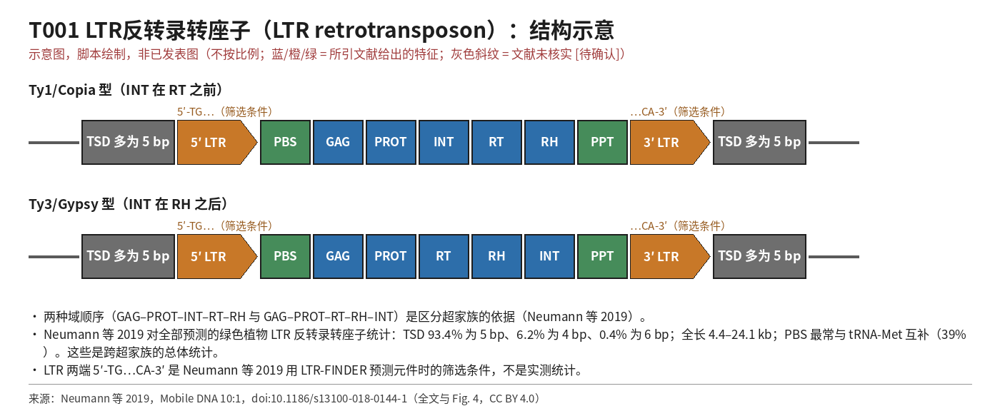

图 T001-1　LTR反转录转座子（LTR retrotransposon）：结构示意。示意图，脚本绘制，非已发表图；每个特征的来源写在图下方。序列：Dfam 4.0 绿色植物家族中没有本类型可用的共识序列（无此类家族、两端 30 bp 含 N，或分类标注无法核实），不画序列。


典型的自主型 LTR 反转录转座子由 5' LTR、内部编码区与 3' LTR 三部分组成，全长通常在 4 kb 至 15 kb 之间，少数大型植物元件可超过 20 kb [待确认]。单个 LTR 的长度跨度较大，多在 100 bp 至数 kb 之间，内部依次包含 U3、R 和 U5 三个功能亚区，分别承担转录启动调控、转录起始与加尾信号定位等功能 [待确认]。绝大多数完整元件的 LTR 末端存在短反向重复序列，最经典的末端二核苷酸为 5'-TG...CA-3'，但部分家族存在非经典末端变异 [待确认]。在内部区域两端，5' LTR 下游紧邻引物结合位点（primer binding site，PBS），其序列通常与宿主细胞中某种 tRNA 的 3' 端互补，用于启动负链 DNA 合成；3' LTR 上游紧邻富含嘌呤的多聚嘌呤区（polypurine tract，PPT），用于启动正链 DNA 合成 [待确认]。（见本条“本版补充说明”）

#### TSD

LTR 反转录转座子整合进入宿主染色体时，整合酶在靶位点 DNA 双链上产生交错切口，随后由宿主 DNA 修复系统补平缺口，在元件 5' 端和 3' 端外侧形成一对长度相同的正向重复序列，称为靶位点重复（target site duplication，TSD） [待确认]。整个 LTR 目的 TSD 长度通常为 4 bp 至 6 bp，其中植物常见超家族以 5 bp 最为典型 [待确认]。

#### 编码蛋白与结构域顺序

完整的自主型 LTR 反转录转座子在内部区域编码 `gag` 与 `pol` 两个核心功能区，部分超家族或特定植物谱系还在 `pol` 下游携带 `env` 样开放阅读框（Havecker 等 2004, doi:10.1186/gb-2004-5-6-225）。`gag` 编码衣壳样结构蛋白，负责在细胞质内组装病毒样颗粒（virus-like particle，VLP）并保护转录本 RNA；`pol` 编码完成转座周期必需的酶类，包括天冬氨酸蛋白酶（PR/PROT）、整合酶（INT）、反转录酶（RT）与核糖核酸酶 H（RH/RNase H）（Neumann 等 2019, doi:10.1186/s13100-018-0144-1）。`pol` 内结构域的排列顺序是区分 LTR 目内超家族的核心分子标志：Copia 超家族遵循 PROT-INT-RT-RH 顺序，而 Gypsy、Bel-Pao 及逆转录病毒相关类群遵循 PROT-RT-RH-INT 顺序（Neumann 等 2019, doi:10.1186/s13100-018-0144-1）。

#### 转座机制

LTR 反转录转座子采用复制粘贴式机制扩增，每次成功转座都会在保留原拷贝的基础上产生新拷贝 [待确认]。过程始于宿主 RNA 聚合酶 II 识别 5' LTR 中 U3 区的启动子，从 5' R 区起始转录并在 3' R 区终止加尾，生成全长单链 RNA 转录本 [待确认]。该 RNA 既作为翻译 `gag` 与 `pol` 蛋白的信使 RNA，也被包裹进入细胞质内的病毒样颗粒作为反转录模板 [待确认]。在病毒样颗粒内，反转录酶以结合在 PBS 上的宿主 tRNA 为引物合成负链强停 DNA，经链转移至 3' R 区后继续延伸合成全长负链 cDNA；随后 RNase H 降解 RNA 模板，保留抗降解的 PPT 片段作为正链引物，经第二次链转移合成双链 cDNA [待确认]。最后，双链 cDNA 随整合酶进入细胞核并插入宿主基因组新位点，伴随产生 TSD [待确认]。由于反转录机制决定了新插入拷贝的 5' LTR 与 3' LTR 序列完全一致，后续随演化时间独立积累碱基替代，因此两个 LTR 之间的序列分歧度常被用于推算单个完整拷贝的插入时间 [待确认]。

#### 自主与非自主搭档

完整编码 `gag` 与 `pol` 蛋白且保留两端 LTR、PBS 与 PPT 的元件属于自主型，能够独立驱动自身转座 [待确认]。当内部编码区发生大片段缺失或失活，但仍保留两端 LTR 及顺式作用元件时，则形成非自主型衍生物，它们无法自行合成反转录与整合机器，必须反式借用同细胞内自主型元件编码的蛋白完成扩增 [待确认]。植物中两类代表性的非自主搭档为微型末端重复反转录转座子（TRIM）与大型反转录转座子衍生物（LARD） [待确认]。此外，单个完整元件的两翼 LTR 之间经常发生不等同源重组，直接切除内部编码区及其中一个 LTR，在基因组中仅残留一个孤立的 solo-LTR，该过程是植物基因组清除冗余 LTR 序列并抑制基因组无限膨胀的重要平衡机制 [待确认]。

#### 识别特征与工具

全基因组水平从头识别完整 LTR 反转录转座子主要依据结构特征：两段序列高度相似且间隔适中的正向重复 LTR、保守的 5'-TG...CA-3' 末端、紧邻两翼的 4 bp 至 6 bp TSD、内部 PBS 与 PPT 以及可识别的 `gag-pol` 蛋白结构域 [待确认]。常用的结构预测软件包括 LTR_FINDER（Xu 和 Wang 2007, doi:10.1093/nar/gkm286）、LTRharvest（Ellinghaus 等 2008, doi:10.1186/1471-2105-9-18）以及用于注释内部 PBS、PPT 和蛋白结构域的 LTRdigest（Steinbiss 等 2009, doi:10.1093/nar/gkp759）。LTR_retriever 能够整合上游候选结果并通过严格边界与结构域过滤大幅降低假阳性，同时衍生出基于完整 LTR 比例评估基因组组装连续性的 LAI 指标（Ou 和 Jiang 2018, doi:10.1104/pp.17.01310）。综合注释流程 EDTA 整合了 LTR 候选识别与去冗余库构建步骤（Ou 等 2019, doi:10.1186/s13059-019-1905-y）；针对植物 LTR 元件的超家族与谱系级精准分类，目前广泛采用基于 REXdb 蛋白结构域隐马尔可夫模型（HMM）的 TEsorter（Zhang 等 2022, doi:10.1093/hr/uhac017；Neumann 等 2019, doi:10.1186/s13100-018-0144-1）。（见本条“本版补充说明”）

#### 分类争议

LTR 目层面的分类争议集中在边界界定与病毒命名衔接两方面。首先，2007 年统一分类体系将 Retrovirus（RLR）与 ERV（RLE）并列为独立超家族，而 Dfam 现行体系及病毒分类学则倾向于将外源性逆转录病毒与其内源化整合拷贝统一纳入 Retroviridae/ERV 谱系框架中（Wicker 等 2007, doi:10.1038/nrg2165；Storer 等 2021, doi:10.1186/s13100-020-00230-y）。其次，内源副反转录病毒（Caulimoviridae）虽不具备典型双 LTR 整合结构，但因与 LTR 元件共享反转录酶系统发育近缘关系，在 REXdb 与 Dfam 中常与 LTR 类群并列收录以避免注释混淆，学界对其是否属于狭义 LTR 目存在界定差异（Neumann 等 2019, doi:10.1186/s13100-018-0144-1；Storer 等 2021, doi:10.1186/s13100-020-00230-y）。此外，植物部分 Copia 与 Gypsy 谱系携带 `env` 样开放阅读框，曾引发关于植物是否存在逆转录病毒的讨论，现行分类已明确将其归回植物 LTR 谱系而非 ERV（Neumann 等 2019, doi:10.1186/s13100-018-0144-1）。

#### 发现与分布

**发现与命名**

- Boeke 等 (1985) Ty elements transpose through an RNA intermediate. Cell. doi:10.1016/0092-8674(85)90197-7。摘要原句：“If the donor TyH3 is marked with an intron-containing fragment, the intron is correctly spliced out of the Ty during transposition, suggesting that the Ty RNA is the intermediate for transposition”；支持范围：Ty1 transposes via an RNA intermediate (first LTR retrotransposon mechanism)
- Xiong 和 Eickbush (1990) Origin and evolution of retroelements based upon their reverse transcriptase sequences. The EMBO Journal. doi:10.1002/j.1460-2075.1990.tb07536.x。摘要原句：“To study the evolutionary relationship of reverse transcriptase (RT) containing genetic elements, a phylogenetic tree of 82 retroelements from animals, plants, protozoans and bacteria was constructed”；涉及生物：retroelements across eukaryotes；支持范围：RT-based phylogeny separating LTR and non-LTR retroelements
- Wicker 等 (2007) A unified classification system for eukaryotic transposable elements. Nature Rev Genetics. doi:10.1038/nrg2165。摘要原句：“Here we propose the first unified hierarchical classification system, designed on the basis of the transposition mechanism, sequence similarities and structural relationships, that can be easily applied by non-experts”；支持范围：hierarchical classification (class, subclass, order, superfamily)

**植物中的报道**

- Bennetzen 和 Wang (2014) The contributions of transposable elements to the structure, function, and evolution of plant genomes. Annual Rev of Plant Biology. doi:10.1146/annurev-arplant-050213-035811。摘要原句：“Although the origins and attitudes of TEs have the hallmarks of selfish DNA, there are numerous cases where TE components have been co-opted by the host to create new genes or modify gene regulation”；涉及生物：plants；支持范围：LTR retrotransposons in plant genomes
- Kumar 和 Bennetzen (1999) Plant retrotransposons. Annual Rev of Genetics. doi:10.1146/annurev.genet.33.1.479。摘要原句：“Retrotransposons are mobile genetic elements that transpose through reverse transcription of an RNA intermediate”；涉及生物：plants
- Neumann 等 (2019) Systematic survey of plant LTR-retrotransposons elucidates phylogenetic relationships of their polyprotein domains and provides a reference for element classification. Mobile DNA. doi:10.1186/s13100-018-0144-1。摘要原句：“BackgroundPlant LTR-retrotransposons are classified into two superfamilies, Ty1/copia and Ty3/gypsy”；涉及生物：Viridiplantae；支持范围：REXdb survey of plant LTR retrotransposon lineages

**葡萄中的报道**

- Velasco 等 (2007) A high quality draft consensus sequence of the genome of a heterozygous grapevine variety. PLoS ONE. doi:10.1371/journal.pone.0001326。正文原句：“The repeats were included in group I (retrotransposons: Copia, Gypsy, LINE) and group II (DNA transposons: Mutator, CACTA, hAT) according to Feschotte et al. [75] . The most abundant TEs were Gypsy/athila-like elements followed by Copia…”；涉及生物：Vitis vinifera；支持范围：most abundant TEs in the grape draft genome
- Shi 等 (2023) The complete reference genome for grapevine (Vitis vinifera L.) genetics and breeding. Horticulture Research. doi:10.1093/hr/uhad061。正文原句：“The TEs mainly consisted of the long terminal repeat (LTR) type (47.54%), predominantly Gypsy (20.22%) and Copia (19.67%)…”；涉及生物：Vitis vinifera PN40024；支持范围：TE composition of the T2T grape genome
- Carrier 等 (2012) Transposable elements are a major cause of somatic polymorphism in Vitis vinifera L. PLoS ONE. doi:10.1371/journal.pone.0032973。正文原句：“Selection of mobile elements and confirmation of their insertion polymorphism We selected for detailed analyses four representative mobile elements among class I LTR transposable elements: Gret-1 , Copia-10 , Gypsy-19 and Cauliv-1 . These four elements have very different copy numbers and polymorphic sites in the partial…”；涉及生物：Vitis vinifera；支持范围：Gret-1, Copia-10, Gypsy-19, Cauliv-1 insertion polymorphism

#### 本版补充说明

① 域顺序：GAG–PROT–INT–RT–RH（Ty1/Copia）与 GAG–PROT–RT–RH–INT（Ty3/Gypsy）是 Neumann 等 2019（doi:10.1186/s13100-018-0144-1）在超家族层面给出的判别顺序；本条若写某谱系“遵循”该顺序，指的是沿用超家族的顺序，不是该文对本谱系另行测定。

② 末端：5′-TG…CA-3′ 是该文用 LTR-FINDER 预测元件时设定的筛选条件，不是对各谱系的实测统计；本条中“末端保守为 5′-TG…CA-3′”一类说法应按此理解。

③ TSD 统计（93.4% 为 5 bp、6.2% 为 4 bp、0.4% 为 6 bp）与全长 4.4–24.1 kb 是该文对全部预测元件的总体统计，不是某一超家族或谱系的值；各谱系的值见 Fig. 4 与 T011–T045。

### T002 Ty1/Copia超家族（Ty1/Copia）

**名称对照**：Wicker 体系：I 类 / LTR 目 / Copia 超家族（代码 RLC）；Dfam 节点：Long_Terminal_Repeat_Element;Ty1-Copia；REXdb 路径：Class_I/LTR/Ty1/copia。（来源：代码据 Wu 等 2025, doi:10.3390/biom15030346；Dfam 4.0 分类树，2026-11-23 读取；REXdb v4.0 说明文件，doi:10.5281/zenodo.10160279）

#### 定义与命名

Ty1/Copia 超家族是 I 类转座子 LTR 目下的两大植物主导超家族之一，在 2007 年统一分类体系中三字母代码为 `RLC`（Wicker 等 2007, doi:10.1038/nrg2165）。该超家族以最早在酿酒酵母中发现的 Ty1 元件和在黑腹果蝇中发现的 Copia 元件联合命名；在国际病毒分类委员会（ICTV）体系中对应 Pseudoviridae 科，在 Dfam 现行分类中对应 `LTR/Copia` 节点（Wicker 等 2007, doi:10.1038/nrg2165）。根据 2019 年基于反转录转座子蛋白结构域建立的 REXdb 分类体系，绿色植物中的 Ty1/Copia 进一步划分为 16 个系统发育谱系：Ale、Alesia、Angela、Bianca、Bryco、Gymco-I、Gymco-II、Gymco-III、Gymco-IV、Ikeros、Ivana、Lyco、Osser、SIRE、TAR 与 Tork（Neumann 等 2019, doi:10.1186/s13100-018-0144-1）。

#### 结构、长度与末端

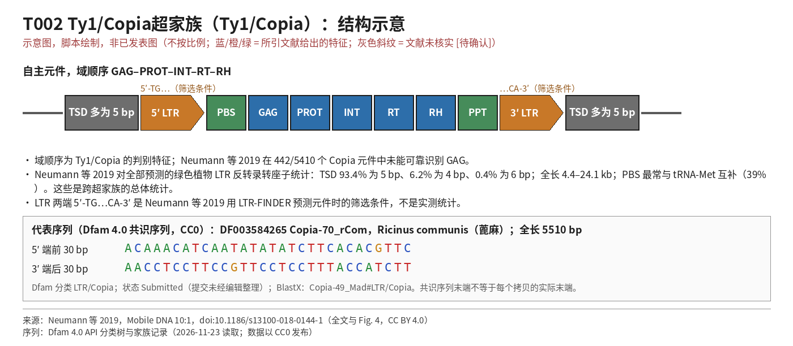

图 T002-1　Ty1/Copia超家族（Ty1/Copia）：结构示意。示意图，脚本绘制，非已发表图；每个特征的来源写在图下方。序列条：Dfam DF003584265（Copia-70_rCom，蓖麻 Ricinus communis，Dfam 4.0，CC0；状态 Submitted）前、后各 30 bp。该共识序列两端不是 5′-TG…CA-3′，提交的共识边界可能与真实 LTR 末端不一致，仅作序列样例。

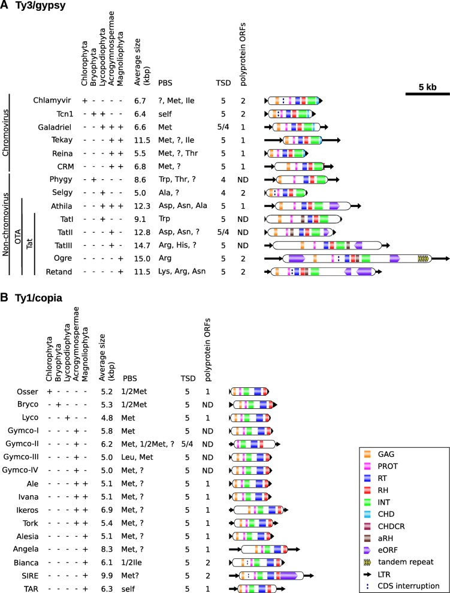

图 T002-P1　绿色植物 Ty1/copia 与 Ty3/gypsy 各谱系的分布、平均长度、PBS、TSD、ORF 数与代表元件结构。原图：Neumann 等（2019），Fig. 4。Systematic survey of plant LTR-retrotransposons elucidates phylogenetic relationships of their polyprotein domains and provides a reference for element classification. Mob DNA. doi:10.1186/s13100-018-0144-1。许可：CC BY 4.0（https://creativecommons.org/licenses/by/4.0/）。未修改。


完整的自主型 Ty1/Copia 元件全长多在 4 kb 至 9 kb 之间，整体平均长度通常短于 Ty3/Gypsy 超家族，但部分大型谱系（如 Angela 与 SIRE）全长可达 10 kb 左右 [待确认]。单个 LTR 长度一般为 150 bp 至 1.5 kb，多数家族两端呈现保守的 5'-TG...CA-3' 末端二核苷酸 [待确认]。5' LTR 下游具 PBS（植物 Copia 元件最常与甲硫氨酸启动 tRNA 互补，具体不同谱系 tRNA 偏好细节待确认），3' LTR 上游具 PPT。相比 Ty3/Gypsy，部分 Copia 谱系（如 Ale）结构极为紧凑，内部非编码区较短，LTR 长度常仅数百 bp（Neumann 等 2019, doi:10.1186/s13100-018-0144-1）。（见本条“本版补充说明”）

#### TSD

整合进入宿主基因组时形成正向重复的 TSD，典型长度为 5 bp [待确认]。在极少数家族或修复异常位点中可见 4 bp 或 6 bp 变异（待确认）。

#### 编码蛋白与结构域顺序

Ty1/Copia 超家族最核心的分子鉴别特征是 `pol` 区域内整合酶（INT）位于反转录酶（RT）与核糖核酸酶 H（RH）的上游，完整结构域排列顺序为 **GAG - PROT - INT - RT - RH**（Neumann 等 2019, doi:10.1186/s13100-018-0144-1）。这一顺序与 Ty3/Gypsy、Bel-Pao 及逆转录病毒的 PROT-RT-RH-INT 顺序截然相反，是最稳定的超家族判别依据 [待确认]。在许多植物 Copia 元件中，`gag` 与 `pol` 位于同一个连续开放阅读框内，翻译后由自身编码的蛋白酶切割成熟；部分家族则通过核糖体移码或终止密码子通读调控 `gag` 与 `pol` 的化学计量比（Havecker 等 2004, doi:10.1186/gb-2004-5-6-225）。在植物谱系中，SIRE 谱系具有显著的结构特例，其在 `pol` 下游额外携带一个 `env` 样开放阅读框（Neumann 等 2019, doi:10.1186/s13100-018-0144-1）。

#### 转座机制

遵循标准的 LTR 反转录转座子复制粘贴机制：由 5' LTR 启动子驱动全长 RNA 转录，在细胞质内组装形成病毒样颗粒并完成以 tRNA-PBS 和 PPT 为引物的双链 cDNA 合成，最终由整合酶将双链 cDNA 整合至宿主染色体并产生 5 bp TSD [待确认]。不少植物 Copia 元件的 5' LTR U3 区含有与逆境胁迫、激素信号或组织发育相关的顺式调控基序，使其在正常发育状态下受表观遗传沉默抑制，而在非生物或生物胁迫、组织培养及杂交冲击条件下可被转录激活 [待确认]。

#### 自主与非自主搭档

自主型 Ty1/Copia 元件携带完整 `gag` 与 `pol` 结构域，可驱动自身及同源非自主元件扩增 [待确认]。非自主衍生物丧失部分或全部内部编码序列但保留 LTR、PBS 与 PPT，依赖同家族自主型元件反式提供的蛋白机器完成反转录与整合；植物中的部分 TRIM 元件在序列与末端特征上显示出与 Copia 谱系相关的演化来源（具体 TRIM 与 Copia 搭档配对的专文 DOI 待确认）。同元件两翼 LTR 间的不等同源重组同样在 Copia 家族中频繁发生，产生大量 solo-LTR [待确认]。

#### 识别特征与工具

Ty1/Copia 的从头结构检出依赖 LTRharvest（Ellinghaus 等 2008, doi:10.1186/1471-2105-9-18）、LTR_FINDER（Xu 和 Wang 2007, doi:10.1093/nar/gkm286）、LTR_retriever（Ou 和 Jiang 2018, doi:10.1104/pp.17.01310）与 EDTA（Ou 等 2019, doi:10.1186/s13059-019-1905-y）。将其与 Ty3/Gypsy 准确区分并细分至植物 16 个谱系，核心依据是 `pol` 内 INT-RT-RH 的结构域顺序以及各结构域的 HMM 比对得分，标准工具为基于 REXdb 的 TEsorter（Zhang 等 2022, doi:10.1093/hr/uhac017；Neumann 等 2019, doi:10.1186/s13100-018-0144-1），辅助蛋白域注释亦可使用 LTRdigest（Steinbiss 等 2009, doi:10.1093/nar/gkp759）与 GyDB（Llorens 等 2011, doi:10.1093/nar/gkq1061）。对于丧失内部编码区的非自主 Copia 衍生物或 solo-LTR，需依靠其 LTR 序列与完整自主型参考拷贝的核酸同源性进行归类 [待确认]。

#### 分类争议

主要争议集中在病毒学与转座子学命名体系的并行，以及植物内部谱系的历史划分差异。ICTV 体系使用 Pseudoviridae 及其下属名（如 Pseudovirus、Hemivirus、Sirevirus），而基因组学与植物转座子研究界普遍沿用 Ty1/Copia 与 RLC 命名（Wicker 等 2007, doi:10.1038/nrg2165；Llorens 等 2011, doi:10.1093/nar/gkq1061）。在植物谱系层面，早期不同文献对 Angela/Tork、Ivana/Oryco 以及 Maximus/SIRE 等谱系的命名和边界定义并不统一，2019 年 REXdb 系统发育分类统一了这些对应关系（如将 Maximus 统一归入 SIRE，将 Oryco 统一归入 Ivana）（Neumann 等 2019, doi:10.1186/s13100-018-0144-1）。此外，由于 SIRE 谱系携带 `env` 样开放阅读框，早期个别研究曾将其视作植物逆转录病毒候选者，现行分类已明确其属于 Ty1/Copia 超家族的独立谱系（Neumann 等 2019, doi:10.1186/s13100-018-0144-1）。

#### 发现与分布

**发现与命名**

- Wicker 等 (2007) A unified classification system for eukaryotic transposable elements. Nature Rev Genetics. doi:10.1038/nrg2165。摘要原句：“Here we propose the first unified hierarchical classification system, designed on the basis of the transposition mechanism, sequence similarities and structural relationships, that can be easily applied by non-experts”；支持范围：hierarchical classification (class, subclass, order, superfamily) [注意：所引句不含该名称，仅支持上位/总体论断]
- Boeke 等 (1985) Ty elements transpose through an RNA intermediate. Cell. doi:10.1016/0092-8674(85)90197-7。摘要原句：“If the donor TyH3 is marked with an intron-containing fragment, the intron is correctly spliced out of the Ty during transposition, suggesting that the Ty RNA is the intermediate for transposition”；支持范围：Ty1 element (type member of Ty1/Copia) [注意：所引句不含该名称，仅支持上位/总体论断]
- Mount 和 Rubin (1985) Complete nucleotide sequence of the Drosophila transposable element copia: homology between copia and retroviral proteins. Molecular and Cellular Biology. doi:10.1128/mcb.5.7.1630-1638.1985。摘要原句：“We have determined the complete nucleotide sequence of the copia element present at the white-apricot allele of the white locus in Drosophila melanogaster”；涉及生物：Drosophila melanogaster；支持范围：complete sequence of copia and homology to retroviral proteins [注意：所引句不含该名称，仅支持上位/总体论断]

**植物中的报道**

- Kumar 和 Bennetzen (1999) Plant retrotransposons. Annual Rev of Genetics. doi:10.1146/annurev.genet.33.1.479。摘要原句：“Retrotransposons are mobile genetic elements that transpose through reverse transcription of an RNA intermediate”；涉及生物：plants
- Neumann 等 (2019) Systematic survey of plant LTR-retrotransposons elucidates phylogenetic relationships of their polyprotein domains and provides a reference for element classification. Mobile DNA. doi:10.1186/s13100-018-0144-1。摘要原句：“BackgroundPlant LTR-retrotransposons are classified into two superfamilies, Ty1/copia and Ty3/gypsy”；涉及生物：Viridiplantae；支持范围：REXdb survey of plant LTR retrotransposon lineages
- Hirochika 等 (1996) Retrotransposons of rice involved in mutations induced by tissue culture. Proceedings of the National Academy of Sciences. doi:10.1073/pnas.93.15.7783。摘要原句：“Five retrotransposon families of rice (Tos1-Tos5) have been reported previously”；支持范围：Tos17 copia-like retrotransposon activated by tissue culture [注意：所引句不含该名称，仅支持上位/总体论断]
- Grandbastien 等 (1989) Tnt1, a mobile retroviral-like transposable element of tobacco isolated by plant cell genetics. Nature. doi:10.1038/337376a0。摘要原句：“Here, we report the isolation of the first tobacco (Nicotiana tabacum) transposable element, Tnt1, which seems to be the most complete mobile retrotransposon characterized in higher plants”；涉及生物：tobacco (Nicotiana tabacum)；支持范围：Tnt1 retroviral-like element [注意：所引句不含该名称，仅支持上位/总体论断]
- Wicker 和 Keller (2007) Genome-wide comparative analysis of copia retrotransposons in Triticeae, rice, and Arabidopsis reveals conserved ancient evolutionary lineages and distinct dynamics of individual copia families. Genome Research. doi:10.1101/gr.6214107。正文原句：“…Triticeae sequences are the closely related Angela , BARE1 , and WIS families. copia elements from grasses and their Arabidopsis homologs can be separated into six major evolutionary lineages Approximately 500 amino acids covering the reverse transcriptase domain (the most conserved region of the copia elements) from 77…”；涉及生物：barley, wheat, rice, Arabidopsis；支持范围：six copia lineages across monocots and dicots [注意：所引句不含该名称，仅支持上位/总体论断]

**葡萄中的报道**

- Shi 等 (2023) The complete reference genome for grapevine (Vitis vinifera L.) genetics and breeding. Horticulture Research. doi:10.1093/hr/uhad061。正文原句：“The TEs mainly consisted of the long terminal repeat (LTR) type (47.54%), predominantly Gypsy (20.22%) and Copia (19.67%)…”；涉及生物：Vitis vinifera PN40024；支持范围：TE composition of the T2T grape genome [注意：所引句不含该名称，仅支持上位/总体论断]
- Moisy 等 (2008) Characterization of ten novel Ty1/copia-like retrotransposon families of the grapevine genome. BMC Genomics. doi:10.1186/1471-2164-9-469。摘要原句：“To characterize retrotransposon families in the grapevine genome (the fourth crop plant genome sequenced) we have combined two approaches: a PCR-based method for the isolation of RnaseH-LTR sequences with a computer-based sequence similarity search in the whole-genome sequence of PN40024.ResultsSupported by a phylogenic…”；涉及生物：Vitis vinifera；支持范围：ten novel Ty1/copia families plus Tvv1 Vine-1 and Gret1
- Pelsy 和 Merdinoglu (2002) Complete sequence of Tvv1, a family of Ty 1 copia-like retrotransposons of Vitis vinifera L., reconstituted by chromosome walking. Theoretical and Applied Genetics. doi:10.1007/s00122-002-0969-2。摘要原句：“The reconstitution of a family of retroelements, named Tvv1, was achieved by six successive steps”；涉及生物：Vitis vinifera；支持范围：Tvv1 Ty1/copia family [注意：所引句不含该名称，仅支持上位/总体论断]
- Verriès 等 (2000) Cloning and characterization of Vine-1, a LTR-retrotransposon-like element in Vitis vinifera L., and other Vitis species. Genome. doi:10.1139/g99-139。摘要原句：“We report the organization of a grapevine chimeric gene Adhr-Vine-1, composed by an Adhr gene, into which a retroelement, Vine-1, was inserted”；涉及生物：Vitis vinifera；支持范围：Vine-1 LTR retrotransposon [注意：所引句不含该名称，仅支持上位/总体论断]
- Labra 等 (2004) Vine-1 retrotransposon-based sequence-specific amplified polymorphism for Vitis vinifera L. genotyping. Plant Breeding. doi:10.1046/j.1439-0523.2003.00965.x。摘要原句：“The development and application of this procedure to the LTR of the Vine-1 element from grapevine is reported”；涉及生物：Vitis vinifera；支持范围：Vine-1 SSAP markers [注意：所引句不含该名称，仅支持上位/总体论断]
- Pelsy (2007) Untranslated leader region polymorphism of Tvv1, a retrotransposon family, is a novel marker useful for analyzing genetic diversity and relatedness in the genus Vitis. Theoretical and Applied Genetics. doi:10.1007/s00122-007-0643-9。摘要原句：“Grapevine retrotransposons belonging to the Tvv1 family share a single, highly conserved open reading frame but differ by their untranslated leader (UTL) region, which is highly variable in size”；涉及生物：Vitis vinifera；支持范围：Tvv1 UTR polymorphism [注意：所引句不含该名称，仅支持上位/总体论断]
- Carrier 等 (2012) Transposable elements are a major cause of somatic polymorphism in Vitis vinifera L. PLoS ONE. doi:10.1371/journal.pone.0032973。正文原句：“Selection of mobile elements and confirmation of their insertion polymorphism We selected for detailed analyses four representative mobile elements among class I LTR transposable elements: Gret-1 , Copia-10 , Gypsy-19 and Cauliv-1 . These four elements have very different copy numbers and polymorphic sites in the partial…”；涉及生物：Vitis vinifera；支持范围：Gret-1, Copia-10, Gypsy-19, Cauliv-1 insertion polymorphism [注意：所引句不含该名称，仅支持上位/总体论断]
- Park 等 (2021) Horizontal Transfer of LTR Retrotransposons Contributes to the Genome Diversity of Vitis. International Journal of Molecular Sciences. doi:10.3390/ijms221910446。正文原句：“In our analysis, the major difference in LTR retrotransposon content in the Vitis genomes appeared in the native LTR retrotransposon families, such as Tork , Athila , and Tat ( Figure 5 d,e and Figure 6 , and Supplementary Figure S7 )”；涉及生物：Vitis；支持范围：horizontal transfer of LTR retrotransposons; Tork, CRM, Reina, Athila, Tat families in four Vitis genomes [注意：所引句不含该名称，仅支持上位/总体论断]

#### 本版补充说明

① 域顺序：GAG–PROT–INT–RT–RH（Ty1/Copia）与 GAG–PROT–RT–RH–INT（Ty3/Gypsy）是 Neumann 等 2019（doi:10.1186/s13100-018-0144-1）在超家族层面给出的判别顺序；本条若写某谱系“遵循”该顺序，指的是沿用超家族的顺序，不是该文对本谱系另行测定。

② 末端：5′-TG…CA-3′ 是该文用 LTR-FINDER 预测元件时设定的筛选条件，不是对各谱系的实测统计；本条中“末端保守为 5′-TG…CA-3′”一类说法应按此理解。

③ TSD 统计（93.4% 为 5 bp、6.2% 为 4 bp、0.4% 为 6 bp）与全长 4.4–24.1 kb 是该文对全部预测元件的总体统计，不是某一超家族或谱系的值；各谱系的值见 Fig. 4 与 T011–T045。

### T003 Ty3/Gypsy超家族（Ty3/Gypsy）

**名称对照**：Wicker 体系：I 类 / LTR 目 / Gypsy 超家族（代码 RLG）；Dfam 节点：Gypsy-ERV;Gypsy；REXdb 路径：Class_I/LTR/Ty3/gypsy。（来源：代码据 Wu 等 2025, doi:10.3390/biom15030346；Dfam 4.0 分类树，2026-11-23 读取；REXdb v4.0 说明文件，doi:10.5281/zenodo.10160279）

#### 定义与命名

Ty3/Gypsy 超家族是 I 类转座子 LTR 目下的另一大核心超家族，在 2007 年统一分类体系中三字母代码为 `RLG`（Wicker 等 2007, doi:10.1038/nrg2165）。该超家族以酿酒酵母的 Ty3 元件与黑腹果蝇的 Gypsy 元件命名；在 ICTV 病毒分类体系中对应 Metaviridae 科，在 Dfam 现行分类中对应 `LTR/Gypsy` 节点（Wicker 等 2007, doi:10.1038/nrg2165；Storer 等 2021, doi:10.1186/s13100-020-00230-y）。根据 2019 年 REXdb 系统发育分类框架，绿色植物的 Ty3/Gypsy 划分为两大主支：非染色质病毒支（non-chromovirus），包含 Athila 与 Tat（进一步细分为 TatI、TatII、TatIII、Ogre、Retand 等谱系）；以及染色质病毒支（chromovirus），在被子植物中主要包含 CRM、Galadriel、Reina 与 Tekay，在苔藓、蕨类与藻类中还包括 Chlamyvir、Tcn1、Phygy 与 Selgy 等谱系（Neumann 等 2019, doi:10.1186/s13100-018-0144-1）。

#### 结构、长度与末端

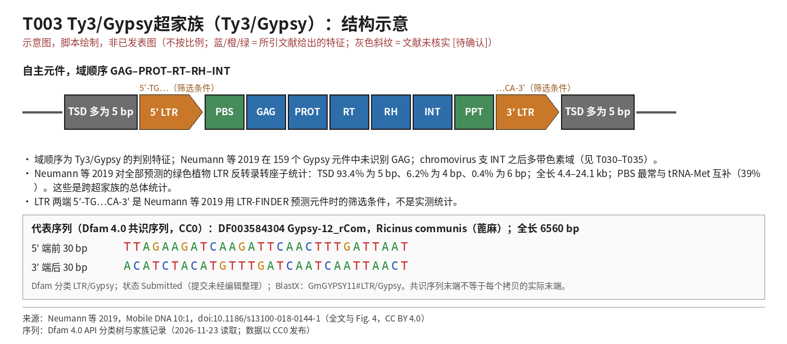

图 T003-1　Ty3/Gypsy超家族（Ty3/Gypsy）：结构示意。示意图，脚本绘制，非已发表图；每个特征的来源写在图下方。序列条：Dfam DF003584304（Gypsy-12_rCom，蓖麻 Ricinus communis，Dfam 4.0，CC0；状态 Submitted）前、后各 30 bp。该共识序列两端不是 5′-TG…CA-3′，提交的共识边界可能与真实 LTR 末端不一致，仅作序列样例。


图 T003-P1　绿色植物 Ty1/copia 与 Ty3/gypsy 各谱系的分布、平均长度、PBS、TSD、ORF 数与代表元件结构。原图：Neumann 等（2019），Fig. 4。Systematic survey of plant LTR-retrotransposons elucidates phylogenetic relationships of their polyprotein domains and provides a reference for element classification. Mob DNA. doi:10.1186/s13100-018-0144-1。许可：CC BY 4.0（https://creativecommons.org/licenses/by/4.0/）。未修改。


自主型 Ty3/Gypsy 元件的典型全长为 5 kb 至 15 kb，整体尺寸普遍大于 Ty1/Copia；部分非染色质病毒谱系（如 Ogre 与 Retand）因内部存在较长的非编码区或附加开放阅读框，全长常超过 15 kb 甚至突破 20 kb [待确认]。单个 LTR 长度变化幅度大，常见范围为 300 bp 至 3 kb 以上，末端高度保守为 5'-TG...CA-3' [待确认]。内部两端同样具备 PBS 与 PPT，LTR 内含 U3、R、U5 调控亚区 [待确认]。（见本条“本版补充说明”）

#### TSD

整合进入宿主基因组时形成正向重复的 TSD，典型长度为 5 bp [待确认]。少数谱系或个别位点可见 4 bp 或 6 bp 变异（待确认）。

#### 编码蛋白与结构域顺序

Ty3/Gypsy 超家族的核心结构特征是 `pol` 区域内反转录酶（RT）与核糖核酸酶 H（RH）位于整合酶（INT）上游，完整结构域顺序为 **GAG - PROT - RT - RH - INT**（Neumann 等 2019, doi:10.1186/s13100-018-0144-1）。该排列顺序与 Bel-Pao 和逆转录病毒一致，但与 Ty1/Copia 明显不同 [待确认]。在染色质病毒支（chromovirus）中，整合酶 C 端额外携带一个染色质结构域（chromodomain，CHD 或特化的着丝粒靶向基序 CHDCR），能够结合特定的组蛋白修饰或着丝粒蛋白，引导元件定向整合至异染色质或着丝粒区域（Neumann 等 2019, doi:10.1186/s13100-018-0144-1；Llorens 等 2011, doi:10.1093/nar/gkq1061）。在非染色质病毒支中，Athila 与部分 Tat 谱系常在 `pol` 下游携带 `env` 样开放阅读框或功能尚不完全明确的附加开放阅读框（Neumann 等 2019, doi:10.1186/s13100-018-0144-1）。

#### 转座机制

采用典型的 LTR 反转录转座子复制粘贴机制，经宿主 RNA 聚合酶 II 转录、细胞质病毒样颗粒内反转录合成双链 cDNA 以及整合酶介导的染色体整合完成扩增 [待确认]。与随机整合相比，染色质病毒支元件借助整合酶 C 端的染色质结构域表现出明显的靶向整合偏好，例如 CRM 谱系特异性靶向着丝粒区域，降低了插入必需功能基因导致宿主致死的风险，从而有助于自身在基因组中长期高拷贝存留（Neumann 等 2019, doi:10.1186/s13100-018-0144-1）。

#### 自主与非自主搭档

完整编码 `gag` 与 `pol` 的 Ty3/Gypsy 元件为自主型，既能自我扩增，也可为同家族缺失内部编码区的非自主衍生物提供反式转座机器 [待确认]。植物中的大型反转录转座子衍生物（LARD）多被认为起源于大型 Ty3/Gypsy（或部分 Copia）元件内部编码区缺失后的衍生形式，长度常超过 4 kb 且不含完整 `pol`（LARD 起源配对专文 DOI 待确认）。高拷贝 Ty3/Gypsy 元件也频繁发生两翼 LTR 间的不等同源重组，形成大量 solo-LTR，部分完整元件之间还常形成嵌套插入（nested insertion）结构，构成异染色质区的主体骨架 [待确认]。

#### 识别特征与工具

结构从头识别采用 LTRharvest（Ellinghaus 等 2008, doi:10.1186/1471-2105-9-18）、LTR_FINDER（Xu 和 Wang 2007, doi:10.1093/nar/gkm286）、LTR_retriever（Ou 和 Jiang 2018, doi:10.1104/pp.17.01310）与 EDTA（Ou 等 2019, doi:10.1186/s13059-019-1905-y）。在超家族及谱系鉴定层面，因 Ty3/Gypsy 与 Bel-Pao、ERV 具有相同的 PROT-RT-RH-INT 排列顺序，必须结合蛋白结构域 HMM 比对与系统发育归类，同时核查整合酶 C 端是否存在染色质结构域以区分染色质病毒支与非染色质病毒支（Neumann 等 2019, doi:10.1186/s13100-018-0144-1）。植物项目首选基于 REXdb 的 TEsorter 完成至 CRM、Tekay、Reina、Galadriel、Athila、Tat/Ogre/Retand 等谱系的自动化分类（Zhang 等 2022, doi:10.1093/hr/uhac017）。

#### 分类争议

第一项争议是命名规范问题：近年来部分研究者指出「Gypsy」一词在社会语境中带有族群歧视色彩，倡议统一改用 Ty3 或 Metaviridae 替代，但 2007 年统一分类体系（RLG）、Dfam 现行节点与 REXdb 仍保留 Ty3/Gypsy 或 Gypsy 标签以确保生物信息学数据库与下游工具的向后兼容（Wicker 等 2007, doi:10.1038/nrg2165；Storer 等 2021, doi:10.1186/s13100-020-00230-y；Neumann 等 2019, doi:10.1186/s13100-018-0144-1；更名倡议专文 DOI 待确认）。第二项争议涉及内部谱系合并与命名对应，例如早期文献中的 Del 谱系在 2019 年 REXdb 框架下统一归入 Tekay，早期笼统并称的 OTA（Ogre/Tat/Athila）复合群在系统发育上被清晰拆分为独立的 Athila 谱系与 Tat 谱系及其子支（Neumann 等 2019, doi:10.1186/s13100-018-0144-1）。

#### 发现与分布

**发现与命名**

- Wicker 等 (2007) A unified classification system for eukaryotic transposable elements. Nature Rev Genetics. doi:10.1038/nrg2165。摘要原句：“Here we propose the first unified hierarchical classification system, designed on the basis of the transposition mechanism, sequence similarities and structural relationships, that can be easily applied by non-experts”；支持范围：hierarchical classification (class, subclass, order, superfamily) [注意：所引句不含该名称，仅支持上位/总体论断]
- Marlor 等 (1986) The Drosophila melanogaster gypsy transposable element encodes putative gene products homologous to retroviral proteins. Molecular and Cellular Biology. doi:10.1128/mcb.6.4.1129-1134.1986。摘要原句：“We determined the complete nucleotide sequence of the gypsy element present at the forked locus of Drosophila melanogaster in the f1 allele”；涉及生物：Drosophila melanogaster；支持范围：gypsy encodes retrovirus-like gene products [注意：所引句不含该名称，仅支持上位/总体论断]
- Hansen 等 (1988) Ty3, a yeast retrotransposon associated with tRNA genes, has homology to animal retroviruses. Molecular and Cellular Biology. doi:10.1128/mcb.8.12.5245-5256.1988。摘要原句：“Ty3, a retrotransposon of Saccharomyces cerevisiae, is found within 20 base pairs (bp) of the 5' ends of different tRNA genes”；涉及生物：Saccharomyces cerevisiae；支持范围：Ty3 sequence and relationship to retroviruses

**植物中的报道**

- Kumar 和 Bennetzen (1999) Plant retrotransposons. Annual Rev of Genetics. doi:10.1146/annurev.genet.33.1.479。摘要原句：“Retrotransposons are mobile genetic elements that transpose through reverse transcription of an RNA intermediate”；涉及生物：plants
- Neumann 等 (2019) Systematic survey of plant LTR-retrotransposons elucidates phylogenetic relationships of their polyprotein domains and provides a reference for element classification. Mobile DNA. doi:10.1186/s13100-018-0144-1。摘要原句：“BackgroundPlant LTR-retrotransposons are classified into two superfamilies, Ty1/copia and Ty3/gypsy”；涉及生物：Viridiplantae；支持范围：REXdb survey of plant LTR retrotransposon lineages
- Marín 和 Lloréns (2000) Ty3/Gypsy retrotransposons: description of new Arabidopsis thaliana elements and evolutionary perspectives derived from comparative genomic data. Molecular Biology and Evolution. doi:10.1093/oxfordjournals.molbev.a026385。摘要原句：“We performed a comprehensive analysis of the evolution of the Ty3/GYPSY: group of long-terminal-repeat retrotransposons (also known as METAVIRIDAE:)”；涉及生物：Arabidopsis thaliana；支持范围：new Arabidopsis Ty3/gypsy elements
- Llorens 等 (2011) The Gypsy Database (GyDB) of mobile genetic elements: release 2.0. Nucleic Acids Research. doi:10.1093/nar/gkq1061。摘要原句：“This article introduces the second release of the Gypsy Database of Mobile Genetic Elements (GyDB 2.0): a research project devoted to the evolutionary dynamics of viruses and transposable elements based on their phylogenetic classification (per lineage and protein domain)”；支持范围：GyDB gypsy database classification [注意：所引句不含该名称，仅支持上位/总体论断]

**葡萄中的报道**

- Shi 等 (2023) The complete reference genome for grapevine (Vitis vinifera L.) genetics and breeding. Horticulture Research. doi:10.1093/hr/uhad061。正文原句：“The TEs mainly consisted of the long terminal repeat (LTR) type (47.54%), predominantly Gypsy (20.22%) and Copia (19.67%)…”；涉及生物：Vitis vinifera PN40024；支持范围：TE composition of the T2T grape genome [注意：所引句不含该名称，仅支持上位/总体论断]
- Moisy 等 (2008) Characterization of ten novel Ty1/copia-like retrotransposon families of the grapevine genome. BMC Genomics. doi:10.1186/1471-2164-9-469。摘要原句：“To characterize retrotransposon families in the grapevine genome (the fourth crop plant genome sequenced) we have combined two approaches: a PCR-based method for the isolation of RnaseH-LTR sequences with a computer-based sequence similarity search in the whole-genome sequence of PN40024.ResultsSupported by a phylogenic…”；涉及生物：Vitis vinifera；支持范围：ten novel Ty1/copia families plus Tvv1 Vine-1 and Gret1 [注意：所引句不含该名称，仅支持上位/总体论断]
- Kobayashi 等 (2004) Retrotransposon-induced mutations in grape skin color. Science. doi:10.1126/science.1095011。仅标题可核实，只用于说明该文存在及其命名/主题，不据此作内容论断
- Pereira 等 (2005) Genomic analysis of Grapevine Retrotransposon 1 (Gret 1) in Vitis vinifera. Theoretical and Applied Genetics. doi:10.1007/s00122-005-0009-0。摘要原句：“The complete sequence of the first retrotransposon isolated in Vitis vinifera, Gret 1, was used to design primers that permitted its analysis in the genome of grapevine cultivars”；涉及生物：Vitis vinifera；支持范围：Gret1 genomic analysis [注意：所引句不含该名称，仅支持上位/总体论断]
- Cochetel 等 (2023) A super-pangenome of the North American wild grape species. Genome Biology. doi:10.1186/s13059-023-03133-2。正文原句：“Remarkably, 56% of the private TEs were long terminal repeats (LTR) Gypsy retrotransposons, which represented only 24% of the core TEs (Fig. 2 e)”；涉及生物：Vitis species；支持范围：Gypsy over-represented in private TEs [注意：所引句不含该名称，仅支持上位/总体论断]
- Carrier 等 (2012) Transposable elements are a major cause of somatic polymorphism in Vitis vinifera L. PLoS ONE. doi:10.1371/journal.pone.0032973。正文原句：“Selection of mobile elements and confirmation of their insertion polymorphism We selected for detailed analyses four representative mobile elements among class I LTR transposable elements: Gret-1 , Copia-10 , Gypsy-19 and Cauliv-1 . These four elements have very different copy numbers and polymorphic sites in the partial…”；涉及生物：Vitis vinifera；支持范围：Gret-1, Copia-10, Gypsy-19, Cauliv-1 insertion polymorphism [注意：所引句不含该名称，仅支持上位/总体论断]
- Park 等 (2021) Horizontal Transfer of LTR Retrotransposons Contributes to the Genome Diversity of Vitis. International Journal of Molecular Sciences. doi:10.3390/ijms221910446。正文原句：“In our analysis, the major difference in LTR retrotransposon content in the Vitis genomes appeared in the native LTR retrotransposon families, such as Tork , Athila , and Tat ( Figure 5 d,e and Figure 6 , and Supplementary Figure S7 )”；涉及生物：Vitis；支持范围：horizontal transfer of LTR retrotransposons; Tork, CRM, Reina, Athila, Tat families in four Vitis genomes [注意：所引句不含该名称，仅支持上位/总体论断]

#### 本版补充说明

① 域顺序：GAG–PROT–INT–RT–RH（Ty1/Copia）与 GAG–PROT–RT–RH–INT（Ty3/Gypsy）是 Neumann 等 2019（doi:10.1186/s13100-018-0144-1）在超家族层面给出的判别顺序；本条若写某谱系“遵循”该顺序，指的是沿用超家族的顺序，不是该文对本谱系另行测定。

② 末端：5′-TG…CA-3′ 是该文用 LTR-FINDER 预测元件时设定的筛选条件，不是对各谱系的实测统计；本条中“末端保守为 5′-TG…CA-3′”一类说法应按此理解。

③ TSD 统计（93.4% 为 5 bp、6.2% 为 4 bp、0.4% 为 6 bp）与全长 4.4–24.1 kb 是该文对全部预测元件的总体统计，不是某一超家族或谱系的值；各谱系的值见 Fig. 4 与 T011–T045。

### T004 Bel-Pao超家族（Bel-Pao）

**名称对照**：Wicker 体系：I 类 / LTR 目（Wicker 超家族名单原文未读，未核实）；Dfam 节点：Long_Terminal_Repeat_Element;Bel-Pao；REXdb 路径：无对应节点。（来源：Wicker 2007 原文本书未读；Dfam 4.0 分类树，2026-11-23 读取；REXdb v4.0 说明文件，doi:10.5281/zenodo.10160279）

#### 定义与命名

Bel-Pao 超家族是 I 类转座子 LTR 目下的五大经典超家族之一，在 2007 年统一分类体系中三字母代码为 `RLB`（Wicker 等 2007, doi:10.1038/nrg2165）。该超家族以黑腹果蝇中鉴定的 BEL 元件与家蚕中鉴定的 Pao 元件共同命名；在 Dfam 现行分类体系中对应 `LTR/Pao` 节点，在 ICTV 病毒分类体系中对应 Belpaoviridae 科（Belpaoviridae 建科文献 DOI 待确认）。

#### 结构、长度与末端

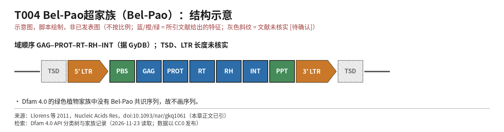

图 T004-1　Bel-Pao超家族（Bel-Pao）：结构示意。示意图，脚本绘制，非已发表图；每个特征的来源写在图下方。序列：Dfam 4.0 绿色植物家族中没有本类型可用的共识序列（无此类家族、两端 30 bp 含 N，或分类标注无法核实），不画序列。


完整的自主型 Bel-Pao 元件全长通常在 4.5 kb 至 10 kb 之间，两端为正向重复的 LTR，单个 LTR 长度多为数百 bp 至约 1 kb（具体跨物种精确长度统计文献 DOI 待确认）。与其余 LTR 超家族一致，其 LTR 末端多保留保守的 5'-TG...CA-3' 反向重复二核苷酸，内部区域包含位于 5' LTR 下游的 PBS 与位于 3' LTR 上游的 PPT [待确认]。（见本条“本版补充说明”）

#### TSD

整合进入宿主基因组时，整合酶介导产生 4 bp 至 6 bp 的正向靶位点重复，以 5 bp 最为常见 [待确认]。

#### 编码蛋白与结构域顺序

自主型 Bel-Pao 元件编码 `gag` 与 `pol` 蛋白，`pol` 内结构域排列顺序与 Ty3/Gypsy 及逆转录病毒相同，为 **GAG - PROT - RT - RH - INT**（Llorens 等 2011, doi:10.1093/nar/gkq1061）。尽管结构域顺序与 Ty3/Gypsy 一致，但 Bel-Pao 在反转录酶、RNase H 与整合酶的氨基酸序列上构成高度独立的单系分支，与 Ty3/Gypsy 和逆转录病毒分界清晰（Llorens 等 2011, doi:10.1093/nar/gkq1061）。部分 Bel-Pao 元件的 `gag` 蛋白含有特征性的锌指基序（CCHC），少数动物成员（如线虫中的 Tas 类元件）在 `pol` 下游携带 `env` 样开放阅读框（具体 `env` 样蛋白分布与功能验证文献 DOI 待确认）。

#### 转座机制

Bel-Pao 超家族遵循经典的 LTR 反转录转座子复制粘贴扩增机制：宿主 RNA 聚合酶 II 从 5' LTR 启动子转录全长 RNA，经翻译组装病毒样颗粒并在胞质内以 PBS 和 PPT 为引物完成双链 cDNA 反转录，随后由整合酶催化双链 cDNA 整合至宿主基因组新位点并形成 TSD [待确认]。

#### 自主与非自主搭档

与其余 LTR 超家族类似，宿主基因组中除具备完整 `gag` 和 `pol` 的自主型 Bel-Pao 拷贝外，也存在内部编码区缺失的非自主衍生物及两翼 LTR 不等同源重组形成的 solo-LTR（针对 Bel-Pao 专属非自主搭档谱系的系统分类研究较少，待确认）。

#### 识别特征与工具

在动物基因组中，完整 Bel-Pao 元件的结构检出同样依赖 LTRharvest（Ellinghaus 等 2008, doi:10.1186/1471-2105-9-18）、LTR_FINDER（Xu 和 Wang 2007, doi:10.1093/nar/gkm286）与 RepeatModeler2（Flynn 等 2020, doi:10.1073/pnas.1921046117）。由于其 `pol` 结构域顺序与 Ty3/Gypsy 完全一致（均为 PROT-RT-RH-INT），仅凭结构域顺序无法将其与 Ty3/Gypsy 区分，必须依赖针对反转录酶与整合酶的 HMM 序列模型比对和系统发育树定位，主要参考数据库包括 Dfam与 GyDB（Llorens 等 2011, doi:10.1093/nar/gkq1061）。在植物与葡萄注释中，采用面向植物优化的 EDTA（Ou 等 2019, doi:10.1186/s13059-019-1905-y）与基于 REXdb 的 TEsorter（Zhang 等 2022, doi:10.1093/hr/uhac017）可有效避免将植物 Gypsy 退化拷贝误判为 Bel-Pao。

#### 分类争议

早期文献曾一度将 BEL 与 Pao 视为彼此独立的小类群，或将其附属于 Gypsy 的外群分支；2007 年统一分类体系明确将两者合并确立为 LTR 目下独立的 Bel-Pao（RLB）超家族（Wicker 等 2007, doi:10.1038/nrg2165）。现行数据库在标签命名上略有差异：Dfam 使用简化标签 `LTR/Pao`，GyDB 与部分转座子文献沿用 Bel/Pao 或 Bel-Pao（Llorens 等 2011, doi:10.1093/nar/gkq1061），而病毒分类体系则将其单列为 Belpaoviridae（待确认）。在整合多工具注释结果时，需统一 `RLB`、`BEL`、`Pao` 与 `Bel-Pao` 的映射关系。

#### 发现与分布

**发现与命名**

- Wicker 等 (2007) A unified classification system for eukaryotic transposable elements. Nature Rev Genetics. doi:10.1038/nrg2165。摘要原句：“Here we propose the first unified hierarchical classification system, designed on the basis of the transposition mechanism, sequence similarities and structural relationships, that can be easily applied by non-experts”；支持范围：hierarchical classification (class, subclass, order, superfamily) [注意：所引句不含该名称，仅支持上位/总体论断]
- Frame 等 (2001) New BEL-like LTR-retrotransposons in Fugu rubripes, Caenorhabditis elegans, and Drosophila melanogaster. Gene. doi:10.1016/s0378-1119(00)00567-9。摘要原句：“The BEL group of retroelements is present in greater numbers, variety and taxonomic range than may have been thought previously”；涉及生物：Fugu rubripes, Caenorhabditis elegans, Drosophila melanogaster；支持范围：BEL-like LTR retrotransposons in animals [注意：所引句不含该名称，仅支持上位/总体论断]
- Malik 等 (2000) Poised for contagion: evolutionary origins of the infectious abilities of invertebrate retroviruses. Genome Research. doi:10.1101/gr.145000。摘要原句：“First, the gypsy and related LTR retrotransposable elements (the insect errantiviruses) have acquired their envelope-like gene from a class of insect baculoviruses (double-stranded DNA viruses with no RNA stage)”；涉及生物：invertebrates (Drosophila, C. elegans etc.)；支持范围：Gypsy/BEL/retrovirus origins by RT phylogeny [注意：所引句不含该名称，仅支持上位/总体论断]

**植物中的报道**

- 未检索到已核实的植物报道 [待确认]。

**葡萄中的报道**

- 未检索到葡萄专门报道（检索方式见文末「证据与检索方法」）。这只说明检索没有找到，不能据此推断葡萄基因组中不存在。

#### 本版补充说明

① 域顺序：GAG–PROT–INT–RT–RH（Ty1/Copia）与 GAG–PROT–RT–RH–INT（Ty3/Gypsy）是 Neumann 等 2019（doi:10.1186/s13100-018-0144-1）在超家族层面给出的判别顺序；本条若写某谱系“遵循”该顺序，指的是沿用超家族的顺序，不是该文对本谱系另行测定。

② 末端：5′-TG…CA-3′ 是该文用 LTR-FINDER 预测元件时设定的筛选条件，不是对各谱系的实测统计；本条中“末端保守为 5′-TG…CA-3′”一类说法应按此理解。

③ TSD 统计（93.4% 为 5 bp、6.2% 为 4 bp、0.4% 为 6 bp）与全长 4.4–24.1 kb 是该文对全部预测元件的总体统计，不是某一超家族或谱系的值；各谱系的值见 Fig. 4 与 T011–T045。

### T005 逆转录病毒与内源性逆转录病毒超家族（Retrovirus / ERV）

**名称对照**：Wicker 体系：I 类 / LTR 目（Wicker 超家族名单原文未读，未核实）；Dfam 节点：Gypsy-ERV;Retroviridae；REXdb 路径：无对应节点。（来源：Wicker 2007 原文本书未读；Dfam 4.0 分类树，2026-11-23 读取；REXdb v4.0 说明文件，doi:10.5281/zenodo.10160279）

#### 定义与命名

逆转录病毒（Retrovirus，对应 ICTV 分类的 Retroviridae 科）是一类编码包膜蛋白、能以感染性病毒颗粒形式在宿主细胞和个体间水平传播的外源性反转录病毒；当其前病毒（provirus）整合进入宿主生殖系细胞染色体并随宿主繁殖垂直遗传给后代时，即成为宿主基因组中的内源性逆转录病毒（endogenous retrovirus，ERV）（Havecker 等 2004, doi:10.1186/gb-2004-5-6-225）。2007 年统一分类体系在 LTR 目下将 Retrovirus（三字母代码 `RLR`）与 ERV（三字母代码 `RLE`）分列为两个超家族（Wicker 等 2007, doi:10.1038/nrg2165）。Dfam 现行分类体系及 2021 年发布的数据标准则依据反转录酶和结构蛋白的系统发育关系，在 `LTR` 节点下将内源性逆转录病毒细分为 `ERV1`（Class I，对应伽马与艾普西隆逆转录病毒近缘支）、`ERVK` / `ERV2`（Class II，对应贝塔等逆转录病毒近缘支）、`ERVL` / `ERV3`（Class III，对应泡沫逆转录病毒近缘支）及 `ERV4` 等分支（Storer 等 2021, doi:10.1186/s13100-020-00230-y）。

#### 结构、长度与末端

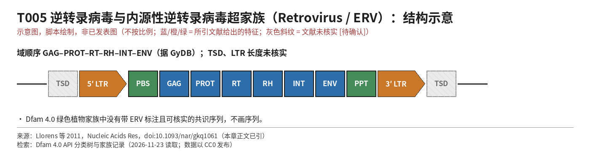

图 T005-1　逆转录病毒与内源性逆转录病毒超家族（Retrovirus / ERV）：结构示意。示意图，脚本绘制，非已发表图；每个特征的来源写在图下方。序列：Dfam 4.0 绿色植物家族中没有本类型可用的共识序列（无此类家族、两端 30 bp 含 N，或分类标注无法核实），不画序列。


完整前病毒与年轻完整 ERV 的全长通常为 7 kb 至 11 kb，两端为长度约 300 bp 至 1.2 kb 的正向重复 LTR（含 U3、R、U5 三个功能亚区），末端高度保守为 5'-TG...CA-3'（各 ERV 亚类精确长度分布文献 DOI 待确认）。内部区域两端同样包含 PBS 与 PPT，完整编码区依次排列 `gag`、`pro`、`pol` 与 `env` [待确认]。由于长期滞留宿主基因组并遭受突变与缺失，脊椎动物基因组中绝大多数 ERV 拷贝已丧失完整开放阅读框或缺失 `env` 基因（Havecker 等 2004, doi:10.1186/gb-2004-5-6-225）。（见本条“本版补充说明”）

#### TSD

前病毒整合进入宿主染色体时产生 4 bp 至 6 bp 的正向靶位点重复，不同逆转录病毒演化支具有相对固定的长度偏好（如部分支系为 4 bp、5 bp 或 6 bp）（各属精确 TSD 长度对应关系文献 DOI 待确认）。

#### 编码蛋白与结构域顺序

核心结构域排列顺序为 **GAG - PROT - RT - RH - INT - ENV**（Llorens 等 2011, doi:10.1093/nar/gkq1061）。与典型 Ty3/Gypsy 元件相比，完整逆转录病毒和年轻 ERV 在 `pol` 下游编码真正的包膜糖蛋白（ENV），包含表面亚基与跨膜亚基，负责病毒颗粒与宿主细胞表面受体结合并介导膜融合感染；复杂逆转录病毒（如慢病毒与泡沫病毒相关类群）还可编码额外的调控蛋白，部分 ERV 成员在 `pol` 中还携带脱氧尿苷三磷酸酶（dUTPase）等辅助结构域（Llorens 等 2011, doi:10.1093/nar/gkq1061；复杂逆转录病毒附属基因细节待确认）。

#### 转座机制

外源性逆转录病毒通过包膜蛋白识别靶细胞受体并进入胞质，在病毒核心内利用自身反转录酶以 PBS 与 PPT 为引物合成双链 cDNA，随后进入细胞核由整合酶整合至宿主染色体成为前病毒；前病毒经宿主 RNA 聚合酶 II 转录并翻译结构蛋白与酶类后，在细胞膜出芽形成新的感染性病毒颗粒 [待确认]。进入生殖系基因组形成 ERV 后，保留活性的拷贝既可通过细胞外再感染途径产生新整合，更常见的是在 `env` 失活或缺失后转变为纯细胞内反转录转座模式，以类似常规 LTR 反转录转座子的复制粘贴方式在宿主基因组中扩增（`env` 丢失与胞内扩增效率关联专文 DOI 待确认）。

#### 自主与非自主搭档

同时保留功能性 `gag`、`pol`（及或 `env`）的 ERV 拷贝属于自主型；脊椎动物基因组中绝大多数 ERV 拷贝因内部大片段缺失或移码突变而成为非自主衍生物，依赖同家族自主型拷贝反式提供的酶系进行扩增，此外哺乳动物基因组中存在数量庞大的由两翼 LTR 不等同源重组形成的 solo-LTR（Storer 等 2021, doi:10.1186/s13100-020-00230-y）。

#### 识别特征与工具

在脊椎动物基因组中，ERV 的识别通常结合从头 LTR 结构预测工具（LTRharvest，Ellinghaus 等 2008, doi:10.1186/1471-2105-9-18；LTR_FINDER，Xu 和 Wang 2007, doi:10.1093/nar/gkm286；RepeatModeler2，Flynn 等 2020, doi:10.1073/pnas.1921046117）与基于 Dfam（Storer 等 2021, doi:10.1186/s13100-020-00230-y）及 GyDB（Llorens 等 2011, doi:10.1093/nar/gkq1061）的蛋白结构域 HMM 检索，并可辅以脊椎动物专用前病毒识别工具如 RetroTector（RetroTector 文献 DOI 待确认）。在植物与葡萄研究中，为防止将 SIRE 与 Athila/Tat 误判为 ERV，应优先采用基于植物专用库 REXdb 的 TEsorter 完成谱系级鉴定（Zhang 等 2022, doi:10.1093/hr/uhac017；Neumann 等 2019, doi:10.1186/s13100-018-0144-1）。

#### 分类争议

第一项争议在于 Retrovirus 与 ERV 的层级拆分。2007 年统一分类体系将外源性 Retrovirus（RLR）与内源性 ERV（RLE）列为 LTR 目下两个并列超家族，但从分子演化角度看，ERV 并非单一单系群，而是多个不同属外源性逆转录病毒在演化史上多次独立整合进入脊椎动物生殖系的产物；因此 Dfam 现行分类体系及现代病毒学主张将其统一置于 Retroviridae/ERV 框架下，并按 ERV1、ERV2、ERV3 等系统发育分支细分（Wicker 等 2007, doi:10.1038/nrg2165；Storer 等 2021, doi:10.1186/s13100-020-00230-y）。第二项争议源于早期植物研究中的术语混用：由于植物 SIRE 与 Athila/Tat 元件携带 `env` 样开放阅读框，早期文献偶将其称为植物逆转录病毒或植物 ERV，现行植物转座子分类标准已明确否定该混用，强调两者分别归属 Ty1/Copia 与 Ty3/Gypsy，不可与脊椎动物 ERV 混为一谈（Neumann 等 2019, doi:10.1186/s13100-018-0144-1）。

#### 发现与分布

**发现与命名**

- Wicker 等 (2007) A unified classification system for eukaryotic transposable elements. Nature Rev Genetics. doi:10.1038/nrg2165。摘要原句：“Here we propose the first unified hierarchical classification system, designed on the basis of the transposition mechanism, sequence similarities and structural relationships, that can be easily applied by non-experts”；支持范围：hierarchical classification (class, subclass, order, superfamily) [注意：所引句不含该名称，仅支持上位/总体论断]
- Weiss (2006) The discovery of endogenous retroviruses. Retrovirology. doi:10.1186/1742-4690-3-67。摘要原句：“When endogenous retroviruses (ERV) were discovered in the late 1960s, the Mendelian inheritance of retroviral genomes by their hosts was an entirely new concept”；支持范围：history of discovery of endogenous retroviruses

**植物中的报道**

- Wright 和 Voytas (2002) Athila4 of Arabidopsis and Calypso of soybean define a lineage of endogenous plant retroviruses. Genome Research. doi:10.1101/gr.196001。摘要原句：“The Athila retroelements of Arabidopsis thaliana encode a putative envelope gene, suggesting that they are infectious retroviruses”；涉及生物：Arabidopsis thaliana, soybean；支持范围：plant gypsy-type endogenous retrovirus-like lineage (not vertebrate ERV) [注意：所引句不含该名称，仅支持上位/总体论断]

**葡萄中的报道**

- 未检索到葡萄专门报道（检索方式见文末「证据与检索方法」）。这只说明检索没有找到，不能据此推断葡萄基因组中不存在。

#### 本版补充说明

① 域顺序：GAG–PROT–INT–RT–RH（Ty1/Copia）与 GAG–PROT–RT–RH–INT（Ty3/Gypsy）是 Neumann 等 2019（doi:10.1186/s13100-018-0144-1）在超家族层面给出的判别顺序；本条若写某谱系“遵循”该顺序，指的是沿用超家族的顺序，不是该文对本谱系另行测定。

② 末端：5′-TG…CA-3′ 是该文用 LTR-FINDER 预测元件时设定的筛选条件，不是对各谱系的实测统计；本条中“末端保守为 5′-TG…CA-3′”一类说法应按此理解。

③ TSD 统计（93.4% 为 5 bp、6.2% 为 4 bp、0.4% 为 6 bp）与全长 4.4–24.1 kb 是该文对全部预测元件的总体统计，不是某一超家族或谱系的值；各谱系的值见 Fig. 4 与 T011–T045。

### T006 副反转录病毒与内源副反转录病毒（Caulimoviridae / EPRV）

**名称对照**：Wicker 体系：未核实；Dfam 节点：Gypsy-ERV;Pararetroviridae；REXdb 路径：Class_I/pararetrovirus。（来源：Wicker 2007 原文本书未读；Dfam 4.0 分类树，2026-11-23 读取；REXdb v4.0 说明文件，doi:10.5281/zenodo.10160279）

#### 定义与命名

副反转录病毒科（Caulimoviridae，英文常统称 plant pararetrovirus）是一类感染维管植物的环状双链 DNA 病毒，其复制周期包含经 RNA 中间体进行反转录的步骤，但不具备真逆转录病毒必需的基因组整合阶段（专文 DOI 待确认）。当该科病毒的部分片段或近完整基因组意外整合进入宿主植物细胞核染色体并随宿主世代垂直遗传时，即称为内源副反转录病毒（endogenous pararetrovirus，EPRV）（专文 DOI 待确认）。该类群在病毒分类体系中下辖 Caulimovirus、Badnavirus、Petuvirus、Tungrovirus、Cavemovirus、Soymovirus、Solendovirus、Rosadnavirus 等属，以及广泛内源化的 Florendovirus 谱系（各属分类修订专文 DOI 待确认）。在 2007 年真核转座子统一分类体系中，Caulimoviridae 并未列为 LTR 目下的经典转座子超家族 [待确认]；然而由于其反转录酶与 LTR 反转录转座子具有明确的系统发育近缘关系，2019 年建立的植物 REXdb 数据库与 2021 年发布的 Dfam 序列模型体系均在 LTR 相关分类框架中单列 pararetrovirus / Caulimoviridae 节点，以便在全基因组重复序列注释中准确区分并防止误判为 Ty3/Gypsy 或 ERV [待确认]。

#### 结构、长度与末端

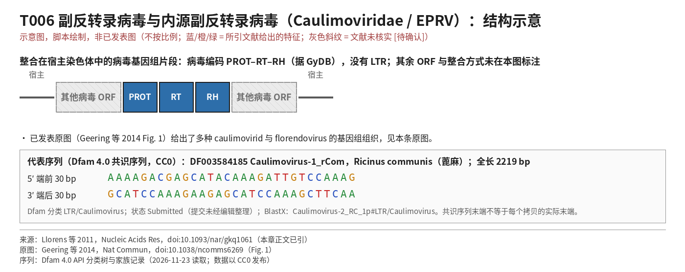

图 T006-1　副反转录病毒与内源副反转录病毒（Caulimoviridae / EPRV）：结构示意。示意图，脚本绘制，非已发表图；每个特征的来源写在图下方。序列条：Dfam DF003584185（Caulimovirus-1_rCom，蓖麻 Ricinus communis，Dfam 4.0，CC0；状态 Submitted）前、后各 30 bp。

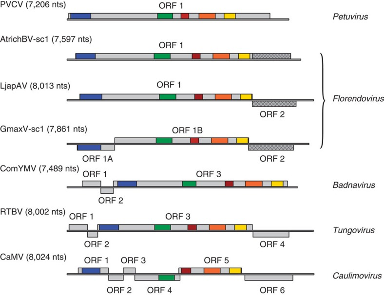

图 T006-P1　多种 caulimovirid 与内源 florendovirus 的基因组组织。原图：Geering 等（2014），Fig. 1。Endogenous florendoviruses are major components of plant genomes and hallmarks of virus evolution. Nat Commun. doi:10.1038/ncomms6269。许可：CC BY 4.0（https://creativecommons.org/licenses/by/4.0/）。未修改。


游离态副反转录病毒颗粒携带长度约 7 kb 至 9.5 kb 的环状双链 DNA 基因组，双链上带有特定位点的缺口，分子结构上**不具备**真 LTR 反转录转座子两端的长末端重复序列（专文 DOI 待确认）。整合进入宿主染色体形成 EPRV 后，其拷贝形态高度异质：既可以是长度仅数百 bp 至数 kb 的碎片化插入，也可以是包含串联重复、倒位重排或近全长病毒基因组的复合插入位点（专文 DOI 待确认）。由于缺乏 LTR 结构，EPRV 末端不存在经典的 5'-TG...CA-3' 反向重复二核苷酸，内部仍可保留病毒启动子区以及与宿主 tRNA 互补的负链引物结合位点（PBS）和正链多聚嘌呤区（PPT）（专文 DOI 待确认）。（见本条“本版补充说明”）

#### TSD

副反转录病毒不编码整合酶，其基因组整合进入宿主核染色体的过程并非酶促特异性切口整合，而是依赖宿主双链断裂修复过程中的非法重组或非同源末端连接（NHEJ），因此 EPRV 插入位点两侧**不产生**典型、等长的靶位点重复（TSD）（专文 DOI 待确认）。

#### 编码蛋白与结构域顺序

典型 Caulimoviridae 基因组编码病毒运动蛋白（MP）、衣壳相关蛋白（GAG/CP）、天冬氨酸蛋白酶（PROT/PR）、反转录酶（RT）与核糖核酸酶 H（RH/RNase H），核心酶类结构域排列顺序为 **PROT - RT - RH**（Llorens 等 2011, doi:10.1093/nar/gkq1061）。与 Ty1/Copia、Ty3/Gypsy 及逆转录病毒相比，副反转录病毒最关键的结构域鉴别特征是**完全缺失整合酶（INT）结构域**，且多数属缺乏典型包膜蛋白基因，但在不同病毒属中常携带编码蚜虫传毒辅助因子、反式激活因子或功能未知蛋白的附加开放阅读框（Llorens 等 2011, doi:10.1093/nar/gkq1061；各属附加基因功能专文 DOI 待确认）。

#### 转座机制

副反转录病毒并非严格意义上的经典转座子。游离病毒在宿主细胞核内以闭环微染色体形式存在，由宿主 RNA 聚合酶 II 转录产生超长于基因组全长的前基因组 RNA（pgRNA），随后转运至细胞质内作为翻译模板并经自身反转录酶反转录合成新的环状双链 DNA（专文 DOI 待确认）。其整合进入宿主核基因组属于复制周期之外的偶发事件，主要通过宿主 DNA 双链断裂修复途径捕获病毒 DNA 碎片或串联体实现（专文 DOI 待确认）。绝大多数 EPRV 整合后因片段化、重排、提前终止密码子及宿主表观遗传沉默而彻底丧失活性；仅在少数植物类群（如香蕉、烟草、矮牵牛等）中，部分完整或串联排列的 EPRV 拷贝在胁迫或杂交条件下可经同源重组或转录激活重新释放游离感染性病毒（具体活化案例专文 DOI 待确认）。

#### 自主与非自主搭档

由于 EPRV 缺乏整合酶且不遵循经典转座子的自主/非自主反式转座体系，基因组中不存在传统意义上依赖整合酶反式驱动的自主/非自主搭档关系。宿主基因组中占绝对多数的 EPRV 为碎片化或失活的化石拷贝，仅极少数完整串联拷贝在特定遗传背景下保留向游离病毒复原的潜能（专文 DOI 待确认）。

#### 识别特征与工具

由于 EPRV 缺乏双 LTR 边界与 TSD，基于双 LTR 结构的传统预测软件（如 LTRharvest、LTR_FINDER、LTR_retriever）无法将其作为完整 LTR 元件检出（Ou 和 Jiang 2018, doi:10.1104/pp.17.01310）。识别 EPRV 主要依赖针对 PROT、RT、RH 及 MP/GAG 保守蛋白结构域的隐马尔可夫模型（HMM）搜索与系统发育定位。在植物基因组注释实践中，基于 REXdb 数据库的 TEsorter 能够将携带 pararetrovirus 特征蛋白域的序列单独归类为 `pararetrovirus`，避免其混入 Ty3/Gypsy 统计中（Zhang 等 2022, doi:10.1093/hr/uhac017）；也可借助 RepeatModeler2 结合 Dfam 与 GyDB 序列模型进行同源注释与人工复核（Flynn 等 2020, doi:10.1073/pnas.1921046117；Llorens 等 2011, doi:10.1093/nar/gkq1061）。

#### 分类争议

主要争议在于 EPRV 是否应归入转座子体系。从严格机制看，副反转录病毒不含 LTR、不编码整合酶、不以常规复制粘贴方式在染色体间自主转座，本质上属于整合入宿主基因组的内源病毒元件（EVE）而非真转座子，因此 2007 年统一分类体系未将其列为 LTR 超家族 [待确认]。但在基因组重复序列注释实践中，因其 RT 与 RH 结构域与 Ty3/Gypsy 具有显著序列相似性且常以多拷贝重复形式存在于植物基因组中，REXdb、GyDB 与 Dfam 均将其纳入扩展参考库并置于 LTR 邻近或病毒关联节点下（Llorens 等 2011, doi:10.1093/nar/gkq1061）。在撰写基因组重复序列统计报告时，建议将其与典型 LTR 反转录转座子分开计数。

#### 发现与分布

**发现与命名**

- Hull 等 (2000) Viral sequences integrated into plant genomes. Trends in Plant Science. doi:10.1016/s1360-1385(00)01723-4。仅标题可核实，只用于说明该文存在及其命名/主题，不据此作内容论断
- Harper 等 (2002) Viral sequences integrated into plant genomes. Annual Rev of Phytopathology. doi:10.1146/annurev.phyto.40.120301.105642。摘要原句：“Sequences of various DNA plant viruses have been found integrated into the host genome”
- Staginnus 和 Richert-Pöggeler (2006) Endogenous pararetroviruses: two-faced travelers in the plant genome. Trends in Plant Science. doi:10.1016/j.tplants.2006.08.008。摘要原句：“Endogenous plant pararetroviruses (EPRVs) were identified as integrated counterparts of most members of the plant virus family Caulimoviridae and represent repetitive elements that are ubiquitous in the plant kingdom”；支持范围：endogenous pararetroviruses in plant genomes

**植物中的报道**

- Geering 等 (2014) Endogenous florendoviruses are major components of plant genomes and hallmarks of virus evolution. Nature Communications. doi:10.1038/ncomms6269。摘要原句：“The extent and importance of endogenous viral elements have been extensively described in animals but are much less well understood in plants”；涉及生物：flowering plants；支持范围：florendoviruses in plant genomes [注意：所引句不含该名称，仅支持上位/总体论断]
- Diop 等 (2018) Tracheophyte genomes keep track of the deep evolution of the Caulimoviridae. Scientific Reports. doi:10.1038/s41598-017-16399-x。摘要原句：“The Caulimoviridae is the most common group of EVEs in plants, although their presence has often been overlooked in plant genome studies”；支持范围：Caulimoviridae endogenous elements across tracheophytes

**葡萄中的报道**

- Carrier 等 (2012) Transposable elements are a major cause of somatic polymorphism in Vitis vinifera L. PLoS ONE. doi:10.1371/journal.pone.0032973。正文原句：“Selection of mobile elements and confirmation of their insertion polymorphism We selected for detailed analyses four representative mobile elements among class I LTR transposable elements: Gret-1 , Copia-10 , Gypsy-19 and Cauliv-1 . These four elements have very different copy numbers and polymorphic sites in the partial…”；涉及生物：Vitis vinifera；支持范围：Gret-1, Copia-10, Gypsy-19, Cauliv-1 insertion polymorphism [注意：所引句不含该名称，仅支持上位/总体论断]
- Bertsch 等 (2009) Retention of the virus-derived sequences in the nuclear genome of grapevine as a potential pathway to virus resistance. Biology Direct. doi:10.1186/1745-6150-4-21。正文原句：“Presentation of the hypothesis The 913 apparent sequence matches with the putative viral nucleotide sequences were identified using the Grape Genome Browser . Blast analysis of these virus-related inserts revealed sixteen potential ORFs that exhibited the highest, 30–60% identity to the protein sequences of five distinct…”；支持范围：endogenous pararetrovirus-like inserts in grapevine genome

#### 本版补充说明

① 域顺序：GAG–PROT–INT–RT–RH（Ty1/Copia）与 GAG–PROT–RT–RH–INT（Ty3/Gypsy）是 Neumann 等 2019（doi:10.1186/s13100-018-0144-1）在超家族层面给出的判别顺序；本条若写某谱系“遵循”该顺序，指的是沿用超家族的顺序，不是该文对本谱系另行测定。

② 末端：5′-TG…CA-3′ 是该文用 LTR-FINDER 预测元件时设定的筛选条件，不是对各谱系的实测统计；本条中“末端保守为 5′-TG…CA-3′”一类说法应按此理解。

③ TSD 统计（93.4% 为 5 bp、6.2% 为 4 bp、0.4% 为 6 bp）与全长 4.4–24.1 kb 是该文对全部预测元件的总体统计，不是某一超家族或谱系的值；各谱系的值见 Fig. 4 与 T011–T045。

### T007 微型末端重复反转录转座子（TRIM）

**名称对照**：Wicker 体系：I 类 / LTR 目（非自主衍生物）；Dfam 节点：Long_Terminal_Repeat_Element;TRIM；REXdb 路径：无对应节点。（来源：类与目据 Arkhipova 2017, doi:10.1186/s13100-017-0103-2；Dfam 4.0 分类树，2026-11-23 读取；REXdb v4.0 说明文件，doi:10.5281/zenodo.10160279）

#### 定义与命名

微型末端重复反转录转座子（terminal-repeat retrotransposon in miniature，TRIM）是一类高度精简的非自主型 LTR 反转录转座子衍生物 [待确认]。在 2007 年统一分类体系中，TRIM 不作为独立超家族设立，而是作为 LTR 目下的非自主型结构类别列出 [待确认]；Dfam 现行分类体系亦将已鉴定的植物 TRIM 家族归入 LTR 相关非自主条目进行管理 [待确认]。TRIM 最初在马铃薯与拟南芥等植物基因组中被系统描述，以极短的全长、极短的 LTR 以及完全丧失编码能力的内部序列为显著特征（最初命名专文 DOI 待确认）。

#### 结构、长度与末端

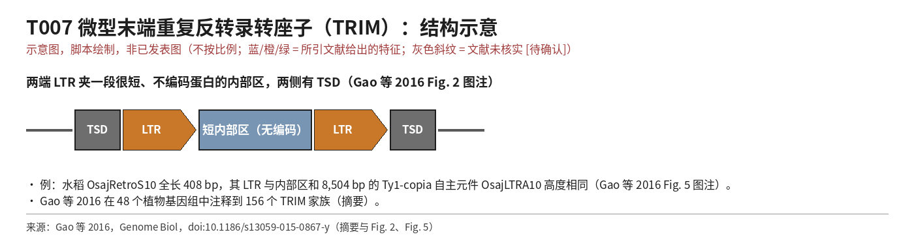

图 T007-1　微型末端重复反转录转座子（TRIM）：结构示意。示意图，脚本绘制，非已发表图；每个特征的来源写在图下方。序列：Dfam 4.0 绿色植物家族中没有本类型可用的共识序列（无此类家族、两端 30 bp 含 N，或分类标注无法核实），不画序列。

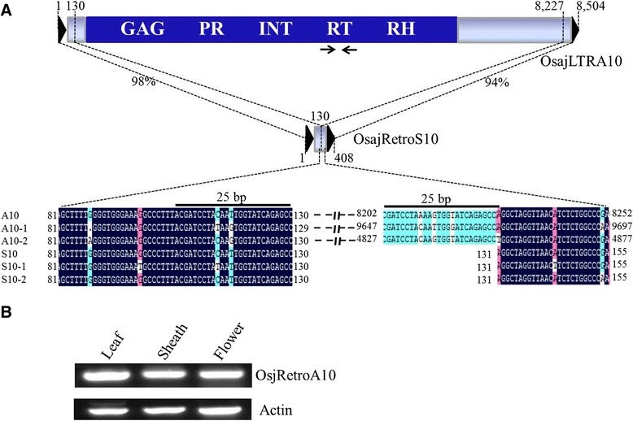

图 T007-P1　水稻 TRIM OsajRetroS10（408 bp）与 Ty1-copia 自主元件 OsajLTRA10 的结构与末端序列比对。原图：Gao 等（2016），Fig. 5。Landscape and evolutionary dynamics of terminal repeat retrotransposons in miniature in plant genomes. Genome Biol. doi:10.1186/s13059-015-0867-y。许可：CC BY 4.0（https://creativecommons.org/licenses/by/4.0/）。未修改。


TRIM 具有完整的 LTR 反转录转座子基本骨架，由 5' LTR、极短的内部非编码区和 3' LTR 构成，但整体尺寸大幅缩减，全长通常在 300 bp 至 1000 bp 之间（部分定义放宽至 1.5 kb 以下，精确阈值文献 DOI 待确认）。单个 LTR 长度一般为 100 bp 至 350 bp，内部非编码区往往仅 100 bp 至 300 bp（专文 DOI 待确认）。尽管尺寸极小，活跃的 TRIM 拷贝仍严格保留反转录所需的顺式作用元件，包括两端经典的 5'-TG...CA-3' 末端二核苷酸、紧邻 5' LTR 下游的 PBS 以及紧邻 3' LTR 上游的 PPT [待确认]。（见本条“本版补充说明”）

#### TSD

与自主型 LTR 反转录转座子一致，TRIM 整合进入宿主基因组时在元件两侧形成正向靶位点重复，典型长度为 5 bp [待确认]。

#### 编码蛋白与结构域顺序

TRIM 的内部区域极短，**不编码**任何完整的 `gag`、`pol` 或其他转座相关蛋白，因此不存在 `pol` 结构域排列顺序 [待确认]。

#### 转座机制

TRIM 自身无法合成衣壳蛋白、反转录酶、RNase H 与整合酶，必须依赖同细胞内自主型 LTR 反转录转座子反式提供的蛋白机器完成扩增 [待确认]。其扩增过程同样遵循 RNA 中间体复制粘贴模式：由 5' LTR 中的启动子驱动转录产生全长单链 RNA，随后被反式搭档提供的衣壳与酶系识别，以自身保留的 PBS 与 PPT 为引物完成双链 cDNA 合成，并由整合酶整合至宿主基因组新位点，伴随产生 5 bp TSD [待确认]。与完整大型 LTR 元件类似，TRIM 两翼 LTR 之间也可发生不等同源重组，进而形成单拷贝的 solo-LTR [待确认]。

#### 自主与非自主搭档

TRIM 本身即属于非自主型元件，其进化起源普遍被认为源自完整自主型 LTR 反转录转座子（多与 Ty1/Copia 或 Ty3/Gypsy 相关）内部编码区发生大片段缺失后的极端精简衍生物 [待确认]。在绝大多数植物基因组中，特定 TRIM 家族究竟由哪一个具体的自主型家族反式驱动，往往因序列长期分化而难以直接通过核酸同源性配对确认（具体配对验证专文 DOI 待确认）。

#### 识别特征与工具

常规 LTR 结构预测流程（如 LTRharvest 与 LTR_FINDER）默认最小元件长度和内部区域长度阈值通常针对数 kb 的完整自主型元件设置，若直接采用默认参数极易漏检全长不足 1 kb 的 TRIM [待确认]。检出 TRIM 时需专门下调最小 LTR 长度（如降至 80–100 bp）和最小内部区长度（如降至 100 bp），并严格联合检验 5'-TG...CA-3' 末端、5 bp TSD、PBS/PPT 信号以及高拷贝序列一致性，以排除串联重复与微卫星造成的假阳性 [待确认]。由于缺乏蛋白编码域，TEsorter 无法对 TRIM 进行基于蛋白域的谱系分类（Zhang 等 2022, doi:10.1093/hr/uhac017），通常需结合专门的短非自主 LTR 筛选脚本、RepeatModeler2（Flynn 等 2020, doi:10.1073/pnas.1921046117）及手工边界校对确认。（见本条“本版补充说明”）

#### 分类争议

第一项争议是 TRIM 的尺寸上限与非自主 LTR 的划分边界：不同研究对 TRIM 最大全长的界定在 1 kb 至 1.5 kb 之间存在浮动，导致介于 1 kb 与 4 kb 之间的中等长度非自主 LTR 元件在 TRIM 与 LARD 之间存在归类灰区（专文 DOI 待确认）。第二项争议在于 TRIM 并非单一系统发育单系群，而是不同自主型 LTR 家族在演化史上多次独立缺失内部编码区趋同形成的结构形态，因此在严格系统发育分类中不可将其视为与 Copia、Gypsy 并列的独立超家族 [待确认]。

#### 发现与分布

**发现与命名**

- Witte 等 (2001) Terminal-repeat retrotransposons in miniature (TRIM) are involved in restructuring plant genomes. Proceedings of the National Academy of Sciences. doi:10.1073/pnas.241341898。摘要原句：“A new group of long terminal repeats (LTR) retrotransposons, termed terminal-repeat retrotransposons in miniature (TRIM), are described that are present in both monocotyledonous and dicotyledonous plant”；涉及生物：plants (Arabidopsis, rice, others)；支持范围：TRIM named and described
- Kalendar 等 (2004) Large retrotransposon derivatives: abundant, conserved but nonautonomous retroelements of barley and related genomes. Genetics. doi:10.1534/genetics.166.3.1437。摘要原句：“These features describe a novel group of elements, called LARDs or large retrotransposon derivatives (LARDs)”；涉及生物：barley and Triticeae；支持范围：large retrotransposon derivatives (LARD) and TRIM-like nonautonomous elements [注意：所引句不含该名称，仅支持上位/总体论断]

**植物中的报道**

- Chaparro 等 (2015) Terminal-repeat retrotransposons with GAG domain in plant genomes: a new testimony on the complex world of transposable elements. Genome Biology and Evolution. doi:10.1093/gbe/evv001。摘要原句：“A novel structure of nonautonomous long terminal repeat (LTR) retrotransposons called terminal repeat with GAG domain (TR-GAG) has been described in plants, both in monocotyledonous, dicotyledonous and basal angiosperm genomes”；涉及生物：plants；支持范围：TR-GAG terminal-repeat retrotransposons in plant genomes [注意：所引句不含该名称，仅支持上位/总体论断]

**葡萄中的报道**

- 未检索到葡萄专门报道（检索方式见文末「证据与检索方法」）。这只说明检索没有找到，不能据此推断葡萄基因组中不存在。

#### 本版补充说明

① 域顺序：GAG–PROT–INT–RT–RH（Ty1/Copia）与 GAG–PROT–RT–RH–INT（Ty3/Gypsy）是 Neumann 等 2019（doi:10.1186/s13100-018-0144-1）在超家族层面给出的判别顺序；本条若写某谱系“遵循”该顺序，指的是沿用超家族的顺序，不是该文对本谱系另行测定。

② 末端：5′-TG…CA-3′ 是该文用 LTR-FINDER 预测元件时设定的筛选条件，不是对各谱系的实测统计；本条中“末端保守为 5′-TG…CA-3′”一类说法应按此理解。

③ TSD 统计（93.4% 为 5 bp、6.2% 为 4 bp、0.4% 为 6 bp）与全长 4.4–24.1 kb 是该文对全部预测元件的总体统计，不是某一超家族或谱系的值；各谱系的值见 Fig. 4 与 T011–T045。

### T008 大型反转录转座子衍生物（LARD）

**名称对照**：Wicker 体系：I 类 / LTR 目（非自主衍生物）；Dfam 节点：无对应节点；REXdb 路径：无对应节点。（来源：类与目据 Arkhipova 2017, doi:10.1186/s13100-017-0103-2；Dfam 4.0 分类树，2026-11-23 读取；REXdb v4.0 说明文件，doi:10.5281/zenodo.10160279）

#### 定义与命名

大型反转录转座子衍生物（large retrotransposon derivative，LARD）是一类尺寸较大、但内部缺乏完整功能性蛋白编码能力的非自主型 LTR 反转录转座子 [待确认]。在 2007 年统一分类体系中，LARD 与 TRIM 并列作为 LTR 目下的非自主型结构类别，而非独立超家族 [待确认]。LARD 最初在大麦等禾本科植物基因组中被发现并命名，其核心特征是拥有长达数 kb 的 LTR 与非编码内部区域，但内部完全缺失或严重破坏了 `gag-pol` 编码框（最初命名专文 DOI 待确认）。

#### 结构、长度与末端

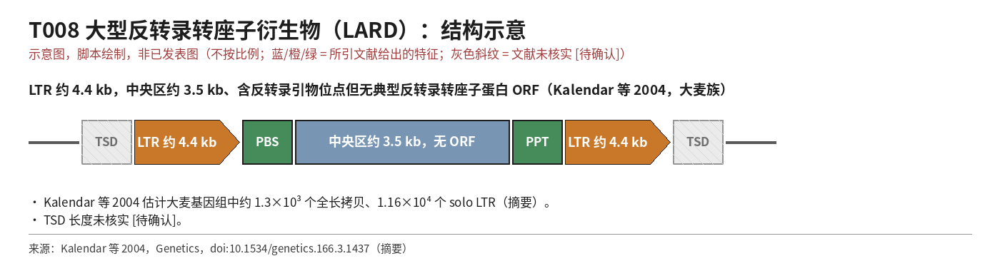

图 T008-1　大型反转录转座子衍生物（LARD）：结构示意。示意图，脚本绘制，非已发表图；每个特征的来源写在图下方。序列：Dfam 4.0 绿色植物家族中没有本类型可用的共识序列（无此类家族、两端 30 bp 含 N，或分类标注无法核实），不画序列。


LARD 的典型全长超过 4 kb，常见范围为 4 kb 至 12 kb 以上，尺寸与大型自主型 Ty1/Copia 或 Ty3/Gypsy 元件相当（精确跨物种长度分布专文 DOI 待确认）。其单个 LTR 通常较长，可达 1 kb 至 4 kb 以上，两端保留保守的 5'-TG...CA-3' 反向重复二核苷酸；内部区域同样长达数 kb，但主要由非编码序列、短重复片段或高度退化的残余序列构成（专文 DOI 待确认）。与 TRIM 相同，能够活跃扩增的 LARD 严格保留 5' LTR 下游的 PBS 与 3' LTR 上游的 PPT [待确认]。（见本条“本版补充说明”）

#### TSD

整合进入宿主染色体时在元件外侧形成正向靶位点重复，典型长度为 5 bp [待确认]。

#### 编码蛋白与结构域顺序

LARD 内部**不具备**完整的 `pol` 编码区，也不编码功能性的衣壳、蛋白酶、反转录酶、RNase H 或整合酶蛋白 [待确认]。部分演化较年轻的 LARD 内部可能残留零散的 `gag` 或 `pol` 退化片段，但均无法独立完成蛋白翻译与催化功能（专文 DOI 待确认）。

#### 转座机制

LARD 采用与自主型 LTR 反转录转座子相同的复制粘贴机制，但自身无法提供转座所需酶系，必须由同细胞内共表达的自主型 LTR 反转录转座子反式提供病毒样颗粒组装蛋白、反转录酶与整合酶 [待确认]。其 5' LTR 启动子驱动全长 RNA 转录，随后借用反式酶系在 PBS 与 PPT 引导下合成双链 cDNA 并整合进入宿主基因组新位点，伴随产生 5 bp TSD [待确认]。由于 LARD 拥有较长的两翼 LTR，其发生两翼 LTR 不等同源重组并产生 solo-LTR 的频率通常较高 [待确认]。

#### 自主与非自主搭档

LARD 属于典型的非自主型元件，普遍认为由大型自主型 Ty3/Gypsy 或 Ty1/Copia 元件在演化中发生内部编码区缺失或替换后形成 [待确认]。由于缺乏内部编码区但保留长段非编码内部序列，有假说认为 LARD 的长内部区可能具有维持特定 RNA 二级结构或包装长度以适配自主型搭档病毒样颗粒的作用（机制假说专文 DOI 待确认）。部分 LARD 家族可通过 LTR 与 PBS 序列的高相似度追溯其对应的自主型母本家族（专文 DOI 待确认）。

#### 识别特征与工具

LARD 因全长和 LTR 长度与自主型元件相近，可直接被 LTRharvest（Ellinghaus 等 2008, doi:10.1186/1471-2105-9-18）、LTR_FINDER（Xu 和 Wang 2007, doi:10.1093/nar/gkm286）、LTR_retriever（Ou 和 Jiang 2018, doi:10.1104/pp.17.01310）与 EDTA（Ou 等 2019, doi:10.1186/s13059-019-1905-y）等标准结构预测工具检出。将其与自主型 LTR 区分的关键步骤是对内部序列执行蛋白结构域检索（如使用 TEsorter 或 LTRdigest），确认其缺乏完整 `pol` 结构域（Zhang 等 2022, doi:10.1093/hr/uhac017；Steinbiss 等 2009, doi:10.1093/nar/gkp759）。在实际注释中，需进一步结合拷贝数与家族一致性评估：真正活跃扩增的 LARD 往往表现为多拷贝高度一致的同源家族，而孤立单拷贝的无编码区元件更可能是随机缺失形成的退化自主型拷贝（待确认）。

#### 分类争议

核心争议在于「LARD」与「退化/失活的自主型 LTR 拷贝」在基因组注释中的实操界线。自动化流程（如 EDTA 结合 TEsorter）通常把有完整双 LTR 但检不出完整蛋白域的元件统一归为 `LTR/unknown`，并不会自动区分其究竟是长期独立扩增的 LARD 家族还是刚发生内部缺失的 Copia/Gypsy 退化拷贝（Ou 等 2019, doi:10.1186/s13059-019-1905-y；Zhang 等 2022, doi:10.1093/hr/uhac017）。此外，与 TRIM 一样，LARD 是多起源的非自主形态集合，不构成独立的系统发育超家族 [待确认]。

#### 发现与分布

**发现与命名**

- Kalendar 等 (2004) Large retrotransposon derivatives: abundant, conserved but nonautonomous retroelements of barley and related genomes. Genetics. doi:10.1534/genetics.166.3.1437。摘要原句：“These features describe a novel group of elements, called LARDs or large retrotransposon derivatives (LARDs)”；涉及生物：barley and related grasses；支持范围：LARD named

**植物中的报道**

- Chaparro 等 (2015) Terminal-repeat retrotransposons with GAG domain in plant genomes: a new testimony on the complex world of transposable elements. Genome Biology and Evolution. doi:10.1093/gbe/evv001。摘要原句：“A novel structure of nonautonomous long terminal repeat (LTR) retrotransposons called terminal repeat with GAG domain (TR-GAG) has been described in plants, both in monocotyledonous, dicotyledonous and basal angiosperm genomes”；涉及生物：plants；支持范围：TR-GAG terminal-repeat retrotransposons in plant genomes [注意：所引句不含该名称，仅支持上位/总体论断]

**葡萄中的报道**

- 未检索到葡萄专门报道（检索方式见文末「证据与检索方法」）。这只说明检索没有找到，不能据此推断葡萄基因组中不存在。

#### 本版补充说明

① 域顺序：GAG–PROT–INT–RT–RH（Ty1/Copia）与 GAG–PROT–RT–RH–INT（Ty3/Gypsy）是 Neumann 等 2019（doi:10.1186/s13100-018-0144-1）在超家族层面给出的判别顺序；本条若写某谱系“遵循”该顺序，指的是沿用超家族的顺序，不是该文对本谱系另行测定。

② 末端：5′-TG…CA-3′ 是该文用 LTR-FINDER 预测元件时设定的筛选条件，不是对各谱系的实测统计；本条中“末端保守为 5′-TG…CA-3′”一类说法应按此理解。

③ TSD 统计（93.4% 为 5 bp、6.2% 为 4 bp、0.4% 为 6 bp）与全长 4.4–24.1 kb 是该文对全部预测元件的总体统计，不是某一超家族或谱系的值；各谱系的值见 Fig. 4 与 T011–T045。

### T009 单长末端重复序列（solo-LTR）

**名称对照**：Wicker 体系：形态，不是分类单元；Dfam 节点：无对应节点；REXdb 路径：无对应节点。（来源：类与目据 Arkhipova 2017, doi:10.1186/s13100-017-0103-2；Dfam 4.0 分类树，2026-11-23 读取；REXdb v4.0 说明文件，doi:10.5281/zenodo.10160279）

#### 定义与命名

单长末端重复序列（solo-LTR，中文简称单 LTR）并非独立的转座子超家族或分类单元，而是完整 LTR 反转录转座子（包括自主型元件以及 TRIM、LARD 等非自主型元件）在宿主基因组中经历不等同源重组后遗留的特定结构形态 [待确认]。无论其原始母本属于 Ty1/Copia、Ty3/Gypsy、Bel-Pao 还是 ERV，只要内部区域与其中一个 LTR 被重组切除、在原位点仅留下单个 LTR，均统称为 solo-LTR [待确认]。

#### 结构、长度与末端

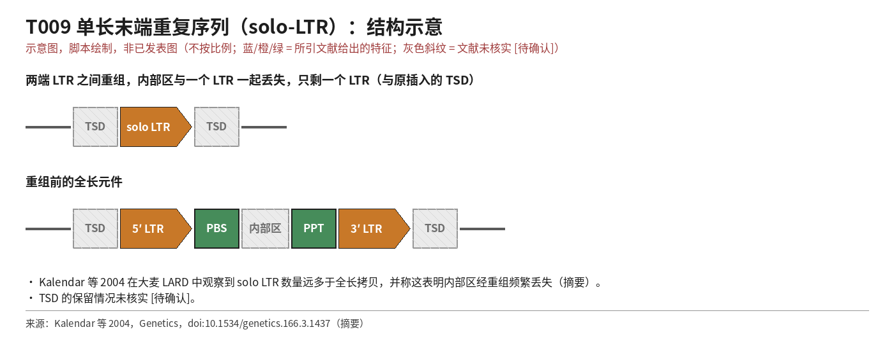

图 T009-1　单长末端重复序列（solo-LTR）：结构示意。示意图，脚本绘制，非已发表图；每个特征的来源写在图下方。序列：Dfam 4.0 绿色植物家族中没有本类型可用的共识序列（无此类家族、两端 30 bp 含 N，或分类标注无法核实），不画序列。


solo-LTR 由单一的 LTR 序列构成，不含内部编码区、PBS 或 PPT [待确认]。其长度直接取决于母本元件单个 LTR 的长度，跨度从 TRIM 来源的约 100 bp 至大型 Gypsy 或 LARD 来源的数 kb 不等 [待确认]。完整的 solo-LTR 仍保留原 LTR 内部的 U3、R、U5 序列以及两端的短反向重复二核苷酸（最经典为 5'-TG...CA-3'） [待确认]。（见本条“本版补充说明”）

#### TSD

由于不等同源重组仅切除原元件 5' LTR 与 3' LTR 之间的内部片段及一个冗余 LTR，原整合位点外侧的一对靶位点重复并未受破坏，因此新形成的 solo-LTR 两侧依然完整保留母本插入时产生的 4 bp 至 6 bp（植物中典型为 5 bp）正向 TSD [待确认]。两翼存在等长正向 TSD 是区分真正 solo-LTR 与普通截短 LTR 碎片的核心判据 [待确认]。

#### 编码蛋白与结构域顺序

solo-LTR 完全不含内部 `gag` 与 `pol` 区域，因此**不编码**任何转座酶或反转录相关蛋白，不存在结构域排列顺序 [待确认]。

#### 转座机制

solo-LTR 本身**丧失转座能力**，既不能自主转座，也无法作为非自主搭档完成反转录扩增，因为其缺乏完整的双 LTR 链转移结构以及 PBS 与 PPT。其形成机制是染色体内的**不等同源重组**（unequal homologous recombination）：同一个完整 LTR 反转录转座子两端的 5' LTR 与 3' LTR 作为高度同源的正向重复序列发生错配联会与交换，将夹在中间的内部编码区连同其中一个 LTR 以环状 DNA 形式切除并丢失，最终在染色体原位仅保留一个嵌合型的单个 LTR [待确认]。尽管丧失移动能力，保留完整 U3 启动子与调控基序的 solo-LTR 仍可作为宿主基因的异源启动子、增强子或加尾信号，持续影响邻近基因的转录调控 [待确认]。

#### 自主与非自主搭档

solo-LTR 是完整 LTR 元件（自主型或非自主型）经重组清除后的终点降解形态，不参与自主/非自主转座搭档体系 [待确认]。在基因组演化分析中，全基因组或特定家族的「solo-LTR 与完整 LTR 拷贝数比值（solo:intact ratio）」是衡量该物种基因组 DNA 清除速率与基因组收缩动态的核心定量指标 [待确认]。

#### 识别特征与工具

基于双 LTR 结构的从头预测软件无法直接检出 solo-LTR，因为其仅存在单个 LTR 拷贝。全基因组识别 solo-LTR 的标准流程是先利用 LTR_retriever 或 EDTA 构建高质量非冗余 LTR 序列库，再通过 RepeatMasker 或 BLAST 对基因组执行同源比对，并结合脚本筛选出「仅匹配单个完整 LTR、两侧无对应内部编码区匹配且两翼具备 4 bp 至 6 bp 正向 TSD」的位点 [待确认]。LTR_retriever 配套流程提供了专门的 solo-LTR 识别与统计脚本（Ou 和 Jiang 2018, doi:10.1104/pp.17.01310）。

#### 分类争议

solo-LTR 本身不存在系统发育分类争议，但实际分析中常见两类方法学误区与界定分歧。其一是切忌将 solo-LTR 视作独立超家族进行并列统计，而应按其 LTR 序列同源性归回对应的 Ty1/Copia 或 Ty3/Gypsy 超家族及谱系下统计 [待确认]。其二是严格判定标准差异：部分研究仅依据「孤立匹配单个 LTR 且周围一定窗口内无内部序列」即计为 solo-LTR，而更严格的标准要求同时验证两侧存在完好 TSD，以排除因基因组组装缺口或嵌套插入打断造成的假性 solo-LTR [待确认]。

#### 发现与分布

**发现与命名**

- Shirasu 等 (2000) A contiguous 66-kb barley DNA sequence provides evidence for reversible genome expansion. Genome Research. doi:10.1101/gr.10.7.908。摘要原句：“Amplification of retrotransposons has been postulated to be a major mechanism increasing genome size and leading to "genomic obesity." To gain insights into the relation between retrotransposons and genome expansion in a large genome, we have studied a 66-kb contiguous sequence at the Rar1 locus of barley in detail”；涉及生物：barley (Hordeum vulgare)；支持范围：solo-LTR formation and reversible genome expansion [注意：所引句不含该名称，仅支持上位/总体论断]
- Vitte 和 Panaud (2003) Formation of solo-LTRs through unequal homologous recombination counterbalances amplifications of LTR retrotransposons in rice Oryza sativa L. Molecular Biology and Evolution. doi:10.1093/molbev/msg055。摘要原句：“We show that solo-LTR formation through homologous unequal recombination has occurred in rice within the past 5 Myr for the three elements”；涉及生物：rice (Oryza sativa)；支持范围：solo-LTRs by unequal homologous recombination
- Devos 等 (2002) Genome size reduction through illegitimate recombination counteracts genome expansion in Arabidopsis. Genome Research. doi:10.1101/gr.132102。摘要原句：“It is well documented that, in addition to polyploidization, retrotransposon amplification has been a major cause of genome expansion”；涉及生物：Arabidopsis thaliana；支持范围：illegitimate recombination removes LTR retrotransposons [注意：所引句不含该名称，仅支持上位/总体论断]

**植物中的报道**

- Shirasu 等 (2000) A contiguous 66-kb barley DNA sequence provides evidence for reversible genome expansion. Genome Research. doi:10.1101/gr.10.7.908。同一论文，原句见上；支持范围：solo LTRs and reversible genome expansion [注意：所引句不含该名称，仅支持上位/总体论断]
- Vitte 和 Panaud (2003) Formation of solo-LTRs through unequal homologous recombination counterbalances amplifications of LTR retrotransposons in rice Oryza sativa L. Molecular Biology and Evolution. doi:10.1093/molbev/msg055。同一论文，原句见上；支持范围：solo-LTR formation [注意：所引句不含该名称，仅支持上位/总体论断]
- Devos 等 (2002) Genome size reduction through illegitimate recombination counteracts genome expansion in Arabidopsis. Genome Research. doi:10.1101/gr.132102。同一论文，原句见上；支持范围：genome size reduction by recombination [注意：所引句不含该名称，仅支持上位/总体论断]

**葡萄中的报道**

- Kobayashi 等 (2004) Retrotransposon-induced mutations in grape skin color. Science. doi:10.1126/science.1095011。仅标题可核实，只用于说明该文存在及其命名/主题，不据此作内容论断
- Yang 等 (2022) Removal of a 10-kb Gret1 transposon from VvMybA1 of Vitis vinifera cv. Chardonnay. Horticulture Research. doi:10.1093/hr/uhac201。摘要原句：“Many white grape cultivars have a nonfunctional VvMybA1 gene due to the presence of a 10-kb Gret1 transposon in its promoter”；涉及生物：Vitis vinifera Chardonnay；支持范围：Gret1 removal from VvMybA1 [注意：所引句不含该名称，仅支持上位/总体论断]
- Nakajima 等 (2023) Targeted deletion of grape retrotransposon associated with fruit skin color via CRISPR/Cas9 in Vitis labrascana 'Shine Muscat'. PLOS ONE. doi:10.1371/journal.pone.0286698。正文原句：“To induce transformed plants, AECs were cultured as before but without 2,4-D. Detection of solo LTR and CRISPR/Cas9-induced mutations at Gret#4 target site Genomic DNA was extracted from calluses and regenerated plants with a DNeasy Plant Mini Kit (Qiagen, Germany) according to the supplier’s…”；涉及生物：Vitis labruscana；支持范围：solo LTR after deletion of grape retrotransposon [注意：所引句不含该名称，仅支持上位/总体论断]

#### 本版补充说明

① 域顺序：GAG–PROT–INT–RT–RH（Ty1/Copia）与 GAG–PROT–RT–RH–INT（Ty3/Gypsy）是 Neumann 等 2019（doi:10.1186/s13100-018-0144-1）在超家族层面给出的判别顺序；本条若写某谱系“遵循”该顺序，指的是沿用超家族的顺序，不是该文对本谱系另行测定。

② 末端：5′-TG…CA-3′ 是该文用 LTR-FINDER 预测元件时设定的筛选条件，不是对各谱系的实测统计；本条中“末端保守为 5′-TG…CA-3′”一类说法应按此理解。

③ TSD 统计（93.4% 为 5 bp、6.2% 为 4 bp、0.4% 为 6 bp）与全长 4.4–24.1 kb 是该文对全部预测元件的总体统计，不是某一超家族或谱系的值；各谱系的值见 Fig. 4 与 T011–T045。

### T010 卡珊德拉元件（Cassandra）

**名称对照**：Wicker 体系：I 类 / LTR 目（非自主衍生物）；Dfam 节点：Gypsy-ERV;Retroviridae（RepeatMasker 子类型标为 Cassandra）；REXdb 路径：无对应节点。（来源：类与目据 Arkhipova 2017, doi:10.1186/s13100-017-0103-2；Dfam 4.0 分类树，2026-11-23 读取；REXdb v4.0 说明文件，doi:10.5281/zenodo.10160279）

#### 定义与命名

卡珊德拉元件（Cassandra，又称 5S-TRIM）是一类广泛存在于维管植物基因组中、结构高度保守的 TRIM 样非自主型 LTR 反转录转座子，其最显著的分子特征是在 5' LTR 与 3' LTR 内部均携带一段高度保守的 5S rRNA 相关序列及 RNA 聚合酶 III（Pol III）内部启动子基序（首次命名专文 DOI 待确认）。在 2007 年统一分类体系的框架下，Cassandra 属于 LTR 目下的非自主型 TRIM 样元件，并非独立超家族 [待确认]。需要特别指出的是，Dfam 现行分类体系将 `LTR/Cassandra` 节点映射在 `Retroviridae` 分类分支之下，这仅属于数据库本体层级中的历史标签对应，绝不可据此将 Cassandra 误认为逆转录病毒或内源性逆转录病毒（ERV） [待确认]。

#### 结构、长度与末端

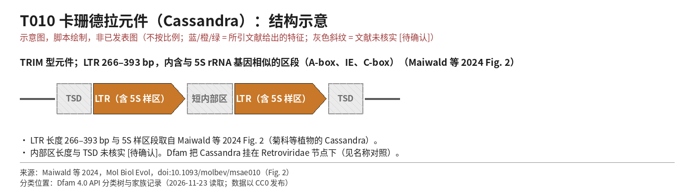

图 T010-1　卡珊德拉元件（Cassandra）：结构示意。示意图，脚本绘制，非已发表图；每个特征的来源写在图下方。序列：Dfam 4.0 绿色植物家族中没有本类型可用的共识序列（无此类家族、两端 30 bp 含 N，或分类标注无法核实），不画序列。

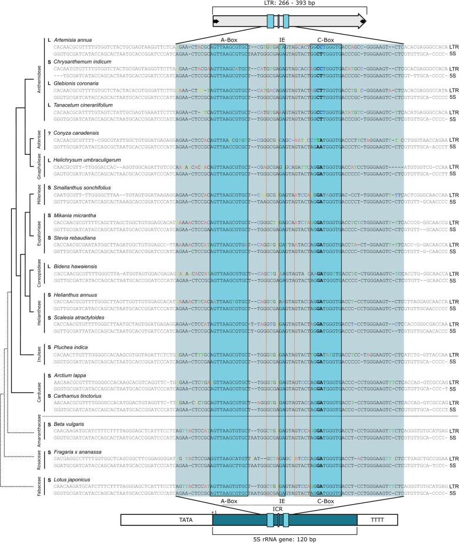

图 T010-P1　Cassandra LTR（266–393 bp）中与 5S rRNA 基因相似的区段（A-box、IE、C-box）的序列比对。原图：Maiwald 等（2024），Fig. 2。Evolving Together: Cassandra Retrotransposons Gradually Mirror Promoter Mutations of the 5S rRNA Genes. Mol Biol Evol. doi:10.1093/molbev/msae010。许可：CC BY 4.0（https://creativecommons.org/licenses/by/4.0/）。未修改。


Cassandra 的整体结构与典型 TRIM 一致，由 5' LTR、极短的内部非编码区和 3' LTR 构成，全长通常在 500 bp 至 850 bp 之间，单个 LTR 长度多为 200 bp 至 350 bp，内部非编码区一般仅数十至百余 bp（精确跨物种长度范围专文 DOI 待确认）。元件两端保留保守的 5'-TG...CA-3' 反向重复二核苷酸，内部区域紧邻 5' LTR 下游具 PBS（通常与甲硫氨酸启动 tRNA 互补，具体细节待确认），紧邻 3' LTR 上游具 PPT（专文 DOI 待确认）。与普通 TRIM 相比，Cassandra 两个 LTR 内部各自嵌入一段约 120 bp 的 5S rRNA 同源区，包含典型的 Pol III 内部控制区基序（A box、IE 与 C box）（专文 DOI 待确认）。（见本条“本版补充说明”）

#### TSD

整合进入宿主基因组时在元件两翼形成正向靶位点重复，典型长度为 5 bp（专文 DOI 待确认）。

#### 编码蛋白与结构域顺序

Cassandra 为典型的非自主型小型元件，内部非编码区极短，**不编码**任何 `gag`、`pol` 或其他转座相关蛋白，无蛋白结构域顺序（专文 DOI 待确认）。

#### 转座机制

Cassandra 采用非自主型 LTR 反转录转座子的复制粘贴扩增模式，但其转录启动机制独具特色：传统 LTR 反转录转座子依赖宿主 RNA 聚合酶 II 从 5' LTR 的 U3 区启动转录，而 Cassandra 凭借 LTR 内携带的 5S rRNA 样内部启动子，可由宿主 RNA 聚合酶 III 驱动转录产生 RNA 中间体（具体 Pol III 转录机制与转录本加工验证专文 DOI 待确认）。随后，该 RNA 中间体借助宿主基因组中自主型 LTR 反转录转座子反式提供的反转录酶与整合酶，以自身 PBS 和 PPT 为引物完成双链 cDNA 合成并整合至新位点，伴随产生 5 bp TSD（专文 DOI 待确认）。Cassandra 两翼 LTR 之间同样可发生不等同源重组形成 solo-LTR（专文 DOI 待确认）。

#### 自主与非自主搭档

Cassandra 属于高度特化的非自主型 TRIM 样元件，必须依赖自主型 LTR 反转录转座子反式提供酶系完成扩增；由于 Cassandra 在陆生植物中具有极古老的演化历史且自身不含蛋白编码区，其在不同植物类群中具体借用的自主型搭档家族尚未完全明确（待确认）。

#### 识别特征与工具

常规默认参数的 LTR 预测软件因最小长度阈值限制容易漏检 Cassandra；鉴定该元件需下调 LTRharvest 或 LTR_FINDER 的最小 LTR 与内部区长度参数，并结合 5S rRNA 保守序列同源检索（如使用 Infernal/Rfam 或 BLAST 扫描 5S rDNA 基序）联合判定：若一对间距数百 bp 的正向重复序列均包含 5S rRNA 样内部启动子基序，且两端具 5'-TG...CA-3' 末端与 5 bp TSD、内部具 PBS 与 PPT，即可确认为 Cassandra 元件（专文 DOI 待确认）。在同源注释层面，Dfam 收录有 `LTR/Cassandra` 序列模型可供 RepeatMasker 检索 [待确认]。（见本条“本版补充说明”）

#### 分类争议

当前最突出的分类与注释陷阱来自数据库层级映射：Dfam 现行分类体系将 `LTR/Cassandra` 放置在 `Retroviridae` 节点之下 [待确认]。这一归位仅源于早期数据库分类树整合时的标签挂载，并不代表 Cassandra 在系统发育或生物学本质上属于逆转录病毒或 ERV。在植物与葡萄转座子注释、统计图表制作及书稿撰写中，若上游工具直接继承了 Dfam 的父类路径，必须手动修正，将 Cassandra 明确归回植物非自主型 LTR / TRIM 样元件类别，严禁将其归入 Retrovirus / ERV 统计项。此外，在基因组非编码 RNA 注释中，需将 Cassandra 内部携带的 5S rDNA 样片段与真正的串联排列 5S rRNA 基因簇严格区分（专文 DOI 待确认）。

#### 发现与分布

**发现与命名**

- Kalendar 等 (2008) Cassandra retrotransposons carry independently transcribed 5S RNA. Proceedings of the National Academy of Sciences. doi:10.1073/pnas.0709698105。摘要原句：“These elements, named Cassandra, universally carry conserved 5S RNA sequences and associated RNA polymerase (pol) III promoters and terminators in their long terminal repeats (LTRs)”；涉及生物：plants (angiosperm genomes)；支持范围：Cassandra TRIM-like elements carrying 5S rRNA

**植物中的报道**

- Kalendar 等 (2008) Cassandra retrotransposons carry independently transcribed 5S RNA. Proceedings of the National Academy of Sciences. doi:10.1073/pnas.0709698105。同一论文，原句见上；支持范围：Cassandra elements
- Maiwald 等 (2021) The Cassandra retrotransposon landscape in sugar beet (Beta vulgaris) and related Amaranthaceae: recombination and re-shuffling lead to a high structural variability. Annals of Botany. doi:10.1093/aob/mcaa176。摘要原句：“In contrast, the non-coding Cassandra terminal repeat retrotransposons in miniature (TRIMs) are widespread in many plants”；涉及生物：sugar beet and Amaranthaceae；支持范围：Cassandra landscape
- Maiwald 等 (2024) Evolving Together: Cassandra Retrotransposons Gradually Mirror Promoter Mutations of the 5S rRNA Genes. Molecular Biology and Evolution. doi:10.1093/molbev/msae010。摘要原句：“The 5S rRNA genes are among the most conserved nucleotide sequences across all species”；支持范围：Cassandra 5S promoter mutation [注意：所引句不含该名称，仅支持上位/总体论断]

**葡萄中的报道**

- 未检索到葡萄专门报道（检索方式见文末「证据与检索方法」）。这只说明检索没有找到，不能据此推断葡萄基因组中不存在。


#### 本版补充说明

① 域顺序：GAG–PROT–INT–RT–RH（Ty1/Copia）与 GAG–PROT–RT–RH–INT（Ty3/Gypsy）是 Neumann 等 2019（doi:10.1186/s13100-018-0144-1）在超家族层面给出的判别顺序；本条若写某谱系“遵循”该顺序，指的是沿用超家族的顺序，不是该文对本谱系另行测定。

② 末端：5′-TG…CA-3′ 是该文用 LTR-FINDER 预测元件时设定的筛选条件，不是对各谱系的实测统计；本条中“末端保守为 5′-TG…CA-3′”一类说法应按此理解。

③ TSD 统计（93.4% 为 5 bp、6.2% 为 4 bp、0.4% 为 6 bp）与全长 4.4–24.1 kb 是该文对全部预测元件的总体统计，不是某一超家族或谱系的值；各谱系的值见 Fig. 4 与 T011–T045。

## 第二部分　Copia 超家族谱系（一）

### T011 Ale谱系（Copia/Ale）

**名称对照**：Wicker 体系：I 类 / LTR 目 / Copia（代码 RLC）；Wicker 不分谱系；Dfam 节点：Ty1-Copia（Dfam 无谱系节点）；REXdb 路径：Class_I/LTR/Ty1/copia/Ale。（来源：代码据 Wu 等 2025, doi:10.3390/biom15030346；Dfam 4.0 分类树，2026-11-23 读取；REXdb v4.0 说明文件，doi:10.5281/zenodo.10160279）

#### 定义与命名

Ale 是 I 类转座子 LTR 目 Ty1/Copia 超家族（RLC）下的核心植物谱系之一（Neumann 等 2019, doi:10.1186/s13100-018-0144-1）。该谱系在 2007 年建立的植物 Copia 早期分类中即被列为六大主要谱系之一（早期分类专文 DOI 待确认），在 2019 年基于蛋白结构域建立的 REXdb 绿色植物系统分类框架中定名为 `Ale`，并明确对应早期文献中的旧名 `Retrofit`（Neumann 等 2019, doi:10.1186/s13100-018-0144-1）。在 Dfam 现行分类体系中，该类群归入 `LTR/Copia` 节点之下 [待确认]。

#### 结构、长度与末端

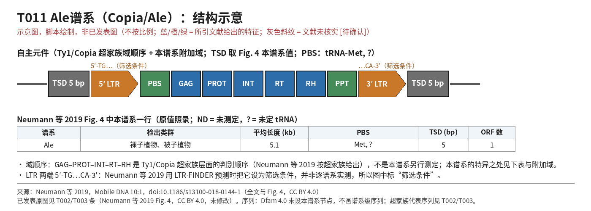

图 T011-1　Ale谱系（Copia/Ale）：结构示意。示意图，脚本绘制，非已发表图；每个特征的来源写在图下方。序列：Dfam 4.0 未设本谱系节点，没有谱系级共识序列；超家族代表序列见 T002/T003。


Ale 谱系元件整体结构高度紧凑，全长通常在 4.5 kb 至 5.5 kb 之间，是植物 Ty1/Copia 超家族中尺寸较短的代表性谱系 [待确认]。其单个 LTR 长度一般较短，多集中在 150 bp 至 400 bp 左右，内部非编码区亦较为精简 [待确认]。完整拷贝的 LTR 两端通常保留保守的 5'-TG...CA-3' 反向重复二核苷酸，5' LTR 下游具与宿主 tRNA 互补的引物结合位点（PBS），3' LTR 上游具多聚嘌呤区（PPT） [待确认]。（见本条“本版补充说明”）

#### TSD

整合进入宿主基因组时在元件两侧形成正向靶位点重复，典型长度为 5 bp [待确认]。

#### 编码蛋白与结构域顺序

自主型 Ale 元件编码完整的 `gag` 与 `pol` 蛋白，严格遵循 Ty1/Copia 超家族的经典结构域排列顺序：**GAG - PROT - INT - RT - RH**（Neumann 等 2019, doi:10.1186/s13100-018-0144-1）。在多数 Ale 元件中，`gag` 与 `pol` 位于单一连续开放阅读框内，不携带 `env` 样附加开放阅读框（Neumann 等 2019, doi:10.1186/s13100-018-0144-1）。（见本条“本版补充说明”）

#### 转座机制

遵循标准的 LTR 反转录转座子复制粘贴扩增机制：由宿主 RNA 聚合酶 II 从 5' LTR 启动子转录全长 RNA，在胞质病毒样颗粒内以 PBS 和 PPT 为引物完成双链 cDNA 反转录，随后由整合酶催化整合至宿主染色体新位点并产生 5 bp TSD [待确认]。

#### 自主与非自主搭档

完整编码 `gag-pol` 的拷贝为自主型；基因组中同时存在内部编码区缺失的非自主衍生物及两翼 LTR 不等同源重组形成的 solo-LTR [待确认]。关于 Ale 谱系专属的非自主搭档家族配对细节待确认。

#### 识别特征与工具

结构从头识别采用 LTRharvest（Ellinghaus 等 2008, doi:10.1186/1471-2105-9-18）、LTR_FINDER（Xu 和 Wang 2007, doi:10.1093/nar/gkm286）、LTR_retriever（Ou 和 Jiang 2018, doi:10.1104/pp.17.01310）与 EDTA（Ou 等 2019, doi:10.1186/s13059-019-1905-y）。将其精准归入 Ale 谱系并与近缘的 Alesia 区分，标准工具为基于 REXdb 蛋白结构域 HMM 模型的 TEsorter（Zhang 等 2022, doi:10.1093/hr/uhac017；Neumann 等 2019, doi:10.1186/s13100-018-0144-1）。

#### 分类争议

早期文献曾将该类群的部分代表家族分别称为 Retrofit 或 Hopscotch 等，导致不同物种间的谱系名称不统一；2019 年 REXdb 系统发育分类已将其统一规范为 `Ale` 谱系，并将系统发育上与 Ale 相近但独立成支的 Alesia 单独分列（Neumann 等 2019, doi:10.1186/s13100-018-0144-1）。

#### 发现与分布

**发现与命名**

- Wicker 和 Keller (2007) Genome-wide comparative analysis of copia retrotransposons in Triticeae, rice, and Arabidopsis reveals conserved ancient evolutionary lineages and distinct dynamics of individual copia families. Genome Research. doi:10.1101/gr.6214107。正文原句：“…the respective names. Major evolutionary lineages are indicated by curly brackets. A reverse transcriptase sequence from yeast (ScRT) served as outgroup. The sequences cluster into six major evolutionary lineages ( Angela , Ale , Bianca , Ivana , Maximus , and TAR ) ( Fig. 1 ). We defined the lineages primarily as large…”；涉及生物：barley, wheat, rice, Arabidopsis；支持范围：six ancient copia lineages named (Angela, Ale, Bianca, Ivana, Maximus, TAR)

**植物中的报道**

- Neumann 等 (2019) Systematic survey of plant LTR-retrotransposons elucidates phylogenetic relationships of their polyprotein domains and provides a reference for element classification. Mobile DNA. doi:10.1186/s13100-018-0144-1。正文原句：“…and Keller [ 24 ] examined 599 Ty1/copia elements from barley, wheat, rice and Arabiopsis thaliana , and classified these into six ancient lineages (Maximus, Ivana, Ale, Angela, TAR and Bianca, Table 1 ) all of which were predicted to have existed before the divergence of monocots and dicots. However, because of the…”；涉及生物：Viridiplantae；支持范围：REXdb survey of plant LTR retrotransposon lineages
- Wicker 和 Keller (2007) Genome-wide comparative analysis of copia retrotransposons in Triticeae, rice, and Arabidopsis reveals conserved ancient evolutionary lineages and distinct dynamics of individual copia families. Genome Research. doi:10.1101/gr.6214107。同一论文，原句见上；支持范围：six copia lineages across monocots and dicots

**葡萄中的报道**

- 未检索到葡萄专门报道（检索方式见文末「证据与检索方法」）。这只说明检索没有找到，不能据此推断葡萄基因组中不存在。

#### 本版补充说明

① 域顺序：GAG–PROT–INT–RT–RH（Ty1/Copia）与 GAG–PROT–RT–RH–INT（Ty3/Gypsy）是 Neumann 等 2019（doi:10.1186/s13100-018-0144-1）在超家族层面给出的判别顺序；本条若写某谱系“遵循”该顺序，指的是沿用超家族的顺序，不是该文对本谱系另行测定。

② 末端：5′-TG…CA-3′ 是该文用 LTR-FINDER 预测元件时设定的筛选条件，不是对各谱系的实测统计；本条中“末端保守为 5′-TG…CA-3′”一类说法应按此理解。

③ 该文 Fig. 4 给出本谱系：检出类群 裸子植物、被子植物；平均长度 5.1 kb；PBS Met, ?；TSD 5 bp；ORF 数 1（ND 为未测定）。正文中标 [待确认] 的“TSD 典型长度 5 bp”与 Fig. 4 一致。

### T012 Alesia谱系（Copia/Alesia）

**名称对照**：Wicker 体系：I 类 / LTR 目 / Copia（代码 RLC）；Wicker 不分谱系；Dfam 节点：Ty1-Copia（Dfam 无谱系节点）；REXdb 路径：Class_I/LTR/Ty1/copia/Alesia。（来源：代码据 Wu 等 2025, doi:10.3390/biom15030346；Dfam 4.0 分类树，2026-11-23 读取；REXdb v4.0 说明文件，doi:10.5281/zenodo.10160279）

#### 定义与命名

Alesia 是 I 类转座子 LTR 目 Ty1/Copia 超家族（RLC）下的独立植物谱系，在 2019 年基于反转录转座子蛋白结构域建立的 REXdb 绿色植物系统分类框架中正式确立，规范命名为 `Alesia`（Neumann 等 2019, doi:10.1186/s13100-018-0144-1）。在系统发育树上，Alesia 与 Ale 谱系亲缘关系最为接近，但构成统计支持度明确的独立单系分支（Neumann 等 2019, doi:10.1186/s13100-018-0144-1）。在 Dfam 现行分类体系中，该谱系归入 `LTR/Copia` 节点之下 [待确认]。

#### 结构、长度与末端

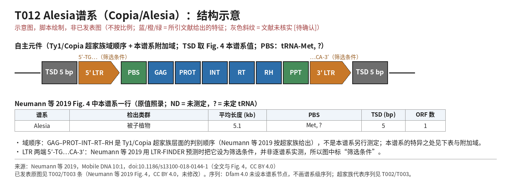

图 T012-1　Alesia谱系（Copia/Alesia）：结构示意。示意图，脚本绘制，非已发表图；每个特征的来源写在图下方。序列：Dfam 4.0 未设本谱系节点，没有谱系级共识序列；超家族代表序列见 T002/T003。


自主型 Alesia 元件整体结构与近缘的 Ale 谱系相似，偏向紧凑型，全长多在 4.5 kb 至 6 kb 之间，单个 LTR 长度通常为数百 bp（精确跨物种长度分布统计待确认）。完整拷贝两翼具正向重复 LTR，末端保守为 5'-TG...CA-3'，内部两端具备 PBS 与 PPT [待确认]。（见本条“本版补充说明”）

#### TSD

整合进入宿主染色体时在元件外侧产生正向靶位点重复，典型长度为 5 bp [待确认]。

#### 编码蛋白与结构域顺序

自主型 Alesia 元件遵循 Ty1/Copia 超家族标准结构域排列顺序：**GAG - PROT - INT - RT - RH**（Neumann 等 2019, doi:10.1186/s13100-018-0144-1）。其内部不含 `env` 样开放阅读框（Neumann 等 2019, doi:10.1186/s13100-018-0144-1）。（见本条“本版补充说明”）

#### 转座机制

遵循经典的 LTR 反转录转座子复制粘贴扩增机制：5' LTR 启动子驱动全长 RNA 转录，在胞质病毒样颗粒内借由 PBS 与 PPT 引导反转录合成双链 cDNA，再由整合酶整合进入宿主基因组新位点并伴随形成 5 bp TSD [待确认]。

#### 自主与非自主搭档

完整携带 `gag-pol` 的拷贝为自主型；基因组中可伴随存在内部缺失的非自主衍生物以及两翼 LTR 不等同源重组形成的 solo-LTR [待确认]。Alesia 谱系专属的非自主搭档关系尚缺乏专门报道，待确认。

#### 识别特征与工具

常规结构检出使用 LTRharvest（Ellinghaus 等 2008, doi:10.1186/1471-2105-9-18）、LTR_FINDER（Xu 和 Wang 2007, doi:10.1093/nar/gkm286）、LTR_retriever（Ou 和 Jiang 2018, doi:10.1104/pp.17.01310）与 EDTA（Ou 等 2019, doi:10.1186/s13059-019-1905-y）。由于 Alesia 在结构长度和蛋白序列上与 Ale 较为接近，仅凭结构特征无法区分，必须依赖基于 REXdb 蛋白域 HMM 的 TEsorter 进行谱系级精准鉴定（Zhang 等 2022, doi:10.1093/hr/uhac017；Neumann 等 2019, doi:10.1186/s13100-018-0144-1）。

#### 分类争议

在 2007 年早期的植物 Copia 六大谱系划分中，Alesia 尚未被单列，其成员在早期研究中容易被并入 Ale 谱系或归为未分类 Copia；2019 年 REXdb 系统发育分析基于多结构域联合建树将其确立为独立谱系，现已成为植物转座子细分类的标准节点（Neumann 等 2019, doi:10.1186/s13100-018-0144-1）。

#### 发现与分布

**发现与命名**

- Neumann 等 (2019) Systematic survey of plant LTR-retrotransposons elucidates phylogenetic relationships of their polyprotein domains and provides a reference for element classification. Mobile DNA. doi:10.1186/s13100-018-0144-1。正文原句：“…of Ty1/copia elements REXdb Wicker and Keller a GyDB b ICTV c Ale Ale Sirevirus/Retrofit ((Koala, Melmoth, Retrofit) pseudovirus (Melmoth, Retrofit, Hopscotch) Alesia Ale – – Angela Angela – pseudovirus (BARE-1) Bianca Bianca – – Bryco – – – Lyco – – – Gymco-I, II, III, IV – – – Ikeros Angela Tork (Sto-4) pseudovirus (Sto-4)…”；涉及生物：Viridiplantae；支持范围：Alesia defined as REXdb lineage (Table 1 maps Alesia to Wicker-Keller Ale)

**植物中的报道**

- Neumann 等 (2019) Systematic survey of plant LTR-retrotransposons elucidates phylogenetic relationships of their polyprotein domains and provides a reference for element classification. Mobile DNA. doi:10.1186/s13100-018-0144-1。同一论文，原句见上；支持范围：REXdb survey of plant LTR retrotransposon lineages

**葡萄中的报道**

- 未检索到葡萄专门报道（检索方式见文末「证据与检索方法」）。这只说明检索没有找到，不能据此推断葡萄基因组中不存在。

#### 本版补充说明

① 域顺序：GAG–PROT–INT–RT–RH（Ty1/Copia）与 GAG–PROT–RT–RH–INT（Ty3/Gypsy）是 Neumann 等 2019（doi:10.1186/s13100-018-0144-1）在超家族层面给出的判别顺序；本条若写某谱系“遵循”该顺序，指的是沿用超家族的顺序，不是该文对本谱系另行测定。

② 末端：5′-TG…CA-3′ 是该文用 LTR-FINDER 预测元件时设定的筛选条件，不是对各谱系的实测统计；本条中“末端保守为 5′-TG…CA-3′”一类说法应按此理解。

③ 该文 Fig. 4 给出本谱系：检出类群 被子植物；平均长度 5.1 kb；PBS Met, ?；TSD 5 bp；ORF 数 1（ND 为未测定）。正文中标 [待确认] 的“TSD 典型长度 5 bp”与 Fig. 4 一致。

### T013 Angela谱系（Copia/Angela）

**名称对照**：Wicker 体系：I 类 / LTR 目 / Copia（代码 RLC）；Wicker 不分谱系；Dfam 节点：Ty1-Copia（Dfam 无谱系节点）；REXdb 路径：Class_I/LTR/Ty1/copia/Angela。（来源：代码据 Wu 等 2025, doi:10.3390/biom15030346；Dfam 4.0 分类树，2026-11-23 读取；REXdb v4.0 说明文件，doi:10.5281/zenodo.10160279）

#### 定义与命名

Angela 是 I 类转座子 LTR 目 Ty1/Copia 超家族（RLC）下的核心植物谱系之一，在 2007 年早期植物 Copia 六大谱系分类及 2019 年 REXdb 绿色植物系统分类框架中均作为独立谱系确立，规范命名为 `Angela`（Neumann 等 2019, doi:10.1186/s13100-018-0144-1）。该谱系包含禾本科植物中著名的高拷贝家族，如大麦中的 `BARE1` 与小麦中的 `WIS` 等近缘家族（Neumann 等 2019, doi:10.1186/s13100-018-0144-1；BARE1 与 WIS 原始命名专文 DOI 待确认）。在 Dfam 现行分类体系中归入 `LTR/Copia` 节点之下 [待确认]。

#### 结构、长度与末端

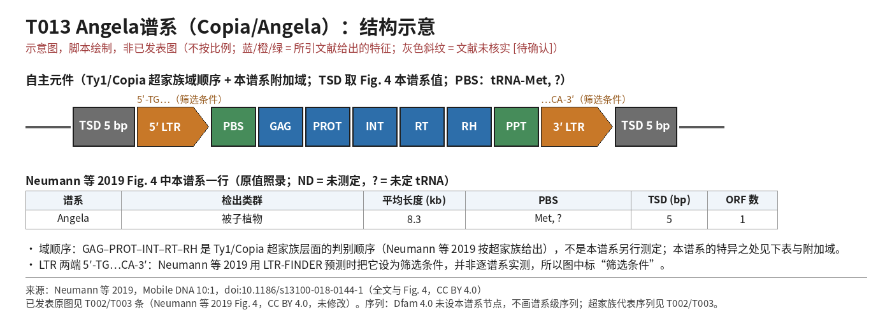

图 T013-1　Angela谱系（Copia/Angela）：结构示意。示意图，脚本绘制，非已发表图；每个特征的来源写在图下方。序列：Dfam 4.0 未设本谱系节点，没有谱系级共识序列；超家族代表序列见 T002/T003。


Angela 谱系属于植物 Ty1/Copia 超家族中尺寸较大的谱系，自主型元件全长通常在 7 kb 至 9.5 kb 之间，单个 LTR 长度较长，常在 1 kb 至 2 kb 左右 [待确认]。元件两翼 LTR 末端保留保守的 5'-TG...CA-3' 反向重复二核苷酸，5' LTR 下游具经典 PBS，3' LTR 上游具 PPT [待确认]。（见本条“本版补充说明”）

#### TSD

整合进入宿主基因组时在元件两侧产生正向靶位点重复，典型长度为 5 bp [待确认]。

#### 编码蛋白与结构域顺序

自主型 Angela 元件编码 `gag` 与 `pol` 蛋白，严格遵循 Ty1/Copia 超家族的 **GAG - PROT - INT - RT - RH** 结构域排列顺序，不携带 `env` 样开放阅读框（Neumann 等 2019, doi:10.1186/s13100-018-0144-1）。（见本条“本版补充说明”）

#### 转座机制

采用标准的 LTR 反转录转座子复制粘贴扩增机制：由宿主 RNA 聚合酶 II 从 5' LTR 启动子转录全长 RNA，经胞质病毒样颗粒内反转录合成双链 cDNA 后，由整合酶整合至宿主基因组新位点并伴随产生 5 bp TSD [待确认]。由于 Angela 元件的单个 LTR 较长，其两翼 LTR 间的不等同源重组效率通常较高，在基因组中易伴随产生大量 solo-LTR [待确认]。

#### 自主与非自主搭档

完整编码 `gag-pol` 的 Angela 拷贝为自主型，既能自我扩增，也可在基因组中伴生内部编码区缺失的非自主衍生物以及高丰度的 solo-LTR [待确认]。在禾本科中，部分高拷贝非自主衍生物（如与 BARE1 相关的 BARE2 衍生物）与自主型 Angela 家族存在明确的演化关联（具体配对专文 DOI 待确认）。

#### 识别特征与工具

完整元件的结构识别依赖 LTRharvest（Ellinghaus 等 2008, doi:10.1186/1471-2105-9-18）、LTR_FINDER（Xu 和 Wang 2007, doi:10.1093/nar/gkm286）、LTR_retriever（Ou 和 Jiang 2018, doi:10.1104/pp.17.01310）与 EDTA（Ou 等 2019, doi:10.1186/s13059-019-1905-y）。谱系级分类使用基于 REXdb 蛋白结构域 HMM 的 TEsorter（Zhang 等 2022, doi:10.1093/hr/uhac017；Neumann 等 2019, doi:10.1186/s13100-018-0144-1）。

#### 分类争议

早期文献常直接以具体物种的高拷贝家族名（如 BARE1、WIS）指代该类群，或将其与 Tork 谱系在宽泛意义上混淆；2019 年 REXdb 系统分类明确将 Angela、Tork 与系统发育上靠近 Angela 的 Ikeros 各自确立为独立谱系，规范了跨物种命名标准（Neumann 等 2019, doi:10.1186/s13100-018-0144-1）。

#### 发现与分布

**发现与命名**

- Wicker 和 Keller (2007) Genome-wide comparative analysis of copia retrotransposons in Triticeae, rice, and Arabidopsis reveals conserved ancient evolutionary lineages and distinct dynamics of individual copia families. Genome Research. doi:10.1101/gr.6214107。正文原句：“…the respective names. Major evolutionary lineages are indicated by curly brackets. A reverse transcriptase sequence from yeast (ScRT) served as outgroup. The sequences cluster into six major evolutionary lineages ( Angela , Ale , Bianca , Ivana , Maximus , and TAR ) ( Fig. 1 ). We defined the lineages primarily as large…”；涉及生物：barley, wheat, rice, Arabidopsis；支持范围：six ancient copia lineages named (Angela, Ale, Bianca, Ivana, Maximus, TAR)

**植物中的报道**

- Neumann 等 (2019) Systematic survey of plant LTR-retrotransposons elucidates phylogenetic relationships of their polyprotein domains and provides a reference for element classification. Mobile DNA. doi:10.1186/s13100-018-0144-1。正文原句：“…Keller [ 24 ] examined 599 Ty1/copia elements from barley, wheat, rice and Arabiopsis thaliana , and classified these into six ancient lineages (Maximus, Ivana, Ale, Angela, TAR and Bianca, Table 1 ) all of which were predicted to have existed before the divergence of monocots and dicots. However, because of the relatively…”；涉及生物：Viridiplantae；支持范围：REXdb survey of plant LTR retrotransposon lineages
- Wicker 和 Keller (2007) Genome-wide comparative analysis of copia retrotransposons in Triticeae, rice, and Arabidopsis reveals conserved ancient evolutionary lineages and distinct dynamics of individual copia families. Genome Research. doi:10.1101/gr.6214107。同一论文，原句见上；支持范围：six copia lineages across monocots and dicots

**葡萄中的报道**

- 未检索到葡萄专门报道（检索方式见文末「证据与检索方法」）。这只说明检索没有找到，不能据此推断葡萄基因组中不存在。

#### 本版补充说明

① 域顺序：GAG–PROT–INT–RT–RH（Ty1/Copia）与 GAG–PROT–RT–RH–INT（Ty3/Gypsy）是 Neumann 等 2019（doi:10.1186/s13100-018-0144-1）在超家族层面给出的判别顺序；本条若写某谱系“遵循”该顺序，指的是沿用超家族的顺序，不是该文对本谱系另行测定。

② 末端：5′-TG…CA-3′ 是该文用 LTR-FINDER 预测元件时设定的筛选条件，不是对各谱系的实测统计；本条中“末端保守为 5′-TG…CA-3′”一类说法应按此理解。

③ 该文 Fig. 4 给出本谱系：检出类群 被子植物；平均长度 8.3 kb；PBS Met, ?；TSD 5 bp；ORF 数 1（ND 为未测定）。正文中标 [待确认] 的“TSD 典型长度 5 bp”与 Fig. 4 一致。

### T014 Bianca谱系（Copia/Bianca）

**名称对照**：Wicker 体系：I 类 / LTR 目 / Copia（代码 RLC）；Wicker 不分谱系；Dfam 节点：Ty1-Copia（Dfam 无谱系节点）；REXdb 路径：Class_I/LTR/Ty1/copia/Bianca。（来源：代码据 Wu 等 2025, doi:10.3390/biom15030346；Dfam 4.0 分类树，2026-11-23 读取；REXdb v4.0 说明文件，doi:10.5281/zenodo.10160279）

#### 定义与命名

Bianca 是 I 类转座子 LTR 目 Ty1/Copia 超家族（RLC）下的六大经典植物谱系之一，在 2019 年 REXdb 绿色植物系统分类框架中确立为独立谱系，规范命名为 `Bianca`（Neumann 等 2019, doi:10.1186/s13100-018-0144-1）。在 Dfam 现行分类体系中归入 `LTR/Copia` 节点之下 [待确认]。

#### 结构、长度与末端


图 T014-1　Bianca谱系（Copia/Bianca）：结构示意。示意图，脚本绘制，非已发表图；每个特征的来源写在图下方。序列：Dfam 4.0 未设本谱系节点，没有谱系级共识序列；超家族代表序列见 T002/T003。


自主型 Bianca 元件全长一般处于中等水平，多在 5 kb 至 7.5 kb 之间，单个 LTR 长度通常为数百 bp 至约 1 kb（精确跨物种长度统计待确认）。完整拷贝两翼具正向重复 LTR，末端保守为 5'-TG...CA-3'，3' LTR 上游具 PPT [待确认]。Bianca 谱系最独特的结构特征在于其引物结合位点（PBS）：2019 年 REXdb 系统研究指出，与绝大多数使用甲硫氨酸启动 tRNA（tRNA-Met）作为反转录引物的植物 LTR 元件不同，Bianca 的 PBS 序列常对应经过编辑的半分子异亮氨酸 tRNA（1/2 tRNA-Ile）（Neumann 等 2019, doi:10.1186/s13100-018-0144-1）。（见本条“本版补充说明”）

#### TSD

整合进入宿主基因组时在元件两侧形成正向靶位点重复，典型长度为 5 bp [待确认]。

#### 编码蛋白与结构域顺序

自主型 Bianca 元件编码 `gag` 与 `pol` 蛋白，严格遵循 Ty1/Copia 超家族的 **GAG - PROT - INT - RT - RH** 结构域排列顺序，不携带 `env` 样开放阅读框（Neumann 等 2019, doi:10.1186/s13100-018-0144-1）。在反转录酶等核心结构域的系统发育树上，Bianca 常位于被子植物 Copia 谱系中分化较早的独立分支（Neumann 等 2019, doi:10.1186/s13100-018-0144-1）。（见本条“本版补充说明”）

#### 转座机制

遵循经典的 LTR 反转录转座子复制粘贴扩增机制，经全长 RNA 转录、胞质病毒样颗粒内反转录合成双链 cDNA 及整合酶介导的染色体整合完成扩增 [待确认]。在负链 cDNA 起始阶段，其特异性利用与编辑后 1/2 tRNA-Ile 互补的 PBS 启动反转录（Neumann 等 2019, doi:10.1186/s13100-018-0144-1）。

#### 自主与非自主搭档

完整携带 `gag-pol` 的拷贝为自主型；基因组中同时存在内部编码区缺失的非自主衍生物以及两翼 LTR 不等同源重组形成的 solo-LTR [待确认]。关于 Bianca 谱系专属非自主搭档家族的报道较少，待确认。

#### 识别特征与工具

结构预测依赖 LTRharvest（Ellinghaus 等 2008, doi:10.1186/1471-2105-9-18）、LTR_FINDER（Xu 和 Wang 2007, doi:10.1093/nar/gkm286）、LTR_retriever（Ou 和 Jiang 2018, doi:10.1104/pp.17.01310）与 EDTA（Ou 等 2019, doi:10.1186/s13059-019-1905-y）。需要注意，若仅依赖默认 tRNA-Met 库筛查 PBS（如部分默认参数下的 LTRdigest 检索），可能因 Bianca 使用 1/2 tRNA-Ile 而漏检其 PBS 信号（Steinbiss 等 2009, doi:10.1093/nar/gkp759；Neumann 等 2019, doi:10.1186/s13100-018-0144-1）。谱系级准确归类应采用基于 REXdb 蛋白结构域 HMM 的 TEsorter（Zhang 等 2022, doi:10.1093/hr/uhac017）。

#### 分类争议

Bianca 作为独立谱系的地位在 2007 年早期植物 Copia 分类及 2019 年 REXdb 体系中高度一致，几乎不存在合并争议；讨论主要集中于其在 Copia 超家族深层系统发育树中的基部位置及特殊 PBS 引物机制的起源演化（Neumann 等 2019, doi:10.1186/s13100-018-0144-1）。

#### 发现与分布

**发现与命名**

- Wicker 和 Keller (2007) Genome-wide comparative analysis of copia retrotransposons in Triticeae, rice, and Arabidopsis reveals conserved ancient evolutionary lineages and distinct dynamics of individual copia families. Genome Research. doi:10.1101/gr.6214107。正文原句：“…the respective names. Major evolutionary lineages are indicated by curly brackets. A reverse transcriptase sequence from yeast (ScRT) served as outgroup. The sequences cluster into six major evolutionary lineages ( Angela , Ale , Bianca , Ivana , Maximus , and TAR ) ( Fig. 1 ). We defined the lineages primarily as large…”；涉及生物：barley, wheat, rice, Arabidopsis；支持范围：six ancient copia lineages named (Angela, Ale, Bianca, Ivana, Maximus, TAR)

**植物中的报道**

- Neumann 等 (2019) Systematic survey of plant LTR-retrotransposons elucidates phylogenetic relationships of their polyprotein domains and provides a reference for element classification. Mobile DNA. doi:10.1186/s13100-018-0144-1。正文原句：“…examined 599 Ty1/copia elements from barley, wheat, rice and Arabiopsis thaliana , and classified these into six ancient lineages (Maximus, Ivana, Ale, Angela, TAR and Bianca, Table 1 ) all of which were predicted to have existed before the divergence of monocots and dicots. However, because of the relatively small sampling…”；涉及生物：Viridiplantae；支持范围：REXdb survey of plant LTR retrotransposon lineages
- Wicker 和 Keller (2007) Genome-wide comparative analysis of copia retrotransposons in Triticeae, rice, and Arabidopsis reveals conserved ancient evolutionary lineages and distinct dynamics of individual copia families. Genome Research. doi:10.1101/gr.6214107。同一论文，原句见上；支持范围：six copia lineages across monocots and dicots

**葡萄中的报道**

- 未检索到葡萄专门报道（检索方式见文末「证据与检索方法」）。这只说明检索没有找到，不能据此推断葡萄基因组中不存在。

#### 本版补充说明

① 域顺序：GAG–PROT–INT–RT–RH（Ty1/Copia）与 GAG–PROT–RT–RH–INT（Ty3/Gypsy）是 Neumann 等 2019（doi:10.1186/s13100-018-0144-1）在超家族层面给出的判别顺序；本条若写某谱系“遵循”该顺序，指的是沿用超家族的顺序，不是该文对本谱系另行测定。

② 末端：5′-TG…CA-3′ 是该文用 LTR-FINDER 预测元件时设定的筛选条件，不是对各谱系的实测统计；本条中“末端保守为 5′-TG…CA-3′”一类说法应按此理解。

③ 该文 Fig. 4 给出本谱系：检出类群 被子植物；平均长度 6.1 kb；PBS 1/2Ile；TSD 5 bp；ORF 数 2（ND 为未测定）。正文中标 [待确认] 的“TSD 典型长度 5 bp”与 Fig. 4 一致。

### T015 Ivana谱系（Copia/Ivana）

**名称对照**：Wicker 体系：I 类 / LTR 目 / Copia（代码 RLC）；Wicker 不分谱系；Dfam 节点：Ty1-Copia（Dfam 无谱系节点）；REXdb 路径：Class_I/LTR/Ty1/copia/Ivana。（来源：代码据 Wu 等 2025, doi:10.3390/biom15030346；Dfam 4.0 分类树，2026-11-23 读取；REXdb v4.0 说明文件，doi:10.5281/zenodo.10160279）

#### 定义与命名

Ivana 是 I 类转座子 LTR 目 Ty1/Copia 超家族（RLC）下的六大经典植物谱系之一（Neumann 等 2019, doi:10.1186/s13100-018-0144-1）。在 2019 年基于蛋白结构域建立的 REXdb 绿色植物系统分类框架中，该谱系统一定名为 `Ivana`，并明确对应早期文献中的旧名 `Oryco`（Neumann 等 2019, doi:10.1186/s13100-018-0144-1）。在 Dfam 现行分类体系中归入 `LTR/Copia` 节点之下 [待确认]。

#### 结构、长度与末端


图 T015-1　Ivana谱系（Copia/Ivana）：结构示意。示意图，脚本绘制，非已发表图；每个特征的来源写在图下方。序列：Dfam 4.0 未设本谱系节点，没有谱系级共识序列；超家族代表序列见 T002/T003。


Ivana 谱系与 Ale 类似，属于结构紧凑型植物 Copia 元件，完整自主型拷贝的全长多在 4.5 kb 至 5.5 kb 之间，单个 LTR 长度通常较短，多在 150 bp 至 400 bp 左右，内部非编码区精简 [待确认]。元件两翼 LTR 末端保守为 5'-TG...CA-3'，内部两端具备 PBS 与 PPT [待确认]。（见本条“本版补充说明”）

#### TSD

整合进入宿主染色体时在元件两侧产生正向靶位点重复，典型长度为 5 bp [待确认]。

#### 编码蛋白与结构域顺序

自主型 Ivana 元件编码完整的 `gag` 与 `pol` 蛋白，严格遵循 Ty1/Copia 超家族的 **GAG - PROT - INT - RT - RH** 结构域排列顺序，不携带 `env` 样开放阅读框（Neumann 等 2019, doi:10.1186/s13100-018-0144-1）。（见本条“本版补充说明”）

#### 转座机制

遵循经典的 LTR 反转录转座子复制粘贴扩增机制：由宿主 RNA 聚合酶 II 从 5' LTR 启动子转录全长 RNA，经胞质病毒样颗粒内以 PBS 和 PPT 为引物完成双链 cDNA 合成后，由整合酶整合进入宿主染色体新位点并产生 5 bp TSD [待确认]。

#### 自主与非自主搭档

完整编码 `gag-pol` 的拷贝为自主型；基因组中同时存在内部缺失的非自主衍生物及两翼 LTR 不等同源重组形成的 solo-LTR [待确认]。关于 Ivana 谱系专属非自主搭档家族的配对验证文献待确认。

#### 识别特征与工具

结构从头预测采用 LTRharvest（Ellinghaus 等 2008, doi:10.1186/1471-2105-9-18）、LTR_FINDER（Xu 和 Wang 2007, doi:10.1093/nar/gkm286）、LTR_retriever（Ou 和 Jiang 2018, doi:10.1104/pp.17.01310）与 EDTA（Ou 等 2019, doi:10.1186/s13059-019-1905-y）。由于 Ivana 与 Ale 均具有较短的全长与 LTR 长度，仅凭尺寸无法区分，必须依赖基于 REXdb 蛋白结构域 HMM 模型的 TEsorter 完成准确谱系归类（Zhang 等 2022, doi:10.1093/hr/uhac017；Neumann 等 2019, doi:10.1186/s13100-018-0144-1）。

#### 分类争议

主要历史分歧在于命名不统一：早期基于水稻等物种的研究普遍使用 `Oryco` 命名该谱系，另一些研究使用 `Ivana`；2019 年 REXdb 系统发育分类正式统一采用 `Ivana` 作为规范谱系名，并将 `Oryco` 列为历史同义旧名（Neumann 等 2019, doi:10.1186/s13100-018-0144-1）。

#### 发现与分布

**发现与命名**

- Wicker 和 Keller (2007) Genome-wide comparative analysis of copia retrotransposons in Triticeae, rice, and Arabidopsis reveals conserved ancient evolutionary lineages and distinct dynamics of individual copia families. Genome Research. doi:10.1101/gr.6214107。正文原句：“…the respective names. Major evolutionary lineages are indicated by curly brackets. A reverse transcriptase sequence from yeast (ScRT) served as outgroup. The sequences cluster into six major evolutionary lineages ( Angela , Ale , Bianca , Ivana , Maximus , and TAR ) ( Fig. 1 ). We defined the lineages primarily as large…”；涉及生物：barley, wheat, rice, Arabidopsis；支持范围：six ancient copia lineages named (Angela, Ale, Bianca, Ivana, Maximus, TAR)

**植物中的报道**

- Neumann 等 (2019) Systematic survey of plant LTR-retrotransposons elucidates phylogenetic relationships of their polyprotein domains and provides a reference for element classification. Mobile DNA. doi:10.1186/s13100-018-0144-1。正文原句：“2 ). Wicker and Keller [ 24 ] examined 599 Ty1/copia elements from barley, wheat, rice and Arabiopsis thaliana , and classified these into six ancient lineages (Maximus, Ivana, Ale, Angela, TAR and Bianca, Table 1 ) all of which were predicted to have existed before the divergence of monocots and dicots. However, because of…”；涉及生物：Viridiplantae；支持范围：REXdb survey of plant LTR retrotransposon lineages
- Wicker 和 Keller (2007) Genome-wide comparative analysis of copia retrotransposons in Triticeae, rice, and Arabidopsis reveals conserved ancient evolutionary lineages and distinct dynamics of individual copia families. Genome Research. doi:10.1101/gr.6214107。同一论文，原句见上；支持范围：six copia lineages across monocots and dicots

**葡萄中的报道**

- 未检索到葡萄专门报道（检索方式见文末「证据与检索方法」）。这只说明检索没有找到，不能据此推断葡萄基因组中不存在。

#### 本版补充说明

① 域顺序：GAG–PROT–INT–RT–RH（Ty1/Copia）与 GAG–PROT–RT–RH–INT（Ty3/Gypsy）是 Neumann 等 2019（doi:10.1186/s13100-018-0144-1）在超家族层面给出的判别顺序；本条若写某谱系“遵循”该顺序，指的是沿用超家族的顺序，不是该文对本谱系另行测定。

② 末端：5′-TG…CA-3′ 是该文用 LTR-FINDER 预测元件时设定的筛选条件，不是对各谱系的实测统计；本条中“末端保守为 5′-TG…CA-3′”一类说法应按此理解。

③ 该文 Fig. 4 给出本谱系：检出类群 裸子植物、被子植物；平均长度 5.1 kb；PBS Met, ?；TSD 5 bp；ORF 数 1（ND 为未测定）。正文中标 [待确认] 的“TSD 典型长度 5 bp”与 Fig. 4 一致。

### T016 Ikeros谱系（Copia/Ikeros）

**名称对照**：Wicker 体系：I 类 / LTR 目 / Copia（代码 RLC）；Wicker 不分谱系；Dfam 节点：Ty1-Copia（Dfam 无谱系节点）；REXdb 路径：Class_I/LTR/Ty1/copia/Ikeros。（来源：代码据 Wu 等 2025, doi:10.3390/biom15030346；Dfam 4.0 分类树，2026-11-23 读取；REXdb v4.0 说明文件，doi:10.5281/zenodo.10160279）

#### 定义与命名

Ikeros 是 I 类转座子 LTR 目 Ty1/Copia 超家族（RLC）下的独立植物谱系（Neumann 等 2019, doi:10.1186/s13100-018-0144-1）。在 2007 年早期的植物 Copia 分类中，Ikeros 仅作为具体家族被提及，未与六大谱系并列（早期分类专文 DOI 待确认）；2019 年 REXdb 绿色植物系统分类框架基于多结构域系统发育分析将其提升并正式确立为独立谱系，规范命名为 `Ikeros`（Neumann 等 2019, doi:10.1186/s13100-018-0144-1）。在 Dfam 现行分类体系中归入 `LTR/Copia` 节点之下 [待确认]。

#### 结构、长度与末端


图 T016-1　Ikeros谱系（Copia/Ikeros）：结构示意。示意图，脚本绘制，非已发表图；每个特征的来源写在图下方。序列：Dfam 4.0 未设本谱系节点，没有谱系级共识序列；超家族代表序列见 T002/T003。


自主型 Ikeros 元件全长多在 5 kb 至 7 kb 左右，单个 LTR 长度通常为数百 bp 至约 1 kb（精确跨物种长度分布统计待确认）。完整拷贝两翼具正向重复 LTR，末端保守为 5'-TG...CA-3'，内部两端具备 PBS 与 PPT [待确认]。（见本条“本版补充说明”）

#### TSD

整合进入宿主基因组时在元件两侧形成正向靶位点重复，典型长度为 5 bp [待确认]。

#### 编码蛋白与结构域顺序

自主型 Ikeros 元件编码 `gag` 与 `pol` 蛋白，严格遵循 Ty1/Copia 超家族的 **GAG - PROT - INT - RT - RH** 结构域排列顺序，不携带 `env` 样开放阅读框（Neumann 等 2019, doi:10.1186/s13100-018-0144-1）。在部分蛋白结构域系统发育树上，Ikeros 与 Angela 谱系位置相对靠近，但在联合结构域分析中保持独立单系分支（Neumann 等 2019, doi:10.1186/s13100-018-0144-1）。（见本条“本版补充说明”）

#### 转座机制

遵循经典的 LTR 反转录转座子复制粘贴扩增机制：5' LTR 启动子驱动全长 RNA 转录，在胞质病毒样颗粒内借由 PBS 与 PPT 引导合成双链 cDNA，随后由整合酶整合至宿主染色体新位点并产生 5 bp TSD [待确认]。

#### 自主与非自主搭档

完整携带 `gag-pol` 的拷贝为自主型；基因组中可伴生内部缺失的非自主衍生物及两翼 LTR 不等同源重组形成的 solo-LTR [待确认]。关于 Ikeros 专属非自主搭档的专门研究待确认。

#### 识别特征与工具

结构检出采用 LTRharvest（Ellinghaus 等 2008, doi:10.1186/1471-2105-9-18）、LTR_FINDER（Xu 和 Wang 2007, doi:10.1093/nar/gkm286）、LTR_retriever（Ou 和 Jiang 2018, doi:10.1104/pp.17.01310）与 EDTA（Ou 等 2019, doi:10.1186/s13059-019-1905-y）。将其与在部分树上位置相近的 Angela 谱系准确区分，需使用基于 REXdb 蛋白结构域 HMM 的 TEsorter（Zhang 等 2022, doi:10.1093/hr/uhac017；Neumann 等 2019, doi:10.1186/s13100-018-0144-1）。

#### 分类争议

主要争议在于其分类层级定位：2007 年早期植物 Copia 分类仅将其视为家族级别，而 2019 年 REXdb 系统发育研究基于跨 80 种绿色植物的蛋白域聚类将其正式确立为独立谱系；在部分单结构域系统发育树中 Ikeros 与 Angela 靠近，因此在自动化注释中需以完整多结构域 HMM 联合判别为准（Neumann 等 2019, doi:10.1186/s13100-018-0144-1）。

#### 发现与分布

**发现与命名**

- Neumann 等 (2019) Systematic survey of plant LTR-retrotransposons elucidates phylogenetic relationships of their polyprotein domains and provides a reference for element classification. Mobile DNA. doi:10.1186/s13100-018-0144-1。正文原句：“…pseudovirus (Melmoth, Retrofit, Hopscotch) Alesia Ale – – Angela Angela – pseudovirus (BARE-1) Bianca Bianca – – Bryco – – – Lyco – – – Gymco-I, II, III, IV – – – Ikeros Angela Tork (Sto-4) pseudovirus (Sto-4) Ivana Ivana Sirevirus/Oryco (Araco, Oryco1–1, Oryco1–2, Poco, Vitico1–1) – Osser – Osser hemivirus (Osser) SIRE…”；涉及生物：Viridiplantae；支持范围：Ikeros defined as REXdb lineage (Table 1)
- Wicker 和 Keller (2007) Genome-wide comparative analysis of copia retrotransposons in Triticeae, rice, and Arabidopsis reveals conserved ancient evolutionary lineages and distinct dynamics of individual copia families. Genome Research. doi:10.1101/gr.6214107。正文原句：“…For eight of the 20 copia families, only a single complete element is deposited at TREP. Nine families have two to four members ( Ale , Barbara , Bianca , HORPIA2 , Ikeros , Inga , Maximus , Oref , and TAR1 ) and most abundant are the closely related Angela , BARE1 , and WIS families for which 15, 17, and 26 complete copies…”；涉及生物：barley, wheat, rice, Arabidopsis；支持范围：Ikeros appears as a named copia family before REXdb

**植物中的报道**

- Neumann 等 (2019) Systematic survey of plant LTR-retrotransposons elucidates phylogenetic relationships of their polyprotein domains and provides a reference for element classification. Mobile DNA. doi:10.1186/s13100-018-0144-1。同一论文，原句见上；支持范围：REXdb survey of plant LTR retrotransposon lineages

**葡萄中的报道**

- 未检索到葡萄专门报道（检索方式见文末「证据与检索方法」）。这只说明检索没有找到，不能据此推断葡萄基因组中不存在。

#### 本版补充说明

① 域顺序：GAG–PROT–INT–RT–RH（Ty1/Copia）与 GAG–PROT–RT–RH–INT（Ty3/Gypsy）是 Neumann 等 2019（doi:10.1186/s13100-018-0144-1）在超家族层面给出的判别顺序；本条若写某谱系“遵循”该顺序，指的是沿用超家族的顺序，不是该文对本谱系另行测定。

② 末端：5′-TG…CA-3′ 是该文用 LTR-FINDER 预测元件时设定的筛选条件，不是对各谱系的实测统计；本条中“末端保守为 5′-TG…CA-3′”一类说法应按此理解。

③ 该文 Fig. 4 给出本谱系：检出类群 裸子植物、被子植物；平均长度 6.9 kb；PBS Met, ?；TSD 5 bp；ORF 数 1（ND 为未测定）。正文中标 [待确认] 的“TSD 典型长度 5 bp”与 Fig. 4 一致。

### T017 TAR谱系（Copia/TAR）

**名称对照**：Wicker 体系：I 类 / LTR 目 / Copia（代码 RLC）；Wicker 不分谱系；Dfam 节点：Ty1-Copia（Dfam 无谱系节点）；REXdb 路径：Class_I/LTR/Ty1/copia/TAR。（来源：代码据 Wu 等 2025, doi:10.3390/biom15030346；Dfam 4.0 分类树，2026-11-23 读取；REXdb v4.0 说明文件，doi:10.5281/zenodo.10160279）

#### 定义与命名

TAR 是 I 类转座子 LTR 目 Ty1/Copia 超家族（RLC）下的六大经典植物谱系之一，在 2019 年 REXdb 绿色植物系统分类框架中正式确立为独立谱系，规范命名为 `TAR`（Neumann 等 2019, doi:10.1186/s13100-018-0144-1）。在 Dfam 现行分类体系中归入 `LTR/Copia` 节点之下 [待确认]。

#### 结构、长度与末端

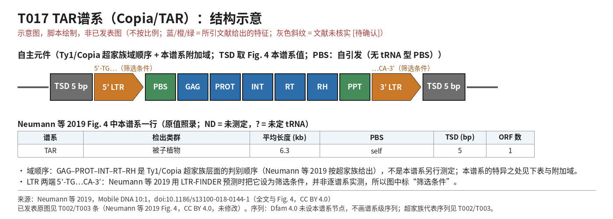

图 T017-1　TAR谱系（Copia/TAR）：结构示意。示意图，脚本绘制，非已发表图；每个特征的来源写在图下方。序列：Dfam 4.0 未设本谱系节点，没有谱系级共识序列；超家族代表序列见 T002/T003。


自主型 TAR 元件全长多在 5 kb 至 7 kb 之间，单个 LTR 长度一般为数百 bp 至约 1 kb（精确跨物种长度分布统计待确认）。完整拷贝两翼具正向重复 LTR，末端保守为 5'-TG...CA-3'，3' LTR 上游具 PPT [待确认]。在反转录起始结构上，2019 年 REXdb 系统研究记录到 TAR 谱系元件常缺乏典型的宿主 tRNA 互补 PBS，而是采用自引发（self-priming）机制起始反转录（Neumann 等 2019, doi:10.1186/s13100-018-0144-1）。（见本条“本版补充说明”）

#### TSD

整合进入宿主染色体时在元件两侧产生正向靶位点重复，典型长度为 5 bp [待确认]。

#### 编码蛋白与结构域顺序

自主型 TAR 元件编码 `gag` 与 `pol` 蛋白，严格遵循 Ty1/Copia 超家族的 **GAG - PROT - INT - RT - RH** 结构域排列顺序，不携带 `env` 样开放阅读框（Neumann 等 2019, doi:10.1186/s13100-018-0144-1）。（见本条“本版补充说明”）

#### 转座机制

遵循 LTR 反转录转座子的复制粘贴扩增机制，经全长 RNA 转录、胞质病毒样颗粒内反转录合成双链 cDNA 及整合酶介导的染色体整合完成扩增 [待确认]。与多数依赖宿主 tRNA 结合 PBS 启动负链合成的 Copia 谱系不同，TAR 谱系常通过转录本自身 RNA 分子内折回配对实现自引发起始反转录（Neumann 等 2019, doi:10.1186/s13100-018-0144-1；自引发二级结构分子机制专文 DOI 待确认）。

#### 自主与非自主搭档

完整编码 `gag-pol` 的拷贝为自主型；基因组中同时存在内部缺失的非自主衍生物及两翼 LTR 不等同源重组形成的 solo-LTR [待确认]。关于 TAR 谱系专属非自主搭档家族的配对研究待确认。

#### 识别特征与工具

结构从头识别采用 LTRharvest（Ellinghaus 等 2008, doi:10.1186/1471-2105-9-18）、LTR_FINDER（Xu 和 Wang 2007, doi:10.1093/nar/gkm286）、LTR_retriever（Ou 和 Jiang 2018, doi:10.1104/pp.17.01310）与 EDTA（Ou 等 2019, doi:10.1186/s13059-019-1905-y）。鉴于 TAR 常采用自引发机制而非经典 tRNA-PBS，在使用 LTRdigest 等工具进行辅助注释时不可将缺失经典 PBS 作为排除 TAR 的依据（Steinbiss 等 2009, doi:10.1093/nar/gkp759；Neumann 等 2019, doi:10.1186/s13100-018-0144-1）。谱系级精准分类应使用基于 REXdb 蛋白结构域 HMM 的 TEsorter（Zhang 等 2022, doi:10.1093/hr/uhac017）。

#### 分类争议

主要需注意避免与 Tork 谱系混淆或随意合并：早期部分研究曾将 Tork 与 TAR 归入宽泛的 Tork/TAR 复合群，但 2019 年 REXdb 系统发育分类已明确两者在蛋白结构域演化树上分属独立单系支且在反转录引发特征上存在差异，应严格分列为 `TAR` 与 `Tork`（Neumann 等 2019, doi:10.1186/s13100-018-0144-1）。

#### 发现与分布

**发现与命名**

- Wicker 和 Keller (2007) Genome-wide comparative analysis of copia retrotransposons in Triticeae, rice, and Arabidopsis reveals conserved ancient evolutionary lineages and distinct dynamics of individual copia families. Genome Research. doi:10.1101/gr.6214107。正文原句：“…the respective names. Major evolutionary lineages are indicated by curly brackets. A reverse transcriptase sequence from yeast (ScRT) served as outgroup. The sequences cluster into six major evolutionary lineages ( Angela , Ale , Bianca , Ivana , Maximus , and TAR ) ( Fig. 1 ). We defined the lineages primarily as large…”；涉及生物：barley, wheat, rice, Arabidopsis；支持范围：six ancient copia lineages named (Angela, Ale, Bianca, Ivana, Maximus, TAR)

**植物中的报道**

- Neumann 等 (2019) Systematic survey of plant LTR-retrotransposons elucidates phylogenetic relationships of their polyprotein domains and provides a reference for element classification. Mobile DNA. doi:10.1186/s13100-018-0144-1。正文原句：“…[ 24 ] examined 599 Ty1/copia elements from barley, wheat, rice and Arabiopsis thaliana , and classified these into six ancient lineages (Maximus, Ivana, Ale, Angela, TAR and Bianca, Table 1 ) all of which were predicted to have existed before the divergence of monocots and dicots. However, because of the relatively small…”；涉及生物：Viridiplantae；支持范围：REXdb survey of plant LTR retrotransposon lineages
- Wicker 和 Keller (2007) Genome-wide comparative analysis of copia retrotransposons in Triticeae, rice, and Arabidopsis reveals conserved ancient evolutionary lineages and distinct dynamics of individual copia families. Genome Research. doi:10.1101/gr.6214107。同一论文，原句见上；支持范围：six copia lineages across monocots and dicots

**葡萄中的报道**

- 未检索到葡萄专门报道（检索方式见文末「证据与检索方法」）。这只说明检索没有找到，不能据此推断葡萄基因组中不存在。

#### 本版补充说明

① 域顺序：GAG–PROT–INT–RT–RH（Ty1/Copia）与 GAG–PROT–RT–RH–INT（Ty3/Gypsy）是 Neumann 等 2019（doi:10.1186/s13100-018-0144-1）在超家族层面给出的判别顺序；本条若写某谱系“遵循”该顺序，指的是沿用超家族的顺序，不是该文对本谱系另行测定。

② 末端：5′-TG…CA-3′ 是该文用 LTR-FINDER 预测元件时设定的筛选条件，不是对各谱系的实测统计；本条中“末端保守为 5′-TG…CA-3′”一类说法应按此理解。

③ 该文 Fig. 4 给出本谱系：检出类群 被子植物；平均长度 6.3 kb；PBS 自引发；TSD 5 bp；ORF 数 1（ND 为未测定）。正文中标 [待确认] 的“TSD 典型长度 5 bp”与 Fig. 4 一致。

### T018 Tork谱系（Copia/Tork）

**名称对照**：Wicker 体系：I 类 / LTR 目 / Copia（代码 RLC）；Wicker 不分谱系；Dfam 节点：Ty1-Copia（Dfam 无谱系节点）；REXdb 路径：Class_I/LTR/Ty1/copia/Tork。（来源：代码据 Wu 等 2025, doi:10.3390/biom15030346；Dfam 4.0 分类树，2026-11-23 读取；REXdb v4.0 说明文件，doi:10.5281/zenodo.10160279）

#### 定义与命名

Tork 是 I 类转座子 LTR 目 Ty1/Copia 超家族（RLC）下的独立植物谱系，在 2019 年基于反转录转座子蛋白结构域建立的 REXdb 绿色植物系统分类框架中规范命名为 `Tork`，与 TAR、Angela、Ivana、Ale、Bianca 等谱系并列（Neumann 等 2019, doi:10.1186/s13100-018-0144-1）。该谱系名称源于早期在烟草等植物中鉴定的 Tnt1/Tto1 等经典 Copia 家族所属的类群（Tnt1 原始发现专文 DOI 待确认）。在 Dfam 现行分类体系中归入 `LTR/Copia` 节点之下 [待确认]。

#### 结构、长度与末端

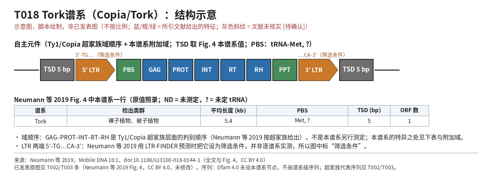

图 T018-1　Tork谱系（Copia/Tork）：结构示意。示意图，脚本绘制，非已发表图；每个特征的来源写在图下方。序列：Dfam 4.0 未设本谱系节点，没有谱系级共识序列；超家族代表序列见 T002/T003。


自主型 Tork 元件全长多在 5 kb 至 7 kb 之间，单个 LTR 长度通常为 400 bp 至 1 kb 左右（精确跨物种长度分布统计待确认）。完整拷贝两翼具正向重复 LTR，末端高度保守为 5'-TG...CA-3'，5' LTR 下游具经典 PBS，3' LTR 上游具 PPT [待确认]。（见本条“本版补充说明”）

#### TSD

整合进入宿主基因组时在元件两侧形成正向靶位点重复，典型长度为 5 bp [待确认]。

#### 编码蛋白与结构域顺序

自主型 Tork 元件编码完整的 `gag` 与 `pol` 蛋白，严格遵循 Ty1/Copia 超家族的 **GAG - PROT - INT - RT - RH** 结构域排列顺序，不携带 `env` 样开放阅读框（Neumann 等 2019, doi:10.1186/s13100-018-0144-1）。（见本条“本版补充说明”）

#### 转座机制

遵循经典的 LTR 反转录转座子复制粘贴扩增机制：5' LTR 启动子驱动全长 RNA 转录，在胞质病毒样颗粒内借由 PBS 与 PPT 引导完成双链 cDNA 反转录，随后由整合酶整合至宿主基因组新位点并伴随产生 5 bp TSD [待确认]。部分 Tork 谱系代表家族（如烟草 Tnt1）的 5' LTR U3 区携带胁迫响应顺式作用元件，在原生质体制备、组织培养或生物与非生物胁迫条件下可被强烈转录激活（Tnt1 胁迫激活专文 DOI 待确认）。

#### 自主与非自主搭档

完整编码 `gag-pol` 的拷贝为自主型；基因组中同时存在内部编码区缺失的非自主衍生物及两翼 LTR 不等同源重组形成的 solo-LTR [待确认]。关于 Tork 谱系专属非自主搭档家族的系统配对研究待确认。

#### 识别特征与工具

完整元件的结构识别采用 LTRharvest（Ellinghaus 等 2008, doi:10.1186/1471-2105-9-18）、LTR_FINDER（Xu 和 Wang 2007, doi:10.1093/nar/gkm286）、LTR_retriever（Ou 和 Jiang 2018, doi:10.1104/pp.17.01310）与 EDTA（Ou 等 2019, doi:10.1186/s13059-019-1905-y）。谱系级精准分类采用基于 REXdb 蛋白结构域 HMM 的 TEsorter（Zhang 等 2022, doi:10.1093/hr/uhac017；Neumann 等 2019, doi:10.1186/s13100-018-0144-1）。

#### 分类争议

早期部分植物转座子分类文献曾将 Tork 与 TAR（甚至 Angela）在较宽泛的层级上合并讨论；2019 年 REXdb 系统发育分类已明确将 `Tork` 与 `TAR` 作为并列的独立谱系分列，在转座子注释、统计与谱系比较中切勿将 Tork 与 TAR 随意合并（Neumann 等 2019, doi:10.1186/s13100-018-0144-1）。

#### 发现与分布

**发现与命名**

- Neumann 等 (2019) Systematic survey of plant LTR-retrotransposons elucidates phylogenetic relationships of their polyprotein domains and provides a reference for element classification. Mobile DNA. doi:10.1186/s13100-018-0144-1。正文原句：“…and 30 Ty3/gypsy elements from 26 Viridiplantae species. They identified five plant lineages of Ty1/copia elements, referred to as Oryco, Sire, Retrofit, Osser and Tork (Table 1 ). Ty3/gypsy elements in plants were found to belong to two major lineages, chromovirus and Tat/Athila, the former composed of the Del, Reina, CRM…”；涉及生物：Viridiplantae；支持范围：Tork lineage in unified table with prior names

**植物中的报道**

- Neumann 等 (2019) Systematic survey of plant LTR-retrotransposons elucidates phylogenetic relationships of their polyprotein domains and provides a reference for element classification. Mobile DNA. doi:10.1186/s13100-018-0144-1。同一论文，原句见上；支持范围：REXdb survey of plant LTR retrotransposon lineages
- Grandbastien 等 (1989) Tnt1, a mobile retroviral-like transposable element of tobacco isolated by plant cell genetics. Nature. doi:10.1038/337376a0。摘要原句：“Here, we report the isolation of the first tobacco (Nicotiana tabacum) transposable element, Tnt1, which seems to be the most complete mobile retrotransposon characterized in higher plants”；涉及生物：tobacco (Nicotiana tabacum)；支持范围：Tnt1 retroviral-like element [注意：所引句不含该名称，仅支持上位/总体论断]

**葡萄中的报道**

- Park 等 (2021) Horizontal Transfer of LTR Retrotransposons Contributes to the Genome Diversity of Vitis. International Journal of Molecular Sciences. doi:10.3390/ijms221910446。正文原句：“Among them, Tork was the largest family, and 3.0–5.5% of the family members were newly generated by paralogs of the horizontally transferred LTR retrotransposons ( Figure 5 d)”；涉及生物：Vitis；支持范围：horizontal transfer of LTR retrotransposons; Tork, CRM, Reina, Athila, Tat families in four Vitis genomes

#### 本版补充说明

① 域顺序：GAG–PROT–INT–RT–RH（Ty1/Copia）与 GAG–PROT–RT–RH–INT（Ty3/Gypsy）是 Neumann 等 2019（doi:10.1186/s13100-018-0144-1）在超家族层面给出的判别顺序；本条若写某谱系“遵循”该顺序，指的是沿用超家族的顺序，不是该文对本谱系另行测定。

② 末端：5′-TG…CA-3′ 是该文用 LTR-FINDER 预测元件时设定的筛选条件，不是对各谱系的实测统计；本条中“末端保守为 5′-TG…CA-3′”一类说法应按此理解。

③ 该文 Fig. 4 给出本谱系：检出类群 裸子植物、被子植物；平均长度 5.4 kb；PBS Met, ?；TSD 5 bp；ORF 数 1（ND 为未测定）。正文中标 [待确认] 的“TSD 典型长度 5 bp”与 Fig. 4 一致。

### T019 SIRE谱系（Copia/SIRE）

**名称对照**：Wicker 体系：I 类 / LTR 目 / Copia（代码 RLC）；Wicker 不分谱系；Dfam 节点：Ty1-Copia（Dfam 无谱系节点）；REXdb 路径：Class_I/LTR/Ty1/copia/SIRE。（来源：代码据 Wu 等 2025, doi:10.3390/biom15030346；Dfam 4.0 分类树，2026-11-23 读取；REXdb v4.0 说明文件，doi:10.5281/zenodo.10160279）

#### 定义与命名

SIRE 是 I 类转座子 LTR 目 Ty1/Copia 超家族（RLC）下的六大核心植物谱系之一，在 2019 年 REXdb 绿色植物系统分类框架中规范命名为 `SIRE`（Neumann 等 2019, doi:10.1186/s13100-018-0144-1）。该谱系即 2007 年早期植物 Copia 六大谱系分类中的 `Maximus` 谱系，在病毒学与早期文献中亦常对应狭义的 `Sirevirus` 或 `Agrovirus`（Neumann 等 2019, doi:10.1186/s13100-018-0144-1；Sirevirus 原始命名专文 DOI 待确认）。在 Dfam 现行分类体系中归入 `LTR/Copia` 节点之下 [待确认]。

#### 结构、长度与末端

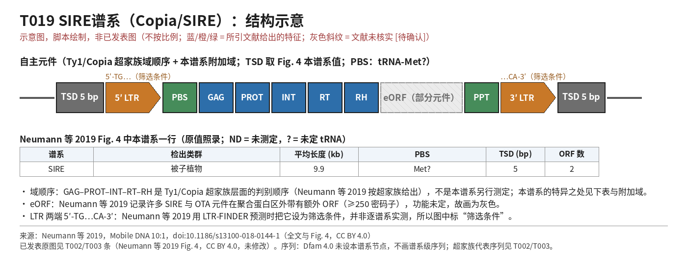

图 T019-1　SIRE谱系（Copia/SIRE）：结构示意。示意图，脚本绘制，非已发表图；每个特征的来源写在图下方。序列：Dfam 4.0 未设本谱系节点，没有谱系级共识序列；超家族代表序列见 T002/T003。


SIRE 是植物 Ty1/Copia 超家族中尺寸最大的谱系之一，完整自主型元件全长通常在 8 kb 至 11 kb 之间，单个 LTR 长度较长，多在 1 kb 至 2 kb 左右 [待确认]。元件两翼 LTR 末端保守为 5'-TG...CA-3'，5' LTR 下游具经典 PBS，3' LTR 上游具 PPT [待确认]。（见本条“本版补充说明”）

#### TSD

整合进入宿主基因组时在元件两侧形成正向靶位点重复，典型长度为 5 bp [待确认]。

#### 编码蛋白与结构域顺序

自主型 SIRE 元件严格遵循 Ty1/Copia 超家族的 **GAG - PROT - INT - RT - RH** 结构域排列顺序（Neumann 等 2019, doi:10.1186/s13100-018-0144-1）。该谱系最显著的结构特征是在 `pol` 编码区下游的 3' 端常携带一个额外的开放阅读框，称为 `env` 样开放阅读框（eORF）（Neumann 等 2019, doi:10.1186/s13100-018-0144-1）。该 eORF 在氨基酸序列上与脊椎动物逆转录病毒的包膜蛋白并无同源性，其确切生物学功能目前尚未完全阐明（Neumann 等 2019, doi:10.1186/s13100-018-0144-1；eORF 功能研究专文 DOI 待确认）。（见本条“本版补充说明”）

#### 转座机制

遵循经典的 LTR 反转录转座子复制粘贴扩增机制：5' LTR 启动子驱动全长 RNA 转录，在胞质病毒样颗粒内借由 PBS 与 PPT 引导反转录合成双链 cDNA，随后由整合酶整合进入宿主染色体新位点并产生 5 bp TSD [待确认]。尽管携带 3' 端 eORF，目前没有确凿证据表明 SIRE 能够形成具有细胞间感染能力的游离逆转录病毒颗粒（Neumann 等 2019, doi:10.1186/s13100-018-0144-1）。

#### 自主与非自主搭档

完整编码 `gag-pol`（及或 eORF）的拷贝为自主型；基因组中普遍伴生内部编码区缺失的非自主衍生物以及因长 LTR 不等同源重组形成的大量 solo-LTR [待确认]。关于 SIRE 谱系专属非自主搭档家族的配对研究待确认。

#### 识别特征与工具

结构从头识别采用 LTRharvest（Ellinghaus 等 2008, doi:10.1186/1471-2105-9-18）、LTR_FINDER（Xu 和 Wang 2007, doi:10.1093/nar/gkm286）、LTR_retriever（Ou 和 Jiang 2018, doi:10.1104/pp.17.01310）与 EDTA（Ou 等 2019, doi:10.1186/s13059-019-1905-y）。谱系级精准分类采用基于 REXdb 蛋白结构域 HMM 的 TEsorter，可准确识别 SIRE 的 `pol` 结构域特征并避免将其误判为 ERV（Zhang 等 2022, doi:10.1093/hr/uhac017；Neumann 等 2019, doi:10.1186/s13100-018-0144-1）。

#### 分类争议

第一项争议是历史命名并存：早期文献中 `Maximus`、`Sirevirus`、`Agrovirus` 与 `SIRE` 混用，2019 年 REXdb 系统发育分类已统一采用 `SIRE` 作为规范谱系名（Neumann 等 2019, doi:10.1186/s13100-018-0144-1）。第二项也是最关键的争议在于属性定性：由于 SIRE 在 `pol` 下游携带 3' 端 eORF，早期个别研究曾将其称作「植物内源性逆转录病毒（plant ERV）」；2019 年 REXdb 系统分类明确反对这一称谓，强调 SIRE 的 `pol` 结构域顺序（INT-RT-RH）与系统发育位置均确凿属于 Ty1/Copia 超家族，与脊椎动物 Retrovirus / ERV 无直接同源演化关系，绝不可将其称作植物内源逆转录病毒（Neumann 等 2019, doi:10.1186/s13100-018-0144-1）。

#### 发现与分布

**发现与命名**

- Wicker 和 Keller (2007) Genome-wide comparative analysis of copia retrotransposons in Triticeae, rice, and Arabidopsis reveals conserved ancient evolutionary lineages and distinct dynamics of individual copia families. Genome Research. doi:10.1101/gr.6214107。正文原句：“…the respective names. Major evolutionary lineages are indicated by curly brackets. A reverse transcriptase sequence from yeast (ScRT) served as outgroup. The sequences cluster into six major evolutionary lineages ( Angela , Ale , Bianca , Ivana , Maximus , and TAR ) ( Fig. 1 ). We defined the lineages primarily as large…”；涉及生物：barley, wheat, rice, Arabidopsis；支持范围：six ancient copia lineages named (Angela, Ale, Bianca, Ivana, Maximus, TAR) [注意：所引句不含该名称，仅支持上位/总体论断]
- Laten 等 (1998) SIRE-1, a copia/Ty1-like retroelement from soybean, encodes a retroviral envelope-like protein. Proceedings of the National Academy of Sciences. doi:10.1073/pnas.95.12.6897。摘要原句：“The soybean genome hosts a family of several hundred, relatively homogeneous copies of a large, copia/Ty1-like retroelement designated SIRE-1”；涉及生物：soybean (Glycine max)；支持范围：SIRE-1 encodes envelope-like protein
- Havecker 等 (2005) The Sireviruses, a plant-specific lineage of the Ty1/copia retrotransposons, interact with a family of proteins related to dynein light chain 8. Plant Physiology. doi:10.1104/pp.105.065680。摘要原句：“Plant genomes are rich in long terminal repeat retrotransposons, and here we describe a plant-specific lineage of Ty1/copia elements called the Sireviruses”；涉及生物：plants；支持范围：Sireviruses as plant-specific Ty1/copia lineage

**植物中的报道**

- Neumann 等 (2019) Systematic survey of plant LTR-retrotransposons elucidates phylogenetic relationships of their polyprotein domains and provides a reference for element classification. Mobile DNA. doi:10.1186/s13100-018-0144-1。正文原句：“…related species [ 25 , 26 ] or focused on a particular lineage of LTR-retrotransposons, e.g. chromoviruses [ 11 , 27 – 31 ], Athila [ 32 ], Ogre [ 33 ], Tat [ 34 ] or SIRE [ 35 – 37 ]. Although these studies demonstrated the potential of a phylogeny-based classification their results are difficult to unify and generalize…”；涉及生物：Viridiplantae；支持范围：REXdb survey of plant LTR retrotransposon lineages
- Wicker 和 Keller (2007) Genome-wide comparative analysis of copia retrotransposons in Triticeae, rice, and Arabidopsis reveals conserved ancient evolutionary lineages and distinct dynamics of individual copia families. Genome Research. doi:10.1101/gr.6214107。同一论文，原句见上；支持范围：six copia lineages across monocots and dicots [注意：所引句不含该名称，仅支持上位/总体论断]
- Laten 等 (1998) SIRE-1, a copia/Ty1-like retroelement from soybean, encodes a retroviral envelope-like protein. Proceedings of the National Academy of Sciences. doi:10.1073/pnas.95.12.6897。同一论文，原句见上；支持范围：SIRE-1
- Havecker 等 (2005) The Sireviruses, a plant-specific lineage of the Ty1/copia retrotransposons, interact with a family of proteins related to dynein light chain 8. Plant Physiology. doi:10.1104/pp.105.065680。同一论文，原句见上；支持范围：Sireviruses lineage

**葡萄中的报道**

- 未检索到葡萄专门报道（检索方式见文末「证据与检索方法」）。这只说明检索没有找到，不能据此推断葡萄基因组中不存在。


#### 本版补充说明

① 域顺序：GAG–PROT–INT–RT–RH（Ty1/Copia）与 GAG–PROT–RT–RH–INT（Ty3/Gypsy）是 Neumann 等 2019（doi:10.1186/s13100-018-0144-1）在超家族层面给出的判别顺序；本条若写某谱系“遵循”该顺序，指的是沿用超家族的顺序，不是该文对本谱系另行测定。

② 末端：5′-TG…CA-3′ 是该文用 LTR-FINDER 预测元件时设定的筛选条件，不是对各谱系的实测统计；本条中“末端保守为 5′-TG…CA-3′”一类说法应按此理解。

③ 该文 Fig. 4 给出本谱系：检出类群 被子植物；平均长度 9.9 kb；PBS Met?；TSD 5 bp；ORF 数 2（ND 为未测定）。正文中标 [待确认] 的“TSD 典型长度 5 bp”与 Fig. 4 一致。

## 第三部分　Copia 超家族谱系（二）

### T020 Osser谱系（Copia/Osser）

**名称对照**：Wicker 体系：I 类 / LTR 目 / Copia（代码 RLC）；Wicker 不分谱系；Dfam 节点：Ty1-Copia（Dfam 无谱系节点）；REXdb 路径：Class_I/LTR/Ty1/copia/Osser。（来源：代码据 Wu 等 2025, doi:10.3390/biom15030346；Dfam 4.0 分类树，2026-11-23 读取；REXdb v4.0 说明文件，doi:10.5281/zenodo.10160279）

#### 定义与命名

Osser 是 I 类转座子 LTR 目 Ty1/Copia 超家族（RLC）下的古老植物谱系，在 2019 年基于反转录转座子蛋白结构域建立的 REXdb 绿色植物系统分类框架中被确立为 16 个核心谱系之一，规范命名为 `Osser`（Neumann 等 2019, doi:10.1186/s13100-018-0144-1）。在绿色植物 Ty1/Copia 超家族的系统发育分析中，Osser 处于最基部位置，常被用作构建植物 Copia 谱系系统发育树的外群（Neumann 等 2019, doi:10.1186/s13100-018-0144-1）。在 Dfam 现行分类体系中，该类群归入 `LTR/Copia` 节点之下 [待确认]。

#### 结构、长度与末端


图 T020-1　Osser谱系（Copia/Osser）：结构示意。示意图，脚本绘制，非已发表图；每个特征的来源写在图下方。序列：Dfam 4.0 未设本谱系节点，没有谱系级共识序列；超家族代表序列见 T002/T003。


自主型 Osser 元件遵循典型 Ty1/Copia 元件的基本结构，由 5' LTR、内部编码区与 3' LTR 构成，两翼 LTR 末端多保留保守的 5'-TG...CA-3' 反向重复二核苷酸，3' LTR 上游具多聚嘌呤区（PPT）（精确跨物种全长与单 LTR 长度统计待确认）。在引物结合位点（PBS）特征上，2019 年 REXdb 系统研究指出，Osser 谱系的 PBS 可对应半分子甲硫氨酸 tRNA（1/2 tRNA-Met），不同于多数被子植物 Copia 谱系使用完整 tRNA 3' 端作为引物的经典模式（Neumann 等 2019, doi:10.1186/s13100-018-0144-1）。（见本条“本版补充说明”）

#### TSD

整合进入宿主基因组时在元件两侧形成正向靶位点重复，典型长度为 5 bp（具体物种变异范围待确认）。

#### 编码蛋白与结构域顺序

自主型 Osser 元件编码 `gag` 与 `pol` 蛋白，严格遵循 Ty1/Copia 超家族的 **GAG - PROT - INT - RT - RH** 结构域排列顺序，不携带 `env` 样开放阅读框（Neumann 等 2019, doi:10.1186/s13100-018-0144-1）。（见本条“本版补充说明”）

#### 转座机制

遵循标准的 LTR 反转录转座子复制粘贴扩增机制：由 5' LTR 启动子驱动全长 RNA 转录，在胞质病毒样颗粒内借由 PBS 与 PPT 引导反转录合成双链 cDNA，再由整合酶整合至宿主染色体新位点并伴随产生 TSD [待确认]。其负链合成起始可利用 1/2 tRNA-Met 互补序列（Neumann 等 2019, doi:10.1186/s13100-018-0144-1）。

#### 自主与非自主搭档

完整携带 `gag-pol` 的拷贝为自主型；基因组中可能伴生内部编码区缺失的非自主衍生物及两翼 LTR 不等同源重组形成的 solo-LTR（Osser 专属非自主搭档家族的配对研究待确认）。

#### 识别特征与工具

结构从头识别采用 LTRharvest（Ellinghaus 等 2008, doi:10.1186/1471-2105-9-18）、LTR_FINDER（Xu 和 Wang 2007, doi:10.1093/nar/gkm286）、LTR_retriever（Ou 和 Jiang 2018, doi:10.1104/pp.17.01310）与 EDTA（Ou 等 2019, doi:10.1186/s13059-019-1905-y）。谱系级鉴定依赖基于 REXdb 蛋白结构域 HMM 的 TEsorter（Zhang 等 2022, doi:10.1093/hr/uhac017；Neumann 等 2019, doi:10.1186/s13100-018-0144-1）。

#### 分类争议

Osser 在 2019 年 REXdb 框架下作为基部独立谱系地位明确，几乎不存在归属争议；因其在系统发育树上分化极早，在跨门类比较中常被用作锚定植物 Copia 超家族根部的外群（Neumann 等 2019, doi:10.1186/s13100-018-0144-1）。

#### 发现与分布

**发现与命名**

- Neumann 等 (2019) Systematic survey of plant LTR-retrotransposons elucidates phylogenetic relationships of their polyprotein domains and provides a reference for element classification. Mobile DNA. doi:10.1186/s13100-018-0144-1。正文原句：“…24 Ty1/copia and 30 Ty3/gypsy elements from 26 Viridiplantae species. They identified five plant lineages of Ty1/copia elements, referred to as Oryco, Sire, Retrofit, Osser and Tork (Table 1 ). Ty3/gypsy elements in plants were found to belong to two major lineages, chromovirus and Tat/Athila, the former composed of the Del,…”；涉及生物：Viridiplantae；支持范围：lineage listed in REXdb Table 1

**植物中的报道**

- Neumann 等 (2019) Systematic survey of plant LTR-retrotransposons elucidates phylogenetic relationships of their polyprotein domains and provides a reference for element classification. Mobile DNA. doi:10.1186/s13100-018-0144-1。同一论文，原句见上；支持范围：REXdb survey of plant LTR retrotransposon lineages

**葡萄中的报道**

- 未检索到葡萄专门报道（检索方式见文末「证据与检索方法」）。这只说明检索没有找到，不能据此推断葡萄基因组中不存在。

#### 本版补充说明

① 域顺序：GAG–PROT–INT–RT–RH（Ty1/Copia）与 GAG–PROT–RT–RH–INT（Ty3/Gypsy）是 Neumann 等 2019（doi:10.1186/s13100-018-0144-1）在超家族层面给出的判别顺序；本条若写某谱系“遵循”该顺序，指的是沿用超家族的顺序，不是该文对本谱系另行测定。

② 末端：5′-TG…CA-3′ 是该文用 LTR-FINDER 预测元件时设定的筛选条件，不是对各谱系的实测统计；本条中“末端保守为 5′-TG…CA-3′”一类说法应按此理解。

③ 该文 Fig. 4 给出本谱系：检出类群 绿藻门；平均长度 5.2 kb；PBS 1/2Met；TSD 5 bp；ORF 数 1（ND 为未测定）。正文中标 [待确认] 的“TSD 典型长度 5 bp”与 Fig. 4 一致。

### T021 Bryco谱系（Copia/Bryco）

**名称对照**：Wicker 体系：I 类 / LTR 目 / Copia（代码 RLC）；Wicker 不分谱系；Dfam 节点：Ty1-Copia（Dfam 无谱系节点）；REXdb 路径：Class_I/LTR/Ty1/copia/Bryco。（来源：代码据 Wu 等 2025, doi:10.3390/biom15030346；Dfam 4.0 分类树，2026-11-23 读取；REXdb v4.0 说明文件，doi:10.5281/zenodo.10160279）

#### 定义与命名

Bryco 是 I 类转座子 LTR 目 Ty1/Copia 超家族（RLC）下的独立植物谱系，在 2019 年基于反转录转座子蛋白结构域建立的 REXdb 绿色植物系统分类框架中被正式确立，规范命名为 `Bryco`（Neumann 等 2019, doi:10.1186/s13100-018-0144-1）。该名称源于其主要宿主类群苔藓植物（Bryophyta）与 Copia 超家族的组合（Neumann 等 2019, doi:10.1186/s13100-018-0144-1）。在 Dfam 现行分类体系中归入 `LTR/Copia` 节点之下 [待确认]。

#### 结构、长度与末端

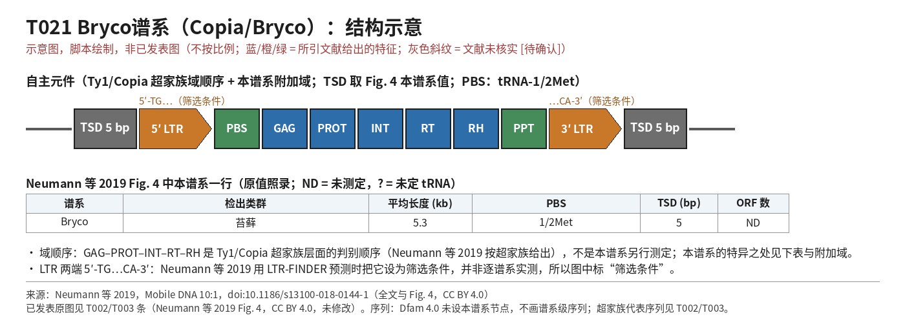

图 T021-1　Bryco谱系（Copia/Bryco）：结构示意。示意图，脚本绘制，非已发表图；每个特征的来源写在图下方。序列：Dfam 4.0 未设本谱系节点，没有谱系级共识序列；超家族代表序列见 T002/T003。


自主型 Bryco 元件具备典型 LTR 反转录转座子的三段式结构（5' LTR、内部编码区与 3' LTR），两翼 LTR 末端多保留保守的 5'-TG...CA-3' 反向重复二核苷酸，内部两端具 PBS 与 PPT（Bryco 跨物种精确全长与 LTR 长度范围统计待确认）。（见本条“本版补充说明”）

#### TSD

整合进入宿主染色体时在元件两侧形成正向靶位点重复，典型长度为 5 bp（具体变异情况待确认）。

#### 编码蛋白与结构域顺序

自主型 Bryco 元件编码 `gag` 与 `pol` 蛋白，严格遵循 Ty1/Copia 超家族的 **GAG - PROT - INT - RT - RH** 结构域排列顺序，不携带 `env` 样开放阅读框（Neumann 等 2019, doi:10.1186/s13100-018-0144-1）。（见本条“本版补充说明”）

#### 转座机制

遵循经典的 LTR 反转录转座子复制粘贴扩增机制：由 5' LTR 启动子驱动全长 RNA 转录，在胞质病毒样颗粒内借由 PBS 与 PPT 引导反转录合成双链 cDNA，再由整合酶整合进入宿主基因组新位点并伴随产生 TSD [待确认]。

#### 自主与非自主搭档

完整编码 `gag-pol` 的拷贝为自主型；基因组中可伴生内部缺失的非自主衍生物及两翼 LTR 不等同源重组形成的 solo-LTR（Bryco 专属非自主搭档研究待确认）。

#### 识别特征与工具

结构从头预测采用 LTRharvest（Ellinghaus 等 2008, doi:10.1186/1471-2105-9-18）、LTR_FINDER（Xu 和 Wang 2007, doi:10.1093/nar/gkm286）、LTR_retriever（Ou 和 Jiang 2018, doi:10.1104/pp.17.01310）与 EDTA（Ou 等 2019, doi:10.1186/s13059-019-1905-y）。谱系级精准分类采用基于 REXdb 蛋白结构域 HMM 的 TEsorter（Zhang 等 2022, doi:10.1093/hr/uhac017；Neumann 等 2019, doi:10.1186/s13100-018-0144-1）。

#### 分类争议

Bryco 于 2019 年 REXdb 系统分类中首次作为苔藓植物代表性 Copia 谱系确立，分类边界清晰；随着后续更多苔藓与角苔、地钱基因组的测序，REXdb v4.0 又新增了其他苔藓相关谱系（如 Bryana），需在更新版参考库中注意区分（Neumann 等 2019, doi:10.1186/s13100-018-0144-1；v4.0 具体修订文献 DOI 待确认）。

#### 发现与分布

**发现与命名**

- Neumann 等 (2019) Systematic survey of plant LTR-retrotransposons elucidates phylogenetic relationships of their polyprotein domains and provides a reference for element classification. Mobile DNA. doi:10.1186/s13100-018-0144-1。正文原句：“…Ale Ale Sirevirus/Retrofit ((Koala, Melmoth, Retrofit) pseudovirus (Melmoth, Retrofit, Hopscotch) Alesia Ale – – Angela Angela – pseudovirus (BARE-1) Bianca Bianca – – Bryco – – – Lyco – – – Gymco-I, II, III, IV – – – Ikeros Angela Tork (Sto-4) pseudovirus (Sto-4) Ivana Ivana Sirevirus/Oryco (Araco, Oryco1–1, Oryco1–2, Poco,…”；涉及生物：Viridiplantae；支持范围：lineage listed in REXdb Table 1

**植物中的报道**

- Neumann 等 (2019) Systematic survey of plant LTR-retrotransposons elucidates phylogenetic relationships of their polyprotein domains and provides a reference for element classification. Mobile DNA. doi:10.1186/s13100-018-0144-1。同一论文，原句见上；支持范围：REXdb survey of plant LTR retrotransposon lineages

**葡萄中的报道**

- 未检索到葡萄专门报道（检索方式见文末「证据与检索方法」）。这只说明检索没有找到，不能据此推断葡萄基因组中不存在。

#### 本版补充说明

① 域顺序：GAG–PROT–INT–RT–RH（Ty1/Copia）与 GAG–PROT–RT–RH–INT（Ty3/Gypsy）是 Neumann 等 2019（doi:10.1186/s13100-018-0144-1）在超家族层面给出的判别顺序；本条若写某谱系“遵循”该顺序，指的是沿用超家族的顺序，不是该文对本谱系另行测定。

② 末端：5′-TG…CA-3′ 是该文用 LTR-FINDER 预测元件时设定的筛选条件，不是对各谱系的实测统计；本条中“末端保守为 5′-TG…CA-3′”一类说法应按此理解。

③ 该文 Fig. 4 给出本谱系：检出类群 苔藓；平均长度 5.3 kb；PBS 1/2Met；TSD 5 bp；ORF 数 ND（ND 为未测定）。正文中标 [待确认] 的“TSD 典型长度 5 bp”与 Fig. 4 一致。

### T022 Lyco谱系（Copia/Lyco）

**名称对照**：Wicker 体系：I 类 / LTR 目 / Copia（代码 RLC）；Wicker 不分谱系；Dfam 节点：Ty1-Copia（Dfam 无谱系节点）；REXdb 路径：Class_I/LTR/Ty1/copia/Lyco。（来源：代码据 Wu 等 2025, doi:10.3390/biom15030346；Dfam 4.0 分类树，2026-11-23 读取；REXdb v4.0 说明文件，doi:10.5281/zenodo.10160279）

#### 定义与命名

Lyco 是 I 类转座子 LTR 目 Ty1/Copia 超家族（RLC）下的独立植物谱系，在 2019 年基于反转录转座子蛋白结构域建立的 REXdb 绿色植物系统分类框架中正式确立，规范命名为 `Lyco`（Neumann 等 2019, doi:10.1186/s13100-018-0144-1）。该名称源于其核心宿主类群石松类植物（Lycopodiopsida）与 Copia 超家族的组合（Neumann 等 2019, doi:10.1186/s13100-018-0144-1）。在 Dfam 现行分类体系中归入 `LTR/Copia` 节点之下 [待确认]。

#### 结构、长度与末端


图 T022-1　Lyco谱系（Copia/Lyco）：结构示意。示意图，脚本绘制，非已发表图；每个特征的来源写在图下方。序列：Dfam 4.0 未设本谱系节点，没有谱系级共识序列；超家族代表序列见 T002/T003。


自主型 Lyco 元件具备完整的 5' LTR、内部编码区与 3' LTR 结构，两翼 LTR 末端多保留保守的 5'-TG...CA-3' 反向重复二核苷酸，内部两端具备 PBS 与 PPT（Lyco 跨物种精确全长与单 LTR 长度统计待确认）。（见本条“本版补充说明”）

#### TSD

整合进入宿主基因组时在元件两侧产生正向靶位点重复，典型长度为 5 bp（具体变异范围待确认）。

#### 编码蛋白与结构域顺序

自主型 Lyco 元件编码 `gag` 与 `pol` 蛋白，严格遵循 Ty1/Copia 超家族的 **GAG - PROT - INT - RT - RH** 结构域排列顺序，不携带 `env` 样开放阅读框（Neumann 等 2019, doi:10.1186/s13100-018-0144-1）。（见本条“本版补充说明”）

#### 转座机制

遵循经典的 LTR 反转录转座子复制粘贴扩增机制：5' LTR 启动子驱动全长 RNA 转录，在胞质病毒样颗粒内借由 PBS 与 PPT 引导反转录合成双链 cDNA，随后由整合酶整合进入宿主染色体新位点并产生 TSD [待确认]。

#### 自主与非自主搭档

完整编码 `gag-pol` 的拷贝为自主型；基因组中可伴生内部编码区缺失的非自主衍生物及两翼 LTR 不等同源重组形成的 solo-LTR（Lyco 专属非自主搭档研究待确认）。

#### 识别特征与工具

结构从头识别采用 LTRharvest（Ellinghaus 等 2008, doi:10.1186/1471-2105-9-18）、LTR_FINDER（Xu 和 Wang 2007, doi:10.1093/nar/gkm286）、LTR_retriever（Ou 和 Jiang 2018, doi:10.1104/pp.17.01310）与 EDTA（Ou 等 2019, doi:10.1186/s13059-019-1905-y）。谱系级准确鉴定采用基于 REXdb 蛋白结构域 HMM 的 TEsorter（Zhang 等 2022, doi:10.1093/hr/uhac017；Neumann 等 2019, doi:10.1186/s13100-018-0144-1）。

#### 分类争议

Lyco 在 2019 年 REXdb 系统发育分类中作为石松类特征谱系确立，目前无显著合并或拆分的分类争议（Neumann 等 2019, doi:10.1186/s13100-018-0144-1）。

#### 发现与分布

**发现与命名**

- Neumann 等 (2019) Systematic survey of plant LTR-retrotransposons elucidates phylogenetic relationships of their polyprotein domains and provides a reference for element classification. Mobile DNA. doi:10.1186/s13100-018-0144-1。正文原句：“…((Koala, Melmoth, Retrofit) pseudovirus (Melmoth, Retrofit, Hopscotch) Alesia Ale – – Angela Angela – pseudovirus (BARE-1) Bianca Bianca – – Bryco – – – Lyco – – – Gymco-I, II, III, IV – – – Ikeros Angela Tork (Sto-4) pseudovirus (Sto-4) Ivana Ivana Sirevirus/Oryco (Araco, Oryco1–1, Oryco1–2, Poco, Vitico1–1) – Osser – Osser…”；涉及生物：Viridiplantae；支持范围：lineage listed in REXdb Table 1

**植物中的报道**

- Neumann 等 (2019) Systematic survey of plant LTR-retrotransposons elucidates phylogenetic relationships of their polyprotein domains and provides a reference for element classification. Mobile DNA. doi:10.1186/s13100-018-0144-1。同一论文，原句见上；支持范围：REXdb survey of plant LTR retrotransposon lineages

**葡萄中的报道**

- 未检索到葡萄专门报道（检索方式见文末「证据与检索方法」）。这只说明检索没有找到，不能据此推断葡萄基因组中不存在。

#### 本版补充说明

① 域顺序：GAG–PROT–INT–RT–RH（Ty1/Copia）与 GAG–PROT–RT–RH–INT（Ty3/Gypsy）是 Neumann 等 2019（doi:10.1186/s13100-018-0144-1）在超家族层面给出的判别顺序；本条若写某谱系“遵循”该顺序，指的是沿用超家族的顺序，不是该文对本谱系另行测定。

② 末端：5′-TG…CA-3′ 是该文用 LTR-FINDER 预测元件时设定的筛选条件，不是对各谱系的实测统计；本条中“末端保守为 5′-TG…CA-3′”一类说法应按此理解。

③ 该文 Fig. 4 给出本谱系：检出类群 石松类；平均长度 4.8 kb；PBS Met；TSD 5 bp；ORF 数 1（ND 为未测定）。正文中标 [待确认] 的“TSD 典型长度 5 bp”与 Fig. 4 一致。

### T023 Gymco-I谱系（Copia/Gymco-I）

**名称对照**：Wicker 体系：I 类 / LTR 目 / Copia（代码 RLC）；Wicker 不分谱系；Dfam 节点：Ty1-Copia（Dfam 无谱系节点）；REXdb 路径：Class_I/LTR/Ty1/copia/Gymco-I。（来源：代码据 Wu 等 2025, doi:10.3390/biom15030346；Dfam 4.0 分类树，2026-11-23 读取；REXdb v4.0 说明文件，doi:10.5281/zenodo.10160279）

#### 定义与命名

Gymco-I 是 I 类转座子 LTR 目 Ty1/Copia 超家族（RLC）下的独立植物谱系，在 2019 年基于反转录转座子蛋白结构域建立的 REXdb 绿色植物系统分类框架中正式确立，与 Gymco-II、Gymco-III、Gymco-IV 并列构成裸子植物中特有的四个 Copia 谱系分支，规范命名为 `Gymco-I`（Neumann 等 2019, doi:10.1186/s13100-018-0144-1）。在 Dfam 现行分类体系中归入 `LTR/Copia` 节点之下 [待确认]。

#### 结构、长度与末端

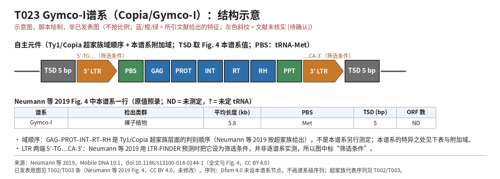

图 T023-1　Gymco-I谱系（Copia/Gymco-I）：结构示意。示意图，脚本绘制，非已发表图；每个特征的来源写在图下方。序列：Dfam 4.0 未设本谱系节点，没有谱系级共识序列；超家族代表序列见 T002/T003。


自主型 Gymco-I 元件具备 5' LTR、内部编码区与 3' LTR 的完整结构，两翼 LTR 末端多保留保守的 5'-TG...CA-3' 反向重复二核苷酸，内部两端具备 PBS 与 PPT（Gymco-I 在裸子植物中的精确全长与单 LTR 长度分布统计待确认）。（见本条“本版补充说明”）

#### TSD

整合进入宿主基因组时在元件两侧形成正向靶位点重复，典型长度为 5 bp（具体变异情况待确认）。

#### 编码蛋白与结构域顺序

自主型 Gymco-I 元件编码 `gag` 与 `pol` 蛋白，严格遵循 Ty1/Copia 超家族的 **GAG - PROT - INT - RT - RH** 结构域排列顺序，不携带 `env` 样开放阅读框（Neumann 等 2019, doi:10.1186/s13100-018-0144-1）。（见本条“本版补充说明”）

#### 转座机制

遵循经典的 LTR 反转录转座子复制粘贴扩增机制：5' LTR 启动子驱动全长 RNA 转录，在胞质病毒样颗粒内借由 PBS 与 PPT 引导反转录合成双链 cDNA，再由整合酶整合至宿主染色体新位点并伴随产生 TSD [待确认]。

#### 自主与非自主搭档

完整编码 `gag-pol` 的拷贝为自主型；在庞大的裸子植物基因组中常伴生大量内部缺失或退化的非自主拷贝及 solo-LTR（Gymco-I 专属非自主搭档研究待确认）。

#### 识别特征与工具

结构从头识别采用 LTRharvest（Ellinghaus 等 2008, doi:10.1186/1471-2105-9-18）、LTR_FINDER（Xu 和 Wang 2007, doi:10.1093/nar/gkm286）、LTR_retriever（Ou 和 Jiang 2018, doi:10.1104/pp.17.01310）与 EDTA（Ou 等 2019, doi:10.1186/s13059-019-1905-y）。将其与其余三个 Gymco 谱系及被子植物 Copia 谱系区分，需使用基于 REXdb 蛋白结构域 HMM 的 TEsorter（Zhang 等 2022, doi:10.1093/hr/uhac017；Neumann 等 2019, doi:10.1186/s13100-018-0144-1）。

#### 分类争议

在 2019 年 REXdb 发布之前，裸子植物中的 Copia 元件常缺乏统一谱系归属而笼统归为未分类 Copia；2019 年基于多结构域建树将其清晰拆分为 Gymco-I 至 Gymco-IV 四个独立谱系，目前在植物转座子分类中得到广泛沿用（Neumann 等 2019, doi:10.1186/s13100-018-0144-1）。

#### 发现与分布

**发现与命名**

- Neumann 等 (2019) Systematic survey of plant LTR-retrotransposons elucidates phylogenetic relationships of their polyprotein domains and provides a reference for element classification. Mobile DNA. doi:10.1186/s13100-018-0144-1。正文原句：“…((Koala, Melmoth, Retrofit) pseudovirus (Melmoth, Retrofit, Hopscotch) Alesia Ale – – Angela Angela – pseudovirus (BARE-1) Bianca Bianca – – Bryco – – – Lyco – – – Gymco-I, II, III, IV – – – Ikeros Angela Tork (Sto-4) pseudovirus (Sto-4) Ivana Ivana Sirevirus/Oryco (Araco, Oryco1–1, Oryco1–2, Poco, Vitico1–1) – Osser – Osser…”；涉及生物：Viridiplantae；支持范围：lineage listed in REXdb Table 1

**植物中的报道**

- Neumann 等 (2019) Systematic survey of plant LTR-retrotransposons elucidates phylogenetic relationships of their polyprotein domains and provides a reference for element classification. Mobile DNA. doi:10.1186/s13100-018-0144-1。同一论文，原句见上；支持范围：REXdb survey of plant LTR retrotransposon lineages

**葡萄中的报道**

- 未检索到葡萄专门报道（检索方式见文末「证据与检索方法」）。这只说明检索没有找到，不能据此推断葡萄基因组中不存在。

#### 本版补充说明

① 域顺序：GAG–PROT–INT–RT–RH（Ty1/Copia）与 GAG–PROT–RT–RH–INT（Ty3/Gypsy）是 Neumann 等 2019（doi:10.1186/s13100-018-0144-1）在超家族层面给出的判别顺序；本条若写某谱系“遵循”该顺序，指的是沿用超家族的顺序，不是该文对本谱系另行测定。

② 末端：5′-TG…CA-3′ 是该文用 LTR-FINDER 预测元件时设定的筛选条件，不是对各谱系的实测统计；本条中“末端保守为 5′-TG…CA-3′”一类说法应按此理解。

③ 该文 Fig. 4 给出本谱系：检出类群 裸子植物；平均长度 5.8 kb；PBS Met；TSD 5 bp；ORF 数 ND（ND 为未测定）。正文中标 [待确认] 的“TSD 典型长度 5 bp”与 Fig. 4 一致。

### T024 Gymco-II谱系（Copia/Gymco-II）

**名称对照**：Wicker 体系：I 类 / LTR 目 / Copia（代码 RLC）；Wicker 不分谱系；Dfam 节点：Ty1-Copia（Dfam 无谱系节点）；REXdb 路径：Class_I/LTR/Ty1/copia/Gymco-II。（来源：代码据 Wu 等 2025, doi:10.3390/biom15030346；Dfam 4.0 分类树，2026-11-23 读取；REXdb v4.0 说明文件，doi:10.5281/zenodo.10160279）

#### 定义与命名

Gymco-II 是 I 类转座子 LTR 目 Ty1/Copia 超家族（RLC）下的独立植物谱系，在 2019 年基于反转录转座子蛋白结构域建立的 REXdb 绿色植物系统分类框架中正式确立，属于裸子植物相关 Copia 谱系之一，规范命名为 `Gymco-II`（Neumann 等 2019, doi:10.1186/s13100-018-0144-1）。在 Dfam 现行分类体系中归入 `LTR/Copia` 节点之下 [待确认]。

#### 结构、长度与末端

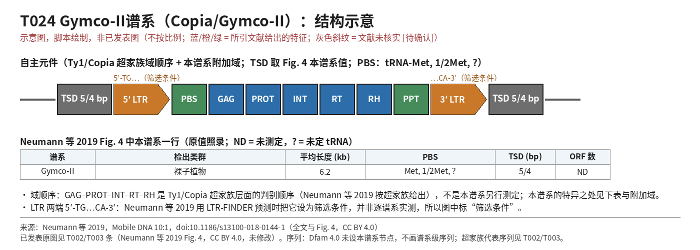

图 T024-1　Gymco-II谱系（Copia/Gymco-II）：结构示意。示意图，脚本绘制，非已发表图；每个特征的来源写在图下方。序列：Dfam 4.0 未设本谱系节点，没有谱系级共识序列；超家族代表序列见 T002/T003。


自主型 Gymco-II 元件由 5' LTR、内部编码区和 3' LTR 构成，两翼 LTR 末端多保留保守的 5'-TG...CA-3' 反向重复二核苷酸，内部两端具备 PBS 与 PPT（Gymco-II 精确全长与单 LTR 长度范围统计待确认）。（见本条“本版补充说明”）

#### TSD

整合进入宿主染色体时在元件两侧形成正向靶位点重复，典型长度为 5 bp（具体变异情况待确认）。

#### 编码蛋白与结构域顺序

自主型 Gymco-II 元件编码 `gag` 与 `pol` 蛋白，严格遵循 Ty1/Copia 超家族的 **GAG - PROT - INT - RT - RH** 结构域排列顺序，不携带 `env` 样开放阅读框（Neumann 等 2019, doi:10.1186/s13100-018-0144-1）。（见本条“本版补充说明”）

#### 转座机制

遵循经典的 LTR 反转录转座子复制粘贴扩增机制：由宿主 RNA 聚合酶 II 从 5' LTR 启动子转录全长 RNA，经胞质病毒样颗粒内以 PBS 和 PPT 为引物完成双链 cDNA 合成，随后由整合酶整合至宿主基因组新位点并产生 TSD [待确认]。

#### 自主与非自主搭档

完整编码 `gag-pol` 的拷贝为自主型；基因组中可伴生内部编码区缺失的非自主衍生物及两翼 LTR 不等同源重组形成的 solo-LTR（Gymco-II 专属非自主搭档研究待确认）。

#### 识别特征与工具

结构从头识别采用 LTRharvest（Ellinghaus 等 2008, doi:10.1186/1471-2105-9-18）、LTR_FINDER（Xu 和 Wang 2007, doi:10.1093/nar/gkm286）、LTR_retriever（Ou 和 Jiang 2018, doi:10.1104/pp.17.01310）与 EDTA（Ou 等 2019, doi:10.1186/s13059-019-1905-y）。谱系级精准分类采用基于 REXdb 蛋白结构域 HMM 的 TEsorter（Zhang 等 2022, doi:10.1093/hr/uhac017；Neumann 等 2019, doi:10.1186/s13100-018-0144-1）。

#### 分类争议

Gymco-II 在 2019 年 REXdb 多结构域系统发育树中独立成支，目前无显著合并或拆分争议，但在裸子植物基因组注释中需通过蛋白域模型与 Gymco-I、Gymco-III、Gymco-IV 严格区分（Neumann 等 2019, doi:10.1186/s13100-018-0144-1）。

#### 发现与分布

**发现与命名**

- Neumann 等 (2019) Systematic survey of plant LTR-retrotransposons elucidates phylogenetic relationships of their polyprotein domains and provides a reference for element classification. Mobile DNA. doi:10.1186/s13100-018-0144-1。正文原句：“…differentiating some groups included the PBS type and the presence of eORFs (Fig. 4 ). PBSs complementary to 1/2tRNA-Met were detected in Osser, Bryco and portion of Gymco-II elements (Additional files 1 and 5 ). Bianca elements had PBSs complementary to the post-transriptionally edited 1/2tRNA-Ile. The first base of this…”；涉及生物：Viridiplantae；支持范围：lineage listed in REXdb Table 1

**植物中的报道**

- Neumann 等 (2019) Systematic survey of plant LTR-retrotransposons elucidates phylogenetic relationships of their polyprotein domains and provides a reference for element classification. Mobile DNA. doi:10.1186/s13100-018-0144-1。同一论文，原句见上；支持范围：REXdb survey of plant LTR retrotransposon lineages

**葡萄中的报道**

- 未检索到葡萄专门报道（检索方式见文末「证据与检索方法」）。这只说明检索没有找到，不能据此推断葡萄基因组中不存在。

#### 本版补充说明

① 域顺序：GAG–PROT–INT–RT–RH（Ty1/Copia）与 GAG–PROT–RT–RH–INT（Ty3/Gypsy）是 Neumann 等 2019（doi:10.1186/s13100-018-0144-1）在超家族层面给出的判别顺序；本条若写某谱系“遵循”该顺序，指的是沿用超家族的顺序，不是该文对本谱系另行测定。

② 末端：5′-TG…CA-3′ 是该文用 LTR-FINDER 预测元件时设定的筛选条件，不是对各谱系的实测统计；本条中“末端保守为 5′-TG…CA-3′”一类说法应按此理解。

③ 该文 Fig. 4 给出本谱系：检出类群 裸子植物；平均长度 6.2 kb；PBS Met, 1/2Met, ?；TSD 5/4 bp；ORF 数 ND（ND 为未测定）。本谱系 TSD 不是单一的 5 bp，正文“典型长度为 5 bp”一类写法以 Fig. 4 为准。

### T025 Gymco-III谱系（Copia/Gymco-III）

**名称对照**：Wicker 体系：I 类 / LTR 目 / Copia（代码 RLC）；Wicker 不分谱系；Dfam 节点：Ty1-Copia（Dfam 无谱系节点）；REXdb 路径：Class_I/LTR/Ty1/copia/Gymco-III。（来源：代码据 Wu 等 2025, doi:10.3390/biom15030346；Dfam 4.0 分类树，2026-11-23 读取；REXdb v4.0 说明文件，doi:10.5281/zenodo.10160279）

#### 定义与命名

Gymco-III 是 I 类转座子 LTR 目 Ty1/Copia 超家族（RLC）下的独立植物谱系，在 2019 年基于反转录转座子蛋白结构域建立的 REXdb 绿色植物系统分类框架中正式确立，属于裸子植物相关 Copia 谱系之一，规范命名为 `Gymco-III`（Neumann 等 2019, doi:10.1186/s13100-018-0144-1）。在 Dfam 现行分类体系中归入 `LTR/Copia` 节点之下 [待确认]。

#### 结构、长度与末端


图 T025-1　Gymco-III谱系（Copia/Gymco-III）：结构示意。示意图，脚本绘制，非已发表图；每个特征的来源写在图下方。序列：Dfam 4.0 未设本谱系节点，没有谱系级共识序列；超家族代表序列见 T002/T003。


自主型 Gymco-III 元件具备 5' LTR、内部编码区与 3' LTR 结构，两翼 LTR 末端多保留保守的 5'-TG...CA-3' 反向重复二核苷酸，内部两端具 PBS 与 PPT（Gymco-III 精确全长与单 LTR 长度范围统计待确认）。（见本条“本版补充说明”）

#### TSD

整合进入宿主染色体时在元件两侧形成正向靶位点重复，典型长度为 5 bp（具体变异情况待确认）。

#### 编码蛋白与结构域顺序

自主型 Gymco-III 元件编码 `gag` 与 `pol` 蛋白，严格遵循 Ty1/Copia 超家族的 **GAG - PROT - INT - RT - RH** 结构域排列顺序，不携带 `env` 样开放阅读框（Neumann 等 2019, doi:10.1186/s13100-018-0144-1）。（见本条“本版补充说明”）

#### 转座机制

遵循经典的 LTR 反转录转座子复制粘贴扩增机制：5' LTR 启动子驱动全长 RNA 转录，在胞质病毒样颗粒内借由 PBS 与 PPT 引导反转录合成双链 cDNA，随后由整合酶整合进入宿主染色体新位点并产生 TSD [待确认]。

#### 自主与非自主搭档

完整编码 `gag-pol` 的拷贝为自主型；基因组中可伴生内部缺失的非自主衍生物及两翼 LTR 不等同源重组形成的 solo-LTR（Gymco-III 专属非自主搭档研究待确认）。

#### 识别特征与工具

结构从头识别采用 LTRharvest（Ellinghaus 等 2008, doi:10.1186/1471-2105-9-18）、LTR_FINDER（Xu 和 Wang 2007, doi:10.1093/nar/gkm286）、LTR_retriever（Ou 和 Jiang 2018, doi:10.1104/pp.17.01310）与 EDTA（Ou 等 2019, doi:10.1186/s13059-019-1905-y）。谱系级精准分类采用基于 REXdb 蛋白结构域 HMM 的 TEsorter（Zhang 等 2022, doi:10.1093/hr/uhac017；Neumann 等 2019, doi:10.1186/s13100-018-0144-1）。

#### 分类争议

Gymco-III 在 2019 年 REXdb 系统发育分类中作为独立单系支确立，目前无显著分类争议（Neumann 等 2019, doi:10.1186/s13100-018-0144-1）。

#### 发现与分布

**发现与命名**

- Neumann 等 (2019) Systematic survey of plant LTR-retrotransposons elucidates phylogenetic relationships of their polyprotein domains and provides a reference for element classification. Mobile DNA. doi:10.1186/s13100-018-0144-1。正文原句：“…((Koala, Melmoth, Retrofit) pseudovirus (Melmoth, Retrofit, Hopscotch) Alesia Ale – – Angela Angela – pseudovirus (BARE-1) Bianca Bianca – – Bryco – – – Lyco – – – Gymco-I, II, III, IV – – – Ikeros Angela Tork (Sto-4) pseudovirus (Sto-4) Ivana Ivana Sirevirus/Oryco (Araco, Oryco1–1, Oryco1–2, Poco, Vitico1–1) – Osser – Osser…”；涉及生物：Viridiplantae；支持范围：lineage listed in REXdb Table 1

**植物中的报道**

- Neumann 等 (2019) Systematic survey of plant LTR-retrotransposons elucidates phylogenetic relationships of their polyprotein domains and provides a reference for element classification. Mobile DNA. doi:10.1186/s13100-018-0144-1。同一论文，原句见上；支持范围：REXdb survey of plant LTR retrotransposon lineages

**葡萄中的报道**

- 未检索到葡萄专门报道（检索方式见文末「证据与检索方法」）。这只说明检索没有找到，不能据此推断葡萄基因组中不存在。

#### 本版补充说明

① 域顺序：GAG–PROT–INT–RT–RH（Ty1/Copia）与 GAG–PROT–RT–RH–INT（Ty3/Gypsy）是 Neumann 等 2019（doi:10.1186/s13100-018-0144-1）在超家族层面给出的判别顺序；本条若写某谱系“遵循”该顺序，指的是沿用超家族的顺序，不是该文对本谱系另行测定。

② 末端：5′-TG…CA-3′ 是该文用 LTR-FINDER 预测元件时设定的筛选条件，不是对各谱系的实测统计；本条中“末端保守为 5′-TG…CA-3′”一类说法应按此理解。

③ 该文 Fig. 4 给出本谱系：检出类群 裸子植物；平均长度 5.0 kb；PBS Leu, Met；TSD 5 bp；ORF 数 ND（ND 为未测定）。正文中标 [待确认] 的“TSD 典型长度 5 bp”与 Fig. 4 一致。

### T026 Gymco-IV谱系（Copia/Gymco-IV）

**名称对照**：Wicker 体系：I 类 / LTR 目 / Copia（代码 RLC）；Wicker 不分谱系；Dfam 节点：Ty1-Copia（Dfam 无谱系节点）；REXdb 路径：Class_I/LTR/Ty1/copia/Gymco-IV。（来源：代码据 Wu 等 2025, doi:10.3390/biom15030346；Dfam 4.0 分类树，2026-11-23 读取；REXdb v4.0 说明文件，doi:10.5281/zenodo.10160279）

#### 定义与命名

Gymco-IV 是 I 类转座子 LTR 目 Ty1/Copia 超家族（RLC）下的独立植物谱系，在 2019 年基于反转录转座子蛋白结构域建立的 REXdb 绿色植物系统分类框架中正式确立，属于裸子植物相关 Copia 谱系之一，规范命名为 `Gymco-IV`（Neumann 等 2019, doi:10.1186/s13100-018-0144-1）。在 Dfam 现行分类体系中归入 `LTR/Copia` 节点之下 [待确认]。

#### 结构、长度与末端

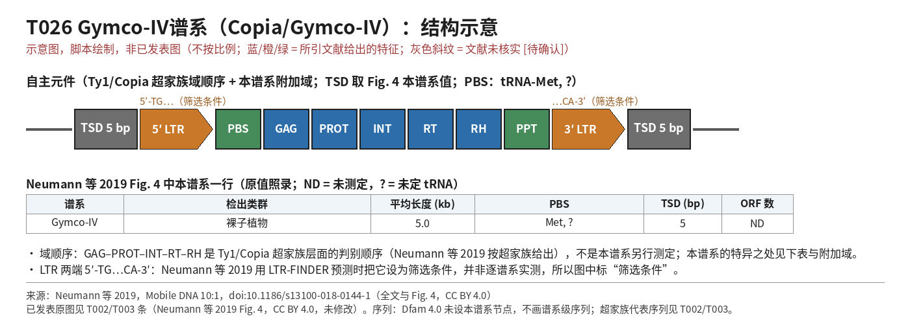

图 T026-1　Gymco-IV谱系（Copia/Gymco-IV）：结构示意。示意图，脚本绘制，非已发表图；每个特征的来源写在图下方。序列：Dfam 4.0 未设本谱系节点，没有谱系级共识序列；超家族代表序列见 T002/T003。


自主型 Gymco-IV 元件具备 5' LTR、内部编码区与 3' LTR 结构，两翼 LTR 末端多保留保守的 5'-TG...CA-3' 反向重复二核苷酸，内部两端具备 PBS 与 PPT（Gymco-IV 精确全长与单 LTR 长度范围统计待确认）。（见本条“本版补充说明”）

#### TSD

整合进入宿主染色体时在元件两侧形成正向靶位点重复，典型长度为 5 bp（具体变异情况待确认）。

#### 编码蛋白与结构域顺序

自主型 Gymco-IV 元件编码 `gag` 与 `pol` 蛋白，严格遵循 Ty1/Copia 超家族的 **GAG - PROT - INT - RT - RH** 结构域排列顺序，不携带 `env` 样开放阅读框（Neumann 等 2019, doi:10.1186/s13100-018-0144-1）。（见本条“本版补充说明”）

#### 转座机制

遵循经典的 LTR 反转录转座子复制粘贴扩增机制：5' LTR 启动子驱动全长 RNA 转录，在胞质病毒样颗粒内借由 PBS 与 PPT 引导反转录合成双链 cDNA，随后由整合酶整合进入宿主染色体新位点并产生 TSD [待确认]。

#### 自主与非自主搭档

完整编码 `gag-pol` 的拷贝为自主型；基因组中可伴生内部编码区缺失的非自主衍生物及两翼 LTR 不等同源重组形成的 solo-LTR（Gymco-IV 专属非自主搭档研究待确认）。

#### 识别特征与工具

结构从头识别采用 LTRharvest（Ellinghaus 等 2008, doi:10.1186/1471-2105-9-18）、LTR_FINDER（Xu 和 Wang 2007, doi:10.1093/nar/gkm286）、LTR_retriever（Ou 和 Jiang 2018, doi:10.1104/pp.17.01310）与 EDTA（Ou 等 2019, doi:10.1186/s13059-019-1905-y）。谱系级精准分类采用基于 REXdb 蛋白结构域 HMM 的 TEsorter（Zhang 等 2022, doi:10.1093/hr/uhac017；Neumann 等 2019, doi:10.1186/s13100-018-0144-1）。

#### 分类争议

Gymco-IV 在 2019 年 REXdb 系统发育分类中作为独立单系支确立，目前无显著分类争议（Neumann 等 2019, doi:10.1186/s13100-018-0144-1）。

#### 发现与分布

**发现与命名**

- Neumann 等 (2019) Systematic survey of plant LTR-retrotransposons elucidates phylogenetic relationships of their polyprotein domains and provides a reference for element classification. Mobile DNA. doi:10.1186/s13100-018-0144-1。正文原句：“…((Koala, Melmoth, Retrofit) pseudovirus (Melmoth, Retrofit, Hopscotch) Alesia Ale – – Angela Angela – pseudovirus (BARE-1) Bianca Bianca – – Bryco – – – Lyco – – – Gymco-I, II, III, IV – – – Ikeros Angela Tork (Sto-4) pseudovirus (Sto-4) Ivana Ivana Sirevirus/Oryco (Araco, Oryco1–1, Oryco1–2, Poco, Vitico1–1) – Osser – Osser…”；涉及生物：Viridiplantae；支持范围：lineage listed in REXdb Table 1

**植物中的报道**

- Neumann 等 (2019) Systematic survey of plant LTR-retrotransposons elucidates phylogenetic relationships of their polyprotein domains and provides a reference for element classification. Mobile DNA. doi:10.1186/s13100-018-0144-1。同一论文，原句见上；支持范围：REXdb survey of plant LTR retrotransposon lineages

**葡萄中的报道**

- 未检索到葡萄专门报道（检索方式见文末「证据与检索方法」）。这只说明检索没有找到，不能据此推断葡萄基因组中不存在。

#### 本版补充说明

① 域顺序：GAG–PROT–INT–RT–RH（Ty1/Copia）与 GAG–PROT–RT–RH–INT（Ty3/Gypsy）是 Neumann 等 2019（doi:10.1186/s13100-018-0144-1）在超家族层面给出的判别顺序；本条若写某谱系“遵循”该顺序，指的是沿用超家族的顺序，不是该文对本谱系另行测定。

② 末端：5′-TG…CA-3′ 是该文用 LTR-FINDER 预测元件时设定的筛选条件，不是对各谱系的实测统计；本条中“末端保守为 5′-TG…CA-3′”一类说法应按此理解。

③ 该文 Fig. 4 给出本谱系：检出类群 裸子植物；平均长度 5.0 kb；PBS Met, ?；TSD 5 bp；ORF 数 ND（ND 为未测定）。正文中标 [待确认] 的“TSD 典型长度 5 bp”与 Fig. 4 一致。

### T027 Alexandra谱系（Copia/Alexandra）

**名称对照**：Wicker 体系：I 类 / LTR 目 / Copia（代码 RLC）；Wicker 不分谱系；Dfam 节点：Ty1-Copia（Dfam 无谱系节点）；REXdb 路径：Class_I/LTR/Ty1/copia/Alexandra。（来源：代码据 Wu 等 2025, doi:10.3390/biom15030346；Dfam 4.0 分类树，2026-11-23 读取；REXdb v4.0 说明文件，doi:10.5281/zenodo.10160279）

#### 定义与命名

Alexandra 是 I 类转座子 LTR 目 Ty1/Copia 超家族（RLC）下在 REXdb Viridiplantae v4.0 版本中新增的植物谱系，规范命名为 `Alexandra`（REXdb v4.0 更新说明及该谱系正式发表出处 DOI 待确认）。在 2019 年发表的 REXdb 原始论文的 16 个 Copia 谱系名单中尚未收录此名 [待确认]。在 Dfam 现行分类体系中归入 `LTR/Copia` 节点之下 [待确认]。

#### 结构、长度与末端

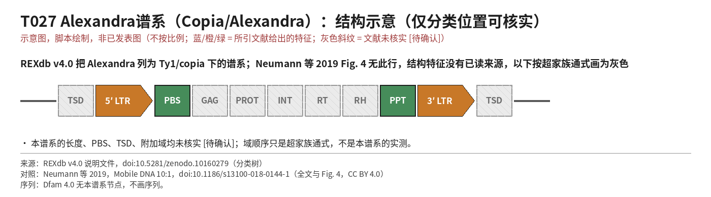

图 T027-1　Alexandra谱系（Copia/Alexandra）：结构示意。示意图，脚本绘制，非已发表图；每个特征的来源写在图下方。序列：Dfam 4.0 未设本谱系节点，没有谱系级共识序列；超家族代表序列见 T002/T003。


作为 Ty1/Copia 超家族成员，自主型 Alexandra 元件遵循 5' LTR、内部编码区与 3' LTR 的三段式骨架，两翼 LTR 末端多为 5'-TG...CA-3'，内部两端具 PBS 与 PPT（Alexandra 谱系特有的全长范围、单 LTR 长度及 PBS 特征待确认）。（见本条“本版补充说明”）

#### TSD

整合进入宿主染色体时预期形成正向靶位点重复，遵循 Ty1/Copia 超家族的典型 5 bp 特征（该谱系实测 TSD 统计待确认）。

#### 编码蛋白与结构域顺序

自主型 Alexandra 元件遵循 Ty1/Copia 超家族的 **GAG - PROT - INT - RT - RH** 结构域排列顺序（是否携带特殊附加结构域或开放阅读框待确认）。（见本条“本版补充说明”）

#### 转座机制

遵循经典的 LTR 反转录转座子复制粘贴扩增机制：由 5' LTR 启动子驱动全长 RNA 转录，在胞质病毒样颗粒内完成双链 cDNA 反转录并由整合酶整合进入宿主染色体新位点（是否存在特殊转录或引发机制待确认）。

#### 自主与非自主搭档

完整携带 `gag-pol` 的拷贝为自主型；基因组中可能存在内部缺失的非自主衍生物及 solo-LTR（具体搭档关系待确认）。

#### 识别特征与工具

结构从头识别采用 LTRharvest（Ellinghaus 等 2008, doi:10.1186/1471-2105-9-18）、LTR_FINDER（Xu 和 Wang 2007, doi:10.1093/nar/gkm286）、LTR_retriever（Ou 和 Jiang 2018, doi:10.1104/pp.17.01310）与 EDTA（Ou 等 2019, doi:10.1186/s13059-019-1905-y）。谱系级鉴定必须使用已更新至 REXdb Viridiplantae v4.0 数据库的 TEsorter 或相应蛋白结构域 HMM 模型，旧版 v3.0 数据库无法检出该谱系标签（Zhang 等 2022, doi:10.1093/hr/uhac017；v4.0 数据库版本细节待确认）。

#### 分类争议

由于 Alexandra 未出现在 2019 年 REXdb 原始论文的 16 谱系名单中，不同版本数据库（v3.0 与 v4.0）的注释结果在跨项目比较时会出现标签不一致 [待确认]；在正式引用该谱系名时，需核对并注明其首次发表文献出处与 REXdb 版本号（待确认）。

#### 发现与分布

**发现与命名**

- (2023) REXdb Viridiplantae database v4.0 (README and classification tree). Zenodo. doi:10.5281/zenodo.10160279。REXdb 分类树原句：“--Alexandra * (REXdb Viridiplantae v4.0 README classification tree; asterisk marks new lineage)”；支持范围：REXdb Viridiplantae v4.0 adds these lineages

**植物中的报道**

- 未检索到已核实的植物报道 [待确认]。

**葡萄中的报道**

- 未检索到葡萄专门报道（检索方式见文末「证据与检索方法」）。这只说明检索没有找到，不能据此推断葡萄基因组中不存在。

#### 本版补充说明

① 域顺序：GAG–PROT–INT–RT–RH（Ty1/Copia）与 GAG–PROT–RT–RH–INT（Ty3/Gypsy）是 Neumann 等 2019（doi:10.1186/s13100-018-0144-1）在超家族层面给出的判别顺序；本条若写某谱系“遵循”该顺序，指的是沿用超家族的顺序，不是该文对本谱系另行测定。

② 末端：5′-TG…CA-3′ 是该文用 LTR-FINDER 预测元件时设定的筛选条件，不是对各谱系的实测统计；本条中“末端保守为 5′-TG…CA-3′”一类说法应按此理解。

③ 该文 Fig. 4 没有本谱系（本谱系见于 REXdb v4.0），长度、PBS、TSD 仍为 [待确认]。

### T028 Ferco谱系（Copia/Ferco）

**名称对照**：Wicker 体系：I 类 / LTR 目 / Copia（代码 RLC）；Wicker 不分谱系；Dfam 节点：Ty1-Copia（Dfam 无谱系节点）；REXdb 路径：Class_I/LTR/Ty1/copia/Ferco。（来源：代码据 Wu 等 2025, doi:10.3390/biom15030346；Dfam 4.0 分类树，2026-11-23 读取；REXdb v4.0 说明文件，doi:10.5281/zenodo.10160279）

#### 定义与命名

Ferco 是 I 类转座子 LTR 目 Ty1/Copia 超家族（RLC）下在 REXdb Viridiplantae v4.0 版本中新增的植物谱系，规范命名为 `Ferco`（REXdb v4.0 更新说明及该谱系正式发表出处 DOI 待确认）。2019 年发表的 REXdb 原始论文的 16 个 Copia 谱系名单中未包含此名 [待确认]。在 Dfam 现行分类体系中归入 `LTR/Copia` 节点之下 [待确认]。

#### 结构、长度与末端

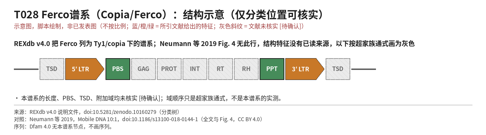

图 T028-1　Ferco谱系（Copia/Ferco）：结构示意。示意图，脚本绘制，非已发表图；每个特征的来源写在图下方。序列：Dfam 4.0 未设本谱系节点，没有谱系级共识序列；超家族代表序列见 T002/T003。


作为 Ty1/Copia 超家族成员，自主型 Ferco 元件遵循 5' LTR、内部编码区与 3' LTR 的三段式骨架，两翼 LTR 末端多为 5'-TG...CA-3'，内部两端具 PBS 与 PPT（Ferco 谱系特有的全长范围、单 LTR 长度及 PBS 特征待确认）。（见本条“本版补充说明”）

#### TSD

整合进入宿主染色体时预期形成正向靶位点重复，遵循 Ty1/Copia 超家族的典型 5 bp 特征（该谱系实测 TSD 统计待确认）。

#### 编码蛋白与结构域顺序

自主型 Ferco 元件遵循 Ty1/Copia 超家族的 **GAG - PROT - INT - RT - RH** 结构域排列顺序（是否携带特殊附加结构域或开放阅读框待确认）。（见本条“本版补充说明”）

#### 转座机制

遵循经典的 LTR 反转录转座子复制粘贴扩增机制：由 5' LTR 启动子驱动全长 RNA 转录，在胞质病毒样颗粒内完成双链 cDNA 反转录并由整合酶整合进入宿主染色体新位点（是否存在特殊转录或引发机制待确认）。

#### 自主与非自主搭档

完整携带 `gag-pol` 的拷贝为自主型；基因组中可能伴生内部缺失的非自主衍生物及 solo-LTR（具体搭档关系待确认）。

#### 识别特征与工具

结构从头识别采用 LTRharvest（Ellinghaus 等 2008, doi:10.1186/1471-2105-9-18）、LTR_FINDER（Xu 和 Wang 2007, doi:10.1093/nar/gkm286）、LTR_retriever（Ou 和 Jiang 2018, doi:10.1104/pp.17.01310）与 EDTA（Ou 等 2019, doi:10.1186/s13059-019-1905-y）。谱系级鉴定必须使用已更新至 REXdb Viridiplantae v4.0 数据库的 TEsorter 或相应蛋白结构域 HMM 模型（Zhang 等 2022, doi:10.1093/hr/uhac017；v4.0 数据库版本细节待确认）。

#### 分类争议

由于 Ferco 未出现在 2019 年 REXdb 原始论文的 16 谱系名单中，在使用不同版本 REXdb 进行跨物种比较时需注意版本差异，并在正式引用前核对原始发表文献出处（待确认）。

#### 发现与分布

**发现与命名**

- (2023) REXdb Viridiplantae database v4.0 (README and classification tree). Zenodo. doi:10.5281/zenodo.10160279。REXdb 分类树原句：“--Ferco     * (REXdb Viridiplantae v4.0 README classification tree; asterisk marks new lineage)”；支持范围：REXdb Viridiplantae v4.0 adds these lineages

**植物中的报道**

- 未检索到已核实的植物报道 [待确认]。

**葡萄中的报道**

- 未检索到葡萄专门报道（检索方式见文末「证据与检索方法」）。这只说明检索没有找到，不能据此推断葡萄基因组中不存在。

#### 本版补充说明

① 域顺序：GAG–PROT–INT–RT–RH（Ty1/Copia）与 GAG–PROT–RT–RH–INT（Ty3/Gypsy）是 Neumann 等 2019（doi:10.1186/s13100-018-0144-1）在超家族层面给出的判别顺序；本条若写某谱系“遵循”该顺序，指的是沿用超家族的顺序，不是该文对本谱系另行测定。

② 末端：5′-TG…CA-3′ 是该文用 LTR-FINDER 预测元件时设定的筛选条件，不是对各谱系的实测统计；本条中“末端保守为 5′-TG…CA-3′”一类说法应按此理解。

③ 该文 Fig. 4 没有本谱系（本谱系见于 REXdb v4.0），长度、PBS、TSD 仍为 [待确认]。

### T029 Bryana谱系（Copia/Bryana）

**名称对照**：Wicker 体系：I 类 / LTR 目 / Copia（代码 RLC）；Wicker 不分谱系；Dfam 节点：Ty1-Copia（Dfam 无谱系节点）；REXdb 路径：Class_I/LTR/Ty1/copia/Bryana。（来源：代码据 Wu 等 2025, doi:10.3390/biom15030346；Dfam 4.0 分类树，2026-11-23 读取；REXdb v4.0 说明文件，doi:10.5281/zenodo.10160279）

#### 定义与命名

Bryana 是 I 类转座子 LTR 目 Ty1/Copia 超家族（RLC）下在 REXdb Viridiplantae v4.0 版本中新增的植物谱系，规范命名为 `Bryana`（REXdb v4.0 更新说明及该谱系正式发表出处 DOI 待确认）。2019 年发表的 REXdb 原始论文的 16 个 Copia 谱系名单中未包含此名 [待确认]。在 Dfam 现行分类体系中归入 `LTR/Copia` 节点之下 [待确认]。

#### 结构、长度与末端

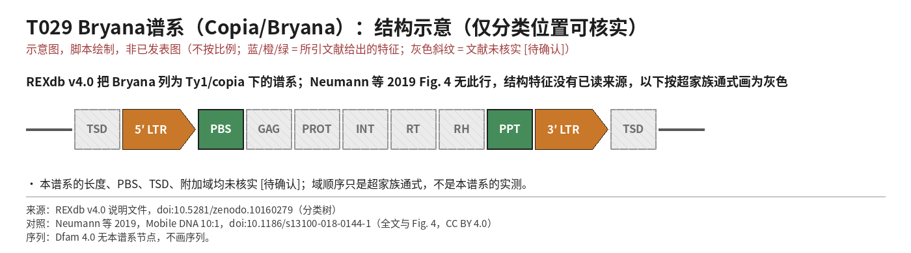

图 T029-1　Bryana谱系（Copia/Bryana）：结构示意。示意图，脚本绘制，非已发表图；每个特征的来源写在图下方。序列：Dfam 4.0 未设本谱系节点，没有谱系级共识序列；超家族代表序列见 T002/T003。


作为 Ty1/Copia 超家族成员，自主型 Bryana 元件遵循 5' LTR、内部编码区与 3' LTR 的三段式骨架，两翼 LTR 末端多为 5'-TG...CA-3'，内部两端具 PBS 与 PPT（Bryana 谱系特有的全长范围、单 LTR 长度及 PBS 特征待确认）。（见本条“本版补充说明”）

#### TSD

整合进入宿主染色体时预期形成正向靶位点重复，遵循 Ty1/Copia 超家族的典型 5 bp 特征（该谱系实测 TSD 统计待确认）。

#### 编码蛋白与结构域顺序

自主型 Bryana 元件遵循 Ty1/Copia 超家族的 **GAG - PROT - INT - RT - RH** 结构域排列顺序（是否携带特殊附加结构域或开放阅读框待确认）。（见本条“本版补充说明”）

#### 转座机制

遵循经典的 LTR 反转录转座子复制粘贴扩增机制：由 5' LTR 启动子驱动全长 RNA 转录，在胞质病毒样颗粒内完成双链 cDNA 反转录并由整合酶整合进入宿主染色体新位点（是否存在特殊转录或引发机制待确认）。

#### 自主与非自主搭档

完整携带 `gag-pol` 的拷贝为自主型；基因组中可能伴生内部缺失的非自主衍生物及 solo-LTR（具体搭档关系待确认）。

#### 识别特征与工具

结构从头识别采用 LTRharvest（Ellinghaus 等 2008, doi:10.1186/1471-2105-9-18）、LTR_FINDER（Xu 和 Wang 2007, doi:10.1093/nar/gkm286）、LTR_retriever（Ou 和 Jiang 2018, doi:10.1104/pp.17.01310）与 EDTA（Ou 等 2019, doi:10.1186/s13059-019-1905-y）。谱系级鉴定必须使用已更新至 REXdb Viridiplantae v4.0 数据库的 TEsorter 或相应蛋白结构域 HMM 模型（Zhang 等 2022, doi:10.1093/hr/uhac017；v4.0 数据库版本细节待确认）。

#### 分类争议

由于 Bryana 未出现在 2019 年 REXdb 原始论文的 16 谱系名单中，在跨项目比较及使用不同版本 REXdb 数据库时需注意与 Bryco 等苔藓相关谱系的版本兼容问题，并在正式引用前核对原始发表文献出处（待确认）。

#### 发现与分布

**发现与命名**

- (2023) REXdb Viridiplantae database v4.0 (README and classification tree). Zenodo. doi:10.5281/zenodo.10160279。REXdb 分类树原句：“--Bryana    * (REXdb Viridiplantae v4.0 README classification tree; asterisk marks new lineage)”；支持范围：REXdb Viridiplantae v4.0 adds these lineages

**植物中的报道**

- 未检索到已核实的植物报道 [待确认]。

**葡萄中的报道**

- 未检索到葡萄专门报道（检索方式见文末「证据与检索方法」）。这只说明检索没有找到，不能据此推断葡萄基因组中不存在。


#### 本版补充说明

① 域顺序：GAG–PROT–INT–RT–RH（Ty1/Copia）与 GAG–PROT–RT–RH–INT（Ty3/Gypsy）是 Neumann 等 2019（doi:10.1186/s13100-018-0144-1）在超家族层面给出的判别顺序；本条若写某谱系“遵循”该顺序，指的是沿用超家族的顺序，不是该文对本谱系另行测定。

② 末端：5′-TG…CA-3′ 是该文用 LTR-FINDER 预测元件时设定的筛选条件，不是对各谱系的实测统计；本条中“末端保守为 5′-TG…CA-3′”一类说法应按此理解。

③ 该文 Fig. 4 没有本谱系（本谱系见于 REXdb v4.0），长度、PBS、TSD 仍为 [待确认]。

## 第四部分　Gypsy 超家族：色质病毒样谱系

### T030 Chlamyvir谱系（Gypsy/Chlamyvir）

**名称对照**：Wicker 体系：I 类 / LTR 目 / Gypsy（代码 RLG）；Wicker 不分谱系；Dfam 节点：Gypsy-ERV;Gypsy（Dfam 无谱系节点）；REXdb 路径：Class_I/LTR/Ty3/gypsy/chromovirus/Chlamyvir。（来源：代码据 Wu 等 2025, doi:10.3390/biom15030346；Dfam 4.0 分类树，2026-11-23 读取；REXdb v4.0 说明文件，doi:10.5281/zenodo.10160279）

#### 定义与命名

Chlamyvir 是 I 类转座子 LTR 目 Ty3/Gypsy 超家族（RLG）染色质病毒支（chromovirus）下的古老植物谱系，在 2019 年基于反转录转座子蛋白结构域建立的 REXdb 绿色植物系统分类框架中正式确立，完整路径常记作 `Gypsy/chromovirus/Chlamyvir`（Neumann 等 2019, doi:10.1186/s13100-018-0144-1）。在 Dfam 现行分类体系中，该类群归入 `LTR/Gypsy` 节点之下 [待确认]。

#### 结构、长度与末端

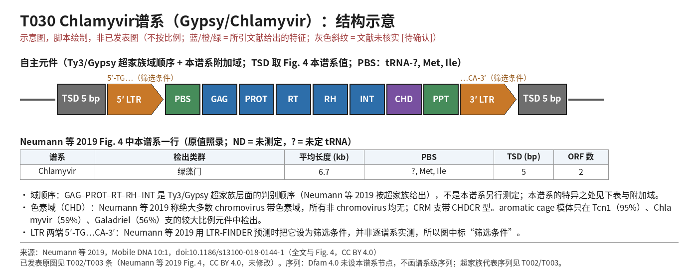

图 T030-1　Chlamyvir谱系（Gypsy/Chlamyvir）：结构示意。示意图，脚本绘制，非已发表图；每个特征的来源写在图下方。序列：Dfam 4.0 未设本谱系节点，没有谱系级共识序列；超家族代表序列见 T002/T003。


自主型 Chlamyvir 元件具备典型 LTR 反转录转座子的 5' LTR、内部编码区与 3' LTR 三段式结构，两翼 LTR 末端多保留保守的 5'-TG...CA-3' 反向重复二核苷酸，内部两端具备引物结合位点（PBS）与多聚嘌呤区（PPT）（Chlamyvir 精确全长与单 LTR 长度分布统计待确认）。（见本条“本版补充说明”）

#### TSD

整合进入宿主基因组时在元件两侧形成正向靶位点重复，遵循 Ty3/Gypsy 超家族的典型 5 bp 特征（该谱系实测变异范围待确认）。

#### 编码蛋白与结构域顺序

自主型 Chlamyvir 元件编码 `gag` 与 `pol` 蛋白，遵循 Ty3/Gypsy 超家族染色质病毒支的标准结构域排列顺序：**GAG - PROT - RT - RH - INT - CHD**（Neumann 等 2019, doi:10.1186/s13100-018-0144-1）。整合酶（INT）C 端携带染色质结构域（chromodomain，CHD），其具体亚型与组蛋白结合特性尚待进一步功能验证（待确认）。（见本条“本版补充说明”）

#### 转座机制

遵循经典的 LTR 反转录转座子复制粘贴扩增机制：由宿主 RNA 聚合酶 II 从 5' LTR 启动子转录全长 RNA，在胞质病毒样颗粒内借由 PBS 与 PPT 引导反转录合成双链 cDNA，随后由整合酶整合进入宿主染色体新位点并伴随产生 TSD [待确认]。

#### 自主与非自主搭档

完整编码 `gag-pol` 的拷贝为自主型；基因组中可伴生内部编码区缺失的非自主衍生物及两翼 LTR 不等同源重组形成的 solo-LTR（Chlamyvir 专属非自主搭档研究待确认）。

#### 识别特征与工具

结构从头识别采用 LTRharvest（Ellinghaus 等 2008, doi:10.1186/1471-2105-9-18）、LTR_FINDER（Xu 和 Wang 2007, doi:10.1093/nar/gkm286）、LTR_retriever（Ou 和 Jiang 2018, doi:10.1104/pp.17.01310）与 EDTA（Ou 等 2019, doi:10.1186/s13059-019-1905-y）。谱系级精准鉴定采用基于 REXdb 蛋白结构域 HMM 模型的 TEsorter（Zhang 等 2022, doi:10.1093/hr/uhac017；Neumann 等 2019, doi:10.1186/s13100-018-0144-1）。

#### 分类争议

Chlamyvir 在 2019 年 REXdb 系统发育分类中作为藻类特异的染色质病毒支谱系确立，分类界限清晰，目前无显著合并或拆分争议（Neumann 等 2019, doi:10.1186/s13100-018-0144-1）。

#### 发现与分布

**发现与命名**

- Gorinsek 等 (2004) Evolutionary genomics of chromoviruses in eukaryotes. Molecular Biology and Evolution. doi:10.1093/molbev/msh057。摘要原句：“The diversity, origin, and evolution of chromoviruses in Eukaryota were examined using the massive amount of genome sequence data for different eukaryotic lineages”；涉及生物：eukaryotes (fungi, plants, animals)；支持范围：chromovirus clades CRM, Chlamyvir, Galadriel, Reina, Del (Tekay) [注意：所引句不含该名称，仅支持上位/总体论断]

**植物中的报道**

- Neumann 等 (2019) Systematic survey of plant LTR-retrotransposons elucidates phylogenetic relationships of their polyprotein domains and provides a reference for element classification. Mobile DNA. doi:10.1186/s13100-018-0144-1。正文原句：“1 ], c [ 75 ] Table 2 Unification of classification of Ty3/gypsy elements REXdb GyDB ICTV other chromovirus|CRM chromoviruses|CRM (Beetle1, CRM) – CRM [ 27 ] chromovirus|Chlamyvir – – Chlamyvir [ 27 ] chromovirus|Galadriel chromoviruses|Galadriel (Galadriel, Monkey, Tntom1) – Galadriel [ 27 ] chromovirus|Tcn1 a only…”；涉及生物：Viridiplantae；支持范围：REXdb survey of plant LTR retrotransposon lineages
- Gorinsek 等 (2004) Evolutionary genomics of chromoviruses in eukaryotes. Molecular Biology and Evolution. doi:10.1093/molbev/msh057。同一论文，原句见上；支持范围：chromoviruses across eukaryotes [注意：所引句不含该名称，仅支持上位/总体论断]

**葡萄中的报道**

- 未检索到葡萄专门报道（检索方式见文末「证据与检索方法」）。这只说明检索没有找到，不能据此推断葡萄基因组中不存在。

#### 本版补充说明

① 域顺序：GAG–PROT–INT–RT–RH（Ty1/Copia）与 GAG–PROT–RT–RH–INT（Ty3/Gypsy）是 Neumann 等 2019（doi:10.1186/s13100-018-0144-1）在超家族层面给出的判别顺序；本条若写某谱系“遵循”该顺序，指的是沿用超家族的顺序，不是该文对本谱系另行测定。

② 末端：5′-TG…CA-3′ 是该文用 LTR-FINDER 预测元件时设定的筛选条件，不是对各谱系的实测统计；本条中“末端保守为 5′-TG…CA-3′”一类说法应按此理解。

③ 该文 Fig. 4 给出本谱系：检出类群 绿藻门；平均长度 6.7 kb；PBS ?, Met, Ile；TSD 5 bp；ORF 数 2（ND 为未测定）。正文中标 [待确认] 的“TSD 典型长度 5 bp”与 Fig. 4 一致。

### T031 Tcn1谱系（Gypsy/Tcn1）

**名称对照**：Wicker 体系：I 类 / LTR 目 / Gypsy（代码 RLG）；Wicker 不分谱系；Dfam 节点：Gypsy-ERV;Gypsy（Dfam 无谱系节点）；REXdb 路径：Class_I/LTR/Ty3/gypsy/chromovirus/Tcn1。（来源：代码据 Wu 等 2025, doi:10.3390/biom15030346；Dfam 4.0 分类树，2026-11-23 读取；REXdb v4.0 说明文件，doi:10.5281/zenodo.10160279）

#### 定义与命名

Tcn1 是 I 类转座子 LTR 目 Ty3/Gypsy 超家族（RLG）染色质病毒支（chromovirus）下的古老谱系，在 2019 年 REXdb 绿色植物系统分类框架中正式收录为独立谱系，完整路径常记作 `Gypsy/chromovirus/Tcn1`（Neumann 等 2019, doi:10.1186/s13100-018-0144-1）。在系统发育上，Tcn1 与真菌中的 Tf1/Sushi 类染色质病毒元件亲缘关系相近（Neumann 等 2019, doi:10.1186/s13100-018-0144-1）。在 Dfam 现行分类体系中归入 `LTR/Gypsy` 节点之下 [待确认]。

#### 结构、长度与末端

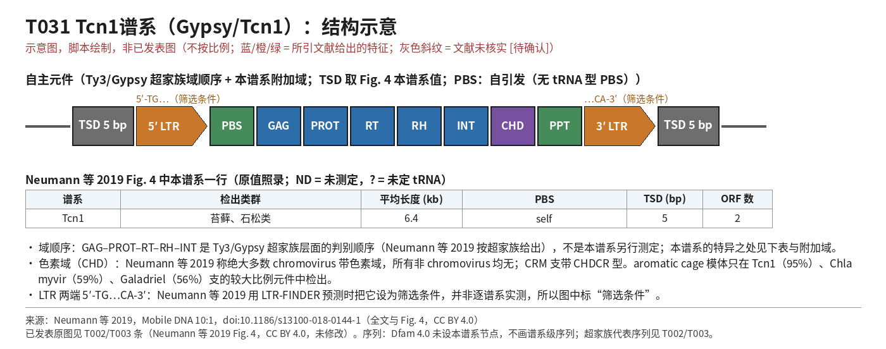

图 T031-1　Tcn1谱系（Gypsy/Tcn1）：结构示意。示意图，脚本绘制，非已发表图；每个特征的来源写在图下方。序列：Dfam 4.0 未设本谱系节点，没有谱系级共识序列；超家族代表序列见 T002/T003。


自主型 Tcn1 元件具备 5' LTR、内部编码区与 3' LTR 的完整结构，两翼 LTR 末端多保留保守的 5'-TG...CA-3' 反向重复二核苷酸，3' LTR 上游具 PPT（精确跨物种全长与单 LTR 长度分布统计待确认）。在负链反转录起始结构方面，2019 年 REXdb 系统研究指出，与近缘的真菌 Tf1 类似，Tcn1 谱系元件常缺乏经典宿主 tRNA 互补 PBS，可能采用自引发（self-priming）机制起始反转录（Neumann 等 2019, doi:10.1186/s13100-018-0144-1）。（见本条“本版补充说明”）

#### TSD

整合进入宿主染色体时在元件两侧形成正向靶位点重复，遵循 Ty3/Gypsy 超家族的典型 5 bp 特征（具体变异情况待确认）。

#### 编码蛋白与结构域顺序

自主型 Tcn1 元件编码 `gag` 与 `pol` 蛋白，遵循 Ty3/Gypsy 超家族染色质病毒支的标准结构域排列顺序：**GAG - PROT - RT - RH - INT - CHD**（Neumann 等 2019, doi:10.1186/s13100-018-0144-1）。其整合酶 C 端携带染色质结构域（CHD）（Neumann 等 2019, doi:10.1186/s13100-018-0144-1）。（见本条“本版补充说明”）

#### 转座机制

遵循 LTR 反转录转座子的复制粘贴扩增机制，经全长 RNA 转录、胞质病毒样颗粒内反转录合成双链 cDNA 及整合酶介导的染色体整合完成扩增 [待确认]。其反转录负链合成可能不依赖宿主 tRNA 引物，而是通过 RNA 转录本自身二级结构折回实现自引发起始（Neumann 等 2019, doi:10.1186/s13100-018-0144-1；植物 Tcn1 自引发机制实验验证文献 DOI 待确认）。

#### 自主与非自主搭档

完整编码 `gag-pol` 的拷贝为自主型；基因组中可伴生内部缺失的非自主衍生物及两翼 LTR 不等同源重组形成的 solo-LTR（Tcn1 专属非自主搭档研究待确认）。

#### 识别特征与工具

结构从头识别采用 LTRharvest（Ellinghaus 等 2008, doi:10.1186/1471-2105-9-18）、LTR_FINDER（Xu 和 Wang 2007, doi:10.1093/nar/gkm286）、LTR_retriever（Ou 和 Jiang 2018, doi:10.1104/pp.17.01310）与 EDTA（Ou 等 2019, doi:10.1186/s13059-019-1905-y）。鉴于其可能采用自引发机制，注释时不可将缺失经典 tRNA-PBS 作为排除依据；谱系级鉴定依赖基于 REXdb 蛋白结构域 HMM 的 TEsorter（Zhang 等 2022, doi:10.1093/hr/uhac017；Neumann 等 2019, doi:10.1186/s13100-018-0144-1）。

#### 分类争议

Tcn1 最早在真菌中被命名，后续在苔藓与石松植物中发现的同源分支在 2019 年 REXdb 框架下沿用 `Tcn1` 谱系名，其跨界分布究竟源于古老垂直遗传还是水平转移仍有演化讨论（Neumann 等 2019, doi:10.1186/s13100-018-0144-1；跨界起源专项研究 DOI 待确认）。

#### 发现与分布

**发现与命名**

- Novikova 等 (2010) Evolutionary genomics revealed interkingdom distribution of Tcn1-like chromodomain-containing Gypsy LTR retrotransposons among fungi and plants. BMC Genomics. doi:10.1186/1471-2164-11-231。摘要原句：“It appeared that one of the clades, namely Tcn1 clade, was present in basidiomycetes and non-seed plants including mosses (Bryophyta) and lycophytes (genus Selaginella).ConclusionsThe interkingdom distribution is not typical for chromodomain-containing LTR retrotransposons clades which are usually very specific for a…”；涉及生物：fungi and plants；支持范围：Tcn1-like chromodomain Gypsy retrotransposons

**植物中的报道**

- Neumann 等 (2019) Systematic survey of plant LTR-retrotransposons elucidates phylogenetic relationships of their polyprotein domains and provides a reference for element classification. Mobile DNA. doi:10.1186/s13100-018-0144-1。正文原句：“…CRM) – CRM [ 27 ] chromovirus|Chlamyvir – – Chlamyvir [ 27 ] chromovirus|Galadriel chromoviruses|Galadriel (Galadriel, Monkey, Tntom1) – Galadriel [ 27 ] chromovirus|Tcn1 a only Tf1/Sushi-related clades of chromoviruses in non-Viridiplantae spp.: Maggy (Maggy, Dane-1), marY1 (marY1), Pyret (Pyret, Cgret, Cft-1, Skippy),…”；涉及生物：Viridiplantae；支持范围：REXdb survey of plant LTR retrotransposon lineages
- Novikova 等 (2010) Evolutionary genomics revealed interkingdom distribution of Tcn1-like chromodomain-containing Gypsy LTR retrotransposons among fungi and plants. BMC Genomics. doi:10.1186/1471-2164-11-231。同一论文，原句见上；支持范围：Tcn1-like elements in plants [注意：所引句不含该名称，仅支持上位/总体论断]

**葡萄中的报道**

- 未检索到葡萄专门报道（检索方式见文末「证据与检索方法」）。这只说明检索没有找到，不能据此推断葡萄基因组中不存在。

#### 本版补充说明

① 域顺序：GAG–PROT–INT–RT–RH（Ty1/Copia）与 GAG–PROT–RT–RH–INT（Ty3/Gypsy）是 Neumann 等 2019（doi:10.1186/s13100-018-0144-1）在超家族层面给出的判别顺序；本条若写某谱系“遵循”该顺序，指的是沿用超家族的顺序，不是该文对本谱系另行测定。

② 末端：5′-TG…CA-3′ 是该文用 LTR-FINDER 预测元件时设定的筛选条件，不是对各谱系的实测统计；本条中“末端保守为 5′-TG…CA-3′”一类说法应按此理解。

③ 该文 Fig. 4 给出本谱系：检出类群 苔藓、石松类；平均长度 6.4 kb；PBS 自引发；TSD 5 bp；ORF 数 2（ND 为未测定）。正文中标 [待确认] 的“TSD 典型长度 5 bp”与 Fig. 4 一致。

### T032 CRM谱系（Gypsy/CRM）

**名称对照**：Wicker 体系：I 类 / LTR 目 / Gypsy（代码 RLG）；Wicker 不分谱系；Dfam 节点：Gypsy-ERV;Gypsy（Dfam 无谱系节点）；REXdb 路径：Class_I/LTR/Ty3/gypsy/chromovirus/CRM。（来源：代码据 Wu 等 2025, doi:10.3390/biom15030346；Dfam 4.0 分类树，2026-11-23 读取；REXdb v4.0 说明文件，doi:10.5281/zenodo.10160279）

#### 定义与命名

CRM（centromeric retrotransposon，简称 CR 或 CRM）是 I 类转座子 LTR 目 Ty3/Gypsy 超家族（RLG）染色质病毒支（chromovirus）下最具代表性的着丝粒偏好谱系，在 2019 年 REXdb 绿色植物系统分类框架中规范命名为 `CRM`（Neumann 等 2019, doi:10.1186/s13100-018-0144-1）。在 Dfam 现行分类体系中归入 `LTR/Gypsy` 节点之下 [待确认]。

#### 结构、长度与末端

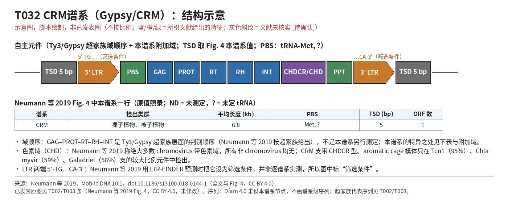

图 T032-1　CRM谱系（Gypsy/CRM）：结构示意。示意图，脚本绘制，非已发表图；每个特征的来源写在图下方。序列：Dfam 4.0 未设本谱系节点，没有谱系级共识序列；超家族代表序列见 T002/T003。

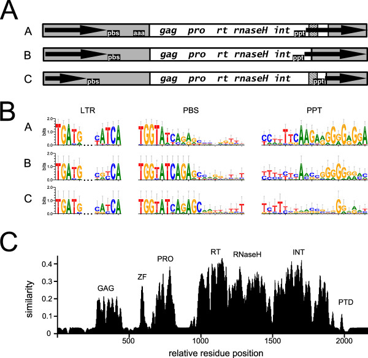

图 T032-P1　植物着丝粒反转录转座子（CRM）各组的结构、LTR 末端序列标志、PBS 与 PPT。原图：Neumann 等（2011），Fig. 4。Plant centromeric retrotransposons: a structural and cytogenetic perspective. Mob DNA. doi:10.1186/1759-8753-2-4。许可：CC BY 2.0（https://creativecommons.org/licenses/by/2.0/）。未修改。


自主型 CRM 元件全长通常在 6 kb 至 9 kb 之间，单个 LTR 长度多在 500 bp 至 1.5 kb 左右（精确跨物种长度分布统计待确认）。完整拷贝两翼具正向重复 LTR，末端保守为 5'-TG...CA-3'，5' LTR 下游具经典 PBS，3' LTR 上游具 PPT [待确认]。（见本条“本版补充说明”）

#### TSD

整合进入宿主基因组时在元件两侧形成正向靶位点重复，典型长度为 5 bp [待确认]。

#### 编码蛋白与结构域顺序

自主型 CRM 元件编码 `gag` 与 `pol` 蛋白，遵循 Ty3/Gypsy 超家族染色质病毒支的经典结构域排列顺序：**GAG - PROT - RT - RH - INT - CHD/CHDCR**（Neumann 等 2019, doi:10.1186/s13100-018-0144-1）。其最核心的分子鉴别特征位于整合酶（INT）C 端：部分 CRM 成员携带特化的着丝粒靶向染色质结构域，称为 **CHDCR**（或 CR 基序），该基序在序列上明显区别于经典芳香族笼（aromatic cage）型染色质结构域，赋予元件特异性识别并定向整合至着丝粒区域的能力（Neumann 等 2019, doi:10.1186/s13100-018-0144-1；CHDCR 发现与功能验证专文 DOI 待确认）。（见本条“本版补充说明”）

#### 转座机制

遵循 LTR 反转录转座子的复制粘贴扩增机制：由 5' LTR 启动子驱动全长 RNA 转录，在胞质病毒样颗粒内借由 PBS 与 PPT 引导反转录合成双链 cDNA，最终由整合酶催化整合进入宿主染色体并产生 5 bp TSD [待确认]。与随机整合不同，携带 CHDCR 基序的 CRM 元件能够定向靶向着丝粒区域，与着丝粒特异性组蛋白 H3 变体（CENH3）及着丝粒串联卫星重复序列交织共存（Neumann 等 2019, doi:10.1186/s13100-018-0144-1）。

#### 自主与非自主搭档

完整编码 `gag-pol` 的拷贝为自主型；在着丝粒与近着丝粒区域，CRM 元件常发生频繁的嵌套插入、内部缺失形成非自主衍生物以及两翼 LTR 不等同源重组产生 solo-LTR [待确认]。

#### 识别特征与工具

结构从头识别采用 LTRharvest（Ellinghaus 等 2008, doi:10.1186/1471-2105-9-18）、LTR_FINDER（Xu 和 Wang 2007, doi:10.1093/nar/gkm286）、LTR_retriever（Ou 和 Jiang 2018, doi:10.1104/pp.17.01310）与 EDTA（Ou 等 2019, doi:10.1186/s13059-019-1905-y）。谱系级鉴定首选基于 REXdb 蛋白结构域 HMM 的 TEsorter，可同步检出整合酶 C 端的 CHDCR 特征域（Zhang 等 2022, doi:10.1093/hr/uhac017；Neumann 等 2019, doi:10.1186/s13100-018-0144-1）。由于 CRM 高度聚集于着丝粒，在短读长草图基因组中极易因组装坍缩而被严重低估，需结合长读长 T2T 组装进行准确评估 [待确认]。

#### 分类争议

早年文献按物种分别命名为 CRR（水稻）、CRM（玉米）、CRW（小麦）等，2019 年 REXdb 系统发育分类统一以 `CRM` 作为跨物种谱系名（Neumann 等 2019, doi:10.1186/s13100-018-0144-1）。此外，并非所有系统发育归属 CRM 谱系的成员都严格局限于着丝粒核心区，部分缺失典型 CHDCR 的分支可分布于近着丝粒区，因此分类归属必须以蛋白结构域系统发育位置而非单纯染色体定位为准（Neumann 等 2019, doi:10.1186/s13100-018-0144-1）。

#### 发现与分布

**发现与命名**

- Gorinsek 等 (2004) Evolutionary genomics of chromoviruses in eukaryotes. Molecular Biology and Evolution. doi:10.1093/molbev/msh057。摘要原句：“The diversity, origin, and evolution of chromoviruses in Eukaryota were examined using the massive amount of genome sequence data for different eukaryotic lineages”；涉及生物：eukaryotes (fungi, plants, animals)；支持范围：chromovirus clades CRM, Chlamyvir, Galadriel, Reina, Del (Tekay) [注意：所引句不含该名称，仅支持上位/总体论断]
- Zhong 等 (2002) Centromeric retroelements and satellites interact with maize kinetochore protein CENH3. The Plant Cell. doi:10.1105/tpc.006106。摘要原句：“Maize centromeres are composed of CentC tandem repeat arrays, centromeric retrotransposons (CRs), and a variety of other repeats”；涉及生物：maize (Zea mays)；支持范围：CRM centromeric retroelement [注意：所引句不含该名称，仅支持上位/总体论断]

**植物中的报道**

- Neumann 等 (2019) Systematic survey of plant LTR-retrotransposons elucidates phylogenetic relationships of their polyprotein domains and provides a reference for element classification. Mobile DNA. doi:10.1186/s13100-018-0144-1。正文原句：“…Osser and Tork (Table 1 ). Ty3/gypsy elements in plants were found to belong to two major lineages, chromovirus and Tat/Athila, the former composed of the Del, Reina, CRM and Galadriel clades, the latter of the Tat and Athila clades (Table 2 ). Wicker and Keller [ 24 ] examined 599 Ty1/copia elements from barley, wheat, rice…”；涉及生物：Viridiplantae；支持范围：REXdb survey of plant LTR retrotransposon lineages
- Zhong 等 (2002) Centromeric retroelements and satellites interact with maize kinetochore protein CENH3. The Plant Cell. doi:10.1105/tpc.006106。同一论文，原句见上；支持范围：CRM centromeric retroelement [注意：所引句不含该名称，仅支持上位/总体论断]
- Neumann 等 (2011) Plant centromeric retrotransposons: a structural and cytogenetic perspective. Mobile DNA. doi:10.1186/1759-8753-2-4。摘要原句：“BackgroundThe centromeric and pericentromeric regions of plant chromosomes are colonized by Ty3/gypsy retrotransposons, which, on the basis of their reverse transcriptase sequences, form the chromovirus CRM clade”
- Sharma 和 Presting (2014) Evolution of centromeric retrotransposons in grasses. Genome Biology and Evolution. doi:10.1093/gbe/evu096。摘要原句：“Centromeric retrotransposons (CRs) constitute a family of plant retroelements, some of which have the ability to target their insertion almost exclusively to the functional centromeres”；涉及生物：grasses；支持范围：CRM evolution in grasses [注意：所引句不含该名称，仅支持上位/总体论断]
- Gorinsek 等 (2004) Evolutionary genomics of chromoviruses in eukaryotes. Molecular Biology and Evolution. doi:10.1093/molbev/msh057。同一论文，原句见上；支持范围：chromoviruses across eukaryotes [注意：所引句不含该名称，仅支持上位/总体论断]

**葡萄中的报道**

- Park 等 (2021) Horizontal Transfer of LTR Retrotransposons Contributes to the Genome Diversity of Vitis. International Journal of Molecular Sciences. doi:10.3390/ijms221910446。正文原句：“In the Gypsy superfamily, a total of eight families were identified, but only CRM and Reina contained horizontally transferred elements ( Figure 5 e)”；涉及生物：Vitis；支持范围：horizontal transfer of LTR retrotransposons; Tork, CRM, Reina, Athila, Tat families in four Vitis genomes

#### 本版补充说明

① 域顺序：GAG–PROT–INT–RT–RH（Ty1/Copia）与 GAG–PROT–RT–RH–INT（Ty3/Gypsy）是 Neumann 等 2019（doi:10.1186/s13100-018-0144-1）在超家族层面给出的判别顺序；本条若写某谱系“遵循”该顺序，指的是沿用超家族的顺序，不是该文对本谱系另行测定。

② 末端：5′-TG…CA-3′ 是该文用 LTR-FINDER 预测元件时设定的筛选条件，不是对各谱系的实测统计；本条中“末端保守为 5′-TG…CA-3′”一类说法应按此理解。

③ 该文 Fig. 4 给出本谱系：检出类群 裸子植物、被子植物；平均长度 6.8 kb；PBS Met, ?；TSD 5 bp；ORF 数 1（ND 为未测定）。正文中标 [待确认] 的“TSD 典型长度 5 bp”与 Fig. 4 一致。

### T033 Galadriel谱系（Gypsy/Galadriel）

**名称对照**：Wicker 体系：I 类 / LTR 目 / Gypsy（代码 RLG）；Wicker 不分谱系；Dfam 节点：Gypsy-ERV;Gypsy（Dfam 无谱系节点）；REXdb 路径：Class_I/LTR/Ty3/gypsy/chromovirus/Galadriel。（来源：代码据 Wu 等 2025, doi:10.3390/biom15030346；Dfam 4.0 分类树，2026-11-23 读取；REXdb v4.0 说明文件，doi:10.5281/zenodo.10160279）

#### 定义与命名

Galadriel 是 I 类转座子 LTR 目 Ty3/Gypsy 超家族（RLG）染色质病毒支（chromovirus）下的独立植物谱系，在 2019 年 REXdb 绿色植物系统分类框架中规范命名为 `Galadriel`（Neumann 等 2019, doi:10.1186/s13100-018-0144-1）。在 Dfam 现行分类体系中归入 `LTR/Gypsy` 节点之下 [待确认]。

#### 结构、长度与末端

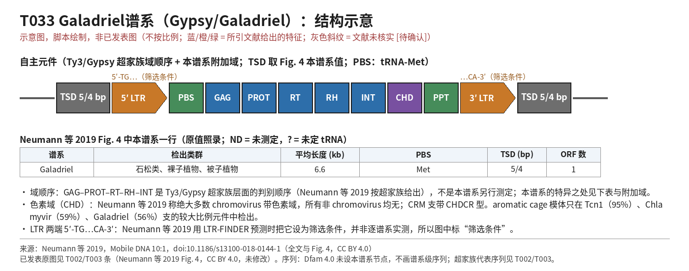

图 T033-1　Galadriel谱系（Gypsy/Galadriel）：结构示意。示意图，脚本绘制，非已发表图；每个特征的来源写在图下方。序列：Dfam 4.0 未设本谱系节点，没有谱系级共识序列；超家族代表序列见 T002/T003。


自主型 Galadriel 元件全长多在 5.5 kb 至 8 kb 之间，单个 LTR 长度通常为数百 bp 至约 1 kb（精确跨物种长度分布统计待确认）。完整拷贝两翼具正向重复 LTR，末端保守为 5'-TG...CA-3'，5' LTR 下游具经典 PBS，3' LTR 上游具 PPT [待确认]。（见本条“本版补充说明”）

#### TSD

整合进入宿主基因组时在元件两侧形成正向靶位点重复，典型长度为 5 bp [待确认]。

#### 编码蛋白与结构域顺序

自主型 Galadriel 元件编码 `gag` 与 `pol` 蛋白，遵循 Ty3/Gypsy 超家族染色质病毒支的标准结构域排列顺序：**GAG - PROT - RT - RH - INT - CHD**（Neumann 等 2019, doi:10.1186/s13100-018-0144-1）。2019 年 REXdb 系统研究指出，部分 Galadriel 成员的整合酶 C 端携带经典的芳香族笼（aromatic cage）型染色质结构域（CHD），该结构域由保守的芳香族氨基酸残基构成，可识别特定组蛋白甲基化修饰（Neumann 等 2019, doi:10.1186/s13100-018-0144-1）。（见本条“本版补充说明”）

#### 转座机制

遵循经典的 LTR 反转录转座子复制粘贴扩增机制：由宿主 RNA 聚合酶 II 从 5' LTR 启动子转录全长 RNA，在胞质病毒样颗粒内借由 PBS 与 PPT 引导反转录合成双链 cDNA，随后由整合酶催化整合至宿主染色体新位点并伴随产生 5 bp TSD [待确认]。整合酶 C 端的芳香族笼型染色质结构域可能参与引导元件向特定染色质环境整合（Neumann 等 2019, doi:10.1186/s13100-018-0144-1）。

#### 自主与非自主搭档

完整编码 `gag-pol` 的拷贝为自主型；基因组中可伴生内部编码区缺失的非自主衍生物及两翼 LTR 不等同源重组形成的 solo-LTR（Galadriel 专属非自主搭档研究待确认）。

#### 识别特征与工具

结构从头识别采用 LTRharvest（Ellinghaus 等 2008, doi:10.1186/1471-2105-9-18）、LTR_FINDER（Xu 和 Wang 2007, doi:10.1093/nar/gkm286）、LTR_retriever（Ou 和 Jiang 2018, doi:10.1104/pp.17.01310）与 EDTA（Ou 等 2019, doi:10.1186/s13059-019-1905-y）。谱系级精准分类采用基于 REXdb 蛋白结构域 HMM 的 TEsorter（Zhang 等 2022, doi:10.1093/hr/uhac017；Neumann 等 2019, doi:10.1186/s13100-018-0144-1）。

#### 分类争议

Galadriel 在 2019 年 REXdb 系统发育分类中作为染色质病毒支的独立谱系地位明确，目前无显著合并或拆分争议（Neumann 等 2019, doi:10.1186/s13100-018-0144-1）。

#### 发现与分布

**发现与命名**

- Gorinsek 等 (2004) Evolutionary genomics of chromoviruses in eukaryotes. Molecular Biology and Evolution. doi:10.1093/molbev/msh057。摘要原句：“The diversity, origin, and evolution of chromoviruses in Eukaryota were examined using the massive amount of genome sequence data for different eukaryotic lineages”；涉及生物：eukaryotes (fungi, plants, animals)；支持范围：chromovirus clades CRM, Chlamyvir, Galadriel, Reina, Del (Tekay) [注意：所引句不含该名称，仅支持上位/总体论断]

**植物中的报道**

- Neumann 等 (2019) Systematic survey of plant LTR-retrotransposons elucidates phylogenetic relationships of their polyprotein domains and provides a reference for element classification. Mobile DNA. doi:10.1186/s13100-018-0144-1。正文原句：“…Tork (Table 1 ). Ty3/gypsy elements in plants were found to belong to two major lineages, chromovirus and Tat/Athila, the former composed of the Del, Reina, CRM and Galadriel clades, the latter of the Tat and Athila clades (Table 2 ). Wicker and Keller [ 24 ] examined 599 Ty1/copia elements from barley, wheat, rice and…”；涉及生物：Viridiplantae；支持范围：REXdb survey of plant LTR retrotransposon lineages
- Gorinsek 等 (2004) Evolutionary genomics of chromoviruses in eukaryotes. Molecular Biology and Evolution. doi:10.1093/molbev/msh057。同一论文，原句见上；支持范围：chromoviruses across eukaryotes [注意：所引句不含该名称，仅支持上位/总体论断]

**葡萄中的报道**

- 未检索到葡萄专门报道（检索方式见文末「证据与检索方法」）。这只说明检索没有找到，不能据此推断葡萄基因组中不存在。

#### 本版补充说明

① 域顺序：GAG–PROT–INT–RT–RH（Ty1/Copia）与 GAG–PROT–RT–RH–INT（Ty3/Gypsy）是 Neumann 等 2019（doi:10.1186/s13100-018-0144-1）在超家族层面给出的判别顺序；本条若写某谱系“遵循”该顺序，指的是沿用超家族的顺序，不是该文对本谱系另行测定。

② 末端：5′-TG…CA-3′ 是该文用 LTR-FINDER 预测元件时设定的筛选条件，不是对各谱系的实测统计；本条中“末端保守为 5′-TG…CA-3′”一类说法应按此理解。

③ 该文 Fig. 4 给出本谱系：检出类群 石松类、裸子植物、被子植物；平均长度 6.6 kb；PBS Met；TSD 5/4 bp；ORF 数 1（ND 为未测定）。本谱系 TSD 不是单一的 5 bp，正文“典型长度为 5 bp”一类写法以 Fig. 4 为准。

### T034 Tekay谱系（Gypsy/Tekay）

**名称对照**：Wicker 体系：I 类 / LTR 目 / Gypsy（代码 RLG）；Wicker 不分谱系；Dfam 节点：Gypsy-ERV;Gypsy（Dfam 无谱系节点）；REXdb 路径：Class_I/LTR/Ty3/gypsy/chromovirus/Tekay。（来源：代码据 Wu 等 2025, doi:10.3390/biom15030346；Dfam 4.0 分类树，2026-11-23 读取；REXdb v4.0 说明文件，doi:10.5281/zenodo.10160279）

#### 定义与命名

Tekay 是 I 类转座子 LTR 目 Ty3/Gypsy 超家族（RLG）染色质病毒支（chromovirus）下的种子植物主干谱系之一，在 2019 年 REXdb 绿色植物系统分类框架中规范命名为 `Tekay`（Neumann 等 2019, doi:10.1186/s13100-018-0144-1）。在早期植物转座子分类文献中，该谱系常被称为 `Del`（以百合中的 Del1 元件命名，具体对应关系在 2019 年 REXdb 框架下统一归入 Tekay）（Neumann 等 2019, doi:10.1186/s13100-018-0144-1；Del 原始命名专文 DOI 待确认）。在 Dfam 现行分类体系中归入 `LTR/Gypsy` 节点之下 [待确认]。

#### 结构、长度与末端


图 T034-1　Tekay谱系（Gypsy/Tekay）：结构示意。示意图，脚本绘制，非已发表图；每个特征的来源写在图下方。序列：Dfam 4.0 未设本谱系节点，没有谱系级共识序列；超家族代表序列见 T002/T003。


Tekay 是染色质病毒支中尺寸偏大的谱系，自主型元件全长通常在 8 kb 至 13 kb 之间，单个 LTR 长度较长，常在 1 kb 至 3 kb 左右（精确跨物种极值统计待确认）。完整拷贝两翼具正向重复 LTR，末端保守为 5'-TG...CA-3'，5' LTR 下游具经典 PBS，3' LTR 上游具 PPT [待确认]。（见本条“本版补充说明”）

#### TSD

整合进入宿主基因组时在元件两侧形成正向靶位点重复，典型长度为 5 bp [待确认]。

#### 编码蛋白与结构域顺序

自主型 Tekay 元件编码 `gag` 与 `pol` 蛋白，遵循 Ty3/Gypsy 超家族染色质病毒支的标准结构域排列顺序：**GAG - PROT - RT - RH - INT - CHD**（Neumann 等 2019, doi:10.1186/s13100-018-0144-1）。其整合酶 C 端携带染色质结构域（CHD）（Neumann 等 2019, doi:10.1186/s13100-018-0144-1）。（见本条“本版补充说明”）

#### 转座机制

遵循经典的 LTR 反转录转座子复制粘贴扩增机制：5' LTR 启动子驱动全长 RNA 转录，在胞质病毒样颗粒内借由 PBS 与 PPT 引导反转录合成双链 cDNA，随后由整合酶整合进入宿主染色体新位点并伴随产生 5 bp TSD [待确认]。借助染色质结构域，Tekay 元件倾向于在异染色质区与近着丝粒区富集整合，降低对常染色质功能基因的破坏风险（Neumann 等 2019, doi:10.1186/s13100-018-0144-1）。

#### 自主与非自主搭档

完整编码 `gag-pol` 的拷贝为自主型；由于 Tekay 拷贝数庞大且单个 LTR 较长，宿主基因组中普遍存在大量内部缺失的非自主衍生物、嵌套插入体以及两翼 LTR 不等同源重组形成的 solo-LTR [待确认]。

#### 识别特征与工具

结构从头识别采用 LTRharvest（Ellinghaus 等 2008, doi:10.1186/1471-2105-9-18）、LTR_FINDER（Xu 和 Wang 2007, doi:10.1093/nar/gkm286）、LTR_retriever（Ou 和 Jiang 2018, doi:10.1104/pp.17.01310）与 EDTA（Ou 等 2019, doi:10.1186/s13059-019-1905-y）。谱系级精准分类采用基于 REXdb 蛋白结构域 HMM 的 TEsorter（Zhang 等 2022, doi:10.1093/hr/uhac017；Neumann 等 2019, doi:10.1186/s13100-018-0144-1）。

#### 分类争议

主要历史分歧在于旧名 `Del` 与现行规范名 `Tekay` 的对应关系：早期文献多用 `Del` 指代该谱系，2019 年 REXdb 系统分类统一规范为 `Tekay`，在跨文献整合与数据比较时需将历史注释中的 `Del` 映射至 `Tekay`（Neumann 等 2019, doi:10.1186/s13100-018-0144-1）。

#### 发现与分布

**发现与命名**

- Gorinsek 等 (2004) Evolutionary genomics of chromoviruses in eukaryotes. Molecular Biology and Evolution. doi:10.1093/molbev/msh057。摘要原句：“The diversity, origin, and evolution of chromoviruses in Eukaryota were examined using the massive amount of genome sequence data for different eukaryotic lineages”；涉及生物：eukaryotes (fungi, plants, animals)；支持范围：chromovirus clades CRM, Chlamyvir, Galadriel, Reina, Del (Tekay) [注意：所引句不含该名称，仅支持上位/总体论断]
- Neumann 等 (2019) Systematic survey of plant LTR-retrotransposons elucidates phylogenetic relationships of their polyprotein domains and provides a reference for element classification. Mobile DNA. doi:10.1186/s13100-018-0144-1。正文原句：“…(TF1), V-clade (Amn-ichi, Amn-ni, Amn-san, Sushi-ichi) – Tcn1 [ 27 , 31 ] chromovirus|Reina chromoviruses|Reina (Reina, Gloin, Gimli, Ifg7) – Reina [ 27 ] chromovirus|Tekay chromoviruses|Del (Del, Bagy-1, Legolas, Peabody, Retrosat-2) Metavirus (Del1) Tekay [ 27 ] non-chromovirus|OTA|Athila Athila/Tat|Athila (Athila4–1,…”；涉及生物：Viridiplantae；支持范围：Tekay listed as REXdb name (Table 2, Del clade)

**植物中的报道**

- Neumann 等 (2019) Systematic survey of plant LTR-retrotransposons elucidates phylogenetic relationships of their polyprotein domains and provides a reference for element classification. Mobile DNA. doi:10.1186/s13100-018-0144-1。同一论文，原句见上；支持范围：REXdb survey of plant LTR retrotransposon lineages
- Gorinsek 等 (2004) Evolutionary genomics of chromoviruses in eukaryotes. Molecular Biology and Evolution. doi:10.1093/molbev/msh057。同一论文，原句见上；支持范围：chromoviruses across eukaryotes [注意：所引句不含该名称，仅支持上位/总体论断]

**葡萄中的报道**

- 未检索到葡萄专门报道（检索方式见文末「证据与检索方法」）。这只说明检索没有找到，不能据此推断葡萄基因组中不存在。

#### 本版补充说明

① 域顺序：GAG–PROT–INT–RT–RH（Ty1/Copia）与 GAG–PROT–RT–RH–INT（Ty3/Gypsy）是 Neumann 等 2019（doi:10.1186/s13100-018-0144-1）在超家族层面给出的判别顺序；本条若写某谱系“遵循”该顺序，指的是沿用超家族的顺序，不是该文对本谱系另行测定。

② 末端：5′-TG…CA-3′ 是该文用 LTR-FINDER 预测元件时设定的筛选条件，不是对各谱系的实测统计；本条中“末端保守为 5′-TG…CA-3′”一类说法应按此理解。

③ 该文 Fig. 4 给出本谱系：检出类群 裸子植物、被子植物；平均长度 11.5 kb；PBS Met, ?, Ile；TSD 5 bp；ORF 数 1（ND 为未测定）。正文中标 [待确认] 的“TSD 典型长度 5 bp”与 Fig. 4 一致。

### T035 Reina谱系（Gypsy/Reina）

**名称对照**：Wicker 体系：I 类 / LTR 目 / Gypsy（代码 RLG）；Wicker 不分谱系；Dfam 节点：Gypsy-ERV;Gypsy（Dfam 无谱系节点）；REXdb 路径：Class_I/LTR/Ty3/gypsy/chromovirus/Reina。（来源：代码据 Wu 等 2025, doi:10.3390/biom15030346；Dfam 4.0 分类树，2026-11-23 读取；REXdb v4.0 说明文件，doi:10.5281/zenodo.10160279）

#### 定义与命名

Reina 是 I 类转座子 LTR 目 Ty3/Gypsy 超家族（RLG）染色质病毒支（chromovirus）下的独立种子植物谱系，在 2019 年 REXdb 绿色植物系统分类框架中规范命名为 `Reina`（Neumann 等 2019, doi:10.1186/s13100-018-0144-1）。在 Dfam 现行分类体系中归入 `LTR/Gypsy` 节点之下 [待确认]。

#### 结构、长度与末端

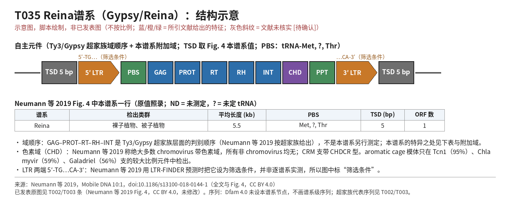

图 T035-1　Reina谱系（Gypsy/Reina）：结构示意。示意图，脚本绘制，非已发表图；每个特征的来源写在图下方。序列：Dfam 4.0 未设本谱系节点，没有谱系级共识序列；超家族代表序列见 T002/T003。


Reina 属于染色质病毒支中结构相对紧凑的谱系，自主型元件全长多在 5 kb 至 6.5 kb 之间，整体尺寸明显短于同支的 Tekay 谱系，单个 LTR 长度一般较短，多集中在 300 bp 至 600 bp 左右（精确跨物种极值统计待确认）。完整拷贝两翼具正向重复 LTR，末端保守为 5'-TG...CA-3'，5' LTR 下游具经典 PBS，3' LTR 上游具 PPT [待确认]。（见本条“本版补充说明”）

#### TSD

整合进入宿主基因组时在元件两侧形成正向靶位点重复，典型长度为 5 bp [待确认]。

#### 编码蛋白与结构域顺序

自主型 Reina 元件编码 `gag` 与 `pol` 蛋白，遵循 Ty3/Gypsy 超家族染色质病毒支的标准结构域排列顺序：**GAG - PROT - RT - RH - INT - CHD**（Neumann 等 2019, doi:10.1186/s13100-018-0144-1）。其整合酶 C 端携带染色质结构域（CHD）（Neumann 等 2019, doi:10.1186/s13100-018-0144-1）。（见本条“本版补充说明”）

#### 转座机制

遵循经典的 LTR 反转录转座子复制粘贴扩增机制：5' LTR 启动子驱动全长 RNA 转录，在胞质病毒样颗粒内借由 PBS 与 PPT 引导反转录合成双链 cDNA，随后由整合酶整合至宿主染色体新位点并伴随产生 5 bp TSD [待确认]。

#### 自主与非自主搭档

完整编码 `gag-pol` 的拷贝为自主型；基因组中同时存在内部缺失的非自主衍生物及两翼 LTR 不等同源重组形成的 solo-LTR（Reina 专属非自主搭档研究待确认）。

#### 识别特征与工具

结构从头识别采用 LTRharvest（Ellinghaus 等 2008, doi:10.1186/1471-2105-9-18）、LTR_FINDER（Xu 和 Wang 2007, doi:10.1093/nar/gkm286）、LTR_retriever（Ou 和 Jiang 2018, doi:10.1104/pp.17.01310）与 EDTA（Ou 等 2019, doi:10.1186/s13059-019-1905-y）。谱系级精准分类采用基于 REXdb 蛋白结构域 HMM 的 TEsorter（Zhang 等 2022, doi:10.1093/hr/uhac017；Neumann 等 2019, doi:10.1186/s13100-018-0144-1）。

#### 分类争议

Reina 在 2019 年 REXdb 系统发育分类中作为种子植物染色质病毒支的独立谱系地位明确，目前无显著合并或拆分争议（Neumann 等 2019, doi:10.1186/s13100-018-0144-1）。

#### 发现与分布

**发现与命名**

- Gorinsek 等 (2004) Evolutionary genomics of chromoviruses in eukaryotes. Molecular Biology and Evolution. doi:10.1093/molbev/msh057。摘要原句：“The diversity, origin, and evolution of chromoviruses in Eukaryota were examined using the massive amount of genome sequence data for different eukaryotic lineages”；涉及生物：eukaryotes (fungi, plants, animals)；支持范围：chromovirus clades CRM, Chlamyvir, Galadriel, Reina, Del (Tekay) [注意：所引句不含该名称，仅支持上位/总体论断]

**植物中的报道**

- Neumann 等 (2019) Systematic survey of plant LTR-retrotransposons elucidates phylogenetic relationships of their polyprotein domains and provides a reference for element classification. Mobile DNA. doi:10.1186/s13100-018-0144-1。正文原句：“Retrofit, Osser and Tork (Table 1 ). Ty3/gypsy elements in plants were found to belong to two major lineages, chromovirus and Tat/Athila, the former composed of the Del, Reina, CRM and Galadriel clades, the latter of the Tat and Athila clades (Table 2 ). Wicker and Keller [ 24 ] examined 599 Ty1/copia elements from barley,…”；涉及生物：Viridiplantae；支持范围：REXdb survey of plant LTR retrotransposon lineages
- Gorinsek 等 (2004) Evolutionary genomics of chromoviruses in eukaryotes. Molecular Biology and Evolution. doi:10.1093/molbev/msh057。同一论文，原句见上；支持范围：chromoviruses across eukaryotes [注意：所引句不含该名称，仅支持上位/总体论断]

**葡萄中的报道**

- Park 等 (2021) Horizontal Transfer of LTR Retrotransposons Contributes to the Genome Diversity of Vitis. International Journal of Molecular Sciences. doi:10.3390/ijms221910446。正文原句：“In the Gypsy superfamily, a total of eight families were identified, but only CRM and Reina contained horizontally transferred elements ( Figure 5 e)”；涉及生物：Vitis；支持范围：horizontal transfer of LTR retrotransposons; Tork, CRM, Reina, Athila, Tat families in four Vitis genomes

#### 本版补充说明

① 域顺序：GAG–PROT–INT–RT–RH（Ty1/Copia）与 GAG–PROT–RT–RH–INT（Ty3/Gypsy）是 Neumann 等 2019（doi:10.1186/s13100-018-0144-1）在超家族层面给出的判别顺序；本条若写某谱系“遵循”该顺序，指的是沿用超家族的顺序，不是该文对本谱系另行测定。

② 末端：5′-TG…CA-3′ 是该文用 LTR-FINDER 预测元件时设定的筛选条件，不是对各谱系的实测统计；本条中“末端保守为 5′-TG…CA-3′”一类说法应按此理解。

③ 该文 Fig. 4 给出本谱系：检出类群 裸子植物、被子植物；平均长度 5.5 kb；PBS Met, ?, Thr；TSD 5 bp；ORF 数 1（ND 为未测定）。正文中标 [待确认] 的“TSD 典型长度 5 bp”与 Fig. 4 一致。

### T036 Ferney谱系（Gypsy/Ferney）

**名称对照**：Wicker 体系：I 类 / LTR 目 / Gypsy（代码 RLG）；Wicker 不分谱系；Dfam 节点：Gypsy-ERV;Gypsy（Dfam 无谱系节点）；REXdb 路径：Class_I/LTR/Ty3/gypsy/chromovirus/Ferney。（来源：代码据 Wu 等 2025, doi:10.3390/biom15030346；Dfam 4.0 分类树，2026-11-23 读取；REXdb v4.0 说明文件，doi:10.5281/zenodo.10160279）

#### 定义与命名

Ferney 是 I 类转座子 LTR 目 Ty3/Gypsy 超家族（RLG）染色质病毒支（chromovirus）下在 REXdb Viridiplantae v4.0 版本中新增的植物谱系，规范命名为 `Ferney`（REXdb v4.0 更新说明及该谱系正式发表出处 DOI 待确认）。在 2019 年发表的 REXdb 原始论文的 Gypsy 谱系名单中尚未收录此名 [待确认]。在 Dfam 现行分类体系中归入 `LTR/Gypsy` 节点之下 [待确认]。

#### 结构、长度与末端


图 T036-1　Ferney谱系（Gypsy/Ferney）：结构示意。示意图，脚本绘制，非已发表图；每个特征的来源写在图下方。序列：Dfam 4.0 未设本谱系节点，没有谱系级共识序列；超家族代表序列见 T002/T003。


作为 Ty3/Gypsy 超家族染色质病毒支成员，自主型 Ferney 元件遵循 5' LTR、内部编码区与 3' LTR 的三段式骨架，两翼 LTR 末端多为 5'-TG...CA-3'，内部两端具 PBS 与 PPT（Ferney 谱系特有的全长范围、单 LTR 长度及 PBS 特征待确认）。（见本条“本版补充说明”）

#### TSD

整合进入宿主染色体时预期形成正向靶位点重复，遵循 Ty3/Gypsy 超家族的典型 5 bp 特征（该谱系实测 TSD 统计待确认）。

#### 编码蛋白与结构域顺序

自主型 Ferney 元件遵循 Ty3/Gypsy 超家族染色质病毒支的 **GAG - PROT - RT - RH - INT - CHD** 结构域排列顺序（其整合酶 C 端染色质结构域具体亚型特征待确认）。（见本条“本版补充说明”）

#### 转座机制

遵循经典的 LTR 反转录转座子复制粘贴扩增机制：由 5' LTR 启动子驱动全长 RNA 转录，在胞质病毒样颗粒内完成双链 cDNA 反转录并由整合酶整合进入宿主染色体新位点（是否存在特殊靶向整合偏好待确认）。

#### 自主与非自主搭档

完整携带 `gag-pol` 的拷贝为自主型；基因组中可能伴生内部缺失的非自主衍生物及 solo-LTR（具体搭档关系待确认）。

#### 识别特征与工具

结构从头识别采用 LTRharvest（Ellinghaus 等 2008, doi:10.1186/1471-2105-9-18）、LTR_FINDER（Xu 和 Wang 2007, doi:10.1093/nar/gkm286）、LTR_retriever（Ou 和 Jiang 2018, doi:10.1104/pp.17.01310）与 EDTA（Ou 等 2019, doi:10.1186/s13059-019-1905-y）。谱系级鉴定必须使用已更新至 REXdb Viridiplantae v4.0 数据库的 TEsorter 或相应蛋白结构域 HMM 模型，旧版数据库无法检出该谱系标签（Zhang 等 2022, doi:10.1093/hr/uhac017；v4.0 数据库版本细节待确认）。

#### 分类争议

由于 Ferney 未出现在 2019 年 REXdb 原始论文的谱系名单中，不同版本数据库（v3.0 与 v4.0）的注释结果在跨项目比较时会出现标签不一致 [待确认]；在正式引用该谱系名时，需核对并注明其首次发表文献出处与 REXdb 版本号（待确认）。

#### 发现与分布

**发现与命名**

- (2023) REXdb Viridiplantae database v4.0 (README and classification tree). Zenodo. doi:10.5281/zenodo.10160279。REXdb 分类树原句：“--Ferney  * (REXdb Viridiplantae v4.0 README classification tree; asterisk marks new lineage)”；支持范围：REXdb Viridiplantae v4.0 adds these lineages

**植物中的报道**

- 未检索到已核实的植物报道 [待确认]。

**葡萄中的报道**

- 未检索到葡萄专门报道（检索方式见文末「证据与检索方法」）。这只说明检索没有找到，不能据此推断葡萄基因组中不存在。


#### 本版补充说明

① 域顺序：GAG–PROT–INT–RT–RH（Ty1/Copia）与 GAG–PROT–RT–RH–INT（Ty3/Gypsy）是 Neumann 等 2019（doi:10.1186/s13100-018-0144-1）在超家族层面给出的判别顺序；本条若写某谱系“遵循”该顺序，指的是沿用超家族的顺序，不是该文对本谱系另行测定。

② 末端：5′-TG…CA-3′ 是该文用 LTR-FINDER 预测元件时设定的筛选条件，不是对各谱系的实测统计；本条中“末端保守为 5′-TG…CA-3′”一类说法应按此理解。

③ 该文 Fig. 4 没有本谱系（本谱系见于 REXdb v4.0），长度、PBS、TSD 仍为 [待确认]。

## 第五部分　Gypsy 超家族：苔藓/石松特有谱系与 OTA 分支

### T037 Phygy谱系（Gypsy/Phygy）

**名称对照**：Wicker 体系：I 类 / LTR 目 / Gypsy（代码 RLG）；Wicker 不分谱系；Dfam 节点：Gypsy-ERV;Gypsy（Dfam 无谱系节点）；REXdb 路径：Class_I/LTR/Ty3/gypsy/non-chromovirus/Phygy。（来源：代码据 Wu 等 2025, doi:10.3390/biom15030346；Dfam 4.0 分类树，2026-11-23 读取；REXdb v4.0 说明文件，doi:10.5281/zenodo.10160279）

#### 定义与命名

Phygy 是 I 类转座子 LTR 目 Ty3/Gypsy 超家族（RLG）非染色质病毒支（non-chromovirus）下的独立植物谱系，在 2019 年基于反转录转座子蛋白结构域建立的 REXdb 绿色植物系统分类框架中正式确立，规范命名为 `Phygy`（Neumann 等 2019, doi:10.1186/s13100-018-0144-1）。该名称源于其主要宿主苔藓植物小立碗藓（*Physcomitrella*）与 Gypsy 超家族的组合（Neumann 等 2019, doi:10.1186/s13100-018-0144-1）。在 Dfam 现行分类体系中，该类群归入 `LTR/Gypsy` 节点之下 [待确认]。

#### 结构、长度与末端


图 T037-1　Phygy谱系（Gypsy/Phygy）：结构示意。示意图，脚本绘制，非已发表图；每个特征的来源写在图下方。序列：Dfam 4.0 未设本谱系节点，没有谱系级共识序列；超家族代表序列见 T002/T003。


Phygy 属于 Ty3/Gypsy 超家族中尺寸较短的谱系，自主型元件结构紧凑，全长明显短于种子植物中的 Athila、Ogre 等大型非染色质病毒元件（Neumann 等 2019, doi:10.1186/s13100-018-0144-1；精确跨物种全长与单 LTR 长度极值统计待确认）。完整拷贝由 5' LTR、内部编码区与 3' LTR 构成，两翼 LTR 末端多保留保守的 5'-TG...CA-3' 反向重复二核苷酸，内部两端具引物结合位点（PBS）与多聚嘌呤区（PPT） [待确认]。（见本条“本版补充说明”）

#### TSD

整合进入宿主基因组时在元件两侧形成正向靶位点重复，遵循 Ty3/Gypsy 超家族的典型 5 bp 特征（该谱系实测变异范围待确认）。

#### 编码蛋白与结构域顺序

自主型 Phygy 元件编码 `gag` 与 `pol` 蛋白，遵循 Ty3/Gypsy 超家族非染色质病毒支的标准结构域排列顺序：**GAG - PROT - RT - RH - INT**（Neumann 等 2019, doi:10.1186/s13100-018-0144-1）。其整合酶（INT）C 端不携带染色质结构域（CHD），且不含 `env` 样开放阅读框（Neumann 等 2019, doi:10.1186/s13100-018-0144-1）。（见本条“本版补充说明”）

#### 转座机制

遵循经典的 LTR 反转录转座子复制粘贴扩增机制：由宿主 RNA 聚合酶 II 从 5' LTR 启动子转录全长 RNA，在胞质病毒样颗粒内借由 PBS 与 PPT 引导反转录合成双链 cDNA，随后由整合酶整合进入宿主染色体新位点并伴随产生 TSD [待确认]。

#### 自主与非自主搭档

完整编码 `gag-pol` 的拷贝为自主型；基因组中可伴生内部编码区缺失的非自主衍生物及两翼 LTR 不等同源重组形成的 solo-LTR（Phygy 专属非自主搭档研究待确认）。

#### 识别特征与工具

结构从头识别采用 LTRharvest（Ellinghaus 等 2008, doi:10.1186/1471-2105-9-18）、LTR_FINDER（Xu 和 Wang 2007, doi:10.1093/nar/gkm286）、LTR_retriever（Ou 和 Jiang 2018, doi:10.1104/pp.17.01310）与 EDTA（Ou 等 2019, doi:10.1186/s13059-019-1905-y）。谱系级精准鉴定采用基于 REXdb 蛋白结构域 HMM 的 TEsorter（Zhang 等 2022, doi:10.1093/hr/uhac017；Neumann 等 2019, doi:10.1186/s13100-018-0144-1）。

#### 分类争议

Phygy 在 2019 年 REXdb 系统发育分类中作为苔藓特异的非染色质病毒支独立谱系确立，目前无显著合并或拆分争议（Neumann 等 2019, doi:10.1186/s13100-018-0144-1）。

#### 发现与分布

**发现与命名**

- Neumann 等 (2019) Systematic survey of plant LTR-retrotransposons elucidates phylogenetic relationships of their polyprotein domains and provides a reference for element classification. Mobile DNA. doi:10.1186/s13100-018-0144-1。正文原句：“…and TatV [ 34 ] non-chromovirus|OTA|Tat|Retand Athila/Tat|Tat (Cinful-1, Tat4–1, RIRE2, RetroSor1) Metavirus (Tat4) Retand [ 65 ]; TatVI [ 34 ] non-chromovirus|Phygy – – – non-chromovirus|Selgy – – – a Tcn1 clade belongs to Tf1/Sushi group of retrotransposons which occur in fungi and vertebrate species We have attempted to…”；涉及生物：Viridiplantae；支持范围：Phygy and Selgy listed in REXdb Table 2 with no earlier name

**植物中的报道**

- Neumann 等 (2019) Systematic survey of plant LTR-retrotransposons elucidates phylogenetic relationships of their polyprotein domains and provides a reference for element classification. Mobile DNA. doi:10.1186/s13100-018-0144-1。同一论文，原句见上；支持范围：REXdb survey of plant LTR retrotransposon lineages

**葡萄中的报道**

- 未检索到葡萄专门报道（检索方式见文末「证据与检索方法」）。这只说明检索没有找到，不能据此推断葡萄基因组中不存在。

#### 本版补充说明

① 域顺序：GAG–PROT–INT–RT–RH（Ty1/Copia）与 GAG–PROT–RT–RH–INT（Ty3/Gypsy）是 Neumann 等 2019（doi:10.1186/s13100-018-0144-1）在超家族层面给出的判别顺序；本条若写某谱系“遵循”该顺序，指的是沿用超家族的顺序，不是该文对本谱系另行测定。

② 末端：5′-TG…CA-3′ 是该文用 LTR-FINDER 预测元件时设定的筛选条件，不是对各谱系的实测统计；本条中“末端保守为 5′-TG…CA-3′”一类说法应按此理解。

③ 该文 Fig. 4 给出本谱系：检出类群 苔藓；平均长度 8.6 kb；PBS Trp, Thr, ?；TSD 4 bp；ORF 数 ND（ND 为未测定）。本谱系 TSD 不是单一的 5 bp，正文“典型长度为 5 bp”一类写法以 Fig. 4 为准。

### T038 Selgy谱系（Gypsy/Selgy）

**名称对照**：Wicker 体系：I 类 / LTR 目 / Gypsy（代码 RLG）；Wicker 不分谱系；Dfam 节点：Gypsy-ERV;Gypsy（Dfam 无谱系节点）；REXdb 路径：Class_I/LTR/Ty3/gypsy/non-chromovirus/Selgy。（来源：代码据 Wu 等 2025, doi:10.3390/biom15030346；Dfam 4.0 分类树，2026-11-23 读取；REXdb v4.0 说明文件，doi:10.5281/zenodo.10160279）

#### 定义与命名

Selgy 是 I 类转座子 LTR 目 Ty3/Gypsy 超家族（RLG）非染色质病毒支（non-chromovirus）下的独立植物谱系，在 2019 年基于反转录转座子蛋白结构域建立的 REXdb 绿色植物系统分类框架中正式确立，规范命名为 `Selgy`（Neumann 等 2019, doi:10.1186/s13100-018-0144-1）。该名称源于其主要宿主石松类卷柏（*Selaginella*）与 Gypsy 超家族的组合（Neumann 等 2019, doi:10.1186/s13100-018-0144-1）。在 Dfam 现行分类体系中归入 `LTR/Gypsy` 节点之下 [待确认]。

#### 结构、长度与末端

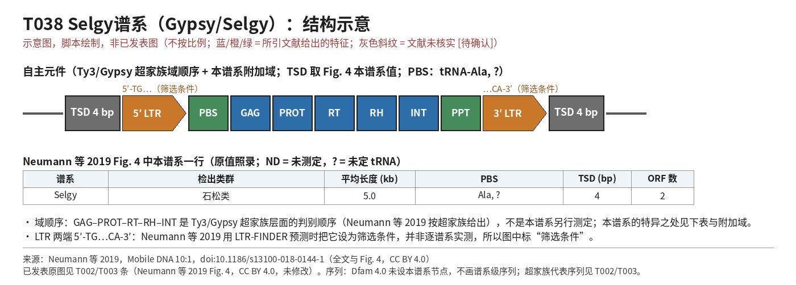

图 T038-1　Selgy谱系（Gypsy/Selgy）：结构示意。示意图，脚本绘制，非已发表图；每个特征的来源写在图下方。序列：Dfam 4.0 未设本谱系节点，没有谱系级共识序列；超家族代表序列见 T002/T003。


Selgy 与 Phygy 类似，属于 Ty3/Gypsy 超家族中整体尺寸较短的紧凑型谱系（Neumann 等 2019, doi:10.1186/s13100-018-0144-1；精确跨物种全长与单 LTR 长度统计待确认）。完整拷贝由 5' LTR、内部编码区与 3' LTR 构成，两翼 LTR 末端多保留保守的 5'-TG...CA-3' 反向重复二核苷酸，内部两端具备 PBS 与 PPT [待确认]。（见本条“本版补充说明”）

#### TSD

整合进入宿主染色体时在元件两侧形成正向靶位点重复，遵循 Ty3/Gypsy 超家族的典型 5 bp 特征（具体变异情况待确认）。

#### 编码蛋白与结构域顺序

自主型 Selgy 元件编码 `gag` 与 `pol` 蛋白，遵循 Ty3/Gypsy 超家族非染色质病毒支的标准结构域排列顺序：**GAG - PROT - RT - RH - INT**（Neumann 等 2019, doi:10.1186/s13100-018-0144-1）。其整合酶 C 端不携带染色质结构域，亦不含 `env` 样开放阅读框（Neumann 等 2019, doi:10.1186/s13100-018-0144-1）。（见本条“本版补充说明”）

#### 转座机制

遵循经典的 LTR 反转录转座子复制粘贴扩增机制：5' LTR 启动子驱动全长 RNA 转录，在胞质病毒样颗粒内借由 PBS 与 PPT 引导反转录合成双链 cDNA，随后由整合酶整合进入宿主染色体新位点并伴随产生 TSD [待确认]。

#### 自主与非自主搭档

完整编码 `gag-pol` 的拷贝为自主型；基因组中可伴生内部编码区缺失的非自主衍生物及两翼 LTR 不等同源重组形成的 solo-LTR（Selgy 专属非自主搭档研究待确认）。

#### 识别特征与工具

结构从头识别采用 LTRharvest（Ellinghaus 等 2008, doi:10.1186/1471-2105-9-18）、LTR_FINDER（Xu 和 Wang 2007, doi:10.1093/nar/gkm286）、LTR_retriever（Ou 和 Jiang 2018, doi:10.1104/pp.17.01310）与 EDTA（Ou 等 2019, doi:10.1186/s13059-019-1905-y）。谱系级精准鉴定采用基于 REXdb 蛋白结构域 HMM 的 TEsorter（Zhang 等 2022, doi:10.1093/hr/uhac017；Neumann 等 2019, doi:10.1186/s13100-018-0144-1）。

#### 分类争议

Selgy 在 2019 年 REXdb 系统发育分类中作为石松类特异的非染色质病毒支独立谱系确立，目前无显著合并或拆分争议（Neumann 等 2019, doi:10.1186/s13100-018-0144-1）。

#### 发现与分布

**发现与命名**

- Neumann 等 (2019) Systematic survey of plant LTR-retrotransposons elucidates phylogenetic relationships of their polyprotein domains and provides a reference for element classification. Mobile DNA. doi:10.1186/s13100-018-0144-1。正文原句：“…Athila/Tat|Tat (Cinful-1, Tat4–1, RIRE2, RetroSor1) Metavirus (Tat4) Retand [ 65 ]; TatVI [ 34 ] non-chromovirus|Phygy – – – non-chromovirus|Selgy – – – a Tcn1 clade belongs to Tf1/Sushi group of retrotransposons which occur in fungi and vertebrate species We have attempted to overcome the limitations of previous studies by…”；涉及生物：Viridiplantae；支持范围：Phygy and Selgy listed in REXdb Table 2 with no earlier name

**植物中的报道**

- Neumann 等 (2019) Systematic survey of plant LTR-retrotransposons elucidates phylogenetic relationships of their polyprotein domains and provides a reference for element classification. Mobile DNA. doi:10.1186/s13100-018-0144-1。同一论文，原句见上；支持范围：REXdb survey of plant LTR retrotransposon lineages

**葡萄中的报道**

- 未检索到葡萄专门报道（检索方式见文末「证据与检索方法」）。这只说明检索没有找到，不能据此推断葡萄基因组中不存在。

#### 本版补充说明

① 域顺序：GAG–PROT–INT–RT–RH（Ty1/Copia）与 GAG–PROT–RT–RH–INT（Ty3/Gypsy）是 Neumann 等 2019（doi:10.1186/s13100-018-0144-1）在超家族层面给出的判别顺序；本条若写某谱系“遵循”该顺序，指的是沿用超家族的顺序，不是该文对本谱系另行测定。

② 末端：5′-TG…CA-3′ 是该文用 LTR-FINDER 预测元件时设定的筛选条件，不是对各谱系的实测统计；本条中“末端保守为 5′-TG…CA-3′”一类说法应按此理解。

③ 该文 Fig. 4 给出本谱系：检出类群 石松类；平均长度 5.0 kb；PBS Ala, ?；TSD 4 bp；ORF 数 2（ND 为未测定）。本谱系 TSD 不是单一的 5 bp，正文“典型长度为 5 bp”一类写法以 Fig. 4 为准。

### T039 Athila谱系（Gypsy/Athila）

**名称对照**：Wicker 体系：I 类 / LTR 目 / Gypsy（代码 RLG）；Wicker 不分谱系；Dfam 节点：Gypsy-ERV;Gypsy（Dfam 无谱系节点）；REXdb 路径：Class_I/LTR/Ty3/gypsy/non-chromovirus/OTA/Athila。（来源：代码据 Wu 等 2025, doi:10.3390/biom15030346；Dfam 4.0 分类树，2026-11-23 读取；REXdb v4.0 说明文件，doi:10.5281/zenodo.10160279）

#### 定义与命名

Athila 是 I 类转座子 LTR 目 Ty3/Gypsy 超家族（RLG）非染色质病毒支 OTA 超级支（Ogre/Tat/Athila）下的核心植物谱系，在 2019 年 REXdb 绿色植物系统分类框架中完整路径记作 `Gypsy/non-chromovirus/OTA/Athila`（Neumann 等 2019, doi:10.1186/s13100-018-0144-1）。在 Dfam 现行分类体系中归入 `LTR/Gypsy` 节点之下 [待确认]。

#### 结构、长度与末端

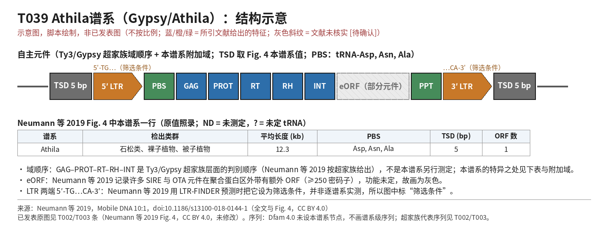

图 T039-1　Athila谱系（Gypsy/Athila）：结构示意。示意图，脚本绘制，非已发表图；每个特征的来源写在图下方。序列：Dfam 4.0 未设本谱系节点，没有谱系级共识序列；超家族代表序列见 T002/T003。


Athila 属于尺寸较大的植物 Gypsy 谱系，自主型元件全长通常在 10 kb 至 14 kb 之间，单个 LTR 长度多在 1 kb 至 2 kb 左右 [待确认]。其显著结构特征是内部区域常包含大段非编码序列，使得整体长度显著大于普通染色质病毒支元件（Neumann 等 2019, doi:10.1186/s13100-018-0144-1）。完整拷贝两翼 LTR 末端保守为 5'-TG...CA-3'，5' LTR 下游具经典 PBS，3' LTR 上游具 PPT [待确认]。（见本条“本版补充说明”）

#### TSD

整合进入宿主基因组时在元件两侧形成正向靶位点重复，典型长度为 5 bp [待确认]。

#### 编码蛋白与结构域顺序

自主型 Athila 元件编码 `gag` 与 `pol` 蛋白，遵循 Ty3/Gypsy 超家族的 **GAG - PROT - RT - RH - INT** 结构域排列顺序，不携带整合酶 C 端的染色质结构域（Neumann 等 2019, doi:10.1186/s13100-018-0144-1）。与同属 OTA 超级支的 Tat 支不同，Athila 携带常规真核型 RNase H（而非 Tat 支特有的古菌型 aRH）（Neumann 等 2019, doi:10.1186/s13100-018-0144-1）。此外，Athila 在 `pol` 下游常携带一个额外的 `env` 样开放阅读框（eORF），该 eORF 与脊椎动物逆转录病毒的包膜蛋白并无直接同源关系（Neumann 等 2019, doi:10.1186/s13100-018-0144-1）。（见本条“本版补充说明”）

#### 转座机制

遵循经典的 LTR 反转录转座子复制粘贴扩增机制：由宿主 RNA 聚合酶 II 从 5' LTR 启动子转录全长 RNA，经胞质病毒样颗粒内以 PBS 和 PPT 为引物完成双链 cDNA 合成后，由整合酶整合进入宿主染色体新位点并伴随产生 5 bp TSD [待确认]。尽管携带 `env` 样开放阅读框，目前并无证据表明 Athila 能够形成具有细胞间感染能力的游离逆转录病毒颗粒（Neumann 等 2019, doi:10.1186/s13100-018-0144-1）。

#### 自主与非自主搭档

完整编码 `gag-pol` 的拷贝为自主型；由于 Athila 拷贝数高、全长及 LTR 较长，宿主基因组中普遍存在大量内部缺失的非自主衍生物、嵌套插入体以及两翼 LTR 不等同源重组形成的 solo-LTR [待确认]。

#### 识别特征与工具

结构从头识别采用 LTRharvest（Ellinghaus 等 2008, doi:10.1186/1471-2105-9-18）、LTR_FINDER（Xu 和 Wang 2007, doi:10.1093/nar/gkm286）、LTR_retriever（Ou 和 Jiang 2018, doi:10.1104/pp.17.01310）与 EDTA（Ou 等 2019, doi:10.1186/s13059-019-1905-y）。谱系级精准分类采用基于 REXdb 蛋白结构域 HMM 的 TEsorter，可有效将其与 Tat 支及脊椎动物 ERV 区分（Zhang 等 2022, doi:10.1093/hr/uhac017；Neumann 等 2019, doi:10.1186/s13100-018-0144-1）。

#### 分类争议

早期文献因 Athila 携带 `env` 样开放阅读框，偶将其视作「植物内源性逆转录病毒（plant ERV）」；2019 年 REXdb 系统发育分类明确否定该混用，确认其隶属 Ty3/Gypsy 超家族 OTA 超级支，绝不可与脊椎动物 ERV 混淆（Neumann 等 2019, doi:10.1186/s13100-018-0144-1）。

#### 发现与分布

**发现与命名**

- Pélissier 等 (1995) Athila, a new retroelement from Arabidopsis thaliana. Plant Molecular Biology. doi:10.1007/bf00020976。摘要原句：“An analysis of Arabidopsis thaliana heterochromatic regions allowed the identification of a new family of retroelements called Athila”；涉及生物：Arabidopsis thaliana；支持范围：Athila first described
- Wright 和 Voytas (2002) Athila4 of Arabidopsis and Calypso of soybean define a lineage of endogenous plant retroviruses. Genome Research. doi:10.1101/gr.196001。摘要原句：“The Athila retroelements of Arabidopsis thaliana encode a putative envelope gene, suggesting that they are infectious retroviruses”；涉及生物：Arabidopsis thaliana and soybean；支持范围：Athila4 and Calypso define an endogenous plant retrovirus lineage

**植物中的报道**

- Neumann 等 (2019) Systematic survey of plant LTR-retrotransposons elucidates phylogenetic relationships of their polyprotein domains and provides a reference for element classification. Mobile DNA. doi:10.1186/s13100-018-0144-1。正文原句：“…elements, referred to as Oryco, Sire, Retrofit, Osser and Tork (Table 1 ). Ty3/gypsy elements in plants were found to belong to two major lineages, chromovirus and Tat/Athila, the former composed of the Del, Reina, CRM and Galadriel clades, the latter of the Tat and Athila clades (Table 2 ). Wicker and Keller [ 24 ] examined…”；涉及生物：Viridiplantae；支持范围：REXdb survey of plant LTR retrotransposon lineages
- Pélissier 等 (1995) Athila, a new retroelement from Arabidopsis thaliana. Plant Molecular Biology. doi:10.1007/bf00020976。同一论文，原句见上；支持范围：Athila
- Wright 和 Voytas (2002) Athila4 of Arabidopsis and Calypso of soybean define a lineage of endogenous plant retroviruses. Genome Research. doi:10.1101/gr.196001。同一论文，原句见上；支持范围：Athila4, Calypso

**葡萄中的报道**

- Park 等 (2021) Horizontal Transfer of LTR Retrotransposons Contributes to the Genome Diversity of Vitis. International Journal of Molecular Sciences. doi:10.3390/ijms221910446。正文原句：“In our analysis, the major difference in LTR retrotransposon content in the Vitis genomes appeared in the native LTR retrotransposon families, such as Tork , Athila , and Tat ( Figure 5 d,e and Figure 6 , and Supplementary Figure S7 )”；涉及生物：Vitis；支持范围：horizontal transfer of LTR retrotransposons; Tork, CRM, Reina, Athila, Tat families in four Vitis genomes
- Velasco 等 (2007) A high quality draft consensus sequence of the genome of a heterozygous grapevine variety. PLoS ONE. doi:10.1371/journal.pone.0001326。正文原句：“The repeats were included in group I (retrotransposons: Copia, Gypsy, LINE) and group II (DNA transposons: Mutator, CACTA, hAT) according to Feschotte et al. [75] . The most abundant TEs were Gypsy/athila-like elements followed by Copia…”；涉及生物：Vitis vinifera；支持范围：Gypsy/athila-like elements most abundant

#### 本版补充说明

① 域顺序：GAG–PROT–INT–RT–RH（Ty1/Copia）与 GAG–PROT–RT–RH–INT（Ty3/Gypsy）是 Neumann 等 2019（doi:10.1186/s13100-018-0144-1）在超家族层面给出的判别顺序；本条若写某谱系“遵循”该顺序，指的是沿用超家族的顺序，不是该文对本谱系另行测定。

② 末端：5′-TG…CA-3′ 是该文用 LTR-FINDER 预测元件时设定的筛选条件，不是对各谱系的实测统计；本条中“末端保守为 5′-TG…CA-3′”一类说法应按此理解。

③ 该文 Fig. 4 给出本谱系：检出类群 石松类、裸子植物、被子植物；平均长度 12.3 kb；PBS Asp, Asn, Ala；TSD 5 bp；ORF 数 1（ND 为未测定）。正文中标 [待确认] 的“TSD 典型长度 5 bp”与 Fig. 4 一致。

### T040 Tatius谱系（Gypsy/Tatius）

**名称对照**：Wicker 体系：I 类 / LTR 目 / Gypsy（代码 RLG）；Wicker 不分谱系；Dfam 节点：Gypsy-ERV;Gypsy（Dfam 无谱系节点）；REXdb 路径：Class_I/LTR/Ty3/gypsy/non-chromovirus/OTA/Tatius。（来源：代码据 Wu 等 2025, doi:10.3390/biom15030346；Dfam 4.0 分类树，2026-11-23 读取；REXdb v4.0 说明文件，doi:10.5281/zenodo.10160279）

#### 定义与命名

Tatius 是 I 类转座子 LTR 目 Ty3/Gypsy 超家族（RLG）非染色质病毒支 OTA 超级支下在 REXdb Viridiplantae v4.0 版本中新增的植物谱系，完整路径记作 `Gypsy/OTA/Tatius`（REXdb v4.0 更新说明及该谱系正式发表出处 DOI 待确认）。在 2019 年发表的 REXdb 原始论文的 OTA 谱系名单中尚未收录此名 [待确认]。在 Dfam 现行分类体系中归入 `LTR/Gypsy` 节点之下 [待确认]。

#### 结构、长度与末端

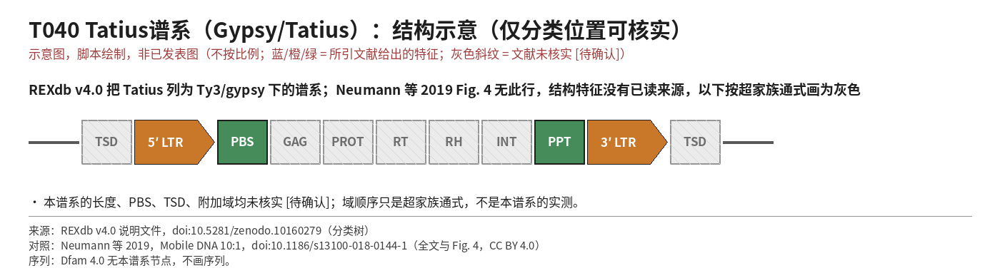

图 T040-1　Tatius谱系（Gypsy/Tatius）：结构示意。示意图，脚本绘制，非已发表图；每个特征的来源写在图下方。序列：Dfam 4.0 未设本谱系节点，没有谱系级共识序列；超家族代表序列见 T002/T003。


作为 Ty3/Gypsy 超家族 OTA 超级支成员，自主型 Tatius 元件遵循 5' LTR、内部编码区与 3' LTR 的三段式骨架，两翼 LTR 末端多为 5'-TG...CA-3'，内部两端具 PBS 与 PPT（Tatius 谱系特有的全长范围、单 LTR 长度及非编码区特征待确认）。（见本条“本版补充说明”）

#### TSD

整合进入宿主染色体时预期形成正向靶位点重复，遵循 Ty3/Gypsy 超家族的典型 5 bp 特征（该谱系实测 TSD 统计待确认）。

#### 编码蛋白与结构域顺序

自主型 Tatius 元件遵循 Ty3/Gypsy 超家族非染色质病毒支的 **GAG - PROT - RT - RH - INT** 结构域排列顺序（其 RNase H 类型是否为古菌型 aRH 以及是否携带 eORF 尚待核对原始发表文献，待确认）。（见本条“本版补充说明”）

#### 转座机制

遵循经典的 LTR 反转录转座子复制粘贴扩增机制：5' LTR 启动子驱动全长 RNA 转录，在胞质病毒样颗粒内完成双链 cDNA 反转录并由整合酶整合进入宿主染色体新位点 [待确认]。

#### 自主与非自主搭档

完整编码 `gag-pol` 的拷贝为自主型；基因组中可能伴生内部缺失的非自主衍生物及 solo-LTR（具体搭档关系待确认）。

#### 识别特征与工具

结构从头识别采用 LTRharvest（Ellinghaus 等 2008, doi:10.1186/1471-2105-9-18）、LTR_FINDER（Xu 和 Wang 2007, doi:10.1093/nar/gkm286）、LTR_retriever（Ou 和 Jiang 2018, doi:10.1104/pp.17.01310）与 EDTA（Ou 等 2019, doi:10.1186/s13059-019-1905-y）。谱系级鉴定必须使用已更新至 REXdb Viridiplantae v4.0 数据库的 TEsorter 或相应蛋白结构域 HMM 模型，旧版 v3.0 数据库无法检出该谱系标签（Zhang 等 2022, doi:10.1093/hr/uhac017；v4.0 数据库版本细节待确认）。

#### 分类争议

由于 Tatius 未出现在 2019 年 REXdb 原始论文的 OTA 谱系名单中，不同版本数据库（v3.0 与 v4.0）的注释结果在跨项目比较时会出现标签不一致 [待确认]；在正式引用该谱系名时，需核对并注明其首次发表文献出处与 REXdb 版本号（待确认）。

#### 发现与分布

**发现与命名**

- (2023) REXdb Viridiplantae database v4.0 (README and classification tree). Zenodo. doi:10.5281/zenodo.10160279。REXdb 分类树原句：“--Tatius  * (REXdb Viridiplantae v4.0 README classification tree; asterisk marks new lineage)”；支持范围：REXdb Viridiplantae v4.0 adds these lineages

**植物中的报道**

- 未检索到已核实的植物报道 [待确认]。

**葡萄中的报道**

- 未检索到葡萄专门报道（检索方式见文末「证据与检索方法」）。这只说明检索没有找到，不能据此推断葡萄基因组中不存在。

#### 本版补充说明

① 域顺序：GAG–PROT–INT–RT–RH（Ty1/Copia）与 GAG–PROT–RT–RH–INT（Ty3/Gypsy）是 Neumann 等 2019（doi:10.1186/s13100-018-0144-1）在超家族层面给出的判别顺序；本条若写某谱系“遵循”该顺序，指的是沿用超家族的顺序，不是该文对本谱系另行测定。

② 末端：5′-TG…CA-3′ 是该文用 LTR-FINDER 预测元件时设定的筛选条件，不是对各谱系的实测统计；本条中“末端保守为 5′-TG…CA-3′”一类说法应按此理解。

③ 该文 Fig. 4 没有本谱系（本谱系见于 REXdb v4.0），长度、PBS、TSD 仍为 [待确认]。

### T041 TatI亚谱系（Gypsy/TatI）

**名称对照**：Wicker 体系：I 类 / LTR 目 / Gypsy（代码 RLG）；Wicker 不分谱系；Dfam 节点：Gypsy-ERV;Gypsy（Dfam 无谱系节点）；REXdb 路径：Class_I/LTR/Ty3/gypsy/non-chromovirus/OTA/Tat/TatI。（来源：代码据 Wu 等 2025, doi:10.3390/biom15030346；Dfam 4.0 分类树，2026-11-23 读取；REXdb v4.0 说明文件，doi:10.5281/zenodo.10160279）

#### 定义与命名

TatI 是 I 类转座子 LTR 目 Ty3/Gypsy 超家族（RLG）非染色质病毒支 OTA 超级支 Tat 分支下的独立亚谱系，在 2019 年 REXdb 绿色植物系统分类框架中正式确立，完整路径记作 `Gypsy/non-chromovirus/OTA/Tat/TatI`（Neumann 等 2019, doi:10.1186/s13100-018-0144-1）。2019 年研究依据系统发育关系并结合引物结合位点（PBS）、靶位点重复（TSD）及附加开放阅读框（eORF）等结构特征，将 Tat 分支细分为 TatI、TatII、TatIII、Ogre 与 Retand 五个亚谱系（Neumann 等 2019, doi:10.1186/s13100-018-0144-1）。在 Dfam 现行分类体系中归入 `LTR/Gypsy` 节点之下 [待确认]。

#### 结构、长度与末端

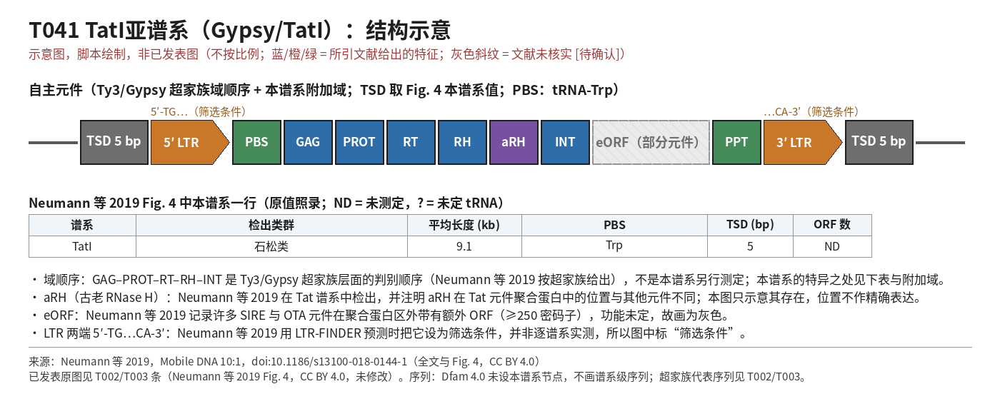

图 T041-1　TatI亚谱系（Gypsy/TatI）：结构示意。示意图，脚本绘制，非已发表图；每个特征的来源写在图下方。序列：Dfam 4.0 未设本谱系节点，没有谱系级共识序列；超家族代表序列见 T002/T003。


自主型 TatI 元件由 5' LTR、内部编码区与 3' LTR 构成，两翼 LTR 末端多保留保守的 5'-TG...CA-3' 反向重复二核苷酸，内部两端具备 PBS 与 PPT（TatI 精确全长与单 LTR 长度范围及特有 PBS 类型统计待确认）。（见本条“本版补充说明”）

#### TSD

整合进入宿主染色体时在元件两侧形成正向靶位点重复，典型长度为 5 bp（TatI 亚谱系是否存在特征性 TSD 长度变异待确认）。

#### 编码蛋白与结构域顺序

自主型 TatI 元件遵循 Ty3/Gypsy 超家族 Tat 分支的特征性结构域排列顺序：**GAG - PROT - RT - RH - aRH - INT**（或以古菌型核糖核酸酶 H **aRH** 取代/伴随经典 RH，具体位置与结构域组织以 2019 年 REXdb 界定为准），不含整合酶 C 端染色质结构域（Neumann 等 2019, doi:10.1186/s13100-018-0144-1）。携带古菌型 RNase H（archaeal RNase H，aRH）是整个 Tat 分支区别于 Athila 及其他 Gypsy 谱系的最核心分子标志（Neumann 等 2019, doi:10.1186/s13100-018-0144-1）。（见本条“本版补充说明”）

#### 转座机制

遵循经典的 LTR 反转录转座子复制粘贴扩增机制：5' LTR 启动子驱动全长 RNA 转录，在胞质病毒样颗粒内借由 PBS 与 PPT 引导反转录合成双链 cDNA，随后由整合酶整合进入宿主染色体新位点并伴随产生 TSD [待确认]。

#### 自主与非自主搭档

完整编码 `gag-pol`（含 aRH）的拷贝为自主型；基因组中可伴生内部缺失的非自主衍生物及两翼 LTR 不等同源重组形成的 solo-LTR（TatI 专属非自主搭档研究待确认）。

#### 识别特征与工具

结构从头识别采用 LTRharvest（Ellinghaus 等 2008, doi:10.1186/1471-2105-9-18）、LTR_FINDER（Xu 和 Wang 2007, doi:10.1093/nar/gkm286）、LTR_retriever（Ou 和 Jiang 2018, doi:10.1104/pp.17.01310）与 EDTA（Ou 等 2019, doi:10.1186/s13059-019-1905-y）。将其与 TatII、TatIII、Ogre、Retand 精准区分，需依赖基于 REXdb 蛋白结构域 HMM（含 aRH 模型）的 TEsorter（Zhang 等 2022, doi:10.1093/hr/uhac017；Neumann 等 2019, doi:10.1186/s13100-018-0144-1）。

#### 分类争议

在 2019 年 REXdb 细化之前，TatI、TatII、TatIII 常被笼统合并为单一的 Tat 谱系；2019 年研究基于多结构域系统发育与 PBS/TSD/eORF 特征将其正式拆分为独立亚谱系（Neumann 等 2019, doi:10.1186/s13100-018-0144-1）。

#### 发现与分布

**发现与命名**

- Wright 和 Voytas (1998) Potential retroviruses in plants: Tat1 is related to a group of Arabidopsis thaliana Ty3/gypsy retrotransposons that encode envelope-like proteins. Genetics. doi:10.1093/genetics/149.2.703。摘要原句：“Tat1 was originally identified as an insertion near the Arabidopsis thaliana SAM1 gene”；涉及生物：Arabidopsis thaliana；支持范围：Tat1 related to Arabidopsis Ty3/gypsy elements encoding envelope-like proteins [注意：所引句不含该名称，仅支持上位/总体论断]
- Ustyantsev 等 (2015) Convergent evolution of ribonuclease h in LTR retrotransposons and retroviruses. Molecular Biology and Evolution. doi:10.1093/molbev/msv008。摘要原句：“Two notable structural differences between these groups of genetic elements are 1) the presence in retroviruses of an additional envelope gene, env, which mediates infection, and 2) a specific dual ribonuclease H (RNH) domain encoded by the retroviral pol gene”；涉及生物：LTR retrotransposons and retroviruses；支持范围：TatI-VI naming (cited in REXdb Table 2) [注意：所引句不含该名称，仅支持上位/总体论断]

**植物中的报道**

- Neumann 等 (2019) Systematic survey of plant LTR-retrotransposons elucidates phylogenetic relationships of their polyprotein domains and provides a reference for element classification. Mobile DNA. doi:10.1186/s13100-018-0144-1。正文原句：“…(Del1) Tekay [ 27 ] non-chromovirus|OTA|Athila Athila/Tat|Athila (Athila4–1, Diaspora, Bagy-2, Cyclops-2) Metavirus (Athila) Athila [ 32 ] non-chromovirus|OTA|Tat|TatI – – TatI [ 34 ] non-chromovirus|OTA|Tat|TatII – – TatII [ 34 ] non-chromovirus|OTA|Tat|TatIII – – TatIII [ 34 ] non-chromovirus|OTA|Tat|Ogre Athila/Tat|Tat…”；涉及生物：Viridiplantae；支持范围：REXdb survey of plant LTR retrotransposon lineages
- Wright 和 Voytas (1998) Potential retroviruses in plants: Tat1 is related to a group of Arabidopsis thaliana Ty3/gypsy retrotransposons that encode envelope-like proteins. Genetics. doi:10.1093/genetics/149.2.703。同一论文，原句见上；支持范围：Tat1 [注意：所引句不含该名称，仅支持上位/总体论断]

**葡萄中的报道**

- Park 等 (2021) Horizontal Transfer of LTR Retrotransposons Contributes to the Genome Diversity of Vitis. International Journal of Molecular Sciences. doi:10.3390/ijms221910446。正文原句：“In our analysis, the major difference in LTR retrotransposon content in the Vitis genomes appeared in the native LTR retrotransposon families, such as Tork , Athila , and Tat ( Figure 5 d,e and Figure 6 , and Supplementary Figure S7 )”；涉及生物：Vitis；支持范围：horizontal transfer of LTR retrotransposons; Tork, CRM, Reina, Athila, Tat families in four Vitis genomes [Park 2021 以 Tat 分支名汇报，未区分 TatI/II/III] [注意：所引句不含该名称，仅支持上位/总体论断]

#### 本版补充说明

① 域顺序：GAG–PROT–INT–RT–RH（Ty1/Copia）与 GAG–PROT–RT–RH–INT（Ty3/Gypsy）是 Neumann 等 2019（doi:10.1186/s13100-018-0144-1）在超家族层面给出的判别顺序；本条若写某谱系“遵循”该顺序，指的是沿用超家族的顺序，不是该文对本谱系另行测定。

② 末端：5′-TG…CA-3′ 是该文用 LTR-FINDER 预测元件时设定的筛选条件，不是对各谱系的实测统计；本条中“末端保守为 5′-TG…CA-3′”一类说法应按此理解。

③ 该文 Fig. 4 给出本谱系：检出类群 石松类；平均长度 9.1 kb；PBS Trp；TSD 5 bp；ORF 数 ND（ND 为未测定）。正文中标 [待确认] 的“TSD 典型长度 5 bp”与 Fig. 4 一致。

### T042 TatII亚谱系（Gypsy/TatII）

**名称对照**：Wicker 体系：I 类 / LTR 目 / Gypsy（代码 RLG）；Wicker 不分谱系；Dfam 节点：Gypsy-ERV;Gypsy（Dfam 无谱系节点）；REXdb 路径：Class_I/LTR/Ty3/gypsy/non-chromovirus/OTA/Tat/TatII。（来源：代码据 Wu 等 2025, doi:10.3390/biom15030346；Dfam 4.0 分类树，2026-11-23 读取；REXdb v4.0 说明文件，doi:10.5281/zenodo.10160279）

#### 定义与命名

TatII 是 I 类转座子 LTR 目 Ty3/Gypsy 超家族（RLG）非染色质病毒支 OTA 超级支 Tat 分支下的独立亚谱系，在 2019 年 REXdb 绿色植物系统分类框架中正式确立，完整路径记作 `Gypsy/non-chromovirus/OTA/Tat/TatII`（Neumann 等 2019, doi:10.1186/s13100-018-0144-1）。在 Dfam 现行分类体系中归入 `LTR/Gypsy` 节点之下 [待确认]。

#### 结构、长度与末端

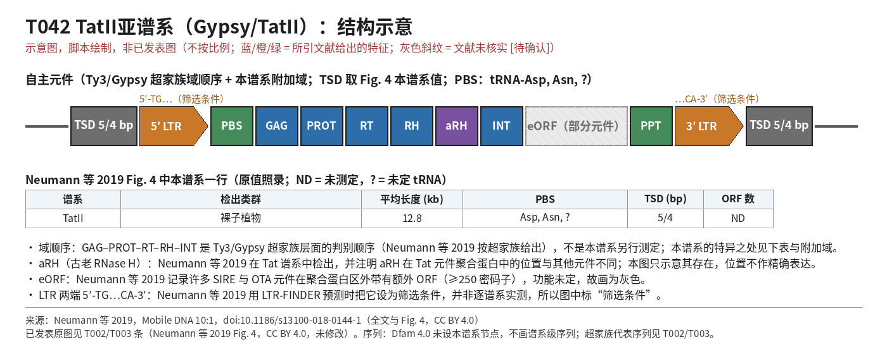

图 T042-1　TatII亚谱系（Gypsy/TatII）：结构示意。示意图，脚本绘制，非已发表图；每个特征的来源写在图下方。序列：Dfam 4.0 未设本谱系节点，没有谱系级共识序列；超家族代表序列见 T002/T003。


自主型 TatII 元件具备 5' LTR、内部编码区与 3' LTR 结构，两翼 LTR 末端多保留保守的 5'-TG...CA-3' 反向重复二核苷酸，内部两端具备 PBS 与 PPT（TatII 精确全长与单 LTR 长度分布统计待确认）。（见本条“本版补充说明”）

#### TSD

整合进入宿主染色体时在元件两侧形成正向靶位点重复，典型长度为 5 bp（具体变异情况待确认）。

#### 编码蛋白与结构域顺序

自主型 TatII 元件遵循 Ty3/Gypsy 超家族 Tat 分支的结构域特征，编码 `gag` 与 `pol` 蛋白（排列顺序为 PROT - RT - RH/aRH - INT），携带 Tat 分支标志性的古菌型核糖核酸酶 H（aRH），不携带整合酶 C 端染色质结构域（Neumann 等 2019, doi:10.1186/s13100-018-0144-1）。

#### 转座机制

遵循经典的 LTR 反转录转座子复制粘贴扩增机制：5' LTR 启动子驱动全长 RNA 转录，在胞质病毒样颗粒内借由 PBS 与 PPT 引导反转录合成双链 cDNA，随后由整合酶整合进入宿主染色体新位点并产生 TSD [待确认]。

#### 自主与非自主搭档

完整编码 `gag-pol` 的拷贝为自主型；基因组中可伴生内部缺失的非自主衍生物及两翼 LTR 不等同源重组形成的 solo-LTR（TatII 专属非自主搭档研究待确认）。

#### 识别特征与工具

结构从头识别采用 LTRharvest（Ellinghaus 等 2008, doi:10.1186/1471-2105-9-18）、LTR_FINDER（Xu 和 Wang 2007, doi:10.1093/nar/gkm286）、LTR_retriever（Ou 和 Jiang 2018, doi:10.1104/pp.17.01310）与 EDTA（Ou 等 2019, doi:10.1186/s13059-019-1905-y）。谱系级精准分类采用基于 REXdb 蛋白结构域 HMM 的 TEsorter（Zhang 等 2022, doi:10.1093/hr/uhac017；Neumann 等 2019, doi:10.1186/s13100-018-0144-1）。

#### 分类争议

TatII 于 2019 年 REXdb 系统发育研究中从宽泛的 Tat 复合群中拆分确立为独立亚谱系，目前在植物转座子细分类中作为标准节点使用（Neumann 等 2019, doi:10.1186/s13100-018-0144-1）。

#### 发现与分布

**发现与命名**

- Wright 和 Voytas (1998) Potential retroviruses in plants: Tat1 is related to a group of Arabidopsis thaliana Ty3/gypsy retrotransposons that encode envelope-like proteins. Genetics. doi:10.1093/genetics/149.2.703。摘要原句：“Tat1 was originally identified as an insertion near the Arabidopsis thaliana SAM1 gene”；涉及生物：Arabidopsis thaliana；支持范围：Tat1 related to Arabidopsis Ty3/gypsy elements encoding envelope-like proteins [注意：所引句不含该名称，仅支持上位/总体论断]
- Ustyantsev 等 (2015) Convergent evolution of ribonuclease h in LTR retrotransposons and retroviruses. Molecular Biology and Evolution. doi:10.1093/molbev/msv008。摘要原句：“Two notable structural differences between these groups of genetic elements are 1) the presence in retroviruses of an additional envelope gene, env, which mediates infection, and 2) a specific dual ribonuclease H (RNH) domain encoded by the retroviral pol gene”；涉及生物：LTR retrotransposons and retroviruses；支持范围：TatI-VI naming (cited in REXdb Table 2) [注意：所引句不含该名称，仅支持上位/总体论断]

**植物中的报道**

- Neumann 等 (2019) Systematic survey of plant LTR-retrotransposons elucidates phylogenetic relationships of their polyprotein domains and provides a reference for element classification. Mobile DNA. doi:10.1186/s13100-018-0144-1。正文原句：“A|Athila Athila/Tat|Athila (Athila4–1, Diaspora, Bagy-2, Cyclops-2) Metavirus (Athila) Athila [ 32 ] non-chromovirus|OTA|Tat|TatI – – TatI [ 34 ] non-chromovirus|OTA|Tat|TatII – – TatII [ 34 ] non-chromovirus|OTA|Tat|TatIII – – TatIII [ 34 ] non-chromovirus|OTA|Tat|Ogre Athila/Tat|Tat (Ogre) – Ogre [ 33 ]; TatIV(Ogre) and…”；涉及生物：Viridiplantae；支持范围：REXdb survey of plant LTR retrotransposon lineages
- Wright 和 Voytas (1998) Potential retroviruses in plants: Tat1 is related to a group of Arabidopsis thaliana Ty3/gypsy retrotransposons that encode envelope-like proteins. Genetics. doi:10.1093/genetics/149.2.703。同一论文，原句见上；支持范围：Tat1 [注意：所引句不含该名称，仅支持上位/总体论断]

**葡萄中的报道**

- 未检索到葡萄专门报道（检索方式见文末「证据与检索方法」）。这只说明检索没有找到，不能据此推断葡萄基因组中不存在。

#### 本版补充说明

① 域顺序：GAG–PROT–INT–RT–RH（Ty1/Copia）与 GAG–PROT–RT–RH–INT（Ty3/Gypsy）是 Neumann 等 2019（doi:10.1186/s13100-018-0144-1）在超家族层面给出的判别顺序；本条若写某谱系“遵循”该顺序，指的是沿用超家族的顺序，不是该文对本谱系另行测定。

② 末端：5′-TG…CA-3′ 是该文用 LTR-FINDER 预测元件时设定的筛选条件，不是对各谱系的实测统计；本条中“末端保守为 5′-TG…CA-3′”一类说法应按此理解。

③ 该文 Fig. 4 给出本谱系：检出类群 裸子植物；平均长度 12.8 kb；PBS Asp, Asn, ?；TSD 5/4 bp；ORF 数 ND（ND 为未测定）。本谱系 TSD 不是单一的 5 bp，正文“典型长度为 5 bp”一类写法以 Fig. 4 为准。

### T043 TatIII亚谱系（Gypsy/TatIII）

**名称对照**：Wicker 体系：I 类 / LTR 目 / Gypsy（代码 RLG）；Wicker 不分谱系；Dfam 节点：Gypsy-ERV;Gypsy（Dfam 无谱系节点）；REXdb 路径：Class_I/LTR/Ty3/gypsy/non-chromovirus/OTA/Tat/TatIII。（来源：代码据 Wu 等 2025, doi:10.3390/biom15030346；Dfam 4.0 分类树，2026-11-23 读取；REXdb v4.0 说明文件，doi:10.5281/zenodo.10160279）

#### 定义与命名

TatIII 是 I 类转座子 LTR 目 Ty3/Gypsy 超家族（RLG）非染色质病毒支 OTA 超级支 Tat 分支下的独立亚谱系，在 2019 年 REXdb 绿色植物系统分类框架中正式确立，完整路径记作 `Gypsy/non-chromovirus/OTA/Tat/TatIII`（Neumann 等 2019, doi:10.1186/s13100-018-0144-1）。在 Dfam 现行分类体系中归入 `LTR/Gypsy` 节点之下 [待确认]。

#### 结构、长度与末端


图 T043-1　TatIII亚谱系（Gypsy/TatIII）：结构示意。示意图，脚本绘制，非已发表图；每个特征的来源写在图下方。序列：Dfam 4.0 未设本谱系节点，没有谱系级共识序列；超家族代表序列见 T002/T003。


自主型 TatIII 元件由 5' LTR、内部编码区与 3' LTR 构成，两翼 LTR 末端多保留保守的 5'-TG...CA-3' 反向重复二核苷酸，内部两端具备 PBS 与 PPT（TatIII 精确全长与单 LTR 长度分布统计待确认）。（见本条“本版补充说明”）

#### TSD

整合进入宿主染色体时在元件两侧形成正向靶位点重复，典型长度为 5 bp（具体变异情况待确认）。

#### 编码蛋白与结构域顺序

自主型 TatIII 元件遵循 Ty3/Gypsy 超家族 Tat 分支的结构域特征，编码 `gag` 与 `pol` 蛋白（排列顺序为 PROT - RT - RH/aRH - INT），携带古菌型核糖核酸酶 H（aRH），不携带整合酶 C 端染色质结构域（Neumann 等 2019, doi:10.1186/s13100-018-0144-1）。

#### 转座机制

遵循经典的 LTR 反转录转座子复制粘贴扩增机制：5' LTR 启动子驱动全长 RNA 转录，在胞质病毒样颗粒内借由 PBS 与 PPT 引导反转录合成双链 cDNA，随后由整合酶整合进入宿主染色体新位点并伴随产生 TSD [待确认]。

#### 自主与非自主搭档

完整编码 `gag-pol` 的拷贝为自主型；基因组中可伴生内部缺失的非自主衍生物及两翼 LTR 不等同源重组形成的 solo-LTR（TatIII 专属非自主搭档研究待确认）。

#### 识别特征与工具

结构从头识别采用 LTRharvest（Ellinghaus 等 2008, doi:10.1186/1471-2105-9-18）、LTR_FINDER（Xu 和 Wang 2007, doi:10.1093/nar/gkm286）、LTR_retriever（Ou 和 Jiang 2018, doi:10.1104/pp.17.01310）与 EDTA（Ou 等 2019, doi:10.1186/s13059-019-1905-y）。谱系级精准分类采用基于 REXdb 蛋白结构域 HMM 的 TEsorter（Zhang 等 2022, doi:10.1093/hr/uhac017；Neumann 等 2019, doi:10.1186/s13100-018-0144-1）。

#### 分类争议

TatIII 于 2019 年 REXdb 系统发育研究中从宽泛的 Tat 复合群中拆分确立为独立亚谱系，目前无显著分类争议（Neumann 等 2019, doi:10.1186/s13100-018-0144-1）。

#### 发现与分布

**发现与命名**

- Wright 和 Voytas (1998) Potential retroviruses in plants: Tat1 is related to a group of Arabidopsis thaliana Ty3/gypsy retrotransposons that encode envelope-like proteins. Genetics. doi:10.1093/genetics/149.2.703。摘要原句：“Tat1 was originally identified as an insertion near the Arabidopsis thaliana SAM1 gene”；涉及生物：Arabidopsis thaliana；支持范围：Tat1 related to Arabidopsis Ty3/gypsy elements encoding envelope-like proteins [注意：所引句不含该名称，仅支持上位/总体论断]
- Ustyantsev 等 (2015) Convergent evolution of ribonuclease h in LTR retrotransposons and retroviruses. Molecular Biology and Evolution. doi:10.1093/molbev/msv008。摘要原句：“Two notable structural differences between these groups of genetic elements are 1) the presence in retroviruses of an additional envelope gene, env, which mediates infection, and 2) a specific dual ribonuclease H (RNH) domain encoded by the retroviral pol gene”；涉及生物：LTR retrotransposons and retroviruses；支持范围：TatI-VI naming (cited in REXdb Table 2) [注意：所引句不含该名称，仅支持上位/总体论断]

**植物中的报道**

- Neumann 等 (2019) Systematic survey of plant LTR-retrotransposons elucidates phylogenetic relationships of their polyprotein domains and provides a reference for element classification. Mobile DNA. doi:10.1186/s13100-018-0144-1。正文原句：“…Bagy-2, Cyclops-2) Metavirus (Athila) Athila [ 32 ] non-chromovirus|OTA|Tat|TatI – – TatI [ 34 ] non-chromovirus|OTA|Tat|TatII – – TatII [ 34 ] non-chromovirus|OTA|Tat|TatIII – – TatIII [ 34 ] non-chromovirus|OTA|Tat|Ogre Athila/Tat|Tat (Ogre) – Ogre [ 33 ]; TatIV(Ogre) and TatV [ 34 ] non-chromovirus|OTA|Tat|Retand…”；涉及生物：Viridiplantae；支持范围：REXdb survey of plant LTR retrotransposon lineages
- Wright 和 Voytas (1998) Potential retroviruses in plants: Tat1 is related to a group of Arabidopsis thaliana Ty3/gypsy retrotransposons that encode envelope-like proteins. Genetics. doi:10.1093/genetics/149.2.703。同一论文，原句见上；支持范围：Tat1 [注意：所引句不含该名称，仅支持上位/总体论断]

**葡萄中的报道**

- 未检索到葡萄专门报道（检索方式见文末「证据与检索方法」）。这只说明检索没有找到，不能据此推断葡萄基因组中不存在。

#### 本版补充说明

① 域顺序：GAG–PROT–INT–RT–RH（Ty1/Copia）与 GAG–PROT–RT–RH–INT（Ty3/Gypsy）是 Neumann 等 2019（doi:10.1186/s13100-018-0144-1）在超家族层面给出的判别顺序；本条若写某谱系“遵循”该顺序，指的是沿用超家族的顺序，不是该文对本谱系另行测定。

② 末端：5′-TG…CA-3′ 是该文用 LTR-FINDER 预测元件时设定的筛选条件，不是对各谱系的实测统计；本条中“末端保守为 5′-TG…CA-3′”一类说法应按此理解。

③ 该文 Fig. 4 给出本谱系：检出类群 裸子植物；平均长度 14.7 kb；PBS Arg, His, ?；TSD 5 bp；ORF 数 ND（ND 为未测定）。正文中标 [待确认] 的“TSD 典型长度 5 bp”与 Fig. 4 一致。

### T044 Ogre亚谱系（Gypsy/Ogre）

**名称对照**：Wicker 体系：I 类 / LTR 目 / Gypsy（代码 RLG）；Wicker 不分谱系；Dfam 节点：Gypsy-ERV;Gypsy（Dfam 无谱系节点）；REXdb 路径：Class_I/LTR/Ty3/gypsy/non-chromovirus/OTA/Tat/Ogre。（来源：代码据 Wu 等 2025, doi:10.3390/biom15030346；Dfam 4.0 分类树，2026-11-23 读取；REXdb v4.0 说明文件，doi:10.5281/zenodo.10160279）

#### 定义与命名

Ogre 是 I 类转座子 LTR 目 Ty3/Gypsy 超家族（RLG）非染色质病毒支 OTA 超级支 Tat 分支下极具代表性的超大型植物亚谱系，在 2019 年 REXdb 绿色植物系统分类框架中完整路径记作 `Gypsy/non-chromovirus/OTA/Tat/Ogre`（Neumann 等 2019, doi:10.1186/s13100-018-0144-1）。该名称源自其异常庞大的元件尺寸（最初在豌豆等豆科植物中被发现并命名，原始命名专文 DOI 待确认）。在 Dfam 现行分类体系中归入 `LTR/Gypsy` 节点之下 [待确认]。

#### 结构、长度与末端


图 T044-1　Ogre亚谱系（Gypsy/Ogre）：结构示意。示意图，脚本绘制，非已发表图；每个特征的来源写在图下方。序列：Dfam 4.0 未设本谱系节点，没有谱系级共识序列；超家族代表序列见 T002/T003。


Ogre 是陆生植物中已知全长最长的 LTR 反转录转座子谱系之一，完整自主型元件全长常超过 15 kb，在豆科等大型基因组植物中甚至可达 20 kb 至 25 kb 以上 [待确认]。其单个 LTR 长度亦极为庞大，常达 3 kb 至 5 kb 以上，内部常包含大段非编码区及内含子样结构 [待确认]。完整拷贝两翼 LTR 末端保守为 5'-TG...CA-3'，内部两端具备 PBS 与 PPT [待确认]。（见本条“本版补充说明”）

#### TSD

整合进入宿主染色体时在元件两侧形成正向靶位点重复，典型长度为 5 bp [待确认]。

#### 编码蛋白与结构域顺序

自主型 Ogre 元件编码 `gag` 与 `pol` 蛋白，遵循 Tat 分支的特征性结构域组织（PROT - RT - RH/aRH - INT），携带标志性的古菌型核糖核酸酶 H（aRH），不携带整合酶 C 端染色质结构域；部分 Ogre 元件在 `gag` 上游或 `pol` 两侧还携带额外的开放阅读框，并可能通过剪接加工产生编码蛋白（Neumann 等 2019, doi:10.1186/s13100-018-0144-1；Ogre 内含子剪接机制专文 DOI 待确认）。

#### 转座机制

遵循经典的 LTR 反转录转座子复制粘贴扩增机制：5' LTR 启动子驱动全长 RNA 转录，经胞质病毒样颗粒内反转录合成双链 cDNA 后，由整合酶整合进入宿主染色体新位点并伴随产生 5 bp TSD [待确认]。

#### 自主与非自主搭档

完整编码 `gag-pol` 的拷贝为自主型；由于 Ogre 全长极大且单个 LTR 长达数 kb，在宿主基因组中极易发生两翼 LTR 不等同源重组形成大型 solo-LTR，或发生内部截短形成非自主衍生物 [待确认]。

#### 识别特征与工具

需要特别注意，由于 Ogre 全长常超过 15 kb 至 25 kb，而 LTRharvest 与 LTR_FINDER 等软件的默认最大元件间距参数往往设在 15 kb 左右，若不调大最大距离阈值（如放宽至 25–30 kb）极易漏检完整 Ogre 拷贝 [待确认]。谱系级精准分类采用基于 REXdb 蛋白结构域 HMM 的 TEsorter（Zhang 等 2022, doi:10.1093/hr/uhac017）。

#### 分类争议

早期文献中 Ogre 与 Retand、Tat 之间的界限较为模糊，常统称为 Ogre/Tat 类群；2019 年 REXdb 系统发育分类已将其清晰界定为 Tat 分支下的独立亚谱系 `Ogre`（Neumann 等 2019, doi:10.1186/s13100-018-0144-1）。

#### 发现与分布

**发现与命名**

- Macas 和 Neumann (2007) Ogre elements--a distinct group of plant Ty3/gypsy-like retrotransposons. Gene. doi:10.1016/j.gene.2006.08.007。摘要原句：“Ogre elements are a group of LTR retrotransposons recently discovered in legume plants, where they constitute almost 40% of the genome in some species”；涉及生物：pea and other plants；支持范围：Ogre elements as a distinct Ty3/gypsy group
- Neumann 等 (2003) Highly abundant pea LTR retrotransposon Ogre is constitutively transcribed and partially spliced. Plant Molecular Biology. doi:10.1023/b:plan.0000006945.77043.ce。摘要原句：“We have isolated and characterized a novel giant retroelement, named Ogre, which is over 22 kb long and makes up at least 5% of the pea (Pisum sativum L.) genome”；涉及生物：pea (Pisum sativum)；支持范围：Ogre constitutively transcribed, partially spliced

**植物中的报道**

- Neumann 等 (2019) Systematic survey of plant LTR-retrotransposons elucidates phylogenetic relationships of their polyprotein domains and provides a reference for element classification. Mobile DNA. doi:10.1186/s13100-018-0144-1。正文原句：“…in a group of closely related species [ 25 , 26 ] or focused on a particular lineage of LTR-retrotransposons, e.g. chromoviruses [ 11 , 27 – 31 ], Athila [ 32 ], Ogre [ 33 ], Tat [ 34 ] or SIRE [ 35 – 37 ]. Although these studies demonstrated the potential of a phylogeny-based classification their results are difficult to…”；涉及生物：Viridiplantae；支持范围：REXdb survey of plant LTR retrotransposon lineages
- Macas 和 Neumann (2007) Ogre elements--a distinct group of plant Ty3/gypsy-like retrotransposons. Gene. doi:10.1016/j.gene.2006.08.007。同一论文，原句见上；支持范围：Ogre group
- Neumann 等 (2003) Highly abundant pea LTR retrotransposon Ogre is constitutively transcribed and partially spliced. Plant Molecular Biology. doi:10.1023/b:plan.0000006945.77043.ce。同一论文，原句见上；支持范围：Ogre transcription

**葡萄中的报道**

- 未检索到葡萄专门报道（检索方式见文末「证据与检索方法」）。这只说明检索没有找到，不能据此推断葡萄基因组中不存在。

#### 本版补充说明

① 域顺序：GAG–PROT–INT–RT–RH（Ty1/Copia）与 GAG–PROT–RT–RH–INT（Ty3/Gypsy）是 Neumann 等 2019（doi:10.1186/s13100-018-0144-1）在超家族层面给出的判别顺序；本条若写某谱系“遵循”该顺序，指的是沿用超家族的顺序，不是该文对本谱系另行测定。

② 末端：5′-TG…CA-3′ 是该文用 LTR-FINDER 预测元件时设定的筛选条件，不是对各谱系的实测统计；本条中“末端保守为 5′-TG…CA-3′”一类说法应按此理解。

③ 该文 Fig. 4 给出本谱系：检出类群 被子植物；平均长度 15.0 kb；PBS Arg；TSD 5 bp；ORF 数 2（ND 为未测定）。正文中标 [待确认] 的“TSD 典型长度 5 bp”与 Fig. 4 一致。

### T045 Retand亚谱系（Gypsy/Retand）

**名称对照**：Wicker 体系：I 类 / LTR 目 / Gypsy（代码 RLG）；Wicker 不分谱系；Dfam 节点：Gypsy-ERV;Gypsy（Dfam 无谱系节点）；REXdb 路径：Class_I/LTR/Ty3/gypsy/non-chromovirus/OTA/Tat/Retand。（来源：代码据 Wu 等 2025, doi:10.3390/biom15030346；Dfam 4.0 分类树，2026-11-23 读取；REXdb v4.0 说明文件，doi:10.5281/zenodo.10160279）

#### 定义与命名

Retand 是 I 类转座子 LTR 目 Ty3/Gypsy 超家族（RLG）非染色质病毒支 OTA 超级支 Tat 分支下的核心植物亚谱系之一，在 2019 年 REXdb 绿色植物系统分类框架中完整路径记作 `Gypsy/non-chromovirus/OTA/Tat/Retand`（Neumann 等 2019, doi:10.1186/s13100-018-0144-1）。在 Dfam 现行分类体系中归入 `LTR/Gypsy` 节点之下 [待确认]。

#### 结构、长度与末端

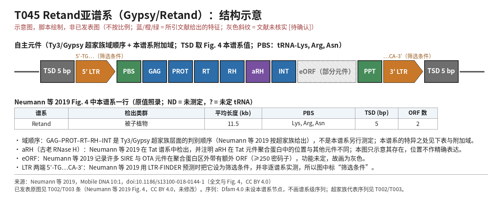

图 T045-1　Retand亚谱系（Gypsy/Retand）：结构示意。示意图，脚本绘制，非已发表图；每个特征的来源写在图下方。序列：Dfam 4.0 未设本谱系节点，没有谱系级共识序列；超家族代表序列见 T002/T003。


Retand 属于大型植物 Gypsy 亚谱系，自主型元件全长通常在 10 kb 至 16 kb 之间，单个 LTR 长度常达 1 kb 至 3 kb 以上（精确跨物种极值统计待确认）。完整拷贝两翼 LTR 末端保守为 5'-TG...CA-3'，5' LTR 下游具经典 PBS，3' LTR 上游具 PPT，内部区域除 `gag-pol` 外常包含大段非编码区或串联重复片段（Neumann 等 2019, doi:10.1186/s13100-018-0144-1）。（见本条“本版补充说明”）

#### TSD

整合进入宿主基因组时在元件两侧形成正向靶位点重复，典型长度为 5 bp [待确认]。

#### 编码蛋白与结构域顺序

自主型 Retand 元件编码 `gag` 与 `pol` 蛋白，遵循 Tat 分支的特征性结构域组织（PROT - RT - RH/aRH - INT），携带古菌型核糖核酸酶 H（aRH），不携带整合酶 C 端染色质结构域，部分成员在 `pol` 下游可携带附加开放阅读框（Neumann 等 2019, doi:10.1186/s13100-018-0144-1）。

#### 转座机制

遵循经典的 LTR 反转录转座子复制粘贴扩增机制：5' LTR 启动子驱动全长 RNA 转录，在胞质病毒样颗粒内借由 PBS 与 PPT 引导反转录合成双链 cDNA，随后由整合酶整合进入宿主染色体新位点并伴随产生 5 bp TSD [待确认]。

#### 自主与非自主搭档

完整编码 `gag-pol` 的拷贝为自主型；在基因组中常伴生内部编码区缺失的非自主衍生物、嵌套插入体以及两翼 LTR 不等同源重组形成的 solo-LTR [待确认]。

#### 识别特征与工具

结构从头识别采用 LTRharvest（Ellinghaus 等 2008, doi:10.1186/1471-2105-9-18）、LTR_FINDER（Xu 和 Wang 2007, doi:10.1093/nar/gkm286）、LTR_retriever（Ou 和 Jiang 2018, doi:10.1104/pp.17.01310）与 EDTA（Ou 等 2019, doi:10.1186/s13059-019-1905-y）。谱系级精准分类采用基于 REXdb 蛋白结构域 HMM 的 TEsorter（Zhang 等 2022, doi:10.1093/hr/uhac017；Neumann 等 2019, doi:10.1186/s13100-018-0144-1）。

#### 分类争议

Retand 最早在石竹科植物中被命名，2019 年 REXdb 系统发育分类将其确立为 Tat 分支下的独立亚谱系，与 Ogre、TatI、TatII、TatIII 明确区分，目前无显著分类争议（Neumann 等 2019, doi:10.1186/s13100-018-0144-1）。

#### 发现与分布

**发现与命名**

- Kejnovsky 等 (2006) Retand: a novel family of gypsy-like retrotransposons harboring an amplified tandem repeat. Molecular Genetics and Genomics. doi:10.1007/s00438-006-0140-x。摘要原句：“In this paper we describe a pair of novel Ty3/gypsy retrotransposons isolated from the dioecious plant Silene latifolia, consisting of a non-autonomous element Retand-1 (3.7 kb) and its autonomous partner Retand-2 (11.1 kb)”；涉及生物：Silene latifolia；支持范围：Retand family with amplified tandem repeat

**植物中的报道**

- Neumann 等 (2019) Systematic survey of plant LTR-retrotransposons elucidates phylogenetic relationships of their polyprotein domains and provides a reference for element classification. Mobile DNA. doi:10.1186/s13100-018-0144-1。正文原句：“…non-chromovirus|OTA|Tat|TatIII – – TatIII [ 34 ] non-chromovirus|OTA|Tat|Ogre Athila/Tat|Tat (Ogre) – Ogre [ 33 ]; TatIV(Ogre) and TatV [ 34 ] non-chromovirus|OTA|Tat|Retand Athila/Tat|Tat (Cinful-1, Tat4–1, RIRE2, RetroSor1) Metavirus (Tat4) Retand [ 65 ]; TatVI [ 34 ] non-chromovirus|Phygy – – – non-chromovirus|Selgy – – –…”；涉及生物：Viridiplantae；支持范围：REXdb survey of plant LTR retrotransposon lineages
- Kejnovsky 等 (2006) Retand: a novel family of gypsy-like retrotransposons harboring an amplified tandem repeat. Molecular Genetics and Genomics. doi:10.1007/s00438-006-0140-x。同一论文，原句见上；支持范围：Retand

**葡萄中的报道**

- 未检索到葡萄专门报道（检索方式见文末「证据与检索方法」）。这只说明检索没有找到，不能据此推断葡萄基因组中不存在。


#### 本版补充说明

① 域顺序：GAG–PROT–INT–RT–RH（Ty1/Copia）与 GAG–PROT–RT–RH–INT（Ty3/Gypsy）是 Neumann 等 2019（doi:10.1186/s13100-018-0144-1）在超家族层面给出的判别顺序；本条若写某谱系“遵循”该顺序，指的是沿用超家族的顺序，不是该文对本谱系另行测定。

② 末端：5′-TG…CA-3′ 是该文用 LTR-FINDER 预测元件时设定的筛选条件，不是对各谱系的实测统计；本条中“末端保守为 5′-TG…CA-3′”一类说法应按此理解。

③ 该文 Fig. 4 给出本谱系：检出类群 被子植物；平均长度 11.5 kb；PBS Lys, Arg, Asn；TSD 5 bp；ORF 数 2（ND 为未测定）。正文中标 [待确认] 的“TSD 典型长度 5 bp”与 Fig. 4 一致。

## 第六部分　DIRS、PLE 与 LINE/SINE 目

### T046 DIRS超家族（DIRS）

**名称对照**：Wicker 体系：I 类 / DIRS 目；Dfam 节点：Tyrosine_Recombinase_Elements;DIRS；REXdb 路径：Class_I/DIRS。（来源：类与目据 Arkhipova 2017, doi:10.1186/s13100-017-0103-2；Dfam 4.0 分类树，2026-11-23 读取；REXdb v4.0 说明文件，doi:10.5281/zenodo.10160279）

#### 定义与命名

DIRS（Dictyostelium intermediate repeat sequence，又称 DIRS-1 或酪氨酸重组酶反转录转座子）是 I 类转座子 DIRS 目下的核心超家族，在 2007 年建立的真核转座子统一分类体系中三字母代码为 `RYD`，其中首位 `R` 代表反转录转座子，第二位 `Y` 代表酪氨酸重组酶（tyrosine recombinase，YR），第三位 `D` 代表 DIRS 超家族（Wicker 等 2007, doi:10.1038/nrg2165）。在 Dfam 现行分类体系及 2021 年发布的数据标准中，该类群归入 `Retroposon` 或独立 `DIRS` 相关节点之下，作为区别于经典 LTR、LINE 与 PLE 的独立反转录转座子分支管理 [待确认]。

#### 结构、长度与末端

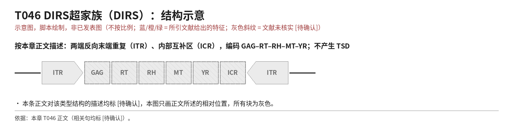

图 T046-1　DIRS超家族（DIRS）：结构示意。示意图，脚本绘制，非已发表图；每个特征的来源写在图下方。序列：Dfam 4.0 绿色植物家族中没有本类型可用的共识序列（无此类家族、两端 30 bp 含 N，或分类标注无法核实），不画序列。


完整的自主型 DIRS 元件全长通常在 4 kb 至 6.5 kb 之间（精确跨门类长度分布统计待确认）。与 LTR 反转录转座子两端为正向重复不同，DIRS 元件的末端结构极为特殊：其 5' 端和 3' 端是一对反向末端重复序列（inverted terminal repeat，ITR），且元件内部靠近 3' 端处还存在一段内部互补区（internal complementary region，ICR），ICR 由分别与左侧 ITR 和右侧 ITR 互补的序列拼接而成 [待确认]。元件末端不具备典型 LTR 的 5'-TG...CA-3' 整合酶识别特征，也不含 LINE 典型的 3' poly(A) 尾 [待确认]。

#### TSD

DIRS 元件整合进入宿主基因组时**不产生**靶位点重复（TSD 为 0 bp） [待确认]。这一特征源于其整合过程由酪氨酸重组酶催化位点特异性或环状 DNA 重组完成，而非由整合酶在靶位点 DNA 双链上产生交错切口 [待确认]。

#### 编码蛋白与结构域顺序

自主型 DIRS 元件内部通常包含三个部分重叠的开放阅读框，编码衣壳样蛋白（GAG）、反转录酶（RT）、核糖核酸酶 H（RH）、甲基转移酶（MT）以及酪氨酸重组酶（YR），核心结构域排列顺序为 **GAG - RT - RH - MT - YR** [待确认]。与 LTR 反转录转座子相比，DIRS 完全缺失天冬氨酸蛋白酶（PROT）与经典 DDE 型整合酶（INT）；而与同属 DIRS 目的 Ngaro 和 VIPER 超家族相比，携带甲基转移酶（MT）结构域是 DIRS 超家族的关键鉴别特征 [待确认]。

#### 转座机制

DIRS 采用独特的游离环状双链 DNA 中间体机制完成复制粘贴扩增 [待确认]。转录产生的全长 RNA 经反转录酶合成 cDNA 时，借助两端反向末端重复（ITR）与内部互补区（ICR）之间的碱基配对和模板转换，形成闭合的游离环状双链 DNA 中间体；随后由自身编码的酪氨酸重组酶（YR）催化该环状 DNA 与宿主染色体靶位点发生重组整合，整个过程不产生 TSD（环状中间体精细分子模型专文 DOI 待确认）。

#### 自主与非自主搭档

完整编码 GAG、RT、RH、MT 与 YR 的拷贝为自主型；宿主基因组中可伴生内部编码区缺失或截短、但保留 ITR 与 ICR 顺式重组信号的非自主衍生物，依赖同家族自主型拷贝反式提供的酶系完成扩增（DIRS 非自主搭档专项验证文献 DOI 待确认）。由于两端为反向重复而非正向重复，DIRS 不会像 LTR 元件那样通过不等同源重组形成常规 solo-LTR。

#### 识别特征与工具

因缺乏正向重复 LTR 与 TSD，基于双 LTR 结构的传统预测软件（如 LTRharvest、LTR_FINDER、LTR_retriever）无法将其作为完整元件检出（Ou 和 Jiang 2018, doi:10.1104/pp.17.01310）。识别 DIRS 需依赖针对 RT、RH、MT 与 YR 保守蛋白结构域的隐马尔可夫模型（HMM）检索，结合两端 ITR 与内部 ICR 的结构比对；常用工具包括 RepeatModeler2（Flynn 等 2020, doi:10.1073/pnas.1921046117）、基于 Dfam 的 RepeatMasker 注释以及 GyDB 蛋白结构域参考库。

#### 分类争议

早期文献曾将 DIRS 归入广义 LTR 反转录转座子的异类分支；2007 年统一分类体系因其采用酪氨酸重组酶整合、无 TSD 且末端为 ITR+ICR 结构，正式将其与 Ngaro、VIPER 共同提升为独立于 LTR 目的 DIRS 目（Wicker 等 2007, doi:10.1038/nrg2165）。在部分数据库与注释流程中，DIRS 目下的层级归属与标签命名仍存在细微差异（如部分旧版 RepeatMasker 标签曾标注为 `LTR/DIRS`），在整合统计时需统一归入 I 类 DIRS 目。

#### 发现与分布

**发现与命名**

- Cappello 等 (1985) Sequence of Dictyostelium DIRS-1: an apparent retrotransposon with inverted terminal repeats and an internal circle junction sequence. Cell. doi:10.1016/0092-8674(85)90016-9。摘要原句：“The Dictyostelium discoideum transposon DIRS-1 contains long terminal repeats that are inverted (ITRs) and nonidentical”；涉及生物：Dictyostelium discoideum；支持范围：DIRS-1 first described
- Goodwin 和 Poulter (2004) A new group of tyrosine recombinase-encoding retrotransposons. Molecular Biology and Evolution. doi:10.1093/molbev/msh072。摘要原句：“A wide variety of novel tyrosine recombinase (YR)-encoding retrotransposons were identified using data emerging from the various eukaryotic genome sequencing projects”；涉及生物：fungi, animals, protists；支持范围：tyrosine recombinase retrotransposons (DIRS and Ngaro) [注意：所引句不含该名称，仅支持上位/总体论断]
- Poulter 和 Goodwin (2005) DIRS-1 and the other tyrosine recombinase retrotransposons. Cytogenetic and Genome Research. doi:10.1159/000084991。摘要原句：“DIRS-1 is a retroelement from the slime mold Dictyostelium discoideum”

**植物中的报道**

- 未检索到已核实的植物报道 [待确认]。

**葡萄中的报道**

- 未检索到葡萄专门报道（检索方式见文末「证据与检索方法」）。这只说明检索没有找到，不能据此推断葡萄基因组中不存在。

### T047 Ngaro超家族（Ngaro）

**名称对照**：Wicker 体系：I 类 / DIRS 目（Wicker 超家族名单原文未读，未核实）；Dfam 节点：Tyrosine_Recombinase_Elements;Ngaro；REXdb 路径：无单独节点（REXdb 只有 DIRS）。（来源：Wicker 2007 原文本书未读；Dfam 4.0 分类树，2026-11-23 读取；REXdb v4.0 说明文件，doi:10.5281/zenodo.10160279）

#### 定义与命名

Ngaro 是 I 类转座子 DIRS 目下的三大经典超家族之一（与 DIRS、VIPER 并列），在 2007 年统一分类体系中三字母代码为 `RYN`，其中 `R` 代表反转录转座子，`Y` 代表酪氨酸重组酶，`N` 代表 Ngaro 超家族（Wicker 等 2007, doi:10.1038/nrg2165）。在 Dfam 现行分类体系中，该类群归入 `DIRS/Ngaro` 或对应酪氨酸重组酶反转录转座子分支下管理 [待确认]。

#### 结构、长度与末端

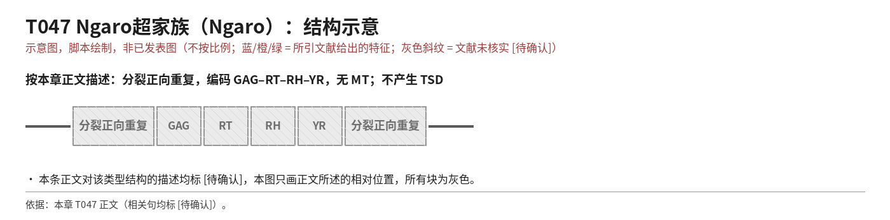

图 T047-1　Ngaro超家族（Ngaro）：结构示意。示意图，脚本绘制，非已发表图；每个特征的来源写在图下方。序列：Dfam 4.0 绿色植物家族中没有本类型可用的共识序列（无此类家族、两端 30 bp 含 N，或分类标注无法核实），不画序列。


完整的自主型 Ngaro 元件全长通常在 4 kb 至 6 kb 之间（精确跨物种长度分布统计待确认）。Ngaro 与 DIRS 超家族在末端结构上存在根本区别：Ngaro 不具备反向末端重复（ITR）和内部互补区（ICR），而是采用**分裂正向重复（split direct repeats）**结构，即 5' 端由串联的 A1 重复段构成，内部靠近 3' 端和末端依次分布 B1、A2 与 B2 重复段，形成 `A1 - 内部编码区 - B1 - A2 - B2` 的独特排列（分裂正向重复结构解析专文 DOI 待确认）。

#### TSD

与 DIRS 超家族一致，Ngaro 由酪氨酸重组酶催化整合进入宿主基因组，整合过程**不产生**靶位点重复（TSD 为 0 bp） [待确认]。

#### 编码蛋白与结构域顺序

自主型 Ngaro 元件编码衣壳样蛋白（GAG）、反转录酶（RT）、核糖核酸酶 H（RH）和酪氨酸重组酶（YR），核心结构域排列顺序为 **GAG - RT - RH - YR** [待确认]。与 DIRS 超家族相比，Ngaro 最显著的蛋白结构域差异是**缺失甲基转移酶（MT）结构域**，且同样不含经典整合酶（INT）与天冬氨酸蛋白酶（PROT） [待确认]。

#### 转座机制

Ngaro 同样通过游离环状双链 DNA 中间体完成复制粘贴扩增：全长 RNA 转录本在反转录过程中借助分裂正向重复（A1/A2 与 B1/B2）的配对与链转移合成闭合环状双链 DNA，随后由自身编码的酪氨酸重组酶催化整合进入宿主染色体，不形成 TSD（Ngaro 环状中间体机制专文 DOI 待确认）。

#### 自主与非自主搭档

完整编码 GAG、RT、RH 与 YR 的拷贝为自主型；基因组中可存在内部编码区缺失但保留分裂正向重复顺式信号的非自主衍生物，依赖同家族自主型拷贝反式提供酶系完成扩增（具体搭档案例专文 DOI 待确认）。

#### 识别特征与工具

Ngaro 无法被常规双 LTR 预测软件完整检出，识别主要依赖 RepeatModeler2（Flynn 等 2020, doi:10.1073/pnas.1921046117）从头聚类结合 Dfam与 GyDB的蛋白结构域 HMM 检索，确认其具备 `RT-RH-YR` 组合、缺失 `MT` 结构域且两翼呈分裂正向重复结构。

#### 分类争议

2007 年统一分类体系确立 Ngaro 为 DIRS 目下独立超家族后，其与 DIRS 超家族的界限清晰；学界讨论主要集中在 Ngaro 与同样具分裂正向重复和缺失 MT 结构域的 VIPER 超家族之间的深层系统发育关系（Wicker 等 2007, doi:10.1038/nrg2165；两者系统发育比较专文 DOI 待确认）。

#### 发现与分布

**发现与命名**

- Poulter 和 Goodwin (2005) DIRS-1 and the other tyrosine recombinase retrotransposons. Cytogenetic and Genome Research. doi:10.1159/000084991。摘要原句：“DIRS-1 is a retroelement from the slime mold Dictyostelium discoideum”
- Goodwin 和 Poulter (2004) A new group of tyrosine recombinase-encoding retrotransposons. Molecular Biology and Evolution. doi:10.1093/molbev/msh072。摘要原句：“We refer to these latter elements as the Ngaro group after a representative from zebrafish”；涉及生物：fungi, animals, protists；支持范围：Ngaro group described

**植物中的报道**

- 未检索到已核实的植物报道 [待确认]。

**葡萄中的报道**

- 未检索到葡萄专门报道（检索方式见文末「证据与检索方法」）。这只说明检索没有找到，不能据此推断葡萄基因组中不存在。

### T048 VIPER超家族（VIPER）

**名称对照**：Wicker 体系：I 类 / DIRS 目（Wicker 超家族名单原文未读，未核实）；Dfam 节点：Viper-group;Viper；REXdb 路径：无单独节点（REXdb 只有 DIRS）。（来源：Wicker 2007 原文本书未读；Dfam 4.0 分类树，2026-11-23 读取；REXdb v4.0 说明文件，doi:10.5281/zenodo.10160279）

#### 定义与命名

VIPER（vestigial interposed retroelement，又称 Viper）是 I 类转座子 DIRS 目下的第三大经典超家族，在 2007 年统一分类体系中三字母代码为 `RYV`（Wicker 等 2007, doi:10.1038/nrg2165）。在动质体等原生生物及部分泛真核转座子文献中，还存在一个与 VIPER 亲缘相近或归属尚存讨论的标签 `TATE`（telomere-associated transposable element，具体与 VIPER 的归并关系专文 DOI 待确认）。在 Dfam 现行分类体系中，VIPER 归入 DIRS 相关分支下管理 [待确认]。

#### 结构、长度与末端

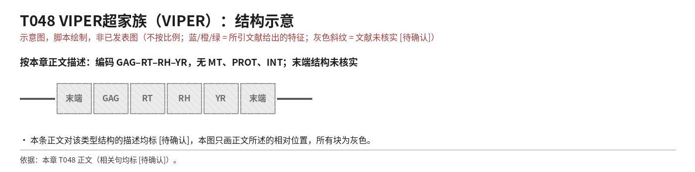

图 T048-1　VIPER超家族（VIPER）：结构示意。示意图，脚本绘制，非已发表图；每个特征的来源写在图下方。序列：Dfam 4.0 绿色植物家族中没有本类型可用的共识序列（无此类家族、两端 30 bp 含 N，或分类标注无法核实），不画序列。


完整的自主型 VIPER 元件全长通常在 4 kb 至 5 kb 左右（精确跨物种长度分布统计待确认）。其末端结构与 Ngaro 超家族相似，采用分裂正向重复（split direct repeats）骨架，而非 DIRS 的反向末端重复加内部互补区结构（VIPER 末端结构解析专文 DOI 待确认）。元件不含典型 LTR 的 5'-TG...CA-3' 末端，亦无 LINE 典型的 3' poly(A) 尾 [待确认]。

#### TSD

与 DIRS 目内其他超家族一致，VIPER 经由酪氨酸重组酶整合进入宿主染色体，整合过程**不产生**靶位点重复（TSD 为 0 bp） [待确认]。

#### 编码蛋白与结构域顺序

自主型 VIPER 元件编码衣壳样蛋白（GAG-like）、反转录酶（RT）、核糖核酸酶 H（RH）与酪氨酸重组酶（YR），核心结构域排列顺序为 **GAG - RT - RH - YR**，同样缺失甲基转移酶（MT）、天冬氨酸蛋白酶（PROT）与经典整合酶（INT） [待确认]。尽管结构域组成与 Ngaro 相同，VIPER 在反转录酶与酪氨酸重组酶的系统发育树上构成独立分支 [待确认]。

#### 转座机制

推断遵循 DIRS 目典型的酪氨酸重组酶介导环状双链 DNA 中间体扩增机制：由全长 RNA 经反转录及分裂正向重复介导的模板转换合成环状双链 DNA，随后由酪氨酸重组酶催化整合进入宿主基因组且不产生 TSD [待确认]。

#### 自主与非自主搭档

完整编码 GAG、RT、RH 与 YR 的拷贝为自主型；在锥虫等宿主基因组中，VIPER 拷贝常高度退化或发生内部缺失形成非自主衍生物（最初即因其在宿主基因组中多以退化片段形式存在而得名「vestigial」）（专文 DOI 待确认）。

#### 识别特征与工具

识别 VIPER 主要依赖针对 RT、RH 与 YR 蛋白结构域的 HMM 检索与系统发育比对，参考数据库包括 Dfam与 GyDB，结合 RepeatModeler2（Flynn 等 2020, doi:10.1073/pnas.1921046117）进行重复家族聚类。在植物与葡萄转座子注释中无需专门针对 VIPER 进行结构扫描，若泛真核参考库产生零星命中应优先排查外源污染或低分值误匹配。

#### 分类争议

主要争议集中在两个方面：其一是 `TATE` 标签的归属，部分研究将端粒相关的 TATE 元件归为 VIPER 的近缘分支或独立小支，尚未在所有数据库中完全统一（专文 DOI 待确认）；其二是 VIPER 与 Ngaro 在蛋白结构域组成和分裂正向重复骨架上高度相似，两者在 DIRS 目内的深层演化分歧仍依赖更多原生生物基因组数据进行解析（Wicker 等 2007, doi:10.1038/nrg2165）。

#### 发现与分布

**发现与命名**

- Lorenzi 等 (2006) The VIPER elements of trypanosomes constitute a novel group of tyrosine recombinase-enconding retrotransposons. Molecular and Biochemical Parasitology. doi:10.1016/j.molbiopara.2005.10.002。摘要原句：“VIPER was initially characterized as a 2326bp LTR-like retroelement associated to SIRE, a short interspersed repetitive element specific of Trypanosoma cruzi”；涉及生物：trypanosomes；支持范围：VIPER tyrosine recombinase retrotransposon

**植物中的报道**

- 未检索到已核实的植物报道 [待确认]。

**葡萄中的报道**

- 未检索到葡萄专门报道（检索方式见文末「证据与检索方法」）。这只说明检索没有找到，不能据此推断葡萄基因组中不存在。

### T049 Penelope样反转录转座子（PLE / Penelope）

**名称对照**：Wicker 体系：I 类 / PLE 目；Dfam 节点：Retrotransposon;Penelope-like_Elements；REXdb 路径：Class_I/Penelope。（来源：类与目据 Arkhipova 2017, doi:10.1186/s13100-017-0103-2；Dfam 4.0 分类树，2026-11-23 读取；REXdb v4.0 说明文件，doi:10.5281/zenodo.10160279）

#### 定义与命名

Penelope 样反转录转座子（Penelope-like element，简称 PLE）是 I 类转座子下的五大目之一，在 2007 年统一分类体系中三字母代码以 `RP` 开头，其唯一经典超家族为 Penelope（代码 `RPP`）（Wicker 等 2007, doi:10.1038/nrg2165）。该类群以最早在果蝇（*Drosophila virilis*）杂种不育体系中发现的 Penelope 元件命名（原始发现专文 DOI 待确认）。在 Dfam 现行分类体系中，PLE 归入独立节点 `LINE/Penelope` 或 `PLE` 相关分支下，与经典 LINE 和 LTR 严格区分 [待确认]。

#### 结构、长度与末端

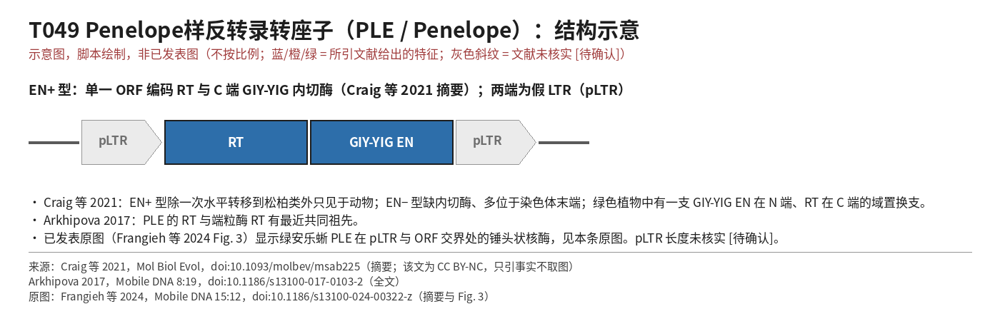

图 T049-1　Penelope样反转录转座子（PLE / Penelope）：结构示意。示意图，脚本绘制，非已发表图；每个特征的来源写在图下方。序列：Dfam 4.0 绿色植物家族中没有本类型可用的共识序列（无此类家族、两端 30 bp 含 N，或分类标注无法核实），不画序列。

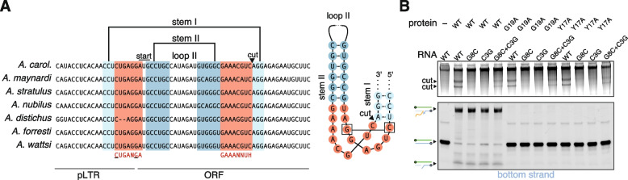

图 T049-P1　绿安乐蜥 PLE 在 pLTR 与 ORF 交界处的锤头状核酶序列与切割实验。原图：Frangieh 等（2024），Fig. 3。Internal initiation of reverse transcription in a Penelope-like retrotransposon. Mob DNA. doi:10.1186/s13100-024-00322-z。许可：CC BY 4.0（https://creativecommons.org/licenses/by/4.0/）。未修改。


完整的自主型 PLE 元件全长通常在 3 kb 至 4.5 kb 之间（精确跨门类长度范围专文 DOI 待确认）。PLE 具有极具辨识度的末端特征：元件两侧常带有长度约数百 bp 的**假长末端重复序列（pseudo-LTR，pLTR）**，这些 pLTR 既可以是正向重复，也可以是反向重复，且常因串联整合形成复杂的复合拷贝 [待确认]。此外，部分 PLE 元件在编码区内保留有功能性**内含子**，这在以 RNA 为中间体的反转录转座子中极为罕见 [待确认]。

#### TSD

PLE 整合进入宿主基因组时，在元件两翼形成长度可变的靶位点重复（TSD），典型长度多在 6 bp 至 12 bp 之间（常见为 8 bp 左右） [待确认]。

#### 编码蛋白与结构域顺序

自主型 PLE 元件编码一个大的单一开放阅读框，包含反转录酶（RT）与 **GIY-YIG 型核酸内切酶（EN）** 两个核心结构域，排列顺序为 **RT - GIY-YIG EN** [待确认]。PLE 的反转录酶在系统发育上更接近真核生物端粒酶反转录酶（TERT），而其 GIY-YIG 型核酸内切酶则与 I 组内含子归巢核酸内切酶同源，与 LINE 编码的 APE/RLE 内切酶以及 LTR 编码的 DDE 型整合酶均无同源关系 [待确认]。部分定位于染色体端粒区域的特化 PLE 分支（如 Athena 类元件）缺失 GIY-YIG 内切酶结构域（端粒 PLE 专文 DOI 待确认）。

#### 转座机制

PLE 采用类似 LINE 的**靶位点引物反转录（target-primed reverse transcription，TPRT）**机制，但切割宿主靶位点 DNA 的酶是自身编码的 GIY-YIG 型核酸内切酶而非 LINE 的 APE/RLE 内切酶 [待确认]。部分 PLE 在反转录过程中能够保留其内部内含子，表明其转录本在进入反转录前可逃避宿主剪接体的完全剪接 [待确认]。

#### 自主与非自主搭档

完整编码 RT 与 GIY-YIG EN 的拷贝为自主型；基因组中普遍存在 5' 端截短或内部缺失的非自主拷贝，且由于串联插入频繁，常形成头尾相连的复合结构 [待确认]。

#### 识别特征与工具

识别 PLE 的核心依据是同时检出与端粒酶近缘的 RT 结构域以及特征性的 GIY-YIG 核酸内切酶结构域，辅以两翼 pLTR 与可变长 TSD 核查。常用工具包括 RepeatModeler2（Flynn 等 2020, doi:10.1073/pnas.1921046117）、基于 Dfam 的 RepeatMasker 注释以及 GyDB 蛋白结构域 HMM 检索。

#### 分类争议

2007 年统一分类体系将 PLE 确立为与 LTR、DIRS、LINE、SINE 并列的独立目（Wicker 等 2007, doi:10.1038/nrg2165）。但在 Dfam 与 RepeatMasker 的传统标签体系中，PLE 长期被挂在 `LINE/Penelope` 路径之下 [待确认]。鉴于 PLE 拥有独立的端粒酶近缘 RT 和 GIY-YIG 内切酶，在严谨的演化分析与书稿分类中应将其作为独立目（PLE）与经典 LINE 分开统计。

#### 发现与分布

**发现与命名**

- Evgen'ev 等 (1997) Penelope, a new family of transposable elements and its possible role in hybrid dysgenesis in Drosophila virilis. Proceedings of the National Academy of Sciences. doi:10.1073/pnas.94.1.196。摘要原句：“The insertion sequence responsible for the mutant phenotype of a dysgenic yellow allele has been characterized and named Penelope”；涉及生物：Drosophila virilis；支持范围：Penelope first described
- Arkhipova (2006) Distribution and phylogeny of Penelope-like elements in eukaryotes. Systematic Biology. doi:10.1080/10635150601077683。摘要原句：“Penelope-like elements (PLEs) are a relatively little studied class of eukaryotic retroelements, distinguished by the presence of the GIY-YIG endonuclease domain, the ability of some representatives to retain introns, and the similarity of PLE-encoded reverse transcriptases to telomerases”；涉及生物：eukaryotes；支持范围：Penelope-like elements distribution
- Gladyshev 和 Arkhipova (2007) Telomere-associated endonuclease-deficient Penelope-like retroelements in diverse eukaryotes. Proceedings of the National Academy of Sciences. doi:10.1073/pnas.0702741104。摘要原句：“Penelope-like elements (PLEs) are a recently described class of eukaryotic retroelements characterized by a GIY-YIG endonuclease domain and by a reverse transcriptase domain with similarity to telomerases and group II introns”；涉及生物：diverse eukaryotes；支持范围：telomere-associated Penelope-like elements

**植物中的报道**

- Lin 等 (2016) An Ancient Transkingdom Horizontal Transfer of Penelope-Like Retroelements from Arthropods to Conifers. Genome Biology and Evolution. doi:10.1093/gbe/evw076。摘要原句：“Here, we describe the first case of HTT from animals to plants, involving TEs known as Penelope-like elements, or PLEs, a group of retrotransposons closely related to eukaryotic telomerases”；涉及生物：conifers；支持范围：Penelope-like elements in conifers

**葡萄中的报道**

- 未检索到葡萄专门报道（检索方式见文末「证据与检索方法」）。这只说明检索没有找到，不能据此推断葡萄基因组中不存在。

### T050 长散在核元件（LINE）

**名称对照**：Wicker 体系：I 类 / LINE 目；Dfam 节点：Class_I_Retrotransposition;LINE；REXdb 路径：Class_I/LINE。（来源：类与目据 Arkhipova 2017, doi:10.1186/s13100-017-0103-2；Dfam 4.0 分类树，2026-11-23 读取；REXdb v4.0 说明文件，doi:10.5281/zenodo.10160279）

#### 定义与命名

长散在核元件（long interspersed nuclear element，LINE，又称非 LTR 反转录转座子，non-LTR retrotransposon）是 I 类转座子下的核心自主型目之一，在 2007 年统一分类体系中三字母代码以 `RI` 开头（Wicker 等 2007, doi:10.1038/nrg2165）。2007 年统一分类体系在 LINE 目下划分 5 个超家族：R2（`RIR`）、RTE（`RIT`）、Jockey（`RIJ`）、L1（`RIL`）与 I（`RII`）（Wicker 等 2007, doi:10.1038/nrg2165）。Dfam 现行分类体系及 2021 年发布的数据标准在 `LINE` 节点下采用了更精细的系统发育分支划分，除 L1、RTE、R2、I、Jockey 外，还细列出 CR1、L2、Rex1、Tx1、Tad1、Proto2、Dong-R4、CRE 等众多分支（Storer 等 2021, doi:10.1186/s13100-020-00230-y）。

#### 结构、长度与末端

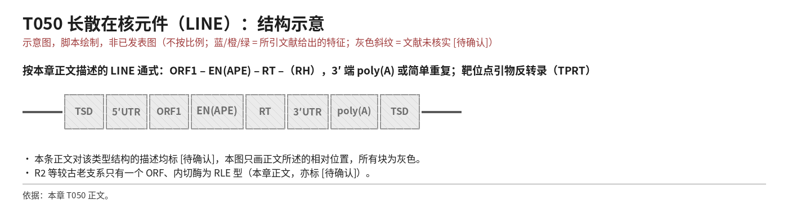

图 T050-1　长散在核元件（LINE）：结构示意。示意图，脚本绘制，非已发表图；每个特征的来源写在图下方。序列：Dfam 4.0 绿色植物家族中没有本类型可用的共识序列（无此类家族、两端 30 bp 含 N，或分类标注无法核实），不画序列。


完整的自主型 LINE 元件全长通常在 4 kb 至 7 kb 之间，但在真核生物基因组中，绝大多数 LINE 拷贝由于反转录过程提前终止而表现为长度仅数百 bp 至数 kb 的 **5' 端截短拷贝** [待确认]。LINE 两端**不具备**长末端重复序列（LTR），其 5' 非翻译区（5' UTR）内部自带 RNA 聚合酶 II 内部启动子，3' 非翻译区（3' UTR）末端通常以多聚腺苷酸尾（poly(A) tail）或简单串联重复序列结束 [待确认]。

#### TSD

LINE 整合进入宿主基因组时在元件两翼形成长度可变的靶位点重复（TSD），典型长度为 5 bp 至 20 bp（常见于 7 bp 至 20 bp 范围）；在部分位点中，整合过程也可能伴随靶位点小片段缺失而不产生经典 TSD [待确认]。

#### 编码蛋白与结构域顺序

不同 LINE 超家族的开放阅读框数量与内切酶类型存在分化。较古老的 R2 等支系通常仅含单个开放阅读框，编码反转录酶（RT）与限制性内切酶样核酸内切酶（RLE）；而 L1、I、Jockey 等较进化的支系通常包含两个开放阅读框（ORF1 与 ORF2）：ORF1 编码具有核酸伴侣活性的 RNA 结合蛋白（GAG 样功能），ORF2 编码**无嘌呤/无嘧啶核酸内切酶（APE）**与反转录酶（RT），部分支系（如 I 超家族）在 ORF2 末尾还携带核糖核酸酶 H（RH）结构域，核心排列顺序为 **ORF1 - EN(APE) - RT - (RH)**（Llorens 等 2011, doi:10.1093/nar/gkq1061）。

#### 转座机制

LINE 采用经典的**靶位点引物反转录（target-primed reverse transcription，TPRT）**机制完成复制粘贴扩增 [待确认]。宿主 RNA 聚合酶 II 从 5' UTR 内部启动子转录全长 RNA，该 RNA 转运至细胞质翻译 ORF1 与 ORF2 蛋白，并与自身蛋白结合形成核糖核蛋白复合物（RNP，表现出强烈的顺式偏好性）重新进入细胞核；随后 ORF2 的核酸内切酶切开宿主染色体 DNA 单链，暴露出的游离 3'-OH 末端直接作为引物，以 LINE RNA 的 3' 端为模板在染色体切口处原位反转录合成 cDNA 负链，再经第二链切口、正链合成与宿主修复完成整合，同时在两侧形成可变长 TSD [待确认]。反转录酶在原位延伸过程中极易脱落，这是基因组中充斥大量 5' 端截短 LINE 拷贝的直接原因 [待确认]。

#### 自主与非自主搭档

完整编码 ORF1 与 ORF2 的 LINE 拷贝为自主型。LINE 编码的反转录与内切酶机器不仅驱动自身扩增，更是 I 类转座子中整个 **SINE 目**（短散在核元件）以及宿主细胞内加工假基因（processed pseudogene）赖以扩增的反式蛋白来源 [待确认]。此外，基因组中还存在大量 5' 端截短或内部缺失的非自主 LINE 拷贝。

#### 识别特征与工具

因缺乏两端重复结构且大量拷贝呈 5' 端截短形态，LINE 的从头识别高度依赖序列聚类与蛋白结构域比对。常用工具包括 RepeatModeler2（Flynn 等 2020, doi:10.1073/pnas.1921046117）、基于 Dfam 序列模型的 RepeatMasker（Storer 等 2021, doi:10.1186/s13100-020-00230-y）以及针对反转录酶和内切酶结构域的 HMM 检索；在植物综合注释流程 EDTA 中，LINE 的注释通常需结合 RepeatModeler2 或同源库补充以弥补纯结构预测的不足（Ou 等 2019, doi:10.1186/s13059-019-1905-y）。

#### 分类争议

主要分歧在于超家族颗粒度：2007 年统一分类体系仅在 LINE 目下设立 R2、RTE、Jockey、L1、I 五个宽泛超家族（Wicker 等 2007, doi:10.1038/nrg2165），而 Dfam 现行体系及分子演化研究界基于反转录酶系统发育树将 LINE 细分为二十余个分支（clades），并将部分传统归入 LINE 的 Penelope 元件在演化分类中独立为 PLE 目（Storer 等 2021, doi:10.1186/s13100-020-00230-y）。

#### 发现与分布

**发现与命名**

- Malik 等 (1999) The age and evolution of non-LTR retrotransposable elements. Molecular Biology and Evolution. doi:10.1093/oxfordjournals.molbev.a026164。摘要原句：“A comprehensive phylogenetic analysis was conducted of non-long-terminal-repeat (non-LTR) retrotransposons based on an extended sequence alignment of their reverse transcriptase (RT) domain”；涉及生物：eukaryotes；支持范围：non-LTR clades and their age
- Kapitonov 等 (2009) Simple and fast classification of non-LTR retrotransposons based on phylogeny of their RT domain protein sequences. Gene. doi:10.1016/j.gene.2009.07.019。摘要原句：“In this paper we focus on a rapid and reliable procedure for classification of autonomous non-LTR retrotransposons based on alignment and clustering of their reverse transcriptase (RT) domains”；支持范围：RT-based classification of non-LTR retrotransposons

**植物中的报道**

- Wright 等 (1996) Multiple non-LTR retrotransposons in the genome of Arabidopsis thaliana. Genetics. doi:10.1093/genetics/142.2.569。摘要原句：“DNA sequence analysis near the Arabidopsis thaliana ABI3 gene revealed the presence of a non-LTR retrotransposon insertion that we have designated Ta11-1”；涉及生物：Arabidopsis thaliana；支持范围：multiple non-LTR retrotransposons
- Noma 等 (1999) Non-LTR retrotransposons (LINEs) as ubiquitous components of plant genomes. Molecular and General Genetics MGG. doi:10.1007/s004380050943。摘要原句：“During the course of work aimed at isolating a rice gene from Oryza australiensis by PCR, the oligonucleotide primers used were found to generate a fragment that showed sequence homology to the endonuclease (EN) region of the maize non-LTR retrotransposon (LINE) Cin4”；支持范围：LINEs ubiquitous in plant genomes
- Schmidt (1999) LINEs, SINEs and repetitive DNA: non-LTR retrotransposons in plant genomes. Plant Molecular Biology. doi:10.1023/a:1006212929794。摘要原句：“Retroelements and remnants thereof constitute a large fraction of the repetitive DNA of plant genomes”；涉及生物：plants；支持范围：LINEs and SINEs in plants
- Leeton 和 Smyth (1993) An abundant LINE-like element amplified in the genome of Lilium speciosum. Molecular and General Genetics MGG. doi:10.1007/bf00282789。摘要原句：“The genomes of Lilium species are very large, containing 30-40 million kilobase pairs of DNA. An abundant fragment of 3.5 kb was released by BamHI digestion of genomic DNA of Lilium speciosum”；涉及生物：lily (Lilium speciosum)；支持范围：LINE-like element

**葡萄中的报道**

- Carrier 等 (2012) Transposable elements are a major cause of somatic polymorphism in Vitis vinifera L. PLoS ONE. doi:10.1371/journal.pone.0032973。正文原句：“The most abundant ones in sequenced clones were LINES retrotransposons, followed by Gypsy and Copia-like…”；涉及生物：Vitis vinifera；支持范围：LINE members among repeat classes in Pinot clones
- Velasco 等 (2007) A high quality draft consensus sequence of the genome of a heterozygous grapevine variety. PLoS ONE. doi:10.1371/journal.pone.0001326。正文原句：“The repeats were included in group I (retrotransposons: Copia, Gypsy, LINE) and group II (DNA transposons: Mutator, CACTA, hAT) according to Feschotte et al. [75] . The most abundant TEs were Gypsy/athila-like elements followed by Copia…”；涉及生物：Vitis vinifera；支持范围：LINE group in grape TE annotation

### T051 短散在核元件（SINE）

**名称对照**：Wicker 体系：I 类 / SINE 目；Dfam 节点：LINE-dependent_Retroposon;SINE；REXdb 路径：Class_I/SINE。（来源：类与目据 Arkhipova 2017, doi:10.1186/s13100-017-0103-2；Dfam 4.0 分类树，2026-11-23 读取；REXdb v4.0 说明文件，doi:10.5281/zenodo.10160279）

#### 定义与命名

短散在核元件（short interspersed nuclear element，SINE）是 I 类转座子下完全由非自主型短元件构成的独立目，在 2007 年统一分类体系中三字母代码以 `RS` 开头（Wicker 等 2007, doi:10.1038/nrg2165）。2007 年统一分类体系依据其 5' 端头部非编码 RNA 的演化起源，将 SINE 目划分为 3 个超家族：tRNA 来源（`RST`）、7SL RNA 来源（`RSL`）和 5S rRNA 来源（`RSS`）（Wicker 等 2007, doi:10.1038/nrg2165）。Dfam 现行分类体系及 2021 年发布的数据标准则在启动子来源（tRNA、7SL、5S 等）的基础上，结合体部保守核心域（如 Core、Deu、V、Meta 等）与 3' 端搭档特征进行更精细的复合命名与分层（Storer 等 2021, doi:10.1186/s13100-020-00230-y）。

#### 结构、长度与末端

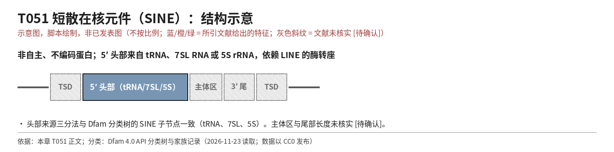

图 T051-1　短散在核元件（SINE）：结构示意。示意图，脚本绘制，非已发表图；每个特征的来源写在图下方。序列：Dfam 4.0 绿色植物家族中没有本类型可用的共识序列（无此类家族、两端 30 bp 含 N，或分类标注无法核实），不画序列。


SINE 尺寸极短，全长通常在 100 bp 至 500 bp 之间，无长末端重复序列（LTR），呈典型的「头部–体部–尾部」三段式结构 [待确认]。5' 端**头部**起源于宿主细胞内由 RNA 聚合酶 III（Pol III）转录的小非编码 RNA（tRNA、7SL RNA 或 5S rRNA），保留了 Pol III 内部启动子基序（例如 tRNA 来源 SINE 的 A box 与 B box）；中间**体部**起源于未知序列、演化保守核心域或自主型 LINE 片段；3' 端**尾部**通常为长度可变的 poly(A) 尾、富含 A/T 的简单重复或与特定自主型 LINE 3' 端高度同源的序列，用于招募搭档 LINE 的反转录酶 [待确认]。

#### TSD

因借用自主型 LINE 的酶系经 TPRT 机制整合，SINE 整合进入宿主染色体时在元件两翼形成与搭档 LINE 一致的可变长靶位点重复（TSD），典型长度为 5 bp 至 20 bp [待确认]。

#### 编码蛋白与结构域顺序

SINE 属于纯粹的非编码、非自主型反转录转座子，全长**不编码**任何蛋白质，不存在蛋白结构域顺序 [待确认]。

#### 转座机制

SINE 的扩增由宿主 **RNA 聚合酶 III** 识别其 5' 端内部启动子驱动转录产生短单链 RNA，随后在细胞质或细胞核内劫持同细胞中活跃表达的自主型 **LINE** 元件所编码的反转录酶与核酸内切酶（ORF2p），借由自身 3' 端尾部序列与 LINE 反转录机器结合，通过**靶位点引物反转录（TPRT）**机制原位合成 cDNA 并整合进入宿主基因组新位点，伴随产生可变长 TSD [待确认]。

#### 自主与非自主搭档

整个 SINE 目全部由非自主型元件构成，严格依赖特定自主型 LINE 家族提供反式转座机器 [待确认]。在哺乳动物中，经典的 Alu（7SL 来源）依赖 L1 超家族反式驱动；在植物及部分动物中，多数 tRNA 来源 SINE 依赖 L1 或 RTE 超家族的 LINE 搭档完成扩增（植物 SINE 与 LINE 搭档配对专文 DOI 待确认）。

#### 识别特征与工具

由于 SINE 长度极短、不编码任何蛋白且不同家族间体部序列高度分化，常规基于蛋白域或长重复结构的软件无法检出。识别 SINE 需结合 Pol III 内部启动子基序（A/B box）、3' 端 poly(A) 或简单重复尾、两翼 5–20 bp TSD 以及全基因组多拷贝一致性进行结构与同源联合筛查；常用工具包括 RepeatModeler2（Flynn 等 2020, doi:10.1073/pnas.1921046117）、基于 Dfam 的 RepeatMasker（Storer 等 2021, doi:10.1186/s13100-020-00230-y）以及专门的 SINE 从头结构预测工具（如 SINE_Scan、AnnoSINE 等，专文 DOI 待确认）。

#### 分类争议

2007 年统一分类体系按头部 RNA 来源将 SINE 简明划分为 tRNA、7SL 与 5S 三个超家族（Wicker 等 2007, doi:10.1038/nrg2165）；然而大量研究表明，许多 SINE 家族在演化中发生了头部、体部保守核心域与尾部的模块重组（嵌合起源），因此 Dfam 现行分类体系主张结合启动子类型与体部核心域进行多维细分，而非仅依赖单一头部来源归类（Storer 等 2021, doi:10.1186/s13100-020-00230-y）。

#### 发现与分布

**发现与命名**

- Okada (1991) SINEs: Short interspersed repeated elements of the eukaryotic genome. Trends in Ecology & Evolution. doi:10.1016/0169-5347(91)90226-n。摘要原句：“Amongst these, there are two kinds of retroposons (sequence elements derived from nonviral cellular RNA): SINEs (short interspersed elements) and LINEs (long interspersed elements)”；支持范围：SINEs defined
- Kramerov 和 Vassetzky (2011) SINEs. WIREs RNA. doi:10.1002/wrna.91。摘要原句：“Short interspersed elements (SINEs) are mobile genetic elements that invade the genomes of many eukaryotes”；涉及生物：eukaryotes
- Kramerov 和 Vassetzky (2011) Origin and evolution of SINEs in eukaryotic genomes. Heredity. doi:10.1038/hdy.2011.43。摘要原句：“Short interspersed elements (SINEs) are one of the two most prolific mobile genomic elements in most of the higher eukaryotes”；涉及生物：eukaryotes；支持范围：origin and evolution of SINEs

**植物中的报道**

- Deragon 和 Zhang (2006) Short interspersed elements (SINEs) in plants: origin, classification, and use as phylogenetic markers. Systematic Biology. doi:10.1080/10635150601047843。摘要原句：“Short interspersed elements (SINEs) are a class of dispersed mobile sequences that use RNA as an intermediate in an amplification process called retroposition”；涉及生物：plants；支持范围：plant SINEs
- Wenke 等 (2011) Targeted identification of short interspersed nuclear element families shows their widespread existence and extreme heterogeneity in plant genomes. The Plant Cell. doi:10.1105/tpc.111.088682。摘要原句：“Short interspersed nuclear elements (SINEs) are non-long terminal repeat retrotransposons that are highly abundant, heterogeneous, and mostly not annotated in eukaryotic genomes”；涉及生物：plants；支持范围：SINE families in plant genomes
- Seibt 等 (2016) Short interspersed nuclear elements (SINEs) are abundant in Solanaceae and have a family-specific impact on gene structure and genome organization. The Plant Journal. doi:10.1111/tpj.13170。摘要原句：“Short interspersed nuclear elements (SINEs) are highly abundant non-autonomous retrotransposons that are widespread in plants”；涉及生物：Solanaceae；支持范围：SINEs in Solanaceae
- Lenoir 等 (2001) The evolutionary origin and genomic organization of SINEs in Arabidopsis thaliana. Molecular Biology and Evolution. doi:10.1093/oxfordjournals.molbev.a003778。摘要原句：“We have characterized the two families of SINE retroposons present in Arabidopsis thaliana”；涉及生物：Arabidopsis thaliana；支持范围：SINEs in Arabidopsis

**葡萄中的报道**

- Benjak 等 (2008) Genome-wide analysis of the "cut-and-paste" transposons of grapevine. PLoS ONE. doi:10.1371/journal.pone.0003107。正文原句：“In the case of Pifvine-2 we found a 154 bp-long deletion present 216 bp downstream of the target site, while in the case of Pifvine-3 there is an insertion of a putative SINE element (155 bp-long with 13 bp-long TSDs) 22 bp after the target site. 10.1371/journal.pone.0003107.g006 Figure 6 Examples of the insertion…”；支持范围：putative SINE near Pifvine-3 insertion (incidental)


## 第七部分　LINE 分支（一）

### T052 L1分支（LINE/L1）

**名称对照**：Wicker 体系：I 类 / LINE 目（L1 的代码 RIL 见 Arkhipova 2017）；Dfam 节点：L1-group;L1；REXdb 路径：Class_I/LINE（REXdb 不分支系）。（来源：代码据 Wu 等 2025, doi:10.3390/biom15030346；Dfam 4.0 分类树，2026-11-23 读取；REXdb v4.0 说明文件，doi:10.5281/zenodo.10160279）

#### 定义与命名

L1（又称 LINE-1）是 I 类转座子 LINE 目下的核心超家族与主要系统发育分支，在 2007 年真核转座子统一分类体系中三字母代码为 `RIL`（Wicker 等 2007, doi:10.1038/nrg2165），在 Dfam 现行分类体系中对应 `LINE/L1` 节点（Storer 等 2021, doi:10.1186/s13100-020-00230-y）。该分支在哺乳动物基因组中以人类 L1 元件为典型代表，在陆生植物中则以玉米 CIN4 与拟南芥 Ta11 等家族为经典代表（CIN4 与 Ta11 原始命名专文 DOI 待确认）。

#### 结构、长度与末端

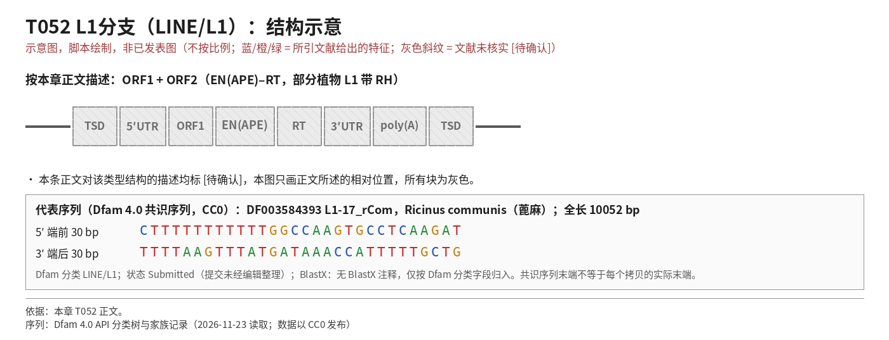

图 T052-1　L1分支（LINE/L1）：结构示意。示意图，脚本绘制，非已发表图；每个特征的来源写在图下方。序列条：Dfam DF003584393（L1-17_rCom，蓖麻 Ricinus communis，Dfam 4.0，CC0；状态 Submitted）前、后各 30 bp。


完整的自主型 L1 元件全长通常在 5 kb 至 7 kb 之间，不含长末端重复序列（LTR） [待确认]。元件 5' 端为包含内部 RNA 聚合酶 II 启动子的 5' 非翻译区（5' UTR），3' 端为 3' UTR 并以多聚腺苷酸尾（poly(A) tail）结束 [待确认]。由于反转录酶在靶位点延伸过程中极易提前脱落，宿主基因组中绝大多数 L1 拷贝表现为长度仅数百 bp 至数 kb 的 **5' 端截短拷贝**，且常伴随 5' 端倒位重排 [待确认]。

#### TSD

L1 整合进入宿主基因组时在元件两翼形成长度可变的靶位点重复（TSD），典型长度为 5 bp 至 20 bp（常见于 7 bp 至 20 bp 范围）；在部分非典型整合位点也可能伴随靶位点微缺失而不形成 TSD [待确认]。

#### 编码蛋白与结构域顺序

完整的自主型 L1 元件包含两个开放阅读框（ORF1 与 ORF2）：ORF1 编码具有核酸伴侣活性的 RNA 结合蛋白，负责与自身转录本结合形成核糖核蛋白复合物（RNP）；ORF2 编码**无嘌呤/无嘧啶核酸内切酶（APE）**与反转录酶（RT），部分植物 L1 成员在 ORF2 下游还携带核糖核酸酶 H（RH）样结构域（植物 L1 携带 RH 的分布比例专文 DOI 待确认），核心结构域排列顺序为 **ORF1 - EN(APE) - RT**。

#### 转座机制

L1 采用经典的**靶位点引物反转录（TPRT）**机制完成复制粘贴扩增：宿主 RNA 聚合酶 II 从 5' UTR 内部启动子转录全长 RNA，经胞质翻译出 ORF1p 与 ORF2p 后，蛋白强烈顺式偏好地结合自身 RNA 形成 RNP 并进入细胞核；ORF2p 的 APE 内切酶在宿主 DNA 富含 A/T 的位点切开单链，暴露的 3'-OH 直接作为引物以 L1 RNA 3' 端 poly(A) 为模板原位合成负链 cDNA，随后经第二链切口、正链合成与宿主修复完成整合并产生可变长 TSD [待确认]。

#### 自主与非自主搭档

完整编码功能性 ORF1 与 ORF2 的 L1 拷贝为自主型。L1 编码的 ORF2p 机器不仅驱动自身及 5' 端截短的非自主 L1 拷贝扩增，还是大量 **SINE**（如哺乳动物 Alu 以及多种植物 tRNA 来源 SINE）与宿主细胞加工假基因赖以反式扩增的核心酶源 [待确认]。

#### 识别特征与工具

因缺乏两端重复结构且绝大多数拷贝呈 5' 端截短形态，L1 识别高度依赖从头重复聚类与蛋白结构域比对。常用工具包括 RepeatModeler2（Flynn 等 2020, doi:10.1073/pnas.1921046117）、基于 Dfam 序列模型的 RepeatMasker（Storer 等 2021, doi:10.1186/s13100-020-00230-y）以及 GyDB 蛋白域参考库；在植物综合注释流程 EDTA 中，L1 通常需结合 RepeatModeler2 或同源库补充注释（Ou 等 2019, doi:10.1186/s13059-019-1905-y）。

#### 分类争议

2007 年统一分类体系将 L1 作为 LINE 目下五大超家族之一（`RIL`）（Wicker 等 2007, doi:10.1038/nrg2165）；Dfam 现行分类体系则在 `LINE/L1` 下按物种与反转录酶演化进一步细分出 Tx1 等近缘分支与众多物种特异亚家族（Storer 等 2021, doi:10.1186/s13100-020-00230-y）。此外，植物 L1 在系统发育上自成单系分支，与哺乳动物 L1 分歧极深，跨界注释时不可直接套用哺乳动物 L1 一致序列。

#### 发现与分布

**发现与命名**

- Scott 等 (1987) Origin of the human L1 elements: proposed progenitor genes deduced from a consensus DNA sequence. Genomics. doi:10.1016/0888-7543(87)90003-6。摘要原句：“A consensus sequence for the human long interspersed repeated DNA element, L1Hs (LINE or KpnI sequence), is presented”；涉及生物：human；支持范围：L1 consensus sequence

**植物中的报道**

- Leeton 和 Smyth (1993) An abundant LINE-like element amplified in the genome of Lilium speciosum. Molecular and General Genetics MGG. doi:10.1007/bf00282789。摘要原句：“The genomes of Lilium species are very large, containing 30-40 million kilobase pairs of DNA. An abundant fragment of 3.5 kb was released by BamHI digestion of genomic DNA of Lilium speciosum”；涉及生物：lily (Lilium speciosum)；支持范围：LINE-like element [注意：所引句不含该名称，仅支持上位/总体论断]
- Heitkam 和 Schmidt (2009) BNR - a LINE family from Beta vulgaris - contains a RRM domain in open reading frame 1 and defines a L1 sub-clade present in diverse plant genomes. The Plant Journal. doi:10.1111/j.1365-313x.2009.03923.x。摘要原句：“We characterized a novel type of plant non-LTR retrotransposons, identified as the BNR family, in sugar beet (Beta vulgaris) genomes”；涉及生物：Beta vulgaris；支持范围：BNR L1 clade in plants [注意：所引句不含该名称，仅支持上位/总体论断]
- Wright 等 (1996) Multiple non-LTR retrotransposons in the genome of Arabidopsis thaliana. Genetics. doi:10.1093/genetics/142.2.569。摘要原句：“DNA sequence analysis near the Arabidopsis thaliana ABI3 gene revealed the presence of a non-LTR retrotransposon insertion that we have designated Ta11-1”；涉及生物：Arabidopsis thaliana；支持范围：non-LTR retrotransposons [注意：所引句不含该名称，仅支持上位/总体论断]

**葡萄中的报道**

- Carrier 等 (2012) Transposable elements are a major cause of somatic polymorphism in Vitis vinifera L. PLoS ONE. doi:10.1371/journal.pone.0032973。正文原句：“The most abundant ones in sequenced clones were LINES retrotransposons, followed by Gypsy and Copia-like…”；涉及生物：Vitis vinifera；支持范围：LINE members among repeat classes in Pinot clones [注意：所引句不含该名称，仅支持上位/总体论断]

### T053 RTE分支（LINE/RTE）

**名称对照**：Wicker 体系：I 类 / LINE 目（Wicker 超家族名单原文未读，未核实）；Dfam 节点：RTE-like；REXdb 路径：Class_I/LINE（REXdb 不分支系）。（来源：Wicker 2007 原文本书未读；Dfam 4.0 分类树，2026-11-23 读取；REXdb v4.0 说明文件，doi:10.5281/zenodo.10160279）

#### 定义与命名

RTE（retrotransposable element）是 I 类转座子 LINE 目下的五大经典超家族之一，在 2007 年统一分类体系中三字母代码为 `RIT`（Wicker 等 2007, doi:10.1038/nrg2165），在 Dfam 现行分类体系中对应 `LINE/RTE`（及其下属 `RTE-BovB`、`RTE-X` 等分支）。动物界著名的跨物种水平转移代表分支 `BovB`（最早在反刍动物中发现）即属于 RTE 超家族下的核心亚支（BovB 水平转移专文 DOI 待确认）。

#### 结构、长度与末端


图 T053-1　RTE分支（LINE/RTE）：结构示意。示意图，脚本绘制，非已发表图；每个特征的来源写在图下方。序列：Dfam 4.0 绿色植物家族中没有本类型可用的共识序列（无此类家族、两端 30 bp 含 N，或分类标注无法核实），不画序列。


完整的自主型 RTE 元件结构高度精简，全长通常在 3 kb 至 4 kb 之间，明显短于 L1 超家族 [待确认]。RTE 两端无 LTR，5' UTR 极短，3' UTR 末端多以简单串联重复序列（如富含 A/T 的短微卫星重复）结束，而非典型的长 poly(A) 尾 [待确认]。与 L1 一样，基因组中大量 RTE 拷贝因反转录提前终止而表现为 5' 端截短形态 [待确认]。

#### TSD

整合进入宿主基因组时在元件两翼形成长度可变的靶位点重复（TSD），典型长度为 5 bp 至 20 bp [待确认]。

#### 编码蛋白与结构域顺序

自主型 RTE 元件最显著的结构特征是**通常仅含单一开放阅读框（ORF）**，缺失典型 L1 所具备的独立 ORF1 编码区 [待确认]。该单一 ORF 编码**无嘌呤/无嘧啶核酸内切酶（APE）**与反转录酶（RT），核心结构域排列顺序为 **EN(APE) - RT**，不含核糖核酸酶 H（RH）结构域 [待确认]。

#### 转座机制

遵循 LINE 目典型的**靶位点引物反转录（TPRT）**复制粘贴机制：由 5' 端内部启动子驱动转录，翻译产生的 APE-RT 融合蛋白识别自身 RNA 3' 端并在宿主 DNA 切口处原位启动负链 cDNA 合成，经第二链合成与修复整合至新位点并伴随产生可变长 TSD [待确认]。在动物界中，RTE（尤其是 BovB 亚支）因频繁借由吸血节肢动物等媒介在爬行类与哺乳类之间发生水平转移而闻名（专文 DOI 待确认）。

#### 自主与非自主搭档

完整编码 APE 与 RT 的拷贝为自主型。RTE 元件的反转录酶能够特异性识别 3' 端共享同源尾部的非自主 SINE，在动物与部分植物中驱动特定 SINE 家族（如动物中的 Bov-tA 等）的反式扩增（具体配对专文 DOI 待确认）。

#### 识别特征与工具

识别 RTE 依赖从头聚类工具 RepeatModeler2（Flynn 等 2020, doi:10.1073/pnas.1921046117）结合 Dfam与 GyDB的蛋白结构域 HMM 比对，核心鉴别特征为单一 ORF 编码 `EN(APE)-RT` 且反转录酶系统发育定位于 RTE 分支。

#### 分类争议

2007 年统一分类体系将 RTE 列为 LINE 目下独立超家族（`RIT`）（Wicker 等 2007, doi:10.1038/nrg2165）；Dfam 现行分类体系则在 RTE 之下进一步细分出 `RTE-BovB`、`RTE-RTE`、`RTE-X` 等多个分支以反映其内部演化多样性 [待确认]。

#### 发现与分布

**发现与命名**

- Malik 等 (1999) The age and evolution of non-LTR retrotransposable elements. Molecular Biology and Evolution. doi:10.1093/oxfordjournals.molbev.a026164。摘要原句：“All identified non-LTR elements could be grouped into 11 distinct clades”；涉及生物：eukaryotes；支持范围：RTE among non-LTR clades [注意：所引句不含该名称，仅支持上位/总体论断]

**植物中的报道**

- Wright 等 (1996) Multiple non-LTR retrotransposons in the genome of Arabidopsis thaliana. Genetics. doi:10.1093/genetics/142.2.569。摘要原句：“DNA sequence analysis near the Arabidopsis thaliana ABI3 gene revealed the presence of a non-LTR retrotransposon insertion that we have designated Ta11-1”；涉及生物：Arabidopsis thaliana；支持范围：non-LTR retrotransposons [注意：所引句不含该名称，仅支持上位/总体论断]

**葡萄中的报道**

- 未检索到葡萄专门报道（检索方式见文末「证据与检索方法」）。这只说明检索没有找到，不能据此推断葡萄基因组中不存在。

### T054 R2分支（LINE/R2）

**名称对照**：Wicker 体系：I 类 / LINE 目（Wicker 超家族名单原文未读，未核实）；Dfam 节点：R2-like;R2；REXdb 路径：Class_I/LINE（REXdb 不分支系）。（来源：Wicker 2007 原文本书未读；Dfam 4.0 分类树，2026-11-23 读取；REXdb v4.0 说明文件，doi:10.5281/zenodo.10160279）

#### 定义与命名

R2 是 I 类转座子 LINE 目下演化最古老的超家族之一，在 2007 年统一分类体系中位列 LINE 目五大经典超家族之一，三字母代码为 `RIR`（核对 2007 年体系编码规则，），在 Dfam 现行分类体系中对应 `LINE/R2`（含 `R2-NeSL`、`R2-Hero` 等细分节点） [待确认]。该分支最著名的生物学特征是高度位点特异性地靶向插入宿主核糖体 DNA（28S rDNA）基因座中（R2 原始发现与位点特异性机制专文 DOI 待确认）。

#### 结构、长度与末端


图 T054-1　R2分支（LINE/R2）：结构示意。示意图，脚本绘制，非已发表图；每个特征的来源写在图下方。序列：Dfam 4.0 绿色植物家族中没有本类型可用的共识序列（无此类家族、两端 30 bp 含 N，或分类标注无法核实），不画序列。


完整的自主型 R2 元件全长通常在 3.5 kb 至 4.5 kb 之间，两端无 LTR，5' 端缺乏经典内部 RNA 聚合酶 II 启动子（常借由宿主 28S rRNA 基因的 RNA 聚合酶 I 共转录，并经自身 5' 端核酶自我切割释放成熟转录本，核酶机制专文 DOI 待确认），3' 端多以短 poly(A) 或富含 A 的尾巴结束。基因组中同样存在大量 5' 端截短拷贝 [待确认]。

#### TSD

由于 R2 编码的限制性内切酶样核酸内切酶（RLE）在靶位点 28S rDNA 特定序列处产生高度精确的切口，其整合过程常产生极短的靶位点重复或微缺失，而非 L1 那样的长可变 TSD（精确 TSD 长度分布专文 DOI 待确认）。

#### 编码蛋白与结构域顺序

自主型 R2 元件仅含**单一开放阅读框**，依次编码 N 端 DNA 结合域（锌指与 Myb 基序）、中间的反转录酶（RT）以及 C 端的**限制性内切酶样核酸内切酶（RLE，含 PD-(D/E)XK 基序）**，核心结构域排列顺序为 **RT - EN(RLE)** [待确认]。内切酶类型（RLE 而非 APE）以及内切酶位于 RT 下游的排列顺序，是 R2 超家族区别于 L1、RTE、I 与 Jockey 的最核心分子标志 [待确认]。

#### 转座机制

R2 是分子生物学中最早通过体外生化实验阐明**靶位点引物反转录（TPRT）**机制的模式转座子（体外 TPRT 经典实验专文 DOI 待确认）。R2 蛋白特异性识别 28S rDNA 靶位点序列，利用 C 端 RLE 内切酶切开下链 DNA，以暴露的 3'-OH 为引物直接反转录自身 RNA，再切开上链并完成第二链合成与整合 [待确认]。

#### 自主与非自主搭档

完整编码 RT 与 RLE 的拷贝为自主型；基因组中常见 5' 端截短的非自主拷贝，由于其高度严格的靶位点特异性与顺式偏好，一般不驱动泛基因组的 SINE 家族扩增（待确认）。

#### 识别特征与工具

识别 R2 的核心依据是检出单一 ORF 编码的 `RT - EN(RLE)` 结构域顺序（内切酶位于 RT 下游），并核查其是否定向插入 28S rDNA 串联重复单元内。常用工具包括 RepeatModeler2（Flynn 等 2020, doi:10.1073/pnas.1921046117）、基于 Dfam 的 RepeatMasker以及 GyDB 蛋白域 HMM 检索。

#### 分类争议

2007 年统一分类体系将所有携带 RLE 内切酶的古老 LINE 元件统归于 R2 超家族（`RIR`） [待确认]；Dfam 现行分类体系及分子系统发育研究则进一步将其细分为 `R2`、`R4`、`CRE`、`NeSL`、`Hero` 等多个独立分支 [待确认]。

#### 发现与分布

**发现与命名**

- Burke 等 (1987) The site-specific ribosomal insertion element type II of Bombyx mori (R2Bm) contains the coding sequence for a reverse transcriptase-like enzyme. Molecular and Cellular Biology. doi:10.1128/mcb.7.6.2221-2230.1987。摘要原句：“We have analyzed by genomic blotting and sequence analysis one class of these elements which we have named R2”；涉及生物：Bombyx mori；支持范围：R2Bm site-specific rDNA insertion element with RT
- Jakubczak 等 (1991) Retrotransposable elements R1 and R2 interrupt the rRNA genes of most insects. Proceedings of the National Academy of Sciences. doi:10.1073/pnas.88.8.3295。摘要原句：“A large number of insect species have been screened for the presence of the retrotransposable elements R1 and R2”；涉及生物：insects；支持范围：R1 and R2 interrupt rRNA genes in most insects

**植物中的报道**

- 未检索到已核实的植物报道 [待确认]。

**葡萄中的报道**

- 未检索到葡萄专门报道（检索方式见文末「证据与检索方法」）。这只说明检索没有找到，不能据此推断葡萄基因组中不存在。

### T055 I分支（LINE/I）

**名称对照**：Wicker 体系：I 类 / LINE 目（Wicker 超家族名单原文未读，未核实）；Dfam 节点：I-group;I；REXdb 路径：Class_I/LINE（REXdb 不分支系）。（来源：Wicker 2007 原文本书未读；Dfam 4.0 分类树，2026-11-23 读取；REXdb v4.0 说明文件，doi:10.5281/zenodo.10160279）

#### 定义与命名

I（又称 I 因子超家族）是 I 类转座子 LINE 目下的五大经典超家族之一，在 2007 年统一分类体系中三字母代码为 `RII`（Wicker 等 2007, doi:10.1038/nrg2165），在 Dfam 现行分类体系中对应 `LINE/I` 节点（且在 `wicker_equiv` 映射字段中明确对应 `I`）。该分支以最早在黑腹果蝇（*Drosophila melanogaster*）I-R 杂种不育体系中发现的 I 因子命名（I 因子原始发现专文 DOI 待确认）。在文献检索与脚本匹配中，切忌使用单字母 `I` 直接检索，应使用 `LINE/I`、`RII` 或 `I-factor` 以避免大量无关噪声。

#### 结构、长度与末端

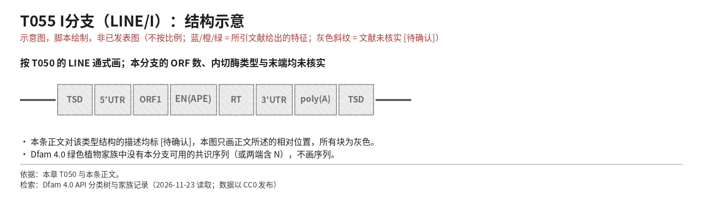

图 T055-1　I分支（LINE/I）：结构示意。示意图，脚本绘制，非已发表图；每个特征的来源写在图下方。序列：Dfam 4.0 绿色植物家族中没有本类型可用的共识序列（无此类家族、两端 30 bp 含 N，或分类标注无法核实），不画序列。


完整的自主型 I 元件全长通常在 5 kb 至 6 kb 之间，两端无 LTR，5' UTR 含内部启动子，3' 端常以短串联重复序列（如黑腹果蝇 I 因子中的 `TAA` 重复）而非经典长 poly(A) 尾结束（I 因子结构专文 DOI 待确认）。基因组中同样存在大量 5' 端截短拷贝 [待确认]。

#### TSD

整合进入宿主基因组时在元件两翼形成长度可变的靶位点重复（TSD），典型长度为 5 bp 至 20 bp（通常在 10 bp 至 14 bp 左右） [待确认]。

#### 编码蛋白与结构域顺序

自主型 I 元件包含两个开放阅读框（ORF1 与 ORF2）：ORF1 编码含 CCHC 锌指基序的 GAG 样核酸结合蛋白；ORF2 依次编码**无嘌呤/无嘧啶核酸内切酶（APE）**、反转录酶（RT）以及**核糖核酸酶 H（RH）**，核心结构域排列顺序为 **ORF1 - EN(APE) - RT - RH** [待确认]。ORF2 末尾携带 RH 结构域是 I 超家族区别于 L1、RTE 与 Jockey 的重要结构特征之一 [待确认]。

#### 转座机制

遵循 LINE 目经典的**靶位点引物反转录（TPRT）**复制粘贴机制：由 5' 端内部启动子驱动全长 RNA 转录，翻译出 ORF1 与 ORF2 蛋白后形成 RNP 进入细胞核，经 APE 内切酶切口、RT 原位反转录及 RH 参与的 RNA 模板降解与第二链合成完成整合，伴随产生可变长 TSD [待确认]。

#### 自主与非自主搭档

完整编码 ORF1 与 ORF2 的拷贝为自主型；基因组中可存在 5' 端截短或内部缺失的非自主拷贝 [待确认]。

#### 识别特征与工具

识别 I 超家族需结合 RepeatModeler2（Flynn 等 2020, doi:10.1073/pnas.1921046117）、基于 Dfam 的 RepeatMasker与 GyDB 蛋白域 HMM 检索，重点确认 ORF2 中同时存在 `EN(APE)-RT-RH` 且反转录酶系统发育定位于 `LINE/I` 分支。

#### 分类争议

在系统发育分析中，I、Jockey 与 R1 等分支在深层演化树上亲缘关系相近（常归入广义 R1-like 或 I-Jockey 超类群）；2007 年统一分类体系将 I（`RII`）与 Jockey（`RIJ`）分列为独立超家族，Dfam 现行体系亦保留 `LINE/I` 独立节点（Wicker 等 2007, doi:10.1038/nrg2165）。

#### 发现与分布

**发现与命名**

- 未找到已核实的原始发现/命名论文 [待确认]（已按名称在 Europe PMC 检索标题，未检出可核对的原始论文）。

**植物中的报道**

- 未检索到已核实的植物报道 [待确认]。

**葡萄中的报道**

- 未检索到葡萄专门报道（检索方式见文末「证据与检索方法」）。这只说明检索没有找到，不能据此推断葡萄基因组中不存在。

### T056 Jockey分支（LINE/Jockey）

**名称对照**：Wicker 体系：I 类 / LINE 目（Wicker 超家族名单原文未读，未核实）；Dfam 节点：I-group;Jockey；REXdb 路径：Class_I/LINE（REXdb 不分支系）。（来源：Wicker 2007 原文本书未读；Dfam 4.0 分类树，2026-11-23 读取；REXdb v4.0 说明文件，doi:10.5281/zenodo.10160279）

#### 定义与命名

Jockey 是 I 类转座子 LINE 目下的五大经典超家族之一，在 2007 年统一分类体系中三字母代码为 `RIJ`（Wicker 等 2007, doi:10.1038/nrg2165），在 Dfam 现行分类体系中对应 `LINE/I-Jockey` 节点。该分支以最早在黑腹果蝇基因组中发现的 Jockey 元件命名，果蝇中负责维持端粒长度的著名端粒逆转座子 `HeT-A` 与 `TART` 亦归属于 Jockey 分支（原始发现与端粒功能专文 DOI 待确认）。

#### 结构、长度与末端


图 T056-1　Jockey分支（LINE/Jockey）：结构示意。示意图，脚本绘制，非已发表图；每个特征的来源写在图下方。序列：Dfam 4.0 绿色植物家族中没有本类型可用的共识序列（无此类家族、两端 30 bp 含 N，或分类标注无法核实），不画序列。


完整的自主型 Jockey 元件全长通常在 4.5 kb 至 6 kb 之间，两端无 LTR，5' 端含内部 RNA 聚合酶 II 启动子，3' 端以 poly(A) 尾结束 [待确认]。基因组中常存在大量 5' 端截短拷贝 [待确认]。

#### TSD

常规散在整合的 Jockey 元件在两翼形成长度可变的靶位点重复（TSD），典型长度为 5 bp 至 20 bp [待确认]；而特化用于端粒延伸的成员（如 HeT-A、TART）直接加接于染色体末端，不产生经典 TSD（专文 DOI 待确认）。

#### 编码蛋白与结构域顺序

自主型 Jockey 元件包含两个开放阅读框（ORF1 与 ORF2）：ORF1 编码含锌指基序的 GAG 样核酸结合蛋白，ORF2 编码**无嘌呤/无嘧啶核酸内切酶（APE）**与反转录酶（RT），核心结构域排列顺序为 **ORF1 - EN(APE) - RT**，通常不含核糖核酸酶 H（RH）结构域 [待确认]。

#### 转座机制

遵循 LINE 目经典的**靶位点引物反转录（TPRT）**复制粘贴机制 [待确认]。在果蝇等缺乏经典端粒酶的双翅目昆虫中，Jockey 分支下的特化成员（如 TART 与 HeT-A）演化出靶向染色体末端的逆转座机制，取代端粒酶承担维持端粒长度的关键功能（端粒替代机制专文 DOI 待确认）。

#### 自主与非自主搭档

完整编码 ORF1 与 ORF2 的拷贝为自主型；基因组中存在大量 5' 端截短或内部缺失的非自主拷贝，例如果蝇端粒区的 HeT-A 即缺失反转录酶编码区，需依赖同支自主型成员反式提供反转录机器（专文 DOI 待确认）。

#### 识别特征与工具

识别 Jockey 依赖 RepeatModeler2（Flynn 等 2020, doi:10.1073/pnas.1921046117）、基于 Dfam 的 RepeatMasker以及 GyDB 蛋白域 HMM 检索，核心判据为 `ORF1 - EN(APE) - RT` 结构域组合及反转录酶系统发育定位于 `LINE/I-Jockey`。

#### 分类争议

2007 年统一分类体系将 Jockey（`RIJ`）与 I（`RII`）并列为独立超家族（Wicker 等 2007, doi:10.1038/nrg2165）；Dfam 现行分类体系则在节点命名上采用 `LINE/I-Jockey` 以体现其与 I 分支的近缘关系 [待确认]。

#### 发现与分布

**发现与命名**

- Priimägi 等 (1988) The Drosophila mobile element jockey belongs to LINEs and contains coding sequences homologous to some retroviral proteins. Gene. doi:10.1016/0378-1119(88)90197-7。摘要原句：“A detailed investigation of the Drosophila melanogaster mobile dispersed repetitive element jockey was performed”；涉及生物：Drosophila melanogaster；支持范围：jockey belongs to LINEs
- Mizrokhi 等 (1988) jockey, a mobile Drosophila element similar to mammalian LINEs, is transcribed from the internal promoter by RNA polymerase II. Cell. doi:10.1016/s0092-8674(88)80013-8。摘要原句：“The mobile element jockey is similar in structural organization and coding potential to the LINEs of various organisms”；涉及生物：Drosophila melanogaster

**植物中的报道**

- 未检索到已核实的植物报道 [待确认]。

**葡萄中的报道**

- 未检索到葡萄专门报道（检索方式见文末「证据与检索方法」）。这只说明检索没有找到，不能据此推断葡萄基因组中不存在。

### T057 CR1分支（LINE/CR1）

**名称对照**：Wicker 体系：I 类 / LINE 目（Wicker 超家族名单原文未读，未核实）；Dfam 节点：CR1-group;CR1；REXdb 路径：Class_I/LINE（REXdb 不分支系）。（来源：Wicker 2007 原文本书未读；Dfam 4.0 分类树，2026-11-23 读取；REXdb v4.0 说明文件，doi:10.5281/zenodo.10160279）

#### 定义与命名

CR1（chicken repeat 1）是 Dfam 现行分类体系中 LINE 目下的独立核心大支，对应 `LINE/CR1` 节点（Storer 等 2021, doi:10.1186/s13100-020-00230-y）。该分支以最早在鸡（*Gallus gallus*）基因组中发现的高拷贝散在重复序列 CR1 命名（CR1 原始发现专文 DOI 待确认）。在 2007 年统一分类体系的五大粗分超家族中，CR1 未单列独立三字母代码，通常在宽泛意义上归入 Jockey 或 L1 邻近类群，而在现代精细系统发育分类与 Dfam 中确立为独立大支（Storer 等 2021, doi:10.1186/s13100-020-00230-y）。

#### 结构、长度与末端

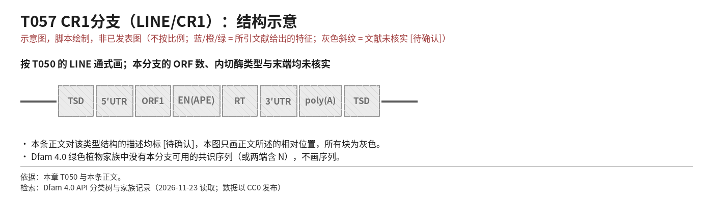

图 T057-1　CR1分支（LINE/CR1）：结构示意。示意图，脚本绘制，非已发表图；每个特征的来源写在图下方。序列：Dfam 4.0 绿色植物家族中没有本类型可用的共识序列（无此类家族、两端 30 bp 含 N，或分类标注无法核实），不画序列。


完整的自主型 CR1 元件全长通常在 4.5 kb 左右，两端无 LTR，5' UTR 含内部启动子，3' 端不以经典 poly(A) 尾结束，而是以高度保守的短串联重复序列（例如鸡 CR1 典型的 8 bp `ATTCTRTG` 重复基序）结尾（CR1 末端结构专文 DOI 待确认）。与其余 LINE 一样，宿主基因组中绝大多数 CR1 拷贝为长度仅数百 bp 的 5' 端截短拷贝 [待确认]。

#### TSD

整合进入宿主基因组时在元件两翼形成长度可变的靶位点重复（TSD），但部分 CR1 拷贝在整合时可能不形成明显 TSD 或伴随靶位点微缺失（专文 DOI 待确认）。

#### 编码蛋白与结构域顺序

完整的自主型 CR1 元件包含两个开放阅读框（ORF1 与 ORF2）：ORF1 编码含酯酶样或核酸结合特征的蛋白，ORF2 编码**无嘌呤/无嘧啶核酸内切酶（APE）**与反转录酶（RT），核心结构域排列顺序为 **ORF1 - EN(APE) - RT**，不含核糖核酸酶 H（RH）结构域（CR1 蛋白域分析专文 DOI 待确认）。

#### 转座机制

遵循 LINE 目经典的**靶位点引物反转录（TPRT）**复制粘贴机制：反转录酶特异性识别自身 3' 端保守重复基序（而非通用 poly(A) 尾），在 APE 内切酶切开的靶位点处原位合成 cDNA 并完成整合（专文 DOI 待确认）。

#### 自主与非自主搭档

完整编码 ORF1 与 ORF2 的拷贝为自主型；CR1 的反转录机器能够驱动 3' 端共享同源尾部序列的非自主 SINE（如部分爬行类与鸟类 SINE）反式扩增（专文 DOI 待确认）。

#### 识别特征与工具

识别 CR1 主要依赖 RepeatModeler2（Flynn 等 2020, doi:10.1073/pnas.1921046117）、基于 Dfam 的 RepeatMasker（Storer 等 2021, doi:10.1186/s13100-020-00230-y）以及 GyDB 蛋白域 HMM 检索，核心判据为 `ORF1 - EN(APE) - RT` 结构域、特征性 3' 端非 poly(A) 短重复尾以及反转录酶系统发育定位于 `LINE/CR1`。

#### 分类争议

在 2007 年统一分类体系中 CR1 未单列超家族，而在 Dfam 现行分类体系中 `LINE/CR1`、`LINE/L2` 与 `LINE/Rex1` 均被确立为独立大支，三者在反转录酶系统发育树上关系密切，共同构成 CR1-like 超支（Storer 等 2021, doi:10.1186/s13100-020-00230-y）。

#### 发现与分布

**发现与命名**

- Burch 等 (1993) Chicken repeat 1 elements contain a pol-like open reading frame and belong to the non-long terminal repeat class of retrotransposons. Proceedings of the National Academy of Sciences. doi:10.1073/pnas.90.17.8199。摘要原句：“Chicken genomes contain approximately 30,000 chicken repeat 1 (CR1) elements scattered among single-copy sequences, but no information has yet been presented to account for how these elements could have dispersed”；涉及生物：chicken (Gallus gallus)；支持范围：CR1 non-LTR retrotransposon

**植物中的报道**

- 未检索到已核实的植物报道 [待确认]。

**葡萄中的报道**

- 未检索到葡萄专门报道（检索方式见文末「证据与检索方法」）。这只说明检索没有找到，不能据此推断葡萄基因组中不存在。

### T058 L2分支（LINE/L2）

**名称对照**：Wicker 体系：I 类 / LINE 目（Wicker 超家族名单原文未读，未核实）；Dfam 节点：L2-group;L2；REXdb 路径：Class_I/LINE（REXdb 不分支系）。（来源：Wicker 2007 原文本书未读；Dfam 4.0 分类树，2026-11-23 读取；REXdb v4.0 说明文件，doi:10.5281/zenodo.10160279）

#### 定义与命名

L2（LINE-2）是 Dfam 现行分类体系中 LINE 目下的独立核心大支，对应 `LINE/L2` 节点 [待确认]。在系统发育树上，L2 与 CR1 及 Rex1 分支亲缘关系极为相近，共同隶属于广义 CR1-like 演化支（L2 系统发育定位专文 DOI 待确认）。在文献与脚本检索中，切忌仅用短名 `L2` 进行文本匹配（易与核糖体蛋白 L2、病毒基因 L2 等混淆），必须使用完整标签 `LINE/L2`。

#### 结构、长度与末端

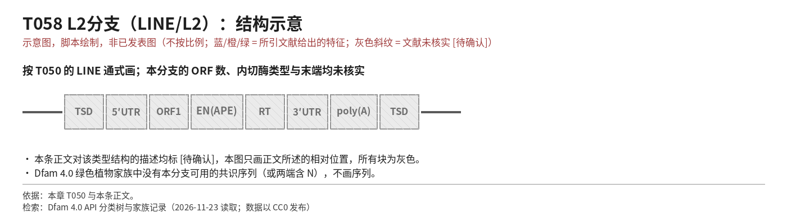

图 T058-1　L2分支（LINE/L2）：结构示意。示意图，脚本绘制，非已发表图；每个特征的来源写在图下方。序列：Dfam 4.0 绿色植物家族中没有本类型可用的共识序列（无此类家族、两端 30 bp 含 N，或分类标注无法核实），不画序列。


完整的自主型 L2 元件全长通常在 3 kb 至 4.5 kb 左右，两端无 LTR，3' 端通常以短串联重复序列（而非经典长 poly(A) 尾）结尾（专文 DOI 待确认）。在哺乳动物（如人类）基因组中，L2 已高度古老失活，几乎全部以严重截短的 3' 端碎片形式存在（专文 DOI 待确认）。

#### TSD

整合进入宿主基因组时在元件两翼形成长度可变的靶位点重复（TSD），典型长度为 5 bp 至 20 bp，但古老退化拷贝的 TSD 多已因突变积累而难以辨认 [待确认]。

#### 编码蛋白与结构域顺序

完整的自主型 L2 元件（在鱼类等仍保留活性拷贝的物种中可见）通常编码 ORF1 与 ORF2，其中 ORF2 编码**无嘌呤/无嘧啶核酸内切酶（APE）**与反转录酶（RT），核心结构域排列顺序为 **ORF1 - EN(APE) - RT**，不含核糖核酸酶 H（RH）结构域 [待确认]。

#### 转座机制

遵循 LINE 目经典的**靶位点引物反转录（TPRT）**复制粘贴机制：由 5' 端内部启动子驱动转录，反转录酶识别自身 3' 端特征尾部序列并在 APE 切口处原位合成 cDNA 完成整合 [待确认]。

#### 自主与非自主搭档

完整编码 ORF1 与 ORF2 的拷贝为自主型。L2 的历史性功能之一是驱动脊椎动物古老非自主 SINE 家族 **MIR**（mammalian-wide interspersed repeat）的反式扩增，MIR 3' 端保留了与 L2 高度同源的尾部识别序列（MIR 与 L2 搭档专文 DOI 待确认）。

#### 识别特征与工具

识别 L2 依赖 RepeatModeler2（Flynn 等 2020, doi:10.1073/pnas.1921046117）、基于 Dfam 的 RepeatMasker以及 GyDB 蛋白域 HMM 检索，需结合反转录酶系统发育定位将其与近缘的 CR1 区分。

#### 分类争议

在 2007 年统一分类体系中 L2 未单列超家族 [待确认]；Dfam 现行分类体系将 `LINE/L2` 与 `LINE/CR1` 分列为独立大支，但两者在反转录酶序列和 3' 端特征上高度相近，部分早期研究曾将两者合并在 CR1 超支内讨论 [待确认]。

#### 发现与分布

**发现与命名**

- 未找到已核实的原始发现/命名论文 [待确认]（已按名称在 Europe PMC 检索标题，未检出可核对的原始论文）。

**植物中的报道**

- 未检索到已核实的植物报道 [待确认]。

**葡萄中的报道**

- 未检索到葡萄专门报道（检索方式见文末「证据与检索方法」）。这只说明检索没有找到，不能据此推断葡萄基因组中不存在。

### T059 R1分支（LINE/R1）

**名称对照**：Wicker 体系：I 类 / LINE 目（Wicker 超家族名单原文未读，未核实）；Dfam 节点：R1-subgroup;R1；REXdb 路径：Class_I/LINE（REXdb 不分支系）。（来源：Wicker 2007 原文本书未读；Dfam 4.0 分类树，2026-11-23 读取；REXdb v4.0 说明文件，doi:10.5281/zenodo.10160279）

#### 定义与命名

R1 是 Dfam 现行分类体系中 LINE 目下的独立系统发育分支，对应 `LINE/R1`（及其近缘分支 `LINE/R1-LOA`）节点 [待确认]。在深层系统发育关系上，R1 与 I、Jockey 分支同处于广义 R1-like 超类群之下（R1 原始发现专文 DOI 待确认）。与 R2 类似，R1 的许多代表成员以高度位点特异性地靶向插入宿主核糖体 DNA（28S rDNA）或端粒重复序列而闻名，但在内切酶类型与系统发育位置上与 R2 完全不同（R1 与 R2 比较专文 DOI 待确认）。

#### 结构、长度与末端


图 T059-1　R1分支（LINE/R1）：结构示意。示意图，脚本绘制，非已发表图；每个特征的来源写在图下方。序列：Dfam 4.0 绿色植物家族中没有本类型可用的共识序列（无此类家族、两端 30 bp 含 N，或分类标注无法核实），不画序列。


完整的自主型 R1 元件全长通常在 5 kb 至 6 kb 之间，两端无 LTR，5' 端含内部启动子（部分靶向 rDNA 的拷贝可借由宿主 rDNA 共转录），3' 端以 poly(A) 尾结束（专文 DOI 待确认）。基因组中同样存在大量 5' 端截短拷贝 [待确认]。

#### TSD

位点特异性插入 28S rDNA 的典型 R1 元件在靶位点切口修复后，常在两翼形成长度相对固定的正向靶位点重复（例如昆虫 R1 典型的约 14 bp TSD，具体长度因家族而异，专文 DOI 待确认）。

#### 编码蛋白与结构域顺序

完整的自主型 R1 元件包含两个开放阅读框（ORF1 与 ORF2）：ORF1 编码核酸结合蛋白，ORF2 编码**无嘌呤/无嘧啶核酸内切酶（APE）**与反转录酶（RT），核心结构域排列顺序为 **ORF1 - EN(APE) - RT**（部分近缘 LOA 成员可携带 RH 样结构域，细节待确认）。虽然 R1 与 R2 均可精准靶向 28S rDNA，但 R1 使用位于 RT 上游的 APE 内切酶，而 R2 使用位于 RT 下游的 RLE 内切酶，两者属于完全独立演化出的 rDNA 靶向机制（专文 DOI 待确认）。

#### 转座机制

遵循 LINE 目经典的**靶位点引物反转录（TPRT）**复制粘贴机制：ORF2 的 APE 内切酶高度特异性地识别并切割 28S rDNA（或特定串联重复区，如端粒重复）中的保守靶序列，暴露的 3'-OH 作为引物原位反转录 R1 RNA 并完成整合，伴随产生特征性 TSD（专文 DOI 待确认）。

#### 自主与非自主搭档

完整编码 ORF1 与 ORF2 的拷贝为自主型；基因组中常见 5' 端截短的非自主拷贝 [待确认]。

#### 识别特征与工具

识别 R1 依赖 RepeatModeler2（Flynn 等 2020, doi:10.1073/pnas.1921046117）、基于 Dfam 的 RepeatMasker以及 GyDB 蛋白域 HMM 检索，核心判据为 `ORF1 - EN(APE) - RT` 结构域组合、28S rDNA 或特定重复区的靶向定位以及反转录酶系统发育定位于 `LINE/R1`。

#### 分类争议

2007 年统一分类体系未将 R1 单列为五大超家族之一，而是将其宽泛归入 I 或 Jockey 邻近类群 [待确认]；Dfam 现行分类体系将其单列为 `LINE/R1` 及 `LINE/R1-LOA`，与 `LINE/I`、`LINE/I-Jockey` 清晰区分 [待确认]。

#### 发现与分布

**发现与命名**

- Jakubczak 等 (1991) Retrotransposable elements R1 and R2 interrupt the rRNA genes of most insects. Proceedings of the National Academy of Sciences. doi:10.1073/pnas.88.8.3295。摘要原句：“A large number of insect species have been screened for the presence of the retrotransposable elements R1 and R2”；涉及生物：insects；支持范围：R1 and R2 interrupt rRNA genes

**植物中的报道**

- 未检索到已核实的植物报道 [待确认]。

**葡萄中的报道**

- 未检索到葡萄专门报道（检索方式见文末「证据与检索方法」）。这只说明检索没有找到，不能据此推断葡萄基因组中不存在。


## 第八部分　LINE 分支（二）与 SINE 类型

### T060 Rex-Babar分支（LINE/Rex-Babar）

**名称对照**：Wicker 体系：I 类 / LINE 目（Wicker 超家族名单原文未读，未核实）；Dfam 节点：CR1-group;Rex-Babar；REXdb 路径：Class_I/LINE（REXdb 不分支系）。（来源：Wicker 2007 原文本书未读；Dfam 4.0 分类树，2026-11-23 读取；REXdb v4.0 说明文件，doi:10.5281/zenodo.10160279）

#### 定义与命名

Rex-Babar（常简称 Rex1）是 I 类转座子 LINE 目下的独立系统发育分支，在 Dfam 与 Repbase 现行分类体系中对应 `LINE/Rex-Babar`（或 `LINE/Rex1`）节点 [待确认]。在 2007 年真核转座子统一分类体系的五大粗分 LINE 超家族框架中，该分支未单列独立三字母代码，而在分子系统发育树上与 CR1 和 L2 分支亲缘关系密切，共同归属于广义 CR1-like 超类群 [待确认]。

#### 结构、长度与末端


图 T060-1　Rex-Babar分支（LINE/Rex-Babar）：结构示意。示意图，脚本绘制，非已发表图；每个特征的来源写在图下方。序列：Dfam 4.0 绿色植物家族中没有本类型可用的共识序列（无此类家族、两端 30 bp 含 N，或分类标注无法核实），不画序列。


完整的自主型 Rex-Babar 元件全长通常在 3.5 kb 至 5 kb 左右，两端无长末端重复序列（LTR），5' UTR 含内部启动子，3' UTR 末端常以短串联重复序列或非典型 poly(A) 尾结束（精确跨物种长度分布统计待确认）。与多数 LINE 分支一致，宿主基因组中大量拷贝因反转录提前终止而表现为 5' 端截短形态 [待确认]。

#### TSD

整合进入宿主基因组时在元件两翼形成长度可变的靶位点重复（TSD），遵循 LINE 目典型的 5 bp 至 20 bp 特征，部分拷贝在整合时可能不形成明显 TSD 或伴随靶位点微缺失（精确 TSD 分布统计待确认）。

#### 编码蛋白与结构域顺序

自主型 Rex-Babar 元件通常包含两个开放阅读框（ORF1 与 ORF2，部分成员 ORF1 退化或难以辨识），其中核心酶类编码区（ORF2）依次编码**无嘌呤/无嘧啶核酸内切酶（APE）**与反转录酶（RT），排列顺序为 **ORF1 - EN(APE) - RT**，不含核糖核酸酶 H（RH）结构域 [待确认]。

#### 转座机制

遵循 LINE 目经典的**靶位点引物反转录（TPRT）**复制粘贴机制：由 5' 端内部启动子驱动转录，ORF2p 的 APE 内切酶切开宿主染色体单链 DNA，以暴露的 3'-OH 为引物原位反转录自身 RNA 合成负链 cDNA，经第二链合成与宿主修复完成整合 [待确认]。

#### 自主与非自主搭档

完整编码 APE 与 RT 的拷贝为自主型；基因组中普遍存在大量 5' 端截短的非自主拷贝 [待确认]。在部分硬骨鱼类等动物基因组中，Rex-Babar 反转录机器可驱动 3' 端共享同源尾部的特定非自主 SINE 家族反式扩增（具体配对专文 DOI 待确认）。

#### 识别特征与工具

识别 Rex-Babar 依赖 RepeatModeler2（Flynn 等 2020, doi:10.1073/pnas.1921046117）、基于 Dfam 的 RepeatMasker以及 GyDB 蛋白域 HMM 检索，核心依据为 `EN(APE) - RT` 结构域组合以及反转录酶系统发育定位于 `LINE/Rex-Babar` 节点，并与近缘的 CR1、L2 区分。

#### 分类争议

2007 年统一分类体系未将 Rex-Babar 单列为五大 LINE 超家族之一 [待确认]；Dfam 现行分类体系将其作为独立分支 `LINE/Rex-Babar` 列出，但部分早期文献及旧版数据库仍沿用 `Rex1` 标签，且其与 CR1、L2 在 CR1-like 超支内的细分界线曾有不同划分 [待确认]。

#### 发现与分布

**发现与命名**

- Volff 等 (2000) Multiple lineages of the non-LTR retrotransposon Rex1 with varying success in invading fish genomes. Molecular Biology and Evolution. doi:10.1093/oxfordjournals.molbev.a026266。摘要原句：“Rex1, together with the related BABAR: elements, represents a new family of non-long-terminal-repeat (non-LTR) retrotransposons from fish, which might be related to the CR1 clade of LINE elements”；支持范围：Rex1 lineages

**植物中的报道**

- 未检索到已核实的植物报道 [待确认]。

**葡萄中的报道**

- 未检索到葡萄专门报道（检索方式见文末「证据与检索方法」）。这只说明检索没有找到，不能据此推断葡萄基因组中不存在。

### T061 Dualen分支（LINE/Dualen）

**名称对照**：Wicker 体系：I 类 / LINE 目（Wicker 超家族名单原文未读，未核实）；Dfam 节点：R4-like;Dualen；REXdb 路径：Class_I/LINE（REXdb 不分支系）。（来源：Wicker 2007 原文本书未读；Dfam 4.0 分类树，2026-11-23 读取；REXdb v4.0 说明文件，doi:10.5281/zenodo.10160279）

#### 定义与命名

Dualen（又称 RandI）是 I 类转座子 LINE 目下极为罕见且具有关键演化意义的系统发育分支，在 Dfam 现行分类体系中对应 `LINE/Dualen`（或 `RandI`）相关节点（Dualen 原始命名专文 DOI 待确认）。该分支得名于其极其罕见的「双核酸内切酶（dual endonuclease）」结构，在演化特征上兼具古老 R2/R4 样元件（含 RLE）与较进化 LINE 元件（含 APE）的双重属性（专文 DOI 待确认）。

#### 结构、长度与末端


图 T061-1　Dualen分支（LINE/Dualen）：结构示意。示意图，脚本绘制，非已发表图；每个特征的来源写在图下方。序列：Dfam 4.0 绿色植物家族中没有本类型可用的共识序列（无此类家族、两端 30 bp 含 N，或分类标注无法核实），不画序列。


完整的自主型 Dualen 元件全长通常在 5 kb 至 6 kb 左右，两端无 LTR，5' 端含内部启动子，3' 端以 poly(A) 或短重复尾结束（精确跨物种长度分布统计待确认）。基因组中同样存在 5' 端截短拷贝 [待确认]。

#### TSD

整合进入宿主基因组时在元件两翼形成长度可变的靶位点重复（TSD），遵循 LINE 目一般规律（具体实测 TSD 长度范围专文 DOI 待确认）。

#### 编码蛋白与结构域顺序

Dualen 最具辨识度的分子特征是**在同一个元件内同时编码两种不同类型的核酸内切酶**：既在反转录酶上游携带**无嘌呤/无嘧啶核酸内切酶（APE）**，又在反转录酶下游携带**限制性内切酶样核酸内切酶（RLE）**，核心结构域排列顺序为 **EN(APE) - RT - EN(RLE)**（部分成员还携带核糖核酸酶 H 或锌指基序，具体结构域细节专文 DOI 待确认）。这一罕见组合被视为连接古老单内切酶 RLE 型 LINE（如 R2、R4）与现代 APE 型 LINE（如 L1、I、Jockey）的关键演化过渡形态（专文 DOI 待确认）。

#### 转座机制

推断遵循 LINE 目经典的**靶位点引物反转录（TPRT）**复制粘贴机制，但关于其 APE 与 RLE 两种内切酶在单次转座事件中如何分工或协同切割宿主 DNA 双链，目前尚缺乏直接的体外生化验证（待确认）。

#### 自主与非自主搭档

完整编码双内切酶与反转录酶的拷贝为自主型；基因组中可存在 5' 端截短或内部缺失的非自主拷贝，目前未见 Dualen 驱动特定 SINE 家族扩增的报道（待确认）。

#### 识别特征与工具

识别 Dualen 的核心分子判据是在同一非 LTR 反转录转座子开放阅读框内同时检出上游 `EN(APE)`、中间 `RT` 与下游 `EN(RLE)` 三个结构域。常用工具包括 RepeatModeler2（Flynn 等 2020, doi:10.1073/pnas.1921046117）、基于 Dfam 的 RepeatMasker以及 GyDB 蛋白域 HMM 检索。

#### 分类争议

由于 Dualen 在 2007 年统一分类体系中未单列超家族，且不同研究团队早期曾分别命名为 `Dualen` 与 `RandI`，在数据库与文献中存在双名并存现象 [待确认]；现代精细系统发育分类已确认其作为 LINE 目下独立稀有分支的演化过渡地位 [待确认]。

#### 发现与分布

**发现与命名**

- 未找到已核实的原始发现/命名论文 [待确认]（已按名称在 Europe PMC 检索标题，未检出可核对的原始论文）。

**植物中的报道**

- 未检索到已核实的植物报道 [待确认]。

**葡萄中的报道**

- 未检索到葡萄专门报道（检索方式见文末「证据与检索方法」）。这只说明检索没有找到，不能据此推断葡萄基因组中不存在。

### T062 Tad1分支（LINE/Tad1）

**名称对照**：Wicker 体系：I 类 / LINE 目（Wicker 超家族名单原文未读，未核实）；Dfam 节点：R1-like;Tad1；REXdb 路径：Class_I/LINE（REXdb 不分支系）。（来源：Wicker 2007 原文本书未读；Dfam 4.0 分类树，2026-11-23 读取；REXdb v4.0 说明文件，doi:10.5281/zenodo.10160279）

#### 定义与命名

Tad1 是 I 类转座子 LINE 目下的独立系统发育分支，在 Dfam 现行分类体系中对应 `LINE/Tad1` 节点 [待确认]。该分支以最早在粗糙脉孢菌（*Neurospora crassa*）中发现的活性非 LTR 反转录转座子 Tad1-1 命名（Tad1 原始发现专文 DOI 待确认）。在 2007 年统一分类体系的五大粗分 LINE 超家族中，Tad1 未单列独立三字母代码，通常在宽泛意义上归入 I 超家族邻近类群 [待确认]。

#### 结构、长度与末端


图 T062-1　Tad1分支（LINE/Tad1）：结构示意。示意图，脚本绘制，非已发表图；每个特征的来源写在图下方。序列：Dfam 4.0 绿色植物家族中没有本类型可用的共识序列（无此类家族、两端 30 bp 含 N，或分类标注无法核实），不画序列。


完整的自主型 Tad1 元件全长通常在 6 kb 至 7 kb 左右，两端无 LTR，5' UTR 含内部启动子，3' 端多以短重复序列或 poly(A) 尾结束（精确跨物种长度分布统计待确认）。基因组中常存在 5' 端截短拷贝 [待确认]。

#### TSD

整合进入宿主基因组时在元件两翼形成长度可变的靶位点重复（TSD），典型长度为 5 bp 至 20 bp（通常在 10 bp 至 17 bp 左右，专文 DOI 待确认）。

#### 编码蛋白与结构域顺序

自主型 Tad1 元件包含两个开放阅读框（ORF1 与 ORF2）：ORF1 编码核酸结合蛋白，ORF2 依次编码**无嘌呤/无嘧啶核酸内切酶（APE）**、反转录酶（RT）与**核糖核酸酶 H（RH）**，核心结构域排列顺序为 **ORF1 - EN(APE) - RT - RH** [待确认]。与 I 超家族类似，携带 RH 结构域是 Tad1 的重要结构特征 [待确认]。

#### 转座机制

遵循 LINE 目经典的**靶位点引物反转录（TPRT）**复制粘贴机制：由 5' 端内部启动子驱动全长 RNA 转录，翻译出 ORF1 与 ORF2 蛋白后形成 RNP 进入细胞核，在 APE 内切酶切口处原位反转录合成 cDNA 并完成整合，伴随产生可变长 TSD [待确认]。在脉孢菌等子囊菌中，Tad1 拷贝在有性生殖阶段极易遭受宿主重复诱导点突变（RIP）防御机制的密集 C-to-T 突变而失活（RIP 防御专文 DOI 待确认）。

#### 自主与非自主搭档

完整编码 ORF1 与 ORF2 的拷贝为自主型；基因组中可存在 5' 端截短或经 RIP 突变失活的非自主拷贝（待确认）。

#### 识别特征与工具

识别 Tad1 依赖 RepeatModeler2（Flynn 等 2020, doi:10.1073/pnas.1921046117）、基于 Dfam 的 RepeatMasker以及 GyDB 蛋白域 HMM 检索，核心判据为 `ORF1 - EN(APE) - RT - RH` 结构域组合以及反转录酶系统发育定位于 `LINE/Tad1`。

#### 分类争议

2007 年统一分类体系未将 Tad1 单列为五大 LINE 超家族之一 [待确认]；Dfam 现行分类体系及真菌转座子研究界则将其确立为独立分支 `LINE/Tad1`，与动物为主的 `LINE/I` 明确区分 [待确认]。

#### 发现与分布

**发现与命名**

- Kinsey 和 Helber (1989) Isolation of a transposable element from Neurospora crassa. Proceedings of the National Academy of Sciences. doi:10.1073/pnas.86.6.1929。摘要原句：“A Neurospora crassa strain from Adiopodoumé, Ivory Coast, contains multiple copies of a transposable element, Tad”；涉及生物：Neurospora crassa；支持范围：Tad isolated [注意：所引句不含该名称，仅支持上位/总体论断]

**植物中的报道**

- 未检索到已核实的植物报道 [待确认]。

**葡萄中的报道**

- 未检索到葡萄专门报道（检索方式见文末「证据与检索方法」）。这只说明检索没有找到，不能据此推断葡萄基因组中不存在。

### T063 CRE / R4相关支（LINE/CRE & R4）

**名称对照**：Wicker 体系：I 类 / LINE 目（Wicker 超家族名单原文未读，未核实）；Dfam 节点：Group-I;CRE；R4 相关见 Group-1;R4-like；REXdb 路径：Class_I/LINE（REXdb 不分支系）。（来源：Wicker 2007 原文本书未读；Dfam 4.0 分类树，2026-11-23 读取；REXdb v4.0 说明文件，doi:10.5281/zenodo.10160279）

#### 定义与命名

CRE / R4 相关支是指 I 类转座子 LINE 目中演化分歧最早、携带限制性内切酶样核酸内切酶（RLE）的一组古老非 LTR 反转录转座子分支集合，在 Dfam 现行分类体系中分别对应 `LINE/CRE`、`LINE/Dong-R4`、`LINE/R2-NeSL` 等独立节点 [待确认]。在 2007 年真核转座子统一分类体系的五大粗分超家族中，这些早期分歧分支均被宽泛归入 `R2` 超家族（`RIR`）之下，而在精细系统发育分析中被拆分为多个独立分支 [待确认]。

#### 结构、长度与末端


图 T063-1　CRE / R4相关支（LINE/CRE & R4）：结构示意。示意图，脚本绘制，非已发表图；每个特征的来源写在图下方。序列：Dfam 4.0 绿色植物家族中没有本类型可用的共识序列（无此类家族、两端 30 bp 含 N，或分类标注无法核实），不画序列。


完整的自主型 CRE、Dong-R4 与 NeSL 元件全长通常在 3 kb 至 5 kb 左右，两端无 LTR，3' 端多以短 poly(A) 或富含 A 的序列结束（精确跨分支长度分布统计待确认）。与多数 LINE 一样，基因组中常伴生 5' 端截短拷贝 [待确认]。

#### TSD

因 RLE 核酸内切酶具有高度严格的靶序列切割特异性，该类群整合进入特定靶位点时常产生较短或长度固定的靶位点重复（TSD），部分位点也可表现为零 TSD 或微小靶位点缺失（专文 DOI 待确认）。

#### 编码蛋白与结构域顺序

该类群最核心的共同分子特征是**仅含单一开放阅读框（ORF）**，编码 N 端 DNA 结合锌指基序、中间的反转录酶（RT）以及 C 端的**限制性内切酶样核酸内切酶（RLE）**，排列顺序为 **RT - EN(RLE)**，不含 APE 内切酶与经典 ORF1 [待确认]。这一结构域组织与 R2 分支相同，构成了整个 LINE 目最基部的早期演化群 [待确认]。

#### 转座机制

采用高度位点特异性的**靶位点引物反转录（TPRT）**机制完成复制粘贴扩增 [待确认]。不同分支演化出截然不同的精准靶向位点：例如 CRE 特异性插入动质体原生生物的剪接前导 RNA（SL RNA）基因串联重复区，NeSL 靶向线虫的剪接前导基因，而 R4 与 Dong 则分别靶向 28S rDNA 或 TAA 串联微卫星重复区（各分支靶位点特异性专文 DOI 待确认）。

#### 自主与非自主搭档

完整编码 RT 与 RLE 的拷贝为自主型；基因组中可存在 5' 端截短的非自主拷贝，因高度位点特异性一般不驱动泛基因组的 SINE 扩增（待确认）。

#### 识别特征与工具

识别该类群的核心依据是检出单一 ORF 编码的 `RT - EN(RLE)` 结构域顺序，并结合其反转录酶系统发育位置及特定靶位点（SL RNA 基因、rDNA 或 TAA 重复）进行归类。常用工具包括 RepeatModeler2（Flynn 等 2020, doi:10.1073/pnas.1921046117）、基于 Dfam 的 RepeatMasker以及 GyDB 蛋白域 HMM 检索。

#### 分类争议

2007 年统一分类体系出于简化目的，将 CRE、R4、Dong、NeSL 与 R2 一并归入 R2 超家族 [待确认]；而 Dfam 现行分类体系及分子演化研究界则基于反转录酶深层分歧与靶位点差异，将其分别单列为 `LINE/CRE`、`LINE/Dong-R4`、`LINE/R2-NeSL` 等独立分支 [待确认]。

#### 发现与分布

**发现与命名**

- Burke 等 (1995) R4, a non-LTR retrotransposon specific to the large subunit rRNA genes of nematodes. Nucleic Acids Research. doi:10.1093/nar/23.22.4628。摘要原句：“A 4.7 kb sequence-specific insertion in the 26S ribosomal RNA gene of Ascaris lumbricoides, named R4, is shown to be a non-long terminal repeat (non-LTR) retrotransposable element”；涉及生物：nematodes；支持范围：R4 rDNA-specific non-LTR retrotransposon

**植物中的报道**

- 未检索到已核实的植物报道 [待确认]。

**葡萄中的报道**

- 未检索到葡萄专门报道（检索方式见文末「证据与检索方法」）。这只说明检索没有找到，不能据此推断葡萄基因组中不存在。

### T064 tRNA源SINE（SINE/tRNA）

**名称对照**：Wicker 体系：I 类 / SINE 目；Dfam 节点：SINE;tRNA_Promoter；REXdb 路径：Class_I/SINE（不分来源）。（来源：类与目据 Arkhipova 2017, doi:10.1186/s13100-017-0103-2；Dfam 4.0 分类树，2026-11-23 读取；REXdb v4.0 说明文件，doi:10.5281/zenodo.10160279）

#### 定义与命名

tRNA 源 SINE（又称 SINE2）是 I 类转座子 SINE 目下分布最广、家族数量最多的核心类型，在 2007 年真核转座子统一分类体系中三字母代码为 `RST`（其中 `R` 代表反转录转座子，`S` 代表 SINE，`T` 代表 tRNA 来源）（Wicker 等 2007, doi:10.1038/nrg2165）。在 Dfam 现行分类体系中，该类群对应 `SINE/tRNA` 及其按体部保守核心域或搭档进一步细分的复合节点（如 `SINE/tRNA-Core`、`SINE/tRNA-RTE`、`SINE/tRNA-Deu`、`SINE/tRNA-V` 等）（Storer 等 2021, doi:10.1186/s13100-020-00230-y）。

#### 结构、长度与末端


图 T064-1　tRNA源SINE（SINE/tRNA）：结构示意。示意图，脚本绘制，非已发表图；每个特征的来源写在图下方。序列：Dfam 4.0 绿色植物家族中没有本类型可用的共识序列（无此类家族、两端 30 bp 含 N，或分类标注无法核实），不画序列。


tRNA 源 SINE 全长通常在 100 bp 至 400 bp 之间，无长末端重复序列（LTR），呈典型的「头部–体部–尾部」三段式结构 [待确认]。5' 端**头部**长约 70 bp 至 80 bp，起源于宿主转运 RNA（tRNA）基因，内部保留 RNA 聚合酶 III（Pol III）转录必需的 **A box** 与 **B box** 内部启动子基序；中间**体部**长约数十至二百 bp，起源于未知序列或演化保守的核心域；3' 端**尾部**通常为长度可变的 poly(A) 尾、富含 A/T 的简单重复或与特定自主型 LINE 3' 端同源的序列 [待确认]。

#### TSD

借用自主型 LINE 的酶系整合进入宿主基因组时，在元件两翼形成长度可变的靶位点重复（TSD），典型长度为 5 bp 至 20 bp [待确认]。

#### 编码蛋白与结构域顺序

tRNA 源 SINE 属于纯粹的非编码、非自主型元件，全长**不编码**任何蛋白质，不存在蛋白结构域顺序 [待确认]。

#### 转座机制

由宿主 **RNA 聚合酶 III** 识别 5' 端 tRNA 头部内的 A box 与 B box 启动子，驱动转录产生短单链 RNA；随后该 RNA 借由自身 3' 端尾部序列劫持同细胞内活跃自主型 **LINE** 元件所编码的反转录酶与核酸内切酶（ORF2p），通过**靶位点引物反转录（TPRT）**机制在宿主染色体切口处原位合成 cDNA 并完成整合，伴随产生可变长 TSD [待确认]。

#### 自主与非自主搭档

所有 tRNA 源 SINE 均为非自主型元件，必须依赖自主型 LINE 反式提供酶系 [待确认]。在植物中，多数 tRNA 源 SINE 依赖 L1 超家族（少数依赖 RTE 超家族）反式驱动；在动物中，不同 tRNA 源 SINE 家族则分别与 L1、L2、CR1 或 RTE 等 LINE 搭档配对（植物 tRNA-SINE 搭档配对专文 DOI 待确认）。

#### 识别特征与工具

识别 tRNA 源 SINE 需联合检测 5' 端 tRNA 同源头部（含 A box 与 B box 基序）、3' 端 poly(A) 或简单重复尾、两翼 5–20 bp TSD 及全基因组多拷贝一致性。常用工具包括 RepeatModeler2（Flynn 等 2020, doi:10.1073/pnas.1921046117）、基于 Dfam 的 RepeatMasker（Storer 等 2021, doi:10.1186/s13100-020-00230-y）以及专门的 SINE 从头预测工具（如 SINE_Scan、AnnoSINE 等，专文 DOI 待确认）。

#### 分类争议

2007 年统一分类体系按 5' 端头部来源将所有 tRNA 来源 SINE 归为 `RST` 超家族（Wicker 等 2007, doi:10.1038/nrg2165）；由于不同家族的体部常独立起源或发生模块重组（携带不同的保守核心域），Dfam 现行分类体系主张在 `SINE/tRNA` 下结合体部核心域与 3' 端搭档类型进行多维细分（Storer 等 2021, doi:10.1186/s13100-020-00230-y）。

#### 发现与分布

**发现与命名**

- Daniels 和 Deininger (1985) Repeat sequence families derived from mammalian tRNA genes. Nature. doi:10.1038/317819a0。摘要原句：“To determine the relationship between Galago SINEs and mammalian tRNA genes, we have compared their sequences”；支持范围：repeat families derived from tRNA genes
- Okada (1991) SINEs: Short interspersed repeated elements of the eukaryotic genome. Trends in Ecology & Evolution. doi:10.1016/0169-5347(91)90226-n。摘要原句：“Amongst these, there are two kinds of retroposons (sequence elements derived from nonviral cellular RNA): SINEs (short interspersed elements) and LINEs (long interspersed elements)”；支持范围：SINE origin from tRNA

**植物中的报道**

- Deragon 和 Zhang (2006) Short interspersed elements (SINEs) in plants: origin, classification, and use as phylogenetic markers. Systematic Biology. doi:10.1080/10635150601047843。摘要原句：“Short interspersed elements (SINEs) are a class of dispersed mobile sequences that use RNA as an intermediate in an amplification process called retroposition”；涉及生物：plants；支持范围：plant SINEs
- Wenke 等 (2011) Targeted identification of short interspersed nuclear element families shows their widespread existence and extreme heterogeneity in plant genomes. The Plant Cell. doi:10.1105/tpc.111.088682。摘要原句：“Short interspersed nuclear elements (SINEs) are non-long terminal repeat retrotransposons that are highly abundant, heterogeneous, and mostly not annotated in eukaryotic genomes”；涉及生物：plants；支持范围：SINE families in plant genomes
- Seibt 等 (2016) Short interspersed nuclear elements (SINEs) are abundant in Solanaceae and have a family-specific impact on gene structure and genome organization. The Plant Journal. doi:10.1111/tpj.13170。摘要原句：“Short interspersed nuclear elements (SINEs) are highly abundant non-autonomous retrotransposons that are widespread in plants”；涉及生物：Solanaceae；支持范围：SINEs in Solanaceae
- Lenoir 等 (2001) The evolutionary origin and genomic organization of SINEs in Arabidopsis thaliana. Molecular Biology and Evolution. doi:10.1093/oxfordjournals.molbev.a003778。摘要原句：“We have characterized the two families of SINE retroposons present in Arabidopsis thaliana”；涉及生物：Arabidopsis thaliana；支持范围：SINEs in Arabidopsis

**葡萄中的报道**

- 未检索到葡萄专门报道（检索方式见文末「证据与检索方法」）。这只说明检索没有找到，不能据此推断葡萄基因组中不存在。

### T065 7SL源SINE（SINE/7SL）

**名称对照**：Wicker 体系：I 类 / SINE 目；Dfam 节点：SINE;7SL-RNA_Promoter；REXdb 路径：Class_I/SINE（不分来源）。（来源：类与目据 Arkhipova 2017, doi:10.1186/s13100-017-0103-2；Dfam 4.0 分类树，2026-11-23 读取；REXdb v4.0 说明文件，doi:10.5281/zenodo.10160279）

#### 定义与命名

7SL 源 SINE（又称 SINE1）是 I 类转座子 SINE 目下以 7SL RNA（信号识别颗粒 RNA 组分）为 5' 端头部起源的经典类型，在 2007 年真核转座子统一分类体系中三字母代码为 `RSL`（Wicker 等 2007, doi:10.1038/nrg2165）。在 Dfam 现行分类体系中，该类群对应 `SINE/Alu`（灵长类二聚体 Alu 家族）与 `SINE/B1`（啮齿类单体 B1 家族）等节点（Storer 等 2021, doi:10.1186/s13100-020-00230-y）。人类基因组中拷贝数超过百万的 **Alu** 家族即是最著名的 7SL 源 SINE 代表（Alu 演化综述专文 DOI 待确认）。

#### 结构、长度与末端


图 T065-1　7SL源SINE（SINE/7SL）：结构示意。示意图，脚本绘制，非已发表图；每个特征的来源写在图下方。序列：Dfam 4.0 绿色植物家族中没有本类型可用的共识序列（无此类家族、两端 30 bp 含 N，或分类标注无法核实），不画序列。


7SL 源 SINE 无长末端重复序列（LTR），由 7SL RNA 内部缺失中间 S 域后衍生而来，5' 端保留 RNA 聚合酶 III 的 A box 与 B box 内部启动子，3' 端以富含 A 的 poly(A) 尾结束 [待确认]。啮齿类 B1 元件呈单体结构，全长约 130 bp 至 150 bp；而灵长类 Alu 元件呈头尾融合的二聚体结构（由两个 7SL 衍生单体经中间富含 A 的连接区拼接而成），全长约 300 bp [待确认]。

#### TSD

借用自主型 L1 的酶系经 TPRT 机制整合进入宿主基因组时，在元件两翼形成长度可变的靶位点重复（TSD），典型长度为 5 bp 至 20 bp（常见于 10 bp 至 18 bp 左右） [待确认]。

#### 编码蛋白与结构域顺序

7SL 源 SINE 为纯粹的非编码、非自主型元件，全长**不编码**任何蛋白质，不存在蛋白结构域顺序 [待确认]。

#### 转座机制

由宿主 **RNA 聚合酶 III** 识别 7SL 衍生头部内的内部启动子驱动转录产生短单链 RNA；该 RNA 结合宿主信号识别颗粒蛋白（SRP9/14）后停靠于核糖体附近，高效劫持正在翻译中的自主型 **L1** 元件编码的 ORF2p 反转录酶与内切酶，通过**靶位点引物反转录（TPRT）**机制原位合成 cDNA 并整合进入宿主基因组新位点，伴随产生可变长 TSD（SRP9/14 劫持 L1 机制专文 DOI 待确认）。

#### 自主与非自主搭档

所有 7SL 源 SINE 均为非自主型元件，在灵长类与啮齿类中严格依赖自主型 **L1（LINE-1）** 超家族反式提供 ORF2p 酶系完成扩增 [待确认]。

#### 识别特征与工具

在哺乳动物基因组中，识别 7SL 源 SINE 主要依赖基于 Dfam 序列模型的 RepeatMasker与 RepeatModeler2，核心特征为约 150 bp 单体或 300 bp 二聚体 7SL 同源骨架、3' 端 poly(A) 尾及两翼可变长 TSD [待确认]。

#### 分类争议

7SL 源 SINE 作为独立类别（`RSL` / `SINE1`）的界定非常清晰，无显著分类争议；在 Dfam 中按哺乳动物演化支分别细分为 `SINE/Alu`、`SINE/B1` 等分支（Storer 等 2021, doi:10.1186/s13100-020-00230-y）。

#### 发现与分布

**发现与命名**

- Ullu 和 Tschudi (1984) Alu sequences are processed 7SL RNA genes. Nature. doi:10.1038/312171a0。摘要原句：“7SL RNA is an abundant cytoplasmic RNA which functions in protein secretion as a component of the signal recognition particle”；涉及生物：human；支持范围：Alu sequences are processed 7SL RNA genes
- Deininger (2011) Alu elements: know the SINEs. Genome Biology. doi:10.1186/gb-2011-12-12-236。摘要原句：“Alu elements are primate-specific repeats and comprise 11% of the human genome”；涉及生物：human

**植物中的报道**

- 未检索到已核实的植物报道 [待确认]。

**葡萄中的报道**

- 未检索到葡萄专门报道（检索方式见文末「证据与检索方法」）。这只说明检索没有找到，不能据此推断葡萄基因组中不存在。

### T066 5S源SINE（SINE/5S）

**名称对照**：Wicker 体系：I 类 / SINE 目；Dfam 节点：SINE;5S-RNA_Promoter；REXdb 路径：Class_I/SINE（不分来源）。（来源：类与目据 Arkhipova 2017, doi:10.1186/s13100-017-0103-2；Dfam 4.0 分类树，2026-11-23 读取；REXdb v4.0 说明文件，doi:10.5281/zenodo.10160279）

#### 定义与命名

5S 源 SINE（又称 SINE3）是 I 类转座子 SINE 目下以 5S 核糖体 RNA（5S rRNA）基因为 5' 端头部起源的独立类型，在 2007 年真核转座子统一分类体系中三字母代码为 `RSS`（其中 `R` 代表反转录转座子，`S` 代表 SINE，末位 `S` 代表 5S rRNA 来源）（Wicker 等 2007, doi:10.1038/nrg2165）。在 Dfam 现行分类体系中，该类群对应 `SINE/5S`（及其与特定体部或搭档结合的细分节点，如 `SINE/5S-Deu-L2` 等） [待确认]。

#### 结构、长度与末端


图 T066-1　5S源SINE（SINE/5S）：结构示意。示意图，脚本绘制，非已发表图；每个特征的来源写在图下方。序列：Dfam 4.0 绿色植物家族中没有本类型可用的共识序列（无此类家族、两端 30 bp 含 N，或分类标注无法核实），不画序列。


5S 源 SINE 全长通常在 200 bp 至 600 bp 之间，无长末端重复序列（LTR），呈「5S 头部–体部–尾部」三段式结构 [待确认]。其核心鉴别特征是 5' 端**头部**长约 120 bp，与宿主 5S rRNA 基因高度同源，内部完整保留 RNA 聚合酶 III（Pol III）1 型内部控制区启动子基序（**A box、IE 中间元件与 C box**）；中间**体部**由非编码序列或保守核心域组成；3' 端**尾部**为 poly(A) 尾、简单重复或与特定自主型 LINE 3' 端同源的序列（5S-SINE 结构专文 DOI 待确认）。

#### TSD

借用自主型 LINE 的酶系经 TPRT 机制整合进入宿主染色体时，在元件两翼形成长度可变的靶位点重复（TSD），典型长度为 5 bp 至 20 bp [待确认]。

#### 编码蛋白与结构域顺序

5S 源 SINE 为纯粹的非编码、非自主型元件，全长**不编码**任何蛋白质，不存在蛋白结构域顺序 [待确认]。

#### 转座机制

由宿主 **RNA 聚合酶 III** 识别 5' 端 5S rRNA 头部内的 A box、IE 与 C box 内部启动子驱动转录产生短单链 RNA；随后借由 3' 端尾部序列招募同细胞内活跃自主型 **LINE** 元件所编码的反转录酶与核酸内切酶，经**靶位点引物反转录（TPRT）**机制原位合成 cDNA 并整合进入宿主基因组新位点，伴随产生可变长 TSD [待确认]。

#### 自主与非自主搭档

所有 5S 源 SINE 均为非自主型元件，依赖自主型 LINE 反式提供酶系，例如在斑马鱼等动物中可由 CR1/L2 等 LINE 分支驱动，在植物中则多与 L1 等植物 LINE 搭档关联（具体搭档配对专文 DOI 待确认）。

#### 识别特征与工具

识别 5S 源 SINE 需联合使用 RepeatModeler2、基于 Dfam 的 RepeatMasker以及 5S rRNA 序列同源扫描（如 Infernal/Rfam 或 BLAST），并核查其 3' 端是否紧随非 5S 体部序列、poly(A)/简单重复尾以及两翼 5–20 bp TSD，从而将其与真正的串联 5S rRNA 基因以及具双 LTR 结构的 Cassandra 元件明确区分 [待确认]。

#### 分类争议

5S 源 SINE 作为 SINE 目三大经典来源之一（`RSS` / `SINE3`）的分类地位清晰（Wicker 等 2007, doi:10.1038/nrg2165）；Dfam 现行体系进一步结合其体部保守核心域（如 Deu 域）和 3' 端搭档（如 L2）进行细分命名 [待确认]。实操中的主要易错点是与 5S rDNA 假基因及植物 Cassandra（5S-TRIM）的注释混淆。

#### 发现与分布

**发现与命名**

- Kapitonov 和 Jurka (2003) A novel class of SINE elements derived from 5S rRNA. Molecular Biology and Evolution. doi:10.1093/molbev/msg075。（原句含内部流程类字样，未转录；见引文）；支持范围：SINE elements derived from 5S rRNA

**植物中的报道**

- 未检索到已核实的植物报道 [待确认]。

**葡萄中的报道**

- 未检索到葡萄专门报道（检索方式见文末「证据与检索方法」）。这只说明检索没有找到，不能据此推断葡萄基因组中不存在。


## 第九部分　TIR DNA 转座子：主要超家族

### T067 TIR DNA转座子（TIR DNA transposon）

**名称对照**：Wicker 体系：II 类 / TIR 目；Dfam 节点：Class_II_DNA_Transposition;Transposase（Dfam 不设 TIR 节点）；REXdb 路径：Class_II/Subclass_1/TIR。（来源：类与目据 Arkhipova 2017, doi:10.1186/s13100-017-0103-2；Dfam 4.0 分类树，2026-11-23 读取；REXdb v4.0 说明文件，doi:10.5281/zenodo.10160279）

#### 定义与命名

末端反向重复 DNA 转座子（terminal inverted repeat DNA transposon，简称 TIR DNA 转座子）是真核生物 II 类转座子（DNA 转座子）亚纲 1（Subclass 1）下最核心的目（order），在 2007 年真核转座子统一分类体系中以三字母代码 `DT` 开头，其中首位 `D` 代表 DNA 转座子，第二位 `T` 代表末端反向重复序列（TIR）（Wicker 等 2007, doi:10.1038/nrg2165）。该目元件的共同特征是两侧具有反向互补的末端重复序列，并通过 DNA 中间体以经典「剪切–粘贴（cut-and-paste）」机制在宿主基因组中移动（Wicker 等 2007, doi:10.1038/nrg2165）。2007 年统一分类体系在 TIR 目下原列 9 个超家族：Tc1-Mariner（DTT）、hAT（DTA）、Mutator（DTM）、Merlin（DTE）、Transib（DTR）、P（DTP）、PiggyBac（DTB）、PIF-Harbinger（DTH）与 CACTA（DTC）（Wicker 等 2007, doi:10.1038/nrg2165）。此后随着跨真核生物基因组测序的推进，又陆续新增了 Sola、Zator、Ginger、Kolobok、Academ、Dada、Zisupton 等多个超家族，Dfam 现行分类体系及 2021 年发布的数据标准已在 `DNA` 节点下系统收录这些后增超家族（Storer 等 2021, doi:10.1186/s13100-020-00230-y）。

#### 结构、长度与末端


图 T067-1　TIR DNA转座子（TIR DNA transposon）：结构示意。示意图，脚本绘制，非已发表图；每个特征的来源写在图下方。序列：Dfam 4.0 绿色植物家族中没有本类型可用的共识序列（无此类家族、两端 30 bp 含 N，或分类标注无法核实），不画序列。


典型的自主型 TIR DNA 转座子由 5' 端 TIR、内部编码区与 3' 端 TIR 三部分构成，全长跨度较大，多在 1.5 kb 至 15 kb 之间，不同超家族的长度差异显著（例如 Tc1/Mariner 常仅 1.3–2.4 kb，而 CACTA 与 Mutator 可超过 10 kb） [待确认]。两翼的 TIR 呈反向互补排列，是转座酶特异性识别并结合的顺式作用位点，单个 TIR 长度从十余 bp（如 hAT、CACTA、PIF/Harbinger）到数百 bp（如 Mutator）不等 [待确认]。许多超家族具有高度保守的末端特征基序，例如 CACTA 典型的 `5'-CACTA...TAGTG-3'`，可作为快速鉴别的分子标志 [待确认]。

#### TSD

TIR DNA 转座子整合进入宿主染色体时，转座酶在靶位点 DNA 双链上产生交错切口，经宿主 DNA 修复系统补平后，在元件外侧形成一对长度高度固定的正向靶位点重复（TSD） [待确认]。与 LINE 长度可变的 TSD 不同，TIR 目内不同超家族的 TSD 长度及靶序列偏好具有极高的诊断价值：例如 Tc1/Mariner 为 2 bp（`TA`）、CACTA 在植物中多为 3 bp、PIF/Harbinger 为 3 bp（`TAA`/`TTA`）、PiggyBac 为 4 bp（`TTAA`）、hAT 为 8 bp、Mutator 为 8–11 bp（常见 9 bp） [待确认]。

#### 编码蛋白与结构域顺序

绝大多数自主型 TIR DNA 转座子在内部编码一种核心酶——**转座酶（transposase）**，其催化核心通常包含高度保守的 **DDE 或 DDD 酸性氨基酸三联体**（统称 DDE/D 转座酶），负责结合金属离子并催化 DNA 链的切割与链转移反应 [待确认]。典型转座酶蛋白通常由 N 端 DNA 结合域（识别自身 TIR 序列）与 C 端催化域（DDE/D 核心）组成；少数超家族（如 PIF/Harbinger）则编码两个独立的开放阅读框，分别负责 DNA 结合/核定位辅助与催化切割 [待确认]。

#### 转座机制

TIR DNA 转座子采用经典的**剪切–粘贴（cut-and-paste）**机制移动：转座酶识别并结合元件两端的 TIR，形成突触复合物将双链 DNA 元件从原供体位点切离，随后转运并催化其插入宿主基因组的受体靶位点，伴随产生特征性 TSD [待确认]。虽然单次转座本身不直接增加拷贝数，但当元件在 DNA 复制期（S 期）从已复制的姐妹染色单体切离并插入尚未复制的区域，或供体位点切除后的双链断裂被宿主以同源染色体/姐妹染色单体为模板进行同源重组修复时，即可实现净拷贝数扩增 [待确认]。若供体位点经非同源末端连接（NHEJ）修复，常在原位点留下少量碱基缺失或重排，称为「转座足迹（footprint）」 [待确认]。

#### 自主与非自主搭档

完整编码功能性转座酶且保留两端完整 TIR 的拷贝属于自主型，能够独立驱动自身转座 [待确认]。当内部编码区发生大片段缺失、截短或被宿主基因片段替换，但仍完整保留两端 TIR 时，即形成非自主型衍生物，依赖同家族自主型元件反式提供的转座酶完成移动 [待确认]。其中，长度极短（通常 50–800 bp）、高拷贝扩增的非自主 TIR 衍生物统称为**微型反向重复转座元件（MITE）**，在植物基因组中数量极为庞大 [待确认]。

#### 识别特征与工具

全基因组水平从头识别 TIR DNA 转座子主要依据两翼反向互补的 TIR、外侧固定长度的特征性 TSD 以及内部转座酶的 DDE/D 催化结构域。综合注释流程 EDTA 整合了 TIR-Learner（基于机器学习与结构特征的 TIR 识别模块）与 MITE 识别模块，是目前植物基因组 TIR 注释的主流工具（Ou 等 2019, doi:10.1186/s13059-019-1905-y）；从头聚类与同源注释亦可结合 RepeatModeler2（Flynn 等 2020, doi:10.1073/pnas.1921046117）与基于 Dfam 的 RepeatMasker（Storer 等 2021, doi:10.1186/s13100-020-00230-y）。

#### 分类争议

主要争议集中在后增超家族的界定与部分超家族的合并标准。2007 年统一分类体系仅列 9 个 TIR 超家族（Wicker 等 2007, doi:10.1038/nrg2165），但后续新发现的 Sola、Zator、Ginger、Kolobok、Academ、Dada 等超家族在 Dfam 与 Repbase 中的层级归属与合并关系曾存在差异（如 Repbase 将 Chapaev/Mirage 与 EnSpm/CACTA 归并，而 Dfam 保留更细分的 CMC 分支）（Storer 等 2021, doi:10.1186/s13100-020-00230-y）。此外，对于无编码区的短 MITE 元件，应依据其 TIR 与 TSD 特征归入对应的自主型超家族，而非与超家族并列。

#### 发现与分布

**发现与命名**

- Wicker 等 (2007) A unified classification system for eukaryotic transposable elements. Nature Rev Genetics. doi:10.1038/nrg2165。摘要原句：“Here we propose the first unified hierarchical classification system, designed on the basis of the transposition mechanism, sequence similarities and structural relationships, that can be easily applied by non-experts”；支持范围：TIR order in Wicker classification
- Feschotte 等 (2002) Plant transposable elements: where genetics meets genomics. Nature Rev Genetics. doi:10.1038/nrg793。摘要原句：“Nowhere is this shift more evident than in plants, in which transposable elements were first discovered and where they are still actively reshaping genomes.”；涉及生物：plants
- Yuan 和 Wessler (2011) The catalytic domain of all eukaryotic cut-and-paste transposase superfamilies. Proceedings of the National Academy of Sciences. doi:10.1073/pnas.1104208108。摘要原句：“Cut-and-paste DNA transposable elements are major components of eukaryotic genomes and are grouped into superfamilies (e.g., hAT, P) based on sequence similarity of the element-encoded transposase”；支持范围：catalytic domain of cut-and-paste transposase superfamilies

**植物中的报道**

- Feschotte 等 (2002) Plant transposable elements: where genetics meets genomics. Nature Rev Genetics. doi:10.1038/nrg793。同一论文，原句见上

**葡萄中的报道**

- Benjak 等 (2008) Genome-wide analysis of the "cut-and-paste" transposons of grapevine. PLoS ONE. doi:10.1371/journal.pone.0003107。正文原句：“We found representatives of the other superfamilies of elements: CACTA , hAT , Mutator , PIF . We have characterized a total of 1160 potentially complete DNA transposons, as well as 2086 defective elements, which altogether represent 1.98% of the Vitis genome ( Table 1 ). 10.1371/journal.pone.0003107.t001 Table 1 Total…”；支持范围：CACTA, hAT, Mutator, PIF DNA transposons; 1160 potentially complete elements

### T068 hAT超家族（hAT）

**名称对照**：Wicker 体系：II 类 / TIR 目（代码 DTA）；Dfam 节点：Transposase;hAT；REXdb 路径：Class_II/Subclass_1/TIR/hAT。（来源：代码据 Wu 等 2025, doi:10.3390/biom15030346；Dfam 4.0 分类树，2026-11-23 读取；REXdb v4.0 说明文件，doi:10.5281/zenodo.10160279）

#### 定义与命名

hAT 超家族是 II 类转座子 TIR 目下的核心超家族，也是植物五大经典 TIR 超家族之一，在 2007 年统一分类体系中三字母代码为 `DTA`（Wicker 等 2007, doi:10.1038/nrg2165）。该超家族名称由最早在三个模式物种中发现的代表元件首字母组合而成：黑腹果蝇的 **h**obo、玉米的 **A**c（Activator）以及金鱼草的 **T**am3（原始命名专文 DOI 待确认）。在 Dfam 现行分类体系中，该超家族对应 `DNA/hAT` 及其下属 `hAT-Ac`、`hAT-Tag1`、`hAT-Tip100`、`hAT-Charlie`、`hAT-Blackjack` 等细分分支（Storer 等 2021, doi:10.1186/s13100-020-00230-y）。

#### 结构、长度与末端


图 T068-1　hAT超家族（hAT）：结构示意。示意图，脚本绘制，非已发表图；每个特征的来源写在图下方。序列条：Dfam DF003584357（hAT-Ac-11_rCom，蓖麻 Ricinus communis，Dfam 4.0，CC0；状态 Submitted）前、后各 30 bp。


完整的自主型 hAT 元件全长通常在 2.5 kb 至 5 kb 之间（例如玉米经典自主型 Ac 元件全长约 4.56 kb，原始测序专文 DOI 待确认）。其两端具有较短的末端反向重复序列（TIR），长度通常为 5 bp 至 27 bp（常见于 11 bp 至 15 bp），且在 TIR 内侧的亚末端区域（subterminal region）常分布有多个供转座酶识别结合的短重复基序 [待确认]。

#### TSD

hAT 超家族整合进入宿主基因组时，在元件两翼形成高度保守的 **8 bp** 正向靶位点重复（TSD） [待确认]。8 bp TSD 配合短 TIR 是全基因组水平快速识别 hAT 元件及其非自主衍生物的最可靠结构标志。

#### 编码蛋白与结构域顺序

自主型 hAT 元件通常编码单一的转座酶蛋白（常含多个内含子，经剪接后翻译），其蛋白结构由 N 端 BED 锌指型 DNA 结合域、中间的 DDE 催化核心（含特征性插入域）以及 C 端高度保守的 **hAT 二聚化结构域（hAT dimerization domain）** 组成（hAT 转座酶晶体结构与二聚化域专文 DOI 待确认）。

#### 转座机制

遵循经典的剪切–粘贴机制：hAT 转座酶结合元件两端 TIR 及亚末端重复基序，在供体位点切割 DNA 双链时，于供体侧切口末端形成特征性的 **DNA 发夹中间体（hairpin intermediate）**，随后经宿主 NHEJ 修复在供体位点留下特征性转座足迹；切离的双链转座子则插入受体靶位点并产生 8 bp TSD（发夹中间体生化机制专文 DOI 待确认）。玉米 Ac 元件在 S 期 DNA 复制后优先转座至邻近的未复制染色质区域，从而实现拷贝数净增长 [待确认]。

#### 自主与非自主搭档

hAT 超家族拥有转座子研究史上最著名的自主/非自主搭档体系——玉米的 **Ac/Ds 系统**：Ac 为自主型元件，编码完整转座酶；Ds（Dissociation）为内部缺失或重排的非自主型衍生物，自身无法移动，但在同细胞存在 Ac 转座酶时可被反式激活并发生转座或诱导染色体断裂 [待确认]。此外，植物基因组中还存在大量极短的 hAT 来源 MITE（如 hAT-Ac 与 hAT-Tip100 来源 MITE），同样保留短 TIR 与 8 bp TSD [待确认]。

#### 识别特征与工具

识别完整 hAT 元件及 hAT-MITE 的核心结构特征为短 TIR（5–27 bp）与外侧精确的 **8 bp TSD**，自主型拷贝辅以 hAT 二聚化结构域和 DDE 催化域的蛋白 HMM 检索。常用工具包括 EDTA（内嵌 TIR-Learner）（Ou 等 2019, doi:10.1186/s13059-019-1905-y）、RepeatModeler2（Flynn 等 2020, doi:10.1073/pnas.1921046117）以及基于 Dfam 序列模型的 RepeatMasker（Storer 等 2021, doi:10.1186/s13100-020-00230-y）。

#### 分类争议

hAT 作为独立超家族（`DTA`）的地位高度稳固，无超家族级争议；Dfam 现行分类体系依据转座酶系统发育在 `DNA/hAT` 下进一步细分为 `hAT-Ac`、`hAT-Tag1`、`hAT-Tip100`、`hAT-Charlie` 等十余个分支，在跨数据库统计时需注意将各子分支归并回 hAT 超家族（Storer 等 2021, doi:10.1186/s13100-020-00230-y）。

#### 发现与分布

**发现与命名**

- McCLINTOCK (1950) The origin and behavior of mutable loci in maize. Proceedings of the National Academy of Sciences. doi:10.1073/pnas.36.6.344。仅标题可核实，只用于说明该文存在及其命名/主题，不据此作内容论断；涉及生物：maize (Zea mays)
- Calvi 等 (1991) Evidence for a common evolutionary origin of inverted repeat transposons in Drosophila and plants: hobo, Activator, and Tam3. Cell. doi:10.1016/0092-8674(81)90010-6。摘要原句：“We have sequenced HFL1 from D. melanogaster, the only cloned hobo element shown to have transposase activity”；涉及生物：Drosophila and plants；支持范围：hobo, Ac, Tam3 common origin (hAT) [注意：所引句不含该名称，仅支持上位/总体论断]
- Kempken 和 Windhofer (2001) The hAT family: a versatile transposon group common to plants, fungi, animals, and man. Chromosoma. doi:10.1007/s004120000118。摘要原句：“The first transposon identified, the maize Activator element, belongs to the hAT family. hAT transposons have been identified in most eukaryotic lineages, including plants, fungi, animals and even man”；涉及生物：plants, fungi, animals；支持范围：hAT family
- Arensburger 等 (2011) Phylogenetic and functional characterization of the hAT transposon superfamily. Genetics. doi:10.1534/genetics.111.126813。摘要原句：“The hAT transposon superfamily contains members from the plant and animal kingdoms, some of which are active when introduced into new host organisms”；支持范围：hAT superfamily phylogeny

**植物中的报道**

- McCLINTOCK (1950) The origin and behavior of mutable loci in maize. Proceedings of the National Academy of Sciences. doi:10.1073/pnas.36.6.344。同一论文，原句见上
- Bundock 和 Hooykaas (2005) An Arabidopsis hAT-like transposase is essential for plant development. Nature. doi:10.1038/nature03667。摘要原句：“Autonomous DNA type transposons encode a transposase that enables them to mobilize to a new chromosomal position in the host genome by a cut-and-paste mechanism”；涉及生物：Arabidopsis thaliana；支持范围：hAT-like transposase essential for development

**葡萄中的报道**

- Benjak 等 (2008) Genome-wide analysis of the "cut-and-paste" transposons of grapevine. PLoS ONE. doi:10.1371/journal.pone.0003107。正文原句：“We found representatives of the other superfamilies of elements: CACTA , hAT , Mutator , PIF . We have characterized a total of 1160 potentially complete DNA transposons, as well as 2086 defective elements, which altogether represent 1.98% of the Vitis genome ( Table 1 ). 10.1371/journal.pone.0003107.t001 Table 1 Total…”；支持范围：CACTA, hAT, Mutator, PIF DNA transposons; 1160 potentially complete elements
- Velasco 等 (2007) A high quality draft consensus sequence of the genome of a heterozygous grapevine variety. PLoS ONE. doi:10.1371/journal.pone.0001326。正文原句：“The repeats were included in group I (retrotransposons: Copia, Gypsy, LINE) and group II (DNA transposons: Mutator, CACTA, hAT) according to Feschotte et al. [75] . The most abundant TEs were Gypsy/athila-like elements followed by Copia…”；涉及生物：Vitis vinifera；支持范围：hAT and Mutator groups in grape TE annotation
- Benjak 等 (2009) Recent amplification and impact of MITEs on the genome of grapevine (Vitis vinifera L.). Genome Biology and Evolution. doi:10.1093/gbe/evp009。正文原句：“On the contrary, we have found potential MITEs related to the other three transposon superfamilies present in grapevine, the CACTA , hAT , and PIF superfamilies, and we named these putative MITEs according to the previously given family names (m-“TE family name”.MITE subfamily number)”；涉及生物：Vitis vinifera；支持范围：MITEs related to CACTA, hAT, PIF in grape

### T069 Mutator / MULE超家族（Mutator / MULE）

**名称对照**：Wicker 体系：II 类 / TIR 目（代码 DTM）；Dfam 节点：Transposase;Mutator-like；REXdb 路径：Class_II/Subclass_1/TIR/MuDR/Mutator。（来源：代码据 Wu 等 2025, doi:10.3390/biom15030346；Dfam 4.0 分类树，2026-11-23 读取；REXdb v4.0 说明文件，doi:10.5281/zenodo.10160279）

#### 定义与命名

Mutator / MULE（Mutator-like element）超家族是 II 类转座子 TIR 目下的核心超家族，也是植物五大经典 TIR 超家族之一，在 2007 年统一分类体系中三字母代码为 `DTM`（Wicker 等 2007, doi:10.1038/nrg2165）。该超家族以最早在玉米中发现的高致突变率转座子系统 **Mu / MuDR** 命名（原始命名专文 DOI 待确认）。在 Dfam 现行分类体系中，该超家族对应 `DNA/MULE-MuDR`（以及 `DNA/MULE-NOF` 等相关节点） [待确认]。

#### 结构、长度与末端


图 T069-1　Mutator / MULE超家族（Mutator / MULE）：结构示意。示意图，脚本绘制，非已发表图；每个特征的来源写在图下方。序列：Dfam 4.0 绿色植物家族中没有本类型可用的共识序列（无此类家族、两端 30 bp 含 N，或分类标注无法核实），不画序列。


完整的自主型 Mutator / MULE 元件全长通常在 3 kb 至 10 kb 之间（例如玉米自主型 MuDR 元件全长约 4.9 kb，原始测序专文 DOI 待确认）。该超家族最显著的结构特征是拥有**极长的末端反向重复序列（TIR）**，典型长度可达 100 bp 至 500 bp 以上（例如玉米 Mu 元件的 TIR 长约 215 bp），明显长于 hAT、CACTA、PIF/Harbinger 与 Tc1/Mariner；少数特殊 MULE 分支（如部分 Jittery 样元件）的 TIR 相对较短 [待确认]。

#### TSD

Mutator / MULE 整合进入宿主基因组时，在元件两翼形成 **8 bp 至 11 bp** 的正向靶位点重复（TSD），其中以 **9 bp** 最为常见 [待确认]。

#### 编码蛋白与结构域顺序

自主型 Mutator / MULE 元件编码特征性的 **MURA 样转座酶**（含 DDE 催化核心与锌指 DNA 结合域）；玉米经典自主型 MuDR 元件包含两个反向转录的开放阅读框：`mudrA` 编码核心转座酶 MURA，`mudrB` 编码辅助蛋白 MURB（后者在多数非禾本科植物 MULE 中并不存在）（MuDR 双基因功能专文 DOI 待确认）。

#### 转座机制

遵循剪切–粘贴机制，但在生殖系细胞中常表现出极高的复制式净扩增效率：MURA 转座酶识别并结合长 TIR 中的保守基序，催化元件从供体位点切离并插入新靶位点，伴随产生 8–11 bp（常见 9 bp）TSD [待确认]。Mutator 元件具有强烈的靶向开放染色质与基因 5' 端启动子区的插入偏好，是植物中致突变效率最高的转座子系统之一 [待确认]。

#### 自主与非自主搭档

完整编码 MURA 样转座酶的拷贝（如 MuDR）为自主型；玉米中的 Mu1 至 Mu8 等经典非自主元件丧失转座酶编码区，依赖 MuDR 反式提供转座酶移动 [待确认]。Mutator 超家族最具演化意义的特殊非自主衍生物是 **Pack-MULE**：这类非自主 MULE 在转座或修复过程中高频「捕获」宿主基因的外显子与内含子片段并将其嵌入自身两端 TIR 之间，形成嵌合型非自主元件，在植物基因组中大量扩增并可产生新的嵌合转录本甚至新功能基因（Pack-MULE 原始发现专文 DOI 待确认）。

#### 识别特征与工具

识别 Mutator / MULE 的核心特征是较长的两翼 TIR（常达百余至数百 bp）、外侧 8–11 bp（常见 9 bp）TSD 以及自主型拷贝内部的 MURA/DDE 转座酶结构域。常用工具包括 EDTA（内嵌 TIR-Learner）（Ou 等 2019, doi:10.1186/s13059-019-1905-y）、RepeatModeler2（Flynn 等 2020, doi:10.1073/pnas.1921046117）以及基于 Dfam 的 RepeatMasker。需要特别注意，由于 Pack-MULE 内部携带宿主基因片段，在全基因组基因注释与转座子屏蔽时极易导致宿主基因被误屏蔽或 Pack-MULE 被误注释为蛋白编码基因 [待确认]。

#### 分类争议

Mutator / MULE（`DTM`）作为独立超家族的地位明确，但在 Dfam 现行分类体系中进一步细分为 `MULE-MuDR`、`MULE-NOF`、`MULE-F` 等分支，且远缘相关的 Rehavkus 等小支在部分文献中亦被归入广义 Mutator 超类群 [待确认]。

#### 发现与分布

**发现与命名**

- Eisen 等 (1994) Sequence similarity of putative transposases links the maize Mutator autonomous element and a group of bacterial insertion sequences. Nucleic Acids Research. doi:10.1093/nar/22.13.2634。摘要原句：“The Mutator transposable element system of maize is the most active transposable element system characterized in higher plants”；涉及生物：maize and bacteria；支持范围：Mutator transposase relatives
- Yu 等 (2000) Mutator-like elements in Arabidopsis thaliana. Structure, diversity and evolution. Genetics. doi:10.1093/genetics/156.4.2019。摘要原句：“In this report, we present the results from analysis of the sequence and structural diversity of Mutator-like elements (MULEs) in the genome of Arabidopsis thaliana (Columbia)”；涉及生物：Arabidopsis thaliana；支持范围：MULEs in Arabidopsis
- Lisch 等 (1995) Genetic characterization of the Mutator system in maize: behavior and regulation of Mu transposons in a minimal line. Genetics. doi:10.1093/genetics/139.4.1777。摘要原句：“Most Mutator lines of maize harbor several different classes of Mu transposons, each of which may be present in high copy number”；涉及生物：maize；支持范围：Mutator system behaviour

**植物中的报道**

- Yu 等 (2000) Mutator-like elements in Arabidopsis thaliana. Structure, diversity and evolution. Genetics. doi:10.1093/genetics/156.4.2019。同一论文，原句见上；支持范围：MULEs
- Jiang 等 (2004) Pack-MULE transposable elements mediate gene evolution in plants. Nature. doi:10.1038/nature02953。摘要原句：“In maize, rice and Arabidopsis a few MULEs were shown to carry fragments of cellular genes”；支持范围：Pack-MULEs carry gene fragments [注意：所引句不含该名称，仅支持上位/总体论断]

**葡萄中的报道**

- Benjak 等 (2008) Genome-wide analysis of the "cut-and-paste" transposons of grapevine. PLoS ONE. doi:10.1371/journal.pone.0003107。正文原句：“We found representatives of the other superfamilies of elements: CACTA , hAT , Mutator , PIF . We have characterized a total of 1160 potentially complete DNA transposons, as well as 2086 defective elements, which altogether represent 1.98% of the Vitis genome ( Table 1 ). 10.1371/journal.pone.0003107.t001 Table 1 Total…”；支持范围：CACTA, hAT, Mutator, PIF DNA transposons; 1160 potentially complete elements
- Velasco 等 (2007) A high quality draft consensus sequence of the genome of a heterozygous grapevine variety. PLoS ONE. doi:10.1371/journal.pone.0001326。正文原句：“The repeats were included in group I (retrotransposons: Copia, Gypsy, LINE) and group II (DNA transposons: Mutator, CACTA, hAT) according to Feschotte et al. [75] . The most abundant TEs were Gypsy/athila-like elements followed by Copia…”；涉及生物：Vitis vinifera；支持范围：hAT and Mutator groups in grape TE annotation

### T070 CACTA超家族（CACTA）

**名称对照**：Wicker 体系：II 类 / TIR 目（代码 DTC）；Dfam 节点：CACTA;CMC;EnSpm；REXdb 路径：Class_II/Subclass_1/TIR/EnSpm/CACTA。（来源：代码据 Wu 等 2025, doi:10.3390/biom15030346；Dfam 4.0 分类树，2026-11-23 读取；REXdb v4.0 说明文件，doi:10.5281/zenodo.10160279）

#### 定义与命名

CACTA（又称 En/Spm）超家族是 II 类转座子 TIR 目下的大型核心超家族，也是植物五大经典 TIR 超家族之一，在 2007 年统一分类体系中三字母代码为 `DTC`（Wicker 等 2007, doi:10.1038/nrg2165）。该超家族以元件两端高度保守的 5 bp 末端基序 `CACTA` 命名，并以最早在玉米中发现的自主型代表元件 Enhancer（En）与 Suppressor-mutator（Spm）称为 En/Spm（原始发现专文 DOI 待确认）。在 Dfam 现行分类体系中，CACTA 与近缘的 Mirage、Chapaev 共同归入 `DNA/CMC` 复合节点之下（分别为 `CMC-EnSpm`、`CMC-Mirage`、`CMC-Chapaev`），而 Repbase 传统体系则倾向于将 Chapaev 与 Mirage 直接归并入 EnSpm 超家族 [待确认]。

#### 结构、长度与末端


图 T070-1　CACTA超家族（CACTA）：结构示意。示意图，脚本绘制，非已发表图；每个特征的来源写在图下方。序列：Dfam 4.0 绿色植物家族中没有本类型可用的共识序列（无此类家族、两端 30 bp 含 N，或分类标注无法核实），不画序列。


自主型 CACTA 元件是植物 TIR DNA 转座子中尺寸最大的超家族之一，全长通常在 6 kb 至 15 kb 之间，部分大型家族甚至超过 20 kb [待确认]。其两翼 TIR 较短，长度通常为 10 bp 至 28 bp，但末端 5 bp 高度保守，经典序列为 **`5'-CACTA...TAGTG-3'`**（少数家族可见 `CACTG` 等微小变异） [待确认]。紧邻两翼 TIR 内侧的亚末端区域（subterminal repeat，STR）富含大量串联或反向排列的短重复基序，是转座酶蛋白结合的关键位点 [待确认]。

#### TSD

植物中的 CACTA 元件整合进入宿主染色体时，在元件两翼典型形成 **3 bp** 的正向靶位点重复（TSD） [待确认]。在动物界的近缘 Chapaev 与 Mirage 分支中，TSD 长度可略有差异（具体动物分支 TSD 统计待确认）。

#### 编码蛋白与结构域顺序

自主型 CACTA 元件通常编码两个关键蛋白（在玉米 En/Spm 中由同一初级转录本经可变剪接产生）：一个为编码核心转座酶的 **TNPD**（含 DDE 催化域，负责在末端 `CACTA` 处进行 DNA 切割），另一个为 **TNPA**（DNA 结合蛋白，特异性结合亚末端重复基序，负责将元件两端拉近形成突触复合物并参与表观遗传调控）（En/Spm 双蛋白功能专文 DOI 待确认）。

#### 转座机制

遵循经典的剪切–粘贴机制：TNPA 蛋白结合两翼亚末端重复基序并介导末端配对，随后 TNPD 转座酶在两翼 `CACTA...TAGTG` 边界处精确切割双链 DNA，将完整元件转移并插入宿主染色体新位点，伴随产生 3 bp TSD [待确认]。CACTA 元件常在植物基因组中表现出复杂的表观遗传活性循环（受 DNA 甲基化精细调控） [待确认]。

#### 自主与非自主搭档

完整编码 TNPA 与 TNPD 蛋白的拷贝为自主型；玉米中的 dSpm（defective Spm）等内部缺失拷贝为经典非自主衍生物，依赖自主型 En/Spm 反式提供蛋白机器移动 [待确认]。与 Mutator 类似，部分植物 CACTA 非自主元件也能捕获宿主基因片段（Pack-CACTA）参与基因重排与演化 [待确认]。

#### 识别特征与工具

识别 CACTA 元件最直观的结构标志是两翼高度保守的 `5'-CACTA...TAGTG-3'` 末端基序、外侧 3 bp TSD 以及内部 TNPD/TNPA 保守蛋白结构域。常用工具包括 EDTA（内嵌 TIR-Learner）（Ou 等 2019, doi:10.1186/s13059-019-1905-y）、RepeatModeler2（Flynn 等 2020, doi:10.1073/pnas.1921046117）以及基于 Dfam 的 RepeatMasker。

#### 分类争议

主要分歧在于数据库对近缘分支的归并方式：2007 年统一分类体系单列 CACTA（`DTC`）（Wicker 等 2007, doi:10.1038/nrg2165）；Repbase 将动物中的 Chapaev 与 Mirage 直接归入 EnSpm 超家族，而 Dfam 现行分类体系采用复合节点 `DNA/CMC` 统领 `CMC-EnSpm`、`CMC-Mirage` 与 `CMC-Chapaev` 三个分支 [待确认]。在植物注释中，`CMC-EnSpm` 即等同于传统的 CACTA（`DTC`）。

#### 发现与分布

**发现与命名**

- Pereira 等 (1986) Molecular analysis of the En/Spm transposable element system of Zea mays. The EMBO Journal. doi:10.1002/j.1460-2075.1986.tb04292.x。摘要原句：“The nucleotide sequence of the autonomous transposable element En-1 isolated from the wx-844::En-1 allele has been determined”；支持范围：En/Spm element molecular analysis [注意：所引句不含该名称，仅支持上位/总体论断]
- Wicker 等 (2003) CACTA transposons in Triticeae. A diverse family of high-copy repetitive elements. Plant Physiology. doi:10.1104/pp.102.015743。摘要原句：“Based on the recent discovery of a local accumulation of CACTA elements at the Glu-A3 loci in the two wheat species Triticum monococcum and Triticum durum, we performed a database search for additional such elements in Triticeae spp”；涉及生物：Triticeae (wheat, barley)；支持范围：CACTA transposons in Triticeae

**植物中的报道**

- Pereira 等 (1986) Molecular analysis of the En/Spm transposable element system of Zea mays. The EMBO Journal. doi:10.1002/j.1460-2075.1986.tb04292.x。同一论文，原句见上；支持范围：En/Spm [注意：所引句不含该名称，仅支持上位/总体论断]
- Wicker 等 (2003) CACTA transposons in Triticeae. A diverse family of high-copy repetitive elements. Plant Physiology. doi:10.1104/pp.102.015743。同一论文，原句见上；支持范围：CACTA in wheat and barley

**葡萄中的报道**

- Benjak 等 (2008) Genome-wide analysis of the "cut-and-paste" transposons of grapevine. PLoS ONE. doi:10.1371/journal.pone.0003107。正文原句：“We found representatives of the other superfamilies of elements: CACTA , hAT , Mutator , PIF . We have characterized a total of 1160 potentially complete DNA transposons, as well as 2086 defective elements, which altogether represent 1.98% of the Vitis genome ( Table 1 ). 10.1371/journal.pone.0003107.t001 Table 1 Total…”；支持范围：CACTA, hAT, Mutator, PIF DNA transposons; 1160 potentially complete elements
- Benjak 等 (2009) Recent amplification and impact of MITEs on the genome of grapevine (Vitis vinifera L.). Genome Biology and Evolution. doi:10.1093/gbe/evp009。正文原句：“On the contrary, we have found potential MITEs related to the other three transposon superfamilies present in grapevine, the CACTA , hAT , and PIF superfamilies, and we named these putative MITEs according to the previously given family names (m-“TE family name”.MITE subfamily number)”；涉及生物：Vitis vinifera；支持范围：MITEs related to CACTA, hAT, PIF in grape

### T071 PIF / Harbinger超家族（PIF / Harbinger）

**名称对照**：Wicker 体系：II 类 / TIR 目（代码 DTH）；Dfam 节点：Transposase;PIF-Harbinger；REXdb 路径：Class_II/Subclass_1/TIR/PIF/Harbinger。（来源：代码据 Wu 等 2025, doi:10.3390/biom15030346；Dfam 4.0 分类树，2026-11-23 读取；REXdb v4.0 说明文件，doi:10.5281/zenodo.10160279）

#### 定义与命名

PIF / Harbinger 超家族是 II 类转座子 TIR 目下的核心超家族，也是植物五大经典 TIR 超家族之一，在 2007 年统一分类体系中三字母代码为 `DTH`（Wicker 等 2007, doi:10.1038/nrg2165）。该超家族以最早在玉米中发现的 **PIF**（P instability factor）元件与在拟南芥中发现的 **Harbinger** 元件联合命名，是植物中高拷贝非自主 MITE 类群 **Tourist** 的自主型对应超家族（PIF 与 Harbinger 原始发现专文 DOI 待确认）。在 Dfam 现行分类体系中，该超家族对应 `DNA/PIF-Harbinger`（及 `PIF-ISL2EU`、`PIF-Spy` 等相关分支） [待确认]。

#### 结构、长度与末端


图 T071-1　PIF / Harbinger超家族（PIF / Harbinger）：结构示意。示意图，脚本绘制，非已发表图；每个特征的来源写在图下方。序列：Dfam 4.0 绿色植物家族中没有本类型可用的共识序列（无此类家族、两端 30 bp 含 N，或分类标注无法核实），不画序列。


完整的自主型 PIF / Harbinger 元件全长通常在 3 kb 至 6 kb 之间 [待确认]。其两翼具有较短的末端反向重复序列（TIR），典型长度为 14 bp 至 50 bp，末端序列常以 `5'-GGGCC...GGCCC-3'` 或富含 G/C 的保守基序起止（具体家族末端变异待确认）。

#### TSD

PIF / Harbinger 元件及其非自主 Tourist MITE 衍生物具有极强的靶位点序列特异性，几乎专一地插入宿主 DNA 的 **`TAA` 或 `TTA`** 三核苷酸靶位点，因此在元件两翼形成高度保守的 **3 bp 正向靶位点重复（TSD，`TAA`/`TTA`）** [待确认]。

#### 编码蛋白与结构域顺序

自主型 PIF / Harbinger 元件最核心的分子特征是内部编码**两个独立的开放阅读框（ORF1 与 ORF2）**：一个 ORF 编码核心 **DDE 型转座酶**（催化 DNA 切割与整合），另一个 ORF 编码含 **Myb 样/SANT DNA 结合域**（类似转录因子）的辅助蛋白，负责与转座酶形成复合物并介导核定位及靶位点结合（双 ORF 协同转座机制专文 DOI 待确认）。

#### 转座机制

遵循经典的剪切–粘贴机制：两个 ORF 编码的转座酶与 Myb 样辅助蛋白协同作用，识别并结合两翼 TIR 将元件切离，随后定向插入宿主基因组的 `TAA`/`TTA` 靶位点，伴随产生 3 bp TSD [待确认]。

#### 自主与非自主搭档

完整编码双 ORF 的 PIF / Harbinger 拷贝为自主型；其最著名的非自主搭档是植物基因组中数量极其庞大的 **Tourist MITE**（例如水稻中高度活跃的 mPing 元件，其自主型搭档即为 PIF/Harbinger 家族的 Ping 与 Pong 元件，mPing/Ping/Pong 专文 DOI 待确认）。Tourist MITE 虽完全丧失编码区，但严格保留与自主型 PIF/Harbinger 匹配的 TIR 与 3 bp `TAA`/`TTA` TSD，能高效劫持自主型双蛋白机器实现爆发性扩增 [待确认]。

#### 识别特征与工具

识别 PIF / Harbinger 的核心结构标志是短 TIR（14–50 bp）与外侧高度保守的 **3 bp `TAA`/`TTA` TSD**，自主型拷贝需同时检出 DDE 转座酶与 Myb/SANT 样辅助蛋白两个 ORF。常用工具包括 EDTA（内嵌 TIR-Learner）（Ou 等 2019, doi:10.1186/s13059-019-1905-y）、RepeatModeler2（Flynn 等 2020, doi:10.1073/pnas.1921046117）以及基于 Dfam 的 RepeatMasker。

#### 分类争议

PIF / Harbinger（`DTH`）作为独立超家族的地位稳固；Dfam 现行分类体系将其与远缘的 `PIF-ISL2EU` 和 `PIF-Spy` 并列归入 PIF-Harbinger 大类之下 [待确认]。实操中需确保将非自主 Tourist MITE 按 TIR/TSD 准确归入 PIF / Harbinger 超家族下统计。

#### 发现与分布

**发现与命名**

- Zhang 等 (2001) P instability factor: an active maize transposon system associated with the amplification of Tourist-like MITEs and a new superfamily of transposases. Proceedings of the National Academy of Sciences. doi:10.1073/pnas.211442198。摘要原句：“The starting point for this study was P instability factor (PIF), an active DNA transposable element family from maize that was first identified following multiple mutagenic insertions into exactly the same site in intron 2 of the maize anthocyanin regulatory gene R. In this study we report the isolation of a maize…”；涉及生物：maize；支持范围：PIF discovered, new superfamily of transposases
- Kapitonov 和 Jurka (2004) Harbinger transposons and an ancient HARBI1 gene derived from a transposase. DNA and Cell Biology. doi:10.1089/104454904323090949。摘要原句：“In this study we report main properties of Harbinger DNA transposons identified in protists, plants, insects, worms, and vertebrates”；支持范围：Harbinger transposons [注意：所引句不含该名称，仅支持上位/总体论断]

**植物中的报道**

- Zhang 等 (2001) P instability factor: an active maize transposon system associated with the amplification of Tourist-like MITEs and a new superfamily of transposases. Proceedings of the National Academy of Sciences. doi:10.1073/pnas.211442198。同一论文，原句见上；支持范围：PIF

**葡萄中的报道**

- Benjak 等 (2008) Genome-wide analysis of the "cut-and-paste" transposons of grapevine. PLoS ONE. doi:10.1371/journal.pone.0003107。正文原句：“We found representatives of the other superfamilies of elements: CACTA , hAT , Mutator , PIF . We have characterized a total of 1160 potentially complete DNA transposons, as well as 2086 defective elements, which altogether represent 1.98% of the Vitis genome ( Table 1 ). 10.1371/journal.pone.0003107.t001 Table 1 Total…”；支持范围：CACTA, hAT, Mutator, PIF DNA transposons; 1160 potentially complete elements
- Benjak 等 (2009) Recent amplification and impact of MITEs on the genome of grapevine (Vitis vinifera L.). Genome Biology and Evolution. doi:10.1093/gbe/evp009。正文原句：“On the contrary, we have found potential MITEs related to the other three transposon superfamilies present in grapevine, the CACTA , hAT , and PIF superfamilies, and we named these putative MITEs according to the previously given family names (m-“TE family name”.MITE subfamily number)”；涉及生物：Vitis vinifera；支持范围：MITEs related to CACTA, hAT, PIF in grape

### T072 Tc1 / Mariner超家族（Tc1 / Mariner）

**名称对照**：Wicker 体系：II 类 / TIR 目（代码 DTT）；Dfam 节点：Transposase;Tc1-Mariner；REXdb 路径：Class_II/Subclass_1/TIR/Tc1（下含 Mariner）。（来源：代码据 Wu 等 2025, doi:10.3390/biom15030346；Dfam 4.0 分类树，2026-11-23 读取；REXdb v4.0 说明文件，doi:10.5281/zenodo.10160279）

#### 定义与命名

Tc1 / Mariner 超家族是 II 类转座子 TIR 目下分布最广、研究最深入的超家族之一，也是植物五大经典 TIR 超家族之一，在 2007 年统一分类体系中三字母代码为 `DTT`（Wicker 等 2007, doi:10.1038/nrg2165）。该超家族以最早在线虫中发现的 **Tc1** 元件与在果蝇中发现的 **Mariner** 元件联合命名，是植物中高拷贝非自主 MITE 类群 **Stowaway** 的自主型对应超家族（Tc1 与 Mariner 原始发现专文 DOI 待确认）。在 Dfam 现行分类体系中，该超家族对应 `DNA/TcMar` 及其下属 `TcMar-Mariner`、`TcMar-Tc1`、`TcMar-Pogo`、`TcMar-Stowaway` 等十余个细分分支（Storer 等 2021, doi:10.1186/s13100-020-00230-y）。

#### 结构、长度与末端


图 T072-1　Tc1 / Mariner超家族（Tc1 / Mariner）：结构示意。示意图，脚本绘制，非已发表图；每个特征的来源写在图下方。序列：Dfam 4.0 绿色植物家族中没有本类型可用的共识序列（无此类家族、两端 30 bp 含 N，或分类标注无法核实），不画序列。


图 T072-P1　DD82E/Sailor、DD34E/Tc1 等转座酶催化域（DDE）比对。原图：Shi 等（2021），Figure 1。Prokaryotic and Eukaryotic Horizontal Transfer of Sailor (DD82E), a New Superfamily of IS630-Tc1-Mariner DNA Transposons. Biology (Basel). doi:10.3390/biology10101005。许可：CC BY 4.0（https://creativecommons.org/licenses/by/4.0/）。未修改。


自主型 Tc1 / Mariner 元件结构极为精简，是 TIR 目中尺寸最小的自主型超家族之一，全长通常仅 **1.3 kb 至 2.4 kb**（少数大型成员可达 3–5 kb） [待确认]。其两翼具有较短的末端反向重复序列（TIR），长度通常为 20 bp 至 40 bp（部分 Tc1 成员可达百余 bp），植物 Stowaway 相关元件的末端常具特征性 `5'-CTCC...GGAG-3'` 保守基序 [待确认]。

#### TSD

Tc1 / Mariner 元件及其非自主 Stowaway MITE 衍生物具有极严格的靶位点特异性，几乎专一地插入宿主 DNA 的 **`TA`** 二核苷酸位点，因此在元件两翼形成高度保守的 **2 bp 正向靶位点重复（TSD，`TA`）** [待确认]。

#### 编码蛋白与结构域顺序

自主型 Tc1 / Mariner 元件仅含单一开放阅读框，编码约 340 个氨基酸的紧凑型转座酶：N 端包含双螺旋-转角-螺旋（HTH）DNA 结合域（识别自身 TIR），C 端包含高度保守的 **DD(34)E**（Tc1 分支）或 **DD(34)D**（Mariner 分支）催化核心 [待确认]。

#### 转座机制

遵循经典的剪切–粘贴机制：转座酶二聚体结合两翼 TIR 将双链元件切离，并在宿主基因组 `TA` 二核苷酸靶位点处切开交错切口并插入元件，经修复后在两侧形成 2 bp `TA` TSD [待确认]。由于其结构精简且转座不严格依赖特定宿主蛋白因子，Tc1 / Mariner 元件在自然界中具有极强的跨物种水平转移能力，人工复活的鱼类 Tc1 元件（如 Sleeping Beauty）亦被广泛改造为脊椎动物基因工程载体（专文 DOI 待确认）。

#### 自主与非自主搭档

完整编码 DD34E/D 转座酶的拷贝为自主型；在植物基因组中，Tc1 / Mariner 最著名的非自主搭档是拷贝数极为庞大的 **Stowaway MITE** [待确认]。实验证实，植物中极少数的自主型 Mariner 样元件（如水稻中的 Osmar 家族）能够反式识别并高效驱动大量远缘 Stowaway MITE 的转座扩增（Osmar 驱动 Stowaway 专文 DOI 待确认）。

#### 识别特征与工具

识别 Tc1 / Mariner 与 Stowaway MITE 的核心结构标志是短 TIR（20–40 bp）与外侧精确的 **2 bp `TA` TSD**，自主型拷贝辅以 DD34E/D 转座酶 HMM 检索。常用工具包括 EDTA（内嵌 TIR-Learner）（Ou 等 2019, doi:10.1186/s13059-019-1905-y）、RepeatModeler2（Flynn 等 2020, doi:10.1073/pnas.1921046117）以及基于 Dfam 的 RepeatMasker（Storer 等 2021, doi:10.1186/s13100-020-00230-y）。

#### 分类争议

Tc1 / Mariner（`DTT`）作为独立超家族的地位稳固；Dfam 现行分类体系在 `DNA/TcMar` 下细分为 `TcMar-Mariner`、`TcMar-Tc1`、`TcMar-Pogo`、`TcMar-Tigger`、`TcMar-Stowaway` 等众多分支，其中植物中的 Stowaway MITE 应明确归于 `DTT` / `TcMar` 超家族之下，不可独立为超家族（Storer 等 2021, doi:10.1186/s13100-020-00230-y）。

#### 发现与分布

**发现与命名**

- Rosenzweig 等 (1983) Sequence of the C. elegans transposable element Tc1. Nucleic Acids Research. doi:10.1093/nar/11.12.4201。摘要原句：“The complete nucleotide sequence was determined for Tc1, a transposable element in the nematode Caenorhabditis elegans”；涉及生物：Caenorhabditis elegans；支持范围：Tc1 sequence
- Jacobson 等 (1986) Molecular structure of a somatically unstable transposable element in Drosophila. Proceedings of the National Academy of Sciences. doi:10.1073/pnas.83.22.8684。摘要原句：“A transposable element has been isolated from an unstable white mutation in Drosophila mauritiana, a sibling species of Drosophila melanogaster”；涉及生物：Drosophila mauritiana；支持范围：mariner [注意：所引句不含该名称，仅支持上位/总体论断]
- Plasterk 等 (1999) Resident aliens: the Tc1/mariner superfamily of transposable elements. Trends in Genetics. doi:10.1016/s0168-9525(99)01777-1。摘要原句：“This article analyses the main characteristics of Tc1/mariner transposable elements, examines some of the factors that have contributed to their evolutionary success, and describes their potential, as well as their limitations, for transgenesis and insertional mutagenesis in diverse animals.”；支持范围：Tc1/mariner superfamily

**植物中的报道**

- Feschotte 和 Wessler (2002) Mariner-like transposases are widespread and diverse in flowering plants. Proceedings of the National Academy of Sciences. doi:10.1073/pnas.022626699。摘要原句：“Complete and partial sequences of mariner-like elements (MLEs) have been reported for hundreds of species of animals, but only two have been identified in plants”；涉及生物：flowering plants；支持范围：mariner-like transposases in plants [注意：所引句不含该名称，仅支持上位/总体论断]

**葡萄中的报道**

- Benjak 等 (2008) Genome-wide analysis of the "cut-and-paste" transposons of grapevine. PLoS ONE. doi:10.1371/journal.pone.0003107。正文原句：“We have not been able to detect any grapevine sequence that could represent a Tc1-Mariner…”；支持范围：no Tc1-mariner found (stated by paper)
- Lizamore 等 (2021) Elevated transcription of transposable elements is accompanied by het-siRNA-driven de novo DNA methylation in grapevine embryogenic callus. BMC Genomics. doi:10.1186/s12864-021-07973-9。正文原句：“Analyses of the grapevine reference genome show that TEs account for approximately half of the nuclear DNA including representatives of eight out of the nine recognised TE superfamilies (the exception being Tc1-Mariner ) [ 10 , 11…”；支持范围：reference genome has 8 of 9 TE superfamilies, Tc1-Mariner excepted (stated by paper)

### T073 微型反向重复转座元件（MITE）

**名称对照**：Wicker 体系：II 类 / TIR 目（非自主，MITE）；Dfam 节点：无对应节点；REXdb 路径：Class_II/Subclass_1/TIR/MITE。（来源：类与目据 Arkhipova 2017, doi:10.1186/s13100-017-0103-2；Dfam 4.0 分类树，2026-11-23 读取；REXdb v4.0 说明文件，doi:10.5281/zenodo.10160279）

#### 定义与命名

微型反向重复转座元件（miniature inverted-repeat transposable element，简称 MITE）是一类长度极短、完全丧失蛋白编码能力、但在宿主基因组中常呈高拷贝扩增的非自主型 TIR DNA 转座子衍生物 [待确认]。在 2007 年统一分类体系中，MITE 不作为独立超家族设立，而是作为非自主型结构形态，依据其末端反向重复（TIR）与靶位点重复（TSD）特征分别归入对应的自主型 TIR 超家族（Wicker 等 2007, doi:10.1038/nrg2165）。植物中最著名的两大经典 MITE 类群是 **Tourist**（归属 PIF/Harbinger 超家族）与 **Stowaway**（归属 Tc1/Mariner 超家族），此外 hAT、Mutator 与 CACTA 超家族亦能衍生出各自的 MITE 家族（Wicker 等 2007, doi:10.1038/nrg2165）。

#### 结构、长度与末端


图 T073-1　微型反向重复转座元件（MITE）：结构示意。示意图，脚本绘制，非已发表图；每个特征的来源写在图下方。序列：Dfam 4.0 绿色植物家族中没有本类型可用的共识序列（无此类家族、两端 30 bp 含 N，或分类标注无法核实），不画序列。


图 T073-P1　病毒基因组中的 MITE 与其潜在自主元件的 5′、3′ 末端序列比对。原图：Zhang 等（2018），Fig. 3。Unexpected invasion of miniature inverted-repeat transposable elements in viral genomes. Mob DNA. doi:10.1186/s13100-018-0125-4。许可：CC BY 4.0（https://creativecommons.org/licenses/by/4.0/）。未修改。


MITE 尺寸高度精简，全长通常在 **50 bp 至 800 bp** 之间（多数集中在 100 bp 至 500 bp），由两翼短 TIR（通常 10 bp 至 40 bp）和中间富含 A/T 的短非编码内部区域构成 [待确认]。与普通随机内部缺失形成的尺寸参差不齐的非自主 TIR 拷贝不同，活跃的 MITE 家族在基因组中表现为**长度高度均一、序列高度一致**的高拷贝群 [待确认]。其末端序列严格继承对应自主型超家族的特征，且因内部富含反向互补区，转录成 RNA 后常能折叠形成稳定的发夹二级结构 [待确认]。

#### TSD

MITE 整合进入宿主基因组时在两翼形成的正向靶位点重复（TSD）完全取决于其反式搭档所属的自主型超家族：例如 Stowaway MITE 为 2 bp（`TA`），Tourist MITE 为 3 bp（`TAA`/`TTA`），hAT 来源 MITE 为 8 bp，Mutator 来源 MITE 为 8–11 bp [待确认]。

#### 编码蛋白与结构域顺序

MITE 内部完全缺失转座酶编码区，**不编码**任何蛋白质，不存在蛋白结构域顺序 [待确认]。

#### 转座机制

MITE 自身无法合成转座酶，必须借用同细胞内自主型 TIR DNA 转座子反式提供的转座酶完成剪切–粘贴式移动 [待确认]。由于尺寸极短、易于在复制期高频扩增且对宿主基因组的物理破坏较小，部分 MITE 家族（如水稻中由 Ping/Pong 驱动的 mPing）能在极短演化时间内扩增至数千甚至数万拷贝，远超其自主型母本的拷贝数 [待确认]。

#### 自主与非自主搭档

MITE 本身即属于特化的非自主型搭档，不同 MITE 家族与特定自主型超家族形成明确配对：Tourist 对应 PIF/Harbinger（`DTH`），Stowaway 对应 Tc1/Mariner（`DTT`），hAT-MITE 对应 hAT（`DTA`），Mutator-MITE 对应 Mutator（`DTM`） [待确认]。由于 MITE 仅需保留两端短 TIR 即可被远缘同超家族转座酶交叉识别，部分 MITE 甚至可在原始母本失活后被同超家族其他活跃自主元件「交叉激活」 [待确认]。

#### 识别特征与工具

因缺乏蛋白编码域且尺寸极短，识别 MITE 高度依赖结构从头预测：检索全基因组中长度 50–800 bp、两翼具反向互补 TIR、外侧具特征性 TSD 且在基因组中呈多拷贝高度一致分布的序列。综合流程 EDTA 整合了专门的 MITE 识别与过滤模块（Ou 等 2019, doi:10.1186/s13059-019-1905-y）；此外，常用的专用从头预测工具还包括 MITE-Hunter、MITE-Tracker 与 Generic Repeat Finder（各专用软件专文 DOI 待确认）。

#### 分类争议

核心规范原则在于：MITE 是多起源的非自主结构形态，**绝不可**将其作为与 hAT、Mutator、CACTA、PIF/Harbinger、Tc1/Mariner 并列的独立超家族统计，而应依据其 TIR 与 TSD 特征归回相应的自主型超家族（Wicker 等 2007, doi:10.1038/nrg2165）。此外，不同软件对 MITE 最大长度上限的界定在 600 bp 至 800 bp 之间略有差异，实操中需保持参数一致。

#### 发现与分布

**发现与命名**

- Bureau 和 Wessler (1992) Tourist: a large family of small inverted repeat elements frequently associated with maize genes. The Plant Cell. doi:10.1105/tpc.4.10.1283。摘要原句：“Members of this previously undescribed family of elements, designated Tourist, are short (133 bp on average), have conserved terminal inverted repeats, are flanked by a 3-bp direct repeat, and display target site specificity”；涉及生物：maize；支持范围：Tourist MITE family [注意：所引句不含该名称，仅支持上位/总体论断]
- Bureau 和 Wessler (1994) Stowaway: a new family of inverted repeat elements associated with the genes of both monocotyledonous and dicotyledonous plants. The Plant Cell. doi:10.1105/tpc.6.6.907。摘要原句：“Members of a new inverted repeat element family, named Stowaway, have been found in close association with more than 40 monocotyledonous and dicotyledonous plant genes listed in the GenBank and EMBL nucleic acid data bases”；支持范围：Stowaway MITE family [注意：所引句不含该名称，仅支持上位/总体论断]

**植物中的报道**

- Bureau 和 Wessler (1992) Tourist: a large family of small inverted repeat elements frequently associated with maize genes. The Plant Cell. doi:10.1105/tpc.4.10.1283。同一论文，原句见上；支持范围：Tourist [注意：所引句不含该名称，仅支持上位/总体论断]
- Bureau 和 Wessler (1994) Stowaway: a new family of inverted repeat elements associated with the genes of both monocotyledonous and dicotyledonous plants. The Plant Cell. doi:10.1105/tpc.6.6.907。同一论文，原句见上；支持范围：Stowaway [注意：所引句不含该名称，仅支持上位/总体论断]

**葡萄中的报道**

- Benjak 等 (2009) Recent amplification and impact of MITEs on the genome of grapevine (Vitis vinifera L.). Genome Biology and Evolution. doi:10.1093/gbe/evp009。正文原句：“On the contrary, we have found potential MITEs related to the other three transposon superfamilies present in grapevine, the CACTA , hAT , and PIF superfamilies, and we named these putative MITEs according to the previously given family names (m-“TE family name”.MITE subfamily number)”；涉及生物：Vitis vinifera；支持范围：MITEs related to CACTA, hAT, PIF in grape


## 第十部分　TIR DNA 转座子：其他超家族（一）

### T074 Merlin超家族（Merlin）

**名称对照**：Wicker 体系：II 类 / TIR 目（Wicker 超家族名单原文未读，未核实）；Dfam 节点：Transposase;Merlin；REXdb 路径：Class_II/Subclass_1/TIR/Merlin。（来源：Wicker 2007 原文本书未读；Dfam 4.0 分类树，2026-11-23 读取；REXdb v4.0 说明文件，doi:10.5281/zenodo.10160279）

#### 定义与命名

Merlin 超家族是 II 类转座子亚纲 1 TIR 目下的九大经典超家族之一，在 2007 年真核转座子统一分类体系中三字母代码为 `DTE`（Wicker 等 2007, doi:10.1038/nrg2165）。在 Dfam 现行分类体系及 2021 年发布的数据标准中，该超家族对应 `DNA/Merlin` 独立节点 [待确认]。该超家族在真核生物中演化历史古老，其转座酶与原核生物的 IS1016 插入序列家族具有明确的同源演化关系（IS1016 同源性专文 DOI 待确认）。

#### 结构、长度与末端


图 T074-1　Merlin超家族（Merlin）：结构示意。示意图，脚本绘制，非已发表图；每个特征的来源写在图下方。序列：Dfam 4.0 绿色植物家族中没有本类型可用的共识序列（无此类家族、两端 30 bp 含 N，或分类标注无法核实），不画序列。


完整的自主型 Merlin 元件全长通常在 1.5 kb 至 3.5 kb 之间，两翼具有长度约 20 bp 至 50 bp 的末端反向重复序列（TIR）（精确跨物种长度分布统计待确认）。不同物种中的 Merlin 家族末端序列分化较大，缺乏像 CACTA 那样跨界高度统一的 5 bp 末端基序（待确认）。

#### TSD

Merlin 元件整合进入宿主基因组时，在元件两翼形成高度保守的 **8 bp 至 9 bp** 正向靶位点重复（TSD），其中以 **8 bp** 或 **9 bp** 为典型特征 [待确认]。

#### 编码蛋白与结构域顺序

自主型 Merlin 元件通常仅含单一开放阅读框，编码约 300 至 400 个氨基酸的 **DDE 型转座酶**，包含 N 端 DNA 结合域与 C 端保守的 DDE 催化核心（与细菌 IS1016/IS1595 转座酶共享特征性催化基序）（蛋白结构域详细解析专文 DOI 待确认）。

#### 转座机制

遵循 TIR 目经典的**剪切–粘贴（cut-and-paste）**转座机制：转座酶识别并结合元件两端的 TIR，将双链 DNA 元件从供体位点切离并催化其整合至宿主染色体新靶位点，经宿主 DNA 修复系统补平切口后在两侧形成 8 bp 至 9 bp 的 TSD [待确认]。

#### 自主与非自主搭档

完整编码 DDE 转座酶且保留两翼完整 TIR 的拷贝为自主型；在动物等宿主基因组中常伴生大量内部缺失的非自主衍生物及极短的 Merlin 来源 MITE，依赖同家族自主型拷贝反式提供的转座酶完成扩增 [待确认]。

#### 识别特征与工具

识别 Merlin 依赖从头重复聚类工具 RepeatModeler2结合基于 Dfam 序列模型的 RepeatMasker，核心判据为两翼短 TIR、外侧 8–9 bp TSD 以及内部 IS1016 样 DDE 转座酶结构域 [待确认]。

#### 分类争议

Merlin 作为 TIR 目下独立超家族（`DTE` / `DNA/Merlin`）的分类地位高度稳固，在 2007 年统一分类体系与 Dfam 现行体系中完全一致（Wicker 等 2007, doi:10.1038/nrg2165）。

#### 发现与分布

**发现与命名**

- Feschotte (2004) Merlin, a new superfamily of DNA transposons identified in diverse animal genomes and related to bacterial IS1016 insertion sequences. Molecular Biology and Evolution. doi:10.1093/molbev/msh188。摘要原句：“Together, these data indicate that these elements belong to a new superfamily of DNA transposons, called Merlin/IS1016, which is common in many eubacterial and animal genomes”；支持范围：Merlin superfamily

**植物中的报道**

- 未检索到已核实的植物报道 [待确认]。

**葡萄中的报道**

- 未检索到葡萄专门报道（检索方式见文末「证据与检索方法」）。这只说明检索没有找到，不能据此推断葡萄基因组中不存在。

### T075 Transib超家族（Transib）

**名称对照**：Wicker 体系：II 类 / TIR 目（Wicker 超家族名单原文未读，未核实）；Dfam 节点：CACTA;Transib；REXdb 路径：无对应节点。（来源：Wicker 2007 原文本书未读；Dfam 4.0 分类树，2026-11-23 读取；REXdb v4.0 说明文件，doi:10.5281/zenodo.10160279）

#### 定义与命名

Transib 超家族是 II 类转座子亚纲 1 TIR 目下的九大经典超家族之一，在 2007 年统一分类体系中三字母代码为 `DTR`（Wicker 等 2007, doi:10.1038/nrg2165）。该超家族在免疫演化史上具有里程碑意义：其转座酶核心催化域与有颌脊椎动物适应性免疫系统中催化 V(D)J 重组的 **RAG1** 重组酶具有直接的同源演化关系（RAG1 起源专文 DOI 待确认）。在 Dfam 现行分类体系中，Transib 被归置于 CMC 复合节点之下，标注为 `DNA/CMC-Transib`，与 CACTA（`CMC-EnSpm`）等并列 [待确认]。

#### 结构、长度与末端


图 T075-1　Transib超家族（Transib）：结构示意。示意图，脚本绘制，非已发表图；每个特征的来源写在图下方。序列：Dfam 4.0 绿色植物家族中没有本类型可用的共识序列（无此类家族、两端 30 bp 含 N，或分类标注无法核实），不画序列。


完整的自主型 Transib 元件全长通常在 3 kb 至 5 kb 左右，两翼具有较短的末端反向重复序列（TIR），典型长度为 10 bp 至 30 bp，其末端常保留高度保守的 `5'-CAC...GTG-3'`（与 CACTA 末端及脊椎动物 V(D)J 重组信号序列 RSS 的七聚体基序相似）（末端基序比较专文 DOI 待确认）。

#### TSD

Transib 元件整合进入宿主基因组时，在元件两翼形成高度保守的 **5 bp** 正向靶位点重复（TSD） [待确认]。

#### 编码蛋白与结构域顺序

自主型 Transib 元件通常编码单一的 **DDE 型转座酶**（约 600 至 800 个氨基酸），包含与脊椎动物 RAG1 核心区高度同源的催化域与锌指结合基序，负责识别两翼 TIR 并催化 DNA 链切割与链转移（Transib 转座酶结构解析专文 DOI 待确认）。

#### 转座机制

遵循 TIR 目经典的**剪切–粘贴**机制，但在供体位点切割 DNA 双链时会于供体侧切口末端形成 **DNA 发夹中间体**（与 RAG1/RAG2 催化 V(D)J 重组时的发夹机制高度一致），随后将元件整合至新靶位点并产生 5 bp TSD（发夹机制专文 DOI 待确认）。

#### 自主与非自主搭档

完整编码转座酶的拷贝为自主型；在昆虫等宿主基因组中普遍存在内部缺失的非自主衍生物及短 MITE，保留 `CAC...GTG` 末端与 5 bp TSD，依赖同家族自主型拷贝反式提供转座酶移动 [待确认]。

#### 识别特征与工具

识别 Transib 依赖 RepeatModeler2与基于 Dfam 序列模型的 RepeatMasker，核心判据为 5 bp TSD、`CAC...GTG` 末端基序以及 RAG1 同源的 DDE 转座酶结构域 [待确认]。

#### 分类争议

2007 年统一分类体系将 Transib 单列为独立超家族（`DTR`），与 CACTA（`DTC`）分列（Wicker 等 2007, doi:10.1038/nrg2165）；而 Dfam 现行分类体系基于深层蛋白序列相似性将 Transib 置于 CMC 复合节点下（`DNA/CMC-Transib`），靠近 CACTA/EnSpm [待确认]。在遵循 2007 年骨架的统计中应保持 `DTR` 独立计数，避免与植物 CACTA（`DTC`）混淆。

#### 发现与分布

**发现与命名**

- Kapitonov 和 Jurka (2003) Molecular paleontology of transposable elements in the Drosophila melanogaster genome. Proceedings of the National Academy of Sciences. doi:10.1073/pnas.0732024100。摘要原句：“We report here a superfamily of "cut and paste" DNA transposons called Transib”；涉及生物：Drosophila melanogaster；支持范围：Transib superfamily

**植物中的报道**

- 未检索到已核实的植物报道 [待确认]。

**葡萄中的报道**

- 未检索到葡萄专门报道（检索方式见文末「证据与检索方法」）。这只说明检索没有找到，不能据此推断葡萄基因组中不存在。

### T076 P元件超家族（P）

**名称对照**：Wicker 体系：II 类 / TIR 目（代码 DTP）；Dfam 节点：Transposase;P_Element；REXdb 路径：Class_II/Subclass_1/TIR/P。（来源：代码据 Wu 等 2025, doi:10.3390/biom15030346；Dfam 4.0 分类树，2026-11-23 读取；REXdb v4.0 说明文件，doi:10.5281/zenodo.10160279）

#### 定义与命名

P 元件（P-element）超家族是 II 类转座子亚纲 1 TIR 目下的九大经典超家族之一，在 2007 年统一分类体系中三字母代码为 `DTP`（Wicker 等 2007, doi:10.1038/nrg2165），在 Dfam 现行分类体系中对应 `DNA/P` 节点。该超家族以最早在黑腹果蝇（*Drosophila melanogaster*）P-M 杂种不育体系中发现的 P 元件命名，是模式动物遗传转化与插入诱变中应用最广泛的 DNA 转座子之一（P 元件原始发现专文 DOI 待确认）。

#### 结构、长度与末端


图 T076-1　P元件超家族（P）：结构示意。示意图，脚本绘制，非已发表图；每个特征的来源写在图下方。序列：Dfam 4.0 绿色植物家族中没有本类型可用的共识序列（无此类家族、两端 30 bp 含 N，或分类标注无法核实），不画序列。


完整的自主型果蝇 P 元件全长约 **2.9 kb**，两翼具有长度约 **31 bp** 的完美末端反向重复序列（TIR），此外在两翼 TIR 内侧约 125 bp 处还存在一对 11 bp 的亚末端反向重复序列，作为转座酶的辅助结合位点（P 元件精细结构专文 DOI 待确认）。

#### TSD

P 元件整合进入宿主基因组时，在元件两翼形成高度保守的 **8 bp** 正向靶位点重复（TSD） [待确认]。

#### 编码蛋白与结构域顺序

自主型 P 元件包含 4 个外显子与 3 个内含子，通过组织特异性可变剪接受到严格调控：在生殖系细胞中，全部 3 个内含子被精确剪除，翻译产生约 87 kDa 的全长活性 **DDE 型转座酶**（含 N 端 THAP 锌指 DNA 结合域与 C 端催化域）；而在体细胞中，第 3 个内含子不被剪除，翻译提前终止产生约 66 kDa 的截短蛋白，充当转座抑制因子（组织特异性剪接调控专文 DOI 待确认）。

#### 转座机制

遵循经典的**剪切–粘贴**机制，并具有显著的组织特异性（仅在生殖系活跃）与复制期拷贝数扩增特征：P 转座酶在供体位点切离双链元件时留下 17-nt 的 3' 端单链突出，供体断裂处常通过同源重组修复恢复拷贝，而切离的元件插入受体靶位点并产生 8 bp TSD [待确认]。P 元件具有强烈的插入基因 5' 端启动子开放染色质区的偏好（专文 DOI 待确认）。

#### 自主与非自主搭档

完整编码 87 kDa 转座酶的拷贝为自主型；果蝇自然群体中存在大量因内部缺失形成的非自主 P 元件（全长数百 bp 至 2 kb 不等），依赖自主型 P 元件反式提供的转座酶移动，人工改造的 P 元件遗传转化载体亦基于此双组分系统 [待确认]。

#### 识别特征与工具

识别 P 元件依赖 RepeatModeler2与基于 Dfam 序列模型的 RepeatMasker，核心特征为 8 bp TSD、约 31 bp TIR 以及含 THAP 锌指域的 P 转座酶 [待确认]。

#### 分类争议

P 元件作为 TIR 目下独立超家族（`DTP` / `DNA/P`）的地位高度稳固，无显著分类争议（Wicker 等 2007, doi:10.1038/nrg2165）。

#### 发现与分布

**发现与命名**

- Rubin 等 (1982) The molecular basis of P-M hybrid dysgenesis: the nature of induced mutations. Cell. doi:10.1016/0092-8674(82)90462-7。摘要原句：“The molecular nature of mutations arising in dysgenic hybrids between P and M Drosophila melanogaster strains has been investigated”；涉及生物：Drosophila melanogaster；支持范围：P element and hybrid dysgenesis
- O'Hare 和 Rubin (1983) Structures of P transposable elements and their sites of insertion and excision in the Drosophila melanogaster genome. Cell. doi:10.1016/0092-8674(83)90133-2。摘要原句：“We have isolated and characterized several members of the P transposable element family from a Drosophila melanogaster P strain”；涉及生物：Drosophila melanogaster；支持范围：P element structures

**植物中的报道**

- 未检索到已核实的植物报道 [待确认]。

**葡萄中的报道**

- 未检索到葡萄专门报道（检索方式见文末「证据与检索方法」）。这只说明检索没有找到，不能据此推断葡萄基因组中不存在。

### T077 piggyBac超家族（piggyBac）

**名称对照**：Wicker 体系：II 类 / TIR 目（Wicker 超家族名单原文未读，未核实）；Dfam 节点：PiggyBac_Group;PiggyBac；REXdb 路径：Class_II/Subclass_1/TIR/PiggyBac。（来源：Wicker 2007 原文本书未读；Dfam 4.0 分类树，2026-11-23 读取；REXdb v4.0 说明文件，doi:10.5281/zenodo.10160279）

#### 定义与命名

piggyBac 超家族是 II 类转座子亚纲 1 TIR 目下的九大经典超家族之一，在 2007 年统一分类体系中三字母代码为 `DTB`（Wicker 等 2007, doi:10.1038/nrg2165），在 Dfam 现行分类体系中对应 `DNA/PiggyBac` 节点。该超家族以最早在粉纹夜蛾（*Trichoplusia ni*）细胞系感染的杆状病毒突变体中发现的 piggyBac（原称 IFP2）元件命名（原始发现专文 DOI 待确认）。

#### 结构、长度与末端


图 T077-1　piggyBac超家族（piggyBac）：结构示意。示意图，脚本绘制，非已发表图；每个特征的来源写在图下方。序列：Dfam 4.0 绿色植物家族中没有本类型可用的共识序列（无此类家族、两端 30 bp 含 N，或分类标注无法核实），不画序列。


完整的自主型 piggyBac 元件全长通常在 2.4 kb 至 3 kb 之间（典型粉纹夜蛾 piggyBac 全长约 2.47 kb） [待确认]。其两翼具有较短的末端反向重复序列（TIR，典型长度约 13 bp），且在两翼 TIR 内侧呈不对称分布着一对 19 bp 的亚末端反向重复序列，共同构成转座酶的识别结合位点（结构解析专文 DOI 待确认）。

#### TSD

piggyBac 超家族具有极其严格的靶位点序列特异性，几乎专一地插入宿主 DNA 的 **`TTAA`** 四核苷酸靶位点，因此在元件两翼形成高度保守的 **4 bp 正向靶位点重复（TSD，`TTAA`）** [待确认]。

#### 编码蛋白与结构域顺序

自主型 piggyBac 元件编码单一开放阅读框，产生约 590 个氨基酸的 **DDD 型转座酶**（含特征性催化核心与 C 端富含半胱氨酸的 CRD 锌指结合域）（piggyBac 转座酶催化核心专文 DOI 待确认）。

#### 转座机制

遵循经典的**剪切–粘贴**机制，但具有一项在基因工程中极具价值的独特生化特性——**无痕精确切除（seamless excision）**：piggyBac 转座酶切离元件时在转座子两端形成发夹中间体，而供体位点两侧暴露出的 `TTAA` 互补单链粘性末端可直接退火连接，将供体位点完整恢复为原始 `TTAA` 序列而不留下任何碱基缺失或转座足迹（无痕切除机制专文 DOI 待确认）。此外，piggyBac 能够携带超大外源 DNA 片段（可达数十至上百 kb），广泛用于哺乳动物和昆虫的基因编辑与转基因操作（专文 DOI 待确认）。

#### 自主与非自主搭档

完整编码 DDD 转座酶的拷贝为自主型；在昆虫与蝙蝠等动物基因组中普遍存在大量内部缺失的非自主衍生物及 piggyBac 来源 MITE，均严格保留短 TIR 与 4 bp `TTAA` TSD [待确认]。

#### 识别特征与工具

识别 piggyBac 的核心结构标志是短 TIR（约 13 bp）与外侧极其严格的 **4 bp `TTAA` TSD**，自主型拷贝辅以 DDD 转座酶 HMM 检索。常用工具包括 RepeatModeler2（Flynn 等 2020, doi:10.1073/pnas.1921046117）与基于 Dfam 序列模型的 RepeatMasker。

#### 分类争议

piggyBac 作为 TIR 目下独立超家族（`DTB` / `DNA/PiggyBac`）的地位高度稳固，无显著分类争议（Wicker 等 2007, doi:10.1038/nrg2165）。

#### 发现与分布

**发现与命名**

- Cary 等 (1989) Transposon mutagenesis of baculoviruses: analysis of Trichoplusia ni transposon IFP2 insertions within the FP-locus of nuclear polyhedrosis viruses. Virology. doi:10.1016/0042-6822(89)90117-7。摘要原句：“The transposable IFP2 element of Trichoplusia ni was originally isolated as a host DNA insertion in spontaneous FP mutants of Galleria mellonella or Autographa californica nuclear polyhedrosis viruses (NPVs)”；涉及生物：Trichoplusia ni；支持范围：piggyBac insertions (IFP2) [注意：所引句不含该名称，仅支持上位/总体论断]
- Sarkar 等 (2003) Molecular evolutionary analysis of the widespread piggyBac transposon family and related "domesticated" sequences. Molecular Genetics and Genomics. doi:10.1007/s00438-003-0909-0。摘要原句：“piggyBac is a short inverted-repeat-type DNA transposable element originally isolated from the genome of the moth Trichoplusia ni”；支持范围：piggyBac family evolution

**植物中的报道**

- 未检索到已核实的植物报道 [待确认]。

**葡萄中的报道**

- 未检索到葡萄专门报道（检索方式见文末「证据与检索方法」）。这只说明检索没有找到，不能据此推断葡萄基因组中不存在。

### T078 Academ超家族（Academ）

**名称对照**：Wicker 体系：II 类 / TIR 目（Wicker 超家族名单原文未读，未核实）；Dfam 节点：Transposase;Academ；REXdb 路径：无对应节点。（来源：Wicker 2007 原文本书未读；Dfam 4.0 分类树，2026-11-23 读取；REXdb v4.0 说明文件，doi:10.5281/zenodo.10160279）

#### 定义与命名

Academ 超家族是在 2007 年统一分类体系之后于 Repbase 与 Dfam 中新增确立的 II 类转座子 TIR 目独立超家族，在 Dfam 现行分类体系中对应 `DNA/Academ`（含 `Academ-1`、`Academ-2` 与 `Academ-H` 等细分分支）（Academ 首次命名专文 DOI 待确认）。由于该超家族确立时间晚于 2007 年，其在 2007 年统一分类体系中没有对应的原始三字母代码 [待确认]。

#### 结构、长度与末端


图 T078-1　Academ超家族（Academ）：结构示意。示意图，脚本绘制，非已发表图；每个特征的来源写在图下方。序列：Dfam 4.0 绿色植物家族中没有本类型可用的共识序列（无此类家族、两端 30 bp 含 N，或分类标注无法核实），不画序列。


图 T078-P1　Academ 与 AcademH 各家族编码蛋白的结构。原图：Kojima（2020），Fig. 1。AcademH, a lineage of Academ DNA transposons encoding helicase found in animals and fungi. Mob DNA. doi:10.1186/s13100-020-00211-1。许可：CC BY 4.0（https://creativecommons.org/licenses/by/4.0/）。未修改。


图 T078-P2　AcademH 插入位点两侧的 TSD 序列。原图：Kojima（2020），Fig. 3。AcademH, a lineage of Academ DNA transposons encoding helicase found in animals and fungi. Mob DNA. doi:10.1186/s13100-020-00211-1。许可：CC BY 4.0（https://creativecommons.org/licenses/by/4.0/）。未修改。


完整的自主型 Academ 元件全长通常在 3 kb 至 8 kb 之间（携带解旋酶域的 Academ-H 成员往往更长，精确跨物种长度分布统计待确认）。元件两翼具有长度约 15 bp 至 40 bp 的末端反向重复序列（TIR），末端常以保守的 `5'-CAG...CTG-3'` 或相近基序起止（具体亚支末端基序专文 DOI 待确认）。

#### TSD

Academ 元件整合进入宿主基因组时，在元件两翼典型形成 **3 bp**（少数分支可见 4 bp）的正向靶位点重复（TSD）（专文 DOI 待确认）。

#### 编码蛋白与结构域顺序

自主型 Academ 元件编码特征性的 **DDE 型转座酶**（约 600 至 900 个氨基酸，含特征性催化核心与 DNA 结合基序）；部分成员（即 `Academ-H` 分支）在转座酶蛋白中或额外开放阅读框内还携带 **解旋酶（helicase）** 结构域（或与宿主解旋酶同源的结构域），这是其显著的分子鉴别特征之一（结构域详细解析专文 DOI 待确认）。

#### 转座机制

推断遵循 TIR 目经典的**剪切–粘贴**转座机制：转座酶识别两翼 TIR 将元件切离并整合至宿主染色体新靶位点，伴随产生 3 bp（或 4 bp）TSD（Academ-H 解旋酶域在转座中的具体生化作用待确认）。

#### 自主与非自主搭档

完整编码转座酶的拷贝为自主型；在动物等宿主基因组中伴生内部缺失的非自主衍生物及短 MITE，依赖自主型拷贝反式提供转座酶移动（专文 DOI 待确认）。

#### 识别特征与工具

识别 Academ 依赖 RepeatModeler2与基于 Dfam 序列模型的 RepeatMasker，核心判据为 3 bp TSD、短 TIR 以及 Academ 特异的 DDE 转座酶（及 Academ-H 的解旋酶域） [待确认]。

#### 分类争议

作为 2007 年之后的后增超家族，Academ 在 Dfam 与 Repbase 中均确立为独立超家族，内部按转座酶系统发育及是否携带解旋酶域细分为 `Academ-1`、`Academ-2` 与 `Academ-H` [待确认]。

#### 发现与分布

**发现与命名**

- Zhang 等 (2016) Evidence for horizontal transfer of a recently active Academ transposon. Insect Molecular Biology. doi:10.1111/imb.12225。摘要原句：“In this study, we provide the first documented example of a new Academ transposon involved in recent and distant HTs into the genomes of species belonging to seven different orders of insects: Lepidoptera, Hymenoptera, Neuroptera, Embioptera, Dermaptera, Trichoptera and Zoraptera”；支持范围：Academ transposon
- Kojima (2020) AcademH, a lineage of Academ DNA transposons encoding helicase found in animals and fungi. Mobile DNA. doi:10.1186/s13100-020-00211-1。摘要原句：“Academ superfamily of DNA transposons is one of the least characterized DNA transposon superfamilies in eukaryotes”；涉及生物：animals and fungi；支持范围：AcademH lineage

**植物中的报道**

- 未检索到已核实的植物报道 [待确认]。

**葡萄中的报道**

- 未检索到葡萄专门报道（检索方式见文末「证据与检索方法」）。这只说明检索没有找到，不能据此推断葡萄基因组中不存在。

### T079 Kolobok超家族（Kolobok）

**名称对照**：Wicker 体系：II 类 / TIR 目（Wicker 超家族名单原文未读，未核实）；Dfam 节点：Transposase;Kolobok；REXdb 路径：Class_II/Subclass_1/TIR/Kolobok。（来源：Wicker 2007 原文本书未读；Dfam 4.0 分类树，2026-11-23 读取；REXdb v4.0 说明文件，doi:10.5281/zenodo.10160279）

#### 定义与命名

Kolobok 超家族是在 2007 年统一分类体系之后于 Repbase 与 Dfam 中确立的 II 类转座子 TIR 目独立超家族，在 Dfam 现行分类体系中对应 `DNA/Kolobok` 及其下属 `Kolobok-T2`、`Kolobok-Hydra`、`Kolobok-E` 等细分分支（Kolobok 原始命名专文 DOI 待确认）。其在 2007 年统一分类体系中无对应原始三字母代码 [待确认]。

#### 结构、长度与末端


图 T079-1　Kolobok超家族（Kolobok）：结构示意。示意图，脚本绘制，非已发表图；每个特征的来源写在图下方。序列：Dfam 4.0 绿色植物家族中没有本类型可用的共识序列（无此类家族、两端 30 bp 含 N，或分类标注无法核实），不画序列。


完整的自主型 Kolobok 元件全长通常在 2.5 kb 至 5 kb 之间，两翼具有较短的末端反向重复序列（TIR，通常 15 bp 至 40 bp），末端常以保守的 `5'-TTAA...TTAA-3'` 邻接特征或特定末端基序起止（精确跨亚支长度与末端统计待确认）。

#### TSD

Kolobok 元件整合进入宿主基因组时，在元件两翼典型形成 **4 bp** 正向靶位点重复（TSD），且许多家族与 piggyBac 类似，表现出靶向 **`TTAA`** 四核苷酸位点的偏好（具体不同亚支 TSD 偏好专文 DOI 待确认）。

#### 编码蛋白与结构域顺序

自主型 Kolobok 元件编码特征性的 **DDE 型转座酶**（含独特的保守催化核心基序，在系统发育上独立于 piggyBac 与其余 TIR 超家族）（蛋白结构域解析专文 DOI 待确认）。

#### 转座机制

推断遵循 TIR 目经典的**剪切–粘贴**转座机制：转座酶识别并结合两翼 TIR，将双链元件切离并插入宿主染色体靶位点，伴随产生 4 bp TSD [待确认]。

#### 自主与非自主搭档

完整编码转座酶的拷贝为自主型；在动物与原生生物基因组中常伴生内部缺失的非自主衍生物及短 MITE，保留 TIR 与 4 bp TSD（专文 DOI 待确认）。

#### 识别特征与工具

识别 Kolobok 依赖 RepeatModeler2与基于 Dfam 序列模型的 RepeatMasker，核心判据为 4 bp（常为 `TTAA`）TSD、短 TIR 以及 Kolobok 特异的 DDE 转座酶结构域，需通过转座酶序列比对将其与同样具 4 bp `TTAA` TSD 的 piggyBac 严格区分 [待确认]。

#### 分类争议

Kolobok 在 Dfam 现行分类体系中作为独立超家族确立，内部按转座酶分歧进一步细分为 `Kolobok-T2`、`Kolobok-Hydra` 等亚支，目前无超家族级合并争议 [待确认]。

#### 发现与分布

**发现与命名**

- Meng 等 (2011) A systematic identification of Kolobok superfamily transposons in Trichomonas vaginalis and sequence analysis on related transposases. Journal of Genetics and Genomics. doi:10.1016/j.jcg.2011.01.003。摘要原句：“In this study, we primarily report the identification of Kolobok-type transposons (termed tvBac) in T. vaginalis and the results of transposase sequence analysis”；涉及生物：Trichomonas vaginalis；支持范围：Kolobok superfamily
- Hikosaka 和 Konishi (2018) Multiple massive domestication and recent amplification of Kolobok superfamily transposons in the clawed frog Xenopus. Zoological Letters. doi:10.1186/s40851-018-0100-4。摘要原句：“Here, we investigated the molecular evolution of the Kolobok DNA transposon superfamily”；涉及生物：clawed frogs；支持范围：Kolobok superfamily

**植物中的报道**

- 未检索到已核实的植物报道 [待确认]。

**葡萄中的报道**

- 未检索到葡萄专门报道（检索方式见文末「证据与检索方法」）。这只说明检索没有找到，不能据此推断葡萄基因组中不存在。

### T080 Ginger超家族（Ginger）

**名称对照**：Wicker 体系：II 类 / TIR 目（Wicker 超家族名单原文未读，未核实）；Dfam 节点：Transposase;Ginger；REXdb 路径：无对应节点。（来源：Wicker 2007 原文本书未读；Dfam 4.0 分类树，2026-11-23 读取；REXdb v4.0 说明文件，doi:10.5281/zenodo.10160279）

#### 定义与命名

Ginger（Gypsy integrase related）超家族是在 2007 年统一分类体系之后确立的 II 类转座子 TIR 目独立超家族，在 Dfam 现行分类体系中对应 `DNA/Ginger`（进一步细分为 `Ginger-1` 与 `Ginger-2` 两个主要分支）（Storer 等 2021, doi:10.1186/s13100-020-00230-y；Ginger 原始命名专文 DOI 待确认）。该超家族得名于其编码的转座酶在氨基酸序列上与 I 类转座子 Ty3/Gypsy 及逆转录病毒的整合酶（integrase）高度同源（同源性专文 DOI 待确认）。

#### 结构、长度与末端


图 T080-1　Ginger超家族（Ginger）：结构示意。示意图，脚本绘制，非已发表图；每个特征的来源写在图下方。序列：Dfam 4.0 绿色植物家族中没有本类型可用的共识序列（无此类家族、两端 30 bp 含 N，或分类标注无法核实），不画序列。


图 T080-P1　Ginger1 的结构（TIR、TSD、末端序列）与转座酶保守模体比对。原图：Bao 等（2010），Figure 1。Ginger DNA transposons in eukaryotes and their evolutionary relationships with long terminal repeat retrotransposons. Mob DNA. doi:10.1186/1759-8753-1-3。许可：CC BY 2.0（https://creativecommons.org/licenses/by/2.0/）。未修改。


完整的自主型 Ginger 元件全长通常在 2.5 kb 至 5 kb 之间，两翼具有末端反向重复序列（TIR，长度从数十 bp 至百余 bp 不等），末端常保留类似 LTR 整合酶识别的 `5'-TG...CA-3'` 特征二核苷酸（精确跨分支长度与末端统计待确认）。

#### TSD

Ginger 元件整合进入宿主基因组时，在元件两翼典型形成 **4 bp**（`Ginger-1` 典型为 4 bp，`Ginger-2` 可为 4 bp 或 5 bp，具体统计待确认）的正向靶位点重复（TSD）（专文 DOI 待确认）。

#### 编码蛋白与结构域顺序

自主型 Ginger 元件编码单一的 **DDE 型转座酶**，其催化核心与 Ty3/Gypsy 超家族及逆转录病毒的整合酶（INT）在序列与结构上高度相似，但不含反转录酶（RT）、RNase H（RH）或蛋白酶（PROT）结构域（Ginger 与 Gypsy 整合酶演化关系专文 DOI 待确认）。

#### 转座机制

遵循 TIR 目经典的**剪切–粘贴** DNA 转座机制：由 Gypsy 整合酶同源的 DDE 转座酶识别两翼 TIR 并催化双链 DNA 元件切离与整合，伴随产生 4 bp 至 5 bp 的 TSD [待确认]。

#### 自主与非自主搭档

完整编码转座酶的拷贝为自主型；在动物等宿主基因组中伴生内部缺失的非自主衍生物及短 MITE，依赖自主型拷贝反式提供转座酶移动（专文 DOI 待确认）。

#### 识别特征与工具

识别 Ginger 依赖 RepeatModeler2与基于 Dfam 序列模型的 RepeatMasker，核心判据为两翼 TIR（而非正向重复 LTR）、4–5 bp TSD 以及独立的 Gypsy 整合酶样 DDE 转座酶（且完全缺失 RT/RH 结构域） [待确认]。

#### 分类争议

由于 `Ginger-1` 与 `Ginger-2` 的转座酶分别与不同整合酶分支存在远缘相似性，部分研究曾讨论两者是否独立起源并应拆分为两个独立超家族；Dfam 现行分类体系将其统一列为 `DNA/Ginger` 下的 `Ginger-1` 与 `Ginger-2`（Storer 等 2021, doi:10.1186/s13100-020-00230-y）。

#### 发现与分布

**发现与命名**

- Bao 等 (2010) Ginger DNA transposons in eukaryotes and their evolutionary relationships with long terminal repeat retrotransposons. Mobile DNA. doi:10.1186/1759-8753-1-3。摘要原句：“In this paper we analyze a diverse superfamily of eukaryotic cut and paste DNA transposons coding for INT-like transposase and discuss their evolutionary relationship to LTR retrotransposons.ResultsA new diverse eukaryotic superfamily of DNA transposons, named Ginger (for 'Gypsy INteGrasE Related') DNA transposons is defined…”；涉及生物：eukaryotes；支持范围：Ginger DNA transposons

**植物中的报道**

- 未检索到已核实的植物报道 [待确认]。

**葡萄中的报道**

- 未检索到葡萄专门报道（检索方式见文末「证据与检索方法」）。这只说明检索没有找到，不能据此推断葡萄基因组中不存在。

### T081 Dada超家族（Dada）

**名称对照**：Wicker 体系：II 类 / TIR 目（Wicker 超家族名单原文未读，未核实）；Dfam 节点：Transposase;Dada；REXdb 路径：无对应节点。（来源：Wicker 2007 原文本书未读；Dfam 4.0 分类树，2026-11-23 读取；REXdb v4.0 说明文件，doi:10.5281/zenodo.10160279）

#### 定义与命名

Dada 超家族是在 2007 年统一分类体系之后、并于 2015 年 Repbase 分类更新中被明确点名收录的 II 类转座子 TIR 目独立超家族，在 Dfam 现行分类体系中对应 `DNA/Dada` 节点（Dada 首次发现及 2015 年 Repbase 更新专文 DOI 待确认）。该超家族在 2007 年统一分类体系中没有对应的原始三字母代码 [待确认]。

#### 结构、长度与末端


图 T081-1　Dada超家族（Dada）：结构示意。示意图，脚本绘制，非已发表图；每个特征的来源写在图下方。序列：Dfam 4.0 绿色植物家族中没有本类型可用的共识序列（无此类家族、两端 30 bp 含 N，或分类标注无法核实），不画序列。


图 T081-P1　Dada 插入位点与 TSD 序列。原图：Kojima & Jurka（2013），Figure 2。A Superfamily of DNA Transposons Targeting Multicopy Small RNA Genes. PLoS One. doi:10.1371/journal.pone.0068260。许可：CC BY 4.0（https://creativecommons.org/licenses/by/4.0/）。未修改。


完整的自主型 Dada 元件全长通常在 3 kb 至 6 kb 左右，两翼具有较短的末端反向重复序列（TIR）（精确跨物种长度与末端基序统计待确认）。该超家族最显著的生物学特征是高度位点特异性地插入宿主基因组中的 **tRNA 基因**或 **snRNA 基因**（如 U6、U1 snRNA）内部（靶向非编码 RNA 基因专文 DOI 待确认）。

#### TSD

Dada 元件整合进入宿主 tRNA 或 snRNA 基因靶位点时，在元件两翼典型形成 **6 bp 至 7 bp**（具体长度因家族而异）的正向靶位点重复（TSD）（专文 DOI 待确认）。

#### 编码蛋白与结构域顺序

自主型 Dada 元件编码单一的 **DDE 型转座酶**（含特征性催化核心与 DNA 结合域），在系统发育上构成独立于其他 TIR 超家族的单系分支（蛋白结构域解析专文 DOI 待确认）。

#### 转座机制

遵循 TIR 目经典的**剪切–粘贴**转座机制，但具有极强的靶位点选择性：Dada 转座酶特异性识别并切割多拷贝的宿主 tRNA 或 snRNA 基因保守序列，将元件插入其中，这种策略类似于 R2 靶向 rDNA，既保证了充足的靶位点供应，又降低了破坏宿主必需单拷贝蛋白编码基因的致死风险（靶向策略专文 DOI 待确认）。

#### 自主与非自主搭档

完整编码转座酶的拷贝为自主型；在鱼类等宿主基因组中伴生内部缺失的非自主衍生物，依赖自主型拷贝反式提供转座酶移动（专文 DOI 待确认）。

#### 识别特征与工具

识别 Dada 依赖 RepeatModeler2与基于 Dfam 序列模型的 RepeatMasker，核心判据为 Dada 特异的 DDE 转座酶结构域、两翼短 TIR、6–7 bp TSD 以及定向插入 tRNA/snRNA 基因座的基因组定位特征 [待确认]。

#### 分类争议

Dada 作为 2007 年之后的后增超家族，在 Repbase 与 Dfam 中均作为独立超家族 `DNA/Dada` 确立，目前无显著分类争议 [待确认]。

#### 发现与分布

**发现与命名**

- Kojima 和 Jurka (2013) A superfamily of DNA transposons targeting multicopy small RNA genes. PLoS ONE. doi:10.1371/journal.pone.0068260。摘要原句：“We here report a new superfamily of sequence-specific DNA transposons, designated Dada”；涉及生物：fish, water flea, oyster, polychaete；支持范围：Dada superfamily named

**植物中的报道**

- 未检索到已核实的植物报道 [待确认]。

**葡萄中的报道**

- 未检索到葡萄专门报道（检索方式见文末「证据与检索方法」）。这只说明检索没有找到，不能据此推断葡萄基因组中不存在。

### T082 IS3EU超家族（IS3EU）

**名称对照**：Wicker 体系：II 类 / TIR 目（Wicker 超家族名单原文未读，未核实）；Dfam 节点：Transposase;IS3EU；REXdb 路径：无对应节点。（来源：Wicker 2007 原文本书未读；Dfam 4.0 分类树，2026-11-23 读取；REXdb v4.0 说明文件，doi:10.5281/zenodo.10160279）

#### 定义与命名

IS3EU（Insertion Sequence 3 in Eukaryotes）超家族是在 2007 年统一分类体系之后于 Repbase 与 Dfam 中确立的 II 类转座子 TIR 目独立超家族，在 Dfam 现行分类体系中对应 `DNA/IS3EU` 节点（IS3EU 原始命名专文 DOI 待确认）。该超家族得名于其编码的转座酶与原核生物中分布最广泛的 **IS3 插入序列家族**具有明确的远缘同源关系（同源性专文 DOI 待确认）。

#### 结构、长度与末端


图 T082-1　IS3EU超家族（IS3EU）：结构示意。示意图，脚本绘制，非已发表图；每个特征的来源写在图下方。序列：Dfam 4.0 绿色植物家族中没有本类型可用的共识序列（无此类家族、两端 30 bp 含 N，或分类标注无法核实），不画序列。


完整的自主型 IS3EU 元件全长通常在 2.5 kb 至 5 kb 左右，两翼具有长度约 15 bp 至 40 bp 的末端反向重复序列（TIR），末端常保留类似原核 IS3 家族的 `5'-TG...CA-3'` 或相近保守末端二核苷酸（精确跨物种长度与末端统计待确认）。

#### TSD

IS3EU 元件整合进入宿主基因组时，在元件两翼典型形成 **3 bp**（部分家族可见 4 bp）的正向靶位点重复（TSD）（专文 DOI 待确认）。

#### 编码蛋白与结构域顺序

自主型 IS3EU 元件编码特征性的 **DDE 型转座酶**（与细菌 IS3 家族转座酶共享保守的催化三联体特征），部分成员还编码第二个辅助开放阅读框或 N 端 DNA 结合域（蛋白结构域详细解析专文 DOI 待确认）。

#### 转座机制

推断遵循 TIR 目经典的**剪切–粘贴**（或类似原核 IS3 的复制式/环状中间体衍生）转座机制，具体在真核生物细胞内的生化切割与链转移细节尚待进一步实验阐明（待确认）。

#### 自主与非自主搭档

完整编码转座酶的拷贝为自主型；在动物等宿主基因组中伴生内部缺失的非自主衍生物及短 MITE，依赖自主型拷贝反式提供转座酶移动（专文 DOI 待确认）。

#### 识别特征与工具

识别 IS3EU 依赖 RepeatModeler2与基于 Dfam 序列模型的 RepeatMasker，核心判据为两翼短 TIR、3–4 bp TSD 以及与细菌 IS3 同源的真核 DDE 转座酶结构域 [待确认]。

#### 分类争议

IS3EU 作为 2007 年之后的后增超家族，在 Repbase 与 Dfam 现行分类体系中均作为独立超家族 `DNA/IS3EU` 确立，目前无显著分类争议 [待确认]。

#### 发现与分布

**发现与命名**

- 未找到已核实的原始发现/命名论文 [待确认]（已按名称在 Europe PMC 检索标题，未检出可核对的原始论文）。

**植物中的报道**

- 未检索到已核实的植物报道 [待确认]。

**葡萄中的报道**

- 未检索到葡萄专门报道（检索方式见文末「证据与检索方法」）。这只说明检索没有找到，不能据此推断葡萄基因组中不存在。


## 第十一部分　TIR DNA 转座子：其他超家族（二）与 Crypton

### T083 Novosib超家族（Novosib）

**名称对照**：Wicker 体系：II 类 / TIR 目（Wicker 超家族名单原文未读，未核实）；Dfam 节点：Transposase;Novosib；REXdb 路径：Class_II/Subclass_1/TIR/Novosib。（来源：Wicker 2007 原文本书未读；Dfam 4.0 分类树，2026-11-23 读取；REXdb v4.0 说明文件，doi:10.5281/zenodo.10160279）

#### 定义与命名

Novosib 超家族是在 2007 年真核转座子统一分类体系之后于 Repbase 与 Dfam 中确立的 II 类转座子亚纲 1 TIR 目独立超家族，在 Dfam 现行分类体系中对应 `DNA/Novosib` 节点 [待确认]。由于该超家族确立时间晚于 2007 年，其在 2007 年统一分类体系中没有对应的原始三字母代码 [待确认]。在 2011 年针对所有已知真核生物剪切–粘贴 DNA 转座子转座酶催化域的系统发育研究中，Novosib 被明确归为编码 DDE/D 型转座酶的独立超家族之一 [待确认]。

#### 结构、长度与末端


图 T083-1　Novosib超家族（Novosib）：结构示意。示意图，脚本绘制，非已发表图；每个特征的来源写在图下方。序列：Dfam 4.0 绿色植物家族中没有本类型可用的共识序列（无此类家族、两端 30 bp 含 N，或分类标注无法核实），不画序列。


完整的自主型 Novosib 元件具备典型的 TIR DNA 转座子骨架，由 5' 端末端反向重复序列（TIR）、内部转座酶编码区与 3' 端 TIR 构成 [待确认]。其两翼 TIR 长度相对较短，末端序列在不同物种的家族间存在一定分化（Novosib 跨物种精确全长与单 TIR 长度分布统计待确认）。

#### TSD

Novosib 元件整合进入宿主基因组时，在元件两翼典型形成 **8 bp** 的正向靶位点重复（TSD），与 hAT 和 P 元件超家族的 TSD 长度一致 [待确认]。

#### 编码蛋白与结构域顺序

自主型 Novosib 元件编码单一的 **DDE/D 型转座酶**，其催化核心在二级结构与活性位点三联体排布上属于 RNase H 折叠超家族，但在氨基酸序列和系统发育位置上独立于 hAT、P、Mutator、CACTA、PIF/Harbinger 与 Tc1/Mariner 等经典超家族 [待确认]。

#### 转座机制

遵循 II 类转座子 TIR 目经典的**剪切–粘贴（cut-and-paste）**转座机制：自身编码的 DDE/D 转座酶识别并结合元件两翼的 TIR，催化双链 DNA 元件从供体位点切离并整合进入宿主染色体新靶位点，经宿主修复系统补平靶位点交错切口后在两侧形成 8 bp TSD [待确认]。

#### 自主与非自主搭档

完整编码 DDE/D 转座酶且保留两翼完整 TIR 的拷贝为自主型；宿主基因组中可伴生内部编码区缺失的非自主衍生物及短 MITE，依赖同家族自主型拷贝反式提供转座酶移动（Novosib 专属非自主搭档配对专文 DOI 待确认）。

#### 识别特征与工具

识别 Novosib 的核心判据是两翼短 TIR、外侧 **8 bp TSD** 以及内部 Novosib 特异的 DDE/D 转座酶结构域 [待确认]。常用识别与注释工具包括 RepeatModeler2（Flynn 等 2020, doi:10.1073/pnas.1921046117）以及基于 Dfam 序列模型的 RepeatMasker。

#### 分类争议

Novosib 作为 2007 年统一分类体系之后的新增 TIR 超家族，在 2011 年转座酶催化域系统分析及 Dfam、Repbase 现行体系中均作为独立超家族确立，无显著合并争议 [待确认]。在植物注释实践中，其与同样产生 8 bp TSD 的 hAT 超家族的区分必须依赖转座酶序列同源性，不可仅凭 TSD 长度归类。

#### 发现与分布

**发现与命名**

- 未找到已核实的原始发现/命名论文 [待确认]（已按名称在 Europe PMC 检索标题，未检出可核对的原始论文）。

**植物中的报道**

- 未检索到已核实的植物报道 [待确认]。

**葡萄中的报道**

- 未检索到葡萄专门报道（检索方式见文末「证据与检索方法」）。这只说明检索没有找到，不能据此推断葡萄基因组中不存在。

### T084 Sola超家族（Sola）

**名称对照**：Wicker 体系：II 类 / TIR 目（Wicker 超家族名单原文未读，未核实）；Dfam 节点：Transposase;Sola；REXdb 路径：Class_II/Subclass_1/TIR/Sola1、TIR/Sola2（无 Sola3）。（来源：Wicker 2007 原文本书未读；Dfam 4.0 分类树，2026-11-23 读取；REXdb v4.0 说明文件，doi:10.5281/zenodo.10160279）

#### 定义与命名

Sola 超家族是 2009 年正式确立并命名的 II 类转座子亚纲 1 TIR 目独立超家族（Bao 等 2009, doi:10.1093/molbev/msp013）。该超家族在发现时即根据转座酶序列分化与靶位点重复特征划分为三个内部亚组：**Sola1（Sola-1）、Sola2（Sola-2）与 Sola3（Sola-3）**（Bao 等 2009, doi:10.1093/molbev/msp013）。2015 年 Repbase 更新报告明确指出，尽管 Sola1、Sola2 与 Sola3 之间存在一定分歧，但这三个亚组尚未升格为各自独立的超家族，在高层级上仍归属于统一的 Sola 超家族（Bao 等 2015, doi:10.1186/s13100-015-0041-9）。在 Dfam 现行分类体系中对应 `DNA/Sola` 及其下属 `Sola-1`、`Sola-2`、`Sola-3` 节点 [待确认]。

#### 结构、长度与末端


图 T084-1　Sola超家族（Sola）：结构示意。示意图，脚本绘制，非已发表图；每个特征的来源写在图下方。序列：Dfam 4.0 绿色植物家族中没有本类型可用的共识序列（无此类家族、两端 30 bp 含 N，或分类标注无法核实），不画序列。


完整的自主型 Sola 元件全长通常在 2.5 kb 至 6 kb 之间，不同亚组和物种间存在差异 [待确认]。元件两翼具有末端反向重复序列（TIR），长度多在十余 bp 至数百 bp 不等；各亚组的末端序列与长度偏好有所不同，例如部分 Sola1 拷贝具有较长的 TIR，而 Sola2 与 Sola3 的 TIR 相对较短（Bao 等 2009, doi:10.1093/molbev/msp013；精确跨物种统计细节待确认）。

#### TSD

Sola 超家族整合进入宿主基因组时在两翼形成 **4 bp** 的正向靶位点重复（TSD），但三个亚组具有截然不同的靶序列偏好：Sola1 几乎专一地插入 **`TA`**（具体表现为含 TA 的 4 bp 靶位点，常呈现 `TA` 相关的回文或特定 4 bp 偏好），而 Sola2 与 Sola3 亦产生 **4 bp** TSD（各亚组精确靶位点共有序列特征以 2009 年原始论文为准，Bao 等 2009, doi:10.1093/molbev/msp013）。

#### 编码蛋白与结构域顺序

自主型 Sola 元件编码特征性的 **DDD 型转座酶**（催化三联体为三个天冬氨酸残基，而非更常见的 DDE），其 N 端常包含锌指或螺旋-转角-螺旋（HTH）DNA 结合域，C 端包含保守的 DDD 催化核心（Bao 等 2009, doi:10.1093/molbev/msp013）。在系统发育分析中，Sola 的三个亚组（Sola1、Sola2、Sola3）共享特征性的 DDD 催化基序并聚为独立大支（Bao 等 2009, doi:10.1093/molbev/msp013）。

#### 转座机制

遵循 II 类转座子 TIR 目经典的**剪切–粘贴**转座机制：DDD 型转座酶识别并结合元件两翼 TIR，催化双链 DNA 元件从供体位点切离并整合至宿主染色体特定 4 bp 靶位点，经修复后在两侧形成 4 bp TSD（Bao 等 2009, doi:10.1093/molbev/msp013）。

#### 自主与非自主搭档

完整编码 DDD 转座酶的拷贝为自主型；宿主基因组中广泛伴生内部编码区缺失的非自主衍生物及短 MITE，保留两翼 TIR 与 4 bp TSD，依赖同亚组自主型拷贝反式提供的转座酶完成扩增（Bao 等 2009, doi:10.1093/molbev/msp013）。

#### 识别特征与工具

识别 Sola 依赖 RepeatModeler2与基于 Dfam 序列模型的 RepeatMasker，核心判据为 4 bp TSD、两翼 TIR 以及特征性的 Sola DDD 转座酶催化域，并需按转座酶分歧进一步区分 Sola1、Sola2 与 Sola3 [待确认]。

#### 分类争议

第一项争议是内部三个亚组的层级定位：2015 年 Repbase 分类报告明确说明 Sola1、Sola2 与 Sola3 虽在序列与靶位点偏好上存在分化，但尚未升格为三个独立超家族（Bao 等 2015, doi:10.1186/s13100-015-0041-9）。第二项争议涉及其与 Zator 的关系：虽然 Sola 与 Zator 在 2009 年同一篇论文中发表且部分文献曾讨论两者的远缘亲缘关系，但两者在转座酶催化域和 TSD（Sola 为 4 bp，Zator 为 3 bp）上分界清晰，必须作为两个独立超家族分条处理（Bao 等 2009, doi:10.1093/molbev/msp013）。

#### 发现与分布

**发现与命名**

- Bao 等 (2009) New superfamilies of eukaryotic DNA transposons and their internal divisions. Molecular Biology and Evolution. doi:10.1093/molbev/msp013。摘要原句：“Here, we report two new superfamilies of DNA transposons, named Sola and Zator”；支持范围：new superfamilies (check names in abstract)

**植物中的报道**

- Bao 等 (2009) New superfamilies of eukaryotic DNA transposons and their internal divisions. Molecular Biology and Evolution. doi:10.1093/molbev/msp013。同一论文，原句见上；支持范围：Sola distributed in plants

**葡萄中的报道**

- 未检索到葡萄专门报道（检索方式见文末「证据与检索方法」）。这只说明检索没有找到，不能据此推断葡萄基因组中不存在。

### T085 Zator超家族（Zator）

**名称对照**：Wicker 体系：II 类 / TIR 目（Wicker 超家族名单原文未读，未核实）；Dfam 节点：Transposase;Zator；REXdb 路径：无对应节点。（来源：Wicker 2007 原文本书未读；Dfam 4.0 分类树，2026-11-23 读取；REXdb v4.0 说明文件，doi:10.5281/zenodo.10160279）

#### 定义与命名

Zator 超家族是 2009 年与 Sola 同期发现并正式命名的 II 类转座子亚纲 1 TIR 目独立超家族（Bao 等 2009, doi:10.1093/molbev/msp013），在 Dfam 现行分类体系中对应 `DNA/Zator` 独立节点。2009 年原始研究及 2015 年 Repbase 分类报告均明确指出，Zator 编码的转座酶与原核生物 TP36 转座酶具有明确同源性，在 PSI-BLAST 迭代检索中，Zator 与 Tc1/Mariner 分别收敛至不同的原核生物转座酶家族，因此两者未被合并，Zator 保持独立超家族地位（Bao 等 2009, doi:10.1093/molbev/msp013；Bao 等 2015, doi:10.1186/s13100-015-0041-9）。

#### 结构、长度与末端


图 T085-1　Zator超家族（Zator）：结构示意。示意图，脚本绘制，非已发表图；每个特征的来源写在图下方。序列：Dfam 4.0 绿色植物家族中没有本类型可用的共识序列（无此类家族、两端 30 bp 含 N，或分类标注无法核实），不画序列。


完整的自主型 Zator 元件结构紧凑，全长通常在 1.5 kb 至 3 kb 左右，两翼具有长度约 20 bp 至 30 bp 的较短末端反向重复序列（TIR），末端常以保守的 `5'-GG...CC-3'` 或相近富含 G/C 的基序起止（精确跨物种末端变异统计待确认）。

#### TSD

Zator 元件整合进入宿主基因组时，在元件两翼高度保守地形成 **3 bp** 的正向靶位点重复（TSD）（Bao 等 2009, doi:10.1093/molbev/msp013）。这一 3 bp TSD 特征可将其与产生 4 bp TSD 的 Sola 以及产生 2 bp `TA` TSD 的 Tc1/Mariner 明确区分开来 [待确认]。

#### 编码蛋白与结构域顺序

自主型 Zator 元件编码单一的 **DDE 型转座酶**（含特征性催化核心与 DNA 结合域），其催化域与细菌中的 **TP36** 转座酶家族直接同源，在序列和系统发育上独立于 Tc1/Mariner、Sola 以及其余真核生物 DDE 转座酶超家族（Bao 等 2009, doi:10.1093/molbev/msp013）。

#### 转座机制

遵循 II 类转座子 TIR 目经典的**剪切–粘贴**转座机制：转座酶识别并结合元件两翼 TIR，将双链 DNA 元件切离并整合至宿主染色体新靶位点，经修复后在两侧形成 3 bp TSD（Bao 等 2009, doi:10.1093/molbev/msp013）。

#### 自主与非自主搭档

完整编码 DDE 转座酶的拷贝为自主型；宿主基因组中伴生内部编码区缺失的非自主衍生物及短 MITE，严格保留两翼 TIR 与 3 bp TSD，依赖同家族自主型拷贝反式提供转座酶移动（Bao 等 2009, doi:10.1093/molbev/msp013）。

#### 识别特征与工具

识别 Zator 依赖 RepeatModeler2与基于 Dfam 序列模型的 RepeatMasker，核心判据为两翼短 TIR、外侧 **3 bp TSD** 以及与细菌 TP36 同源的 Zator DDE 转座酶结构域 [待确认]。

#### 分类争议

主要讨论集中在其与 Tc1/Mariner 及 Sola 的系统发育边界：2015 年 Repbase 更新报告专门阐明，Zator 与 Mariner 在 PSI-BLAST 检索中分别收敛到不同的原核生物转座酶，因此未将其并入 Tc1/Mariner；同时，尽管 Zator 与 Sola 在 2009 年同期发表，两者在 TSD 长度（3 bp 对 4 bp）与催化三联体（DDE 对 DDD）上截然不同，必须严格分列为两个独立超家族（Bao 等 2009, doi:10.1093/molbev/msp013）。

#### 发现与分布

**发现与命名**

- Bao 等 (2009) New superfamilies of eukaryotic DNA transposons and their internal divisions. Molecular Biology and Evolution. doi:10.1093/molbev/msp013。摘要原句：“Here, we report two new superfamilies of DNA transposons, named Sola and Zator”；支持范围：new superfamilies (check names in abstract)

**植物中的报道**

- 未检索到已核实的植物报道 [待确认]。

**葡萄中的报道**

- 未检索到葡萄专门报道（检索方式见文末「证据与检索方法」）。这只说明检索没有找到，不能据此推断葡萄基因组中不存在。

### T086 Zisupton超家族（Zisupton）

**名称对照**：Wicker 体系：II 类 / TIR 目（Wicker 超家族名单原文未读，未核实）；Dfam 节点：Transposase;Zisupton；REXdb 路径：无对应节点。（来源：Wicker 2007 原文本书未读；Dfam 4.0 分类树，2026-11-23 读取；REXdb v4.0 说明文件，doi:10.5281/zenodo.10160279）

#### 定义与命名

Zisupton 超家族是 2011 年（正式出版于 2012 年）在硬骨鱼类基因组中发现并确立的 II 类转座子亚纲 1 TIR 目独立超家族（Böhne 等 2012, doi:10.1093/molbev/msr208），在 2015 年 Repbase 分类更新报告中被明确点名为 2007 年之后的后增超家族之一（Bao 等 2015, doi:10.1186/s13100-015-0041-9）。在 Dfam 现行分类体系中，该超家族对应 `DNA/Zisupton` 独立节点 [待确认]。

#### 结构、长度与末端


图 T086-1　Zisupton超家族（Zisupton）：结构示意。示意图，脚本绘制，非已发表图；每个特征的来源写在图下方。序列：Dfam 4.0 绿色植物家族中没有本类型可用的共识序列（无此类家族、两端 30 bp 含 N，或分类标注无法核实），不画序列。


完整的自主型 Zisupton 元件尺寸相对较大，在最早鉴定的剑尾鱼等硬骨鱼类基因组中全长可达约 8 kb 至 11 kb 左右，两翼具有长度约数十 bp 至百余 bp 的末端反向重复序列（TIR）（跨门类精确长度范围待确认）。

#### TSD

Zisupton 元件整合进入宿主基因组时，在元件两翼高度保守地形成 **8 bp** 的正向靶位点重复（TSD）（Böhne 等 2012, doi:10.1093/molbev/msr208）。

#### 编码蛋白与结构域顺序

自主型 Zisupton 元件编码一个较大的多结构域转座酶蛋白（含多个外显子与内含子），包含 N 端 DNA 结合域（含锌指等基序）、核定位信号以及特征性的 **DDE/D 催化核心**，其转座酶序列在系统发育上构成独立于 hAT、Mutator、CACTA 等所有已知超家族的单系分支（Böhne 等 2012, doi:10.1093/molbev/msr208）。

#### 转座机制

遵循 II 类转座子 TIR 目经典的**剪切–粘贴**转座机制：转座酶识别两翼 TIR 将双链 DNA 元件切离并整合至宿主染色体新靶位点，经修复后在两侧形成 8 bp TSD（Böhne 等 2012, doi:10.1093/molbev/msr208）。在硬骨鱼类（如剑尾鱼 *Xiphophorus*）基因组中，Zisupton 显示出近期活跃转座的分子证据（Böhne 等 2012, doi:10.1093/molbev/msr208）。

#### 自主与非自主搭档

完整编码 Zisupton 转座酶的拷贝为自主型；2011/2012 年原始研究同时在剑尾鱼基因组中鉴定出其典型的非自主衍生物 **little-Zisupton（liZi，全长约 3.37 kb）**，该非自主元件丧失完整转座酶编码区但保留两翼 TIR 与 8 bp TSD，依赖自主型 Zisupton 反式驱动 [待确认]。

#### 识别特征与工具

识别 Zisupton 依赖 RepeatModeler2与基于 Dfam 序列模型的 RepeatMasker，核心判据为 8 bp TSD、两翼 TIR 以及 Zisupton 特异的转座酶蛋白序列同源性 [待确认]。

#### 分类争议

Zisupton 自 2011/2012 年发表以来，在 2015 年 Repbase 更新与 2021 年 Dfam 现行分类体系中均稳固确立为独立超家族 `DNA/Zisupton`，无显著分类归属争议（Böhne 等 2012, doi:10.1093/molbev/msr208；Bao 等 2015, doi:10.1186/s13100-015-0041-9）。

#### 发现与分布

**发现与命名**

- Böhne 等 (2012) Zisupton--a novel superfamily of DNA transposable elements recently active in fish. Molecular Biology and Evolution. doi:10.1093/molbev/msr208。摘要原句：“Accordingly, this element was called Zisupton, for Zinc finger SUMO protease transposon”；支持范围：Zisupton

**植物中的报道**

- 未检索到已核实的植物报道 [待确认]。

**葡萄中的报道**

- 未检索到葡萄专门报道（检索方式见文末「证据与检索方法」）。这只说明检索没有找到，不能据此推断葡萄基因组中不存在。

### T087 Spy超家族（Spy）

**名称对照**：Wicker 体系：II 类 / TIR 目（Wicker 超家族名单原文未读，未核实）；Dfam 节点：PIF-Harbinger;Spy；REXdb 路径：无对应节点。（来源：Wicker 2007 原文本书未读；Dfam 4.0 分类树，2026-11-23 读取；REXdb v4.0 说明文件，doi:10.5281/zenodo.10160279）

#### 定义与命名

Spy 是 2014 年正式发现并命名的一类特殊真核生物 TIR DNA 转座子（Han 等 2014, doi:10.1093/gbe/evu140）。在系统发育上，Spy 的转座酶与原核生物 IS5、真核生物 ISL2EU 以及 PIF/Harbinger 超家族的转座酶存在远缘亲缘关系，但在转座产物特征（不产生靶位点重复）与靶位点切割机制上截然不同（Han 等 2014, doi:10.1093/gbe/evu140）。在 Dfam 现行分类体系中，Spy 被归置于 PIF-Harbinger 大类之下，标注为 `DNA/PIF-Spy`，而 2014 年原始发现文献及部分转座子专著将其作为独立超家族或少见独立类别单列（Han 等 2014, doi:10.1093/gbe/evu140）。

#### 结构、长度与末端


图 T087-1　Spy超家族（Spy）：结构示意。示意图，脚本绘制，非已发表图；每个特征的来源写在图下方。序列：Dfam 4.0 绿色植物家族中没有本类型可用的共识序列（无此类家族、两端 30 bp 含 N，或分类标注无法核实），不画序列。


完整的自主型 Spy 元件全长通常在 2.5 kb 至 5 kb 左右，两翼具有较短的末端反向重复序列（TIR，长度常在 15 bp 至 40 bp 左右），末端常以保守的 `5'-AAA...TTT-3'` 或相近基序起止（精确跨物种末端基序统计待确认）。

#### TSD

Spy 最具辨识度的核心生物学特征是整合进入宿主基因组时**完全不产生靶位点重复（TSD 为 0 bp）** [待确认]。这一特征在绝大多数产生固定长度 TSD 的真核生物 DDE 型 TIR DNA 转座子中极为罕见：Spy 高度特异性地插入宿主 DNA 的 **`AAAT`** 四核苷酸靶位点中间（`AA` 与 `AT` 之间，形成平末端切割），整合后两侧不产生碱基重复（Han 等 2014, doi:10.1093/gbe/evu140）。

#### 编码蛋白与结构域顺序

自主型 Spy 元件通常仅编码单一开放阅读框（与需要两个 ORF 的经典 PIF/Harbinger 不同），产生包含 N 端 DNA 结合域与 C 端 **DDE 催化核心**（与 IS5/ISL2EU/PIF-Harbinger 存在远缘同源性）的转座酶蛋白（Han 等 2014, doi:10.1093/gbe/evu140）。

#### 转座机制

遵循 TIR 目的**剪切–粘贴**机制，但在靶位点切割方式上独树一帜：Spy 转座酶在宿主 `AAAT` 靶位点处产生**平末端（blunt-end）双链切口**而非交错切口，因此双链元件直接插入切口并连接后，两翼不形成任何靶位点重复（0 bp TSD） [待确认]。

#### 自主与非自主搭档

完整编码 DDE 转座酶的拷贝为自主型；在无脊椎动物等宿主基因组中伴生内部缺失的非自主衍生物及短 MITE，同样严格保留两翼 TIR 且插入 `AAAT` 位点、无 TSD（Han 等 2014, doi:10.1093/gbe/evu140）。

#### 识别特征与工具

常规依赖「两翼必须存在固定长度正向 TSD」的 TIR 结构预测软件容易漏检无 TSD 的 Spy 元件。识别 Spy 需依赖 RepeatModeler2（Flynn 等 2020, doi:10.1073/pnas.1921046117）结合基于 Dfam 的 RepeatMasker，重点核查 `DNA/PIF-Spy` 序列模型、单一 ORF 编码的 IS5/PIF 远缘转座酶以及无 TSD 插入 `AAAT` 位点的结构特征（Han 等 2014, doi:10.1093/gbe/evu140）。

#### 分类争议

归属争议是 Spy 的核心分类议题：一方面，2014 年原始发现文献基于 Spy 仅含单一 ORF、平末端切割产生 0 bp TSD 且在系统发育树上构成独立单系支，主张将其确立为独立于 PIF/Harbinger 的新类群/超家族 [待确认]；另一方面，Dfam 现行分类体系因其转座酶与 PIF/Harbinger 和 ISL2EU 具有深层同源关系，将其作为亚型挂靠在 PIF-Harbinger 大类之下，记作 `DNA/PIF-Spy` [待确认]。在编写分类表与跨库比对时，必须清楚注明这一层级差异，切勿将其与具双 ORF 和 3 bp `TAA`/`TTA` TSD 的植物经典 PIF/Harbinger（`DTH`）混为一谈。

#### 发现与分布

**发现与命名**

- Han 等 (2014) Spy: a new group of eukaryotic DNA transposons without target site duplications. Genome Biology and Evolution. doi:10.1093/gbe/evu140。摘要原句：“Here, we report a new group of evolutionarily related DNA transposons called Spy, which also include TIRs and DDE motif-containing transposase but surprisingly do not create TSDs upon insertion.”；涉及生物：diverse invertebrate species；支持范围：Spy 作为新类群被命名并描述（无靶位点重复）；摘要称其见于多种无脊椎动物基因组

**植物中的报道**

- 未检索到已核实的植物报道 [待确认]。

**葡萄中的报道**

- 未检索到葡萄专门报道（检索方式见文末「证据与检索方法」）。这只说明检索没有找到，不能据此推断葡萄基因组中不存在。

### T088 Crypton超家族（Crypton）

**名称对照**：Wicker 体系：II 类 / Crypton 目；Dfam 节点：Tyrosine_Recombinase;Crypton；REXdb 路径：无对应节点。（来源：类与目据 Arkhipova 2017, doi:10.1186/s13100-017-0103-2；Dfam 4.0 分类树，2026-11-23 读取；REXdb v4.0 说明文件，doi:10.5281/zenodo.10160279）

#### 定义与命名

Crypton 是真核生物 II 类转座子亚纲 1（Subclass 1）下独立于 TIR 目的独立目（Crypton 目）及其同名超家族，在 2007 年真核转座子统一分类体系中三字母代码为 `DYC`，其中首位 `D` 代表 DNA 转座子，第二位 `Y` 代表**酪氨酸重组酶（tyrosine recombinase，YR）**，第三位 `C` 代表 Crypton（Wicker 等 2007, doi:10.1038/nrg2165）。该类群最早于 2003 年在真菌新型隐球菌（*Cryptococcus neoformans*）基因组中被发现并命名（Goodwin 等 2003, doi:10.1099/mic.0.26529-0）。2011 年系统发育研究及 Dfam 现行分类体系依据酪氨酸重组酶演化与宿主类群将其进一步细分为多个分支：`Crypton-A`、`Crypton-C`、`Crypton-F`、`Crypton-H`、`Crypton-I`、`Crypton-R`、`Crypton-S`、`Crypton-V` 与 `Crypton-X` 等（Kojima 和 Jurka 2011, doi:10.1186/1759-8753-2-12；Storer 等 2021, doi:10.1186/s13100-020-00230-y）。

#### 结构、长度与末端


图 T088-1　Crypton超家族（Crypton）：结构示意。示意图，脚本绘制，非已发表图；每个特征的来源写在图下方。序列：Dfam 4.0 绿色植物家族中没有本类型可用的共识序列（无此类家族、两端 30 bp 含 N，或分类标注无法核实），不画序列。


图 T088-P1　多种 Crypton 的酪氨酸重组酶结构。原图：Kojima & Jurka（2011），Figure 1。Crypton transposons: identification of new diverse families and ancient domestication events. Mob DNA. doi:10.1186/1759-8753-2-12。许可：CC BY 2.0（https://creativecommons.org/licenses/by/2.0/）。未修改。


完整的自主型 Crypton 元件全长通常在 2 kb 至 4.5 kb 之间（例如最早在新型隐球菌中发现的 Cn1 全长约 4 kb） [待确认]。与 TIR DNA 转座子截然不同，Crypton 两端**不具备**长或短的末端反向重复序列（TIR），而是以一对长度极短（通常仅 **4 bp 至 6 bp**）的**正向重复序列**作为元件边界（如真菌 Cn1 两端典型的短正向重复） [待确认]。

#### TSD

由于 Crypton 通过酪氨酸重组酶介导游离环状双链 DNA 中间体与宿主染色体之间的位点特异性重组完成整合，整合过程不涉及交错双链切口与补平，因此**不产生**经典意义的靶位点重复（TSD 为 0 bp）；元件两端观测到的 4 bp 至 6 bp 短正向重复实质上是重组核心位点（recombination core site）的留存序列 [待确认]。

#### 编码蛋白与结构域顺序

自主型 Crypton 元件仅编码单一核心蛋白——**酪氨酸重组酶（YR）**，其催化核心包含保守的 **R-H-R-Y** 催化四联体特征（属于噬菌体整合酶/λ-integrase 超家族），完全不含 DDE/D 转座酶、反转录酶（RT）或解旋酶结构域（Goodwin 等 2003, doi:10.1099/mic.0.26529-0；Kojima 和 Jurka 2011, doi:10.1186/1759-8753-2-12）。

#### 转座机制

Crypton 采用独特的**游离环状双链 DNA 中间体剪切–粘贴重组机制**：自身编码的酪氨酸重组酶识别元件两端的短正向重复重组核心位点，催化位点特异性切除，将元件以闭合环状双链 DNA 分子的形式从供体位点释放；随后酪氨酸重组酶再催化该环状 DNA 与宿主基因组中另一处匹配的短核心序列发生位点特异性整合（Goodwin 等 2003, doi:10.1099/mic.0.26529-0）。这一机制在酶学上与 I 类转座子 DIRS 目的整合步骤相似，但整个转座周期完全不经过 RNA 中间体与反转录过程 [待确认]。

#### 自主与非自主搭档

完整编码酪氨酸重组酶的拷贝为自主型；在真菌与动物基因组中可伴生内部缺失但保留两端重组核心位点的非自主衍生物，依赖同家族自主型拷贝反式提供的酪氨酸重组酶完成环化与整合（Kojima 和 Jurka 2011, doi:10.1186/1759-8753-2-12）。

#### 识别特征与工具

因缺乏两端 TIR 与经典 TSD，常规 TIR 预测软件（如 TIR-Learner/EDTA）无法检出 Crypton。识别 Crypton 必须依赖针对酪氨酸重组酶（YR）保守催化域的蛋白 HMM 检索与系统发育分析（需确认缺失 RT/RH 结构域以区别于 I 类 DIRS 目），并核查元件两翼是否存在 4–6 bp 短正向重复边界。常用工具包括 RepeatModeler2（Flynn 等 2020, doi:10.1073/pnas.1921046117）与基于 Dfam 序列模型的 RepeatMasker（Storer 等 2021, doi:10.1186/s13100-020-00230-y）。

#### 分类争议

2007 年统一分类体系基于 Crypton 经双链环状 DNA 中间体完成剪切–粘贴移动，将其安置在 II 类转座子**亚纲 1（Subclass 1）**下作为独立目，与 TIR 目并列（Wicker 等 2007, doi:10.1038/nrg2165）。不过，由于其采用酪氨酸重组酶且不通过经典双链断裂切离，部分学者曾讨论其与亚纲 2（Helitron、Maverick/Polinton）在机制划分上的界线；现行 Dfam 与 2011 年系统发育框架均稳固保留 `DNA/Crypton` 及其 `Crypton-A/C/F/H/I/R/S/V/X` 细分体系（Kojima 和 Jurka 2011, doi:10.1186/1759-8753-2-12；Storer 等 2021, doi:10.1186/s13100-020-00230-y）。

#### 发现与分布

**发现与命名**

- Goodwin 等 (2003) Cryptons: a group of tyrosine-recombinase-encoding DNA transposons from pathogenic fungi. Microbiology. doi:10.1099/mic.0.26529-0。摘要原句：“A new group of transposable elements, which the authors have named cryptons, was detected in several pathogenic fungi, including the basidiomycete Cryptococcus neoformans, and the ascomycetes Coccidioides posadasii and Histoplasma capsulatum”；涉及生物：pathogenic fungi；支持范围：Cryptons
- Kojima 和 Jurka (2011) Crypton transposons: identification of new diverse families and ancient domestication events. Mobile DNA. doi:10.1186/1759-8753-2-12。摘要原句：“Cryptons represent a unique class of DNA transposons using tyrosine recombinase (YR) to cut and rejoin the recombining DNA molecules”；涉及生物：eukaryotes；支持范围：Crypton families

**植物中的报道**

- 未检索到已核实的植物报道 [待确认]。

**葡萄中的报道**

- 未检索到葡萄专门报道（检索方式见文末「证据与检索方法」）。这只说明检索没有找到，不能据此推断葡萄基因组中不存在。


## 第十二部分　Helitron、Maverick 与基因捕获形态

### T089 Helitron超家族（Helitron / Helitron-1）

**名称对照**：Wicker 体系：II 类 / Helitron 目；Dfam 节点：Helicase;Helitron-1；REXdb 路径：Class_II/Subclass_2/Helitron。（来源：类与目据 Arkhipova 2017, doi:10.1186/s13100-017-0103-2；Dfam 4.0 分类树，2026-11-23 读取；REXdb v4.0 说明文件，doi:10.5281/zenodo.10160279）

#### 定义与命名

Helitron（经典 HLE1 / Helitron-1）是真核生物 II 类转座子亚纲 2（Subclass 2）下的核心目（Helitron 目）及其同名经典超家族，在 2007 年真核转座子统一分类体系中三字母代码为 `DHH`，其中首位 `D` 代表 DNA 转座子，第二位 `H` 代表解旋酶（helicase），第三位 `H` 代表 Helitron（Wicker 等 2007, doi:10.1038/nrg2165）。该类群通过类似细菌滚环复制（rolling-circle replication）的机制扩增，因此在 Dfam 现行分类体系及 2021 年发布的数据标准中归入 `RC/Helitron` 节点（`RC` 代表 rolling-circle），并与后增的 `RC/Helitron-2` 及 `RC/Helentron` 并列区分（Storer 等 2021, doi:10.1186/s13100-020-00230-y；Thomas 和 Pritham 2015, doi:10.1128/microbiolspec.mdna3-0049-2014）。

#### 结构、长度与末端


图 T089-1　Helitron超家族（Helitron / Helitron-1）：结构示意。示意图，脚本绘制，非已发表图；每个特征的来源写在图下方。序列条：Dfam DF003584379（Helitron-6_rCom，蓖麻 Ricinus communis，Dfam 4.0，CC0；状态 Submitted）前、后各 30 bp。该共识序列两端不符合 5′-TC…CTRR-3′，且无 BlastX 注释，边界可能不准，仅作序列样例。


图 T089-P1　小麦 Xuan1 Helitron 的全长、末端序列、发夹结构与两端 30 bp 序列标志。原图：Peng 等（2026），Extended Data Fig. 3。An active Helitron transposon family in wheat. Nat Plants. doi:10.1038/s41477-026-02319-3。许可：CC BY 4.0（https://creativecommons.org/licenses/by/4.0/）。未修改。


完整的自主型经典 Helitron（Helitron-1）全长通常在 5 kb 至 15 kb 之间，但非自主衍生物（尤其是捕获了宿主基因片段的拷贝）全长跨度极大，从数百 bp 到超过 30 kb 不等 [待确认]。与 TIR DNA 转座子截然不同，经典 Helitron 两端**不具备**末端反向重复序列（TIR），而是具有高度不对称的特征末端：5' 端以高度保守的 **`5'-TC`** 二核苷酸起始，3' 端以 **`CTRR-3'`**（常见为 `CTAG-3'`）结束；在 3' 末端上游约 10 bp 至 12 bp 处，还存在一段长度约 16 bp 至 20 bp、能够折叠形成稳定茎环结构的**亚末端回文发夹序列（palindromic hairpin）**，作为滚环复制终止信号 [待确认]。

#### TSD

经典 Helitron 整合进入宿主基因组时**不产生**靶位点重复（TSD 为 0 bp） [待确认]。其插入具有显著的二核苷酸靶位点偏好，几乎专一地插入宿主 DNA 的 **`5'-A...T-3'`**（即 `AT`）二核苷酸之间，使整合后的元件呈现 `A-[5'-TC...发夹...CTRR-3']-T` 的边界格局，而不复制宿主靶位点碱基（Thomas 和 Pritham 2015, doi:10.1128/microbiolspec.mdna3-0049-2014）。

#### 编码蛋白与结构域顺序

自主型经典 Helitron 编码一个大型多功能融合蛋白 **RepHel**（通常超过 1400 个氨基酸，常含多个内含子）：N 端包含具有滚环复制起始活性的 **Rep（HUH 核酸内切酶）结构域**（含保守的组氨酸-疏水残基-组氨酸基序与催化酪氨酸残基），C 端包含属于超家族 1（SF1）的 **5'→3' DNA 解旋酶（Helicase）结构域**（Thomas 和 Pritham 2015, doi:10.1128/microbiolspec.mdna3-0049-2014）。在植物自主型 Helitron 中，除 RepHel 外，还常编码 1 至 3 个与单链 DNA 结合的**复制蛋白 A（RPA）样蛋白**，协助滚环复制过程中的单链稳定（Thomas 和 Pritham 2015, doi:10.1128/microbiolspec.mdna3-0049-2014）。

#### 转座机制

Helitron 采用独特的**复制式滚环转座（rolling-circle transposition）**机制，且整个过程仅切割 DNA 单链而非双链，因此在 2007 年统一分类体系中与 Maverick 一并归入 II 类转座子亚纲 2 [待确认]。具体过程为：RepHel 蛋白的 Rep 结构域在供体位点 5'-TC 处产生单链切口并与 5' 端共价结合，随后解旋酶沿 5'→3' 方向解开双链，宿主 DNA 复制机器以切口 3'-OH 为引物进行链置换合成，将置换出的单链 Helitron DNA 剥离至 3' 端回文发夹和 CTRR 终止信号处释放；释放的单链（或转化的环状单链）由 RepHel 介导插入宿主染色体新靶位点的 `AT` 二核苷酸之间，最后经宿主 DNA 复制补全为双链，完成一次拷贝数净增而不产生 TSD（Thomas 和 Pritham 2015, doi:10.1128/microbiolspec.mdna3-0049-2014）。若滚环复制在 3' 端发夹处发生通读（read-through），即可将下游邻近的宿主基因片段一并裹挟复制，形成基因捕获型 Helitron（Thomas 和 Pritham 2015, doi:10.1128/microbiolspec.mdna3-0049-2014）。

#### 自主与非自主搭档

完整编码 RepHel（及植物中常伴的 RPA）且保留 5'-TC 与 3' 发夹/CTRR 边界的拷贝为自主型；在真核生物（尤其是植物）基因组中，绝大多数 Helitron 拷贝为内部缺失 RepHel 编码区或仅保留两端边界序列的非自主型衍生物，依赖同家族自主型拷贝反式提供的 RepHel 蛋白完成滚环扩增（Thomas 和 Pritham 2015, doi:10.1128/microbiolspec.mdna3-0049-2014）。

#### 识别特征与工具

因缺乏 TIR 与 TSD 且非自主拷贝内部序列高度异质，经典 Helitron 是全基因组注释中假阳性率最高、最难精准界定边界的转座子类型之一 [待确认]。主流从头结构识别工具为基于局部组合特征（LCV）扫描 5'-TC 与 3' 发夹/CTRR 边界的 **HelitronScanner**（Xiong 等 2014, doi:10.1073/pnas.1410068111），综合注释流程 EDTA 已将其整合入标准流程并通过长度与同源过滤降低假阳性（Ou 等 2019, doi:10.1186/s13059-019-1905-y）；自主型拷贝可辅以 RepHel 蛋白域 HMM 检索与 RepeatModeler2（Flynn 等 2020, doi:10.1073/pnas.1921046117）及 Dfam（Storer 等 2021, doi:10.1186/s13100-020-00230-y）确认。

#### 分类争议

2007 年统一分类体系仅在 Helitron 目下设立单一的 Helitron 超家族（`DHH`）（Wicker 等 2007, doi:10.1038/nrg2165）；2015 年系统综述与 Dfam 现行分类体系基于末端结构（非对称末端对比短反向末端重复）及蛋白结构域（是否含内切酶或 OTU 域）的显著差异，将广义 Helitron 细分为经典 `Helitron-1`、`Helitron-2` 与 `Helentron` 三个并列分支（Thomas 和 Pritham 2015, doi:10.1128/microbiolspec.mdna3-0049-2014；Storer 等 2021, doi:10.1186/s13100-020-00230-y）。

#### 发现与分布

**发现与命名**

- Kapitonov 和 Jurka (2001) Rolling-circle transposons in eukaryotes. Proceedings of the National Academy of Sciences. doi:10.1073/pnas.151269298。摘要原句：“Here, we report a previously unknown category of eukaryotic DNA transposons, Helitron, which transpose by rolling-circle replication”；涉及生物：eukaryotes；支持范围：Helitrons
- Kapitonov 和 Jurka (2007) Helitrons on a roll: eukaryotic rolling-circle transposons. Trends in Genetics. doi:10.1016/j.tig.2007.08.004。摘要原句：“Rolling-circle eukaryotic transposons, known as Helitron transposons, were first discovered in plants (Arabidopsis thaliana and Oryza sativa) and in the nematode Caenorhabditis elegans”

**植物中的报道**

- Lal 等 (2003) The maize genome contains a helitron insertion. The Plant Cell. doi:10.1105/tpc.008375。摘要原句：“Of most significance, the insertion bears striking similarity to the recently described DNA helicase-bearing transposable elements termed HELITRONS: Like Helitrons, the inserted sequence of sh2-7527 is large, lacks terminal repeats, does not duplicate host sequences, and was inserted between a host dinucleotide AT. Like…”；涉及生物：maize；支持范围：Helitron insertion
- Morgante 等 (2005) Gene duplication and exon shuffling by helitron-like transposons generate intraspecies diversity in maize. Nature Genetics. doi:10.1038/ng1615。摘要原句：“The termini of eight of the nine genic insertions that we analyzed shared the structural hallmarks of helitron rolling-circle transposons”；涉及生物：maize；支持范围：Helitron gene capture
- Yang 和 Bennetzen (2009) Distribution, diversity, evolution, and survival of Helitrons in the maize genome. Proceedings of the National Academy of Sciences. doi:10.1073/pnas.0908008106。摘要原句：“Homology and structure-based approaches were used to identify Helitrons in the genome of maize inbred B73”；涉及生物：maize；支持范围：Helitron survey in maize
- Hollister 和 Gaut (2007) Population and evolutionary dynamics of Helitron transposable elements in Arabidopsis thaliana. Molecular Biology and Evolution. doi:10.1093/molbev/msm197。摘要原句：“Helitrons, a recently discovered superfamily of DNA transposons that capture host gene fragments, constitute up to 2% of the Arabidopsis thaliana genome”；涉及生物：Arabidopsis thaliana；支持范围：Helitron dynamics
- Kapitonov 和 Jurka (2001) Rolling-circle transposons in eukaryotes. Proceedings of the National Academy of Sciences. doi:10.1073/pnas.151269298。同一论文，原句见上；支持范围：Helitrons in plant genomes

**葡萄中的报道**

- Shi 等 (2023) The complete reference genome for grapevine (Vitis vinifera L.) genetics and breeding. Horticulture Research. doi:10.1093/hr/uhad061。正文原句：“We found ( Fig. 4A ) that the genes and TE repeats, such as LTR (Gypsy and Copia), DNA TE (MULE-MuDR), and RC (Helitron), had a low density in the special region when the enormous centromeric tandem repeats enriched in the chromosome were viewed in Integrative Genomics Viewer (IGV) ( Fig. 2 , Supplementary Data…”；涉及生物：Vitis vinifera PN40024；支持范围：Helitron (RC) listed among TE repeats in the T2T genome
- Wang 等 (2026) Chromosome-level phylogenomics and genome evolution of the grape family. Nature Plants. doi:10.1038/s41477-026-02442-1。摘要原句：“We show that Helitron transposons drive expansion and regulate expression of nucleotide-binding leucine-rich repeat disease resistance genes in Vitis, and discover a nucleotide-binding leucine-rich repeat gene VbRpv35 from wild grape Vitis bellula, whose heterologous expression enhances downy mildew resistance in Vitis vinifera”；涉及生物：Vitis；支持范围：Helitrons drive NLR gene expansion in Vitis

### T090 Helitron2（Helitron-2）

**名称对照**：Wicker 体系：II 类 / Helitron 目（Wicker 未分亚型）；Dfam 节点：Helicase;Helitron-2；REXdb 路径：Class_II/Subclass_2/Helitron（不分亚型）。（来源：类与目据 Arkhipova 2017, doi:10.1186/s13100-017-0103-2；Dfam 4.0 分类树，2026-11-23 读取；REXdb v4.0 说明文件，doi:10.5281/zenodo.10160279）

#### 定义与命名

Helitron2（又称 Helitron-2）是 II 类转座子亚纲 2 Helitron 目下独立于经典 Helitron-1 的重要演化分支，在 2015 年真核生物滚环转座子系统综述中被明确界定，并在 Dfam 现行分类体系中对应 `RC/Helitron-2` 独立节点（Thomas 和 Pritham 2015, doi:10.1128/microbiolspec.mdna3-0049-2014）。该分支在末端对称结构、靶位点偏好及蛋白域特征上与经典 Helitron-1 存在明确区别（Thomas 和 Pritham 2015, doi:10.1128/microbiolspec.mdna3-0049-2014）。

#### 结构、长度与末端


图 T090-1　Helitron2（Helitron-2）：结构示意。示意图，脚本绘制，非已发表图；每个特征的来源写在图下方。序列：Dfam 4.0 绿色植物家族中没有本类型可用的共识序列（无此类家族、两端 30 bp 含 N，或分类标注无法核实），不画序列。


自主型 Helitron2 全长通常在数 kb 至十余 kb 之间（精确跨物种长度统计待确认）。与经典 Helitron-1 两端无反向重复且严格以 `5'-TC...CTRR-3'` 起止不同，Helitron2 最显著的结构特征是**两端具有短的末端反向重复序列（short TIR，常呈不对称或短反向互补）**，且在 5' 端和 3' 端内部均可能存在发夹样二级结构（Thomas 和 Pritham 2015, doi:10.1128/microbiolspec.mdna3-0049-2014）。

#### TSD

与经典 Helitron-1 一致，Helitron2 整合进入宿主基因组时**不产生**靶位点重复（TSD 为 0 bp），其插入常偏好宿主 DNA 的 `AT` 或 `TT` 二核苷酸位点 [待确认]。

#### 编码蛋白与结构域顺序

自主型 Helitron2 编码核心 **RepHel** 融合蛋白（包含 N 端 HUH 核酸内切酶/Rep 结构域与 C 端 SF1 解旋酶结构域），部分成员还携带 RPA 样单链结合蛋白或附加结构域；在 RepHel 氨基酸序列的系统发育树上，Helitron2 构成独立于经典 Helitron-1 与 Helentron 的单系分支（Thomas 和 Pritham 2015, doi:10.1128/microbiolspec.mdna3-0049-2014）。

#### 转座机制

遵循 Helitron 目的**滚环复制转座**机制：由 RepHel 蛋白催化单链切口与链置换合成，将复制出的单链 DNA 插入宿主基因组新靶位点且不产生 TSD（Thomas 和 Pritham 2015, doi:10.1128/microbiolspec.mdna3-0049-2014）。

#### 自主与非自主搭档

完整编码 RepHel 的拷贝为自主型；在动物等宿主基因组中伴生大量内部编码区缺失的非自主 Helitron2 衍生物，保留两端特征短反向重复与发夹结构，依赖自主型拷贝反式驱动（Thomas 和 Pritham 2015, doi:10.1128/microbiolspec.mdna3-0049-2014）。

#### 识别特征与工具

针对经典 Helitron-1 末端（`5'-TC...CTRR-3'`）训练的 HelitronScanner 容易漏检末端特征不同的 Helitron2（Xiong 等 2014, doi:10.1073/pnas.1410068111）。识别 Helitron2 主要依赖 RepeatModeler2（Flynn 等 2020, doi:10.1073/pnas.1921046117）从头聚类结合基于 Dfam 的 RepeatMasker以及 RepHel 蛋白结构域系统发育定位。

#### 分类争议

2007 年统一分类体系尚未将 Helitron2 从经典 Helitron 中拆分 [待确认]；2015 年系统综述与 Dfam 现行分类体系基于末端短反向重复特征与 RepHel 系统发育分歧将其单列为 `RC/Helitron-2`，但关于其应定级为独立超家族还是 Helitron 超家族下的亚谱系，不同文献表述略有差异（Thomas 和 Pritham 2015, doi:10.1128/microbiolspec.mdna3-0049-2014）。

#### 发现与分布

**发现与命名**

- Thomas 和 Pritham (2015) Helitrons, the Eukaryotic Rolling-circle Transposable Elements. Microbiology Spectrum. doi:10.1128/microbiolspec.mdna3-0049-2014。摘要原句：“Helitrons, the eukaryotic rolling-circle transposable elements, are widespread but most prevalent among plant and animal genomes”

**植物中的报道**

- 未检索到已核实的植物报道 [待确认]。

**葡萄中的报道**

- 未检索到葡萄专门报道（检索方式见文末「证据与检索方法」）。这只说明检索没有找到，不能据此推断葡萄基因组中不存在。

### T091 Helentron（Helentron）

**名称对照**：Wicker 体系：II 类 / Helitron 目（Wicker 未分亚型）；Dfam 节点：Helicase;Helentron；REXdb 路径：Class_II/Subclass_2/Helitron（不分亚型）。（来源：类与目据 Arkhipova 2017, doi:10.1186/s13100-017-0103-2；Dfam 4.0 分类树，2026-11-23 读取；REXdb v4.0 说明文件，doi:10.5281/zenodo.10160279）

#### 定义与命名

Helentron 是 II 类转座子亚纲 2 Helitron 目下与 Helitron-1、Helitron-2 并列的独立演化分支，在 Dfam 现行分类体系中对应 `RC/Helentron` 节点（Thomas 和 Pritham 2015, doi:10.1128/microbiolspec.mdna3-0049-2014）。该类群得名于其核心编码蛋白除具备 Helitron 典型的 Rep 与解旋酶（Helicase）结构域外，还额外携带一个**无嘌呤/无嘧啶核酸内切酶（APE，endonuclease）结构域**（Thomas 和 Pritham 2015, doi:10.1128/microbiolspec.mdna3-0049-2014）。

#### 结构、长度与末端


图 T091-1　Helentron（Helentron）：结构示意。示意图，脚本绘制，非已发表图；每个特征的来源写在图下方。序列：Dfam 4.0 绿色植物家族中没有本类型可用的共识序列（无此类家族、两端 30 bp 含 N，或分类标注无法核实），不画序列。


完整的自主型 Helentron 全长通常在 6 kb 至 15 kb 左右（精确跨物种长度统计待确认）。与经典 Helitron-1 类似，其 5' 端与 3' 端缺乏长 TIR，但部分成员末端可具有短的不对称末端重复、3' 端亚末端回文发夹结构以及保守的末端二核苷酸（Thomas 和 Pritham 2015, doi:10.1128/microbiolspec.mdna3-0049-2014）。

#### TSD

Helentron 整合进入宿主基因组时通常**不产生**经典靶位点重复（TSD 为 0 bp），偏好插入宿主 DNA 的 `AT` 或 `TT` 二核苷酸位点 [待确认]。

#### 编码蛋白与结构域顺序

自主型 Helentron 编码大型多功能融合蛋白，除 N 端 **Rep（HUH 核酸内切酶）** 与中间的 **SF1 DNA 解旋酶（Helicase）** 外，在 C 端还携带一个特征性的 **APE 型核酸内切酶（EN）结构域**（与非 LTR 反转录转座子 LINE 编码的 APE 内切酶同源），部分成员还携带 **OTU（卵巢肿瘤样半胱氨酸蛋白酶）结构域**或 RPA 结构域，核心排列为 **Rep - Helicase - EN(APE) - (OTU)**（Thomas 和 Pritham 2015, doi:10.1128/microbiolspec.mdna3-0049-2014）。

#### 转座机制

推断遵循 Helitron 目的**滚环复制转座**机制，但在靶位点切割与整合环节，其额外携带的 APE 型核酸内切酶结构域可能参与靶位点 DNA 切口形成或辅助单链整合过程（Thomas 和 Pritham 2015, doi:10.1128/microbiolspec.mdna3-0049-2014）。

#### 自主与非自主搭档

完整编码 Rep-Helicase-EN 的拷贝为自主型；在动物基因组中普遍存在大量内部缺失的非自主 Helentron 衍生物，依赖同家族自主型拷贝反式提供酶系完成扩增（Thomas 和 Pritham 2015, doi:10.1128/microbiolspec.mdna3-0049-2014）。

#### 识别特征与工具

识别 Helentron 的核心分子判据是在同一滚环转座子开放阅读框内同时检出 `Rep`、`Helicase` 与 C 端 `APE 内切酶`（及或 `OTU`）结构域。常用工具包括 RepeatModeler2（Flynn 等 2020, doi:10.1073/pnas.1921046117）与基于 Dfam 序列模型的 RepeatMasker。

#### 分类争议

2007 年统一分类体系未将 Helentron 从经典 Helitron 中单列 [待确认]；2015 年系统综述与 Dfam 现行分类体系因其独特的 `APE 内切酶` 与 `OTU` 结构域组合及独立系统发育分支，将其与 `RC/Helitron`、`RC/Helitron-2` 并列单列为 `RC/Helentron`（Thomas 和 Pritham 2015, doi:10.1128/microbiolspec.mdna3-0049-2014）。

#### 发现与分布

**发现与命名**

- Zhang 等 (2017) Horizontal transfer of a novel Helentron in insects. Molecular Genetics and Genomics. doi:10.1007/s00438-016-1270-4。摘要原句：“Helentrons represent a novel subtype of Helitrons”；涉及生物：insects；支持范围：Helentron
- Thomas 和 Pritham (2015) Helitrons, the Eukaryotic Rolling-circle Transposable Elements. Microbiology Spectrum. doi:10.1128/microbiolspec.mdna3-0049-2014。摘要原句：“Recent studies have identified three additional coding and structural variants of Helitrons called Helentrons, Proto-Helentron, and Helitron2”

**植物中的报道**

- 未检索到已核实的植物报道 [待确认]。

**葡萄中的报道**

- 未检索到葡萄专门报道（检索方式见文末「证据与检索方法」）。这只说明检索没有找到，不能据此推断葡萄基因组中不存在。

### T092 Maverick / Polinton超家族（Maverick / Polinton）

**名称对照**：Wicker 体系：II 类 / Maverick 目；Dfam 节点：DNA_Polymerase;Maverick；REXdb 路径：无对应节点。（来源：类与目据 Arkhipova 2017, doi:10.1186/s13100-017-0103-2；Dfam 4.0 分类树，2026-11-23 读取；REXdb v4.0 说明文件，doi:10.5281/zenodo.10160279）

#### 定义与命名

Maverick / Polinton 是真核生物 II 类转座子亚纲 2（Subclass 2）下尺寸最庞大、结构最复杂的独立目（Maverick 目）及其同名超家族，在 2007 年真核转座子统一分类体系中三字母代码为 `DMM`（Wicker 等 2007, doi:10.1038/nrg2165）。该类群在 2006 年与 2007 年被两个研究团队独立系统描述，分别命名为 **Polinton**（源于其同时编码 **POL**ymerase 与 **INT**egrase）与 **Maverick**（Kapitonov 和 Jurka 2006, doi:10.1073/pnas.0600833103；Pritham 等 2007, doi:10.1016/j.gene.2006.08.008）。在 Dfam 现行分类体系中，该类群对应 `DNA/Maverick` 节点，并与近缘的病毒样元件 Mavirus 存在密切演化关联（Storer 等 2021, doi:10.1186/s13100-020-00230-y）。

#### 结构、长度与末端


图 T092-1　Maverick / Polinton超家族（Maverick / Polinton）：结构示意。示意图，脚本绘制，非已发表图；每个特征的来源写在图下方。序列：Dfam 4.0 绿色植物家族中没有本类型可用的共识序列（无此类家族、两端 30 bp 含 N，或分类标注无法核实），不画序列。


图 T092-P1　virophage、Polinton 等元件的基因组结构比较。原图：Yutin 等（2013），Figure 1。Virophages, polintons, and transpovirons: a complex evolutionary network of diverse selfish genetic elements with different reproduction strategies. Virol J. doi:10.1186/1743-422X-10-158。许可：CC BY 2.0（https://creativecommons.org/licenses/by/2.0/）。未修改。


Maverick / Polinton 是已知真核生物中体量最大的自合成 DNA 转座子，完整自主型元件全长通常在 **15 kb 至 25 kb** 之间，少数巨型拷贝甚至超过 40 kb [待确认]。元件两翼具有较长的末端反向重复序列（TIR），典型长度可达 **300 bp 至 1000 bp** [待确认]。

#### TSD

Maverick / Polinton 整合进入宿主染色体时，在元件两翼高度保守地形成 **6 bp**（少数报道为 5 bp 至 6 bp）的正向靶位点重复（TSD） [待确认]。

#### 编码蛋白与结构域顺序

自主型 Maverick / Polinton 内部编码多达 **9 至 10 个**不同的蛋白基因，兼具 DNA 转座子与双链 DNA 病毒（如腺病毒、噬病毒体 Mavirus）的双重基因套组：核心保守蛋白包括 **蛋白引物 B 族 DNA 聚合酶（pPolB）**、**逆转录病毒样整合酶（rve-INT）**、**腺病毒样半胱氨酸蛋白酶（PRO）**、**FtsK-HerA 样包装 ATP 酶（ATPase）** 以及 **主/次衣壳样蛋白（MCP/mCP）** 等（Kapitonov 和 Jurka 2006, doi:10.1073/pnas.0600833103；Pritham 等 2007, doi:10.1016/j.gene.2006.08.008）。

#### 转座机制

Maverick / Polinton 采用独特的**自合成复制式转座（self-synthesizing transposition）**机制：首先由自身编码的整合酶（INT）催化元件从供体位点切离为单链或双链染色体外 DNA 分子；随后由自身编码的 B 族 DNA 聚合酶（pPolB）以蛋白引物机制独立复制合成出完整的双链 DNA 拷贝，最后再由整合酶将新合成的双链拷贝整合至宿主染色体新靶位点并产生 6 bp TSD（Kapitonov 和 Jurka 2006, doi:10.1073/pnas.0600833103）。由于其同时编码病毒衣壳蛋白与包装 ATP 酶，部分学者提出其在演化史上可能兼具游离病毒颗粒阶段（即「Polintovirus」假说，专文 DOI 待确认）。

#### 自主与非自主搭档

完整编码 pPolB、INT、PRO、ATPase 等核心基因套组的拷贝为自主型；在宿主基因组中常存在因大片段内部缺失形成的非自主衍生物，保留两翼长 TIR 与 6 bp TSD，依赖自主型拷贝反式提供复制与整合酶系（Kapitonov 和 Jurka 2006, doi:10.1073/pnas.0600833103；Pritham 等 2007, doi:10.1016/j.gene.2006.08.008）。

#### 识别特征与工具

常规 TIR 预测软件因元件全长过大（15–25 kb 以上）极易漏检 Maverick / Polinton。识别该类群主要依赖针对核心蛋白（pPolB、rve-INT、ATPase、PRO）的 HMM 聚类检索，并核查两翼是否存在 300–1000 bp 的长 TIR 与 6 bp TSD；常用工具包括 RepeatModeler2（Flynn 等 2020, doi:10.1073/pnas.1921046117）与基于 Dfam 的 RepeatMasker（Storer 等 2021, doi:10.1186/s13100-020-00230-y）。

#### 分类争议

第一项争议是命名双轨并行：2006 年命名为 Polinton，2007 年命名为 Maverick，2007 年统一分类体系采用 Maverick（`DMM`），Dfam 亦采用 `DNA/Maverick`（Kapitonov 和 Jurka 2006, doi:10.1073/pnas.0600833103；Pritham 等 2007, doi:10.1016/j.gene.2006.08.008；Wicker 等 2007, doi:10.1038/nrg2165；Storer 等 2021, doi:10.1186/s13100-020-00230-y）。第二项争议在于其演化属性：因编码衣壳蛋白与包装酶且与噬病毒体 Mavirus 高度近缘，学界持续探讨其究竟应视为内源化双链 DNA 病毒还是自合成 DNA 转座子。

#### 发现与分布

**发现与命名**

- Pritham 等 (2007) Mavericks, a novel class of giant transposable elements widespread in eukaryotes and related to DNA viruses. Gene. doi:10.1016/j.gene.2006.08.008。摘要原句：“We previously identified a group of atypical mobile elements designated Mavericks from the nematodes Caenorhabditis elegans and C. briggsae and the zebrafish Danio rerio”；涉及生物：eukaryotes；支持范围：Mavericks
- Kapitonov 和 Jurka (2006) Self-synthesizing DNA transposons in eukaryotes. Proceedings of the National Academy of Sciences. doi:10.1073/pnas.0600833103。摘要原句：“Here we report a previously uncharacterized class of DNA transposons called Polintons that populate genomes of protists, fungi, and animals, including entamoeba, soybean rust, hydra, sea anemone, nematodes, fruit flies, beetle, sea urchin, sea squirt, fish, lizard, frog, and chicken”；涉及生物：eukaryotes；支持范围：Polintons [注意：所引句不含该名称，仅支持上位/总体论断]
- Krupovic 和 Koonin (2015) Polintons: a hotbed of eukaryotic virus, transposon and plasmid evolution. Nature Rev Microbiology. doi:10.1038/nrmicro3389。摘要原句：“Polintons (also known as Mavericks) are large DNA transposons that are widespread in the genomes of eukaryotes”；涉及生物：eukaryotes

**植物中的报道**

- 未检索到已核实的植物报道 [待确认]。

**葡萄中的报道**

- 未检索到葡萄专门报道（检索方式见文末「证据与检索方法」）。这只说明检索没有找到，不能据此推断葡萄基因组中不存在。

### T093 基因捕获型MULE（Pack-MULE）

**名称对照**：Wicker 体系：形态（属 TIR 目 Mutator 超家族）；Dfam 节点：Transposase;Mutator-like（无单独节点）；REXdb 路径：Class_II/Subclass_1/TIR/MuDR/Mutator（不单列）。（来源：类与目据 Arkhipova 2017, doi:10.1186/s13100-017-0103-2；Dfam 4.0 分类树，2026-11-23 读取；REXdb v4.0 说明文件，doi:10.5281/zenodo.10160279）

#### 定义与命名

基因捕获型 MULE（Pack-MULE）并非独立的转座子分类叶节点或超家族，而是 II 类转座子 TIR 目 **Mutator / MULE 超家族（DTM）** 下一种极具演化意义的**非自主结构形态**（Jiang 等 2004, doi:10.1038/nature02953）。其核心定义是指内部丧失原有 MURA 转座酶编码区、转而携带一个或多个来源自宿主正常蛋白编码基因片段（外显子及或内含子）的非自主 MULE 衍生物（Jiang 等 2004, doi:10.1038/nature02953）。

#### 结构、长度与末端


图 T093-1　基因捕获型MULE（Pack-MULE）：结构示意。示意图，脚本绘制，非已发表图；每个特征的来源写在图下方。序列：Dfam 4.0 绿色植物家族中没有本类型可用的共识序列（无此类家族、两端 30 bp 含 N，或分类标注无法核实），不画序列。


图 T093-P1　葡萄 II 类元件内部带入的宿主基因组片段（转导复制）。原图：Benjak 等（2008），Figure 5。Genome-Wide Analysis of the “Cut-and-Paste” Transposons of Grapevine. PLoS One. doi:10.1371/journal.pone.0003107。许可：CC BY 4.0（https://creativecommons.org/licenses/by/4.0/）。未修改。


Pack-MULE 完整保留了 Mutator / MULE 超家族的典型两翼骨架：两端为较长的末端反向重复序列（TIR，常达数十至数百 bp），但两翼 TIR 之间的内部区域不再编码转座酶，而是由捕获自宿主基因组不同位点的单个或多个基因片段拼接而成，全长通常在 1 kb 至 5 kb 之间（部分大型拷贝可超过 5 kb） [待确认]。

#### TSD

与自主型 Mutator / MULE 元件完全一致，Pack-MULE 整合进入宿主基因组时，在两翼 TIR 外侧形成 **8 bp 至 11 bp**（最常见为 **9 bp**）的正向靶位点重复（TSD） [待确认]。

#### 编码蛋白与结构域顺序

Pack-MULE **不编码**功能性的 MURA 转座酶（Jiang 等 2004, doi:10.1038/nature02953）。然而，由于其内部携带拼接在一起的宿主基因外显子片段，少数 Pack-MULE 拷贝能够被宿主转录并经剪接产生嵌合转录本，甚至在自然选择下演化出具有新编码能力的嵌合蛋白（Jiang 等 2004, doi:10.1038/nature02953）。

#### 转座机制

Pack-MULE 自身无移动能力，完全依赖同细胞内自主型 Mutator / MULE 元件反式提供的 MURA 转座酶，以经典**剪切–粘贴**机制在基因组中移动与扩增（Jiang 等 2004, doi:10.1038/nature02953）。关于其「基因捕获（transduplication）」的分子机制，普遍认为发生在 MULE 切离后供体位点双链断裂的间隙修复（gap repair）或异常复制过程中，异位模板转换将宿主基因片段引入了 MULE 内部（Jiang 等 2004, doi:10.1038/nature02953）。

#### 自主与非自主搭档

Pack-MULE 本身即属于 Mutator 超家族（`DTM`）的特化非自主搭档，必须由同家族自主型 MULE 提供反式转座酶（Jiang 等 2004, doi:10.1038/nature02953）。

#### 识别特征与工具

识别 Pack-MULE 必须将其与普通 MULE 及正常宿主基因区分：标准流程是先利用 EDTA/TIR-Learner 等工具检出具备典型 MULE 长 TIR 与 8–11 bp TSD 的元件，再将其内部序列与宿主蛋白编码基因库（排除转座酶）进行 BLAST 比对，筛选出内部携带明确宿主基因片段的拷贝 [待确认]。在基因组注释中，需防止 Pack-MULE 导致真实宿主基因被 RepeatMasker 误屏蔽 [待确认]。

#### 分类争议

Pack-MULE 不存在超家族级分类争议，核心规范原则是将其作为 `Mutator / MULE`（`DTM`）超家族下的非自主形态记录，不可列为独立超家族；实操中需在基因注释与转座子屏蔽流程中做好宿主基因外显子与 Pack-MULE 内部捕获片段的区分。

#### 发现与分布

**发现与命名**

- Jiang 等 (2004) Pack-MULE transposable elements mediate gene evolution in plants. Nature. doi:10.1038/nature02953。摘要原句：“In maize, rice and Arabidopsis a few MULEs were shown to carry fragments of cellular genes”；支持范围：Pack-MULE gene acquisition [注意：所引句不含该名称，仅支持上位/总体论断]

**植物中的报道**

- Jiang 等 (2004) Pack-MULE transposable elements mediate gene evolution in plants. Nature. doi:10.1038/nature02953。同一论文，原句见上；支持范围：Pack-MULEs carry gene fragments [注意：所引句不含该名称，仅支持上位/总体论断]

**葡萄中的报道**

- 未检索到葡萄专门报道（检索方式见文末「证据与检索方法」）。这只说明检索没有找到，不能据此推断葡萄基因组中不存在。

### T094 携带宿主基因片段的Helitron与LTR捕获体（Gene-capturing Helitron / LTR）

**名称对照**：Wicker 体系：形态；Dfam 节点：无对应节点；REXdb 路径：无对应节点。（来源：类与目据 Arkhipova 2017, doi:10.1186/s13100-017-0103-2；Dfam 4.0 分类树，2026-11-23 读取；REXdb v4.0 说明文件，doi:10.5281/zenodo.10160279）

#### 定义与命名

携带宿主基因片段的 Helitron 与 LTR 捕获体（英文常称 gene capture 或 transduplication 元件）并非独立的转座子分类单元，而是指 II 类 **Helitron**（`DHH`）或 I 类 **LTR 反转录转座子**（`RLC` / `RLG`）在转座复制过程中意外裹挟并搬运宿主正常基因片段（外显子、内含子或启动子）后形成的**复合型非自主结构形态**（Thomas 和 Pritham 2015, doi:10.1128/microbiolspec.mdna3-0049-2014）。这类形态条目在机制与识别策略上必须与完整自主型转座子分开讨论。

#### 结构、长度与末端


图 T094-1　携带宿主基因片段的Helitron与LTR捕获体（Gene-capturing Helitron / LTR）：结构示意。示意图，脚本绘制，非已发表图；每个特征的来源写在图下方。序列：Dfam 4.0 绿色植物家族中没有本类型可用的共识序列（无此类家族、两端 30 bp 含 N，或分类标注无法核实），不画序列。


两类捕获体分别继承各自母本转座子的末端边界骨架，但内部区域被部分或全部替换为来自宿主基因组一个或多个位点的基因片段 [待确认]。Helitron 基因捕获体保留 5'-TC 与 3' 亚末端回文发夹/CTRR 边界，全长可从 1 kb 延伸至超过 30 kb，内部常保留宿主基因的原始内含子结构 [待确认]；LTR 基因捕获体（如玉米中的 Bs1 等经典案例）保留两翼正向重复 LTR、PBS 与 PPT，但内部 `gag-pol` 编码区部分缺失并嵌入经过剪接（无内含子）或未剪接的宿主基因片段 [待确认]。

#### TSD

两翼靶位点重复特征完全继承各自母本：Helitron 基因捕获体插入 `AT` 二核苷酸之间且**无 TSD（0 bp）** [待确认]；LTR 基因捕获体两翼则保留典型的 **4 bp 至 6 bp（植物中典型为 5 bp）** 正向 TSD [待确认]。

#### 编码蛋白与结构域顺序

绝大多数基因捕获体因内部原有转座酶或 `gag-pol` 编码区被宿主基因片段破坏或替换，**不再编码**完整的转座核心酶系；但部分捕获体能够表达融合了转座子序列与宿主外显子的嵌合转录本（Thomas 和 Pritham 2015, doi:10.1128/microbiolspec.mdna3-0049-2014）。

#### 转座机制

两类捕获体的基因捕获分子机制截然不同：Helitron 基因捕获体主要源于滚环复制过程中 RepHel 蛋白未能识别原有 3' 端回文发夹终止信号，发生 **3' 端通读（read-through）** 直至下游宿主基因内的下一个类发夹序列处终止，从而将宿主基因片段连同内含子一并复制并搬运至新位点（Thomas 和 Pritham 2015, doi:10.1128/microbiolspec.mdna3-0049-2014）；LTR 基因捕获体则主要源于转录通读或病毒样颗粒内反转录过程中的**模板转换（template switching）**，将宿主 mRNA（常已剪除内含子）整合进入反转录 cDNA 内部 [待确认]。形成后的捕获体均依赖各自母本超家族的自主型元件反式提供酶系继续扩增。

#### 自主与非自主搭档

基因捕获体绝大多数属于非自主型衍生物，分别依赖自主型 Helitron（提供 RepHel）或自主型 Ty1/Copia、Ty3/Gypsy（提供 GAG-POL）反式驱动（Thomas 和 Pritham 2015, doi:10.1128/microbiolspec.mdna3-0049-2014）。

#### 识别特征与工具

识别基因捕获体切忌直接套用仅依赖蛋白编码域的分类工具（如 TEsorter 会因缺少完整 `pol` 而将 LTR 捕获体归为未知）。标准流程是先用 HelitronScanner（Xiong 等 2014, doi:10.1073/pnas.1410068111）或 LTR_retriever / EDTA（Ou 等 2019, doi:10.1186/s13059-019-1905-y）确定完整边界，再将内部序列与宿主蛋白编码基因库比对以识别捕获的外显子/内含子片段，并在构建物种专用转座子参考库时剔除或标记这些宿主基因序列，防止下游 RepeatMasker 将正常宿主基因错误屏蔽（Ou 等 2019, doi:10.1186/s13059-019-1905-y）。

#### 分类争议

基因捕获体是跨纲跨目的功能性结构形态，在分类统计中应严格按其末端边界归回 `Helitron`（`DHH`）或对应的 `LTR` 超家族，不可单独设为转座子分类层级；其在全基因组注释流程中最核心的实践争议在于如何平衡「屏蔽转座子重复区」与「保护被捕获的同源真实宿主基因不被误屏蔽」 [待确认]。

#### 发现与分布

**发现与命名**

- Jiang 等 (2004) Pack-MULE transposable elements mediate gene evolution in plants. Nature. doi:10.1038/nature02953。摘要原句：“In maize, rice and Arabidopsis a few MULEs were shown to carry fragments of cellular genes”；支持范围：Pack-MULE gene acquisition
- Morgante 等 (2005) Gene duplication and exon shuffling by helitron-like transposons generate intraspecies diversity in maize. Nature Genetics. doi:10.1038/ng1615。摘要原句：“We report a whole-genome comparison of gene content in allelic BAC contigs from two maize inbred lines”；涉及生物：maize；支持范围：Helitron gene capture

**植物中的报道**

- Jiang 等 (2004) Pack-MULE transposable elements mediate gene evolution in plants. Nature. doi:10.1038/nature02953。同一论文，原句见上；支持范围：Pack-MULEs carry gene fragments
- Morgante 等 (2005) Gene duplication and exon shuffling by helitron-like transposons generate intraspecies diversity in maize. Nature Genetics. doi:10.1038/ng1615。同一论文，原句见上；支持范围：Helitron gene capture

**葡萄中的报道**

- Benjak 等 (2008) Genome-wide analysis of the "cut-and-paste" transposons of grapevine. PLoS ONE. doi:10.1371/journal.pone.0003107。摘要原句：“We report on the structure of each element, their potentiality to encode a functional transposase, and the existence of matching ESTs that could suggest their transcription.ConclusionsOur results show that these elements have transduplicated and amplified cellular sequences and some of them have been domesticated and…”；支持范围：grape cut-and-paste transposons transduplicated cellular sequences
- Benjak 等 (2009) Recent amplification and impact of MITEs on the genome of grapevine (Vitis vinifera L.). Genome Biology and Evolution. doi:10.1093/gbe/evp009。摘要原句：“Our results show that grapevine MITEs have transduplicated and amplified genomic sequences, including gene sequences and fragments of other mobile elements”；涉及生物：Vitis vinifera；支持范围：grape MITEs transduplicated gene sequences


## 第十三部分　基因组中实际看到的转座子形态

### T095 完整的自主元件（autonomous complete TE）

**名称对照**：Wicker 体系：形态，不是分类单元；Dfam 节点：无对应节点；REXdb 路径：无对应节点。（来源：类与目据 Arkhipova 2017, doi:10.1186/s13100-017-0103-2；Dfam 4.0 分类树，2026-11-23 读取；REXdb v4.0 说明文件，doi:10.5281/zenodo.10160279）

#### 定义与命名

完整的自主元件（autonomous complete TE）并非独立的转座子分类单元，而是指在宿主基因组实况中同时满足「结构完整」与「编码自主」两项条件的转座子拷贝形态 [待确认]。在 2007 年真核转座子统一分类体系中，自主性是区分能够独立编码转座所需全部核心酶系的元件与依赖反式蛋白的衍生元件的基础标准 [待确认]。在基因组学实践中，结构完整且保留功能性开放阅读框的自主拷贝通常代表近期插入或仍具潜在移动活性的元件，是构建物种高质量转座子参考库与界定超家族、谱系边界的黄金标准样本 [待确认]。

#### 结构、长度与末端


图 T095-1　完整的自主元件（autonomous complete TE）：结构示意。示意图，脚本绘制，非已发表图；每个特征的来源写在图下方。序列：形态类条目，不适用。


完整的自主元件严格保留所属目与超家族的全部顺式结构特征，无大片段内部缺失或外部截短：自主型 LTR 反转录转座子具完整的 5' LTR、内部 `gag-pol` 编码区、3' LTR、PBS 与 PPT（全长多为 4–15 kb）；自主型 LINE 具完整 5' UTR、ORF1/ORF2 与 3' 端尾（全长多为 4–7 kb）；自主型 TIR DNA 转座子具成对完整 TIR 与内部转座酶编码区（全长多为 1.5–15 kb）；自主型 Helitron 具完整的 5'-TC、内部 RepHel 编码区与 3' 亚末端回文发夹/CTRR 边界 [待确认]。

#### TSD

完整自主元件在整合位点两侧通常完整保留其所属目和超家族的特征性靶位点重复（TSD），例如植物 LTR 元件典型为 5 bp，LINE 为 5–20 bp 可变长，TIR DNA 转座子按超家族呈固定长度（如 Tc1/Mariner 为 2 bp、PIF/Harbinger 与 CACTA 为 3 bp、hAT 为 8 bp、Mutator 为 8–11 bp），而 DIRS、Crypton 与 Helitron 则为 0 bp [待确认]。

#### 编码蛋白与结构域顺序

完整自主元件内部保留未受移码突变或提前终止密码子破坏的完整开放阅读框（ORF），能够编码完成转座周期必需的全部核心蛋白与结构域，例如 LTR 的 `GAG-PROT-INT-RT-RH`（Copia）或 `GAG-PROT-RT-RH-INT`（Gypsy）、LINE 的 `ORF1-EN-RT`、TIR 的 `DDE/D` 转座酶以及 Helitron 的 `RepHel`（Neumann 等 2019, doi:10.1186/s13100-018-0144-1）。

#### 转座机制

完整自主元件具备独立完成自身所属类别转座循环（复制粘贴、靶位点引物反转录、剪切粘贴或滚环复制）的全部顺式信号与反式酶系；但在正常发育的真核生物体细胞中，绝大多数完整自主拷贝处于宿主 DNA 甲基化、组蛋白修饰和小 RNA 介导的表观遗传深度沉默状态，仅在特定发育窗口、逆境胁迫或表观遗传失活条件下被转录激活 [待确认]。

#### 自主与非自主搭档

完整自主元件是基因组中所有非自主搭档（包括 SINE、TRIM、LARD、MITE、Pack-MULE 及非自主 Helitron）赖以扩增的唯一酶学来源；单个或少数几个保留活性的自主拷贝即可反式驱动同家族数千乃至数万个非自主拷贝爆发扩增 [待确认]。

#### 识别特征与工具

识别完整自主元件必须联合「结构边界检出」与「完整蛋白结构域验证」两步：结构检出使用 LTR_retriever（Ou 和 Jiang 2018, doi:10.1104/pp.17.01310）、EDTA（Ou 等 2019, doi:10.1186/s13059-019-1905-y）与 HelitronScanner（Xiong 等 2014, doi:10.1073/pnas.1410068111）；编码完整性验证依赖基于 REXdb 的 TEsorter（Zhang 等 2022, doi:10.1093/hr/uhac017）以及基于 Dfam 的蛋白域 HMM 检索（Storer 等 2021, doi:10.1186/s13100-020-00230-y）。

#### 分类争议

实操中常见的概念混淆在于将「结构完整（intact）」等同于「功能自主（autonomous）」：许多保留完整两翼 LTR 与 TSD 的拷贝，其内部 `gag-pol` 编码区其实已因点突变引入提前终止密码子或移码而丧失独立编码能力，因此严谨分析应区分「结构完整拷贝」与「编码完整自主拷贝」 [待确认]。

#### 发现与分布

**发现与命名**

- Wicker 等 (2007) A unified classification system for eukaryotic transposable elements. Nature Rev Genetics. doi:10.1038/nrg2165。摘要原句：“Here we propose the first unified hierarchical classification system, designed on the basis of the transposition mechanism, sequence similarities and structural relationships, that can be easily applied by non-experts”；支持范围：autonomous and non-autonomous definition

**植物中的报道**

- Feschotte 等 (2002) Plant transposable elements: where genetics meets genomics. Nature Rev Genetics. doi:10.1038/nrg793。摘要原句：“Nowhere is this shift more evident than in plants, in which transposable elements were first discovered and where they are still actively reshaping genomes.”；涉及生物：plants；支持范围：autonomous and nonautonomous in plants

**葡萄中的报道**

- 未检索到葡萄专门报道（检索方式见文末「证据与检索方法」）。这只说明检索没有找到，不能据此推断葡萄基因组中不存在。

### T096 非自主元件（nonautonomous TE）

**名称对照**：Wicker 体系：形态，不是分类单元；Dfam 节点：无对应节点；REXdb 路径：无对应节点。（来源：类与目据 Arkhipova 2017, doi:10.1186/s13100-017-0103-2；Dfam 4.0 分类树，2026-11-23 读取；REXdb v4.0 说明文件，doi:10.5281/zenodo.10160279）

#### 定义与命名

非自主元件（nonautonomous TE）是指自身缺乏完整、功能性转座酶或反转录/整合蛋白编码能力，但完整保留转座所需顺式作用信号、因而能够依赖同细胞内自主型元件反式提供的酶系完成移动与扩增的一类转座子形态总称 [待确认]。在 2007 年统一分类体系中，除整个 SINE 目全部由非自主元件构成外，其余各主要目下均存在对应的非自主衍生物，包括 LTR 目下的 TRIM 与 LARD、TIR 目下的 MITE（如 Tourist、Stowaway）及 Pack-MULE，以及 Helitron 目下的非自主 Helitron（Wicker 等 2007, doi:10.1038/nrg2165）。

#### 结构、长度与末端


图 T096-1　非自主元件（nonautonomous TE）：结构示意。示意图，脚本绘制，非已发表图；每个特征的来源写在图下方。序列：形态类条目，不适用。


非自主元件的长度跨度极大，从仅 100 bp 左右的 SINE 与 MITE，到 300–1000 bp 的 TRIM，再到 4–12 kb 的 LARD 以及长达数十 kb 的非自主 Helitron 基因捕获体不等 [待确认]。尽管内部编码区缺失或被非编码序列、宿主基因片段替换，活跃的非自主元件均严格保留其对应自主搭档识别必需的顺式末端结构，例如 SINE 的 Pol III 内部启动子与 3' 端尾部、TRIM/LARD 的两翼 LTR 及 PBS/PPT、MITE 的两翼 TIR 以及非自主 Helitron 的 5'-TC 与 3' 亚末端回文发夹/CTRR [待确认]。

#### TSD

非自主元件整合进入宿主基因组时在两翼形成的靶位点重复（TSD）完全继承其反式自主搭档的特征：SINE 继承 LINE 的 5–20 bp 可变长 TSD，TRIM/LARD 继承 LTR 的 5 bp TSD，MITE 继承对应 TIR 超家族的固定长度 TSD（2 bp、3 bp、8 bp 等），非自主 Helitron 则为 0 bp [待确认]。

#### 编码蛋白与结构域顺序

非自主元件**不编码**任何能够独立驱动转座的功能性核心酶系（如转座酶、反转录酶、整合酶或 RepHel），仅少数由自主型拷贝刚发生内部缺失形成的衍生物可能残留无功能的退化蛋白片段 [待确认]。

#### 转座机制

非自主元件通过**反式动员（trans-mobilization）**机制移动：其自身转录本或双链 DNA 末端被同细胞内自主型搭档编码的蛋白复合物识别，随后借用自主搭档的催化机器完成反转录、剪切粘贴或滚环复制 [待确认]。由于尺寸通常远小于自主型母本且对宿主基因组的物理破坏较小，许多非自主元件（尤其是 SINE 与 MITE）在复制效率和自然选择耐受度上反而高于自主型母本，常在宿主基因组中实现爆发式高拷贝扩增 [待确认]。

#### 自主与非自主搭档

非自主元件与自主元件之间形成明确的「分子寄生」搭档配对关系：SINE 依赖 LINE（如 L1、RTE、L2/CR1），TRIM/LARD 依赖 Ty1/Copia 或 Ty3/Gypsy，Tourist MITE 依赖 PIF/Harbinger，Stowaway MITE 依赖 Tc1/Mariner，Ds 依赖 Ac（hAT），Pack-MULE 依赖自主型 Mutator，非自主 Helitron 依赖编码 RepHel 的自主型 Helitron [待确认]。

#### 识别特征与工具

由于缺乏蛋白编码域，基于蛋白 HMM 的工具（如 TEsorter）无法直接识别大多数非自主元件（Zhang 等 2022, doi:10.1093/hr/uhac017）。识别非自主元件主要依赖末端结构特征（TIR、LTR、5'-TC/发夹、Pol III 启动子）、TSD 及全基因组高拷贝一致性聚类，常用工具包括 EDTA（Ou 等 2019, doi:10.1186/s13059-019-1905-y）、RepeatModeler2（Flynn 等 2020, doi:10.1073/pnas.1921046117）以及基于 Dfam 的 RepeatMasker（Storer 等 2021, doi:10.1186/s13100-020-00230-y）。

#### 分类争议

在分类统计中，除 SINE 作为独立目外，其余所有非自主元件（MITE、TRIM、LARD、Pack-MULE、非自主 Helitron）均不应作为独立超家族与自主超家族并列统计，而应依据其末端结构与序列同源性归回相应的自主型超家族（Wicker 等 2007, doi:10.1038/nrg2165）。

#### 发现与分布

**发现与命名**

- Wicker 等 (2007) A unified classification system for eukaryotic transposable elements. Nature Rev Genetics. doi:10.1038/nrg2165。摘要原句：“Here we propose the first unified hierarchical classification system, designed on the basis of the transposition mechanism, sequence similarities and structural relationships, that can be easily applied by non-experts”；支持范围：autonomous and non-autonomous definition
- Feschotte 等 (2002) Plant transposable elements: where genetics meets genomics. Nature Rev Genetics. doi:10.1038/nrg793。摘要原句：“Nowhere is this shift more evident than in plants, in which transposable elements were first discovered and where they are still actively reshaping genomes.”；涉及生物：plants

**植物中的报道**

- Feschotte 等 (2002) Plant transposable elements: where genetics meets genomics. Nature Rev Genetics. doi:10.1038/nrg793。同一论文，原句见上；支持范围：autonomous and nonautonomous in plants
- Witte 等 (2001) Terminal-repeat retrotransposons in miniature (TRIM) are involved in restructuring plant genomes. Proceedings of the National Academy of Sciences. doi:10.1073/pnas.241341898。摘要原句：“A new group of long terminal repeats (LTR) retrotransposons, termed terminal-repeat retrotransposons in miniature (TRIM), are described that are present in both monocotyledonous and dicotyledonous plant”；支持范围：TRIM nonautonomous

**葡萄中的报道**

- 未检索到葡萄专门报道（检索方式见文末「证据与检索方法」）。这只说明检索没有找到，不能据此推断葡萄基因组中不存在。

### T097 碎片与截短体（fragments / 5'-truncated TE）

**名称对照**：Wicker 体系：形态，不是分类单元；Dfam 节点：无对应节点；REXdb 路径：无对应节点。（来源：类与目据 Arkhipova 2017, doi:10.1186/s13100-017-0103-2；Dfam 4.0 分类树，2026-11-23 读取；REXdb v4.0 说明文件，doi:10.5281/zenodo.10160279）

#### 定义与命名

碎片与截短体（fragments / 5'-truncated TE）是指在宿主基因组中因反转录提前终止、非法重组缺失、后续转座子嵌套打断或长期突变退化而丧失一端或两端完整边界、仅以局部片段形式存在的转座子残骸形态 [待确认]。在绝大多数真核生物基因组中，碎片与截短体是数量最庞大、占转座子总长度比例最高的实际存在形态。

#### 结构、长度与末端


图 T097-1　碎片与截短体（fragments / 5'-truncated TE）：结构示意。示意图，脚本绘制，非已发表图；每个特征的来源写在图下方。序列：形态类条目，不适用。


碎片与截短体的长度高度异质，从不足 50 bp 的微小残片到数 kb 的大型半截元件不等，通常丧失完整末端结构（缺失一侧或两侧 LTR、TIR 或 5' UTR） [待确认]。其中最经典的机制性截短形态是 **LINE 的 5' 端截短体（5'-truncation）**：完整 LINE 长约 4–7 kb，但绝大多数基因组拷贝仅保留完整的 3' 端 poly(A) 尾及下游数百 bp 至数 kb 序列，5' 端在反转录过程中随机中止 [待确认]。

#### TSD

LINE 的 5' 端截短体因在整合瞬间即已完成双链修复，两翼通常仍完整保留 5 bp 至 20 bp 的正向 TSD [待确认]。而由非法重组删除、嵌套插入打断或组装断裂形成的普通转座子碎片，其一侧或两侧边界已遭破坏，通常不再具有成对匹配的 TSD。

#### 编码蛋白与结构域顺序

绝大多数碎片与截短体已丧失完整开放阅读框，仅部分大型残片可能保留单个退化的蛋白结构域片段（如孤立的反转录酶或整合酶残余序列），无独立编码功能 [待确认]。

#### 转座机制

碎片与截短体本身已**彻底丧失转座能力**。其形成主要源于四类基因组演化过程：（1）LINE 靶位点引物反转录（TPRT）过程中反转录酶提前脱落导致的 5' 端截短 [待确认]；（2）宿主 DNA 双链断裂修复中的非法重组（illegitimate recombination）不断切除转座子内部与末端片段，是植物基因组清除古老转座子 DNA 的核心途径 [待确认]；（3）新转座子嵌套插入将原有完整元件物理分割为两段碎片；（4）长期碱基替换与小片段插入缺失导致的序列高度分化。

#### 自主与非自主搭档

碎片与截短体属于转座子生命周期的退化降解残骸，既不能自主移动，也不再具备反式动员所需的完整顺式末端信号，不参与自主/非自主搭档体系 [待确认]。

#### 识别特征与工具

结构从头预测软件（如 LTR_retriever、TIR-Learner）无法直接检出碎片与截短体。识别碎片完全依赖先构建高质量完整元件参考库（通过 EDTA 或 RepeatModeler2），再利用 RepeatMasker 结合 Dfam/物种专用库进行局部同源比对（Ou 等 2019, doi:10.1186/s13059-019-1905-y；Flynn 等 2020, doi:10.1073/pnas.1921046117；Storer 等 2021, doi:10.1186/s13100-020-00230-y）。针对被嵌套插入打断的碎片，需采用去碎片化（defragmentation）脚本将同一原始元件的左右两段重新关联统计 [待确认]。

#### 分类争议

实操中的核心争议在于拷贝数统计口径：若直接按 RepeatMasker 原始输出行数计数，一个被多次嵌套打断的古老元件会被重复计为多个独立拷贝，从而严重高估真实插入事件数；因此严谨的拷贝数统计必须结合去碎片化合并处理，并明确区分「同源注释覆盖碱基比例」与「完整拷贝数」 [待确认]。

#### 发现与分布

**发现与命名**

- Szak 等 (2002) Molecular archeology of L1 insertions in the human genome. Genome Biology. doi:10.1186/gb-2002-3-10-research0052。摘要原句：“In particular, L1 elements exhibit a variety of sequence structures after insertion into the human genome that are amenable to computational analysis”；涉及生物：human；支持范围：L1 5-prime truncation

**植物中的报道**

- 未检索到已核实的植物报道 [待确认]。

**葡萄中的报道**

- Carrier 等 (2012) Transposable elements are a major cause of somatic polymorphism in Vitis vinifera L. PLoS ONE. doi:10.1371/journal.pone.0032973。摘要原句：“In this study we provide the first broad description of polymorphism in different clones of a single grapevine cultivar, Pinot noir, in the context of vegetative propagation”；涉及生物：Vitis vinifera；支持范围：TE insertion polymorphism in clones (no fragment/nested/chimera analysis claimed)

### T098 嵌套插入（nested insertion）

**名称对照**：Wicker 体系：形态，不是分类单元；Dfam 节点：无对应节点；REXdb 路径：无对应节点。（来源：类与目据 Arkhipova 2017, doi:10.1186/s13100-017-0103-2；Dfam 4.0 分类树，2026-11-23 读取；REXdb v4.0 说明文件，doi:10.5281/zenodo.10160279）

#### 定义与命名

嵌套插入（nested insertion）是指一个新的转座子拷贝直接插入到宿主基因组中另一个已存在的转座子拷贝内部，形成类似「套娃」的层级复合结构形态 [待确认]。嵌套插入可发生单层（一重嵌套）或多层（连续多次插入形成多层嵌套块），在大型植物基因组的着丝粒、近着丝粒异染色质区及基因间区极为普遍 [待确认]。

#### 结构、长度与末端


图 T098-1　嵌套插入（nested insertion）：结构示意。示意图，脚本绘制，非已发表图；每个特征的来源写在图下方。序列：形态类条目，不适用。


嵌套插入块的全长取决于内外各层转座子的累加长度，大型植物基因组中的多层 LTR 嵌套块可长达数十 kb 至上百 kb [待确认]。在空间结构上，最内层最新插入的元件保持连续完整，而外层较古老的元件则被物理分割为左右两段不连续的片段，其 5' 端与 3' 端边界分别位于整个嵌套块的最外侧。

#### TSD

嵌套插入的每一层元件各自保留其独立整合时产生的 TSD：内层新插入元件的两翼紧邻外层元件被切开的靶位点并形成内层元件自身的 TSD；外层元件的最外侧两翼则仍保留其最初插入宿主染色体时形成的 TSD。

#### 编码蛋白与结构域顺序

内层年轻拷贝常保留完整的蛋白编码结构域，而外层被插入打断的拷贝若插入点位于 `gag-pol` 或转座酶编码框内，其原有编码区将被直接中断失活。

#### 转座机制

嵌套插入本身并非一种独立的新转座酶机制，而是转座子在基因组中反复插入并受纯化选择塑造的宏观分布结果：插入到功能基因内部的转座子极易因有害效应被自然选择淘汰，而插入到已有转座子内部（安全港区域）的拷贝对宿主适合度几乎无害，因而得以大量保留并不断叠加 [待确认]。在时间演化逻辑上，嵌套结构天然提供了严格的相对定年约束——内层元件的插入时间必然晚于（年轻于）被其打断的外层元件 [待确认]。

#### 自主与非自主搭档

自主型与非自主型元件均可作为嵌套插入的外层受体或内层插入体；在植物基因组中，常见年轻的 LTR 反转录转座子或 MITE 插入到古老的大型 Ty3/Gypsy 或 Ty1/Copia 元件内部。

#### 识别特征与工具

嵌套插入是常规从头结构预测软件的重大难点：当外层 LTR 元件因内层插入导致两翼 LTR 间距超过软件最大阈值（如 15–20 kb）时，LTRharvest 与 LTR_FINDER 会直接漏检外层元件 [待确认]。常规 RepeatMasker 注释会将外层元件输出为两段分离的碎片，需采用迭代掩蔽剥离内层元件或专门的嵌套解析算法（如 EDTA 的嵌套处理逻辑与去碎片化工具）才能还原完整的层级嵌套结构（Ou 等 2019, doi:10.1186/s13059-019-1905-y）。

#### 分类争议

嵌套插入在分类学上不存在归属争议，但若在构建物种专用转座子一致序列库（TE library）时未清理嵌套结构，会导致「外层+内层」的复合序列被错误打包为单一参考条目，进而在下游 RepeatMasker 注释中引发严重的跨超家族交叉错误标注 [待确认]。

#### 发现与分布

**发现与命名**

- SanMiguel 等 (1996) Nested retrotransposons in the intergenic regions of the maize genome. Science. doi:10.1126/science.274.5288.765。摘要原句：“Diagnostic sequencing indicated that a 280-kilobase region containing the maize Adh1-F and u22 genes is composed primarily of retrotransposons inserted within each other”；涉及生物：maize；支持范围：nested retrotransposons

**植物中的报道**

- SanMiguel 等 (1996) Nested retrotransposons in the intergenic regions of the maize genome. Science. doi:10.1126/science.274.5288.765。同一论文，原句见上；支持范围：nested retrotransposons

**葡萄中的报道**

- Carrier 等 (2012) Transposable elements are a major cause of somatic polymorphism in Vitis vinifera L. PLoS ONE. doi:10.1371/journal.pone.0032973。摘要原句：“In this study we provide the first broad description of polymorphism in different clones of a single grapevine cultivar, Pinot noir, in the context of vegetative propagation”；涉及生物：Vitis vinifera；支持范围：TE insertion polymorphism in clones (no fragment/nested/chimera analysis claimed)

### T099 嵌合元件与重组产物（chimera / recombinant TE）

**名称对照**：Wicker 体系：形态，不是分类单元；Dfam 节点：无对应节点；REXdb 路径：无对应节点。（来源：类与目据 Arkhipova 2017, doi:10.1186/s13100-017-0103-2；Dfam 4.0 分类树，2026-11-23 读取；REXdb v4.0 说明文件，doi:10.5281/zenodo.10160279）

#### 定义与命名

嵌合元件与重组产物（chimera / recombinant TE）是指由两个或多个不同转座子家族、谱系（甚至不同超家族）的序列片段经分子重组或反转录模板转换拼接而成的复合型转座子形态 [待确认]。在实际基因组分析中，还需严格区分真实存在的「生物学嵌合转座子」与由基因组组装错误或重复序列自动聚类拼接造成的「计算假性嵌合体」 [待确认]。

#### 结构、长度与末端


图 T099-1　嵌合元件与重组产物（chimera / recombinant TE）：结构示意。示意图，脚本绘制，非已发表图；每个特征的来源写在图下方。序列：形态类条目，不适用。


生物学嵌合元件的长度与末端特征视其重组来源而定：最常见的 LTR 重组产物表现为某一家族的 5' LTR 与内部序列拼接了另一近缘家族的 3' LTR 或部分 `pol` 编码区；另一些重组产物则由染色体上两个相邻同向转座子之间发生异位同源重组形成，导致元件内部出现异常长度或双套部分编码域。计算假性嵌合体则常表现为不相关的两类转座子（如 LTR 片段拼接 TIR 片段或卫星重复）被错误合并为同一条一致序列 [待确认]。

#### TSD

经由病毒样颗粒内模板转换产生并新近整合的嵌合 LTR 元件，其两翼通常保留完整匹配的 5 bp 正向 TSD；而由基因组内两个不同位点转座子之间发生异位同源重组形成的嵌合产物，其 5' 端与 3' 端外侧分别继承自两个不同供体位点的侧翼序列，因此两侧**不具备**匹配的 TSD。

#### 编码蛋白与结构域顺序

嵌合元件内部可能出现混合来源的蛋白结构域组合（例如 `gag` 来自 A 家族而 `pol` 来自 B 家族），在极端跨谱系重组或计算假性嵌合体中甚至可能同时检出不同谱系（如 Copia 与 Gypsy）的冲突结构域信号 [待确认]。

#### 转座机制

生物学嵌合 LTR 元件的形成主要依赖两种机制：（1）当同一细胞内两个近缘 LTR 家族共同转录并被共包装进入同一个病毒样颗粒时，反转录酶在合成 cDNA 过程中在两条不同 RNA 模板之间发生**模板转换（template switching）**，直接生成嵌合 cDNA 并整合进入基因组（模板转换机制专文 DOI 待确认）；（2）染色体上已存在的同源或近缘转座子拷贝之间发生**异位同源重组（ectopic homologous recombination）**，产生重组嵌合拷贝并常伴随中间宿主基因组片段的缺失或倒位 [待确认]。

#### 自主与非自主搭档

若模板转换保持了完整开放阅读框与顺式末端，新生的嵌合元件仍可保持自主活性并演化为全新的转座子家族；若重组破坏了编码框，则沦为非自主衍生物或失活残骸。

#### 识别特征与工具

识别嵌合元件与清洗假性嵌合体是高质量转座子库策展（curation）的关键步骤：利用 TEsorter 对候选一致序列进行全长蛋白结构域扫描，若同一条序列中出现顺序异常或归属不同超家族/谱系的冲突结构域，即可判定为嵌合体（Zhang 等 2022, doi:10.1093/hr/uhac017）；同时结合全基因组多拷贝比对（如查看序列两端覆盖度是否一致、是否存在明显断点）可有效区分真实生物学嵌合家族与计算拼接错误 [待确认]。

#### 分类争议

嵌合元件是转座子分类体系中最棘手的边界难点之一：当一个真实嵌合拷贝的 5' LTR 与内部 `pol` 分别归属不同家族或谱系时，基于末端核苷酸相似性的分类与基于核心 `pol` 蛋白域的系统发育分类会产生冲突；在现行植物分类实践中，通常以核心反转录酶/整合酶蛋白域的系统发育归属作为主分类依据，并对明显冲突的嵌合条目予以单独标记或拆分（Neumann 等 2019, doi:10.1186/s13100-018-0144-1）。

#### 发现与分布

**发现与命名**

- Jiang 等 (2004) Pack-MULE transposable elements mediate gene evolution in plants. Nature. doi:10.1038/nature02953。摘要原句：“These chimaeric elements are called Pack-MULEs in this study”；支持范围：chimeric gene-TE elements (Pack-MULE)

**植物中的报道**

- Jiang 等 (2004) Pack-MULE transposable elements mediate gene evolution in plants. Nature. doi:10.1038/nature02953。同一论文，原句见上；支持范围：Pack-MULEs carry gene fragments

**葡萄中的报道**

- Carrier 等 (2012) Transposable elements are a major cause of somatic polymorphism in Vitis vinifera L. PLoS ONE. doi:10.1371/journal.pone.0032973。摘要原句：“In this study we provide the first broad description of polymorphism in different clones of a single grapevine cultivar, Pinot noir, in the context of vegetative propagation”；涉及生物：Vitis vinifera；支持范围：TE insertion polymorphism in clones (no fragment/nested/chimera analysis claimed)
- Benjak 等 (2009) Recent amplification and impact of MITEs on the genome of grapevine (Vitis vinifera L.). Genome Biology and Evolution. doi:10.1093/gbe/evp009。摘要原句：“Our results show that grapevine MITEs have transduplicated and amplified genomic sequences, including gene sequences and fragments of other mobile elements”；涉及生物：Vitis vinifera；支持范围：grape MITEs include fragments of other mobile elements

### T100 被驯化的TE来源基因（TE-derived domesticated gene）

**名称对照**：Wicker 体系：形态，不是分类单元；Dfam 节点：无对应节点；REXdb 路径：无对应节点。（来源：类与目据 Arkhipova 2017, doi:10.1186/s13100-017-0103-2；Dfam 4.0 分类树，2026-11-23 读取；REXdb v4.0 说明文件，doi:10.5281/zenodo.10160279）

#### 定义与命名

被驯化的 TE 来源基因（TE-derived domesticated gene，英文常称 molecular domestication 或 exaptation）是指原本属于转座子的蛋白编码区（如转座酶、`gag` 或整合酶）被宿主基因组「收编」并置于强烈纯化选择之下，彻底丧失自身转座移动能力、转而承担宿主正常生理或发育功能的稳定宿主基因形态（Bennetzen 和 Wang 2014, doi:10.1146/annurev-arplant-050213-035811）。它本质上已演化为宿主蛋白编码基因，不再属于活跃的移动遗传元件。

#### 结构、长度与末端


图 T100-1　被驯化的TE来源基因（TE-derived domesticated gene）：结构示意。示意图，脚本绘制，非已发表图；每个特征的来源写在图下方。序列：形态类条目，不适用。


被驯化的 TE 来源基因通常以**单拷贝或极低拷贝基因家族**的形式稳定定位于宿主染色体的共线性基因座上，长度多为数 kb，具有典型的宿主基因外显子–内含子结构与宿主启动子。由于演化时间久远且已脱离转座循环，其两翼原有的转座子末端结构（如 TIR 或 LTR）几乎全部退化消失（Bennetzen 和 Wang 2014, doi:10.1146/annurev-arplant-050213-035811）。

#### TSD

因原始末端早已丧失且历经数千万年至数亿年的演化，被驯化的 TE 来源基因两侧**不再存在**可辨识的靶位点重复（TSD）。

#### 编码蛋白与结构域顺序

被驯化的基因通常保留了祖先转座子蛋白的特定功能域（尤其是 DNA 结合域，如 hAT 的 BED 锌指域、Mutator 的 MURA DNA 结合域或 PIF/Harbinger 的 Myb/SANT 域），而原有负责 DNA 切割的催化三联体（如 DDE/D 核心）则常发生关键位点突变失活或被改造为执行宿主基因转录调控、染色质重塑或 DNA 重排的新功能（Bennetzen 和 Wang 2014, doi:10.1146/annurev-arplant-050213-035811）。

#### 转座机制

被驯化的 TE 来源基因已**完全丧失转座能力**，严格遵循宿主染色体的孟德尔遗传规律垂直传递，并在物种间保持高度保守的基因组共线性（synteny）与较低的非同义/同义替代率比值（$K_a/K_s < 1$）（Bennetzen 和 Wang 2014, doi:10.1146/annurev-arplant-050213-035811）。

#### 自主与非自主搭档

不再参与任何自主或非自主转座搭档体系。

#### 识别特征与工具

区分被驯化的 TE 来源基因与活跃转座子需综合四项判据：（1）低拷贝数（单拷贝或少数旁系同源拷贝）；（2）跨物种基因组共线性高度保守；（3）两翼完全缺失 TIR/LTR 与 TSD；（4）序列受强烈纯化选择（$K_a/K_s \ll 1$）且具稳定转录表达（Bennetzen 和 Wang 2014, doi:10.1146/annurev-arplant-050213-035811）。在 EDTA 等转座子注释流程中，通常利用宿主已知蛋白库过滤掉与保守宿主基因高度同源的序列，以防误屏蔽驯化基因（Ou 等 2019, doi:10.1186/s13059-019-1905-y）。

#### 分类争议

核心边界争议在于基因组注释中的归属划分：在蛋白编码基因注释中，它们必须作为合法宿主基因保留；而在转座子统计中，必须将其排除在移动转座子拷贝之外，避免将古老驯化基因误计为活跃转座子家族 [待确认]。

#### 发现与分布

**发现与命名**

- Volff (2006) Turning junk into gold: domestication of transposable elements and the creation of new genes in eukaryotes. BioEssays. doi:10.1002/bies.20452。摘要原句：“Such domesticated sequences protect us against infections, are necessary for our reproduction, allow the replication of our chromosomes and control cell proliferation and death; others are essential for plant development”；涉及生物：eukaryotes；支持范围：domestication of TEs
- Jangam 等 (2017) Transposable Element Domestication As an Adaptation to Evolutionary Conflicts. Trends in Genetics. doi:10.1016/j.tig.2017.07.011。摘要原句：“We argue that the domestication of TE proteins may often be the only evolutionary path toward the mitigation of the cost incurred by their own selfish activities.”；涉及生物：eukaryotes；支持范围：domestication as adaptation
- Hudson 等 (2003) The FHY3 and FAR1 genes encode transposase-related proteins involved in regulation of gene expression by the phytochrome A-signaling pathway. The Plant Journal. doi:10.1046/j.1365-313x.2003.01741.x。摘要原句：“We report that the proteins encoded by the FAR1 and FHY3 genes are both related to the transposases of type II MuDR family transposons”；涉及生物：Arabidopsis；支持范围：FHY3 FAR1 transposase-related
- Lin 等 (2007) Transposase-derived transcription factors regulate light signaling in Arabidopsis. Science. doi:10.1126/science.1146281。摘要原句：“We show that Arabidopsis FHY3 and FAR1, which encode two proteins related to Mutator-like transposases, act together to modulate phyA signaling by directly activating the transcription of FHY1 and FHL, whose products are essential for light-induced phyA nuclear accumulation and subsequent light responses”；涉及生物：Arabidopsis；支持范围：transposase-derived TFs

**植物中的报道**

- Bundock 和 Hooykaas (2005) An Arabidopsis hAT-like transposase is essential for plant development. Nature. doi:10.1038/nature03667。摘要原句：“Autonomous DNA type transposons encode a transposase that enables them to mobilize to a new chromosomal position in the host genome by a cut-and-paste mechanism”；涉及生物：Arabidopsis thaliana；支持范围：hAT-like transposase essential for development
- Hudson 等 (2003) The FHY3 and FAR1 genes encode transposase-related proteins involved in regulation of gene expression by the phytochrome A-signaling pathway. The Plant Journal. doi:10.1046/j.1365-313x.2003.01741.x。同一论文，原句见上；支持范围：FHY3 FAR1
- Lin 等 (2007) Transposase-derived transcription factors regulate light signaling in Arabidopsis. Science. doi:10.1126/science.1146281。同一论文，原句见上；支持范围：transposase-derived transcription factors

**葡萄中的报道**

- Benjak 等 (2008) Genome-wide analysis of the "cut-and-paste" transposons of grapevine. PLoS ONE. doi:10.1371/journal.pone.0003107。正文原句：“The other putative domesticated hAT -like transposases Hatvine-4 , Hatvine-5 , and Hatvine-8 are not phylogenetically related to DAYSLEEPER nor the previously characterized Gary element [46] . Hatvine-8 has a non-functional and partially deleted TPase gene which did not allow its alignment and phylogenetical analysis with…”；支持范围：putative domesticated hAT-like transposases and FAR1/FHY3-related MULE elements
- Bertsch 等 (2009) Retention of the virus-derived sequences in the nuclear genome of grapevine as a potential pathway to virus resistance. Biology Direct. doi:10.1186/1745-6150-4-21。正文原句：“He has also raised an important discussion point: if, according to our hypothesis, woody plants such as grapevine evolved resistance to pararetroviruses via exaptation of pararetroviral inserts, why do fully infectious pararetroviruses occur at least in some species of the woody plants? Certainly, this implies that our…”；支持范围：exaptation hypothesis for pararetroviral inserts

### T101 TE衍生的串联重复与卫星（TE-derived satellite）

**名称对照**：Wicker 体系：形态，不是分类单元；Dfam 节点：Tandem_Repeat;Satellite（在串联重复枝，不在转座子枝）；REXdb 路径：无对应节点。（来源：类与目据 Arkhipova 2017, doi:10.1186/s13100-017-0103-2；Dfam 4.0 分类树，2026-11-23 读取；REXdb v4.0 说明文件，doi:10.5281/zenodo.10160279）

#### 定义与命名

TE 衍生的串联重复与卫星（TE-derived satellite）是指起源于转座子局部片段（如 LTR 序列、内部非编码串联重复区、TIR、MITE 或 Helitron 片段）并经由不等交换、滚环扩增或复制滑移演化形成的大规模头尾相连串联重复阵列（tandem repeat array / satellite DNA）形态（TE 衍生卫星专文综述 DOI 待确认）。该形态跨越了「散在重复序列（转座子）」与「串联重复序列（卫星 DNA）」的传统界限。

#### 结构、长度与末端


图 T101-1　TE衍生的串联重复与卫星（TE-derived satellite）：结构示意。示意图，脚本绘制，非已发表图；每个特征的来源写在图下方。序列：形态类条目，不适用。


TE 衍生的卫星 DNA 由长度相对均一的单体（monomer，常见长度从数十 bp 到数百 bp，部分源自完整 LTR 或内部区的单体可达 1 kb 以上）以头尾相连（head-to-tail）方式连续重复排列数十至数万次，构成长达数十 kb 至数 Mb 的大型串联阵列（专文 DOI 待确认）。阵列整体不再具备完整转座子的两端边界（如成对 LTR 或 TIR），仅在单个重复单体序列内部保留与原始母本转座子局部区域的显著核苷酸同源性。

#### TSD

大型串联卫星阵列由反复扩增和同源重组演化形成，阵列两端**不具备**转座子整合特征的靶位点重复（TSD）。

#### 编码蛋白与结构域顺序

绝大多数 TE 衍生的串联重复与卫星起源于转座子的非编码区（如 LTR、亚末端重复区、MITE 或 Retand/Tat 内部非编码串联区），**不编码**任何蛋白质；极少数源自编码区片段的阵列也已丧失完整开放阅读框。

#### 转座机制

TE 衍生的卫星阵列本身已**丧失转座移动能力**。其从原始转座子片段演化为巨型串联阵列的机制主要包括：（1）转座子内部原有的短串联重复区（如 CACTA 亚末端重复或 Retand 内部重复）经不等同源重组（unequal crossing-over）或复制滑移不断扩张；（2）转座子片段环化后经染色体外滚环复制（rolling-circle amplification）产生串联多聚体并重新整合进入异染色质区（卫星起源机制专文 DOI 待确认）。

#### 自主与非自主搭档

不属于自主或非自主转座搭档体系，但在染色体结构（尤其是着丝粒和近着丝粒区域）中常与 CRM 等着丝粒偏好 LTR 反转录转座子紧密交织共存 [待确认]。

#### 识别特征与工具

识别 TE 衍生的串联重复与卫星需联合串联重复搜索工具（如 TRF、StainedGlass 等，专文 DOI 待确认）与转座子同源比对工具（如 RepeatMasker 结合物种专用 TE 库或 Dfam，Storer 等 2021, doi:10.1186/s13100-020-00230-y）：先鉴定出头尾相连的高拷贝串联阵列并提取单体一致序列，再将单体序列与转座子库比对以追溯其母本转座子来源。长读长 T2T 组装是准确解析此类高同源串联阵列的必要前提 [待确认]。

#### 分类争议

在全基因组重复序列统计中，TE 衍生的卫星阵列极易引发重复计数或归类分歧：若不加过滤直接运行 RepeatMasker，整段数 Mb 的卫星阵列可能因单体与某个 LTR 片段同源而被错误计入 LTR 反转录转座子总占比中，显著虚高转座子含量；严谨的注释规范应在统计中将其单列为「串联重复 / 卫星 DNA（Satellite）」，同时在演化溯源中注明其转座子起源 [待确认]。

#### 发现与分布

**发现与命名**

- Macas 等 (2009) Hypervariable 3' UTR region of plant LTR-retrotransposons as a source of novel satellite repeats. Gene. doi:10.1016/j.gene.2009.06.014。摘要原句：“The repetitive sequence PisTR-A has an unusual organization in the pea (Pisum sativum) genome, being present both as short dispersed repeats as well as long arrays of tandemly arranged satellite DNA. Cloning, sequencing and FISH analysis of both PisTR-A variants revealed that the former occurs in the genome embedded within…”；支持范围：satellite repeats from LTR 3 UTR

**植物中的报道**

- Macas 等 (2009) Hypervariable 3' UTR region of plant LTR-retrotransposons as a source of novel satellite repeats. Gene. doi:10.1016/j.gene.2009.06.014。同一论文，原句见上；支持范围：satellite repeats from LTR 3 UTR

**葡萄中的报道**

- Aversano 等 (2024) Distinct structural variants and repeat landscape shape the genomes of the ancient grapes Aglianico and Falanghina. BMC Plant Biology. doi:10.1186/s12870-024-04778-2。摘要原句：“To deepen our understanding on the abundance, diversity, and distribution of SVs and repetitive DNAs, including transposable elements (TEs) and tandemly repeated satellite DNA (satDNAs), we re-sequenced the genomes of the ancient grapes Aglianico and Falanghina”；涉及生物：Vitis vinifera ancient cultivars；支持范围：satellite DNA and TE landscape in ancient grapes


## 逐类汇总表

说明：引用数是「发现与分布」中列出的已核实论文篇数；同一论文可能被多个类型引用。

| 编号 | 类型 | 发现/命名引用 | 植物引用 | 葡萄 |
|---|---|---|---|---|
| T001 | LTR反转录转座子 | 3 | 3 | 3 篇 |
| T002 | Ty1/Copia超家族 | 3 | 5 | 8 篇 |
| T003 | Ty3/Gypsy超家族 | 3 | 4 | 7 篇 |
| T004 | Bel-Pao超家族 | 3 | 未检索到 | 未检索到葡萄专门报道 |
| T005 | 逆转录病毒与内源性逆转录病毒超家族 | 2 | 1 | 未检索到葡萄专门报道 |
| T006 | 副反转录病毒与内源副反转录病毒 | 3 | 2 | 2 篇 |
| T007 | 微型末端重复反转录转座子 | 2 | 1 | 未检索到葡萄专门报道 |
| T008 | 大型反转录转座子衍生物 | 1 | 1 | 未检索到葡萄专门报道 |
| T009 | 单长末端重复序列 | 3 | 3 | 3 篇 |
| T010 | 卡珊德拉元件 | 1 | 3 | 未检索到葡萄专门报道 |
| T011 | Ale谱系 | 1 | 2 | 未检索到葡萄专门报道 |
| T012 | Alesia谱系 | 1 | 1 | 未检索到葡萄专门报道 |
| T013 | Angela谱系 | 1 | 2 | 未检索到葡萄专门报道 |
| T014 | Bianca谱系 | 1 | 2 | 未检索到葡萄专门报道 |
| T015 | Ivana谱系 | 1 | 2 | 未检索到葡萄专门报道 |
| T016 | Ikeros谱系 | 2 | 1 | 未检索到葡萄专门报道 |
| T017 | TAR谱系 | 1 | 2 | 未检索到葡萄专门报道 |
| T018 | Tork谱系 | 1 | 2 | 1 篇 |
| T019 | SIRE谱系 | 3 | 4 | 未检索到葡萄专门报道 |
| T020 | Osser谱系 | 1 | 1 | 未检索到葡萄专门报道 |
| T021 | Bryco谱系 | 1 | 1 | 未检索到葡萄专门报道 |
| T022 | Lyco谱系 | 1 | 1 | 未检索到葡萄专门报道 |
| T023 | Gymco-I谱系 | 1 | 1 | 未检索到葡萄专门报道 |
| T024 | Gymco-II谱系 | 1 | 1 | 未检索到葡萄专门报道 |
| T025 | Gymco-III谱系 | 1 | 1 | 未检索到葡萄专门报道 |
| T026 | Gymco-IV谱系 | 1 | 1 | 未检索到葡萄专门报道 |
| T027 | Alexandra谱系 | 1 | 未检索到 | 未检索到葡萄专门报道 |
| T028 | Ferco谱系 | 1 | 未检索到 | 未检索到葡萄专门报道 |
| T029 | Bryana谱系 | 1 | 未检索到 | 未检索到葡萄专门报道 |
| T030 | Chlamyvir谱系 | 1 | 2 | 未检索到葡萄专门报道 |
| T031 | Tcn1谱系 | 1 | 2 | 未检索到葡萄专门报道 |
| T032 | CRM谱系 | 2 | 5 | 1 篇 |
| T033 | Galadriel谱系 | 1 | 2 | 未检索到葡萄专门报道 |
| T034 | Tekay谱系 | 2 | 2 | 未检索到葡萄专门报道 |
| T035 | Reina谱系 | 1 | 2 | 1 篇 |
| T036 | Ferney谱系 | 1 | 未检索到 | 未检索到葡萄专门报道 |
| T037 | Phygy谱系 | 1 | 1 | 未检索到葡萄专门报道 |
| T038 | Selgy谱系 | 1 | 1 | 未检索到葡萄专门报道 |
| T039 | Athila谱系 | 2 | 3 | 2 篇 |
| T040 | Tatius谱系 | 1 | 未检索到 | 未检索到葡萄专门报道 |
| T041 | TatI亚谱系 | 2 | 2 | 1 篇 |
| T042 | TatII亚谱系 | 2 | 2 | 未检索到葡萄专门报道 |
| T043 | TatIII亚谱系 | 2 | 2 | 未检索到葡萄专门报道 |
| T044 | Ogre亚谱系 | 2 | 3 | 未检索到葡萄专门报道 |
| T045 | Retand亚谱系 | 1 | 2 | 未检索到葡萄专门报道 |
| T046 | DIRS超家族 | 3 | 未检索到 | 未检索到葡萄专门报道 |
| T047 | Ngaro超家族 | 2 | 未检索到 | 未检索到葡萄专门报道 |
| T048 | VIPER超家族 | 1 | 未检索到 | 未检索到葡萄专门报道 |
| T049 | Penelope样反转录转座子 | 3 | 1 | 未检索到葡萄专门报道 |
| T050 | 长散在核元件 | 2 | 4 | 2 篇 |
| T051 | 短散在核元件 | 3 | 4 | 1 篇 |
| T052 | L1分支 | 1 | 3 | 1 篇 |
| T053 | RTE分支 | 1 | 1 | 未检索到葡萄专门报道 |
| T054 | R2分支 | 2 | 未检索到 | 未检索到葡萄专门报道 |
| T055 | I分支 | 未找到 | 未检索到 | 未检索到葡萄专门报道 |
| T056 | Jockey分支 | 2 | 未检索到 | 未检索到葡萄专门报道 |
| T057 | CR1分支 | 1 | 未检索到 | 未检索到葡萄专门报道 |
| T058 | L2分支 | 未找到 | 未检索到 | 未检索到葡萄专门报道 |
| T059 | R1分支 | 1 | 未检索到 | 未检索到葡萄专门报道 |
| T060 | Rex-Babar分支 | 1 | 未检索到 | 未检索到葡萄专门报道 |
| T061 | Dualen分支 | 未找到 | 未检索到 | 未检索到葡萄专门报道 |
| T062 | Tad1分支 | 1 | 未检索到 | 未检索到葡萄专门报道 |
| T063 | CRE / R4相关支 | 1 | 未检索到 | 未检索到葡萄专门报道 |
| T064 | tRNA源SINE | 2 | 4 | 未检索到葡萄专门报道 |
| T065 | 7SL源SINE | 2 | 未检索到 | 未检索到葡萄专门报道 |
| T066 | 5S源SINE | 1 | 未检索到 | 未检索到葡萄专门报道 |
| T067 | TIR DNA转座子 | 3 | 1 | 1 篇 |
| T068 | hAT超家族 | 4 | 2 | 3 篇 |
| T069 | Mutator / MULE超家族 | 3 | 2 | 2 篇 |
| T070 | CACTA超家族 | 2 | 2 | 2 篇 |
| T071 | PIF / Harbinger超家族 | 2 | 1 | 2 篇 |
| T072 | Tc1 / Mariner超家族 | 3 | 1 | 2 篇 |
| T073 | 微型反向重复转座元件 | 2 | 2 | 1 篇 |
| T074 | Merlin超家族 | 1 | 未检索到 | 未检索到葡萄专门报道 |
| T075 | Transib超家族 | 1 | 未检索到 | 未检索到葡萄专门报道 |
| T076 | P元件超家族 | 2 | 未检索到 | 未检索到葡萄专门报道 |
| T077 | piggyBac超家族 | 2 | 未检索到 | 未检索到葡萄专门报道 |
| T078 | Academ超家族 | 2 | 未检索到 | 未检索到葡萄专门报道 |
| T079 | Kolobok超家族 | 2 | 未检索到 | 未检索到葡萄专门报道 |
| T080 | Ginger超家族 | 1 | 未检索到 | 未检索到葡萄专门报道 |
| T081 | Dada超家族 | 1 | 未检索到 | 未检索到葡萄专门报道 |
| T082 | IS3EU超家族 | 未找到 | 未检索到 | 未检索到葡萄专门报道 |
| T083 | Novosib超家族 | 未找到 | 未检索到 | 未检索到葡萄专门报道 |
| T084 | Sola超家族 | 1 | 1 | 未检索到葡萄专门报道 |
| T085 | Zator超家族 | 1 | 未检索到 | 未检索到葡萄专门报道 |
| T086 | Zisupton超家族 | 1 | 未检索到 | 未检索到葡萄专门报道 |
| T087 | Spy超家族 | 1 | 未检索到 | 未检索到葡萄专门报道 |
| T088 | Crypton超家族 | 2 | 未检索到 | 未检索到葡萄专门报道 |
| T089 | Helitron超家族 | 2 | 5 | 2 篇 |
| T090 | Helitron2 | 1 | 未检索到 | 未检索到葡萄专门报道 |
| T091 | Helentron | 2 | 未检索到 | 未检索到葡萄专门报道 |
| T092 | Maverick / Polinton超家族 | 3 | 未检索到 | 未检索到葡萄专门报道 |
| T093 | 基因捕获型MULE | 1 | 1 | 未检索到葡萄专门报道 |
| T094 | 携带宿主基因片段的Helitron与LTR捕获体 | 2 | 2 | 2 篇 |
| T095 | 完整的自主元件 | 1 | 1 | 未检索到葡萄专门报道 |
| T096 | 非自主元件 | 2 | 2 | 未检索到葡萄专门报道 |
| T097 | 碎片与截短体 | 1 | 未检索到 | 1 篇 |
| T098 | 嵌套插入 | 1 | 1 | 1 篇 |
| T099 | 嵌合元件与重组产物 | 1 | 1 | 2 篇 |
| T100 | 被驯化的TE来源基因 | 4 | 3 | 2 篇 |
| T101 | TE衍生的串联重复与卫星 | 1 | 1 | 1 篇 |

## 证据与检索方法

**论文来源与核对。** 「发现与分布」中的论文都由 Europe PMC 的 REST 接口按标题或 DOI 检索得到，并用 Crossref 核对 DOI 可解析、标题与年份相符。支持句取自论文摘要，或取自开放获取全文（PMC）；无摘要的论文（如 Kobayashi 等 2004 的 Science 短文）只作命名/存在依据。

**发现与命名。** 对每个类型先找最早报道或命名它的论文，记录生物体与年份；摘要里没有出现该类型名称的，在「支持范围」中注明只支持上位论断。找不到可核对原始论文的类型（I、L2、Dualen、IS3EU、Novosib 等），写为 [待确认]。

**植物报道。** 只列出摘要或开放全文明确涉及植物的论文。

**葡萄报道。** 对每个类型做两步：（1）Europe PMC 摘要/标题级检索（葡萄相关词 Vitis、grapevine、grape 与类型名及其别名取并集的交集），命中后人工去掉无关结果；（2）在 14 篇葡萄转座子论文的开放全文中检索类型名，这些论文是：Velasco 等 2007（PMC2147077）、Benjak 等 2008（PMC2528002）、Benjak 等 2009（PMC2817404）、Moisy 等 2008（PMC2576258）、Bertsch 等 2009（PMC2714080）、Carrier 等 2012（PMC3299709）、Vondras 等 2019（PMC6907202，全文返回为空，未能检索）、Lizamore 等 2021（PMC8454084）、Park 等 2021（PMC8508631）、Yang 等 2022（PMC9669667）、Shi 等 2023（PMC10199708）、Cochetel 等 2023（PMC10729490）、Nakajima 等 2023（PMC10249860）、Liu 等 2024（PMC11631756）。两步都没有结果的类型写「未检索到葡萄专门报道」。不能用全基因组论文的整体描述推断某个类型在葡萄中不存在，本章也没有这样做；仅有论文自己明确写出缺失的情形（如 Tc1/mariner）才引用其原话。

**前八节的引文。** 条目前八节的文字来自初稿，其中的引文逐句复核：被引论文可得文本（摘要，或开放全文）中须出现该类型名称，句中的长度、TSD 等数值须在该文中出现；分类归属类陈述可引用统一层级分类的摘要；软件类陈述须在句中点名对应软件。不满足者去掉引文并标 [待确认]。这是机械核对，并不等于逐句通读了每篇论文。

**名称对照的来源。** 每条开头的“名称对照”把三套体系的名称并列：Wicker 体系的三字母代码只核实了 Wu 等 2025（doi:10.3390/biom15030346）列出的 RLC、RLG、DTT、DTA、DTM、DTP、DTH、DTC，类与目的层级据 Arkhipova 2017（doi:10.1186/s13100-017-0103-2）；其余 Wicker 名称标“未核实”，因为 Wicker 2007 原文本书未读。Dfam 节点取自 Dfam 4.0 API 的分类树（2026-11-23 读取）；REXdb 路径取自 REXdb v4.0 说明文件（doi:10.5281/zenodo.10160279）。三者没有对应节点时写“无对应节点”。

**配图。** 每条至少有一幅示意图，用同一套脚本模板绘制，图上标明“示意图，脚本绘制，非已发表图”；图中蓝、橙、绿色块是所引文献给出的特征，灰色斜纹块是没有已读来源的部分，标 [待确认]，不写具体数值；每幅图下方列出特征的出处。已发表原图只用 PubMed Central 开放获取数据集中许可为 CC BY 的文章（逐篇核对许可、开放获取与撤稿字段），原样使用，未作任何修改，图注写明作者、题名、期刊、doi 与许可。许可为 CC BY-NC 的文章（如 Starship、Spy、PLE 的部分论文）只引事实，不取图。

**序列条。** 代表序列取自 Dfam 4.0 中绿色植物（Viridiplantae）的家族共识序列（Dfam 数据以 CC0 发布），按以下规则挑选：Dfam 分类与本类型一致，优先选 BlastX 注释与分类一致的家族，两端各 30 bp 中不含 N。可用的家族都来自蓖麻（Ricinus communis），状态均为 Submitted（提交、未经编辑整理），所以序列条只作序列样例，共识序列的末端不等于每个拷贝的实际末端。没有符合规则的家族时，图注写明不画序列。

## 类型详解附录　分类体系外与有争议的类型

本附录是「转座子类型逐类详解」的附录，与书末附录A至C不是同一部分。本附录收集现有分类体系（Wicker 类目、Dfam 超家族、REXdb 谱系）之外、归属有争议或 2020 年后新命名的 21 项。每项固定写四点：是什么、为什么在体系外、来源、与本书条目的关系。只写已读摘要、全文或图注能支持的内容；只核实了题名的论文只用来说明该文存在。

### A01 Caulimoviridae 内源病毒（EPRV / ECV / florendovirus）

**是什么**：Caulimoviridae 是侵染植物的双链 DNA 病毒科；多数维管植物基因组含内源 caulimovirid（ECV），由病毒 DNA 在感染期间整合进生殖细胞染色体而来，有的整合发生在数百万年前（Vassilieff 等 2023, doi:10.3390/biom13071069，摘要）。CAULIFINDER 是自动检测并注释这类内源病毒元件的流程（Vassilieff 等 2022, doi:10.1186/s13100-022-00288-w，摘要）。

**为什么在体系外**：来源是病毒整合，不是转座。Dfam 4.0 分类树在 Gypsy-ERV 之下设 Pararetroviridae 节点；它在 Wicker 体系中的位置本书未核实。

**与本书条目的关系**：对应正文 T006。图：见 T006（含 Geering 等 2014 Fig. 1，doi:10.1038/ncomms6269）。

### A02 Penelope 样元件（PLE）的归属

**是什么**：PLE 的反转录酶与端粒酶反转录酶有最近共同祖先（Arkhipova 2017, doi:10.1186/s13100-017-0103-2，全文）。经典 EN+ 型的单一 ORF 编码 RT 与 C 端 GIY-YIG 内切酶，EN− 型缺内切酶、多限于染色体末端；绿色植物与原生生物中有一支域顺序置换（N 端 GIY-YIG、C 端 RT）的古老分支（Craig 等 2021, doi:10.1093/molbev/msab225，摘要）。一种蜥蜴 PLE 的体外实验显示其反转录可从内部起始（Frangieh 等 2024, doi:10.1186/s13100-024-00322-z，摘要）。

**为什么在体系外**：Wicker 体系把 PLE 列为 1 个目、1 个超家族；Dfam 4.0 把它放在反转录转座子之下，并分出 Athena、Chlamys、Hydra 等多个枝。两套体系的层级不一致。

**与本书条目的关系**：对应正文 T049。图：见 T049（含 Frangieh 等 2024 Fig. 3）。

### A03 Terminon

**是什么**：附着在染色体末端富 G 端粒重复上的可扩展反转录元件；单元可超过 40 kb，可连成很长的链，单元之间常夹带宿主基因；主要聚合组分是属于 PLE 的 Athena 反转录酶，另可带 DEDDy 3′ 外切酶、GDSL 酯酶、GIY-YIG 样内切酶、Rep 蛋白等多个同向 ORF（Arkhipova 等 2017, doi:10.1093/molbev/msx159，摘要）。

**为什么在体系外**：是新命名的类型，现有分类树都没有独立节点；按其反转录酶可算作 PLE 的延伸。

**与本书条目的关系**：与 T049 相关；正文未单列。图：附录图 A03（示意图，脚本绘制）。该文图的许可本次未核实，未取原图。


图 A03-1　Terminon：结构示意。示意图，脚本绘制，非已发表图；每个特征的来源写在图下方。

### A04 Polinton / Maverick 与 virophage、Polinton 样病毒（PLV）

**是什么**：Mavirus 等 virophage 与 Polinton 共享多个基因，作者提出 Polinton 可能由类 Mavirus 的祖先演化而来（Yutin 等 2013, doi:10.1186/1743-422X-10-158，摘要与 Fig. 1）。多数 Polinton 编码二十面体病毒主、次衣壳蛋白同源物，被预测能形成病毒粒（Koonin & Krupovic 2017, doi:10.1016/j.coviro.2017.06.008，摘要）。PLV 长 14–40 kb，常在原生生物基因组中扩增（Bulzu 等 2025, doi:10.1186/s40168-025-02148-0，摘要）；甲藻 Oxyrrhis marina 中发现约 25 kbp 的内源化 PLV（Haro 等 2025, doi:10.1099/jgv.0.002200，摘要）。

**为什么在体系外**：既是转座子又与病毒同源，处在转座子与病毒分类的交界；Dfam 4.0 把 Maverick 放在“DNA 聚合酶”枝，与 Casposon 同级。

**与本书条目的关系**：对应正文 T092。植物中的 Polinton 本次未找到来源。图：附录图 A04（示意图）与 Yutin 等 2013 Fig. 1（原图）。


图 A04-1　Polinton / Maverick 与 virophage、Polinton 样病毒（PLV）：结构示意。示意图，脚本绘制，非已发表图；每个特征的来源写在图下方。


图 A04-P1　virophage、Polinton 等元件的基因组结构比较。原图：Yutin 等（2013），Figure 1。Virophages, polintons, and transpovirons: a complex evolutionary network of diverse selfish genetic elements with different reproduction strategies. Virol J. doi:10.1186/1743-422X-10-158。许可：CC BY 2.0（https://creativecommons.org/licenses/by/2.0/）。未修改。

### A05 Teratorn

**是什么**：青鳉中发现的约 180 kb 元件，由 piggyBac 样转座子与疱疹病毒完全融合而成，两端为 TIR（Inoue 等 2017, doi:10.1038/s41467-017-00527-2，摘要与 Fig. 1）。

**为什么在体系外**：跨越转座子与病毒两个类别，现有分类树没有对应节点；转座酶属 piggyBac 超家族。

**与本书条目的关系**：与 T077 piggyBac 相关；正文未提。图：附录图 A05（示意图）与 Inoue 等 2017 Fig. 1（原图）。


图 A05-1　Teratorn：结构示意。示意图，脚本绘制，非已发表图；每个特征的来源写在图下方。


图 A05-P1　Teratorn 的整体结构（piggyBac 样转座酶 + 疱疹病毒样区，约 180 kb）与基因注释。原图：Inoue 等（2017），Fig. 1。Complete fusion of a transposon and herpesvirus created the Teratorn mobile element in medaka fish. Nat Commun. doi:10.1038/s41467-017-00527-2。许可：CC BY 4.0（https://creativecommons.org/licenses/by/4.0/）。未修改。

### A06 Starship

**是什么**：真菌中的巨型“载货”元件，平均 110 kb，共享保守组分并携带多样的附属基因；在丝状子囊菌各主要纲中找到数百个类似区域，其中 28 个不同的 Starship 长 27–393 kb（Gluck-Thaler 等 2022, doi:10.1093/molbev/msac109，摘要）。

**为什么在体系外**：新类型，现有分类树没有节点；目前只在真菌中报道。

**与本书条目的关系**：与正文无直接对应，植物中无来源。该文为 CC BY-NC，本书不取原图；图：附录图 A06（仅据摘要自绘的示意图）。


图 A06-1　Starship：结构示意。示意图，脚本绘制，非已发表图；每个特征的来源写在图下方。

### A07 Casposon

**是什么**：古菌与细菌中的自合成转座子超家族，用与 Cas1 同源的重组酶（casposase），被认为是 CRISPR-Cas 适应模块和 CRISPR 重复的来源（Krupovic 等 2017, doi:10.1016/j.mib.2017.04.004，摘要）；比较 62 株 Methanosarcina mazei 基因组得到了其近期移动的证据（Krupovic 等 2016, doi:10.1093/gbe/evw006，摘要）。

**为什么在体系外**：非真核转座子；Dfam 4.0 分类树有 Casposon 节点，Wicker 真核体系不涉及。

**与本书条目的关系**：与正文无直接对应。图：附录图 A07（示意图）。


图 A07-1　Casposon：结构示意。示意图，脚本绘制，非已发表图；每个特征的来源写在图下方。

### A08 Fanzor 与 TnpB 类 RNA 引导核酸酶

**是什么**：Fanzor 是广泛存在于真核生物中的 ωRNA 引导内切酶，不同物种的 ωRNA 长度差别很大（Xu 等 2024, doi:10.1016/j.cell.2024.07.050，摘要）。

**为什么在体系外**：本次只读到 Fanzor 的摘要，摘要没有写它与 TnpB 或转座的关系，因此是否归入转座子体系本书不下结论。

**与本书条目的关系**：与正文无直接对应。图：无（已读来源不足以画结构）。

### A09 Helitron 的新工具与新亚型（HLE1 / HLE2）

**是什么**：HELIANO 在 404 个真核基因组中检出大量新的 Helitron 样元件，系统发育上分为 HLE1 与 HLE2 两大支、九个亚群，并发现某些自主家族捕获了 20 种蛋白域（Li 等 2024, doi:10.1093/nar/gkae679，摘要）。DeepHel 用多阶段深度学习同时检测 HLE1 与 HLE2（Liu 等 2026, doi:10.1093/bioinformatics/btag817，摘要）。小麦 Xuan-Feng 家族在 DNA 甲基化降低加热胁迫下移动，Feng8 是其自主驱动者（Peng 等 2026, doi:10.1038/s41477-026-02319-3，摘要）。

**为什么在体系外**：Helitron 内部分类仍在变动；HLE1/HLE2 的划分与正文 T089–T091 的三分法并不一一对应。

**与本书条目的关系**：对应正文 T089–T091。图：Peng 等 2026 Extended Data Fig. 3（原图，见 T089）。


图 A09-P1　小麦 Xuan1 Helitron 的全长、末端序列、发夹结构与两端 30 bp 序列标志。原图：Peng 等（2026），Extended Data Fig. 3。An active Helitron transposon family in wheat. Nat Plants. doi:10.1038/s41477-026-02319-3。许可：CC BY 4.0（https://creativecommons.org/licenses/by/4.0/）。未修改。

### A10 Helitron 捕获宿主基因

**是什么**：玉米 Helitron 捕获基因片段，部分被转录，产生把不同捕获基因编码区连在一起的嵌合转录本（Barbaglia 等 2012, doi:10.1534/genetics.111.136176，摘要）。

**为什么在体系外**：不是新的类型，而是 Helitron 的一种结局；分类树不单列。

**与本书条目的关系**：对应正文 T094。图：见 T094。

### A11 病毒基因组中的 MITE

**是什么**：在 5170 个病毒基因组中找到 10 种 MITE 共 451 个拷贝，其中 8 种属于 hAT 与 Chapaev-Mirage-CACTA 两个超家族，首次在病毒中发现（Zhang 等 2018, doi:10.1186/s13100-018-0125-4，摘要与 Fig. 3）。

**为什么在体系外**：转座子出现在病毒基因组里，打破了 TE 只在细胞基因组中扩增的通常设定；分类树不涉及宿主类型。

**与本书条目的关系**：与正文 T073 MITE 相关，病毒背景正文未写。图：Zhang 等 2018 Fig. 3（原图，见 T073）。


图 A11-P1　病毒基因组中的 MITE 与其潜在自主元件的 5′、3′ 末端序列比对。原图：Zhang 等（2018），Fig. 3。Unexpected invasion of miniature inverted-repeat transposable elements in viral genomes. Mob DNA. doi:10.1186/s13100-018-0125-4。许可：CC BY 4.0（https://creativecommons.org/licenses/by/4.0/）。未修改。

### A12 Pack-MULE

**是什么**：携带宿主基因片段的 Mutator 样元件。Zhao 等 2018（doi:10.1093/nar/gky091）在 Europe PMC 无摘要，只核实了题名（Pack-MULE 的表观遗传特征）。葡萄中 Pifvine、Cactavine、Hatvine、Mutavine 等 II 类元件也带有宿主基因片段（Benjak 等 2008, doi:10.1371/journal.pone.0003107，Fig. 5）。

**为什么在体系外**：是 MULE 的一种形态，不是独立超家族。

**与本书条目的关系**：对应正文 T093。图：Benjak 等 2008 Fig. 5（原图，见 T093）。


图 A12-P1　葡萄 II 类元件内部带入的宿主基因组片段（转导复制）。原图：Benjak 等（2008），Figure 5。Genome-Wide Analysis of the “Cut-and-Paste” Transposons of Grapevine. PLoS One. doi:10.1371/journal.pone.0003107。许可：CC BY 4.0（https://creativecommons.org/licenses/by/4.0/）。未修改。

### A13 Sirevirus 作为类群名

**是什么**：植物 Copia 的 SIRE 谱系；许多 SIRE 与 OTA 元件在聚合蛋白编码区下游带 eORF。Neumann 等 2019 指出 GyDB 中的 Sirevirus 一词同时包含了 SIRE 以外的 Oryco、Retrofit 支，并因植物中从未检出反转录病毒、eORF 功能也属推测，建议不要把任何植物 LTR 反转录转座子称为反转录病毒（doi:10.1186/s13100-018-0144-1，全文）。

**为什么在体系外**：同一名称在不同数据库中覆盖的谱系不同。

**与本书条目的关系**：对应正文 T019。图：见 T019。

### A14 TRIM / LARD / SMART / Cassandra

**是什么**：TRIM：48 个植物基因组中 156 个家族，富集在基因内或附近（Gao 等 2016, doi:10.1186/s13059-015-0867-y，摘要）；该文 Fig. 2 图注称玉米 Zma-SMART 为串联排列的 TRIM（TA-TRIM）。LARD：大麦族中 LTR 约 4.4 kb、中央区约 3.5 kb 且无典型蛋白 ORF 的非自主元件（Kalendar 等 2004, doi:10.1534/genetics.166.3.1437，摘要）。Cassandra：LTR 中含 5S rRNA 样区段的 TRIM（Maiwald 等 2024, doi:10.1093/molbev/msae010，Fig. 2）。

**为什么在体系外**：都是非自主 LTR 衍生物，归属依赖末端特征；SMART 一词本次只在 TRIM 论文图注中见到，与 TRIM 的关系未读到定义。Dfam 4.0 把 Cassandra 挂在 Retroviridae 节点下。

**与本书条目的关系**：对应正文 T007、T008、T010；SMART 正文未写。图：Gao 等 2016 Fig. 2（原图）。


图 A14-P1　玉米 Zma-SMART 串联排列 TRIM（TA-TRIM）的结构与 PCR 验证。原图：Gao 等（2016），Fig. 2。Landscape and evolutionary dynamics of terminal repeat retrotransposons in miniature in plant genomes. Genome Biol. doi:10.1186/s13059-015-0867-y。许可：CC BY 4.0（https://creativecommons.org/licenses/by/4.0/）。未修改。

### A15 Tc1/mariner 相关新类群：Sailor、Traveler、Hiker

**是什么**：Sailor：以 DD82E 催化域为特征的新超家族，见于 6 个界 256 个物种，全长 1.38–6.98 kb，转座酶约 676 aa（Shi 等 2021, doi:10.3390/biology10101005，摘要与 Fig. 4）。Traveler：DD35E 新家族，多数完整拷贝约 1.5 kb，TIR 13–68 bp，只见于 91 种脊椎动物（Zong 等 2020, doi:10.1093/gbe/evaa034，摘要）。Hiker：DD35E 新家族，全长 2.14–3.67 kb，TIR 16–30 bp（Shi 等 2023, doi:10.1016/j.ympev.2023.107906，摘要）。

**为什么在体系外**：2020 年后新命名，尚未进入 Dfam 或 Wicker 体系的超家族名单。

**与本书条目的关系**：与正文 T072 Tc1/Mariner 相关；正文只写总类。图：附录图 A15（示意图）与 Shi 等 2021 Figure 4（原图）。


图 A15-1　Tc1/mariner 相关新类群：Sailor、Traveler、Hiker：结构示意。示意图，脚本绘制，非已发表图；每个特征的来源写在图下方。


图 A15-P1　各类群 Sailor 元件结构、TIR 与 TSD 模体。原图：Shi 等（2021），Figure 4。Prokaryotic and Eukaryotic Horizontal Transfer of Sailor (DD82E), a New Superfamily of IS630-Tc1-Mariner DNA Transposons. Biology (Basel). doi:10.3390/biology10101005。许可：CC BY 4.0（https://creativecommons.org/licenses/by/4.0/）。未修改。

### A16 Kolobok 的驯化与近期扩增

**是什么**：在西部爪蟾与非洲爪蟾中分别找到 38 与 24 个推定 Kolobok 转座酶基因，其中多个显示被驯化的迹象；部分转座酶可能激活长寿的 T2-MITE 亚家族（Hikosaka & Konishi 2018, doi:10.1186/s40851-018-0100-4，摘要）。

**为什么在体系外**：已有超家族的新证据，不改变分类，但说明同一超家族内同时存在可移动拷贝与驯化基因。

**与本书条目的关系**：对应正文 T079、T100。图：见 T079。

### A17 被驯化的转座子基因

**是什么**：转座子蛋白被宿主改作自身基因使用，不再移动。

**为什么在体系外**：不是 TE 类型，而是 TE 的结局。

**与本书条目的关系**：对应正文 T100，来源见该条。图：见 T100。

### A18 逆转录基因（retrogene / retrocopy）

**是什么**：mRNA 经反转录后插入基因组形成的基因拷贝。哺乳动物中主要由 LINE-1 介导，植物中 LTR 反转录转座子似为主要来源；对拟南芥与木薯的年轻逆转录拷贝分析支持双子叶植物中也有类 LINE-1 机制参与（Zhu 等 2016, doi:10.1038/srep24755，摘要）。Kaessmann 等 2009（doi:10.1038/nrg2487）在 Europe PMC 无摘要，只核实了题名。

**为什么在体系外**：不是 TE，但依赖 LINE 或 LTR 元件的反转录机器产生。

**与本书条目的关系**：正文未收。图：无。

### A19 TE 衍生的卫星重复

**是什么**：重复单元来源于转座子片段的串联重复。

**为什么在体系外**：Dfam 4.0 把卫星放在 Tandem_Repeat 枝，不在 TE 枝。

**与本书条目的关系**：对应正文 T101，来源见该条。图：见 T101。

### A20 CMC（CACTA、Mirage、Chapaev）的合并

**是什么**：Arkhipova 2017 在讨论 DDE 转座酶分组时把 CACTA、Mirage 与 Chapaev 合称 CMC（doi:10.1186/s13100-017-0103-2，全文）；Dfam 4.0 分类树的 CACTA 节点下有 CMC。

**为什么在体系外**：原先独立命名的超家族在新体系中被合并，旧文献的名称需要换算。

**与本书条目的关系**：对应正文 T070。图：见 T070。

### A21 Spy 的位置

**是什么**：Spy 转座子插入时不产生 TSD，是已知真核 DNA 转座子中唯一的例子（Han 等 2014, doi:10.1093/gbe/evu140，全文；该文为 CC BY-NC，只引事实不取图）。

**为什么在体系外**：Dfam 4.0 把 Spy 放在 PIF-Harbinger 之下；本书正文单列为 T087。

**与本书条目的关系**：对应正文 T087。图：见 T087。

## 参考文献

1. REXdb 数据库 (2023) REXdb Viridiplantae database v4.0 (README and classification tree). Zenodo. doi:10.5281/zenodo.10160279
2. Arensburger P, Hice RH, Zhou L 等 (2011) Phylogenetic and functional characterization of the hAT transposon superfamily. Genetics. doi:10.1534/genetics.111.126813
3. Arkhipova IR. (2006) Distribution and phylogeny of Penelope-like elements in eukaryotes. Systematic Biology. doi:10.1080/10635150601077683
4. Aversano R, Iovene M, Esposito S 等 (2024) Distinct structural variants and repeat landscape shape the genomes of the ancient grapes Aglianico and Falanghina. BMC Plant Biology. doi:10.1186/s12870-024-04778-2
5. Bao W, Jurka MG, Kapitonov VV 等 (2009) New superfamilies of eukaryotic DNA transposons and their internal divisions. Molecular Biology and Evolution. doi:10.1093/molbev/msp013
6. Bao W, Kapitonov VV, Jurka J. (2010) Ginger DNA transposons in eukaryotes and their evolutionary relationships with long terminal repeat retrotransposons. Mobile DNA. doi:10.1186/1759-8753-1-3
7. Bao W, Kojima KK, Kohany O. (2015) Repbase Update, a database of repetitive elements in eukaryotic genomes. Mobile DNA. doi:10.1186/s13100-015-0041-9
8. Benjak A, Forneck A, Casacuberta JM. (2008) Genome-wide analysis of the "cut-and-paste" transposons of grapevine. PLoS ONE. doi:10.1371/journal.pone.0003107
9. Benjak A, Boué S, Forneck A 等 (2009) Recent amplification and impact of MITEs on the genome of grapevine (Vitis vinifera L.). Genome Biology and Evolution. doi:10.1093/gbe/evp009
10. Bennetzen JL, Wang H. (2014) The contributions of transposable elements to the structure, function, and evolution of plant genomes. Annual Rev of Plant Biology. doi:10.1146/annurev-arplant-050213-035811
11. Bertsch C, Beuve M, Dolja VV 等 (2009) Retention of the virus-derived sequences in the nuclear genome of grapevine as a potential pathway to virus resistance. Biology Direct. doi:10.1186/1745-6150-4-21
12. Boeke JD, Garfinkel DJ, Styles CA 等 (1985) Ty elements transpose through an RNA intermediate. Cell. doi:10.1016/0092-8674(85)90197-7
13. Bundock P, Hooykaas P. (2005) An Arabidopsis hAT-like transposase is essential for plant development. Nature. doi:10.1038/nature03667
14. Burch JB, Davis DL, Haas NB. (1993) Chicken repeat 1 elements contain a pol-like open reading frame and belong to the non-long terminal repeat class of retrotransposons. Proceedings of the National Academy of Sciences. doi:10.1073/pnas.90.17.8199
15. Bureau TE, Wessler SR. (1992) Tourist: a large family of small inverted repeat elements frequently associated with maize genes. The Plant Cell. doi:10.1105/tpc.4.10.1283
16. Bureau TE, Wessler SR. (1994) Stowaway: a new family of inverted repeat elements associated with the genes of both monocotyledonous and dicotyledonous plants. The Plant Cell. doi:10.1105/tpc.6.6.907
17. Burke WD, Calalang CC, Eickbush TH. (1987) The site-specific ribosomal insertion element type II of Bombyx mori (R2Bm) contains the coding sequence for a reverse transcriptase-like enzyme. Molecular and Cellular Biology. doi:10.1128/mcb.7.6.2221-2230.1987
18. Burke WD, Müller F, Eickbush TH. (1995) R4, a non-LTR retrotransposon specific to the large subunit rRNA genes of nematodes. Nucleic Acids Research. doi:10.1093/nar/23.22.4628
19. Böhne A, Zhou Q, Darras A 等 (2012) Zisupton--a novel superfamily of DNA transposable elements recently active in fish. Molecular Biology and Evolution. doi:10.1093/molbev/msr208
20. Calvi BR, Hong TJ, Findley SD 等 (1991) Evidence for a common evolutionary origin of inverted repeat transposons in Drosophila and plants: hobo, Activator, and Tam3. Cell. doi:10.1016/0092-8674(81)90010-6
21. Cappello J, Handelsman K, Lodish HF. (1985) Sequence of Dictyostelium DIRS-1: an apparent retrotransposon with inverted terminal repeats and an internal circle junction sequence. Cell. doi:10.1016/0092-8674(85)90016-9
22. Carrier G, Le Cunff L, Dereeper A 等 (2012) Transposable elements are a major cause of somatic polymorphism in Vitis vinifera L. PLoS ONE. doi:10.1371/journal.pone.0032973
23. Cary LC, Goebel M, Corsaro BG 等 (1989) Transposon mutagenesis of baculoviruses: analysis of Trichoplusia ni transposon IFP2 insertions within the FP-locus of nuclear polyhedrosis viruses. Virology. doi:10.1016/0042-6822(89)90117-7
24. Chaparro C, Gayraud T, de Souza RF 等 (2015) Terminal-repeat retrotransposons with GAG domain in plant genomes: a new testimony on the complex world of transposable elements. Genome Biology and Evolution. doi:10.1093/gbe/evv001
25. Cochetel N, Minio A, Guarracino A 等 (2023) A super-pangenome of the North American wild grape species. Genome Biology. doi:10.1186/s13059-023-03133-2
26. Daniels GR, Deininger PL. (1985) Repeat sequence families derived from mammalian tRNA genes. Nature. doi:10.1038/317819a0
27. Deininger P. (2011) Alu elements: know the SINEs. Genome Biology. doi:10.1186/gb-2011-12-12-236
28. Deragon JM, Zhang X. (2006) Short interspersed elements (SINEs) in plants: origin, classification, and use as phylogenetic markers. Systematic Biology. doi:10.1080/10635150601047843
29. Devos KM, Brown JK, Bennetzen JL. (2002) Genome size reduction through illegitimate recombination counteracts genome expansion in Arabidopsis. Genome Research. doi:10.1101/gr.132102
30. Diop SI, Geering ADW, Alfama-Depauw F 等 (2018) Tracheophyte genomes keep track of the deep evolution of the Caulimoviridae. Scientific Reports. doi:10.1038/s41598-017-16399-x
31. Eisen JA, Benito MI, Walbot V. (1994) Sequence similarity of putative transposases links the maize Mutator autonomous element and a group of bacterial insertion sequences. Nucleic Acids Research. doi:10.1093/nar/22.13.2634
32. Ellinghaus D, Kurtz S, Willhoeft U. (2008) LTRharvest, an efficient and flexible software for de novo detection of LTR retrotransposons. BMC Bioinformatics. doi:10.1186/1471-2105-9-18
33. Evgen'ev MB, Zelentsova H, Shostak N 等 (1997) Penelope, a new family of transposable elements and its possible role in hybrid dysgenesis in Drosophila virilis. Proceedings of the National Academy of Sciences. doi:10.1073/pnas.94.1.196
34. Feschotte C. (2004) Merlin, a new superfamily of DNA transposons identified in diverse animal genomes and related to bacterial IS1016 insertion sequences. Molecular Biology and Evolution. doi:10.1093/molbev/msh188
35. Feschotte C, Wessler SR. (2002) Mariner-like transposases are widespread and diverse in flowering plants. Proceedings of the National Academy of Sciences. doi:10.1073/pnas.022626699
36. Feschotte C, Jiang N, Wessler SR. (2002) Plant transposable elements: where genetics meets genomics. Nature Rev Genetics. doi:10.1038/nrg793
37. Flynn JM, Hubley R, Goubert C 等 (2020) RepeatModeler2 for automated genomic discovery of transposable element families. Proceedings of the National Academy of Sciences. doi:10.1073/pnas.1921046117
38. Frame IG, Cutfield JF, Poulter RT. (2001) New BEL-like LTR-retrotransposons in Fugu rubripes, Caenorhabditis elegans, and Drosophila melanogaster. Gene. doi:10.1016/s0378-1119(00)00567-9
39. Geering AD, Maumus F, Copetti D 等 (2014) Endogenous florendoviruses are major components of plant genomes and hallmarks of virus evolution. Nature Communications. doi:10.1038/ncomms6269
40. Gladyshev EA, Arkhipova IR. (2007) Telomere-associated endonuclease-deficient Penelope-like retroelements in diverse eukaryotes. Proceedings of the National Academy of Sciences. doi:10.1073/pnas.0702741104
41. Goodwin TJ, Poulter RT. (2004) A new group of tyrosine recombinase-encoding retrotransposons. Molecular Biology and Evolution. doi:10.1093/molbev/msh072
42. Goodwin TJD, Butler MI, Poulter RTM. (2003) Cryptons: a group of tyrosine-recombinase-encoding DNA transposons from pathogenic fungi. Microbiology. doi:10.1099/mic.0.26529-0
43. Gorinsek B, Gubensek F, Kordis D. (2004) Evolutionary genomics of chromoviruses in eukaryotes. Molecular Biology and Evolution. doi:10.1093/molbev/msh057
44. Grandbastien MA, Spielmann A, Caboche M. (1989) Tnt1, a mobile retroviral-like transposable element of tobacco isolated by plant cell genetics. Nature. doi:10.1038/337376a0
45. Han MJ, Xu HE, Zhang HH 等 (2014) Spy: a new group of eukaryotic DNA transposons without target site duplications. Genome Biology and Evolution. doi:10.1093/gbe/evu140
46. Hansen LJ, Chalker DL, Sandmeyer SB. (1988) Ty3, a yeast retrotransposon associated with tRNA genes, has homology to animal retroviruses. Molecular and Cellular Biology. doi:10.1128/mcb.8.12.5245-5256.1988
47. Harper G, Hull R, Lockhart B 等 (2002) Viral sequences integrated into plant genomes. Annual Rev of Phytopathology. doi:10.1146/annurev.phyto.40.120301.105642
48. Havecker ER, Gao X, Voytas DF. (2004) The diversity of LTR retrotransposons. Genome Biology. doi:10.1186/gb-2004-5-6-225
49. Havecker ER, Gao X, Voytas DF. (2005) The Sireviruses, a plant-specific lineage of the Ty1/copia retrotransposons, interact with a family of proteins related to dynein light chain 8. Plant Physiology. doi:10.1104/pp.105.065680
50. Heitkam T, Schmidt T. (2009) BNR - a LINE family from Beta vulgaris - contains a RRM domain in open reading frame 1 and defines a L1 sub-clade present in diverse plant genomes. The Plant Journal. doi:10.1111/j.1365-313x.2009.03923.x
51. Hikosaka A, Konishi S. (2018) Multiple massive domestication and recent amplification of Kolobok superfamily transposons in the clawed frog Xenopus. Zoological Letters. doi:10.1186/s40851-018-0100-4
52. Hirochika H, Sugimoto K, Otsuki Y 等 (1996) Retrotransposons of rice involved in mutations induced by tissue culture. Proceedings of the National Academy of Sciences. doi:10.1073/pnas.93.15.7783
53. Hollister JD, Gaut BS. (2007) Population and evolutionary dynamics of Helitron transposable elements in Arabidopsis thaliana. Molecular Biology and Evolution. doi:10.1093/molbev/msm197
54. Hudson ME, Lisch DR, Quail PH. (2003) The FHY3 and FAR1 genes encode transposase-related proteins involved in regulation of gene expression by the phytochrome A-signaling pathway. The Plant Journal. doi:10.1046/j.1365-313x.2003.01741.x
55. Hull R, Harper G, Lockhart B. (2000) Viral sequences integrated into plant genomes. Trends in Plant Science. doi:10.1016/s1360-1385(00)01723-4
56. Jacobson JW, Medhora MM, Hartl DL. (1986) Molecular structure of a somatically unstable transposable element in Drosophila. Proceedings of the National Academy of Sciences. doi:10.1073/pnas.83.22.8684
57. Jakubczak JL, Burke WD, Eickbush TH. (1991) Retrotransposable elements R1 and R2 interrupt the rRNA genes of most insects. Proceedings of the National Academy of Sciences. doi:10.1073/pnas.88.8.3295
58. Jangam D, Feschotte C, Betrán E. (2017) Transposable Element Domestication As an Adaptation to Evolutionary Conflicts. Trends in Genetics. doi:10.1016/j.tig.2017.07.011
59. Jiang N, Bao Z, Zhang X 等 (2004) Pack-MULE transposable elements mediate gene evolution in plants. Nature. doi:10.1038/nature02953
60. Kalendar R, Vicient CM, Peleg O 等 (2004) Large retrotransposon derivatives: abundant, conserved but nonautonomous retroelements of barley and related genomes. Genetics. doi:10.1534/genetics.166.3.1437
61. Kalendar R, Tanskanen J, Chang W 等 (2008) Cassandra retrotransposons carry independently transcribed 5S RNA. Proceedings of the National Academy of Sciences. doi:10.1073/pnas.0709698105
62. Kapitonov VV, Jurka J. (2001) Rolling-circle transposons in eukaryotes. Proceedings of the National Academy of Sciences. doi:10.1073/pnas.151269298
63. Kapitonov VV, Jurka J. (2003) Molecular paleontology of transposable elements in the Drosophila melanogaster genome. Proceedings of the National Academy of Sciences. doi:10.1073/pnas.0732024100
64. Kapitonov VV, Jurka J. (2003) A novel class of SINE elements derived from 5S rRNA. Molecular Biology and Evolution. doi:10.1093/molbev/msg075
65. Kapitonov VV, Jurka J. (2004) Harbinger transposons and an ancient HARBI1 gene derived from a transposase. DNA and Cell Biology. doi:10.1089/104454904323090949
66. Kapitonov VV, Jurka J. (2006) Self-synthesizing DNA transposons in eukaryotes. Proceedings of the National Academy of Sciences. doi:10.1073/pnas.0600833103
67. Kapitonov VV, Jurka J. (2007) Helitrons on a roll: eukaryotic rolling-circle transposons. Trends in Genetics. doi:10.1016/j.tig.2007.08.004
68. Kapitonov VV, Tempel S, Jurka J. (2009) Simple and fast classification of non-LTR retrotransposons based on phylogeny of their RT domain protein sequences. Gene. doi:10.1016/j.gene.2009.07.019
69. Kejnovsky E, Kubat Z, Macas J 等 (2006) Retand: a novel family of gypsy-like retrotransposons harboring an amplified tandem repeat. Molecular Genetics and Genomics. doi:10.1007/s00438-006-0140-x
70. Kempken F, Windhofer F. (2001) The hAT family: a versatile transposon group common to plants, fungi, animals, and man. Chromosoma. doi:10.1007/s004120000118
71. Kinsey JA, Helber J. (1989) Isolation of a transposable element from Neurospora crassa. Proceedings of the National Academy of Sciences. doi:10.1073/pnas.86.6.1929
72. Kobayashi S, Goto-Yamamoto N, Hirochika H. (2004) Retrotransposon-induced mutations in grape skin color. Science. doi:10.1126/science.1095011
73. Kojima KK. (2020) AcademH, a lineage of Academ DNA transposons encoding helicase found in animals and fungi. Mobile DNA. doi:10.1186/s13100-020-00211-1
74. Kojima KK, Jurka J. (2011) Crypton transposons: identification of new diverse families and ancient domestication events. Mobile DNA. doi:10.1186/1759-8753-2-12
75. Kojima KK, Jurka J. (2013) A superfamily of DNA transposons targeting multicopy small RNA genes. PLoS ONE. doi:10.1371/journal.pone.0068260
76. Kramerov DA, Vassetzky NS. (2011) SINEs. WIREs RNA. doi:10.1002/wrna.91
77. Kramerov DA, Vassetzky NS. (2011) Origin and evolution of SINEs in eukaryotic genomes. Heredity. doi:10.1038/hdy.2011.43
78. Krupovic M, Koonin EV. (2015) Polintons: a hotbed of eukaryotic virus, transposon and plasmid evolution. Nature Rev Microbiology. doi:10.1038/nrmicro3389
79. Kumar A, Bennetzen JL. (1999) Plant retrotransposons. Annual Rev of Genetics. doi:10.1146/annurev.genet.33.1.479
80. Labra M, Imazio S, Grassi F 等 (2004) Vine-1 retrotransposon-based sequence-specific amplified polymorphism for Vitis vinifera L. genotyping. Plant Breeding. doi:10.1046/j.1439-0523.2003.00965.x
81. Lal SK, Giroux MJ, Brendel V 等 (2003) The maize genome contains a helitron insertion. The Plant Cell. doi:10.1105/tpc.008375
82. Laten HM, Majumdar A, Gaucher EA. (1998) SIRE-1, a copia/Ty1-like retroelement from soybean, encodes a retroviral envelope-like protein. Proceedings of the National Academy of Sciences. doi:10.1073/pnas.95.12.6897
83. Leeton PR, Smyth DR. (1993) An abundant LINE-like element amplified in the genome of Lilium speciosum. Molecular and General Genetics MGG. doi:10.1007/bf00282789
84. Lenoir A, Lavie L, Prieto JL 等 (2001) The evolutionary origin and genomic organization of SINEs in Arabidopsis thaliana. Molecular Biology and Evolution. doi:10.1093/oxfordjournals.molbev.a003778
85. Lin R, Ding L, Casola C 等 (2007) Transposase-derived transcription factors regulate light signaling in Arabidopsis. Science. doi:10.1126/science.1146281
86. Lin X, Faridi N, Casola C. (2016) An Ancient Transkingdom Horizontal Transfer of Penelope-Like Retroelements from Arthropods to Conifers. Genome Biology and Evolution. doi:10.1093/gbe/evw076
87. Lisch D, Chomet P, Freeling M. (1995) Genetic characterization of the Mutator system in maize: behavior and regulation of Mu transposons in a minimal line. Genetics. doi:10.1093/genetics/139.4.1777
88. Lizamore D, Bicknell R, Winefield C. (2021) Elevated transcription of transposable elements is accompanied by het-siRNA-driven de novo DNA methylation in grapevine embryogenic callus. BMC Genomics. doi:10.1186/s12864-021-07973-9
89. Llorens C, Futami R, Covelli L 等 (2011) The Gypsy Database (GyDB) of mobile genetic elements: release 2.0. Nucleic Acids Research. doi:10.1093/nar/gkq1061
90. Lorenzi HA, Robledo G, Levin MJ. (2006) The VIPER elements of trypanosomes constitute a novel group of tyrosine recombinase-enconding retrotransposons. Molecular and Biochemical Parasitology. doi:10.1016/j.molbiopara.2005.10.002
91. Macas J, Neumann P. (2007) Ogre elements--a distinct group of plant Ty3/gypsy-like retrotransposons. Gene. doi:10.1016/j.gene.2006.08.007
92. Macas J, Koblízková A, Navrátilová A 等 (2009) Hypervariable 3' UTR region of plant LTR-retrotransposons as a source of novel satellite repeats. Gene. doi:10.1016/j.gene.2009.06.014
93. Maiwald S, Weber B, Seibt KM 等 (2021) The Cassandra retrotransposon landscape in sugar beet (Beta vulgaris) and related Amaranthaceae: recombination and re-shuffling lead to a high structural variability. Annals of Botany. doi:10.1093/aob/mcaa176
94. Maiwald S, Mann L, Garcia S 等 (2024) Evolving Together: Cassandra Retrotransposons Gradually Mirror Promoter Mutations of the 5S rRNA Genes. Molecular Biology and Evolution. doi:10.1093/molbev/msae010
95. Malik HS, Burke WD, Eickbush TH. (1999) The age and evolution of non-LTR retrotransposable elements. Molecular Biology and Evolution. doi:10.1093/oxfordjournals.molbev.a026164
96. Malik HS, Henikoff S, Eickbush TH. (2000) Poised for contagion: evolutionary origins of the infectious abilities of invertebrate retroviruses. Genome Research. doi:10.1101/gr.145000
97. Marlor RL, Parkhurst SM, Corces VG. (1986) The Drosophila melanogaster gypsy transposable element encodes putative gene products homologous to retroviral proteins. Molecular and Cellular Biology. doi:10.1128/mcb.6.4.1129-1134.1986
98. Marín I, Lloréns C. (2000) Ty3/Gypsy retrotransposons: description of new Arabidopsis thaliana elements and evolutionary perspectives derived from comparative genomic data. Molecular Biology and Evolution. doi:10.1093/oxfordjournals.molbev.a026385
99. McCLINTOCK B. (1950) The origin and behavior of mutable loci in maize. Proceedings of the National Academy of Sciences. doi:10.1073/pnas.36.6.344
100. Meng Q, Chen K, Ma L 等 (2011) A systematic identification of Kolobok superfamily transposons in Trichomonas vaginalis and sequence analysis on related transposases. Journal of Genetics and Genomics. doi:10.1016/j.jcg.2011.01.003
101. Mizrokhi LJ, Georgieva SG, Ilyin YV. (1988) jockey, a mobile Drosophila element similar to mammalian LINEs, is transcribed from the internal promoter by RNA polymerase II. Cell. doi:10.1016/s0092-8674(88)80013-8
102. Moisy C, Garrison KE, Meredith CP 等 (2008) Characterization of ten novel Ty1/copia-like retrotransposon families of the grapevine genome. BMC Genomics. doi:10.1186/1471-2164-9-469
103. Morgante M, Brunner S, Pea G 等 (2005) Gene duplication and exon shuffling by helitron-like transposons generate intraspecies diversity in maize. Nature Genetics. doi:10.1038/ng1615
104. Mount SM, Rubin GM. (1985) Complete nucleotide sequence of the Drosophila transposable element copia: homology between copia and retroviral proteins. Molecular and Cellular Biology. doi:10.1128/mcb.5.7.1630-1638.1985
105. Nakajima I, Kawahigashi H, Nishitani C 等 (2023) Targeted deletion of grape retrotransposon associated with fruit skin color via CRISPR/Cas9 in Vitis labrascana 'Shine Muscat'. PLOS ONE. doi:10.1371/journal.pone.0286698
106. Neumann P, Pozárková D, Macas J. (2003) Highly abundant pea LTR retrotransposon Ogre is constitutively transcribed and partially spliced. Plant Molecular Biology. doi:10.1023/b:plan.0000006945.77043.ce
107. Neumann P, Navrátilová A, Koblížková A 等 (2011) Plant centromeric retrotransposons: a structural and cytogenetic perspective. Mobile DNA. doi:10.1186/1759-8753-2-4
108. Neumann P, Novák P, Hoštáková N 等 (2019) Systematic survey of plant LTR-retrotransposons elucidates phylogenetic relationships of their polyprotein domains and provides a reference for element classification. Mobile DNA. doi:10.1186/s13100-018-0144-1
109. Noma K, Ohtsubo E, Ohtsubo H. (1999) Non-LTR retrotransposons (LINEs) as ubiquitous components of plant genomes. Molecular and General Genetics MGG. doi:10.1007/s004380050943
110. Novikova O, Smyshlyaev G, Blinov A. (2010) Evolutionary genomics revealed interkingdom distribution of Tcn1-like chromodomain-containing Gypsy LTR retrotransposons among fungi and plants. BMC Genomics. doi:10.1186/1471-2164-11-231
111. O'Hare K, Rubin GM. (1983) Structures of P transposable elements and their sites of insertion and excision in the Drosophila melanogaster genome. Cell. doi:10.1016/0092-8674(83)90133-2
112. Okada N. (1991) SINEs: Short interspersed repeated elements of the eukaryotic genome. Trends in Ecology & Evolution. doi:10.1016/0169-5347(91)90226-n
113. Ou S, Jiang N. (2018) LTR_retriever: A Highly Accurate and Sensitive Program for Identification of Long Terminal Repeat Retrotransposons. Plant Physiology. doi:10.1104/pp.17.01310
114. Ou S, Su W, Liao Y 等 (2019) Benchmarking transposable element annotation methods for creation of a streamlined, comprehensive pipeline. Genome Biology. doi:10.1186/s13059-019-1905-y
115. Park M, Sarkhosh A, Tsolova V 等 (2021) Horizontal Transfer of LTR Retrotransposons Contributes to the Genome Diversity of Vitis. International Journal of Molecular Sciences. doi:10.3390/ijms221910446
116. Pelsy F. (2007) Untranslated leader region polymorphism of Tvv1, a retrotransposon family, is a novel marker useful for analyzing genetic diversity and relatedness in the genus Vitis. Theoretical and Applied Genetics. doi:10.1007/s00122-007-0643-9
117. Pelsy F, Merdinoglu D. (2002) Complete sequence of Tvv1, a family of Ty 1 copia-like retrotransposons of Vitis vinifera L., reconstituted by chromosome walking. Theoretical and Applied Genetics. doi:10.1007/s00122-002-0969-2
118. Pereira A, Cuypers H, Gierl A 等 (1986) Molecular analysis of the En/Spm transposable element system of Zea mays. The EMBO Journal. doi:10.1002/j.1460-2075.1986.tb04292.x
119. Pereira HS, Barão A, Delgado M 等 (2005) Genomic analysis of Grapevine Retrotransposon 1 (Gret 1) in Vitis vinifera. Theoretical and Applied Genetics. doi:10.1007/s00122-005-0009-0
120. Plasterk RH, Izsvák Z, Ivics Z. (1999) Resident aliens: the Tc1/mariner superfamily of transposable elements. Trends in Genetics. doi:10.1016/s0168-9525(99)01777-1
121. Poulter RT, Goodwin TJ. (2005) DIRS-1 and the other tyrosine recombinase retrotransposons. Cytogenetic and Genome Research. doi:10.1159/000084991
122. Priimägi AF, Mizrokhi LJ, Ilyin YV. (1988) The Drosophila mobile element jockey belongs to LINEs and contains coding sequences homologous to some retroviral proteins. Gene. doi:10.1016/0378-1119(88)90197-7
123. Pritham EJ, Putliwala T, Feschotte C. (2007) Mavericks, a novel class of giant transposable elements widespread in eukaryotes and related to DNA viruses. Gene. doi:10.1016/j.gene.2006.08.008
124. Pélissier T, Tutois S, Deragon JM 等 (1995) Athila, a new retroelement from Arabidopsis thaliana. Plant Molecular Biology. doi:10.1007/bf00020976
125. Rosenzweig B, Liao LW, Hirsh D. (1983) Sequence of the C. elegans transposable element Tc1. Nucleic Acids Research. doi:10.1093/nar/11.12.4201
126. Rubin GM, Kidwell MG, Bingham PM. (1982) The molecular basis of P-M hybrid dysgenesis: the nature of induced mutations. Cell. doi:10.1016/0092-8674(82)90462-7
127. SanMiguel P, Tikhonov A, Jin YK 等 (1996) Nested retrotransposons in the intergenic regions of the maize genome. Science. doi:10.1126/science.274.5288.765
128. Sarkar A, Sim C, Hong YS 等 (2003) Molecular evolutionary analysis of the widespread piggyBac transposon family and related "domesticated" sequences. Molecular Genetics and Genomics. doi:10.1007/s00438-003-0909-0
129. Schmidt T. (1999) LINEs, SINEs and repetitive DNA: non-LTR retrotransposons in plant genomes. Plant Molecular Biology. doi:10.1023/a:1006212929794
130. Scott AF, Schmeckpeper BJ, Abdelrazik M 等 (1987) Origin of the human L1 elements: proposed progenitor genes deduced from a consensus DNA sequence. Genomics. doi:10.1016/0888-7543(87)90003-6
131. Seibt KM, Wenke T, Muders K 等 (2016) Short interspersed nuclear elements (SINEs) are abundant in Solanaceae and have a family-specific impact on gene structure and genome organization. The Plant Journal. doi:10.1111/tpj.13170
132. Sharma A, Presting GG. (2014) Evolution of centromeric retrotransposons in grasses. Genome Biology and Evolution. doi:10.1093/gbe/evu096
133. Shi X, Cao S, Wang X 等 (2023) The complete reference genome for grapevine (Vitis vinifera L.) genetics and breeding. Horticulture Research. doi:10.1093/hr/uhad061
134. Shirasu K, Schulman AH, Lahaye T 等 (2000) A contiguous 66-kb barley DNA sequence provides evidence for reversible genome expansion. Genome Research. doi:10.1101/gr.10.7.908
135. Staginnus C, Richert-Pöggeler KR. (2006) Endogenous pararetroviruses: two-faced travelers in the plant genome. Trends in Plant Science. doi:10.1016/j.tplants.2006.08.008
136. Steinbiss S, Willhoeft U, Gremme G 等 (2009) Fine-grained annotation and classification of de novo predicted LTR retrotransposons. Nucleic Acids Research. doi:10.1093/nar/gkp759
137. Storer J, Hubley R, Rosen J 等 (2021) The Dfam community resource of transposable element families, sequence models, and genome annotations. Mobile DNA. doi:10.1186/s13100-020-00230-y
138. Szak ST, Pickeral OK, Makalowski W 等 (2002) Molecular archeology of L1 insertions in the human genome. Genome Biology. doi:10.1186/gb-2002-3-10-research0052
139. Thomas J, Pritham EJ. (2015) Helitrons, the Eukaryotic Rolling-circle Transposable Elements. Microbiology Spectrum. doi:10.1128/microbiolspec.mdna3-0049-2014
140. Ullu E, Tschudi C. (1984) Alu sequences are processed 7SL RNA genes. Nature. doi:10.1038/312171a0
141. Ustyantsev K, Novikova O, Blinov A 等 (2015) Convergent evolution of ribonuclease h in LTR retrotransposons and retroviruses. Molecular Biology and Evolution. doi:10.1093/molbev/msv008
142. Velasco R, Zharkikh A, Troggio M 等 (2007) A high quality draft consensus sequence of the genome of a heterozygous grapevine variety. PLoS ONE. doi:10.1371/journal.pone.0001326
143. Verriès C, Bès C, This P 等 (2000) Cloning and characterization of Vine-1, a LTR-retrotransposon-like element in Vitis vinifera L., and other Vitis species. Genome. doi:10.1139/g99-139
144. Vitte C, Panaud O. (2003) Formation of solo-LTRs through unequal homologous recombination counterbalances amplifications of LTR retrotransposons in rice Oryza sativa L. Molecular Biology and Evolution. doi:10.1093/molbev/msg055
145. Volff JN. (2006) Turning junk into gold: domestication of transposable elements and the creation of new genes in eukaryotes. BioEssays. doi:10.1002/bies.20452
146. Volff JN, Körting C, Schartl M. (2000) Multiple lineages of the non-LTR retrotransposon Rex1 with varying success in invading fish genomes. Molecular Biology and Evolution. doi:10.1093/oxfordjournals.molbev.a026266
147. Wang X, Sun J, Wang J 等 (2026) Chromosome-level phylogenomics and genome evolution of the grape family. Nature Plants. doi:10.1038/s41477-026-02442-1
148. Weiss RA. (2006) The discovery of endogenous retroviruses. Retrovirology. doi:10.1186/1742-4690-3-67
149. Wenke T, Döbel T, Sörensen TR 等 (2011) Targeted identification of short interspersed nuclear element families shows their widespread existence and extreme heterogeneity in plant genomes. The Plant Cell. doi:10.1105/tpc.111.088682
150. Wicker T, Keller B. (2007) Genome-wide comparative analysis of copia retrotransposons in Triticeae, rice, and Arabidopsis reveals conserved ancient evolutionary lineages and distinct dynamics of individual copia families. Genome Research. doi:10.1101/gr.6214107
151. Wicker T, Guyot R, Yahiaoui N 等 (2003) CACTA transposons in Triticeae. A diverse family of high-copy repetitive elements. Plant Physiology. doi:10.1104/pp.102.015743
152. Wicker T, Sabot F, Hua-Van A 等 (2007) A unified classification system for eukaryotic transposable elements. Nature Rev Genetics. doi:10.1038/nrg2165
153. Witte CP, Le QH, Bureau T 等 (2001) Terminal-repeat retrotransposons in miniature (TRIM) are involved in restructuring plant genomes. Proceedings of the National Academy of Sciences. doi:10.1073/pnas.241341898
154. Wright DA, Voytas DF. (1998) Potential retroviruses in plants: Tat1 is related to a group of Arabidopsis thaliana Ty3/gypsy retrotransposons that encode envelope-like proteins. Genetics. doi:10.1093/genetics/149.2.703
155. Wright DA, Voytas DF. (2002) Athila4 of Arabidopsis and Calypso of soybean define a lineage of endogenous plant retroviruses. Genome Research. doi:10.1101/gr.196001
156. Wright DA, Ke N, Smalle J 等 (1996) Multiple non-LTR retrotransposons in the genome of Arabidopsis thaliana. Genetics. doi:10.1093/genetics/142.2.569
157. Xiong Y, Eickbush TH. (1990) Origin and evolution of retroelements based upon their reverse transcriptase sequences. The EMBO Journal. doi:10.1002/j.1460-2075.1990.tb07536.x
158. Xiong W, He L, Lai J 等 (2014) HelitronScanner uncovers a large overlooked cache of Helitron transposons in many plant genomes. Proceedings of the National Academy of Sciences. doi:10.1073/pnas.1410068111
159. Xu Z, Wang H. (2007) LTR_FINDER: an efficient tool for the prediction of full-length LTR retrotransposons. Nucleic Acids Research. doi:10.1093/nar/gkm286
160. Yang L, Bennetzen JL. (2009) Distribution, diversity, evolution, and survival of Helitrons in the maize genome. Proceedings of the National Academy of Sciences. doi:10.1073/pnas.0908008106
161. Yang Y, Ke J, Han X 等 (2022) Removal of a 10-kb Gret1 transposon from VvMybA1 of Vitis vinifera cv. Chardonnay. Horticulture Research. doi:10.1093/hr/uhac201
162. Yu Z, Wright SI, Bureau TE. (2000) Mutator-like elements in Arabidopsis thaliana. Structure, diversity and evolution. Genetics. doi:10.1093/genetics/156.4.2019
163. Yuan YW, Wessler SR. (2011) The catalytic domain of all eukaryotic cut-and-paste transposase superfamilies. Proceedings of the National Academy of Sciences. doi:10.1073/pnas.1104208108
164. Zhang X, Feschotte C, Zhang Q 等 (2001) P instability factor: an active maize transposon system associated with the amplification of Tourist-like MITEs and a new superfamily of transposases. Proceedings of the National Academy of Sciences. doi:10.1073/pnas.211442198
165. Zhang HH, Shen YH, Xiong XM 等 (2016) Evidence for horizontal transfer of a recently active Academ transposon. Insect Molecular Biology. doi:10.1111/imb.12225
166. Zhang HH, Li GY, Xiong XM 等 (2017) Horizontal transfer of a novel Helentron in insects. Molecular Genetics and Genomics. doi:10.1007/s00438-016-1270-4
167. Zhang RG, Li GY, Wang XL 等 (2022) TEsorter: An accurate and fast method to classify LTR-retrotransposons in plant genomes. Horticulture Research. doi:10.1093/hr/uhac017
168. Zhong CX, Marshall JB, Topp C 等 (2002) Centromeric retroelements and satellites interact with maize kinetochore protein CENH3. The Plant Cell. doi:10.1105/tpc.006106


以下为本版新增的参考文献（名称对照、配图、序列条与附录所引）：

169. Arkhipova IR, Yushenova IA, Rodriguez F. (2017) Giant Reverse Transcriptase-Encoding Transposable Elements at Telomeres. Molecular Biology and Evolution. doi:10.1093/molbev/msx159
170. Arkhipova IR. (2017) Using bioinformatic and phylogenetic approaches to classify transposable elements and understand their complex evolutionary histories. Mobile DNA. doi:10.1186/s13100-017-0103-2
171. Barbaglia AM, Klusman KM, Higgins J 等 (2012) Gene Capture by Helitron Transposons Reshuffles the Transcriptome of Maize. Genetics. doi:10.1534/genetics.111.136176
172. Bulzu PA, Henriques Vieira H, Ghai R. (2025) Lineage-specific expansions of polinton-like viruses in photosynthetic cryptophytes. Microbiome. doi:10.1186/s40168-025-02148-0
173. Craig RJ, Yushenova IA, Rodriguez F 等 (2021) An Ancient Clade of Penelope -Like Retroelements with Permuted Domains Is Present in the Green Lineage and Protists, and Dominates Many Invertebrate Genomes. Molecular Biology and Evolution. doi:10.1093/molbev/msab225
174. Frangieh CJ, Wilkinson ME, Strebinger D 等 (2024) Internal initiation of reverse transcription in a Penelope-like retrotransposon. Mobile DNA. doi:10.1186/s13100-024-00322-z
175. Gao D, Li Y, Kim KD 等 (2016) Landscape and evolutionary dynamics of terminal repeat retrotransposons in miniature in plant genomes. Genome Biology. doi:10.1186/s13059-015-0867-y
176. Gluck-Thaler E, Ralston T, Konkel Z 等 (2022) Giant Starship Elements Mobilize Accessory Genes in Fungal Genomes. Molecular Biology and Evolution. doi:10.1093/molbev/msac109
177. Haro R, Gallot-Lavallée L, Archibald JM 等 (2025) Endogenized polinton-like viruses in the dinoflagellate Oxyrrhis marina uncover novel PolB fusion. Journal of General Virology. doi:10.1099/jgv.0.002200
178. Inoue Y, Saga T, Aikawa T 等 (2017) Complete fusion of a transposon and herpesvirus created the Teratorn mobile element in medaka fish. Nature Communications. doi:10.1038/s41467-017-00527-2
179. Kaessmann H, Vinckenbosch N, Long M. (2009) RNA-based gene duplication: mechanistic and evolutionary insights. Nature Reviews Genetics. doi:10.1038/nrg2487
180. Koonin EV, Krupovic M. (2017) Polintons, virophages and transpovirons: a tangled web linking viruses, transposons and immunity. Current Opinion in Virology. doi:10.1016/j.coviro.2017.06.008
181. Krupovic M, Béguin P, Koonin EV. (2017) Casposons: mobile genetic elements that gave rise to the CRISPR-Cas adaptation machinery. Current Opinion in Microbiology. doi:10.1016/j.mib.2017.04.004
182. Krupovic M, Shmakov S, Makarova KS 等 (2016) Recent Mobility of Casposons, Self-Synthesizing Transposons at the Origin of the CRISPR-Cas Immunity. Genome Biology and Evolution. doi:10.1093/gbe/evw006
183. Li Z, Gilbert C, Peng H 等 (2024) Discovery of numerous novel Helitron -like elements in eukaryote genomes using HELIANO. Nucleic Acids Research. doi:10.1093/nar/gkae679
184. Liu Y, Xu M, Wang J. (2026) DeepHel: improving the accuracy and completeness of Helitron annotation with a multistage deep learning framework. Bioinformatics. doi:10.1093/bioinformatics/btag817
185. Peng H, Tang L, Hrunyk N 等 (2026) An active Helitron transposon family in wheat. Nature Plants. doi:10.1038/s41477-026-02319-3
186. Shi S, Puzakov M, Guan Z 等 (2021) Prokaryotic and Eukaryotic Horizontal Transfer of Sailor (DD82E), a New Superfamily of IS630-Tc1-Mariner DNA Transposons. Biology. doi:10.3390/biology10101005
187. Shi S, Puzakov MV, Puzakova LV 等 (2023) Hiker, a new family of DNA transposons encoding transposases with DD35E motifs, displays a distinct phylogenetic relationship with most known DNA transposon families of IS630-Tc1-mariner (ITm). Molecular Phylogenetics and Evolution. doi:10.1016/j.ympev.2023.107906
188. Vassilieff H, Geering ADW, Choisne N 等 (2023) Endogenous Caulimovirids: Fossils, Zombies, and Living in Plant Genomes. Biomolecules. doi:10.3390/biom13071069
189. Vassilieff H, Haddad S, Jamilloux V 等 (2022) CAULIFINDER: a pipeline for the automated detection and annotation of caulimovirid endogenous viral elements in plant genomes. Mobile DNA. doi:10.1186/s13100-022-00288-w
190. Wu W, Zeng Y, Huang Z 等 (2025) Transposable Element Landscape in the Monotypic Species Barthea barthei (Hance) Krass (Melastomataceae) and Its Role in Ecological Adaptation. Biomolecules. doi:10.3390/biom15030346
191. Xu P, Saito M, Faure G 等 (2024) Structural insights into the diversity and DNA cleavage mechanism of Fanzor. Cell. doi:10.1016/j.cell.2024.07.050
192. Yutin N, Raoult D, Koonin EV. (2013) Virophages, polintons, and transpovirons: a complex evolutionary network of diverse selfish genetic elements with different reproduction strategies. Virology Journal. doi:10.1186/1743-422x-10-158
193. Zhang HH, Zhou QZ, Wang PL 等 (2018) Unexpected invasion of miniature inverted-repeat transposable elements in viral genomes. Mobile DNA. doi:10.1186/s13100-018-0125-4
194. Zhao D, Hamilton JP, Vaillancourt B 等 (2018) The unique epigenetic features of Pack-MULEs and their impact on chromosomal base composition and expression spectrum. Nucleic Acids Research. doi:10.1093/nar/gky091
195. Zhu Z, Tan S, Zhang Y 等 (2016) LINE-1-like retrotransposons contribute to RNA-based gene duplication in dicots. Scientific Reports. doi:10.1038/srep24755
196. Zong W, Gao B, Diaby M 等 (2020) Traveler, a New DD35E Family of Tc1/Mariner Transposons, Invaded Vertebrates Very Recently. Genome Biology and Evolution. doi:10.1093/gbe/evaa034
