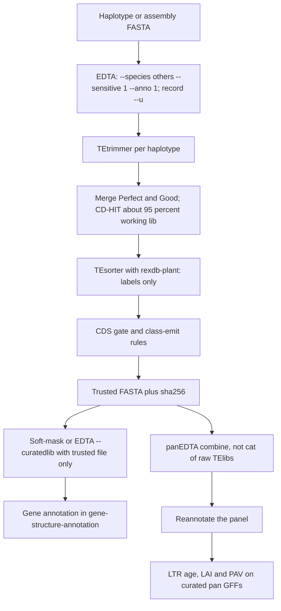

# Workflow - vitis-te

This page is the practical decision tree (README section 9). The repository README starts from what a TE is and how TEs were discovered, then walks through mechanisms, classification, sequence features, host effects, grapevine genomes, field difficulties and software, and ends here. It complements, and does not replace, the public hand-off in [gene-structure-annotation `docs/TE_LIBRARY.md`](https://github.com/Xuzhen-Li/gene-structure-annotation/blob/main/docs/TE_LIBRARY.md).

## Default route

## Decision points

<!-- PROSE:WORKFLOW_DECISIONS -->
1. Run discovery per assembly or haplotype. Do not collapse haplotypes first. Grape insertions can be haplotype-specific.
2. EDTA is the default de novo starting point in this repository (`--species others --sensitive 1 --anno 1`). Set `--u` explicitly and record its source. If `--u` is omitted, EDTA uses a rice rate of 1.3e-8 substitutions per bp per year; that default must not be used silently for grape. A grape value for `--u` is [待确认]. RepeatModeler2 or Earl Grey may be used as an alternative or a sensitivity check. Raw EDTA output is not a trusted library. EDTA expects genome sequence names of at most 13 characters (letters, digits, underscores); keep a name map and map back before gene annotation.
3. After TEtrimmer, merge Perfect and Good and cluster with CD-HIT to a working library (about 95 percent identity). An optional 80-80 family catalog must not overwrite the working library. Concatenating many raw libraries and running CD-HIT is not curation.
4. TEsorter (rexdb-plant) assigns domains and lineage labels. Never replace the working FASTA with `all.cls.lib`. RepeatMasker or Dfam names are homology hits; Wicker names are a structural hierarchy; REXdb lineages are domain phylogeny. Map names explicitly if you need to compare them.
5. The trusted library is the only product allowed as EDTA `--curatedlib` or as the gene soft-mask library. A0 in gene-structure-annotation accepts that file only when its version and sha256 are recorded. The R1 trusted set of about 240 sequences is an archive and teaching example, not automatically the panel gold standard.
6. Soft-mask only (`RepeatMasker -xsmall` or an equivalent lowercase mask). Do not hard-mask for BRAKER or GALBA: hard-masking to `N` truncates or loses real genes that overlap repeats. Do not put TRF, telomere or rDNA repeats into `--curatedlib`. Convert the genome to uppercase before RepeatMasker `-xsmall` so that lowercase afterwards reflects only the trusted-library mask. Library headers should use the `name#Class/Family` form. RepeatMasker `.out` is 1-based closed; BED is 0-based half-open.
7. Combine a panel with panEDTA after the trusted file exists, then reannotate. Do not treat a simple concatenation as a pan library.
8. Compute LTR-LTR divergence, LAI and TE PAV only after curated (or pan) annotations exist. Age in years uses T = K / (2r). If r is in substitutions per site per year, no generation time is needed; a per-generation rate must be converted first, and in a clonal crop that interval is long and uncertain. Gene conversion between LTRs makes ages too young. Convert divergence to years only with an explicit rate (and a generation time only if the rate is per generation); otherwise leave years as [待确认]. Jaillon et al. 2007 report that 41.4% (average value) of the grapevine genome is composed of repetitive/transposable elements: a combined repetitive and TE fraction, averaged over three methods, not a current TE-only annotation.
<!-- /PROSE:WORKFLOW_DECISIONS -->

## Scripts

Example scripts are in `scripts/`. The Python toy chain (`00_make_tiny_genome.py`, `01_ltr_insertion_age.py`, `02_softmask.py`) was tested on the build box on 2026-11-15, Asia/Shanghai (CST, UTC+8). The age script writes years only when `--rate` is supplied; the toy run does not pass a rate. `02_softmask.py` can take `--uppercase-first` and applies the BED mask to every FASTA record. The EDTA, RepeatModeler2/RepeatMasker and TEsorter wrappers are documentation only (`--dry-run` / `--help`) and are untested here because those tools are not installed.

Catalogue versions and DOIs were checked on 2026-11-15, Asia/Shanghai (CST, UTC+8).
