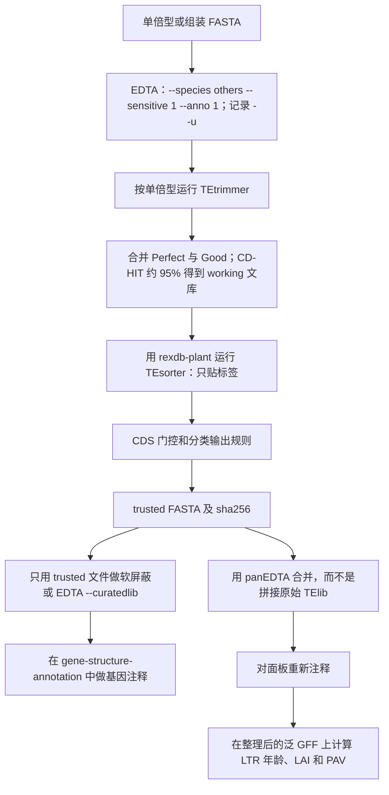

# 流程 - TE-Lib

本页是操作决策树（对应 README 第 9 节）。仓库首页从什么是 TE、它们怎样被发现讲起，再讲移动机制、分类、序列特征、与宿主的关系、葡萄基因组、行业难点和软件，最后落到本页。它补充、但不替代 [gene-structure-annotation `docs/TE_LIBRARY.md`](https://github.com/Xuzhen-Li/gene-structure-annotation/blob/main/docs/TE_LIBRARY.md) 中的公开交接说明。

## 默认路线

## 判断节点

<!-- PROSE:WORKFLOW_DECISIONS -->
1. 按每个组装或单倍型做发现。不要先把单倍型塌缩。葡萄中的插入可以是单倍型特异的。
2. 本仓库默认以 EDTA 作为 de novo 起点（`--species others --sensitive 1 --anno 1`），并显式设定 `--u`、记录其来源。若不设 `--u`，EDTA 会使用水稻的 1.3e-8 /bp/年，不能静默用在葡萄上。葡萄的 `--u` 仍为 [待确认]。RepeatModeler2 或 Earl Grey 可用作备选或敏感性检查。原始 EDTA 输出不是 trusted 文库。EDTA 要求基因组序列名不超过 13 个字符（字母、数字和下划线），并保留与原名的对照表，在交给基因注释前映射回去。
3. TEtrimmer 之后，合并 Perfect 与 Good，并用 CD-HIT 聚成 working 文库（约 95% 一致性）。可选的 80-80 家族目录不能覆盖 working 文库。把许多原始文库拼接后再跑 CD-HIT，并不等于整理。
4. TEsorter（rexdb-plant）只分配结构域和谱系标签。不要用 `all.cls.lib` 替换 working FASTA。RepeatMasker 或 Dfam 名称是同源命中，Wicker 名称是结构层级，REXdb 谱系是结构域系统发育。需要对照时，应明确记录名称对应关系。
5. 只有 trusted 文库可以作为 EDTA `--curatedlib`，或用于基因软屏蔽。gene-structure-annotation 中的 A0 步骤只在记录了版本和 sha256 时接受该文件。R1 约 240 条的 trusted 集合是归档和教学示例，并不自动成为面板金标准。
6. 只做软屏蔽（`RepeatMasker -xsmall` 或等效的小写屏蔽）。不要为 BRAKER 或 GALBA 做硬屏蔽：硬屏蔽成 `N` 会截断或丢失与重复区重叠的真基因。不要把 TRF、端粒或 rDNA 放入 `--curatedlib`。交给 RepeatMasker `-xsmall` 之前先把基因组转成大写，使随后的小写只代表 trusted 文库的屏蔽结果。文库序列名应使用 `name#Class/Family` 格式。RepeatMasker 的 `.out` 是 1 起始闭区间，BED 是 0 起始半开区间。
7. 有 trusted 文件之后，用 panEDTA 合并面板并重新注释。不要把简单拼接当作泛文库。
8. 只有在整理后（或泛）注释存在时，才计算 LTR-LTR 分歧度、LAI 和 TE PAV。换算成年份用 T = K / (2r)。如果 r 的单位是每年每个位点，就不需要世代时间；若 r 是每代速率，才需要先换算，而克隆作物的有性世代间隔很长也不确定。两条 LTR 之间的基因转换会让年龄偏年轻。只有在给出明确速率（若按代计还需世代时间）时，才把分歧度换算成年代；否则年份记为 [待确认]。Jaillon 等人 2007 写的是 41.4% (average value) of the grapevine genome is composed of repetitive/transposable elements：这是三种方法的平均值，也是重复序列与转座元件的合计，不是当前的单纯 TE 注释。
<!-- /PROSE:WORKFLOW_DECISIONS -->

## 脚本

示例脚本在 `scripts/`。Python 演示链（`00_make_tiny_genome.py`、`01_ltr_insertion_age.py`、`02_softmask.py`）已在构建机上于 2026-11-15，Asia/Shanghai（CST，UTC+8）实测。年龄脚本只有在提供 `--rate` 时才输出年份；演示运行不给速率。`02_softmask.py` 可使用 `--uppercase-first`，并对每一条 FASTA 记录按染色体名套用 BED 区间。EDTA、RepeatModeler2/RepeatMasker 和 TEsorter 的封装只用于记录命令（`--dry-run` / `--help`），因这些工具未安装，此处未实测。

目录中的版本和 DOI 核对于 2026-11-15，Asia/Shanghai（CST，UTC+8）。
