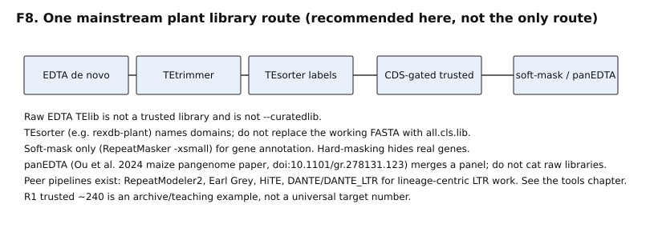

# Tools, mainstream pipelines, and field difficulties

This chapter expands the short software table of the 2026-11-15 README. It adds 2024–2026 tools. Verified claims about EDTA, RepeatModeler2 and LTR_retriever are kept below, then new tools are listed separately.



## Established field difficulties

Moved from the 2026-11-15 README section 7. Scientific claims are unchanged. The soft-mask hand-off link now points at [softmask_handoff.md](softmask_handoff.md) instead of the gene-structure-annotation `TE_LIBRARY.md` file that this addition proposes to retire.

<!-- PROSE:SECTION:T03 -->
- **Nested and fragmented copies.** New insertions into older elements, along with decayed fragments, cause structural detectors to miss copies and homology annotators to split a single element into many hits. Defragment after RepeatMasker ([RepeatCraft](https://github.com/niccw/repeatcraftp), [oneCodeToFindThemAll](https://doua.prabi.fr/software/one-code-to-find-them-all)) and inspect nested structure during curation.
- **Recent versus old copies.** Insertion age from LTR-LTR divergence is meaningful for intact young copies after curation. The two LTRs of a new insertion are copies of the same template and are identical at insertion (Neumann et al. 2019, [doi:10.1186/s13100-018-0144-1](https://doi.org/10.1186/s13100-018-0144-1), full text: "Since the 5′ LTR and 3′ LTR are identical at the time of insertion of a new element copy to the genome the level of their divergence which is caused by mutations acquired over time is proportional to the insertion age."); later divergence is what T = K / (2r) measures, because the two LTRs accumulate substitutions independently. Canonical LTR ends are often 5′-TG…CA-3′ (typical, not absolute; LTR_retriever also reports non-canonical ends). After insertion, recombination between the two LTRs can delete the internal region and leave a single LTR (a solo LTR), which cannot be dated by this formula. If r is in substitutions per site per year, no generation time is needed; a per-generation rate must be converted first. In a clonal crop the sexual generation interval is long and uncertain. Gene conversion between the two LTRs making the estimated age too young is **[待确认]** (not found in the Neumann 2019 full text or the SanMiguel 1998 abstract opened 2026-11-15 CST). Do not treat ages from raw EDTA output as a final deliverable, and do not convert divergence to years without an explicit substitution rate (and a generation time only if the rate is per generation). If EDTA is run without `--u`, it silently uses a rice rate of 1.3e-8 /bp/year; that default is not a grape value and must not be used without stating it explicitly. A grape `--u` is [待确认].
- **Curation is still the bottleneck.** TEtrimmer, MCHelper and Earl Grey automate parts of consensus cleaning, but a trusted library still requires a documented CDS gate and class-emit rules. Goubert et al. 2022 ([doi:10.1186/s13100-021-00259-7](https://doi.org/10.1186/s13100-021-00259-7)) is a beginner's guide to manual curation, not the methods paper for those tools.
- **False positives from gene families and tandem repeats.** NLR clusters, other gene families, SSRs and tandem repeats can enter a de novo library. Keep TRF, telomere and rDNA on a separate non-TE track; they do not belong in `--curatedlib`.
- **Soft-mask hand-off.** The BRAKER README says the genome should be masked for repeats. It then states, verbatim: “This will avoid the prediction of false positive gene structures in repetitive and low complexitiy regions.” The same paragraph says that softmasking “leads to better results than hardmasking.” The further wording that hard-masking to `N` truncates or loses overlapping genes is this repository’s inference **[待确认]**. The only file accepted for gene soft-mask or EDTA `--curatedlib` is the current trusted library, named with its version and sha256 (see [softmask_handoff.md](softmask_handoff.md)). EDTA genome sequence names should be at most 13 characters (letters, digits, underscores), with a name map back to the original headers. Convert the genome to uppercase before RepeatMasker `-xsmall` (a defensive convention in this repository: `-xsmall` writes masked bases as lowercase, and pre-existing lowercase must not be mistaken for a mask; RepeatMasker help documents `-xsmall` but does not itself require a prior uppercase step). Library headers should follow the `name#Class/Family` format. This repository currently treats RepeatMasker `.out` as 1-based closed intervals and BED as 0-based half-open; the RepeatMasker help page does not state that convention **[待确认]**.
- **Pangenome TE presence or absence.** In grape, an insertion may be haplotype-specific. Combine panel libraries with panEDTA once a trusted file exists; concatenating raw TElibs and running CD-HIT does not produce a pan library.
- **Heterozygous, haplotype-resolved genomes.** Run discovery per assembly or haplotype rather than collapsing haplotypes before TE discovery.

## Notes on EDTA, RepeatModeler2 and LTR_retriever

Moved from section 8 of the same README:

<!-- PROSE:SECTION:T04 -->
Each row is expanded in [`catalog/CATALOG.tsv`](../../catalog/CATALOG.tsv), with a link, a title-matched DOI where one exists, inputs, outputs and when to use the tool. Tool versions are not pinned here.

Three tools are worth a brief explanation from opened full text or official READMEs. EDTA (Ou et al. 2019, full text, [doi:10.1186/s13059-019-1905-y](https://doi.org/10.1186/s13059-019-1905-y)) “incorporates LTRharvest, the parallel version of LTR_FINDER, LTR_retriever, GRF, TIR-Learner, HelitronScanner,” and related filters, then combines the more robust calls into a filtered, non-redundant library of intact and fragmented elements, and can resolve nested insertions. RepeatModeler2 (Flynn et al. 2020) is a de novo family finder; the official README describes three de-novo programs (RECON, RepeatScout and LtrHarvest/Ltr_retriever) and documents the `-LTRStruct` switch for structural LTR discovery. LTR_retriever (Ou and Jiang 2018; official README) takes structural LTR-RT candidates (from LTRharvest or LTR_FINDER) and builds a high-quality LTR library. It identifies canonical elements with 5′-TG…CA-3′ termini and also reports non-canonical (non-TGCA) LTR retrotransposons.

| Step | Use when | Tools in this catalogue |
|------|----------|-------------------------|
| De novo discovery | Starting from an assembly or haplotype | [EDTA](https://github.com/oushujun/EDTA) (default here), [RepeatModeler2](https://github.com/Dfam-consortium/RepeatModeler), [Earl Grey](https://github.com/TobyBaril/EarlGrey); family finders [RepeatScout](https://github.com/Dfam-consortium/RepeatScout), [RECON](https://github.com/Dfam-consortium/RECON), [PILER](https://www.drive5.com/piler/) |
| Structural detection | Seeking intact LTR, TIR, MITE or Helitron copies | [LTR_FINDER](https://github.com/xzhub/LTR_FINDER), [LTR_FINDER_parallel](https://github.com/oushujun/LTR_FINDER_parallel), [LTRharvest](https://github.com/genometools/genometools), [LTR_retriever](https://github.com/oushujun/LTR_retriever); [HelitronScanner](https://sourceforge.net/projects/helitronscanner/); MITE-Hunter, [detectMITE](https://sourceforge.net/projects/detectmite/), [TIR-Learner](https://github.com/oushujun/TIR-Learner), [GRF](https://github.com/bioinfolabmu/GenericRepeatFinder), [Inpactor2](https://github.com/simonorozcoarias/Inpactor2) |
| Homology | Annotating or masking with a library | [RepeatMasker](https://github.com/Dfam-consortium/RepeatMasker) ([website](https://www.repeatmasker.org/)); libraries [Dfam](https://www.dfam.org/) and [Repbase](https://www.girinst.org/repbase/) |
| Classification | Labelling a working library | [TEsorter](https://github.com/zhangrengang/TEsorter) + [REXdb](https://bitbucket.org/petrnovak/repex_tarean) (plant LTR lineages); [DeepTE](https://github.com/LiLabAtVT/DeepTE); [TEclass](https://bioinformatics.uni-muenster.de/tools/teclass/index.hbi); [Inpactor](https://github.com/simonorozcoarias/Inpactor), [Inpactor2](https://github.com/simonorozcoarias/Inpactor2) |
| Curation and consensus | Turning raw consensi into a working or trusted library | [TEtrimmer](https://github.com/qjiangzhao/TEtrimmer) (default here), [MCHelper](https://github.com/GonzalezLab/MCHelper), [SENMAP](https://github.com/simonorozcoarias/SENMAP), Goubert guide ([doi:10.1186/s13100-021-00259-7](https://doi.org/10.1186/s13100-021-00259-7)), [CD-HIT](https://github.com/weizhongli/cdhit) |
| Library QC | Removing non-TE repeats and checking assembly quality | [TRF](https://github.com/Benson-Genomics-Lab/TRF) (non-TE track; [website](https://tandem.bu.edu/trf/trf.html)); LAI after curated or pan annotation ([LTR_retriever](https://github.com/oushujun/LTR_retriever)) |
| Masking | Handing a genome to gene annotation | [RepeatMasker](https://github.com/Dfam-consortium/RepeatMasker) `-xsmall` with the trusted library only; [BEDTools](https://github.com/arq5x/bedtools2) for track checks |
| TE age / insertion time | Intact LTR pairs after curation | [LTR_retriever](https://github.com/oushujun/LTR_retriever); `scripts/01_ltr_insertion_age.py` for a toy demonstration |
| Polymorphic TE calling | Population or long-read insertion calling, not library construction | [TEMP](https://github.com/JialiUMassWengLab/TEMP), [RelocaTE2](https://github.com/JinfengChen/RelocaTE2), [xTea](https://github.com/parklab/xTea), [Jitterbug](https://github.com/elzbth/jitterbug), [TIP_finder](https://github.com/simonorozcoarias/TIP_finder) |
| Pangenome TE | A panel of haplotypes or genomes | [panEDTA](https://github.com/oushujun/EDTA) (`panEDTA.sh` in the EDTA repository) |
| Visualization / defragmentation | Cleaning homology annotations | [RepeatCraft](https://github.com/niccw/repeatcraftp), [oneCodeToFindThemAll](https://doua.prabi.fr/software/one-code-to-find-them-all) |

### Inpactor series (plant LTR retrotransposons)

These entries are an alternative or complement to the default EDTA route. They are not a replacement for a CDS-gated trusted library.

| Name | Role | Repository | DOI |
|------|------|------------|-----|
| Inpactor | HPC pipeline to classify plant LTR retrotransposons, mark autonomous and non-autonomous copies, and estimate insertion time | [github.com/simonorozcoarias/Inpactor](https://github.com/simonorozcoarias/Inpactor) | [10.3390/biology7020032](https://doi.org/10.3390/biology7020032) |
| Inpactor2 | Deep-learning and structure-based detection, filtering of fragments and nested copies, and classification of intact plant LTR retrotransposons to superfamily and lineage; input is an assembled genome | [github.com/simonorozcoarias/Inpactor2](https://github.com/simonorozcoarias/Inpactor2) | [10.1093/bib/bbac511](https://doi.org/10.1093/bib/bbac511) |
| InpactorDB | Lineage-level plant LTR retrotransposon reference set (195 genomes, 108 species; 67,241 non-redundant elements in the published set) | [InpactorDB search page](https://inpactordb.github.io); dataset [10.5281/zenodo.4386317](https://doi.org/10.5281/zenodo.4386317) (a later snapshot is [10.5281/zenodo.5816833](https://doi.org/10.5281/zenodo.5816833)) | [10.3390/genes12020190](https://doi.org/10.3390/genes12020190) |
| SENMAP | Convolutional network to keep intact LTR retrotransposon copies when curating a plant library | [github.com/simonorozcoarias/SENMAP](https://github.com/simonorozcoarias/SENMAP) | [10.1515/jib-2021-0036](https://doi.org/10.1515/jib-2021-0036) (journal article; conference report: [10.1109/ci-ibbi54220.2021.9626130](https://doi.org/10.1109/ci-ibbi54220.2021.9626130)) |
| TIP_finder | HPC caller of transposable-element insertion polymorphisms from Illumina paired reads, a chromosome-level reference, and a TE consensus set | [github.com/simonorozcoarias/TIP_finder](https://github.com/simonorozcoarias/TIP_finder) | [10.3390/biology9090281](https://doi.org/10.3390/biology9090281) |
| YORO | Convolutional genomic-object detector for transposable-element detection and classification | [github.com/simonorozcoarias/YORO](https://github.com/simonorozcoarias/YORO) | [10.1371/journal.pone.0291925](https://doi.org/10.1371/journal.pone.0291925) |
| PanTEon | Cross-kingdom framework and database for designing and comparing transposable-element classifiers (preprint) | [github.com/simonorozcoarias/PanTEon](https://github.com/simonorozcoarias/PanTEon) | [10.64898/2026.04.01.715927](https://doi.org/10.64898/2026.04.01.715927) |

Related publications in the same line of work (not standalone tools): a survey of plant retrotransposon structure, identification and classification ([10.3390/ijms20153837](https://doi.org/10.3390/ijms20153837)); a systematic survey of machine-learning methods for transposable-element detection and classification ([10.7717/peerj.8311](https://doi.org/10.7717/peerj.8311)); a k-mer machine-learning method to classify plant LTR retrotransposons ([10.7717/peerj.11456](https://doi.org/10.7717/peerj.11456)); and a comparison of performance metrics for those tasks ([10.3390/pr8060638](https://doi.org/10.3390/pr8060638)). Companion experiment repositories: [MLinTEs](https://github.com/simonorozcoarias/MLinTEs) and [MachineLearningInTEs](https://github.com/simonorozcoarias/MachineLearningInTEs).
<!-- /PROSE:SECTION:T04 -->

## Practical route and red lines

Moved from section 9. The recommended route is still EDTA → TEtrimmer → TEsorter → CDS-gated trusted library → soft-mask or panEDTA. R1 trusted ~240 remains archive/teaching.

The public workflow runs from `EDTA` to `TEtrimmer` to `TEsorter` to a CDS-gated trusted library, and from there to soft-masking or `panEDTA`. The `R1` numbers, such as a trusted count of `~240`, are archive and teaching examples; the panel gold standard may move to a newer trusted file. The gene soft-mask step designated as `A0` accepts only the current trusted file along with its version and sha256, not raw EDTA output and not the entire working library.

1. Run `EDTA` per assembly or haplotype using `--species others --sensitive 1 --anno 1`. Set `--u` explicitly and record its source. A grape value for `--u` is [待确认]; if `--u` is omitted, EDTA silently uses a rice rate of 1.3e-8 /bp/year, which must not be used for grape without stating it explicitly.
2. Run `TEtrimmer` per haplotype, merge the Perfect and Good outputs, and use `CD-HIT` to generate a working library at about 95 percent identity. An optional 80-80 family catalog can also be built, provided it does not overwrite the working library.
3. Run `TEsorter` with a resource such as `rexdb-plant` to assign domains and labels only. Never replace the working FASTA with `all.cls.lib` (`all.cls.lib` in this repository is the name used when TEsorter is run on `all.fa`; the official README output is `<input>.rexdb.cls.lib`).
4. Apply a curation gate using CDS BLAST and TEsorter class-emit rules to produce a trusted FASTA and record its sha256.
5. Run soft-masking or EDTA `--curatedlib` with the trusted file only.
6. Run `panEDTA` to combine panel results formally rather than concatenating TE libraries, then reannotate the panel.
7. Calculate LTR age, LAI and PAV only after curated pan TE GFFs are generated.

| Product | Use as `--curatedlib` / gene soft-mask? |
|---------|----------------------------------------|
| Raw EDTA TElib | No |
| Working lib (post-TEtrimmer CD-HIT) | No (whole file) |
| Trusted gated lib | Yes |
| `cat` + CD-HIT of many libs | No (dedup is not curation) |

```bash
EDTA.pl --genome assembly.fa --species others --sensitive 1 --anno 1 --u RATE --threads 32
```

- Do not treat raw EDTA output as a gold-standard TE library.
- Do not treat `cat` and CD-HIT output as `--curatedlib`.
- Classifier-only tools name consensi; they do not replace trimmers and do not become the library itself.
- Do not hard-mask for BRAKER or GALBA. Soft-mask with a trusted library that has been purged of host genes.
- Non-TE repeats such as TRF, telomeres and rDNA do not belong in `--curatedlib`.

## Newer pipelines and classifiers (2024–2026), title-matched

These tools were not taught in the short README. Each DOI below was title-matched on Crossref for these chapters (see `DOI_CHECKS.tsv` shipped with these teaching files). They are alternatives or complements, not a silent replacement of the red-line route.

| Tool | Paper (official title, year) | DOI | What it is for | How it relates to the route above |
|------|------------------------------|-----|----------------|-----------------------------------|
| [HiTE](https://github.com/CSU-KangHu/HiTE) | *HiTE: a fast and accurate dynamic boundary adjustment approach for full-length transposable element detection and annotation* (2024) | [10.1038/s41467-024-49912-8](https://doi.org/10.1038/s41467-024-49912-8) | Full-length TE detection; HiTE README output lists confident TIR, Helitron and non-LTR identification results (plus LTR-related outputs) | A peer de novo library builder; not tested in the recorded 2026-11-15 checks |
| Earl Grey | already in the old catalogue | [10.1093/molbev/msae068](https://doi.org/10.1093/molbev/msae068) | Automated annotation and curation; paper-ready summaries | Peer pipeline. A soft-masked genome FASTA is an optional Earl Grey output (`-d` / soft-mask flag, default no in the README), not a trusted-lib substitute without a CDS gate |
| TEtrimmer | already in the old catalogue | [10.1038/s41467-025-63889-y](https://doi.org/10.1038/s41467-025-63889-y) | Automates steps of manual consensus curation | Default trimmer in the route above |
| [DANTE](https://github.com/kavonrtep/dante) / [DANTE_LTR](https://github.com/kavonrtep/dante_ltr) | *DANTE and DANTE_LTR: lineage-centric annotation pipelines for long terminal repeat retrotransposons in plant genomes* (2024) | [10.1093/nargab/lqae113](https://doi.org/10.1093/nargab/lqae113) | Lineage-centric LTR annotation in plants | Complements TEsorter/REXdb; does not replace the trusted-lib gate |
| [GraffiTE](https://github.com/cgroza/GraffiTE) | *A unified framework to analyze transposable element insertion polymorphisms using graph genomes* (2024) | [10.1038/s41467-024-53294-2](https://doi.org/10.1038/s41467-024-53294-2) | TE insertion polymorphisms on a graph, from assemblies or long reads, then genotyping | Downstream of a library, not a library builder. The 2024 paper describes v1.0; the current README default is 1.1 (flags, defaults and output files changed; `--reads` was renamed `--genotype_with`). To reproduce the paper, the README points to `-r v1.0.0.0`. Cross-link: vitis-pangenome and VOD project 14 |
| panEDTA | Official Crossref title: *Differences in activity and stability drive transposable element variation in tropical and temperate maize* (2024). The paper introduces panEDTA. | [10.1101/gr.278131.123](https://doi.org/10.1101/gr.278131.123) | Consistent TE annotation across a pangenome panel | Already the panel-merge step in the route above |
| [TEclass2](https://github.com/IOB-Muenster/TEclass2) | *Transformer-Based Classification of Transposable Element Consensus Sequences with TEclass2* (2025) | [10.3390/biology15010059](https://doi.org/10.3390/biology15010059) | Transformer classifier of consensus sequences | Labels only |
| Terrier | *Terrier: a deep learning repeat classifier* (2025) | [10.1093/bib/bbaf442](https://doi.org/10.1093/bib/bbaf442) | Deep-learning repeat classifier | Labels only |
| CREATE | *CREATE: a novel attention-based framework for efficient classification of transposable elements* (2025) | [10.1093/bib/bbaf608](https://doi.org/10.1093/bib/bbaf608) | Attention-based TE classifier | Labels only |
| [DeepHel](https://github.com/lyysxb/DeepHel) | *DeepHel: improving the accuracy and completeness of Helitron annotation with a multi-stage deep learning framework* (2026) | [10.1093/bioinformatics/btag817](https://doi.org/10.1093/bioinformatics/btag817) | Helitron annotation | Peer to HelitronScanner; still needs curation |
| [ColabCuraTE](https://github.com/Ellison-Lab/ColabCuraTE) | *ColabCuraTE: an easy-to-use, web-based pipeline for the manual curation of transposable elements* (2025) | [10.1186/s13100-025-00389-2](https://doi.org/10.1186/s13100-025-00389-2) | Browser-based manual curation | Complements TEtrimmer / the Goubert 2022 guide |
| TE_Bench | *TE_Bench: a foundational benchmarking workflow for transposable element annotation pipelines* (2026) | [10.1186/s13100-026-00405-z](https://doi.org/10.1186/s13100-026-00405-z) | Benchmarking EDTA, RepeatModeler2, and Earl Grey | In their default configurations, RepeatModeler2 and Earl Grey performed similarly and outperformed default EDTA (abstract). Use it to compare tools; do not copy its figures. Redraw only from tabulated numbers, with a citation |
| [panHiTE](https://github.com/CSU-KangHu/HiTE) | *panHiTE: A comprehensive and accurate pipeline for TE detection in large-scale population genomes* (2026) | [10.1016/j.xplc.2025.101669](https://doi.org/10.1016/j.xplc.2025.101669) | TE detection across population genomes (Plant Commun 2026, doi:10.1016/j.xplc.2025.101669; the HiTE README also cites the bioRxiv preprint doi:10.1101/2025.02.15.638472) | Peer to panEDTA; not run here |

Classifier-only tools name consensi; they do not replace trimmers and do not become the library itself.

## Software that remains untested in the recorded 2026-11-15 checks

Wrappers already in `scripts/` (`03_run_edta.sh`, `04_run_repeatmodeler_repeatmasker.sh`, `05_run_tesorter.sh`) document commands and were only `--dry-run` / `--help` tested, as in the 2026-11-15 merge. New tools in the table above were not installed or run for these chapters. Do not read this chapter as a benchmark.

## Abstract lines for seven recently listed tools (methods ②-N1)

These rows were already titled from the official paper titles. The sentences below are quoted from abstracts opened on 2026-11-15 CST (EuropePMC core). None of these tools is a default step in the route above.

- **DANTE / DANTE_LTR** (10.1093/nargab/lqae113). “Herein, we introduce DANTE, a computational pipeline for Domain-based ANnotation of Transposable Elements, designed for sensitive detection of these elements via their conserved protein domain sequences.” Complements TEsorter/REXdb; not a trusted-lib substitute (this repository’s judgement).
- **TEclass2** (10.3390/biology15010059). “Here, we present TEclass2, a software employing a deep learning approach based on a linear transformer architecture with k-mer tokenization and sequence-specific adaptations to classify TE consensus sequences into sixteen superfamilies.” Labels only (this repository’s judgement).
- **Terrier** (10.1093/bib/bbaf442). “Terrier is a deep learning model designed to overcome these challenges by classifying repetitive DNA sequences using a publicly available, curated repeat sequence library trained under the RepeatMasker schema.” Labels only (this repository’s judgement).
- **CREATE** (10.1093/bib/bbaf608). “Here, we propose a novel framework called CREATE, which simultaneously integrates the global pattern distribution and the local sequence profile of TEs using Convolutional neural networks and Recurrent neural nEtworks with an Attention mechanism for efficient TE classification.” Labels only (this repository’s judgement).
- **DeepHel** (10.1093/bioinformatics/btag817). “Existing methods often exhibit limited sensitivity, high false-positive rates, and insufficient support for simultaneous detection of both HLE1 and HLE2, leading to incomplete and imprecise annotation.” “We present DeepHel, a multi-stage deep learning framework that improves the accuracy and completeness of Helitron annotation by modeling intactness, boundary characteristic, and structural consistency.” Peer Helitron annotator; still needs curation (this repository’s judgement).
- **ColabCuraTE** (10.1186/s13100-025-00389-2). “To address this gap, we developed ColabCuraTE, a web-based, user-friendly pipeline implemented in Google Colaboratory that enables manual curation of TEs without the need for local software installation or advanced programming skills.” Complements TEtrimmer (this repository’s judgement).
- **panHiTE** (10.1016/j.xplc.2025.101669). “Here, we present panHiTE, a population-scale TE detection framework that introduces several methodological innovations.” The HiTE README also cites preprint 10.1101/2025.02.15.638472. Peer to panEDTA; not run here (this repository’s judgement).
