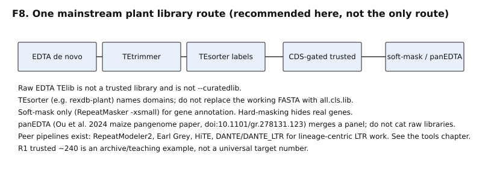

# 工具、主流流程和行业难点

这一章扩展 2026-11-15 那版 README 里较短的软件表，并补上 2024–2026 年的工具。已经审过的 EDTA、RepeatModeler2 和 LTR_retriever 说明放在前面，新工具另表列出。



## 已审核的行业难点

从 2026-11-15 README 第 7 节搬来，科学表述不改。软屏蔽交接的链接改为指向 [softmask_handoff.zh.md](softmask_handoff.zh.md)，而不再指向本次追加计划从 gene-structure-annotation 撤下的 `TE_LIBRARY.md`。

<!-- PROSE:SECTION:T03 -->
- **嵌套和破碎拷贝。** 新插入套进旧元件，以及退化破碎的片段，会让结构检测漏掉拷贝，也会让同源注释把一个元件拆成许多命中片段。RepeatMasker 之后可用 RepeatCraft、oneCodeToFindThemAll 做碎片合并，并在整理时检查嵌套结构。
- **新拷贝与旧拷贝。** 用 LTR-LTR 分歧度估计插入时间，只对整理之后仍然完整的年轻拷贝有意义。新插入时，两条 LTR 复制自同一模板，因此完全相同（Neumann 等 2019，[doi:10.1186/s13100-018-0144-1](https://doi.org/10.1186/s13100-018-0144-1)，全文：“Since the 5′ LTR and 3′ LTR are identical at the time of insertion of a new element copy to the genome the level of their divergence which is caused by mutations acquired over time is proportional to the insertion age.”）；随后的分歧度才是 T = K / (2r) 所度量的量，因为两条 LTR 各自独立积累突变。典型的 LTR 末端常为 5′-TG…CA-3′（典型特征，并非绝对；LTR_retriever 也会报告非典型末端）。插入之后，两条 LTR 之间的重组可以删掉内部区，只留下一条 LTR（solo LTR），这类元件无法用该公式定年。如果 r 的单位是每年每个位点，就不需要世代时间；若 r 是每代速率，则需先作换算。克隆作物的有性世代间隔很长，且不易确定。两条 LTR 之间的基因转换会使估出的年龄偏年轻，这一说法仍标 **[待确认]**（本轮打开的 Neumann 2019 全文和 SanMiguel 1998 摘要中未见）。不要把原始 EDTA 输出里的年龄当作最终交付结果；没有明确的替换率时（若速率按代计，还需明确世代时间），不要把分歧度换算成年代。EDTA 若不设 `--u`，会静默使用水稻的 1.3e-8 /bp/年，不能当作葡萄的默认值。葡萄的 `--u` 仍为 [待确认]。
- **整理仍然是瓶颈。** TEtrimmer、MCHelper 和 Earl Grey 能自动完成部分 consensus 清理，但 trusted 文库仍需要有记录的 CDS 门控和分类输出规则。Goubert 等人 2022（[doi:10.1186/s13100-021-00259-7](https://doi.org/10.1186/s13100-021-00259-7)）是手工整理的入门指南，不是这些工具的方法论文。
- **基因家族和串联重复造成的假阳性。** NLR 簇、其他基因家族、简单重复和串联重复可能混入 de novo 文库。TRF、端粒和 rDNA 应放在单独的非 TE 轨道，它们不属于 `--curatedlib`。
- **软屏蔽交接。** BRAKER 的 README 写：基因组应当做重复序列屏蔽，并原话说 “This will avoid the prediction of false positive gene structures in repetitive and low complexitiy regions.”；对 GeneMark 和 AUGUSTUS，softmasking “leads to better results than hardmasking”。硬屏蔽成 `N` 会使重叠基因被截断或丢失，是本仓库的推断 **[待确认]**。基因软屏蔽或 EDTA `--curatedlib` 只接受当前 trusted 文库，并需注明版本和 sha256（见 [softmask_handoff.zh.md](softmask_handoff.zh.md)）。EDTA 要求基因组序列名不超过 13 个字符（字母、数字和下划线），并保留与原名的对照表。交给 RepeatMasker `-xsmall` 之前先把基因组转成大写（本仓库的防御性约定：`-xsmall` 把被屏蔽碱基写成小写，不能把原有小写误当成屏蔽；RepeatMasker 帮助页说明了 `-xsmall`，但并不要求事先转大写）。文库序列名应使用 `name#Class/Family` 格式。本仓库目前把 RepeatMasker 的 `.out` 当作 1 起始闭区间、把 BED 当作 0 起始半开区间；本轮打开的帮助页未写明该约定，标 **[待确认]**。
- **泛基因组中的 TE 有无。** 在葡萄中，一次插入可能只出现在某一条单倍型上。得到 trusted 文件之后，应使用 panEDTA 合并一组文库；把原始 TElib 拼接后再跑 CD-HIT，并不能得到泛文库。
- **杂合、单倍型分相的基因组。** 按每个组装或单倍型分别做发现，不要在发现之前把单倍型塌缩。

## 已审核的 EDTA、RepeatModeler2 和 LTR_retriever 说明

从同一 README 的第 8 节搬来：

<!-- PROSE:SECTION:T04 -->
每一行的链接、标题匹配的 DOI（如有）、输入、输出和适用场合见 [`catalog/CATALOG.tsv`](../../catalog/CATALOG.tsv)。此处未锁定工具版本。

下面依据已打开的全文或官方 README，对三个工具作简短说明。EDTA（Ou 等 2019，全文，[doi:10.1186/s13059-019-1905-y](https://doi.org/10.1186/s13059-019-1905-y)）“incorporates LTRharvest, the parallel version of LTR_FINDER, LTR_retriever, GRF, TIR-Learner, HelitronScanner，”再把较稳健的结果组合成经过过滤、去冗余的完整与破碎元件文库，并能拆开嵌套插入。RepeatModeler2（Flynn 等 2020）用于 de novo 发现家族；官方 README 写明内部有 RECON、RepeatScout 和 LtrHarvest/Ltr_retriever，并记录 `-LTRStruct` 开关。LTR_retriever（Ou 与 Jiang 2018；官方 README）接收来自 LTRharvest 或 LTR_FINDER 的结构 LTR-RT 候选，构建高质量 LTR 文库；识别典型的 5′-TG…CA-3′ 末端，也报告非典型（非 TGCA）LTR 反转录转座子。

| 步骤 | 适用场合 | 本目录中的工具 |
|------|----------|----------------|
| de novo 发现 | 从组装或单倍型出发 | EDTA（此处默认）、RepeatModeler2、Earl Grey；家族发现还有 RepeatScout、RECON、PILER |
| 结构检测 | 寻找完整的 LTR、TIR、MITE 或 Helitron | LTR_FINDER、LTR_FINDER_parallel、LTRharvest、LTR_retriever；HelitronScanner；MITE-Hunter、detectMITE、TIR-Learner、GRF |
| 同源注释 | 用文库做注释或屏蔽 | RepeatMasker；文库为 Dfam 和 Repbase |
| 分类 | 给 working 文库贴标签 | TEsorter + REXdb（植物 LTR 谱系）；DeepTE；TEclass |
| 整理与 consensus | 把原始 consensus 变成 working 或 trusted 文库 | TEtrimmer（此处默认）、MCHelper、Goubert 指南、CD-HIT |
| 文库质控 | 去掉非 TE 重复、检查组装质量 | TRF（非 TE 轨道）；在整理后或泛注释上计算 LAI |
| 屏蔽 | 把基因组交给基因注释 | 只用 trusted 文库做 RepeatMasker `-xsmall`；用 BEDTools 检查轨道 |
| TE 年龄 / 插入时间 | 整理后的完整 LTR 对 | LTR_retriever；演示脚本 `scripts/01_ltr_insertion_age.py` |
| 多态 TE 检测 | 群体或长读插入检测，不是建库 | TEMP、RelocaTE2、xTea、Jitterbug |
| 泛基因组 TE | 一组单倍型或基因组 | panEDTA（EDTA 仓库中的 `panEDTA.sh`） |
| 可视化 / 碎片合并 | 整理同源注释 | RepeatCraft、oneCodeToFindThemAll |
<!-- /PROSE:SECTION:T04 -->

## 已审核的操作流程和红线

从第 9 节搬来。推荐路线仍然是 EDTA → TEtrimmer → TEsorter → 经 CDS 门控的 trusted 文库 → 软屏蔽或 panEDTA。R1 trusted ~240 仍属于归档和教学。

公开流程仍是 `EDTA` 至 `TEtrimmer`，至 `TEsorter`，再至基于 CDS 过滤的 trusted 文库，最后用于软屏蔽或 `panEDTA`。诸如 trusted `~240` 这样的 `R1` 数字属于归档和教学示例；最终的高质量参考数据可能会更新为新版 trusted 文件。基因软屏蔽步骤（`A0`）只接受当前的 trusted 文件及其版本和 sha256，不接受原始 EDTA 输出，也不接受整个 working 文库。

1. 针对每个组装或单倍型运行 `EDTA`，使用 `--species others --sensitive 1 --anno 1`，并显式设定 `--u`、记录其来源。葡萄的 `--u` 仍为 [待确认]；若不设 `--u`，EDTA 会静默使用水稻的 1.3e-8 /bp/年，不能当作葡萄的默认值。
2. 针对每个单倍型运行 `TEtrimmer`，合并 Perfect 与 Good 序列，并用 `CD-HIT` 生成相似度约 95% 的 working 文库。可以按需生成 80-80 阈值的家族目录，但不要覆盖 working 文库。
3. 使用 `TEsorter`（如 `rexdb-plant`）只分配结构域和标签。不要用 `all.cls.lib` 替换 working FASTA（本仓库的 `all.cls.lib` 指对 `all.fa` 运行 TEsorter 时的文件名；官方 README 的输出是 `<input>.rexdb.cls.lib`）。
4. 通过包含 CDS BLAST 和 TEsorter 分类输出规则的整理步骤，生成 trusted FASTA 并记录 sha256。
5. 仅使用 trusted 文件进行软屏蔽，或作为 EDTA 的 `--curatedlib` 传入。
6. 运行 `panEDTA` 做正式合并，而不是直接拼接 TE 文库，随后对面板重新注释。
7. 在生成经过整理的泛 TE GFF 之后，再做 LTR 插入时间、LAI 和 PAV。

| 产物 | 可否作为 `--curatedlib` / 基因软屏蔽？ |
|------|----------------------------------------|
| 原始 EDTA TElib | 否 |
| working 文库（TEtrimmer 后 CD-HIT） | 否（整份文件） |
| 经过门控的 trusted 文库 | 是 |
| 把许多文库 `cat` 后再 CD-HIT | 否（去冗余不是整理） |

```bash
EDTA.pl --genome assembly.fa --species others --sensitive 1 --anno 1 --u RATE --threads 32
```

- 不要把原始 EDTA 输出当作金标准 TE 文库。
- 不要把 `cat` 加 CD-HIT 的结果直接当作 `--curatedlib`。
- 只做分类的工具只给 consensus 命名，不能取代修剪，也不能直接作为最终文库。
- 不要在 BRAKER 或 GALBA 流程中硬屏蔽。必须使用经过宿主基因清洗的 trusted 文库做软屏蔽。
- 非 TE 重复序列（如 TRF、端粒、rDNA）不属于 `--curatedlib`。

## 较新的流程和分类器（2024–2026，题名已匹配）

这些工具没有写进那版短 README。下面每个 DOI 都在本次追加 的 Crossref 题名匹配中核对过（见批次目录里的 `DOI_CHECKS.tsv`）。它们是替代或补充，不是悄悄替换红线流程。

| 工具 | 论文（官方题名，年份） | DOI | 用途 | 和上面路线的关系 |
|------|------------------------|-----|------|------------------|
| HiTE | *HiTE: a fast and accurate dynamic boundary adjustment approach for full-length transposable element detection and annotation*（2024） | [10.1038/s41467-024-49912-8](https://doi.org/10.1038/s41467-024-49912-8) | 全长 TE 检测；HiTE README 的输出列出 confident TIR、Helitron 和 non-LTR 鉴定结果（以及 LTR 相关输出） | 并列的 de novo 建库工具；2026-11-15 记录的检查中未测 |
| Earl Grey | 已在旧目录中 | [10.1093/molbev/msae068](https://doi.org/10.1093/molbev/msae068) | 自动注释和整理，并给出论文风格的汇总图 | 并列流程。软屏蔽基因组 FASTA 是 Earl Grey 的可选项（README 里 `-d` / soft-mask，默认 no），没有 CDS 门控时不能代替 trusted 文库 |
| TEtrimmer | 已在旧目录中 | [10.1038/s41467-025-63889-y](https://doi.org/10.1038/s41467-025-63889-y) | 自动完成手工整理 consensus 的若干步骤 | 上面路线里的默认修剪工具 |
| DANTE / DANTE_LTR | *DANTE and DANTE_LTR: lineage-centric annotation pipelines for long terminal repeat retrotransposons in plant genomes*（2024） | [10.1093/nargab/lqae113](https://doi.org/10.1093/nargab/lqae113) | 植物 LTR 的谱系注释 | 补充 TEsorter/REXdb；不代替 trusted 门控 |
| GraffiTE | *A unified framework to analyze transposable element insertion polymorphisms using graph genomes*（2024） | [10.1038/s41467-024-53294-2](https://doi.org/10.1038/s41467-024-53294-2) | 在图上分析 TE 插入多态，可从组装或长读出发再分型 | 文库之后的下游分析，不是建库工具。2024 年论文描述的是 v1.0；当前 README 默认是 1.1（标志、默认值和输出文件有改动；`--reads` 已改名为 `--genotype_with`）。要复现论文，README 指向 `-r v1.0.0.0`。交叉见 vitis-pangenome 和 VOD 项目 14 |
| panEDTA | Crossref 官方题名为 *Differences in activity and stability drive transposable element variation in tropical and temperate maize*（2024）。该文介绍了 panEDTA。 | [10.1101/gr.278131.123](https://doi.org/10.1101/gr.278131.123) | 在泛基因组面板上做一致的 TE 注释 | 已是上面路线里的面板合并步骤 |
| TEclass2 | *Transformer-Based Classification of Transposable Element Consensus Sequences with TEclass2*（2025） | [10.3390/biology15010059](https://doi.org/10.3390/biology15010059) | 用 Transformer 给 consensus 分类 | 只贴标签 |
| Terrier | *Terrier: a deep learning repeat classifier*（2025） | [10.1093/bib/bbaf442](https://doi.org/10.1093/bib/bbaf442) | 深度学习重复分类器 | 只贴标签 |
| CREATE | *CREATE: a novel attention-based framework for efficient classification of transposable elements*（2025） | [10.1093/bib/bbaf608](https://doi.org/10.1093/bib/bbaf608) | 基于注意力机制的 TE 分类 | 只贴标签 |
| DeepHel | *DeepHel: improving the accuracy and completeness of Helitron annotation with a multi-stage deep learning framework*（2026） | [10.1093/bioinformatics/btag817](https://doi.org/10.1093/bioinformatics/btag817) | Helitron 注释 | 与 HelitronScanner 并列；仍要整理 |
| ColabCuraTE | *ColabCuraTE: an easy-to-use, web-based pipeline for the manual curation of transposable elements*（2025） | [10.1186/s13100-025-00389-2](https://doi.org/10.1186/s13100-025-00389-2) | 浏览器里做手工整理 | 补充 TEtrimmer 和 Goubert 2022 指南 |
| TE_Bench | *TE_Bench: a foundational benchmarking workflow for transposable element annotation pipelines*（2026） | [10.1186/s13100-026-00405-z](https://doi.org/10.1186/s13100-026-00405-z) | 比较 EDTA、RepeatModeler2 和 Earl Grey | 在默认配置下，RepeatModeler2 与 Earl Grey 表现相近，并优于默认 EDTA（摘要）。用来比较工具；不要复制其插图。若重绘，只能用表中数字，并注明出处 |
| panHiTE | *panHiTE: A comprehensive and accurate pipeline for TE detection in large-scale population genomes*（2026） | [10.1016/j.xplc.2025.101669](https://doi.org/10.1016/j.xplc.2025.101669) | 在群体基因组上检测 TE（Plant Commun 2026，doi:10.1016/j.xplc.2025.101669；HiTE README 同时列出预印本 doi:10.1101/2025.02.15.638472） | 与 panEDTA 并列；此处未运行 |

只做分类的工具只给 consensus 命名，不能取代修剪，也不能直接作为最终文库。

## 2026-11-15 记录的检查中仍未实测的软件

`scripts/` 里已有的封装（`03_run_edta.sh`、`04_run_repeatmodeler_repeatmasker.sh`、`05_run_tesorter.sh`）只记录命令，并且仍像 2026-11-15 那次合并一样，只做了 `--dry-run` / `--help`。上表新工具没有安装，也没有运行。不要把本章当成基准测试。

## 新增七个工具的摘要依据（方法 ②-N1）

这七行的题名已经按官方题名写出。对应的摘要原句见英文版同一节，摘要于 2026-11-15 CST 在 EuropePMC 打开。它们都不是上面默认路线里的步骤。英文版同节每条摘要后的短评是本仓库判断，不是摘要原句。ColabCuraTE 在英文版改引了摘要里描述功能的一句（基于 EuropePMC 摘要于 2026-11-15 CST 重读）。
