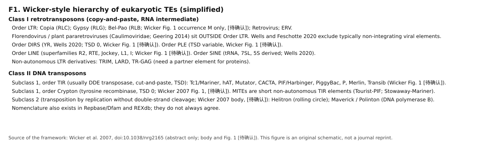

# TE types: a teaching map

This folder is the type-by-type textbook that the short 2026-11-15 README could not hold. It follows the unified eukaryotic classification of Wicker et al. (2007, abstract only, [doi:10.1038/nrg2165](https://doi.org/10.1038/nrg2165); body and Fig. 1 [待确认]), with later names (Maverick/Polinton, TRIM, LARD, Florendovirus) taught next to that framework. A comment by Kapitonov and Jurka (2008, [doi:10.1038/nrg2165-c1](https://doi.org/10.1038/nrg2165-c1)) describes the Repbase implementation of a related “universal” system; the two systems use overlapping but not identical names. Plant LTR lineages also have a protein-domain system, REXdb (Neumann et al. 2019, [doi:10.1186/s13100-018-0144-1](https://doi.org/10.1186/s13100-018-0144-1)). When you report a family, say which code you used.

The Class I / Class II split is older. Finnegan (1989, [doi:10.1016/0168-9525(89)90039-5](https://doi.org/10.1016/0168-9525(89)90039-5); official title *Eukaryotic transposable elements and genome evolution*) is the paper usually cited, but the opened Finnegan abstract does not itself use the words “Class I” and “Class II.” This folder therefore teaches the split through Wells and Feschotte (2020, full text, [doi:10.1146/annurev-genet-040620-022145](https://doi.org/10.1146/annurev-genet-040620-022145)): “The most fundamental division of eukaryotic TEs, introduced by David Finnegan in 1989 ( 51 ), distinguishes two major classes based on their transposition intermediates: class I – retrotransposons, and class II – DNA transposons.” Class I elements use an RNA intermediate (copy-and-paste). Class II elements use a DNA intermediate.

## How to read each chapter

Every chapter is built the same way: what the type is; the structure and the parts that do the work; how it was discovered; how you recognise and classify it today (sequence signatures and tools); and what is known, or still [待确认], in plants and in *Vitis*. Each chapter ends with a claim–source table. Claims without an opened source are cut or marked [待确认].

Non-autonomous copies are usually kept as their own families. They are assigned to a superfamily by shared termini or homology. They are not merged into the consensus of the autonomous partner. This is a teaching practice of this repository [待确认], not a sentence from an opened source.

## Chapter list

| File | What it covers |
|------|----------------|
| [class_I_ltr.md](class_I_ltr.md) | LTR as a Class I **order**: Copia, Gypsy, Bel–Pao (metazoan in Wicker Fig. 1), domain order, TSD 4–6 bp (Fig. 1 values [待确认]) |
| [class_I_line_sine.md](class_I_line_sine.md) | LINE as an order; R2, RTE, Jockey, L1, I as superfamilies (Wicker Fig. 1 [待确认]); SINE groups; TPRT |
| [class_I_dirs_ple.md](class_I_dirs_ple.md) | DIRS (YR, Wells 2020; TSD 0, Wicker Fig. 1 [待确认]) and PLE (variable TSD, Wicker Fig. 1 [待确认]) |
| [class_I_trim_lard.md](class_I_trim_lard.md) | TRIM and LARD as non-autonomous LTR derivatives; TR-GAG |
| [class_II_tir.md](class_II_tir.md) | TIR superfamilies and TSD lengths from Wicker Fig. 1 ([待确认]) |
| [class_II_mite.md](class_II_mite.md) | MITE as a descriptive name; Tourist–PIF; Stowaway–Mariner |
| [class_II_helitron.md](class_II_helitron.md) | Class II subclass 2; rolling-circle; Wicker “Y2-type” [待确认]; Wells HUH/Rep/Hel |
| [class_II_maverick.md](class_II_maverick.md) | Maverick / Polinton: two names; TSD; first-report still [待确认] |
| [class_II_crypton.md](class_II_crypton.md) | Class II subclass 1, second order; termini wording [待确认] |
| [pararetrovirus_florendovirus.md](pararetrovirus_florendovirus.md) | Caulimoviridae / Florendovirus, **outside** Order LTR |
| [non_te_repeats.md](non_te_repeats.md) | Satellites vs CRTs; rDNA; host genes; NUMT/NUPT as repository rules where noted |

Chinese twins use the same sources and sit beside these files as `*.zh.md`.

## Claim–source table

| Claim | Source | Quoted sentence or figure/table | What was read |
|---|---|---|---|
| Wicker 2007 classification framework | doi:10.1038/nrg2165 | Abstract only; body and Fig. 1 quotations [待确认] | Abstract |
| Class I / Class II split attributed to Finnegan 1989 | doi:10.1146/annurev-genet-040620-022145 | Sentence quoted above | Full text |
| Finnegan 1989 paper exists (title) | doi:10.1016/0168-9525(89)90039-5 | Title | Title/abstract (catalogue); Class I/II words are taught via Wells |
