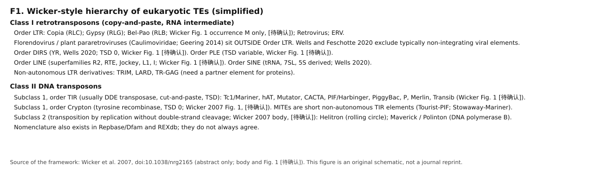

# TE 类型：教学地图

本目录是 2026-11-15 短 README 装不下的按类型教材。框架采用 Wicker 等 2007（摘要，[doi:10.1038/nrg2165](https://doi.org/10.1038/nrg2165)；正文和图 1 [待确认]），并把后来的名称（Maverick/Polinton、TRIM、LARD、Florendovirus）放在这一框架旁边讲。Kapitonov 与 Jurka 2008 的评论（[doi:10.1038/nrg2165-c1](https://doi.org/10.1038/nrg2165-c1)）描述了相关的 Repbase“通用”实现，两套名称有重叠但不完全相同。植物 LTR 谱系另有蛋白结构域体系 REXdb（Neumann 等 2019，[doi:10.1186/s13100-018-0144-1](https://doi.org/10.1186/s13100-018-0144-1)）。报告家族时要写明用的是哪一套代码。

Class I / Class II 的划分更早。通常引用 Finnegan 1989（[doi:10.1016/0168-9525(89)90039-5](https://doi.org/10.1016/0168-9525(89)90039-5)），但已打开的 Finnegan 摘要本身没有写 “Class I / Class II”。本目录因此通过 Wells 与 Feschotte（2020，全文，[doi:10.1146/annurev-genet-040620-022145](https://doi.org/10.1146/annurev-genet-040620-022145)）来讲这一划分：“The most fundamental division of eukaryotic TEs, introduced by David Finnegan in 1989 ( 51 ), distinguishes two major classes based on their transposition intermediates: class I – retrotransposons, and class II – DNA transposons。”

各章结构相同，文末有论断—出处表。没有打开出处的论断会删掉或标 [待确认]。非自主拷贝通常自成家族，靠末端或同源性归到超家族，不并进自主元件的共识序列（本仓库的教学做法 [待确认]）。各章文件列表与出处表见 [README.md](README.md)。
