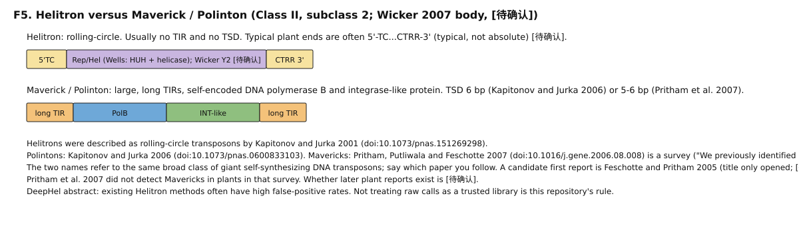

# Helitrons

Helitrons are Class II, subclass 2 DNA transposons (Wicker 2007 body, [待确认]; Wells 2020 uses “four major groups” and does not use subclass 2). They move by a rolling-circle mechanism, not by cut-and-paste with double-strand cleavage at TIR ends.

## Structure and functional parts

Kapitonov and Jurka (2001, [doi:10.1073/pnas.151269298](https://doi.org/10.1073/pnas.151269298); official title *Rolling-circle transposons in eukaryotes*) described these elements. The opened abstract reports “conservative 5′-TC and CTRR-3′ termini,” “16- to 20-bp hairpins … 10–12 nucleotides from the 3′-end,” and that the elements “transpose precisely between the 5′-A and T-3′, with no modifications of the AT target sites.” A later review is Kapitonov and Jurka 2007 ([doi:10.1016/j.tig.2007.08.004](https://doi.org/10.1016/j.tig.2007.08.004)).

Wicker et al. (2007, [doi:10.1038/nrg2165](https://doi.org/10.1038/nrg2165); abstract only; body and Fig. 1 quotations **[待确认]**) are the source previously used to place Helitrons in Class II, subclass 2, with TSD 0, and to write that “Subclass 2 holds DNA TEs that undergo a transposition process that entails replication without double-stranded cleavage.” The same paper describes Helitrons as having a “Y2-type tyrosine recombinase,” “TC or CTRR motifs,” and a “short hairpin.” Wells and Feschotte (2020, full text, [doi:10.1146/annurev-genet-040620-022145](https://doi.org/10.1146/annurev-genet-040620-022145)) describe the catalytic protein as an HUH nuclease / Rep/Hel; they do not use the wording “Y2-type.” This chapter therefore quotes both wordings and does not treat “Y2-type” as a Kapitonov 2001 or Wells 2020 phrase.

Typical features, from those sources:

- Usually **no TIR** and **no TSD** (Wicker Fig. 1, TSD 0, [待确认]; Kapitonov 2001 abstract: no modification of the AT target sites).
- Plant ends are often 5′-TC…CTRR-3′ (Kapitonov 2001 abstract; Wicker body [待确认]). A short hairpin near the 3′ end is described in both Kapitonov 2001 (16–20 bp, 10–12 nucleotides from the 3′ end) and Wicker 2007 (body [待确认]).
- Autonomous copies encode a rolling-circle protein: Wicker’s “Y2-type tyrosine recombinase” [待确认], or Wells and Feschotte’s HUH nuclease / Rep/Hel.
- Many genomic copies have captured extra DNA, including gene fragments. Morgante et al. (2005, abstract, [doi:10.1038/ng1615](https://doi.org/10.1038/ng1615)) documented gene-fragment capture by Helitrons in maize. That is one reason Helitrons matter for gene annotation and for false-positive “new genes.”

Non-autonomous Helitrons are common and should be kept as their own families.

## How to detect and classify

**Signatures.** The end motifs, the absence of a TSD, and a Rep/helicase (or Y2-type, Wicker 2007 body, [待确认]) domain in autonomous copies. The opened DeepHel abstract (Liu et al., [doi:10.1093/bioinformatics/btag817](https://doi.org/10.1093/bioinformatics/btag817)) says existing Helitron methods “often exhibit limited sensitivity, high false-positive rates.” Not treating raw Helitron calls as a trusted library is this repository’s rule.

**Tools.** HelitronScanner (Xiong et al. 2014, [doi:10.1073/pnas.1410068111](https://doi.org/10.1073/pnas.1410068111)) is the classical structural scanner and is used inside EDTA. DeepHel (Liu et al. 2026, [doi:10.1093/bioinformatics/btag817](https://doi.org/10.1093/bioinformatics/btag817)) is a later deep-learning framework aimed at more accurate and more complete Helitron annotation. Do not treat raw HelitronScanner output as a trusted library. Curation should look for consistent ends across copies and for a plausible Rep/helicase partner.

## Plants and *Vitis*

Helitrons are well documented in plants (maize gene-fragment capture: Morgante et al. 2005, cited above). A grapevine family list and a decision about how aggressive the Helitron filter should be in a trusted library are [待确认] and belong in a recorded curation rule, not as an unpublished number.

## Claim–source table

| Claim | Source | Quoted sentence or figure/table | What was read |
|---|---|---|---|
| Helitrons are Class II, subclass 2, and transpose by replication without double-stranded cleavage; TSD 0 | doi:10.1038/nrg2165 | Fig. 1; “Subclass 2 holds DNA TEs that undergo a transposition process that entails replication without double-stranded cleavage” | Abstract only; body and Fig. 1 [待确认] |
| Rolling-circle transposons; 5′-TC and CTRR-3′ termini; 16–20 bp hairpin 10–12 nt from the 3′ end; insertion between 5′-A and T-3′ with no modification of the AT target | doi:10.1073/pnas.151269298 | Abstract sentences quoted above | Abstract (PMC37501) |
| “Y2-type tyrosine recombinase,” TC or CTRR motifs, short hairpin | doi:10.1038/nrg2165 | Body and Fig. 1 | Abstract only; body and Fig. 1 [待确认] |
| Catalytic protein described as an HUH nuclease / Rep/Hel (not the wording “Y2-type”) | doi:10.1146/annurev-genet-040620-022145 | Full text | Full text extract (PMC8293684), doi:10.1146/annurev-genet-040620-022145 |
| Later Helitron review | doi:10.1016/j.tig.2007.08.004 | Title (*Helitrons on a roll: eukaryotic rolling-circle transposons*) | Title/DOI verified; used as a later-review pointer |
| Maize Helitron gene-fragment capture | doi:10.1038/ng1615 | Abstract | Abstract |
| HelitronScanner; DeepHel | doi:10.1073/pnas.1410068111 ; doi:10.1093/bioinformatics/btag817 | Titles | Title/DOI as in the earlier entry; tools cited, not re-run |
