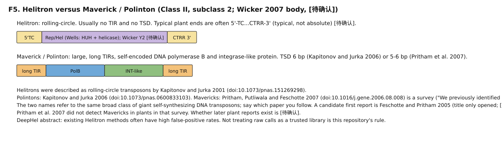

# Helitron

Helitron 属于 Class II 的亚类 2（Wicker 2007 正文，[待确认]；Wells 2020 用 “four major groups”，不使用 subclass 2）。它们以滚环方式移动，不靠在 TIR 末端做双链切割的“剪切—粘贴”方式。

## 结构和起作用的部件

Kapitonov 与 Jurka 2001（[doi:10.1073/pnas.151269298](https://doi.org/10.1073/pnas.151269298)；官方题名为 *Rolling-circle transposons in eukaryotes*）描述了这类元件。打开的摘要写：“conservative 5′-TC and CTRR-3′ termini”，“16- to 20-bp hairpins … 10–12 nucleotides from the 3′-end”，以及它们 “transpose precisely between the 5′-A and T-3′, with no modifications of the AT target sites。”随后的综述是 Kapitonov 与 Jurka 2007（[doi:10.1016/j.tig.2007.08.004](https://doi.org/10.1016/j.tig.2007.08.004)）。

Wicker 等（2007，[doi:10.1038/nrg2165](https://doi.org/10.1038/nrg2165)；摘要；正文和图 1 引句 **[待确认]**）此前被用来把 Helitron 放在 Class II 亚类 2，TSD 为 0，并写 “Subclass 2 holds DNA TEs that undergo a transposition process that entails replication without double-stranded cleavage。”同一篇还写 Helitron 有 “Y2-type tyrosine recombinase”、“TC or CTRR motifs” 和 “short hairpin”。Wells 与 Feschotte（2020，全文，[doi:10.1146/annurev-genet-040620-022145](https://doi.org/10.1146/annurev-genet-040620-022145)）把催化蛋白写成 HUH nuclease / Rep/Hel，没有使用 “Y2-type” 这一措辞。本章同时引用这两种说法，不把 “Y2-type” 写成 Kapitonov 2001 或 Wells 2020 的原词。

根据上述来源，典型特征是：

- 通常**没有 TIR**，也**没有 TSD**（Wicker 图 1 为 TSD 0，[待确认]；Kapitonov 2001 摘要：不修饰 AT 靶位点）。
- 植物中的末端常常是 5′-TC…CTRR-3′（Kapitonov 2001 摘要；Wicker 正文 [待确认]）。3′ 端附近的短发夹见 Kapitonov 2001（16–20 bp，距 3′ 端 10–12 个核苷酸）和 Wicker 2007（正文 [待确认]）。
- 自主拷贝编码滚环复制所需的蛋白：Wicker 的 “Y2-type tyrosine recombinase”[待确认]，或 Wells 与 Feschotte 的 HUH nuclease / Rep/Hel。
- 许多基因组拷贝捕获了额外的 DNA，包括基因片段。Morgante 等（2005，摘要，[doi:10.1038/ng1615](https://doi.org/10.1038/ng1615)）记载了玉米 Helitron 捕获基因片段。这就是 Helitron 既影响基因注释、又容易制造“新基因”假阳性的原因之一。

非自主 Helitron 很常见，应保留为自己的家族。

## 怎么检测和分类

**特征。** 末端基序、没有 TSD，以及自主拷贝上的 Rep/解旋酶（或 Y2 型，Wicker 2007 正文，[待确认]）结构域。已打开的 DeepHel 摘要（Liu 等，[doi:10.1093/bioinformatics/btag817](https://doi.org/10.1093/bioinformatics/btag817)）写既有 Helitron 方法 “often exhibit limited sensitivity, high false-positive rates。” 不把原始 Helitron 检出当作 trusted 文库，是本仓库的规则。

**工具。** HelitronScanner（Xiong 等人 2014，[doi:10.1073/pnas.1410068111](https://doi.org/10.1073/pnas.1410068111)）是经典的结构扫描程序，也被放进 EDTA。DeepHel（Liu 等人 2026，[doi:10.1093/bioinformatics/btag817](https://doi.org/10.1093/bioinformatics/btag817)）是更晚的深度学习框架，目的是提高 Helitron 注释的准确和完整。不要把 HelitronScanner 的原始输出当作 trusted 文库。整理时应检查许多拷贝的末端是否一致，以及是否存在合理的 Rep/解旋酶伙伴。

## 植物和葡萄

Helitron 在植物里有充分记载（玉米基因片段捕获见上面的 Morgante 等 2005）。葡萄的家族清单，以及 trusted 文库里 Helitron 过滤应该有多严，仍为 [待确认]，应写进有记录的整理规则，而不是写成未发表的数字。

论断—出处表见 [class_II_helitron.md](class_II_helitron.md)。
