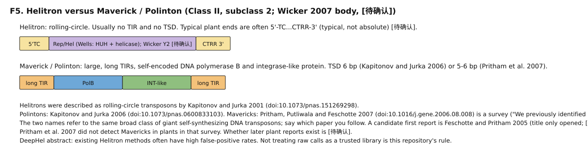

# Maverick / Polinton

Mavericks (also called Polintons) are giant, self-synthesizing DNA transposons. Wicker et al. (2007, abstract only, [doi:10.1038/nrg2165](https://doi.org/10.1038/nrg2165); body and Fig. 1 [待确认]) were previously used to place the Maverick order in Class II, subclass 2, with Fig. 1 values TSD 6 and occurrence marked M, F, O (not plants in that figure); those Fig. 1 values remain [待确认]. Subclass 2, in that paper, “holds DNA TEs that undergo a transposition process that entails replication without double-stranded cleavage.” Their structure is very different from a Helitron. They have **long TIRs** and typically encode a **protein-primed DNA polymerase B** and an **integrase-like** protein, plus additional virus-related genes in many families.

## Discovery papers (two names, one broad class)

This chapter treats Maverick and Polinton as two names for one broad class, following Wells and Feschotte (2020, [doi:10.1146/annurev-genet-040620-022145](https://doi.org/10.1146/annurev-genet-040620-022145), full text: "known as Mavericks or Polintons"). The discovery papers still cited for the names are Pritham, Putliwala and Feschotte 2007 and Kapitonov and Jurka 2006. They are not treated as unrelated types.

- Pritham, Putliwala and Feschotte (2007, [doi:10.1016/j.gene.2006.08.008](https://doi.org/10.1016/j.gene.2006.08.008)): *Mavericks, a novel class of giant transposable elements widespread in eukaryotes and related to DNA viruses.* The abstract says “We previously identified a group of atypical mobile elements designated Mavericks … but not detectable in plants.” That paper is a systematic survey, not the first report of the name. A candidate first report is Feschotte and Pritham (2005, [doi:10.1016/j.tig.2005.07.007](https://doi.org/10.1016/j.tig.2005.07.007); title “Non-mammalian c-integrases are encoded by giant transposable elements”). Only the title was verified in the sources opened for these chapters (EuropePMC abstract length 0); citing it as the first report remains [待确认] until the abstract or text is opened.
- Kapitonov and Jurka (2006, [doi:10.1073/pnas.0600833103](https://doi.org/10.1073/pnas.0600833103)): *Self-synthesizing DNA transposons in eukaryotes,* which introduced the Polinton name. The opened abstract reports “6-bp target site duplications, terminal-inverted repeats that are several hundred nucleotides long, and 5'-AG and TC-3' termini.”

TSD length is therefore 6 bp in Kapitonov and Jurka 2006 and 5–6 bp in the Pritham et al. 2007 abstract. A 6 bp value in Wicker et al. 2007 Fig. 1 remains [待确认]. It is incorrect to say that Mavericks lack TIRs and TSDs: they have long TIRs, and the TSD lengths above come from those papers.

## Detection and *Vitis*

These elements are large and protein-rich, so domain searches (PolB, integrase-like) are more useful than short-TIR scanners. They are not part of the default EDTA plant structural set in the way Helitrons are. Given the 2007 survey’s failure to find them in plants, a grapevine call would be unexpected and must be documented with domains and a paper; do not add Maverick as a default grape category [待确认].

## Claim–source table

| Claim | Source | Quoted sentence or figure/table | What was read |
|---|---|---|---|
| Maverick / Polinton are two names for one broad class (Wells and Feschotte 2020 full text); this chapter also cites the 2006 and 2007 discovery papers | doi:10.1073/pnas.0600833103 ; doi:10.1016/j.gene.2006.08.008 | Titles quoted above | Abstracts |
| Pritham 2007 is a later survey (“We previously identified … Mavericks”) and did not detect them in plants | doi:10.1016/j.gene.2006.08.008 | Abstract sentence quoted above | Abstract |
| First-report status of Feschotte and Pritham 2005 | doi:10.1016/j.tig.2005.07.007 | Title only | Title verified; abstract not opened; [待确认] |
| Polinton: 6-bp TSD, TIRs several hundred nt, 5′-AG and TC-3′ termini | doi:10.1073/pnas.0600833103 | Abstract sentence quoted above | Abstract |
| Pritham 2007 TSD 5–6 bp | doi:10.1016/j.gene.2006.08.008 | Abstract | Abstract |
| Wicker Fig. 1: order Maverick, subclass 2, TSD 6, occurrence M, F, O (not plants there) | doi:10.1038/nrg2165 | Fig. 1 and subclass 2 sentence quoted above | Abstract only; body and Fig. 1 [待确认] |
