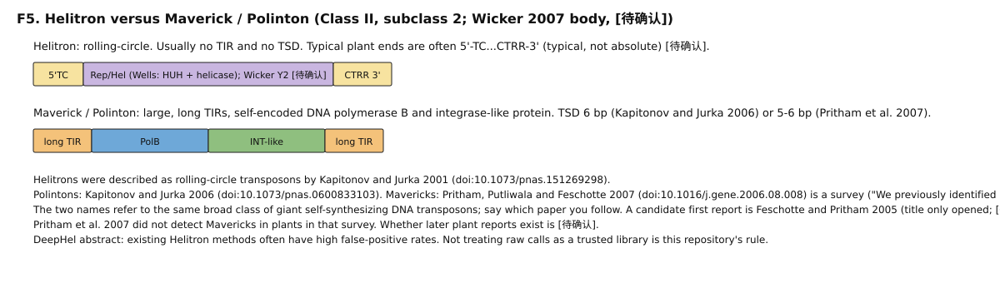

# Maverick / Polinton

Maverick（也称 Polinton）是大型、自我合成的 DNA 转座子。Wicker 等（2007，摘要，[doi:10.1038/nrg2165](https://doi.org/10.1038/nrg2165)；正文和图 1 [待确认]）此前被用来把 Maverick 目放在 Class II 亚类 2；图 1 数值 TSD 为 6、出现范围为 M、F、O（该图未标植物），这些数值仍标 [待确认]。同一篇写亚类 2 “holds DNA TEs that undergo a transposition process that entails replication without double-stranded cleavage。”它们的结构和 Helitron 很不一样：有**很长的 TIR**，通常编码**以蛋白为引物的 DNA 聚合酶 B**和**整合酶样**蛋白，许多家族还带有与病毒相关的其他基因。

## 发现论文（两个名字，同一大类）

本章把 Maverick 和 Polinton 当作同一大类的两个名字，依据是 Wells 与 Feschotte（2020，[doi:10.1146/annurev-genet-040620-022145](https://doi.org/10.1146/annurev-genet-040620-022145)，全文：“known as Mavericks or Polintons”）。发现论文仍同时引用 Pritham、Putliwala 与 Feschotte 2007 和 Kapitonov 与 Jurka 2006，不把它们当成互不相关的两类。

- Pritham、Putliwala 与 Feschotte 2007（[doi:10.1016/j.gene.2006.08.008](https://doi.org/10.1016/j.gene.2006.08.008)）：*Mavericks, a novel class of giant transposable elements widespread in eukaryotes and related to DNA viruses*。摘要写 “We previously identified a group of atypical mobile elements designated Mavericks … but not detectable in plants。”这是系统普查，不是该名称的首篇报道。候选首篇是 Feschotte 与 Pritham 2005（[doi:10.1016/j.tig.2005.07.007](https://doi.org/10.1016/j.tig.2005.07.007)；题名为 “Non-mammalian c-integrases are encoded by giant transposable elements”）。本次追加只核了题名（EuropePMC 摘要长度为 0）；在打开摘要或正文之前，把它写成首篇报道仍为 [待确认]。
- Kapitonov 与 Jurka 2006（[doi:10.1073/pnas.0600833103](https://doi.org/10.1073/pnas.0600833103)）：*Self-synthesizing DNA transposons in eukaryotes*，使用了 Polinton 这个名字。打开的摘要写 “6-bp target site duplications, terminal-inverted repeats that are several hundred nucleotides long, and 5'-AG and TC-3' termini。”

因此，TSD 在 Kapitonov 与 Jurka 2006 中是 6 bp，在 Pritham 等 2007 摘要中是 5–6 bp。Wicker 等 2007 图 1 中的 6 bp 仍标 [待确认]。说 Maverick 没有 TIR 和 TSD 是不对的：它们有长 TIR，TSD 长度以上面这些论文为准。

## 检测和葡萄

这类元件又长、又富含蛋白，因此结构域搜索（PolB、整合酶样）比短 TIR 扫描更有用。它们也不像 Helitron 那样属于 EDTA 植物结构检测的默认集合。鉴于 2007 年的普查在植物中没有找到它们，葡萄上的命中会显得意外，必须用结构域和论文加以说明；不要把 Maverick 当成葡萄的默认类别 [待确认]。

论断—出处表见 [class_II_maverick.md](class_II_maverick.md)。
