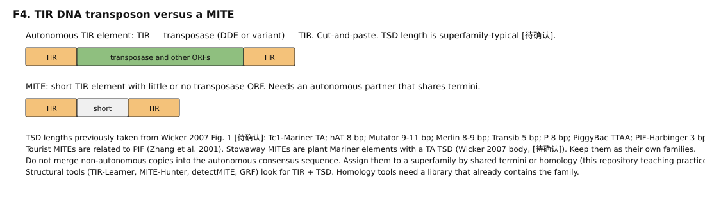

# MITEs

MITE is used here as a descriptive name for short, non-autonomous Class II elements with TIRs, not a Wicker order of its own [待确认]. Bureau and Wessler named Tourist (1992, [doi:10.1105/tpc.4.10.1283](https://doi.org/10.1105/tpc.4.10.1283)) and Stowaway (1994, [doi:10.1105/tpc.6.6.907](https://doi.org/10.1105/tpc.6.6.907)), both abstracts opened for these chapters. Those abstracts name the two families; they do not use the words MITE or miniature. Who first used the name MITE is **[待确认]**.

Zhang and colleagues (2001, abstract, [doi:10.1073/pnas.211442198](https://doi.org/10.1073/pnas.211442198); official title *P instability factor: an active maize transposon system associated with the amplification of Tourist-like MITEs and a new superfamily of transposases*) showed that a Tourist-like MITE family (mPIF) shares termini and target-site preference with PIF, and that “PIFa and these PIF-like elements belong to a new eukaryotic DNA transposon superfamily that is distantly related to the bacterial IS5 group.” (DOI 10.1073/pnas.198207200 had no EuropePMC record in this check and is not used.) Wicker et al. 2007 (abstract only, [doi:10.1038/nrg2165](https://doi.org/10.1038/nrg2165); body [待确认]) were previously quoted as stating that plant Stowaway elements are Mariner elements and “always produce a TA TSD.” That body quotation was not re-verified against a publicly available full text as of 2026-11-15 CST and remains [待确认].

Jiang, Feschotte, Zhang and Wessler (2004) is sometimes cited for a broader MITE–autonomous partnership survey. That paper was **not** opened for these chapters, so any claim taken only from that citation is **[待确认]** and is not taught here.

## Claim–source table

| Claim | Source | Quoted sentence or figure/table | What was read |
|---|---|---|---|
| Tourist named (abstract does not use the word MITE) | doi:10.1105/tpc.4.10.1283 | Abstract | Abstract |
| Stowaway named (abstract does not use the word MITE) | doi:10.1105/tpc.6.6.907 | Abstract | Abstract |
| Tourist-like MITEs related to PIF, and PIF related to IS5 | doi:10.1073/pnas.211442198 | Abstract sentences quoted above | Abstract |
| Stowaway is a plant Mariner with TA TSD | doi:10.1038/nrg2165 | Body | Not re-verified 2026-11-15 CST (Wicker 2007 body not opened); **[待确认]** |
| Jiang et al. 2004 survey claims | — | — | Paper not opened; **[待确认] / not taught** |
