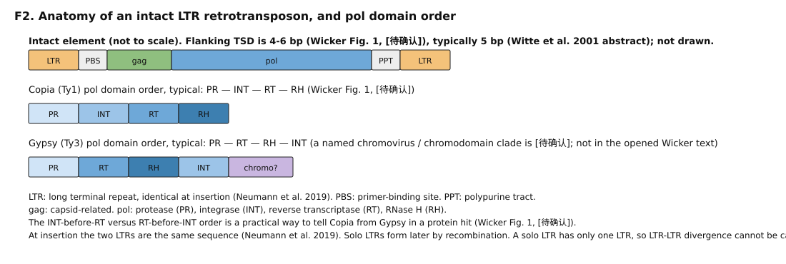

# LTR retrotransposons

LTR retrotransposons are an **order** in Class I (Wicker et al. 2007, abstract only, [doi:10.1038/nrg2165](https://doi.org/10.1038/nrg2165); body and Fig. 1 [待确认]), not a class of their own. The same paper calls LTR elements “the predominant order in plants.” That plant-wide wording is what this chapter uses. The opened Jaillon et al. and Velasco et al. abstracts do not say that LTRs are the most abundant TEs in grape, so a grape-specific “LTR most abundant, including the first grapevine genome papers” claim is not taught here.

## Structure

Wicker et al. 2007: LTRs “start with 5′-TG‑3′ and end with 5′-CA‑3′,” and the order has a TSD of 4–6 bp (Fig. 1; **[待确认]**). Witte et al. (2001, abstract, [doi:10.1073/pnas.241341898](https://doi.org/10.1073/pnas.241341898); Crossref authors Witte, Le, Bureau, Kumar) describe “flanking 5-bp direct repeats found typically at LTR retrotransposon insertion sites.” This chapter therefore teaches TSD **4–6 bp**, typically 5 bp in the TRIM paper just cited. (A previous unsourced “often 5 bp” line is replaced by these two sources.)

Wicker et al. write that Gypsy and Copia “differ in the order of RT and INT in the POL (FIG. 1)” (**[待确认]**):

- **Copia** (often written Ty1/Copia; superfamily code RLC in Fig. 1, **[待确认]**): GAG-AP-INT-RT-RH; TSD 4–6 bp (**[待确认]**). The opened Grandbastien, Spielmann and Caboche (1989) abstract refers to “the Drosophila melanogaster copia retrotransposon,” not to a plant-named Copia element. Whether the double name originated as “yeast Ty1 plus plant Copia” is **[待确认]**; this chapter does not teach Copia as a plant-only name.
- **Gypsy** (Ty3/Gypsy; RLG): GAG-AP-RT-RH-INT; TSD 4–6 bp (**[待确认]**).
- **Bel–Pao** (RLB): GAG-AP-INT-RT-RH like Copia in Fig. 1, TSD 4–6 bp, occurrence marked M (metazoans) only (**[待确认]**). This chapter does not treat Bel–Pao as a plant default.
- **Retrovirus** (RLR) and **ERV** (RLE) are shown in the same figure (**[待确认]**); they are not taught here as plant nuclear TE defaults.

A “chromovirus” clade of Gypsy is **[待确认]**: no opened source in this addition is used for that name.

**Errantivirus** is not taught here as a plant category. No opened source in this addition is used to define the term, so a definition is not given.

## Named plant families

- **Tnt1** from *Nicotiana tabacum* is a Copia-like element first reported by Grandbastien, Spielmann and Caboche (1989, abstract, [doi:10.1038/337376a0](https://doi.org/10.1038/337376a0)).
- **BARE-1** is often cited as an abundant, still-mobile barley Copia element. That “still mobile / abundant” wording was not supported by the Kalendar 2004 abstract opened for LARD, and is **[待确认]** until a BARE-1 paper is quoted.

TRIM and LARD are non-autonomous LTR derivatives and have their own chapter.

## Claim–source table

| Claim | Source | Quoted sentence or figure/table | What was read |
|---|---|---|---|
| LTR is a Class I order, TSD 4–6 bp; Copia GAG-AP-INT-RT-RH; Gypsy GAG-AP-RT-RH-INT; Bel–Pao occurrence M | doi:10.1038/nrg2165 | Fig. 1 and body sentences quoted above | Not re-verified 2026-11-15 CST (Wicker 2007 body and Fig. 1 not opened); **[待确认]** |
| LTR “predominant order in plants”; LTRs start 5′-TG-3′ and end 5′-CA-3′ | doi:10.1038/nrg2165 | Body | Not re-verified 2026-11-15 CST (Wicker 2007 body not opened); **[待确认]** |
| Typical flanking 5-bp direct repeats at LTR insertion sites | doi:10.1073/pnas.241341898 | Abstract | Abstract |
| Tnt1 first report | doi:10.1038/337376a0 | Title/abstract | Abstract |
| Chromovirus as a named Gypsy clade | — | — | Not in opened Wicker text; **[待确认]** |
| BARE-1 “abundant, still mobile” | — | — | Not supported by the opened Kalendar 2004 abstract; **[待确认]** |
| “LTR most abundant in grape, including the first grapevine genome papers” | — | — | Jaillon and Velasco abstracts do not support this; **not taught** |
