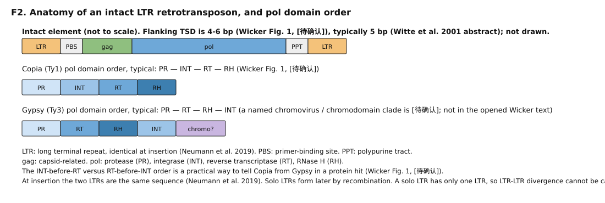

# LTR 反转录转座子

LTR 反转录转座子是 Class I 里的一个**目**（Wicker 等 2007，[doi:10.1038/nrg2165](https://doi.org/10.1038/nrg2165)；正文引句本轮 **[待确认]**），不是单独的“纲”。同一篇被用作 LTR 是植物中 “the predominant order in plants” 的出处，该句本轮也标 **[待确认]**。已打开的 Jaillon、Velasco 摘要并没有写葡萄里 LTR 最多，因此不把“包括第一批葡萄基因组论文在内、LTR 最丰富”当作可核事实来讲。

Wicker 等：LTR “start with 5′-TG‑3′ and end with 5′-CA‑3′”，TSD 为 4–6 bp（图 1；**[待确认]**）。Witte 等（2001，摘要，[doi:10.1073/pnas.241341898](https://doi.org/10.1073/pnas.241341898)；Crossref 作者为 Witte、Le、Bureau、Kumar）写插入位点“typically”有 5 bp 正向重复。本章因此讲 TSD **4–6 bp**，在这篇 TRIM 文献里通常是 5 bp。

Copia（常写作 Ty1/Copia，RLC）与 Gypsy（Ty3/Gypsy，RLG）的差别，Wicker 写在 POL 里 RT 与 INT 的顺序（图 1；**[待确认]**）：Copia 为 GAG-AP-INT-RT-RH，Gypsy 为 GAG-AP-RT-RH-INT。已打开的 Grandbastien、Spielmann 与 Caboche（1989）摘要写的是 “the Drosophila melanogaster copia retrotransposon”，并没有把 Copia 写成植物元件。双名是否来自“酵母 Ty1 与植物 Copia”标为 **[待确认]**，本章不把 Copia 当作只属于植物的名称。Bel–Pao（RLB）在图 1 中出现范围只标了 M（后生动物），不作为植物默认类。Chromovirus 一词在本次追加已打开的出处中没有使用，标为 **[待确认]**。Errantivirus 不作为植物类别来讲；本组教学章节打开的来源中没有定义该词的出处，因此不写定义。

Tnt1 是 Grandbastien、Spielmann 与 Caboche（1989，摘要，[doi:10.1038/337376a0](https://doi.org/10.1038/337376a0)）报道的烟草 Copia 样元件。BARE-1“仍然活跃、很丰富”的说法未在本组教学章节打开的来源中核对的 Kalendar 2004 摘要支持，标为 **[待确认]**。

论断—出处表见 [class_I_ltr.md](class_I_ltr.md)。
