# Figures for the guide

Figures linked from the README files and the book chapters. Three kinds:

1. Published figures under CC BY 4.0, reproduced without changes, with full credit (folder `published/`, or files already in `book/illustrated_v3_p2d/figures/`). Figures from papers that are not openly licensed are not copied.
2. Schematics drawn for this repository (editable SVG with live text, plus a PNG at 2x).
3. Charts computed from `catalog/SOFTWARE_AUTHORITY.tsv` (SVG with live text, plus a PNG at 600 dpi).

## Regenerate

From the repository root (Python 3 with matplotlib; Google Chrome or Chromium for the PNG of each schematic). Existing outputs are never overwritten, so write into an empty folder:

```bash
mkdir new_figs
python3 figures/guide/src/make_te_schematics.py new_figs .
python3 figures/guide/src/make_catalog_charts.py te catalog/SOFTWARE_AUTHORITY.tsv new_figs te
bash figures/guide/src/render_svg.sh new_figs/NAME.svg new_figs/NAME.png WIDTH HEIGHT
```

## Figures and credits

### TE library workflow

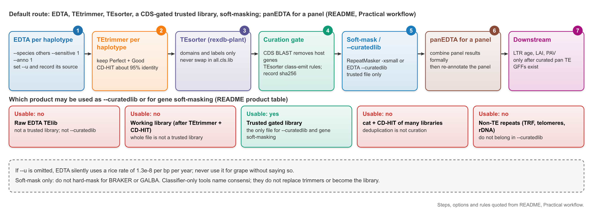

File: `te_workflow.png`

Figure. The practical workflow as one picture: seven steps from EDTA per haplotype to downstream analyses, and which product may be used as `--curatedlib` or for gene soft-masking (only the trusted gated library). Schematic drawn for this repository from the practical workflow in README; editable SVG: `figures/guide/te_workflow.svg`.

### Which tools for which question

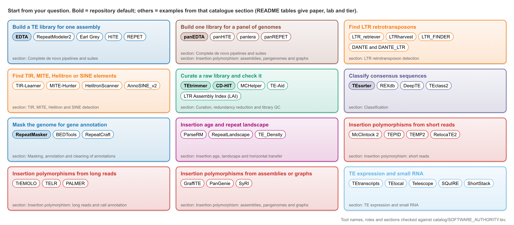

File: `te_question_to_tools.png`

Figure. Start from the question: the repository default (bold) and examples from the matching catalogue section. Names, roles and sections are checked against `catalog/SOFTWARE_AUTHORITY.tsv`; the tables below give paper, lab and tier for each. Schematic drawn for this repository; editable SVG: `figures/guide/te_question_to_tools.svg`.

### Dating an LTR insertion

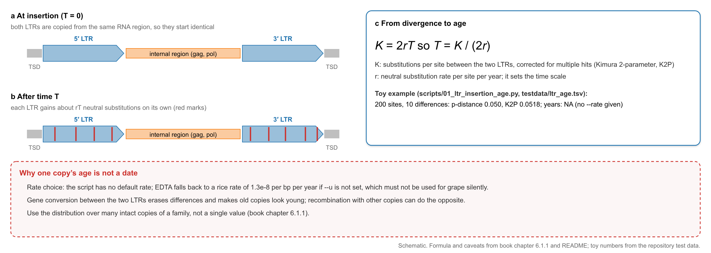

File: `te_ltr_age_concept.png`

Figure. Dating an LTR retrotransposon insertion from its two LTRs: identical at insertion, then each LTR gains substitutions independently, so K = 2rT and T = K/(2r). The toy numbers are from `testdata/ltr_age.tsv` (written by `scripts/01_ltr_insertion_age.py` without a rate). Schematic drawn for this repository.

### Catalogue entries per step by tier

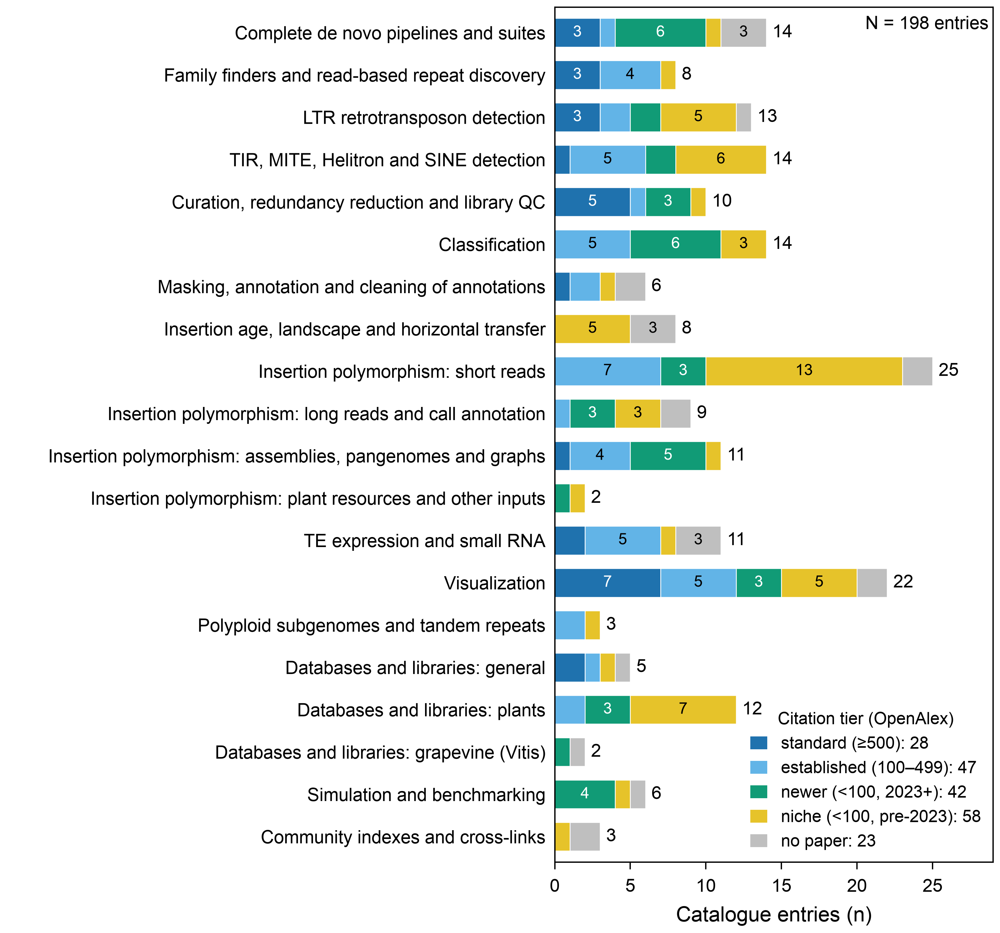

File: `te_catalog_by_step.png`

Figure. Catalogue entries per analysis step, coloured by citation tier (tier rule above). Counts computed from `catalog/SOFTWARE_AUTHORITY.tsv` (198 entries; OpenAlex counts retrieved 2026-11-25) by `figures/guide/src/make_catalog_charts.py`.

### Publication year against citations

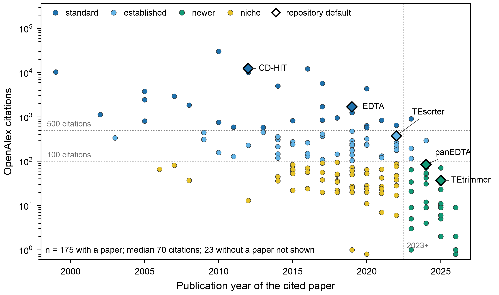

File: `te_catalog_year_citations.png`

Figure. Publication year against OpenAlex citations for the 175 catalogue entries with a paper; diamonds mark repository defaults (RepeatMasker has no paper and is not shown). A citation count is not a measure of accuracy on your genome. Source: `catalog/SOFTWARE_AUTHORITY.tsv`; script `figures/guide/src/make_catalog_charts.py`.

### EDTA pipeline

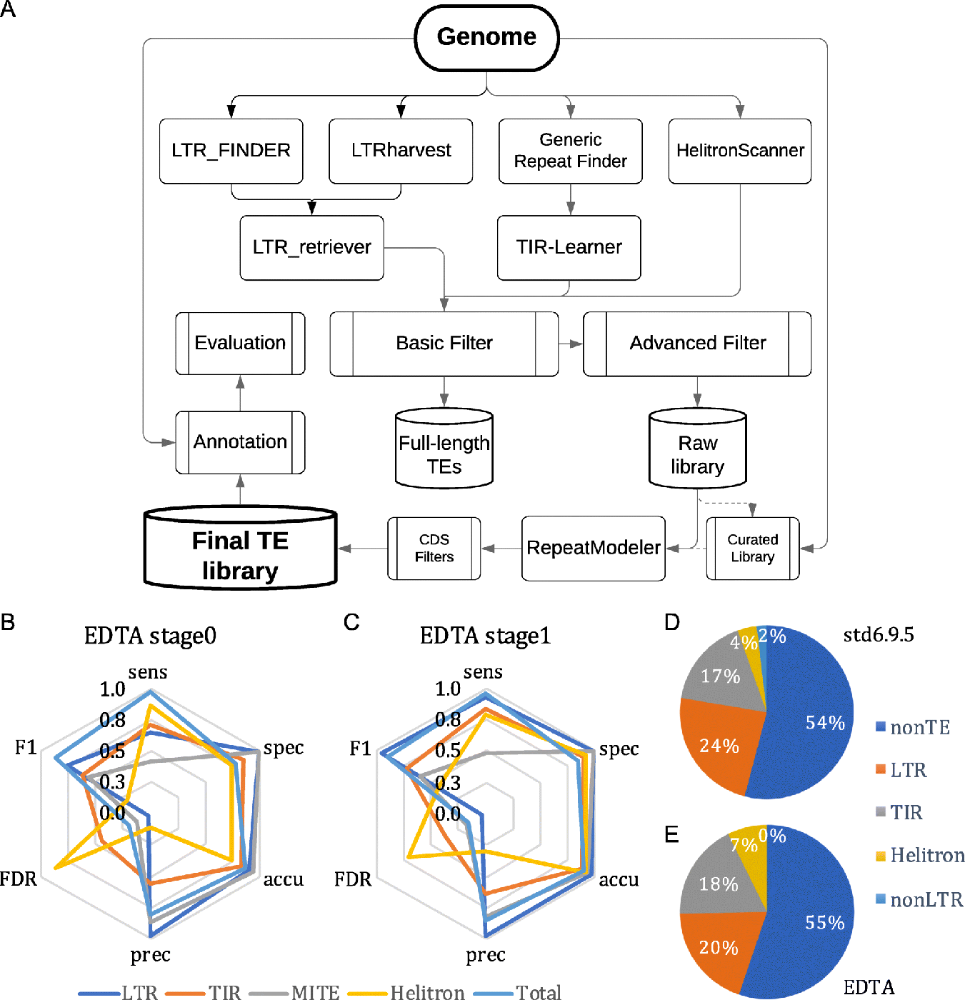

File: `book/illustrated_v3_p2d/figures/ou2019_edta_fig5.png`

Figure. The EDTA pipeline: LTR, TIR and Helitron candidates are found and filtered, the genome is masked, and the rest goes to RepeatModeler before a classified library is assembled. Reproduced without changes from Ou S, Su W, Liao Y, et al. (2019), Benchmarking transposable element annotation methods for creation of a streamlined, comprehensive pipeline, Genome Biology 20:275, Fig. 5, doi:10.1186/s13059-019-1905-y, PMC6913007, licensed CC BY 4.0 (https://creativecommons.org/licenses/by/4.0/). The file is the one already used in the illustrated edition.

### Earl Grey workflow

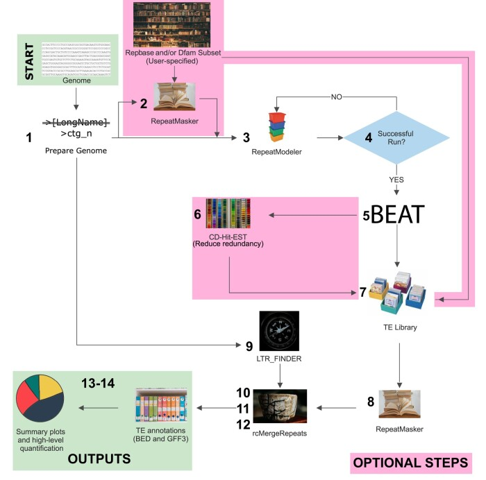

File: `published/earlgrey_2024_fig1.jpg`

Figure. The Earl Grey workflow: prepare the genome, optionally mask known repeats from a Repbase or Dfam subset, run RepeatModeler, extend consensus sequences with BEAT, optionally reduce redundancy with CD-HIT-EST, build the TE library, then RepeatMasker, LTR_FINDER and rcMergeRepeats give BED and GFF3 annotations and summary plots. Pink boxes are optional steps. Reproduced without changes from Baril T, Galbraith J and Hayward A (2024), Earl Grey: a fully automated user-friendly transposable element annotation and analysis pipeline, Molecular Biology and Evolution 41:msae068, Fig. 1, doi:10.1093/molbev/msae068, PMC11003543, licensed CC BY 4.0 (https://creativecommons.org/licenses/by/4.0/).

### Earl Grey summary and repeat landscape

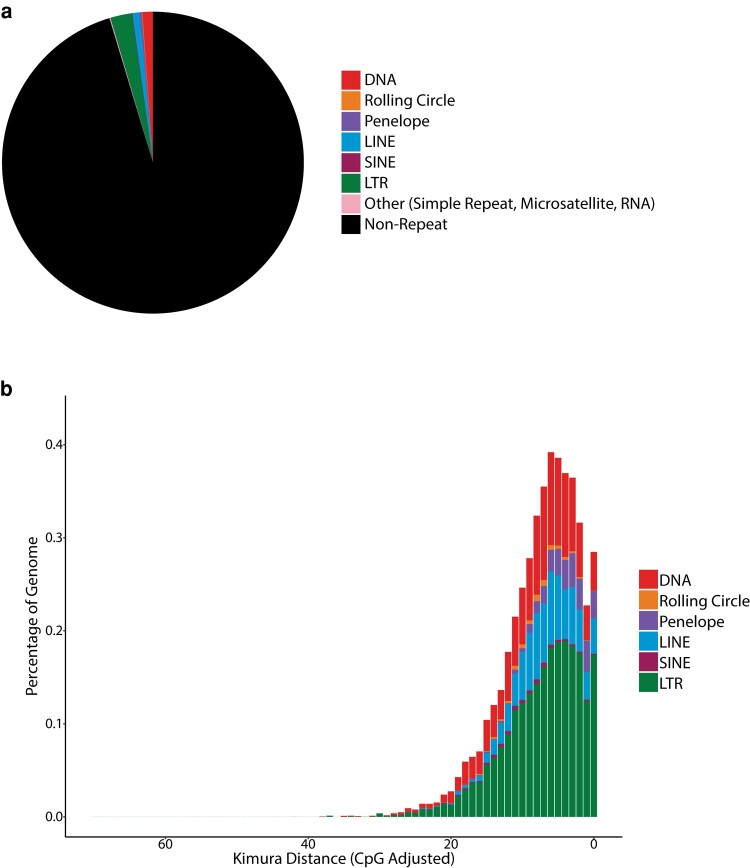

File: `published/earlgrey_2024_fig2.jpg`

Figure. Example Earl Grey output for an 840 Mb simulated genome: share of the genome in each TE class (a) and a repeat landscape, the percentage of the genome against CpG-adjusted Kimura distance to the family consensus, with recent activity on the right (b). Reproduced without changes from Baril T, Galbraith J and Hayward A (2024), Molecular Biology and Evolution 41:msae068, Fig. 2, doi:10.1093/molbev/msae068, PMC11003543, licensed CC BY 4.0 (https://creativecommons.org/licenses/by/4.0/).

### Classification of eukaryotic TEs

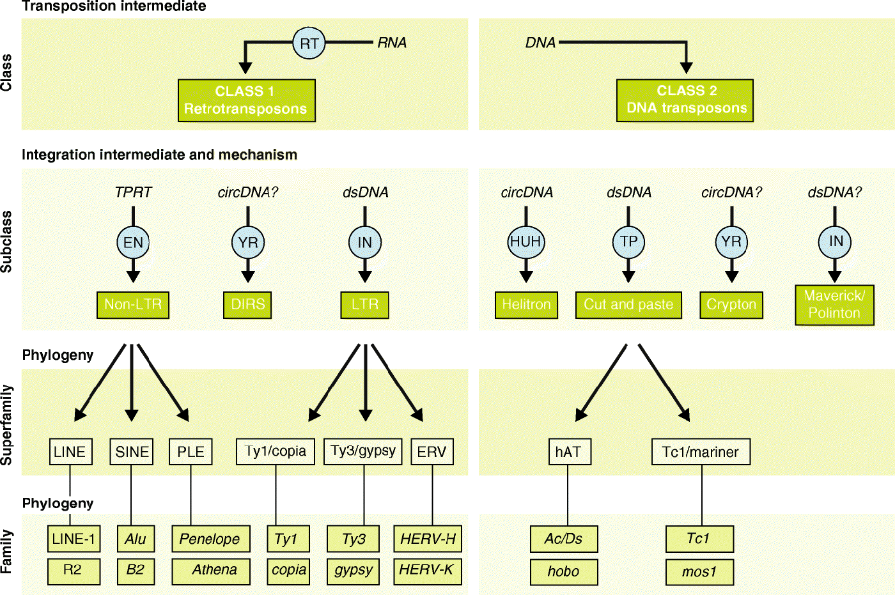

File: `book/illustrated_v3_p2d/figures/bourque2018_fig1.png`

Figure. Classification of eukaryotic transposable elements into class I and class II by transposition intermediate and key enzyme, with the typical structural modules of each group. Reproduced without changes from Bourque G, Burns KH, Gehring M, et al. (2018), Ten things you should know about transposable elements, Genome Biology 19:199, Fig. 1, doi:10.1186/s13059-018-1577-z, PMC6240941, licensed CC BY 4.0 (https://creativecommons.org/licenses/by/4.0/). The file is the one already used in the illustrated edition.

### Detecting TE insertions from reads

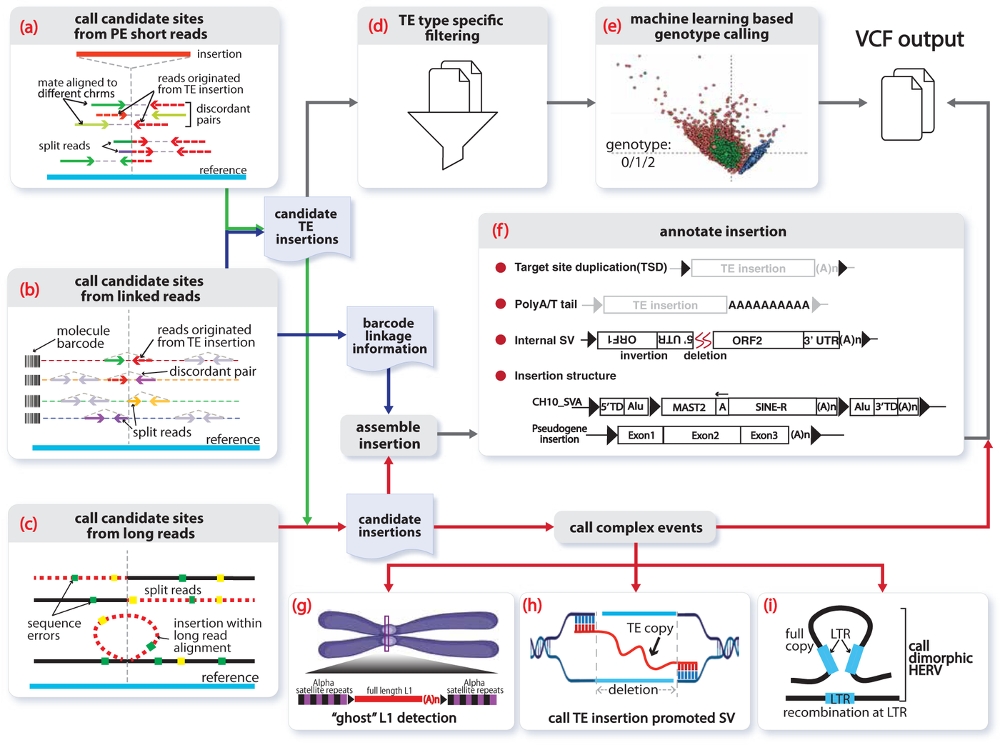

File: `book/illustrated_v3_p2d/figures/chu2021_xtea_fig1.png`

Figure. How paired short reads, linked reads and long reads reveal candidate insertion sites (discordant pairs and split reads), followed by filtering, genotyping and annotation. Human data. Reproduced without changes from Chu C, Borges-Monroy R, Viswanadham VV, et al. (2021), Comprehensive identification of transposable element insertions using multiple sequencing technologies, Nature Communications 12:3836, Fig. 1, doi:10.1038/s41467-021-24041-8, PMC8219666, licensed CC BY 4.0 (https://creativecommons.org/licenses/by/4.0/). The file is the one already used in the illustrated edition.

### PN40024 T2T assembly and TE composition

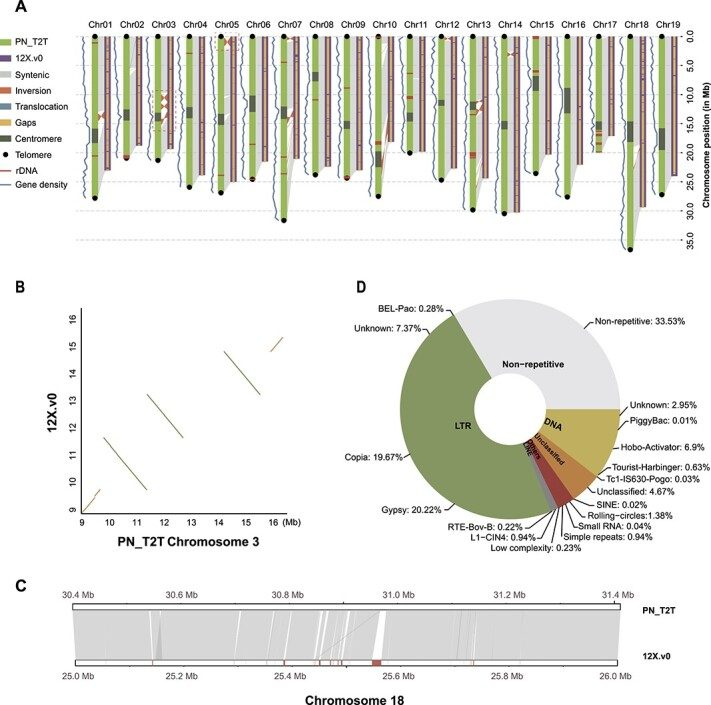

File: `book/illustrated_v3_p2d/figures/shi2023_uhad061_fig1.jpg`

Figure. Overview of the PN40024 telomere-to-telomere assembly; panel D gives the types and shares of transposable elements in this grapevine reference. Reproduced without changes from Shi X, Cao S, Wang X, et al. (2023), The complete reference genome for grapevine (Vitis vinifera L.) genetics and breeding, Horticulture Research 10:uhad061, Fig. 1, doi:10.1093/hr/uhad061, PMC10199708, licensed CC BY 4.0 (https://creativecommons.org/licenses/by/4.0/). The file is the one already used in the illustrated edition.
